# 카프카의 핵심 개념 알아보기

# 카프카의 핵심 개념 알아보기

* toc
{:toc}

---

## Apache Kafka 핵심 개념 완벽 이해: Topic, Partition, Offset, 메시지 구조부터 Replication, ISR, Leader Election, KRaft까지

Apache Kafka는 여러 시스템에서 발생하는 이벤트를 안정적으로 저장하고 전달하기 위한 분산 이벤트 스트리밍 플랫폼이다.

Kafka를 처음 접하면 Producer가 메시지를 발행하고 Consumer가 메시지를 가져간다는 구조는 비교적 쉽게 이해할 수 있다.

하지만 Kafka를 실제 서비스에서 운영하려면 단순한 메시지 전달 구조보다 더 깊은 이해가 필요하다.

예를 들어 다음과 같은 상황을 생각해 보자.

- Kafka Topic의 Partition 수를 늘리면 처리 속도도 증가할까?
- 동일한 주문에서 발생한 이벤트는 항상 순서대로 처리될까?
- Consumer가 메시지를 읽었다면 Kafka에서 해당 메시지는 삭제될까?
- Kafka Broker가 세 대라면 한 대에 장애가 발생해도 항상 안전할까?
- Replication Factor를 3으로 설정하면 메시지 손실을 완전히 방지할 수 있을까?
- Leader가 장애로 종료되면 어떤 Follower가 새로운 Leader로 승격될까?
- 모든 Replica가 장애로 중단되었다가 복구되면 기존 데이터는 어떻게 될까?
- Kafka가 ZooKeeper 대신 KRaft를 사용하게 된 이유는 무엇일까?

이러한 질문에 답하려면 Kafka의 **데이터 모델과 고가용성 아키텍처**를 함께 이해해야 한다.

Kafka의 데이터 모델에서는 Topic, Partition, Offset, Record의 구조가 중요하다.

고가용성에서는 Replication, Leader, Follower, ISR(In-Sync Replicas), Controller, KRaft의 역할을 이해해야 한다.

특히 이 개념들은 서로 독립적이지 않다.

Partition 수는 병렬 처리 성능과 Broker의 리소스 사용량에 영향을 준다.

메시지 Key는 Partition 분배와 순서 보장에 영향을 준다.

Replication Factor는 데이터 복제본의 개수를 결정한다.

ISR과 `acks`, `min.insync.replicas`는 장애 상황에서 어떤 메시지의 저장을 성공으로 판단할 것인지 결정한다.

KRaft는 Broker와 Partition의 상태를 관리하는 클러스터 메타데이터의 일관성을 유지한다.

이번 글에서는 이러한 개념들을 실제 데이터 흐름과 장애 시나리오를 중심으로 살펴본다.

또한 Apache Kafka 4.4 기준으로 과거와 달라진 Partition 분배 방식, Eligible Leader Replicas(ELR), ZooKeeper 제거 및 KRaft 구조도 함께 설명한다. Kafka 4.4는 2026년 10월 22일 공개되었다. [Apache Kafka](https://kafka.apache.org/blog/2026/10/22/apache-kafka-4.4.0-release-announcement/)

---

## Kafka의 전체 아키텍처 이해하기

Kafka의 기본 구조는 다음과 같다.

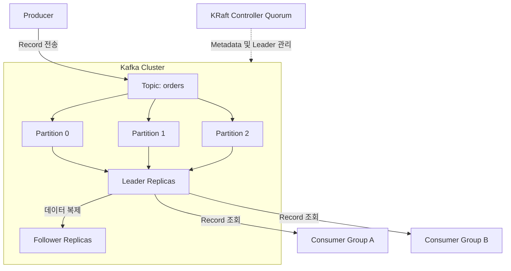

여기서 각 구성 요소는 다음과 같은 책임을 가진다.

| 구성 요소 | 역할 |
|---|---|
| Producer | Kafka에 Record를 전송 |
| Topic | 관련된 이벤트를 논리적으로 구분 |
| Partition | 이벤트를 분산 저장하고 병렬 처리하는 단위 |
| Offset | Partition 내부에서 Record의 위치 |
| Broker | Record를 저장하고 Client 요청을 처리하는 서버 |
| Leader Replica | 해당 Partition의 주요 읽기·쓰기 요청 처리 |
| Follower Replica | Leader의 데이터를 복제 |
| ISR | Leader와 충분히 동기화된 Replica 집합 |
| Consumer | Kafka에 저장된 Record를 조회하고 처리 |
| Controller | 클러스터의 메타데이터와 Partition Leader 관리 |
| KRaft | Controller 사이에서 메타데이터의 일관성을 유지하는 합의 체계 |

Kafka에서 발생하는 문제를 분석할 때도 이러한 구조를 기준으로 접근할 수 있다.

예를 들어 Consumer의 처리 속도가 느리다면 Partition 수와 Consumer 병렬성을 확인해야 한다.

반면 Broker 장애 이후 메시지가 유실되었다면 Replication Factor와 ISR, Producer의 `acks` 설정 등을 확인해야 한다.

즉, **Kafka의 성능을 이해하는 핵심은 Partition이고, 장애 대응을 이해하는 핵심은 Replication과 ISR이며, 클러스터 운영을 이해하는 핵심은 Controller와 KRaft**라고 정리할 수 있다.

---

## Kafka 데이터 모델이란?

Kafka는 데이터를 Topic과 Partition 단위로 관리한다.

Producer가 발행한 메시지는 Topic에 속한 특정 Partition에 기록되며, Partition 내부에서는 Offset으로 위치를 식별한다.

가장 기본적인 구조는 다음과 같다.

```text
Kafka Cluster
│
├── Topic: orders
│   │
│   ├── Partition 0
│   │   ├── Offset 0
│   │   ├── Offset 1
│   │   └── Offset 2
│   │
│   ├── Partition 1
│   │   ├── Offset 0
│   │   └── Offset 1
│   │
│   └── Partition 2
│       ├── Offset 0
│       ├── Offset 1
│       └── Offset 2
│
├── Topic: payments
│
└── Topic: notifications
```

여기서 중요한 점은 Topic과 Partition, Offset이 각각 다른 개념이라는 것이다.

Topic은 이벤트의 종류를 구분한다.

Partition은 데이터를 분산 저장한다.

Offset은 Partition 내부에서 Record의 위치를 나타낸다.

이러한 관계를 이해하면 Kafka가 데이터를 어떻게 저장하고 처리하는지 파악할 수 있다.

---

## Topic이란?

### Topic의 개념

Topic은 Kafka에서 이벤트를 논리적으로 구분하기 위한 이름이다.

Producer는 특정 Topic에 데이터를 발행한다.

Consumer는 필요한 Topic을 구독하고 해당 Topic에 저장된 이벤트를 읽는다.

예를 들어 뉴스와 동영상, 이미지 관련 데이터를 처리하는 시스템이 있다고 가정해 보자.

다음과 같이 Topic을 구분할 수 있다.

```text
news

videos

images
```

Producer는 데이터의 종류에 따라 서로 다른 Topic에 이벤트를 전송한다.

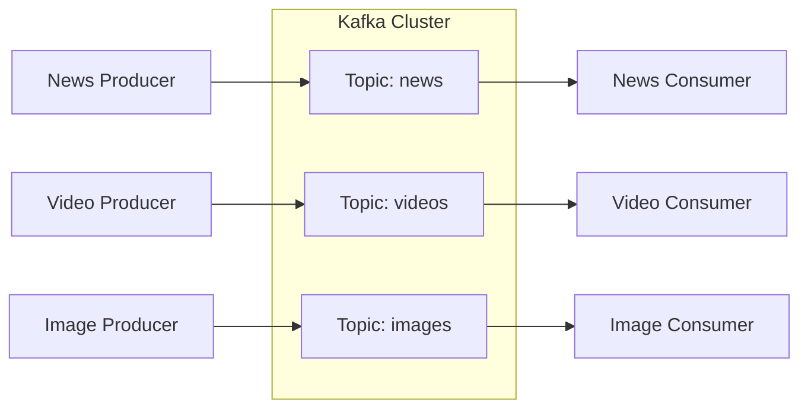

이처럼 하나의 Kafka Cluster에는 여러 Topic이 존재할 수 있다.

하지만 Topic을 단순히 데이터 종류에 따라 구분하는 것만으로는 실제 서비스에서 충분하지 않을 수 있다.

서비스 규모가 커지면 **어떤 시스템이 데이터를 소유하고 있으며, 어떤 이벤트를 전달하는지**도 명확하게 표현해야 한다.

### 실무에서 Topic을 구분하는 방법

예를 들어 전자상거래 시스템에서는 다음과 같이 구성할 수 있다.

```text
commerce.orders.created.v1

commerce.orders.cancelled.v1

commerce.payments.approved.v1

commerce.payments.failed.v1

membership.users.registered.v1

platform.application-logs.v1
```

이러한 이름은 이벤트의 의미를 직관적으로 전달한다.

예를 들어 다음 Topic을 살펴보자.

```text
commerce.payments.approved.v1
```

각 부분은 다음과 같이 해석할 수 있다.

| 구성 | 의미 |
|---|---|
| commerce | 비즈니스 도메인 |
| payments | 데이터의 소유 영역 |
| approved | 이벤트 종류 |
| v1 | 이벤트 계약 또는 Topic 버전 |

다만 이러한 명명 규칙이 Kafka의 필수 구조는 아니다.

실무에서 일관성 있는 이벤트 관리를 위해 사용하는 규칙이다.

Kafka에서는 `.`으로 구분한 문자열을 사용한다고 해서 실제로 계층형 디렉터리가 만들어지는 것은 아니다.

---

## Topic 이름의 규칙

Kafka의 Topic 이름에는 사용할 수 있는 문자와 길이 제한이 존재한다.

기본적인 규칙은 다음과 같다.

| 항목 | 설명 |
|---|---|
| 최대 길이 | 249자 |
| 영문자 | 사용 가능 |
| 숫자 | 사용 가능 |
| 마침표 `.` | 사용 가능 |
| 밑줄 `_` | 사용 가능 |
| 하이픈 `-` | 사용 가능 |
| 공백 | 사용 불가 |
| `.` 또는 `..`만으로 된 이름 | 사용 불가 |

즉, Topic 이름은 **249자까지 사용할 수 있다.**

다만 사용 가능한 문자를 모두 자유롭게 혼용하는 것이 좋은 설계는 아니다.

특히 마침표(`.`)와 밑줄(`_`)을 혼합해서 사용하는 것은 피하는 것이 좋다.

Kafka의 일부 메트릭 이름 변환 과정에서는 두 문자가 충돌할 수 있기 때문이다.

### 권장하는 Topic 명명 규칙

실무에서는 다음과 같은 기준을 정하는 것이 좋다.

1. 소문자를 사용한다.
2. 단어 구분자를 일관되게 사용한다.
3. 도메인이나 서비스 이름을 접두사로 사용한다.
4. Topic의 의미를 명확하게 표현한다.
5. 불필요하게 긴 이름을 피한다.
6. 단수형과 복수형 사용 규칙을 통일한다.
7. 필요한 경우 이벤트 계약의 버전을 포함한다.

예를 들어 다음과 같은 규칙을 정의할 수 있다.

```text
<domain>.<entity>.<event>.v<version>
```

이를 적용하면 다음과 같다.

```text
payment.subscription.created.v1

payment.subscription.cancelled.v1

payment.transaction.completed.v1
```

하지만 Topic 이름에 항상 이벤트 종류를 포함해야 하는 것은 아니다.

예를 들어 하나의 Topic에 동일한 도메인의 여러 이벤트를 저장할 수도 있다.

```text
payment.subscription.events.v1
```

어떤 방식이 적합한지는 이벤트의 보존 기간과 접근 권한, Consumer의 처리 책임, 처리량 등에 따라 결정해야 한다.

### Topic을 지나치게 세분화하면 발생하는 문제

이벤트마다 무조건 새로운 Topic을 생성하면 Topic 수가 빠르게 증가할 수 있다.

Topic이 많아지면 다음과 같은 관리 비용도 증가한다.

- Partition 관리
- Replica 관리
- 접근 권한 관리
- 모니터링
- 데이터 보존 정책 관리
- 이벤트 스키마 관리

따라서 Topic은 단순한 이름이 아니라 운영 정책을 적용하는 단위라는 점을 고려해야 한다.

---

## Topic에 이미지나 동영상 데이터를 저장해도 될까?

Kafka는 Value를 Byte Array 형태로 처리하므로 기술적으로 다양한 데이터를 전송할 수 있다.

하지만 이미지와 동영상 같은 대용량 파일을 Kafka 메시지에 직접 포함하는 것이 항상 적절한 것은 아니다.

예를 들어 이미지 업로드 시스템을 생각해 보자.

사용자가 50MB 이미지 파일을 업로드했다고 가정한다.

이미지 전체를 Kafka에 전송하면 메시지 크기와 네트워크 사용량이 크게 증가할 수 있다.

또한 Broker의 저장 공간과 복제 비용도 증가한다.

따라서 일반적으로는 이미지 파일을 Object Storage에 저장하고, Kafka에는 이미지의 메타데이터와 위치정보를 전달하는 방식을 고려할 수 있다.

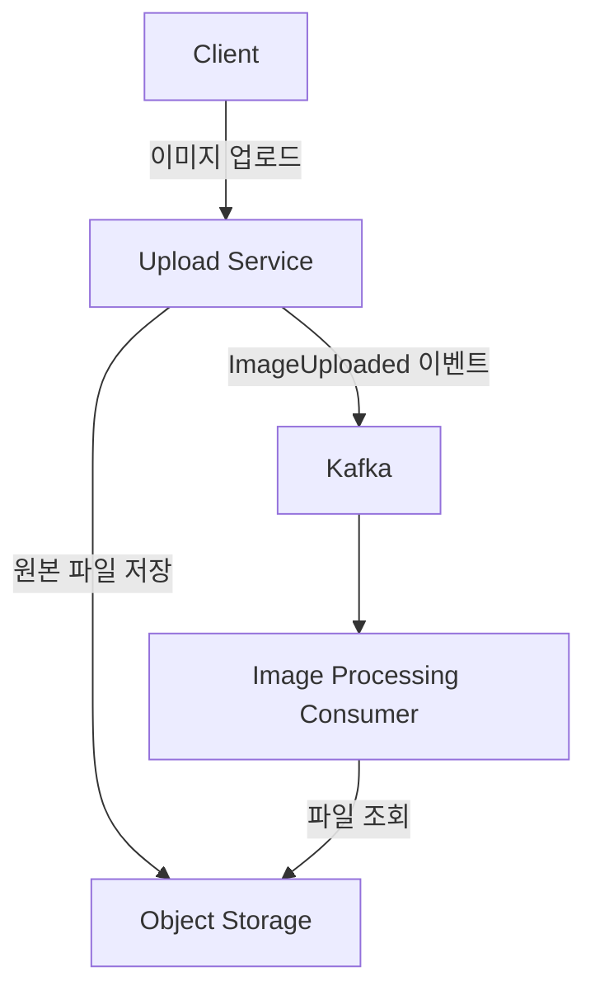

Kafka에 저장하는 이벤트는 다음과 같이 구성할 수 있다.

```json
{
  "eventId": "evt-10001",
  "eventType": "ImageUploaded",
  "imageId": "image-9001",
  "objectKey": "uploads/2026/11/image-9001.jpg",
  "contentType": "image/jpeg"
}
```

이 구조에서는 파일 저장과 이벤트 전달의 책임이 분리된다.

따라서 대용량 파일을 직접 메시지로 전달하는 방식보다 운영 효율을 높일 수 있다.

---

## Partition이란?

### Partition의 개념

Partition은 Topic을 물리적으로 나누어 저장하는 단위다.

Kafka에서 Partition은 **데이터 분산과 병렬 처리의 핵심 단위**다.

예를 들어 다음과 같은 Topic이 있다고 가정해 보자.

```text
Topic: news
```

이 Topic을 하나의 Partition으로 구성할 수 있다.

```text
news
└── Partition 0
```

또는 네 개의 Partition으로 구성할 수 있다.

```text
news
├── Partition 0
├── Partition 1
├── Partition 2
└── Partition 3
```

Producer가 발행한 Record는 Topic에 속한 Partition 중 하나에 저장된다.

### Partition이 하나인 경우

다음과 같은 메시지 네 개가 있다고 가정해 보자.

```text
A

B

C

D
```

하나의 처리 경로에서 메시지마다 1초의 처리가 필요하다면 네 개를 순차적으로 처리하는 데 4초가 걸린다.

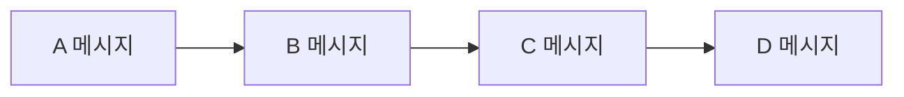

```text
A 처리: 1초

B 처리: 1초

C 처리: 1초

D 처리: 1초

전체 처리 시간: 4초
```

### Partition이 네 개인 경우

네 개의 메시지를 서로 다른 Partition에 저장하고, 각각 독립적인 Consumer가 처리한다고 가정해 보자.

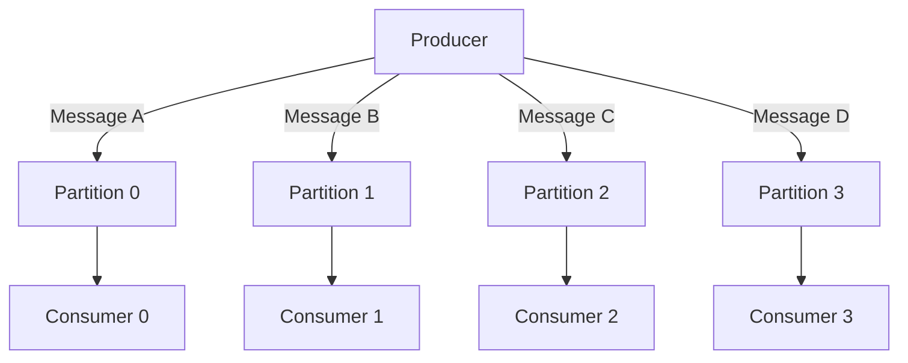

이 경우 네 개의 메시지를 병렬로 처리할 수 있다.

모든 작업이 서로 독립적이고 각 처리 경로에 충분한 자원이 있다면 이론적으로 약 1초 만에 완료할 수 있다.

| 구성 | 처리 방식 | 이론적인 처리 시간 |
|---|---|---:|
| Partition 1개 | 순차 처리 | 4초 |
| Partition 4개 | 병렬 처리 | 1초 |

하지만 이 예시에는 중요한 가정이 있다.

**Partition을 네 개로 늘렸다고 실제 처리 속도가 반드시 네 배가 되는 것은 아니다.**

Kafka의 Partition은 병렬 처리할 수 있는 구조를 제공할 뿐이다.

실제 성능은 Producer와 Broker, Consumer가 사용하는 자원의 영향을 받는다.

---

## Partition 수를 늘리면 성능이 무조건 증가할까?

그렇지 않다.

Partition이 많아지면 병렬 처리 수준을 높일 수 있는 기회가 증가한다.

하지만 동시에 관리해야 할 리소스도 증가한다.

예를 들어 다음 상황을 생각해 보자.

Kafka Topic의 Partition을 4개에서 16개로 늘렸다.

하지만 Consumer가 사용하는 데이터베이스의 Connection Pool은 4개뿐이다.

이 경우 Consumer를 16개로 늘려도 데이터베이스에 접근하는 과정에서 병목이 발생할 수 있다.

또한 Consumer가 외부 API를 호출하는 구조라면 외부 API의 처리량 제한이 병목이 될 수 있다.

### Partition 수 증가에 따른 영향

| 항목 | 긍정적인 영향 | 부정적인 영향 |
|---|---|---|
| Producer | 전송 부하 분산 가능 | Batch가 여러 Partition으로 분산 |
| Consumer | 병렬 처리 수준 향상 가능 | Consumer Group 관리 비용 증가 |
| Broker | 여러 Broker로 데이터 분산 | Metadata 관리 비용 증가 |
| Disk | 저장 부하 분산 가능 | 파일 및 Index 관리 비용 증가 |
| Network | 여러 Broker 활용 | 복제 트래픽 증가 가능 |
| 장애 복구 | Replica 분산 가능 | Leader 선출 및 복구 대상 증가 |

따라서 Partition 수는 많을수록 좋은 값이 아니라 **요구하는 처리량과 시스템 자원을 기준으로 결정해야 하는 설계 요소**다.

---

## Partition이 많아지면 파일 핸들이 증가하는 이유

Kafka는 Partition의 데이터를 Broker의 로그 파일로 관리한다.

각 Partition Replica에는 로그 세그먼트와 관련 Index 파일 등이 존재할 수 있다.

예를 들어 Broker에서 다음과 같은 구조로 데이터를 관리할 수 있다.

```text
Kafka Log Directory
│
├── orders-0
│   ├── 00000000000000000000.log
│   ├── 00000000000000000000.index
│   └── 00000000000000000000.timeindex
│
├── orders-1
│   ├── 00000000000000000000.log
│   ├── 00000000000000000000.index
│   └── 00000000000000000000.timeindex
│
└── orders-2
    ├── 00000000000000000000.log
    ├── 00000000000000000000.index
    └── 00000000000000000000.timeindex
```

실제 저장 파일의 구성은 Kafka 버전과 로그 상태에 따라 달라질 수 있다.

여기서 중요한 점은 Partition 수가 증가하면 Kafka가 관리해야 할 로그 세그먼트와 Index, Replica 상태 정보도 증가한다는 것이다.

Partition이 지나치게 많아지면 다음과 같은 문제가 발생할 수 있다.

- File Descriptor 사용량 증가
- 메모리 사용량 증가
- Metadata 관리 비용 증가
- Replica 동기화 비용 증가
- Controller 관리 작업 증가
- Broker 재시작 및 장애 복구 시간 증가

따라서 Partition 수를 결정할 때는 단순히 Consumer의 병렬 처리 수준만 고려해서는 안 된다.

**Broker 전체에서 관리하는 Partition Replica의 개수**도 함께 확인해야 한다.

---

## Broker당 Partition은 몇 개가 적절할까?

Kafka 운영에서는 Broker당 약 2,000개의 Partition을 권장한다는 식의 수치를 접할 수 있다.

하지만 이 숫자를 Kafka가 강제하는 고정된 최대값으로 이해해서는 안 된다.

실제로 적절한 Partition 수는 다음 요소에 따라 달라진다.

- Kafka 버전
- Broker의 CPU와 메모리
- 디스크 성능
- 네트워크 처리량
- 메시지 크기
- Partition별 데이터 유입량
- Replication Factor
- 장애 복구 목표

예를 들어 동일한 Partition 2,000개를 운영하더라도 각 Partition에서 발생하는 이벤트가 적은 시스템과 초당 대량의 이벤트를 처리하는 시스템은 전혀 다른 자원을 필요로 한다.

따라서 특정 숫자를 절대적인 기준으로 사용하기보다 실제 워크로드를 측정해야 한다.

---

## 적절한 Partition 수는 어떻게 결정할까?

Partition 수를 결정할 때 가장 중요한 기준은 **목표 처리량**이다.

이때 Producer의 처리량과 Consumer의 처리량을 함께 고려해야 한다.

### Producer 처리량 계산

다음과 같은 Producer가 있다고 가정해 보자.

| 항목 | 값 |
|---|---:|
| Producer 인스턴스 | 4개 |
| 인스턴스당 전송량 | 초당 10개 |
| 전체 전송량 | 초당 40개 |

전체 유입량은 초당 40개의 메시지다.

### Consumer 처리량 계산

Consumer 한 개가 초당 5개의 메시지를 처리한다고 가정해 보자.

| 항목 | 값 |
|---|---:|
| Consumer 인스턴스 | 8개 |
| 인스턴스당 처리량 | 초당 5개 |
| 전체 처리량 | 초당 40개 |

이 경우 전체 이벤트 유입량을 처리하기 위해 Consumer 8개가 필요하다.

일반적인 Kafka Consumer Group에서는 하나의 Partition이 한 시점에 하나의 Consumer에게 할당된다.

따라서 8개의 Consumer가 모두 Partition을 할당받아 작업하려면 최소 8개의 Partition이 필요하다.

### Producer 수와 Partition 수는 다르다

여기서 자주 발생하는 오해가 있다.

Producer가 4개이므로 Partition도 반드시 4개여야 한다고 생각하는 것이다.

하지만 Producer 수와 Partition 수는 동일하게 맞춰야 하는 값이 아니다.

하나의 Producer도 여러 Partition에 데이터를 전송할 수 있다.

따라서 앞의 예시에서는 Consumer의 병렬 처리 요구사항을 기준으로 Partition 8개를 검토할 수 있다.

### Partition 수 추정 공식

처리량을 기반으로 Partition 수를 추정할 때는 다음과 같은 접근을 사용할 수 있다.

```text
필요 Partition 수

= max(
    목표 Producer 처리량 / Partition당 쓰기 처리량,
    목표 Consumer 처리량 / Partition당 읽기·처리량
  )
```

각 계산 결과는 올림 처리한다.

예를 들어 다음과 같은 환경을 생각해 보자.

```text
목표 Producer 처리량: 1,000건/초

Partition당 쓰기 처리량: 200건/초

목표 Consumer 처리량: 1,000건/초

Partition당 소비 처리량: 100건/초
```

Producer 기준으로는 최소 5개의 Partition이 필요하다.

Consumer 기준으로는 최소 10개의 Partition이 필요하다.

따라서 초기 추정값은 10개다.

하지만 실제 운영에서는 10개만 구성하는 것이 항상 충분하지 않을 수 있다.

### 처리량 외에 고려해야 할 요소

다음 항목을 함께 검토해야 한다.

1. 순간 최대 트래픽
2. Consumer 장애 후 밀린 이벤트를 복구할 처리 여유
3. 메시지 크기
4. Key별 데이터 분포
5. Broker의 디스크 처리량
6. Replication Factor
7. 향후 서비스 확장 계획
8. Consumer의 외부 데이터베이스 및 API 처리 속도

특히 전체 Consumer 처리량이 이벤트 유입량과 정확히 같다면 평상시에는 처리할 수 있어도 장애 이후 누적된 데이터를 빠르게 따라잡기 어렵다.

따라서 운영 환경에서는 여유 처리량을 고려해야 한다.

---

## Partition 수는 나중에 변경할 수 있을까?

Kafka는 기존 Topic의 Partition 수를 증가시키는 기능을 제공한다.

예를 들어 Partition 수를 4개에서 8개로 늘릴 수 있다.

하지만 일반적인 Kafka 관리 기능으로 기존 Topic의 Partition 수를 줄이는 것은 지원하지 않는다.

Partition 수를 줄여야 한다면 새로운 Topic을 생성하고 데이터를 이전하는 방식을 검토해야 한다. [Apache Kafka](https://kafka.apache.org/44/operations/basic-kafka-operations/?utm_source=chatgpt.com)

### Partition 수 증가 예제

다음 명령어는 기존 Topic의 Partition 수를 8개로 변경한다.

```bash
bin/kafka-topics.sh \
  --bootstrap-server localhost:9092 \
  --alter \
  --topic commerce.orders.created.v1 \
  --partitions 8
```

각 옵션의 의미는 다음과 같다.

| 옵션 | 설명 |
|---|---|
| `--bootstrap-server` | Kafka Broker 접속 주소 |
| `--alter` | 기존 Topic 변경 |
| `--topic` | 변경할 Topic |
| `--partitions` | 변경 후 전체 Partition 수 |

이 명령어를 실행하면 기존 Topic의 Partition 수가 8개로 증가한다.

다만 이미 8개 이상인 Topic을 이 명령으로 줄일 수는 없다.

### Partition 증가 시 주의할 점

Partition 수를 변경하면 Key가 할당되는 Partition도 달라질 수 있다.

예를 들어 기존에 다음 Key가 Partition 1에 저장되었다고 가정해 보자.

```text
Key: order-1001

Partition: 1
```

Partition 수를 변경한 이후에는 같은 Key의 새로운 이벤트가 다른 Partition에 기록될 수 있다.

기존 데이터가 새로운 Partition으로 자동 재배치되는 것도 아니다.

따라서 같은 Key에 대한 이벤트 순서가 중요한 시스템에서는 Partition 수 변경에 신중해야 한다.

---

## Offset이란?

### Offset의 개념

Offset은 Kafka Partition 내부에서 Record의 위치를 나타내는 값이다.

일반적으로 0부터 시작하여 증가하는 64비트 정수 형태로 관리된다.

예를 들어 다음과 같은 Topic이 있다고 가정해 보자.

```text
Topic: orders
```

세 개의 Partition으로 구성되어 있다.

```text
Partition 0
Offset: 0 1 2 3 4 5 6 7 8 9

Partition 1
Offset: 0 1 2 3 4 5 6

Partition 2
Offset: 0 1 2 3 4 5 6 7 8
```

여기서 중요한 점은 **Offset이 Partition마다 독립적으로 존재한다는 것**이다.

Partition 0의 Offset 3과 Partition 1의 Offset 3은 서로 다른 Record를 가리킨다.

따라서 Offset 값 하나만으로 Kafka Record를 식별할 수는 없다.

Record의 위치를 식별하려면 다음 세 가지 정보가 필요하다.

```text
Topic + Partition + Offset
```

예를 들어 다음과 같다.

```text
Topic: orders

Partition: 1

Offset: 15
```

이 정보는 `orders` Topic의 Partition 1에 기록된 Offset 15의 Record를 의미한다.

---

## Offset과 메시지 순서의 관계

Kafka의 Partition은 순서대로 Record가 추가되는 로그 구조다.

예를 들어 주문 상태 변경 이벤트가 다음과 같이 발생했다고 가정해 보자.

```text
Partition 0

Offset 0 → OrderCreated

Offset 1 → PaymentApproved

Offset 2 → ShippingStarted

Offset 3 → ShippingCompleted
```

이 구조에서 Partition 내부의 Record는 Offset 순서로 기록된다.

따라서 Consumer는 해당 Partition의 이벤트를 순서대로 읽을 수 있다.

하지만 서로 다른 Partition 사이에는 전역적인 순서가 존재하지 않는다.

### Partition 간 순서가 보장되지 않는 예시

```text
Partition 0

Offset 0 → A
Offset 1 → C
Offset 2 → E
```

```text
Partition 1

Offset 0 → B
Offset 1 → D
Offset 2 → F
```

Partition 0에서는 A, C, E 순서가 유지된다.

Partition 1에서는 B, D, F 순서가 유지된다.

하지만 전체 이벤트의 순서를 A, B, C, D, E, F로 보장하지는 않는다.

따라서 동일한 주문이나 결제처럼 이벤트 순서가 중요한 데이터는 동일한 Partition에 기록되도록 설계하는 것이 좋다.

이때 사용할 수 있는 개념이 Kafka Record의 Key다.

---

## Offset은 항상 연속적으로 존재할까?

Offset은 Partition에 Record가 추가될 때 증가한다.

하지만 Kafka에 현재 남아 있는 Record의 Offset이 반드시 연속적일 필요는 없다.

예를 들어 다음과 같은 Record가 있다고 가정해 보자.

```text
Offset 0
Offset 1
Offset 2
Offset 3
Offset 4
Offset 5
```

이후 보존 정책이나 Log Compaction 등에 따라 일부 Record가 제거될 수 있다.

그 결과 다음과 같은 형태가 될 수 있다.

```text
Offset 0
Offset 3
Offset 5
```

중간의 Record가 제거되었다고 남아 있는 Record의 Offset을 다시 부여하지는 않는다.

따라서 Offset 차이를 실제로 읽을 수 있는 메시지의 개수와 항상 동일하게 판단해서는 안 된다.

또한 Offset은 주문 ID나 이벤트 ID와도 다르다.

하나의 주문에서 여러 이벤트가 발생하면 동일한 주문 ID를 가지더라도 각 이벤트는 서로 다른 Offset에 기록될 수 있다.

---

## Kafka 메시지의 구조

Kafka에서 Producer가 전송하는 메시지는 일반적으로 Record라고 부른다.

Kafka Record는 단순히 메시지 본문만으로 구성되는 것이 아니다.

애플리케이션에서 주로 다루는 구성 요소는 다음과 같다.

1. Key
2. Value
3. Timestamp
4. Headers
5. Partition
6. Offset

각 요소를 살펴보자.

| 구성 요소 | 필수 여부 및 특징 | 역할 |
|---|---|---|
| Key | 선택적 | 데이터 식별 및 Partition 분배 |
| Value | `null`도 가능 | 실제 전달할 데이터 |
| Timestamp | Record에 포함 | 생성 또는 Broker 기록 시각 |
| Headers | 선택적 | 추가 메타데이터 |
| Partition | 저장 위치 | Record가 저장되는 Partition |
| Offset | Broker에서 부여 | Partition 내부의 위치 |

여기서 Partition과 Offset은 Record가 Kafka에 저장되는 위치를 나타낸다.

Producer가 전송할 때 지정하는 Key와 Value 등의 정보와 구분해서 이해하는 것이 좋다.

---

## Kafka Record의 Key란?

### Key의 개념

Key는 Record와 관련된 식별 정보를 표현하거나 특정 Partition으로 데이터를 분배하는 데 사용되는 값이다.

예를 들어 다음과 같은 이벤트가 있다고 가정해 보자.

```text
Key: order-1001

Value: OrderCreated
```

이후 같은 주문에 대한 다른 이벤트가 발생한다.

```text
Key: order-1001

Value: PaymentApproved
```

```text
Key: order-1001

Value: ShippingStarted
```

동일한 Key를 사용하면 기본적인 Key 기반 Partition 분배 방식에서 같은 Partition으로 전달되도록 구성할 수 있다.

### Key 기반 Partition 분배

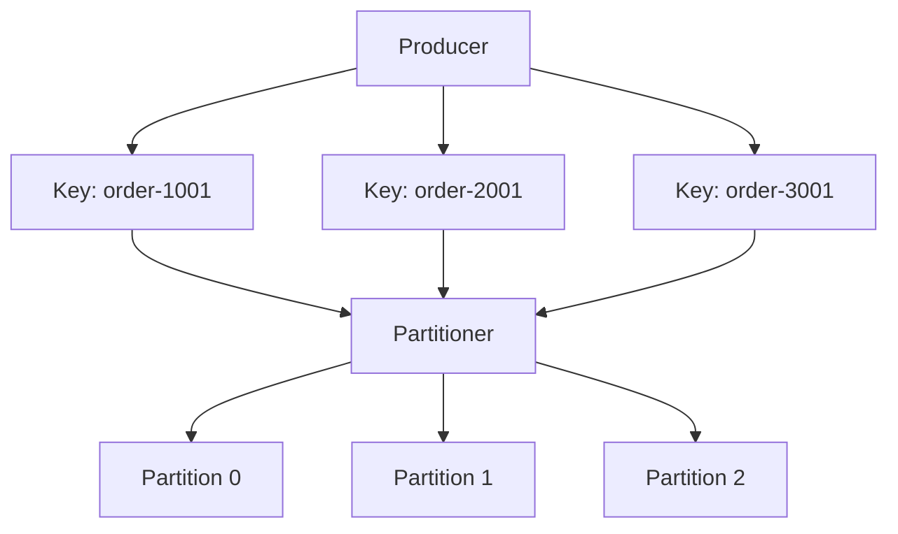

기본적인 Key 기반 분배에서는 직렬화된 Key의 해시값을 이용하여 Partition을 선택한다.

따라서 동일한 Key가 같은 Partition에 배치되도록 사용할 수 있다.

하지만 다음 조건을 고려해야 한다.

- Partition 수가 변경되지 않아야 한다.
- Key의 직렬화 방식이 일관되어야 한다.
- Partition 분배 방식이 변경되지 않아야 한다.
- 명시적으로 다른 Partition을 지정하지 않아야 한다.

따라서 **같은 Key는 어떤 상황에서도 영원히 같은 Partition에 저장된다고 단정해서는 안 된다.**

---

## Key가 없는 메시지는 어떻게 분배될까?

Kafka에서 Key가 없는 Record는 어떤 Partition에 저장될까?

과거에는 이러한 메시지를 Round Robin 방식으로 설명하는 경우가 많았다.

Round Robin은 Partition을 순환하면서 메시지를 분배하는 방식이다.

예를 들어 다음과 같다.

```text
Message A → Partition 0

Message B → Partition 1

Message C → Partition 2

Message D → Partition 0
```

하지만 현재 Java Kafka Producer의 기본 동작은 단순한 메시지별 Round Robin과 다르다.

Key와 Partition을 지정하지 않은 경우 기본적으로 **Sticky Partitioning**을 활용하여 Batch 효율을 높이는 방식으로 동작한다.

Sticky Partitioning은 일정 기간 특정 Partition에 Record를 모아 Batch로 처리하는 데 유리하다.

Kafka 4.4 공식 Producer 설정에서도 Key가 없을 때 Sticky Partition을 선택하는 기본 분배 로직을 설명한다. [Apache Kafka](https://kafka.apache.org/44/configuration/producer-configs/)

### Partition 분배 방식 비교

| 조건 | 일반적인 Partition 선택 방식 |
|---|---|
| Partition 직접 지정 | 지정한 Partition 사용 |
| Key 존재 | Key 기반 해시 분배 |
| Key와 Partition 모두 없음 | 기본 Sticky Partitioning |
| Custom Partitioner 설정 | 개발자가 정의한 규칙 사용 |

### Sticky Partitioning을 사용하는 이유

Kafka는 Record를 한 건씩 전송하는 것보다 여러 Record를 Batch로 전송할 때 효율적일 수 있다.

메시지마다 다른 Partition을 선택하면 작은 Batch가 여러 개 만들어질 수 있다.

반면 일정 기간 같은 Partition에 Record를 모으면 더 큰 Batch를 구성할 수 있다.

이러한 방식은 다음과 같은 장점이 있다.

- 네트워크 요청 효율 개선
- Batch 처리 효율 개선
- 압축 효율 개선 가능

다만 실제 분배 결과는 Producer의 설정과 Kafka Client 버전에 따라 달라질 수 있다.

---

## Kafka Record의 Value란?

Value는 실제로 전달하려는 데이터의 내용이다.

예를 들어 다음과 같은 주문 생성 이벤트를 생각해 보자.

```json
{
  "eventId": "evt-10001",
  "eventType": "OrderCreated",
  "orderId": "order-1001",
  "amount": 45000
}
```

이 JSON 데이터는 Kafka Record의 Value로 사용할 수 있다.

하지만 Kafka Broker가 JSON의 `orderId`나 `amount` 필드를 이해하고 처리하는 것은 아니다.

Kafka는 Value를 기본적으로 Byte 데이터로 다룬다.

따라서 Producer에서는 데이터를 직렬화해야 한다.

Consumer에서는 전달받은 데이터를 역직렬화해야 한다.

### 직렬화와 역직렬화

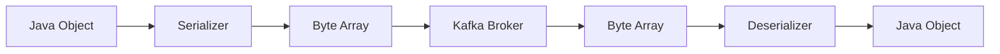

예를 들어 Java 애플리케이션에서 다음 객체를 Kafka에 전송한다고 가정해 보자.

```java
public record OrderCreatedEvent(
    String eventId,
    String orderId,
    Long amount
) {
}
```

이 객체를 그대로 Kafka Broker가 이해하는 것은 아니다.

JSON Serializer 등을 사용하면 객체를 JSON 형태로 변환할 수 있다.

이후 JSON 문자열을 Byte Array로 직렬화하여 전송한다.

Consumer는 같은 데이터 형식을 이해할 수 있는 Deserializer로 복원한다.

### Value가 null일 수도 있을까?

가능하다.

Kafka Record의 Value는 `null`일 수 있다.

특히 Log Compaction을 사용하는 Topic에서는 Key가 존재하고 Value가 `null`인 Record를 **Tombstone**이라고 부른다.

Tombstone은 특정 Key의 데이터를 삭제하거나 정리해야 한다는 의미로 활용할 수 있다.

따라서 `null` Value가 항상 잘못된 메시지는 아니다.

---

## Kafka Record의 Timestamp란?

Timestamp는 Kafka Record와 관련된 시간 정보다.

대표적으로 다음 두 가지 기준이 존재한다.

| 유형 | 설명 |
|---|---|
| `CreateTime` | Producer가 지정하거나 생성한 시각 |
| `LogAppendTime` | Broker가 로그에 기록하는 시각 |

### CreateTime

CreateTime은 이벤트가 Producer 측에서 생성된 시각을 표현하는 데 사용할 수 있다.

예를 들어 다음과 같다.

```text
2026-11-20T10:00:00+09:00
```

### LogAppendTime

LogAppendTime은 Broker에 Record가 기록되는 시각을 기준으로 한다.

### 두 시간이 다른 이유

예를 들어 결제 완료 이벤트가 오전 10시에 발생했다고 가정해 보자.

하지만 네트워크 문제로 Kafka에 전송하는 과정에서 지연이 발생했다.

```text
결제 완료: 10:00:00

Kafka 저장: 10:00:05
```

업무 이벤트가 발생한 시각과 Kafka에 저장된 시각은 다를 수 있다.

따라서 시간 기반 집계나 지연 분석에서는 어떤 시각을 사용하는지 명확하게 정의해야 한다.

실무에서는 Value에도 업무상 발생 시각을 별도로 포함할 수 있다.

```json
{
  "eventId": "evt-payment-1001",
  "eventType": "PaymentCompleted",
  "occurredAt": "2026-11-20T10:00:00+09:00",
  "paymentId": "payment-1001"
}
```

이렇게 하면 Kafka의 Timestamp와 별도로 실제 비즈니스 이벤트의 발생 시각을 관리할 수 있다.

---

## Kafka Record의 Headers란?

Headers는 Record에 추가적인 메타데이터를 전달하기 위한 Key-Value 구조다.

예를 들어 다음과 같은 정보를 포함할 수 있다.

```text
event-id: evt-10001

content-type: application/json

schema-version: 1

trace-id: trace-9001
```

### Headers를 사용하는 이유

Headers를 이용하면 비즈니스 Payload와 메타데이터를 구분할 수 있다.

예를 들어 다음 정보를 생각해 보자.

**Value**

```json
{
  "orderId": "order-1001",
  "amount": 45000,
  "status": "COMPLETED"
}
```

**Headers**

```text
trace-id: trace-1001

content-type: application/json

event-version: 1
```

Value에는 업무 데이터를 저장한다.

Headers에는 추적과 직렬화 형식, 이벤트 계약과 관련된 부가 정보를 포함한다.

### Headers에 라우팅 정보를 넣으면 자동으로 다른 Topic으로 전달될까?

그렇지는 않다.

Headers는 Kafka Broker가 임의로 비즈니스 라우팅을 수행하도록 만드는 기능이 아니다.

라우팅 정보를 활용하려면 해당 Header를 읽고 처리하는 Producer 또는 Consumer, Stream Processing 애플리케이션이 필요하다.

---

## Kafka 메시지 형식의 종류

Kafka는 Record의 Value에 특정한 데이터 형식을 강제하지 않는다.

따라서 여러 직렬화 형식을 사용할 수 있다.

대표적으로 다음과 같은 형식이 있다.

### 텍스트 기반 형식

- JSON
- XML
- CSV

### 이진 기반 형식

- Avro
- Protocol Buffers
- MessagePack

### 주요 데이터 형식 비교

| 형식 | 주요 특징 | 장점 | 고려사항 |
|---|---|---|---|
| JSON | 텍스트 기반 | 가독성, 다양한 언어 지원 | 데이터 크기, 스키마 관리 |
| XML | 태그 기반 | 다양한 구조 표현 | 데이터 크기와 파싱 비용 |
| CSV | 구분자 기반 | 단순한 표 데이터 | 중첩 구조 표현의 제약 |
| Avro | 스키마 기반 이진 형식 | 효율적인 직렬화, 스키마 진화 | 스키마 관리 필요 |
| Protobuf | 스키마 기반 이진 형식 | 빠른 처리, 다양한 언어 지원 | 필드 번호 관리 |
| MessagePack | 이진 직렬화 형식 | 비교적 작은 데이터 크기 | 별도 데이터 계약 관리 |

---

## Avro란?

Apache Avro는 Apache Software Foundation에서 개발한 데이터 직렬화 기술이다.

Avro는 스키마를 기반으로 데이터를 직렬화한다.

따라서 데이터의 구조를 명확하게 정의할 수 있으며, 스키마 변경에 대응하기 위한 규칙을 제공한다.

### Avro 스키마 예제

```json
{
  "type": "record",
  "name": "OrderCreated",
  "namespace": "com.example.events",
  "fields": [
    {
      "name": "orderId",
      "type": "string"
    },
    {
      "name": "amount",
      "type": "long"
    }
  ]
}
```

이 스키마에서는 다음 두 필드를 정의한다.

| 필드 | 타입 |
|---|---|
| orderId | string |
| amount | long |

### Avro의 장점

Avro는 이진 형식으로 데이터를 직렬화하므로 텍스트 기반 형식보다 효율적인 데이터 표현이 가능할 수 있다.

또한 Writer Schema와 Reader Schema를 이용하여 데이터 구조의 변경에 대응할 수 있다.

예를 들어 새로운 필드를 추가할 때 적절한 기본값을 정의하면 이전 버전의 데이터를 읽는 데 활용할 수 있다.

하지만 Avro를 사용한다고 모든 스키마 변경이 자동으로 호환되는 것은 아니다.

필드의 삭제와 타입 변경, 기본값 등을 신중하게 관리해야 한다.

---

## Protocol Buffers란?

Protocol Buffers는 Google에서 개발한 데이터 직렬화 기술이다.

일반적으로 `.proto` 파일을 이용하여 메시지 구조를 정의한다.

### Protobuf 예제

```protobuf
syntax = "proto3";

package example.events;

message OrderCreated {
  string order_id = 1;
  int64 amount = 2;
}
```

이 구조에서 중요한 부분은 필드 번호다.

```protobuf
string order_id = 1;
```

```protobuf
int64 amount = 2;
```

Protobuf에서는 필드 번호가 직렬화 형식의 중요한 부분이다.

따라서 기존 필드 번호를 다른 의미로 재사용하면 과거 데이터를 잘못 해석할 수 있다.

필드를 삭제한 경우에는 해당 번호를 `reserved`로 관리하는 방식이 권장된다.

### Avro와 Protobuf 비교

| 항목 | Avro | Protobuf |
|---|---|---|
| 개발 주체 | Apache Software Foundation | Google |
| 스키마 정의 | JSON 기반 | `.proto` |
| 데이터 형식 | 이진 | 이진 |
| 스키마 진화 | 지원 | 지원 |
| 주요 고려사항 | Writer·Reader Schema | 필드 번호와 변경 규칙 |
| 활용 | 데이터 파이프라인, 이벤트 처리 | RPC, 이벤트 처리, 서비스 간 통신 |

두 형식 모두 Kafka에서 사용할 수 있다.

어떤 형식이 적절한지는 Producer와 Consumer가 사용하는 언어, 데이터 크기, 스키마 관리 방식 등에 따라 달라진다.

---

## MessagePack이란?

MessagePack은 JSON과 유사한 데이터 구조를 이진 형태로 직렬화할 수 있는 형식이다.

문자열과 숫자, 배열, Map 등의 데이터를 표현할 수 있다.

JSON보다 작은 크기로 데이터를 표현할 수 있는 경우가 있다.

하지만 MessagePack 자체는 Avro나 Protobuf처럼 명시적인 스키마 관리 규칙을 강제하지 않는다.

따라서 MessagePack을 사용하는 경우에도 별도의 데이터 계약을 관리하는 것이 좋다.

예를 들어 다음 항목을 명확하게 정의해야 한다.

- 필수 필드
- 데이터 타입
- 필드의 의미
- 데이터 버전
- 호환성 규칙

---

## 메시지 형식 선택 시 고려해야 할 사항

어떤 직렬화 형식이 항상 가장 우수하다고 판단해서는 안 된다.

예를 들어 JSON은 사람이 읽기 쉽고 개발과 디버깅이 편리하다.

반면 Avro와 Protobuf는 데이터 크기와 스키마 관리 측면에서 장점을 제공할 수 있다.

다음과 같은 기준으로 비교할 수 있다.

| 요구사항 | 검토할 형식 |
|---|---|
| 빠른 개발과 가독성 | JSON |
| 명확한 스키마 관리 | Avro, Protobuf |
| 여러 언어 사이의 데이터 계약 | Avro, Protobuf |
| 단순한 표 데이터 | CSV |
| 작은 이진 Payload | Avro, Protobuf, MessagePack |
| 복잡한 스키마 변경 | 명시적인 호환성 관리가 가능한 형식 |

실무에서는 메시지 형식을 선택하는 것뿐 아니라 **Producer와 Consumer 사이의 스키마 호환성을 어떻게 유지할 것인지**가 중요하다.

---

## Kafka 메시지 압축

Kafka는 메시지의 저장과 전송 효율을 높이기 위해 압축을 지원한다.

대표적인 압축 알고리즘은 다음과 같다.

1. Gzip
2. Snappy
3. LZ4
4. Zstd

### 압축을 사용하는 이유

Kafka는 Broker에 메시지를 저장하고, 네트워크를 통해 Producer와 Consumer 사이에서 데이터를 전달한다.

따라서 메시지 크기가 클수록 네트워크 대역폭과 디스크 사용량이 증가할 수 있다.

압축을 사용하면 메시지의 크기를 줄여 이러한 비용을 낮출 수 있다.

### 압축 알고리즘 비교

| 알고리즘 | 일반적인 특징 | 고려사항 |
|---|---|---|
| Gzip | 높은 압축률을 얻을 수 있음 | CPU 비용 |
| Snappy | 빠른 압축 및 해제 | 압축률 |
| LZ4 | 낮은 지연과 빠른 처리 | 압축률 |
| Zstd | 압축률과 처리 속도의 균형 조절 | 압축 수준에 따른 CPU 비용 |

실제 압축 효율은 데이터의 특성에 따라 달라진다.

반복되는 문자열이 많은 JSON 이벤트는 압축 효과가 클 수 있다.

반면 이미 압축된 이미지나 동영상 데이터는 추가 압축 효과가 작을 수 있다.

### Producer 압축 설정

예를 들어 Zstd 압축을 사용하려면 다음과 같이 설정할 수 있다.

```properties
compression.type=zstd
```

Kafka Producer의 기본 압축 방식은 `none`이다.

따라서 Kafka가 모든 메시지를 자동으로 압축한다고 이해해서는 안 된다.

또한 Kafka의 압축은 Record Batch 단위로 적용되므로 Batch 구성에 따라 압축 효율이 달라질 수 있다. [Apache Kafka](https://kafka.apache.org/44/configuration/producer-configs/)

### 압축을 사용하면 항상 성능이 좋아질까?

그렇지 않다.

압축은 네트워크와 디스크 사용량을 줄이는 대신 CPU 연산을 사용한다.

따라서 작은 메시지에서는 압축으로 절감하는 비용보다 압축과 해제에 필요한 CPU 비용이 더 클 수 있다.

실무에서는 다음 지표를 함께 비교해야 한다.

- 메시지 전송량
- 네트워크 사용량
- 디스크 사용량
- Producer CPU 사용량
- Consumer CPU 사용량
- 처리 지연
- 압축률

압축 알고리즘은 실제 이벤트 데이터로 성능을 측정한 뒤 선택하는 것이 좋다.

---

## Kafka의 고가용성이란?

### 고가용성의 개념

고가용성(High Availability)은 시스템의 일부 구성 요소에 장애가 발생하더라도 서비스를 계속 제공할 수 있도록 설계하는 특성이다.

Kafka는 여러 Broker를 이용하여 Cluster를 구성할 수 있다.

하지만 Broker를 여러 대 실행하는 것만으로 모든 데이터의 고가용성이 확보되는 것은 아니다.

예를 들어 Broker가 세 대 존재한다고 가정해 보자.

```text
Broker 1

Broker 2

Broker 3
```

그런데 특정 Partition이 Broker 1에만 저장되어 있다.

이 경우 Broker 1에 장애가 발생하면 다른 Broker가 정상적으로 실행 중이더라도 해당 Partition에 접근할 수 없게 된다.

따라서 Kafka의 고가용성을 이해하려면 **Replication** 개념이 필요하다.

---

## Replication이란?

Replication은 데이터를 여러 위치에 복제하여 저장하는 기능이다.

Kafka에서는 Topic 전체를 하나의 파일처럼 복제하는 것이 아니라 **Topic을 구성하는 각 Partition을 복제**한다.

예를 들어 다음과 같은 Topic이 있다고 가정해 보자.

```text
Topic: orders

Partition 0

Partition 1
```

Replication Factor를 3으로 설정하면 각 Partition의 복제본을 총 세 개씩 유지하도록 구성한다.

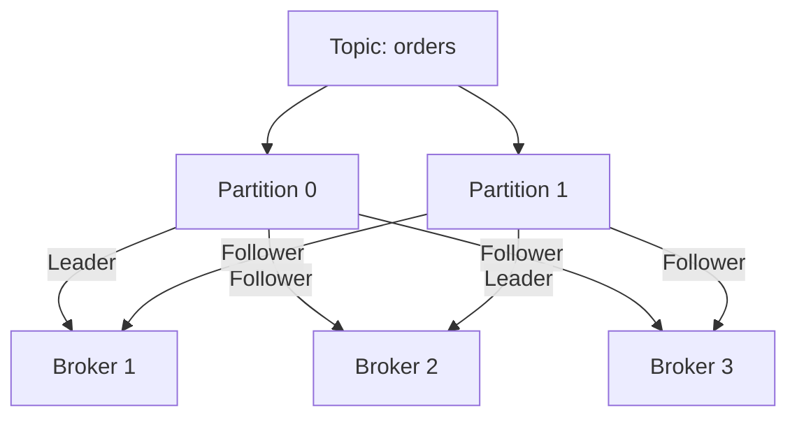

이 구조에서 Partition 0은 Broker 1에 Leader가 있고 Broker 2와 Broker 3에 Follower가 있다.

Partition 1은 Broker 2에 Leader가 있고 Broker 1과 Broker 3에 Follower가 있다.

이처럼 각 Partition은 서로 다른 Broker에 복제본을 유지할 수 있다.

### Replication의 목적

Replication은 크게 두 가지 목적을 가진다.

**첫 번째는 데이터 내구성(Durability)이다.**

특정 Broker가 장애로 종료되어도 다른 Broker에 데이터 복제본이 존재할 수 있다.

**두 번째는 고가용성(Availability)이다.**

Leader가 장애로 중단되면 적절한 Replica가 새로운 Leader로 승격되어 요청 처리를 이어갈 수 있다.

다만 실제 데이터 보존과 서비스 지속 여부는 Replica의 동기화 상태와 클러스터 설정에 따라 달라진다.

---

## Replication Factor란?

Replication Factor는 하나의 Partition에 대해 유지할 전체 Replica 수를 의미한다.

예를 들어 다음과 같다.

| Replication Factor | 전체 Replica 수 | 일반적인 Follower 수 |
|---|---:|---:|
| 1 | 1 | 0 |
| 2 | 2 | 1 |
| 3 | 3 | 2 |

여기서 중요한 점은 Replication Factor에 Leader도 포함된다는 것이다.

즉, Replication Factor가 3이라는 것은 Leader 하나와 Follower 세 개를 의미하지 않는다.

**Leader 하나와 Follower 두 개, 총 세 개의 Replica를 의미한다.**

---

## Replication Factor가 1인 경우

다음과 같은 Kafka Cluster가 있다고 가정해 보자.

```text
Broker 1

Broker 2

Broker 3
```

`peter` Topic의 Partition이 Broker 1에만 존재한다.

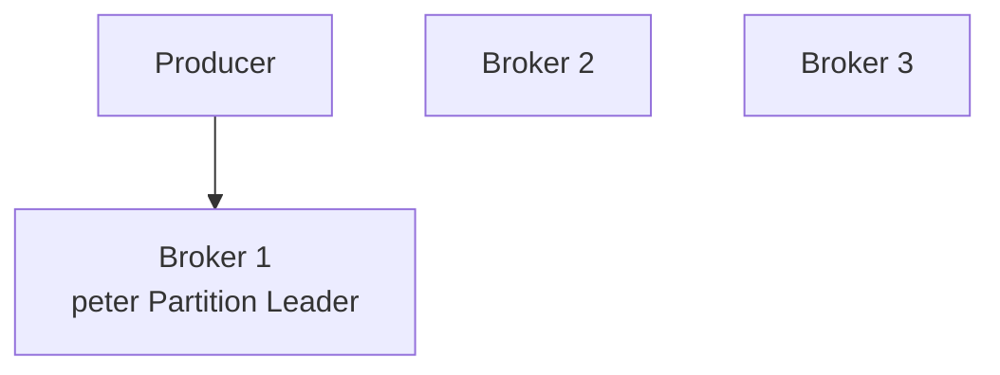

이 상태에서 Broker 3에 장애가 발생했다고 가정해 보자.

Broker 3에는 해당 Partition이 존재하지 않으므로 `peter` Partition은 계속 사용할 수 있다.

하지만 Broker 1에 장애가 발생하면 상황이 달라진다.

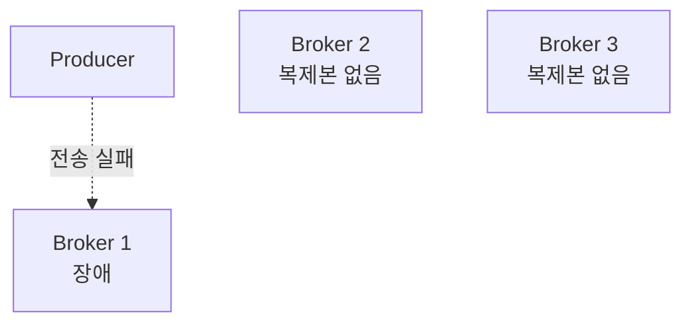

Broker 2와 Broker 3이 정상적으로 실행 중이더라도 해당 Partition의 복제본이 없다.

따라서 Broker 1이 복구되기 전에는 해당 Partition을 사용할 수 없다.

Broker 1의 디스크까지 영구적으로 손상되었다면 해당 데이터가 유실될 수도 있다.

이 사례에서 확인할 수 있는 것은 다음과 같다.

**Kafka Broker가 여러 대 있다는 사실과 특정 Partition의 복제본이 여러 대에 존재한다는 사실은 다르다.**

---

## Replication Factor가 2인 경우

이번에는 `peter` Topic의 Partition에 Replica가 두 개 존재한다고 가정해 보자.

Broker 1에는 Leader가 있다.

Broker 2에는 Follower가 있다.

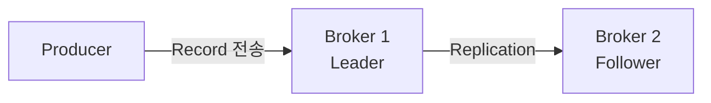

이 상태에서 Broker 1에 장애가 발생했다.

Broker 2의 Follower가 충분히 동기화된 안전한 Replica라면 새로운 Leader로 승격될 수 있다.

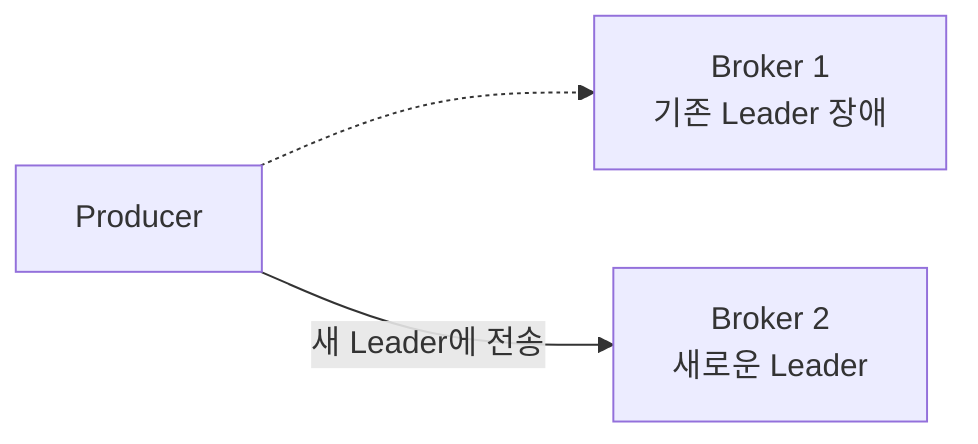

이처럼 복제본을 유지하면 특정 Broker 장애 상황에서도 서비스를 계속 제공할 수 있는 기반을 마련할 수 있다.

하지만 Leader 전환 과정에서는 일시적인 요청 실패나 지연이 발생할 수 있다.

따라서 고가용성이 **모든 장애에서 중단 시간이 0이라는 의미는 아니다.**

---

## Replication Factor에 따른 저장 공간

Replication은 데이터의 안정성을 높이는 데 도움이 된다.

하지만 복제본을 유지하려면 추가적인 저장 공간이 필요하다.

예를 들어 논리적인 Topic 데이터의 크기가 100GB라고 가정해 보자.

| Topic 데이터 크기 | Replication Factor | 필요한 Replica 로그 저장 공간 |
|---|---:|---:|
| 100GB | 1 | 약 100GB |
| 100GB | 2 | 약 200GB |
| 100GB | 3 | 약 300GB |

여기서 표시한 값은 단순화한 계산이다.

실제 Kafka 운영에서는 다음과 같은 공간도 필요하다.

- 로그 Index
- 내부 Topic
- 복제 및 재배치 작업 공간
- 운영 여유 공간
- 로그 세그먼트 관리 공간

따라서 Replication Factor가 3이고 논리적인 데이터가 100GB라고 해서 정확히 300GB만 준비하면 충분하다고 판단해서는 안 된다.

### Replication의 추가 비용

Replication은 디스크뿐 아니라 다음 자원도 사용한다.

- Broker 간 네트워크 대역폭
- 디스크 I/O
- CPU
- 메모리
- Replica 상태 관리 비용

따라서 Replication Factor는 무조건 높게 설정하기보다 데이터의 중요도와 장애 복구 목표, 인프라 비용을 고려하여 결정해야 한다.

---

## Leader와 Follower란?

Kafka는 Partition의 Replica를 관리하기 위해 Leader와 Follower 개념을 사용한다.

### Leader

Leader는 해당 Partition의 주요 읽기 및 쓰기 요청을 처리하는 Replica다.

Producer는 일반적으로 해당 Partition의 Leader에 Record를 전송한다.

Consumer도 기본적으로 Leader를 통해 데이터를 읽는다.

다만 Kafka는 설정에 따라 Follower에서 데이터를 읽는 기능도 지원하므로, 모든 읽기 요청이 어떤 환경에서도 반드시 Leader에서만 수행된다고 단정해서는 안 된다.

### Follower

Follower는 Leader의 데이터를 복제하는 Replica다.

Follower는 Leader에 Fetch 요청을 보내 새로운 Record를 가져온다.

### 데이터 복제 흐름

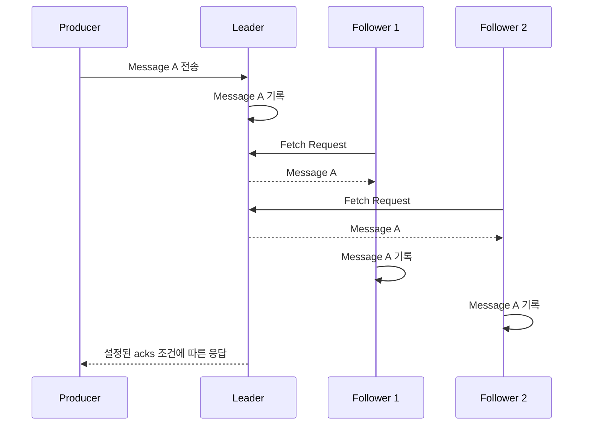

여기서 중요한 것은 Follower가 Leader의 데이터를 지속적으로 복제한다는 점이다.

모든 Follower가 언제나 동일한 시점에 동일한 데이터를 가지고 있는 것은 아니다.

네트워크 문제나 Broker의 부하에 따라 특정 Follower의 복제가 지연될 수 있다.

이러한 상황에서 필요한 개념이 ISR이다.

---

## Leader와 Follower는 Broker의 고정된 역할일까?

아니다.

Leader와 Follower는 Broker 전체에 고정된 역할이 아니다.

**Partition별로 결정되는 역할이다.**

예를 들어 다음과 같은 배치를 생각해 보자.

| Broker | Partition 0 | Partition 1 | Partition 2 |
|---|---|---|---|
| Broker 1 | Leader | Follower | Follower |
| Broker 2 | Follower | Leader | Follower |
| Broker 3 | Follower | Follower | Leader |

Broker 1은 Partition 0에서는 Leader다.

하지만 Partition 1과 Partition 2에서는 Follower다.

따라서 특정 Broker를 항상 Leader Broker라고 부르는 것은 정확하지 않을 수 있다.

실제 운영에서는 Broker별 Leader Partition 수와 처리량의 균형도 중요하다.

---

## ISR(In-Sync Replicas)이란?

### ISR의 개념

ISR은 In-Sync Replicas의 약자다.

ISR은 Leader의 데이터를 충분히 따라오고 있다고 판단되는 Replica의 집합이다.

여기에는 Leader도 포함된다.

예를 들어 다음과 같은 Partition이 있다고 가정해 보자.

```text
Topic: orders

Partition: 0

Leader: Broker 1

Follower: Broker 2

Follower: Broker 3
```

세 Replica가 정상적으로 동기화되고 있다면 ISR은 다음과 같다.

```text
ISR = [Broker 1, Broker 2, Broker 3]
```

### ISR은 단순히 살아 있는 Broker 목록일까?

아니다.

Broker가 실행 중이더라도 Leader의 데이터를 충분히 따라오지 못한다면 ISR에서 제외될 수 있다.

반대로 ISR에서 제외되었다고 해당 Broker의 Replica가 즉시 삭제되는 것은 아니다.

복제 지연 문제가 해결되고 다시 동기화 기준을 충족하면 ISR에 재합류할 수 있다.

### ISR의 중요한 역할

ISR은 다음 두 가지 측면에서 중요하다.

1. 데이터 복제와 쓰기 성공 조건
2. Leader 장애 발생 시 안전한 Leader 후보 판단

따라서 ISR의 변화를 모니터링하면 Kafka Cluster의 데이터 복제 상태를 이해하는 데 도움이 된다.

---

## ISR 축소 시나리오 1: 특정 Follower의 복제 지연

다음과 같은 구성이 있다고 가정해 보자.

```text
Topic: orders

Partition: 0

Replication Factor: 3
```

Replica는 다음과 같다.

```text
Broker 1: Leader

Broker 2: Follower 1

Broker 3: Follower 2
```

처음에는 세 Replica가 모두 ISR에 포함되어 있다.

```text
ISR = [Broker 1, Broker 2, Broker 3]
```

### 1단계: Producer가 A 메시지 전송

Producer가 A 메시지를 Leader에 전송한다.

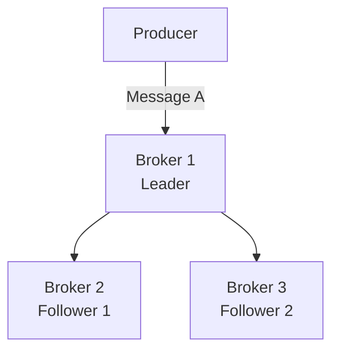

Leader는 메시지를 자신의 로그에 기록한다.

이후 Follower들이 Leader의 데이터를 가져온다.

### 2단계: Follower 2의 동기화 지연

Broker 3의 복제 처리가 느려졌다고 가정해 보자.

Broker 2는 정상적으로 A 메시지를 복제했다.

하지만 Broker 3은 정상적인 동기화 기준을 충족하지 못했다.

```text
Broker 1: A

Broker 2: A

Broker 3: 복제 지연
```

### 3단계: Follower 2의 ISR 제외

Kafka는 일정한 조건에 따라 복제가 지연된 Replica를 ISR에서 제외할 수 있다.

```text
변경 전 ISR

[Broker 1, Broker 2, Broker 3]
```

```text
변경 후 ISR

[Broker 1, Broker 2]
```

이때 Broker 3이 완전히 종료된 것은 아닐 수 있다.

단지 현재 Leader를 충분히 따라오고 있지 못하므로 ISR에서 제외된 것이다.

### ISR이 축소되면 발생하는 문제

ISR에 포함된 Replica 수가 감소하면 현재 데이터의 안전한 복제 상태도 약해질 수 있다.

예를 들어 ISR이 하나만 남았다면 해당 Replica에 장애가 발생했을 때 데이터 접근과 복구가 어려워질 수 있다.

따라서 ISR 감소는 단순한 성능 문제가 아니라 가용성과 데이터 내구성의 위험 신호로 볼 수 있다.

---

## ISR 축소 시나리오 2: Follower가 연속으로 장애를 겪는 경우

이번에는 더 심각한 상황을 살펴보자.

초기에는 세 Replica가 모두 정상이다.

```text
Broker 1: Leader

Broker 2: Follower 1

Broker 3: Follower 2
```

세 Replica가 모두 A 메시지를 저장했다.

| 단계 | Broker 1 | Broker 2 | Broker 3 |
|---|---|---|---|
| 초기 | A | A | A |

### 1단계: Broker 3 장애

Broker 3이 장애로 중단되었다.

이후 Producer가 B 메시지를 전송했다.

Broker 1과 Broker 2는 B 메시지를 저장했다.

| 단계 | Broker 1 | Broker 2 | Broker 3 |
|---|---|---|---|
| A 저장 | A | A | A |
| B 저장 | A, B | A, B | A |

현재 ISR은 다음과 같이 축소될 수 있다.

```text
ISR = [Broker 1, Broker 2]
```

### 2단계: Broker 2 장애

이후 Broker 2도 장애로 중단되었다.

Broker 1만 남았다.

이때 Producer가 C 메시지를 전송했다고 가정해 보자.

단, 이 상황에서 C 메시지가 성공적으로 기록되는지는 `acks`와 `min.insync.replicas` 설정에 따라 달라진다.

최소 ISR이 1이고 해당 쓰기 조건을 만족한다면 다음과 같은 로그 상태가 가능하다.

| 단계 | Broker 1 | Broker 2 | Broker 3 |
|---|---|---|---|
| A 저장 | A | A | A |
| B 저장 | A, B | A, B | A |
| C 저장 | A, B, C | A, B | A |

현재 ISR에는 Broker 1만 남아 있을 수 있다.

```text
ISR = [Broker 1]
```

### 3단계: Broker 1 장애

마지막으로 Broker 1까지 장애로 중단되었다.

이제 세 Broker 모두 정상적으로 데이터를 제공할 수 없는 상태다.

```text
Broker 1: 장애

Broker 2: 장애

Broker 3: 장애
```

이 상황에서는 해당 Partition의 Leader가 존재하지 않아 새로운 쓰기 요청이 실패할 수 있다.

문제는 각 Replica가 가지고 있는 데이터가 서로 다르다는 것이다.

```text
Broker 1: A, B, C

Broker 2: A, B

Broker 3: A
```

이후 어떤 Replica가 새로운 Leader가 되는지에 따라 데이터의 보존 여부가 달라질 수 있다.

---

## 오래된 Follower가 새로운 Leader가 되면 왜 위험할까?

앞의 예시에서 Broker 3은 A 메시지만 가지고 있다.

반면 Broker 1에는 A, B, C가 저장되어 있다.

이때 Broker 3이 가장 먼저 복구되었다고 가정해 보자.

Broker 3에는 다음 데이터만 존재한다.

```text
A
```

이 Replica를 안전성 검증 없이 새로운 Leader로 승격한다면 문제가 발생할 수 있다.

기존 Leader에는 B와 C가 있었지만 새로운 Leader에는 없다.

이후 다른 Broker가 새로운 Leader의 로그를 기준으로 동기화하면 기존의 더 긴 로그 일부가 잘릴 수 있다.

### 데이터 손실 시나리오

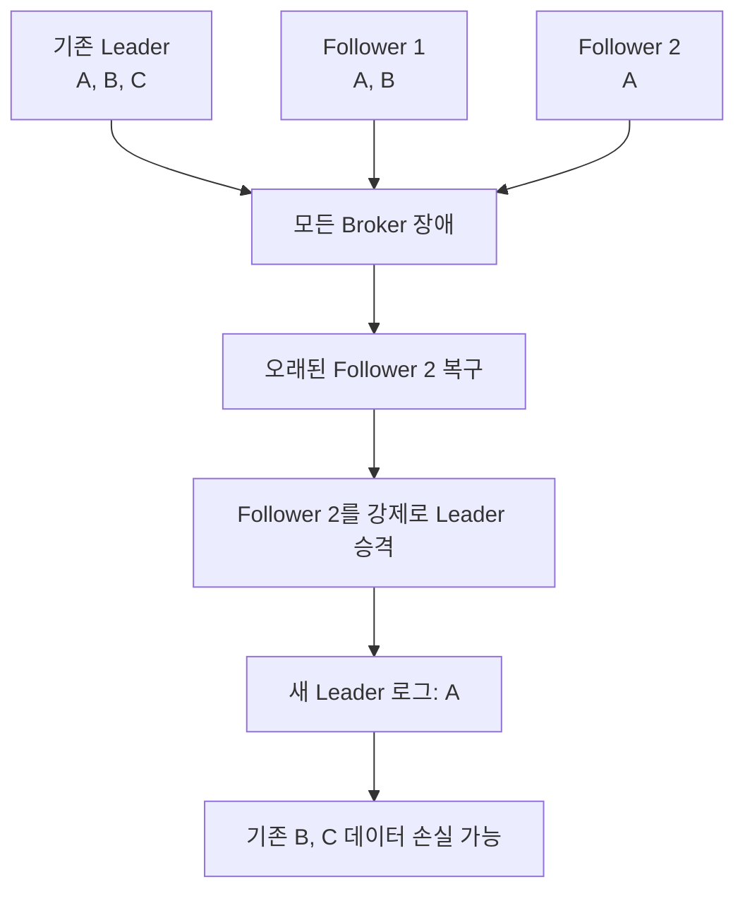

이러한 상황에서 오래된 Replica를 Leader로 선출하는 것은 데이터 내구성 측면에서 위험하다.

따라서 Kafka는 어떤 Replica를 Leader로 선출할 수 있는지 관리하는 메커니즘을 제공한다.

---

## Unclean Leader Election이란?

Unclean Leader Election은 충분히 동기화되지 않은 Replica를 Leader로 승격하는 방식이다.

정상적인 Leader 후보가 존재하지 않는 상황에서 가용성을 회복하기 위해 사용될 수 있다.

하지만 오래된 Replica가 Leader가 되면 일부 메시지가 유실될 수 있다.

### 설정 예제

```properties
unclean.leader.election.enable=false
```

이 설정은 안전하지 않은 Replica를 Leader로 선출하지 않도록 하는 데 사용한다.

이 경우 안전한 Replica가 복구되기 전까지 해당 Partition을 사용할 수 없을 수 있다.

반대로 Unclean Leader Election을 허용하면 서비스 가용성을 빠르게 회복할 가능성이 있지만 데이터 손실 위험을 감수해야 할 수 있다.

### 가용성과 내구성의 트레이드오프

| 선택 | 장점 | 위험 |
|---|---|---|
| 안전한 Replica를 기다림 | 데이터 손실 위험 감소 | 서비스 중단 시간 증가 가능 |
| 오래된 Replica 승격 허용 | 빠른 가용성 회복 가능 | 데이터 손실 가능 |

결국 어떤 정책을 사용할지는 업무의 특성에 따라 달라진다.

예를 들어 결제 승인이나 정산 이벤트처럼 데이터 손실이 치명적인 시스템에서는 안전한 복구를 우선하는 것이 적절할 수 있다.

반면 일부 손실을 허용할 수 있는 데이터에서는 다른 운영 정책을 검토할 수도 있다.

---

## 마지막 Leader가 반드시 먼저 복구되어야 할까?

모든 상황에서 마지막 Leader가 반드시 먼저 복구되어야 한다고 단정할 수는 없다.

중요한 것은 어떤 Replica가 안전하게 보존되어야 할 데이터를 가지고 있는지다.

예를 들어 마지막 Leader에만 C 메시지가 존재한다면 해당 로그의 복구가 중요하다.

하지만 다른 Replica에도 안전하게 복제된 데이터가 존재한다면 반드시 마지막 Leader만이 복구 후보가 되는 것은 아니다.

또한 Kafka의 최신 버전에서는 ISR 외에 Eligible Leader Replicas(ELR)를 활용하는 방식도 제공한다.

따라서 Leader 복구는 다음 요소를 함께 고려해야 한다.

- ISR
- ELR
- Replica의 로그 상태
- Leader Epoch
- 데이터 복제 및 Commit 상태
- Unclean Leader Election 정책

핵심은 **복구 순서 자체보다 데이터 손실 없이 안전하게 Leader를 선출할 수 있는지**다.

---

## ELR(Eligible Leader Replicas)이란?

### ELR이 등장한 이유

전통적인 Kafka의 Leader 선출에서는 ISR이 안전한 Leader 후보를 판단하는 중요한 기준이었다.

하지만 일부 상황에서는 ISR에서 제외되었더라도 안전하게 Leader가 될 수 있는 Replica가 존재할 수 있다.

이러한 문제를 개선하기 위해 Kafka는 Eligible Leader Replicas(ELR) 기능을 도입했다.

ELR은 ISR 밖에 있는 Replica 중에서도 특정 조건을 충족하여 안전하게 Leader로 승격할 수 있는 후보를 추적하는 기능이다.

### Kafka 버전별 ELR

| Kafka 버전 | ELR 관련 특징 |
|---|---|
| 4.0 | ELR 기능 도입 |
| 4.1 | 신규 Cluster에서 기본 활성화 |
| 4.2 이상 | ELR 기반 복제 및 Leader 선출 개선 활용 가능 |

Kafka 공식 문서에서는 ELR이 4.0부터 제공되었으며, 4.1부터 신규 클러스터에서 기본 활성화된다고 설명한다. [Apache Kafka](https://kafka.apache.org/44/operations/eligible-leader-replicas/)

### ISR과 ELR의 차이

| 항목 | ISR | ELR |
|---|---|---|
| 의미 | 현재 Leader와 충분히 동기화된 Replica 집합 | 특정 조건에서 안전하게 Leader가 될 수 있는 추가 후보 |
| 주요 목적 | 복제 및 쓰기 안정성 판단 | 안전한 Leader 선출 가능성 확대 |
| 관계 | 현재 동기화 상태 중심 | ISR 밖의 안전한 후보까지 고려 |
| 운영상 의미 | 현재 복제 안정성 파악 | 장애 복구 선택지 확대 |

여기서 주의할 점은 ELR이 모든 오래된 Replica를 안전하게 승격할 수 있도록 허용하는 기능이 아니라는 것이다.

ELR의 목적은 안전성이 확인된 추가 후보를 관리하는 것이다.

따라서 ISR 밖의 Replica가 새로운 Leader가 될 수 있다는 설명만으로 Unclean Leader Election과 동일하다고 이해해서는 안 된다.

---

## Producer의 acks 설정

Kafka의 고가용성을 이해할 때 Producer의 `acks` 설정도 중요하다.

`acks`는 Producer가 Broker에 Record를 전송한 후 어느 수준의 확인을 기다릴 것인지 결정하는 설정이다.

대표적으로 다음 세 가지가 있다.

```properties
acks=0
```

```properties
acks=1
```

```properties
acks=all
```

### acks=0

Producer가 Broker의 저장 확인 응답을 기다리지 않는 방식이다.

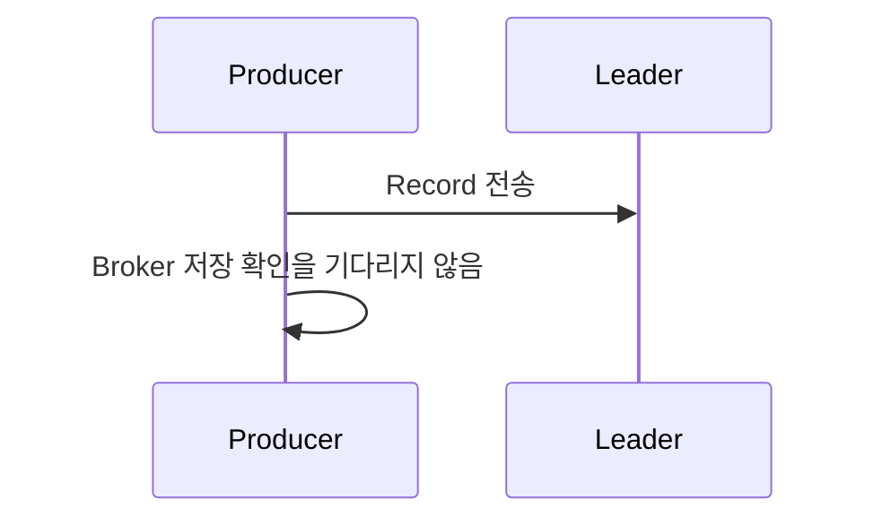

이 방식은 확인 응답을 기다리지 않는다는 특징이 있다.

하지만 Broker에 실제로 Record가 저장되었는지 확인하기 어렵다.

따라서 중요한 비즈니스 이벤트에 사용할 때는 신중해야 한다.

### acks=1

Leader가 Record를 자신의 로그에 기록한 후 확인 응답을 반환하는 방식이다.

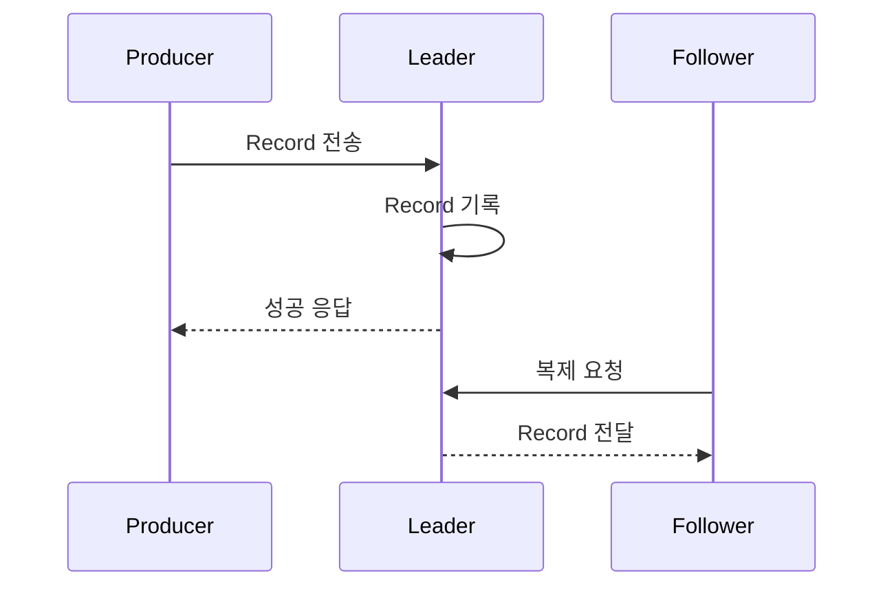

이 구조에서는 Follower의 복제가 완료되기 전에 Producer가 성공 응답을 받을 수 있다.

따라서 Leader가 복제 완료 전에 장애를 겪으면 성공 응답을 받은 Record도 유실될 수 있다.

### acks=all

`acks=all`은 Kafka의 ISR 기반 저장 확인을 기다리는 방식이다.

전통적인 ISR 복제 모델에서는 현재 ISR에 포함된 Replica의 기록 확인을 기준으로 성공 여부를 판단한다.

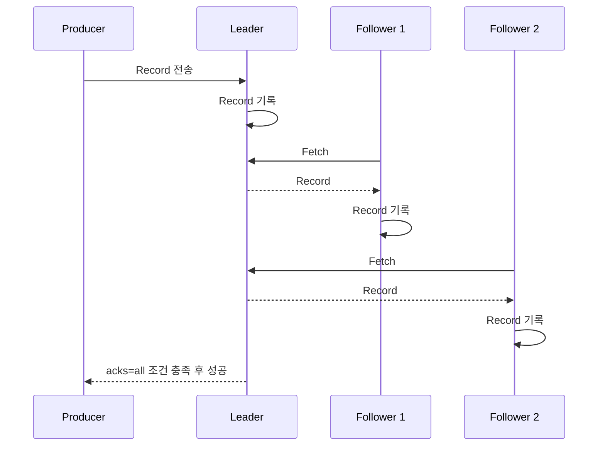

다만 `acks=all`만 설정했다고 모든 장애에서 데이터 유실을 완전히 방지하는 것은 아니다.

ISR에 Replica가 몇 개 존재하는지도 중요하다.

이때 필요한 설정이 `min.insync.replicas`다.

---

## min.insync.replicas란?

`min.insync.replicas`는 `acks=all`로 Record를 기록할 때 요구하는 최소 ISR 수를 지정하는 설정이다.

예를 들어 다음과 같은 환경을 가정해 보자.

```text
Replication Factor: 3

min.insync.replicas: 2

Producer acks: all
```

이 경우 Kafka는 최소 두 개의 ISR이 존재해야 쓰기 작업을 성공시킬 수 있다.

### ISR이 세 개인 경우

```text
ISR = [Broker 1, Broker 2, Broker 3]
```

세 Replica가 모두 정상적으로 동기화되고 있다.

`acks=all`은 현재 ISR의 확인을 기준으로 성공 여부를 판단한다.

### ISR이 두 개인 경우

```text
ISR = [Broker 1, Broker 2]
```

Broker 3이 ISR에서 제외되었지만 최소 ISR 수인 2를 충족한다.

따라서 필요한 복제 조건을 만족하면 쓰기를 성공시킬 수 있다.

### ISR이 하나인 경우

```text
ISR = [Broker 1]
```

최소 ISR 수인 2를 충족하지 못한다.

따라서 새로운 쓰기 요청은 실패할 수 있다.

### 설정별 동작 비교

| 현재 ISR 수 | Replication Factor | min.insync.replicas | acks | 일반적인 쓰기 결과 |
|---:|---:|---:|---|---|
| 3 | 3 | 2 | all | 성공 가능 |
| 2 | 3 | 2 | all | 성공 가능 |
| 1 | 3 | 2 | all | 실패 |
| 1 | 3 | 1 | all | 성공 가능 |

여기서 중요한 부분은 `min.insync.replicas=2`가 ISR 중 아무 두 Replica에만 기록되면 무조건 성공한다는 의미는 아니라는 점이다.

ISR이 세 개라면 `acks=all`은 현재 ISR 전체의 확인을 기준으로 한다.

또한 ELR이 활성화된 Kafka 버전에서는 일부 관련 동작과 복구 의미가 달라지므로 해당 클러스터의 기능 수준을 확인해야 한다. [Apache Kafka](https://kafka.apache.org/44/configuration/topic-configs/)

---

## Replication Factor, acks, min.insync.replicas의 관계

세 설정은 서로 다른 책임을 가진다.

| 설정 | 주요 질문 |
|---|---|
| Replication Factor | 데이터 복제본을 몇 개 유지할 것인가? |
| acks | Producer는 어떤 수준의 저장 확인을 기다릴 것인가? |
| min.insync.replicas | 쓰기 성공에 필요한 최소 동기화 Replica는 몇 개인가? |

예를 들어 결제 이벤트처럼 데이터 내구성이 중요한 시스템에서 다음 구성을 고려할 수 있다.

```text
Replication Factor = 3

min.insync.replicas = 2

acks = all
```

이러한 구성은 가용성과 데이터 내구성 사이의 균형을 고려한 대표적인 예시다.

하지만 이 설정만으로 모든 장애를 해결할 수는 없다.

예를 들어 ISR이 하나로 줄어들면 새로운 쓰기가 실패할 수 있다.

이 상황에서 Producer는 실패를 어떻게 처리해야 할까?

단순히 이벤트를 버리는 것은 적절하지 않을 수 있다.

따라서 다음과 같은 전략을 함께 고려해야 한다.

- Producer 재시도
- 실패한 이벤트의 별도 보관
- Transactional Outbox
- 장애 알림
- Consumer의 멱등성
- 장애 복구 후 재처리

**Kafka의 내구성 설정은 Broker 내부의 데이터 복제만이 아니라 Producer와 Consumer의 업무 처리 방식까지 함께 고려해야 의미가 있다.**

---

## Kafka Topic 생성 예제

이제 Kafka의 주요 개념을 실제 명령어로 연결해 보자.

다음 예제는 Kafka Broker가 최소 세 대 준비되어 있고, `localhost:9092`를 통해 해당 Cluster에 접근할 수 있다는 전제다.

단일 Broker 환경에서는 Replication Factor를 3으로 설정할 수 없다.

### Topic 생성

```bash
bin/kafka-topics.sh \
  --bootstrap-server localhost:9092 \
  --create \
  --topic commerce.orders.created.v1 \
  --partitions 8 \
  --replication-factor 3 \
  --config min.insync.replicas=2
```

각 옵션의 의미는 다음과 같다.

| 옵션 | 설명 |
|---|---|
| `--bootstrap-server` | Kafka Cluster 접속 주소 |
| `--create` | Topic 생성 |
| `--topic` | Topic 이름 |
| `--partitions 8` | Partition 8개 생성 |
| `--replication-factor 3` | Partition마다 Replica 3개 유지 |
| `--config min.insync.replicas=2` | 최소 ISR 2개 요구 |

### Topic 정보 확인

```bash
bin/kafka-topics.sh \
  --bootstrap-server localhost:9092 \
  --describe \
  --topic commerce.orders.created.v1
```

정상적으로 생성되었다면 Topic의 Partition 수와 Replication Factor, Leader, Replicas, ISR 등을 확인할 수 있다.

출력에는 다음과 같은 정보가 포함된다.

```text
Topic: commerce.orders.created.v1

PartitionCount: 8

ReplicationFactor: 3
```

각 Partition에 대해서는 다음과 같은 정보가 나타난다.

```text
Partition: 0

Leader: 1

Replicas: 1,2,3

Isr: 1,2,3
```

이는 출력 형식을 설명하기 위한 예시다.

실제 Leader와 Replica의 Broker ID 및 배치 상태는 클러스터에 따라 달라진다.

### 주요 출력 정보

| 항목 | 의미 |
|---|---|
| Partition | Partition 번호 |
| Leader | 현재 Leader Broker |
| Replicas | 해당 Partition의 전체 Replica |
| Isr | 현재 ISR에 포함된 Replica |

특히 `Replicas`와 `Isr`를 비교하면 복제 상태를 파악할 수 있다.

예를 들어 다음과 같다.

```text
Replicas: 1,2,3

Isr: 1,2
```

이 경우 Replica는 세 개지만 현재 ISR에 포함된 Replica는 두 개다.

Broker 3의 복제 상태를 확인할 필요가 있다.

---

## Producer 설정 예제

Producer에서는 다음과 같은 설정을 사용할 수 있다.

```properties
acks=all
enable.idempotence=true
compression.type=zstd
```

### acks=all

ISR 기반의 저장 확인을 기다린다.

### enable.idempotence=true

Producer의 재시도 과정에서 동일한 Record가 Kafka 로그에 중복 기록되는 문제를 방지하는 기능을 활성화한다.

다만 Consumer가 데이터베이스를 중복 수정하거나 외부 API를 중복 호출하는 문제까지 해결하지는 않는다.

### compression.type=zstd

Zstd 압축을 활성화한다.

실제 운영에서는 메시지 크기와 CPU 사용량, 처리 지연을 측정하여 압축 방식을 선택해야 한다.

---

## Topic과 Partition Replication 배치 예제

이제 실제로 여러 Topic과 Partition이 Broker에 어떻게 배치될 수 있는지 살펴보자.

세 개의 Broker가 있다고 가정한다.

```text
Broker 1

Broker 2

Broker 3
```

두 개의 Topic을 생성한다.

| 항목 | Peter-Topic01 | Peter-Topic02 |
|---|---:|---:|
| Partition 수 | 2 | 2 |
| Replication Factor | 3 | 2 |
| Broker 수 | 3 | 3 |

### Topic01의 Replica 수

```text
Partition 수: 2

Replication Factor: 3

전체 Replica 수: 6
```

### Topic02의 Replica 수

```text
Partition 수: 2

Replication Factor: 2

전체 Replica 수: 4
```

따라서 두 Topic에서 관리하는 전체 Partition Replica 수는 10개다.

### Replica 배치 예제

| Broker | 배치된 Replica |
|---|---|
| Broker 1 | Topic01-P0 Leader, Topic01-P1 Follower, Topic02-P1 Follower |
| Broker 2 | Topic01-P0 Follower, Topic01-P1 Leader, Topic02-P0 Follower, Topic02-P1 Leader |
| Broker 3 | Topic01-P0 Follower, Topic01-P1 Follower, Topic02-P0 Leader |

이 구조에서 각 Partition은 하나의 Leader를 가진다.

그리고 설정된 Replication Factor에 따라 Follower가 존재한다.

### 중요한 점

Topic01은 Replication Factor가 3이므로 각 Partition의 Replica가 세 Broker에 모두 존재한다.

반면 Topic02는 Replication Factor가 2이므로 각 Partition의 Replica가 두 Broker에만 존재한다.

따라서 Broker 1에 장애가 발생했을 때 어떤 Partition에 영향을 주는지는 Replica 배치 상태에 따라 달라진다.

또한 Replica 수가 균등하더라도 Leader의 실제 처리량이 균등하지 않을 수 있다.

따라서 운영에서는 Replica 개수뿐 아니라 다음 요소를 함께 확인해야 한다.

- Broker별 Leader Partition 수
- Partition별 데이터 크기
- Partition별 쓰기 처리량
- Broker별 네트워크 사용량
- Replica 동기화 지연

---

## Kafka가 메타데이터를 관리해야 하는 이유

Kafka Cluster에는 업무 이벤트 외에도 다양한 관리 정보가 존재한다.

대표적으로 다음과 같다.

- Broker 목록
- Broker 상태
- Topic 목록
- Partition 개수
- Partition Replica 배치
- Partition Leader
- ISR 상태
- Cluster 설정
- 접근 권한 및 관련 메타데이터

이러한 정보를 Kafka Cluster의 **Metadata**라고 한다.

### 메타데이터가 중요한 이유

예를 들어 Producer가 다음 Topic으로 Record를 전송하려고 한다고 가정해 보자.

```text
commerce.orders.created.v1
```

Producer는 해당 Topic의 Partition Leader가 어느 Broker에 있는지 알아야 한다.

Leader가 Broker 1에 있다면 해당 Broker로 Record를 전송할 수 있다.

하지만 Broker 1이 장애로 종료되고 Broker 2가 새로운 Leader가 되었다면 Producer는 변경된 정보를 알아야 한다.

이처럼 Kafka Cluster에서는 Metadata를 일관되게 관리해야 한다.

만약 Broker마다 서로 다른 Leader 정보를 가지고 있다면 요청 처리에 문제가 발생할 수 있다.

따라서 Cluster의 상태를 관리하고 여러 구성 요소가 합의할 수 있는 체계가 필요하다.

이 역할과 관련된 기술이 ZooKeeper와 KRaft다.

---

## ZooKeeper란?

### ZooKeeper의 역할

Apache ZooKeeper는 분산 시스템에서 여러 노드의 상태와 설정을 조정하는 데 활용할 수 있는 서비스다.

과거 Kafka는 ZooKeeper를 이용하여 클러스터의 메타데이터와 상태를 관리했다.

대표적으로 다음과 같은 정보가 관리 대상이었다.

- Broker 등록 및 상태
- Controller 선출
- Topic과 Partition 정보
- Leader 및 Replica 상태 변경 관련 정보

### ZooKeeper 기반 Kafka 구조

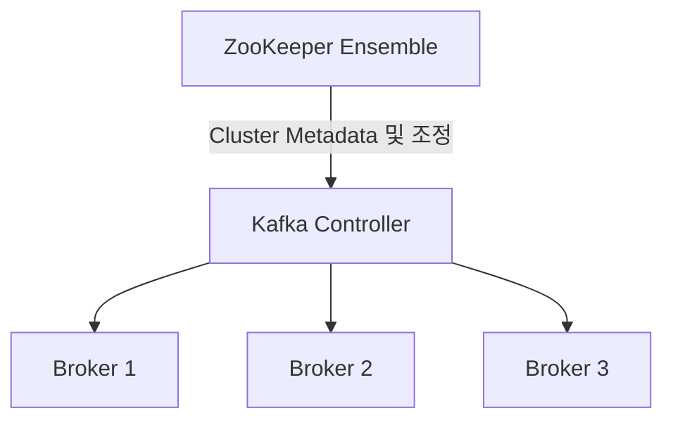

여기서 중요한 점은 ZooKeeper Ensemble의 Leader와 Kafka Controller가 서로 다른 역할이라는 것이다.

ZooKeeper는 자신의 노드 사이에서 합의를 수행한다.

Kafka Controller는 Kafka Cluster의 Partition Leader 선출과 상태 변경 등을 관리한다.

### ZooKeeper 기반 구조의 문제

Kafka와 ZooKeeper를 함께 운영하면 다음과 같은 관리 비용이 발생한다.

- Kafka와 ZooKeeper를 별도로 설치하고 운영
- 서로 다른 시스템의 설정 관리
- 별도의 보안 정책 관리
- 네트워크 구성 복잡성
- ZooKeeper와 Kafka 사이의 상태 동기화
- 장애 복구 절차의 복잡성

특히 Kafka Cluster의 규모가 증가하면 Topic과 Partition 관련 Metadata도 증가한다.

따라서 Metadata 관리의 성능과 운영 복잡성을 개선할 필요가 있었다.

이러한 배경에서 등장한 기술이 KRaft다.

---

## KRaft란?

### KRaft의 개념

KRaft는 Kafka Raft의 약자로, Kafka 자체적으로 클러스터 메타데이터를 관리하기 위한 합의 기반 아키텍처다.

기존의 ZooKeeper 의존성을 제거하고 Kafka 내부에서 메타데이터를 관리하도록 설계되었다.

이러한 전환은 KIP-500을 중심으로 추진되었다.

### Kafka 버전별 변화

| Kafka 버전 | 주요 변화 |
|---|---|
| 3.3 | KRaft가 운영 가능한 단계로 제공 |
| 3.9 | ZooKeeper에서 KRaft로의 전환을 준비하는 주요 버전 |
| 4.0 | ZooKeeper 모드 제거 |
| 4.1 이상 | KRaft 기반 기능과 운영 방식 개선 |
| 4.4 | KRaft 기반 Kafka 운영 |

중요한 점은 **Kafka 4.0부터 ZooKeeper 모드를 지원하지 않는다는 사실**이다.

따라서 Kafka 4.x 환경에서는 ZooKeeper를 사용하는 기존 실행 방식을 그대로 적용할 수 없다.

ZooKeeper 기반 Kafka를 4.x로 업그레이드하려면 지원되는 이전 버전에서 KRaft로 전환하는 절차가 필요하다. [Apache Kafka](https://kafka.apache.org/42/getting-started/upgrade/?utm_source=chatgpt.com)

---

## ZooKeeper와 KRaft의 구조 비교

### ZooKeeper 기반 구조

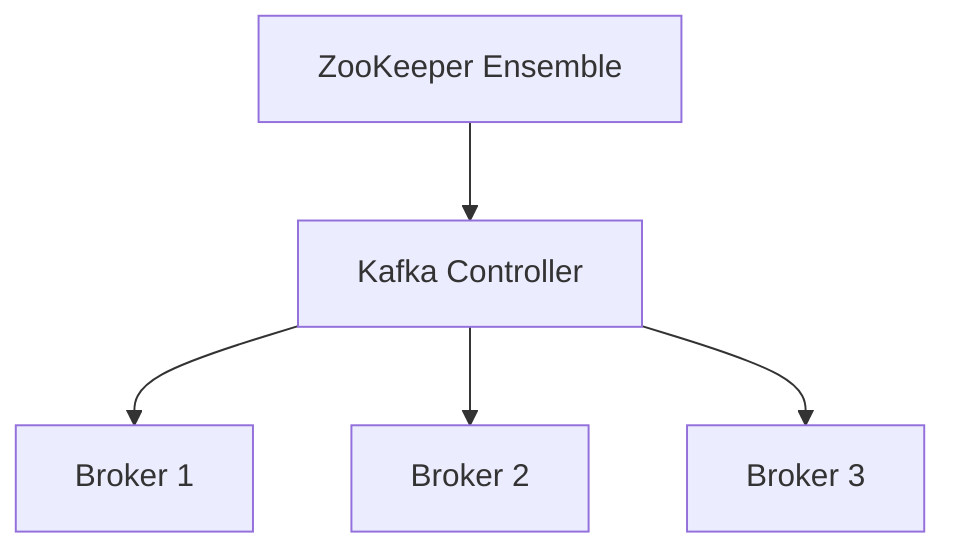

Kafka와 별도의 ZooKeeper 시스템을 운영해야 한다.

### KRaft 기반 구조

```mermaid
flowchart TD
    A["KRaft Controller Quorum"]

    C1["Controller 1"]
    C2["Controller 2"]
    C3["Controller 3"]

    B1["Broker 1"]
    B2["Broker 2"]
    B3["Broker 3"]

    A --> C1
    A --> C2
    A --> C3

    C1 -.->|"Metadata 관리"| B1
    C1 -.-> B2
    C1 -.-> B3
```

KRaft에서는 Kafka 자체의 Controller Quorum이 메타데이터를 관리한다.

이로 인해 별도의 ZooKeeper 시스템을 운영할 필요가 없어진다.

### ZooKeeper와 KRaft 비교

| 항목 | ZooKeeper 기반 | KRaft 기반 |
|---|---|---|
| 메타데이터 관리 | ZooKeeper 활용 | Kafka Controller Quorum |
| 외부 의존성 | ZooKeeper 필요 | ZooKeeper 불필요 |
| 합의 방식 | ZooKeeper 합의 체계 | Kafka Raft |
| 운영 구성 | Kafka와 ZooKeeper 관리 | Kafka 내부 관리 체계 |
| 메타데이터 복제 | ZooKeeper 기반 | Metadata Log 기반 |
| 복구 | ZooKeeper 상태와 Kafka 상태 관리 | Metadata Log와 Snapshot 활용 |
| Kafka 4.x 지원 | 지원하지 않음 | 지원 |

---

## KRaft는 어떻게 동작할까?

KRaft에서는 Controller Quorum이 클러스터 메타데이터를 관리한다.

Controller 사이에서는 Raft 기반 합의를 통해 메타데이터 변경을 일관되게 유지한다.

### Metadata Log

Metadata Log는 Kafka Cluster의 상태 변경 정보를 기록하는 로그다.

예를 들어 다음과 같은 변경이 발생할 수 있다.

```text
Broker 4가 Cluster에 참여했다.

orders Topic이 생성되었다.

Partition 0의 Leader가 변경되었다.

Topic의 설정이 변경되었다.
```

이러한 메타데이터 변경을 로그에 기록하고 Controller 사이에서 복제한다.

### KRaft 동작 구조

```mermaid
flowchart TD
    A["Metadata 변경 요청"]

    B["Active Controller"]

    C["Metadata Log"]

    D["Controller 2"]
    E["Controller 3"]

    F["Metadata 적용"]

    G["Kafka Brokers"]

    H["Snapshot"]

    A --> B

    B --> C

    C --> D
    C --> E

    D --> F
    E --> F

    F --> G

    C --> H
```

KRaft Controller는 메타데이터 변경을 로그에 기록하고, 합의된 로그를 적용하여 클러스터 상태를 관리한다.

### 이벤트 소싱 모델과의 유사성

KRaft의 Metadata Log는 상태 변경을 로그에 기록하고 이를 적용하여 현재 상태를 구성한다는 점에서 이벤트 소싱(Event Sourcing) 모델과 유사한 관점으로 이해할 수 있다.

예를 들어 다음과 같은 상태 변경이 발생했다고 가정해 보자.

```text
1. Broker 1 등록

2. Broker 2 등록

3. orders Topic 생성

4. Partition 0 Leader 변경
```

이러한 변경 로그를 순서대로 적용하면 클러스터 상태를 재구성할 수 있다.

다만 KRaft의 Metadata Log를 일반 애플리케이션이 주문 이벤트를 저장하는 Kafka Topic과 동일한 개념으로 이해해서는 안 된다.

두 로그는 목적과 관리 방식이 다르다.

---

## KRaft Snapshot이란?

Metadata Log에 변경 기록이 계속 쌓이면 과거 로그를 모두 다시 적용하여 상태를 복구하는 데 비용이 증가할 수 있다.

이를 완화하기 위해 Snapshot을 활용한다.

Snapshot은 특정 시점의 메타데이터 상태를 저장한 것이다.

예를 들어 다음과 같은 로그가 있다고 가정해 보자.

```text
Metadata Log

Event 1

Event 2

Event 3

Event 4

Event 5
```

Snapshot이 없다면 상태 복구 시 많은 로그를 적용해야 할 수 있다.

반면 Snapshot이 존재한다면 해당 Snapshot을 기준으로 이후 변경분을 적용하여 상태를 복구할 수 있다.

```text
Snapshot

+

Snapshot 이후 Metadata Log

→

현재 Cluster 상태 복구
```

### Snapshot을 사용하는 이유

- 메타데이터 상태 복구 비용 감소
- 오래된 로그 재생 비용 감소
- Controller 복구 효율 개선
- 대규모 클러스터의 메타데이터 관리 지원

이러한 구조는 KRaft 기반 클러스터의 운영 효율을 높이는 데 도움이 된다.

---

## KRaft Controller Quorum이란?

Quorum은 분산 시스템에서 특정 작업을 합의하기 위해 필요한 노드 집합 또는 합의 조건을 의미한다.

KRaft에서는 Controller가 메타데이터의 일관성을 유지하기 위해 과반수 기반 합의를 사용한다.

### Controller가 세 개인 경우

다음과 같은 구성이 있다고 가정해 보자.

```text
Controller 1

Controller 2

Controller 3
```

과반수는 두 개다.

따라서 Controller 세 개 중 하나에 장애가 발생하더라도 나머지 두 개가 정상이라면 Quorum을 유지할 수 있다.

### Controller가 다섯 개인 경우

```text
Controller 1

Controller 2

Controller 3

Controller 4

Controller 5
```

과반수는 세 개다.

따라서 최대 두 개의 Controller 장애를 감당할 수 있다.

### Controller Quorum 비교

| Controller 수 | 필요한 과반수 | 감당 가능한 Controller 장애 |
|---:|---:|---:|
| 1 | 1 | 0 |
| 3 | 2 | 1 |
| 5 | 3 | 2 |

이러한 계산은 Controller 사이의 합의와 관련된 것이다.

Broker Partition의 Replication Factor와는 다른 개념이다.

---

## Controller Quorum과 Partition Replication의 차이

Kafka에서는 서로 다른 두 가지 복제 구조를 구분해야 한다.

**첫 번째는 업무 Record의 복제다.**

Topic의 Partition에 저장된 이벤트를 Leader와 Follower Replica 사이에서 복제한다.

**두 번째는 Metadata의 복제다.**

KRaft Controller 사이에서 클러스터 상태 정보를 복제한다.

### 구조 비교

```mermaid
flowchart TD
    A["Kafka Cluster"]

    B["Data Plane"]
    C["Control Plane"]

    D["Topic Partition"]
    E["Leader / Follower"]
    F["ISR"]

    G["KRaft Controller Quorum"]
    H["Metadata Log"]
    I["Raft Consensus"]

    A --> B
    A --> C

    B --> D
    D --> E
    E --> F

    C --> G
    G --> H
    H --> I
```

| 구분 | Partition Replication | Controller Quorum |
|---|---|---|
| 주요 목적 | 업무 이벤트 복제 | Cluster Metadata 합의 |
| 관리 대상 | Topic Record | Broker·Topic·Leader 등 상태 |
| 주요 구성 | Leader, Follower, ISR | Active Controller, Quorum |
| 관련 설정 | Replication Factor, 최소 ISR | Controller 구성 및 Quorum |
| 장애 영향 | 특정 Partition의 데이터 처리 | Metadata 변경 및 Leader 관리 |

이 두 구조를 혼동하면 Kafka의 장애 복구 과정을 이해하기 어려워진다.

### Controller Quorum이 무너지면 어떻게 될까?

Controller 과반수가 사라지면 Metadata 합의를 정상적으로 수행하기 어렵다.

따라서 다음과 같은 작업에 문제가 발생할 수 있다.

- Topic 생성 및 변경
- Broker 상태 변경 처리
- 새로운 Partition Leader 선출
- Metadata 갱신

일부 기존 데이터 요청은 특정 조건에서 계속 처리될 수 있지만, 클러스터 전체가 정상적으로 동작한다고 판단해서는 안 된다.

---

## KRaft에서 Broker와 Controller는 반드시 분리해야 할까?

Kafka에서는 프로세스 역할을 다음과 같이 구성할 수 있다.

```properties
process.roles=broker
```

Broker 역할만 수행한다.

```properties
process.roles=controller
```

Controller 역할만 수행한다.

```properties
process.roles=broker,controller
```

Broker와 Controller 역할을 함께 수행한다.

### Combined Mode

Broker와 Controller를 하나의 프로세스에서 실행하는 방식을 Combined Mode라고 부를 수 있다.

개발 환경이나 단순한 테스트 환경에서는 유용하다.

하지만 중요한 운영 환경에서는 Broker와 Controller의 장애 범위를 분리하는 구성을 검토하는 것이 좋다.

예를 들어 Broker의 데이터 처리 부하가 급격히 증가했을 때 Controller의 안정성까지 영향을 받지 않도록 역할을 분리할 수 있다.

### 운영 환경에서의 역할 분리

```mermaid
flowchart TD
    A["Kafka Cluster"]

    subgraph Controllers["Controller Quorum"]
        C1["Controller 1"]
        C2["Controller 2"]
        C3["Controller 3"]
    end

    subgraph Brokers["Data Brokers"]
        B1["Broker 1"]
        B2["Broker 2"]
        B3["Broker 3"]
    end

    A --> Controllers
    A --> Brokers

    Controllers -.->|"Metadata 관리"| Brokers
```

이 구조에서는 Controller가 클러스터 상태 관리를 담당한다.

Broker는 업무 이벤트 저장과 Producer·Consumer 요청 처리를 담당한다.

---

## Kafka 4.4에서 알아야 할 KRaft 구성 차이

KRaft는 Kafka 4.x에서 계속 개선되고 있다.

특히 Controller Quorum은 Static Quorum과 Dynamic Quorum 구성 방식을 구분할 수 있다.

### Static Quorum

미리 지정한 Controller 집합을 기반으로 Quorum을 구성하는 방식이다.

대표적으로 다음과 같은 설정을 사용한다.

```properties
controller.quorum.voters=1@controller1:9093,2@controller2:9093,3@controller3:9093
```

### Dynamic Quorum

Controller 집합을 동적으로 관리할 수 있는 방식이다.

Kafka 4.4에서는 다음과 같은 설정이 사용된다.

```properties
controller.quorum.bootstrap.servers=controller1:9093,controller2:9093,controller3:9093
```

다만 두 설정은 단순히 이름만 변경된 동일한 옵션이 아니다.

Static Quorum과 Dynamic Quorum은 초기화 및 관리 방식에 차이가 있다.

기존 클러스터를 전환하려면 Kafka의 KRaft 기능 버전과 지원되는 전환 절차를 확인해야 한다.

Kafka 4.4 공식 문서에서도 Dynamic Quorum 구성과 Controller 추가·제거 절차를 구분하여 설명한다. [Apache Kafka](https://kafka.apache.org/44/operations/kraft/)

---

## KRaft가 제공하는 장점

KRaft는 Kafka의 메타데이터 관리 구조를 단순화하고 운영 효율을 개선하기 위해 도입되었다.

대표적인 장점은 다음과 같다.

### 1. ZooKeeper 의존성 제거

Kafka와 별도의 ZooKeeper Cluster를 운영할 필요가 없다.

### 2. 운영 구성 단순화

Kafka의 메타데이터 관리 구조가 내부로 통합된다.

### 3. 보안 및 모니터링 관리 개선

서로 다른 두 시스템을 관리하는 복잡성을 줄일 수 있다.

### 4. Metadata Log 기반 상태 관리

클러스터 상태 변경을 로그로 관리하고 복제할 수 있다.

### 5. Snapshot 기반 복구 효율 개선

Snapshot을 활용하여 메타데이터 상태 재구성 비용을 줄일 수 있다.

### 6. 대규모 Partition 환경 지원

많은 Topic과 Partition을 가진 클러스터에서 메타데이터 처리 효율을 높이는 데 도움이 된다.

### 7. Controller 장애 복구 개선

기존 구조보다 Controller 전환 및 복구 효율을 개선할 수 있다.

### 8. Broker 관리 작업 개선

Broker의 종료와 복구, Leader 관리 작업을 효율적으로 수행할 수 있도록 설계되었다.

다만 KRaft를 사용한다고 모든 Controller 장애가 즉시 복구되거나 모든 운영 작업이 항상 더 빠르게 수행된다고 보장되는 것은 아니다.

실제 성능은 Controller 수와 Metadata 규모, 디스크 성능, 네트워크 상태 등에 따라 달라진다.

---

## Kafka 고가용성을 실무에서 설계하는 방법

Kafka를 운영 환경에 도입할 때는 단순히 Replication Factor를 설정하는 것만으로 충분하지 않다.

데이터의 중요도와 장애 허용 범위, 운영 비용을 함께 고려해야 한다.

### 1. 중요한 Topic의 Replication Factor 설정

비즈니스 이벤트의 중요도에 따라 적절한 Replication Factor를 선택해야 한다.

예를 들어 결제 완료 이벤트처럼 유실되면 복구 비용이 큰 데이터는 충분한 복제본을 유지하는 것이 중요하다.

### 2. min.insync.replicas 설정

Replication Factor가 3이라면 최소 ISR을 2로 설정하는 구성을 검토할 수 있다.

이렇게 하면 Replica가 하나만 남은 상태에서 새로운 쓰기를 성공으로 판단하는 위험을 줄일 수 있다.

### 3. Producer의 acks 설정

중요한 데이터에서는 `acks=all`을 검토할 수 있다.

다만 `acks=all`만으로 모든 데이터 손실 가능성이 제거되는 것은 아니다.

### 4. Producer 멱등성 설정

Producer의 재시도 과정에서 중복 기록을 방지하도록 `enable.idempotence=true` 설정을 검토할 수 있다.

### 5. Consumer 멱등성 확보

Kafka 내부의 중복 방지와 Consumer의 업무 처리 중복 방지는 서로 다른 문제다.

따라서 Consumer에서도 중복 처리에 대응해야 한다.

### 6. ISR 상태 모니터링

ISR이 감소하는 상황을 감지해야 한다.

ISR 감소는 네트워크 문제나 Broker 장애, 복제 지연 등의 신호일 수 있다.

### 7. Under-Replicated Partition 모니터링

정상적으로 동기화된 Replica 수가 기대보다 부족한 Partition이 있는지 확인해야 한다.

### 8. Broker별 Leader 분산

특정 Broker에 Leader Partition과 트래픽이 지나치게 집중되지 않도록 관리해야 한다.

### 9. 장애 영역 분리

Replica를 서로 다른 Broker에 배치하는 것뿐 아니라 Rack이나 Availability Zone 등의 장애 영역을 고려해야 한다.

예를 들어 모든 Replica가 동일한 Availability Zone에 있다면 해당 Zone 장애에 취약할 수 있다.

### 10. 저장 공간 여유 확보

Replication Factor가 증가하면 저장 공간도 증가한다.

또한 Broker 장애 이후 Replica를 복구하거나 재배치하는 데 추가 공간이 필요할 수 있다.

### 11. Controller Quorum 안정성 확보

KRaft Controller의 과반수와 장애 배치를 고려해야 한다.

Controller 장애가 메타데이터 관리와 Leader 선출에 영향을 줄 수 있기 때문이다.

### 12. 복구 절차 문서화

Leader Election 실패나 ISR 축소, 전체 Broker 장애 등의 상황에 대한 복구 절차를 준비해야 한다.

특히 Unclean Leader Election을 수행해야 하는 상황에서는 데이터 손실 가능성을 명확하게 이해해야 한다.

---

## 실무 예제: 결제 이벤트의 순서와 고가용성 설계

지금까지 살펴본 개념을 실제 결제 시스템에 적용해 보자.

구독 결제 시스템에서 다음과 같은 이벤트가 발생한다고 가정해 보자.

```text
SubscriptionCreated

PaymentCompleted

MembershipActivated

SubscriptionCancelled
```

이 이벤트들은 하나의 구독에 대한 상태 변경이다.

따라서 순서가 중요할 수 있다.

### Topic 설계

다음과 같은 Topic을 구성할 수 있다.

```text
payment.subscription.events.v1
```

### Partition Key

동일한 구독에 대한 이벤트가 같은 Partition으로 전달되도록 `subscriptionId`를 Key로 사용할 수 있다.

```text
Key: subscription-1001
```

### Value

```json
{
  "eventId": "evt-10001",
  "eventType": "PaymentCompleted",
  "eventVersion": 1,
  "subscriptionId": "subscription-1001",
  "paymentId": "payment-9001",
  "amount": 29000,
  "currency": "KRW",
  "occurredAt": "2026-11-20T10:30:00+09:00"
}
```

### Kafka 구성

```text
Topic: payment.subscription.events.v1

Partition Count: 8

Replication Factor: 3

min.insync.replicas: 2
```

Producer에서는 다음과 같이 설정할 수 있다.

```properties
acks=all
enable.idempotence=true
compression.type=zstd
```

### 전체 아키텍처

```mermaid
flowchart TD
    A["Payment Service"]

    B["Kafka Producer"]

    C["Topic: payment.subscription.events.v1"]

    D["Partition 0"]
    E["Partition 1"]
    F["Partition 2"]

    G["Membership Consumer"]
    H["Notification Consumer"]
    I["Analytics Consumer"]

    J["Membership Database"]
    K["Notification System"]
    L["Analytics Storage"]

    A --> B
    B --> C

    C --> D
    C --> E
    C --> F

    D --> G
    E --> G
    F --> G

    D --> H
    E --> H
    F --> H

    D --> I
    E --> I
    F --> I

    G --> J
    H --> K
    I --> L
```

이 구조에서 Membership Consumer와 Notification Consumer, Analytics Consumer는 서로 다른 Consumer Group으로 구성할 수 있다.

따라서 동일한 이벤트를 각자의 목적에 따라 독립적으로 처리한다.

### 설계에서 중요한 점

첫 번째는 Partition Key다.

동일한 구독에서 발생한 이벤트를 같은 Partition으로 보내도록 설계해야 한다.

두 번째는 이벤트 순서다.

Kafka에 저장된 순서와 Consumer의 업무 처리 완료 순서가 항상 같지는 않으므로 Consumer 내부의 병렬 처리 방식을 고려해야 한다.

세 번째는 데이터 내구성이다.

Replication Factor와 ISR, `acks` 설정을 조합하여 어떤 수준의 저장 확인을 요구할지 결정해야 한다.

네 번째는 장애 복구다.

Consumer가 이벤트를 처리한 후 Offset을 Commit하기 전에 종료되면 동일한 이벤트를 다시 처리할 수 있다.

따라서 멱등성이 필요하다.

다섯 번째는 데이터베이스와 Kafka 사이의 정합성이다.

결제 데이터베이스 저장과 Kafka 이벤트 발행이 서로 다른 작업이라면 Transactional Outbox 등의 패턴을 검토해야 한다.

결국 **Kafka의 데이터 모델과 고가용성 설정은 실제 비즈니스의 정합성과 장애 복구 요구사항에 맞춰 설계해야 한다.**

---

## Kafka 핵심 개념에서 자주 발생하는 오해

마지막으로 Kafka를 이해할 때 혼동하기 쉬운 개념을 정리해 보자.

| 잘못 이해하기 쉬운 내용 | 정확한 이해 |
|---|---|
| Topic은 하나의 저장 파일이다. | Topic은 여러 Partition으로 구성될 수 있는 논리적 단위다. |
| Partition이 많을수록 성능이 무조건 좋아진다. | 병렬성은 증가할 수 있지만 관리 비용과 병목도 고려해야 한다. |
| Producer가 네 개면 Partition도 네 개여야 한다. | Producer 수와 Partition 수는 독립적으로 설계한다. |
| Partition 수는 자유롭게 늘리고 줄일 수 있다. | 일반적으로 증가할 수 있지만 감소는 지원하지 않는다. |
| Offset은 Kafka 전체에서 유일하다. | Offset은 Partition별로 관리된다. |
| 모든 Partition의 메시지는 전역적으로 순서가 보장된다. | 순서는 Partition 내부에서 보장된다. |
| 같은 Key는 어떤 상황에서도 같은 Partition에 저장된다. | Partition 수와 분배 방식 등이 유지되어야 한다. |
| Key가 없으면 무조건 Round Robin으로 분배된다. | 현재 Java Producer는 기본 Sticky 분배를 사용한다. |
| Kafka는 JSON 형식을 사용해야 한다. | Kafka는 Value를 Byte 데이터로 처리하며 다양한 형식을 사용할 수 있다. |
| Kafka는 기본적으로 모든 메시지를 압축한다. | Producer의 기본 압축 설정은 `none`이다. |
| Broker가 세 대면 고가용성이 보장된다. | Partition의 Replication Factor와 Replica 배치를 확인해야 한다. |
| Replication Factor 3은 Follower가 세 개라는 뜻이다. | Leader를 포함하여 총 세 Replica라는 뜻이다. |
| 모든 Broker가 데이터를 읽고 쓴다. | 일반적으로 Partition Leader가 주요 읽기·쓰기 요청을 처리한다. |
| ISR은 살아 있는 Broker 목록이다. | Leader와 충분히 동기화된 Replica 집합이다. |
| ISR에서 제외되면 Replica가 삭제된다. | 동기화 상태에 따라 ISR에서 제외되거나 다시 합류할 수 있다. |
| acks=all이면 절대 데이터가 유실되지 않는다. | 최소 ISR과 Replica 상태 등도 함께 고려해야 한다. |
| 장애 후 먼저 살아난 Follower가 무조건 Leader가 된다. | 안전한 Leader 선출 조건을 만족해야 한다. |
| 모든 Kafka 버전에서는 ISR에 포함된 Replica만 Leader가 된다. | 최신 Kafka에서는 ELR도 고려해야 한다. |
| KRaft는 Partition 데이터 복제를 대체한다. | KRaft는 Cluster Metadata 합의를 담당한다. |
| Kafka 4.x에서도 ZooKeeper를 사용할 수 있다. | Kafka 4.0부터 ZooKeeper 모드는 제거되었다. |

이러한 차이를 이해하면 Kafka의 데이터 저장과 복제, 장애 복구 과정을 더욱 정확하게 파악할 수 있다.

---

## Kafka 데이터 모델과 고가용성의 전체 구조

지금까지 살펴본 개념을 하나의 아키텍처로 정리하면 다음과 같다.

```mermaid
flowchart TD
    A["Producer"]

    subgraph Kafka["Kafka Cluster"]
        B["Topic: payment-events"]

        C["Partition 0"]
        D["Partition 1"]

        E["Broker 1<br/>P0 Leader / P1 Follower"]
        F["Broker 2<br/>P0 Follower / P1 Leader"]
        G["Broker 3<br/>P0 Follower / P1 Follower"]

        H["ISR 관리"]
    end

    subgraph Control["KRaft Controller Quorum"]
        I["Controller 1"]
        J["Controller 2"]
        K["Controller 3"]

        L["Metadata Log"]
        M["Snapshot"]
    end

    N["Consumer Group A"]
    O["Consumer Group B"]

    A -->|"Record 전송"| B

    B --> C
    B --> D

    C --> E
    C --> F
    C --> G

    D --> E
    D --> F
    D --> G

    E --> H
    F --> H
    G --> H

    H --> N
    H --> O

    I --> L
    J --> L
    K --> L

    L --> M

    L -.->|"Metadata 및 Leader 관리"| Kafka
```

이 구조에는 Kafka의 두 가지 중요한 관점이 포함되어 있다.

### 첫 번째: Data Plane

Data Plane은 실제 이벤트를 저장하고 전달하는 영역이다.

다음 구성 요소들이 해당한다.

- Producer
- Topic
- Partition
- Leader
- Follower
- ISR
- Consumer

Kafka의 이벤트 처리량과 데이터 복제, Consumer 처리 성능을 이해할 때 중요한 영역이다.

### 두 번째: Control Plane

Control Plane은 Kafka Cluster의 상태와 구성을 관리하는 영역이다.

다음 구성 요소들이 해당한다.

- KRaft Controller
- Controller Quorum
- Metadata Log
- Snapshot
- Broker 등록 및 상태 관리
- Partition Leader 관리

Kafka의 클러스터 운영과 Metadata 일관성, Controller 장애 복구를 이해할 때 중요한 영역이다.

**Kafka를 운영할 때는 Data Plane과 Control Plane의 역할을 구분해야 한다.**

Kafka의 Partition Replication은 업무 이벤트의 복제를 담당한다.

KRaft Controller Quorum은 클러스터 상태와 Metadata의 합의를 담당한다.

이 두 구조가 함께 동작하면서 Kafka는 분산 이벤트 스트리밍 플랫폼으로서 기능한다.

---

## 정리

Apache Kafka의 핵심 개념은 크게 **데이터 모델과 고가용성 아키텍처**로 구분하여 이해할 수 있다.

데이터 모델에서는 Topic, Partition, Offset, Record가 중요하다.

Topic은 이벤트를 논리적으로 구분하기 위한 이름이다.

Partition은 Topic을 물리적으로 나누어 저장하는 단위이며 Kafka의 병렬 처리와 확장성에 중요한 역할을 한다.

Offset은 Partition 내부에서 Record의 위치를 나타내는 값이다.

Kafka는 Partition 내부의 Record 순서를 유지하지만 서로 다른 Partition 사이의 전역적인 순서는 보장하지 않는다.

따라서 동일한 주문이나 결제와 같이 이벤트 순서가 중요한 데이터는 적절한 Partition Key를 사용해야 한다.

Kafka Record는 Key, Value, Timestamp, Headers 등의 정보로 구성된다.

Key는 Partition 분배와 관련된 식별 정보로 활용할 수 있다.

Value는 실제 전달할 데이터를 의미한다.

Timestamp는 Record의 생성 또는 Broker 기록 시각을 표현한다.

Headers는 추적 정보나 데이터 형식 등의 부가 정보를 전달한다.

Kafka는 Value의 형식을 특정하지 않으므로 JSON, Avro, Protobuf, MessagePack 등 다양한 직렬화 형식을 사용할 수 있다.

또한 메시지 압축을 이용하여 네트워크와 디스크 사용량을 줄일 수 있다.

다만 압축에는 CPU 비용이 발생하므로 실제 데이터 특성과 시스템 요구사항에 맞게 선택해야 한다.

Partition 수는 Kafka의 처리량에 영향을 주는 중요한 설계 요소다.

Partition을 여러 개 구성하면 데이터 분산과 Consumer 병렬 처리가 가능하다.

하지만 Partition 수가 증가하면 Broker가 관리해야 할 파일과 Metadata, Replica 상태 등의 비용도 증가한다.

따라서 Partition 수는 목표 처리량과 Consumer의 처리 능력, 장애 복구 시간 등을 기준으로 결정해야 한다.

고가용성에서는 Replication Factor, Leader, Follower, ISR, `acks`, `min.insync.replicas`를 이해해야 한다.

Replication은 Topic을 구성하는 Partition 단위로 수행된다.

Replication Factor는 하나의 Partition에 대해 유지할 전체 Replica 수를 의미한다.

Leader는 해당 Partition의 주요 읽기 및 쓰기 요청을 처리한다.

Follower는 Leader의 데이터를 복제한다.

ISR은 Leader와 충분히 동기화된 Replica의 집합이다.

Kafka에서 Broker 장애가 발생하면 적절한 Replica가 새로운 Leader로 승격될 수 있다.

그러나 모든 Replica가 동일한 데이터를 보유하고 있는 것은 아니므로 Leader 선출 과정에서는 데이터 내구성을 고려해야 한다.

특히 오래된 Replica를 안전성 검증 없이 Leader로 승격하면 데이터가 유실될 수 있다.

이러한 상황에서 중요한 개념이 Unclean Leader Election이다.

Unclean Leader Election은 가용성을 회복할 가능성을 제공하지만 데이터 손실 위험을 동반할 수 있다.

또한 Kafka 4.0부터는 Eligible Leader Replicas(ELR) 기능이 제공되며, 최신 버전에서는 ISR 외에 안전한 Leader 후보를 관리하는 방식도 활용된다.

Producer의 `acks` 설정은 메시지 저장 확인 수준을 결정한다.

`acks=0`은 Broker의 저장 확인을 기다리지 않는다.

`acks=1`은 Leader의 기록 확인을 기다린다.

`acks=all`은 ISR 기반의 저장 확인을 기다린다.

이때 `min.insync.replicas`를 함께 설정하면 쓰기 성공에 필요한 최소 동기화 Replica 수를 제한할 수 있다.

따라서 Kafka의 고가용성을 확보하려면 Broker 수뿐 아니라 Replication Factor와 ISR, Producer의 저장 확인 설정을 함께 고려해야 한다.

마지막으로 Kafka의 클러스터 관리 아키텍처를 이해해야 한다.

과거 Kafka는 ZooKeeper를 이용하여 클러스터 메타데이터와 상태를 관리했다.

그러나 별도의 ZooKeeper를 운영해야 하는 복잡성이 존재했다.

이를 개선하기 위해 Kafka는 KRaft를 도입했다.

KRaft는 Kafka 내부의 Controller Quorum을 이용하여 클러스터 메타데이터를 관리한다.

메타데이터 변경을 로그에 기록하고 Controller 사이에서 복제하며, Snapshot을 활용하여 상태 복구 효율을 개선할 수 있다.

또한 Kafka 4.0부터 ZooKeeper 모드가 제거되었으므로 현재 Kafka 4.x에서는 KRaft를 기준으로 아키텍처를 이해해야 한다.

실제 운영에서는 이러한 개념들이 서로 연결된다.

Partition 수는 처리량과 Consumer 병렬성에 영향을 준다.

Partition Key는 이벤트 분배와 순서에 영향을 준다.

Replication Factor는 저장 공간과 장애 대응 능력에 영향을 준다.

ISR과 `acks`, `min.insync.replicas`는 메시지의 쓰기 성공 조건과 내구성에 영향을 준다.

KRaft Controller는 이러한 Partition과 Replica의 상태를 일관되게 관리한다.

따라서 **Kafka의 성능과 안정성을 제대로 이해하려면 Topic과 Partition 같은 데이터 저장 구조뿐 아니라 Replica의 동기화 상태, Leader 선출, Producer의 저장 확인 정책, 클러스터 메타데이터 관리 방식까지 함께 이해해야 한다.**

이러한 개념을 바탕으로 Kafka를 설계하면 단순한 메시지 전달을 넘어 높은 처리량과 장애 대응 능력이 요구되는 이벤트 기반 시스템을 구축할 수 있다.

### 한 줄 요약

**Kafka는 Topic과 Partition을 이용하여 이벤트를 분산 저장하고 Offset을 통해 Record의 위치를 관리한다. Partition은 병렬 처리와 순서 보장의 기본 단위이며, Replication Factor와 Leader·Follower·ISR을 통해 데이터 내구성과 고가용성을 설계한다. Producer의 `acks`와 `min.insync.replicas`는 저장 성공 조건을 결정하고, KRaft Controller Quorum은 클러스터 메타데이터의 합의를 담당한다. 따라서 Kafka 운영에서는 데이터 모델, 복제 정책, Leader 선출, 장애 복구 및 KRaft 아키텍처를 함께 이해하는 것이 중요하다.**
