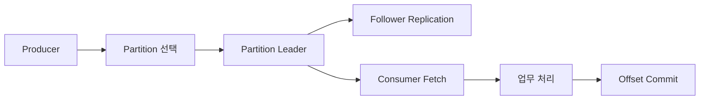
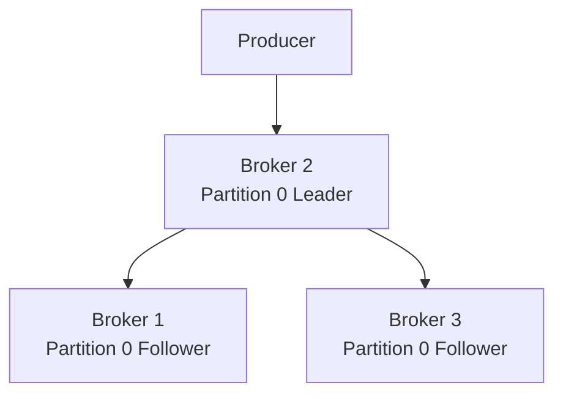
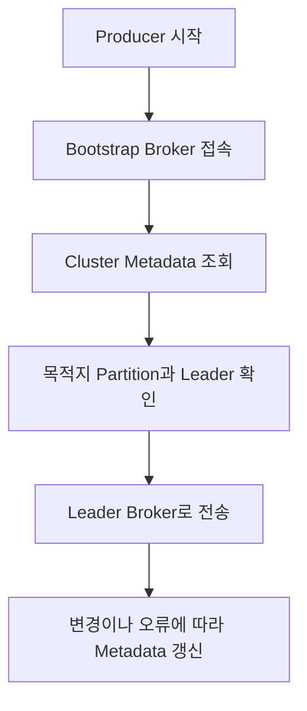
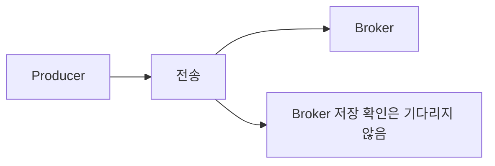
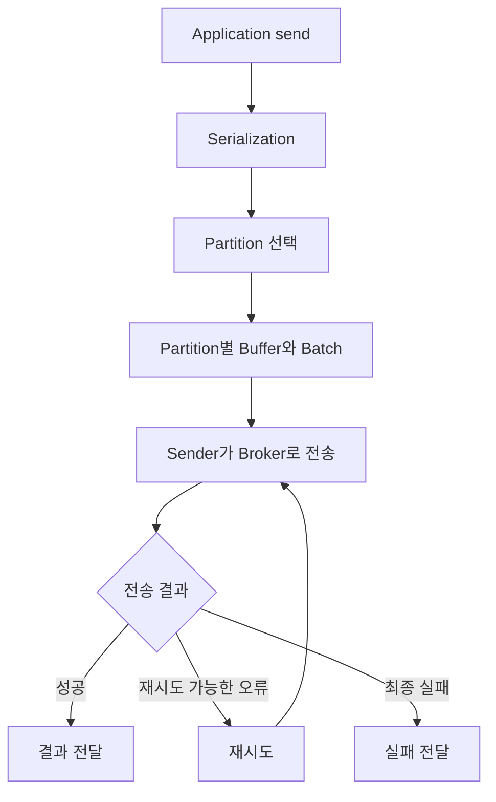
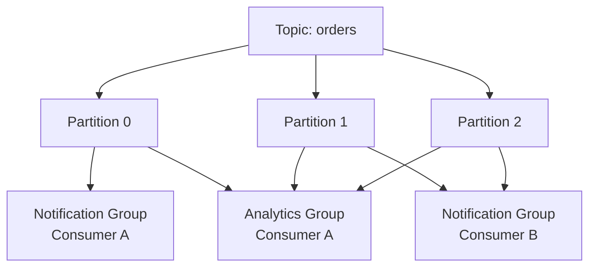
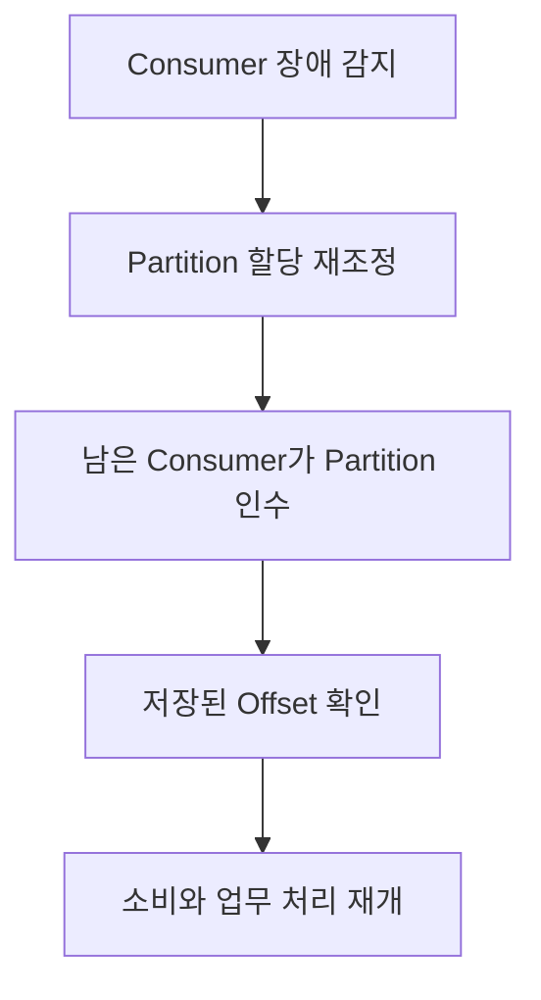
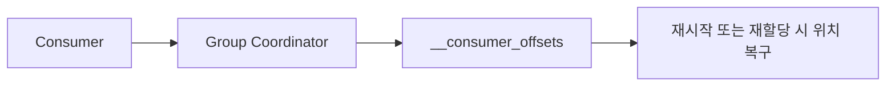

# 카프카 아키텍처 알아보기

# 카프카 아키텍처 알아보기

* toc
{:toc}

---

## Kafka 아키텍처: Producer와 Consumer의 동작

Kafka의 데이터 흐름은 Producer가 Topic에 Record를 기록하고 Consumer가 이를 읽는 구조다. 하지만 실제로는 Producer가 접속한 Broker에 아무 데이터나 보내거나 Consumer가 Cluster 전체에서 무작위로 메시지를 가져오는 방식으로 동작하지 않는다.

Producer는 Record를 저장할 Partition을 결정하고 해당 Partition의 Leader로 전송한다. Consumer는 자신에게 할당된 Partition과 읽을 Offset을 기준으로 데이터를 가져온다.



이 과정에서 세 가지 완료 시점을 구분해야 한다.

- Producer가 전송할 데이터를 자신의 Buffer에 넣은 시점
- Kafka가 설정된 조건에 따라 저장을 확인한 시점
- Consumer가 데이터를 읽고 실제 업무 처리를 완료한 시점

Kafka에 전송했다는 사실과 주문 처리, 이메일 발송, Database 저장이 끝났다는 사실은 서로 다르다. 설정을 이해할 때도 어느 단계의 성공과 실패를 제어하는지 먼저 살펴봐야 한다.

## Producer의 동작 구조

### Producer는 Partition Leader로 데이터를 보낸다

다음과 같이 `peter-topic`의 Partition 0이 세 Broker에 복제되어 있다고 가정한다.

| Broker | 역할 |
|---|---|
| Broker 1 | Partition 0 Follower |
| Broker 2 | Partition 0 Leader |
| Broker 3 | Partition 0 Follower |

Replica가 Leader를 포함해 세 개이므로 Replication Factor는 `3`이다.

Producer는 이 Partition의 Leader인 Broker 2로 데이터를 보낸다. Follower는 Leader의 데이터를 복제한다.



Broker 1에 먼저 접속했다고 해서 모든 데이터를 Broker 1을 경유해 보내는 것은 아니다. Producer는 Metadata를 조회한 뒤 실제 목적지 Broker와 연결한다.

### bootstrap.servers는 최초 연결 주소다

`bootstrap.servers`는 Kafka Cluster에 처음 접속할 때 사용할 Broker 주소 목록이다.

```properties
bootstrap.servers=broker-1:9092,broker-2:9092,broker-3:9092
```

Producer는 이 주소를 통해 Topic, Partition과 Leader 등의 Metadata를 확인한다. 이후 해당 Partition의 Leader로 요청을 보낸다.



주소 목록에 모든 Broker를 넣어야 하는 것은 아니다. 다만 하나만 지정하면 최초 연결 시 그 Broker가 중단되어 있을 때 접속에 실패할 수 있으므로 여러 주소를 제공하는 편이 좋다.

Kafka에는 모든 업무 데이터를 처리하는 단일 Master Broker가 없다. 그렇다고 Leader 개념이 없는 것은 아니다. 업무 데이터에는 Partition Leader가 있고, Metadata 관리에는 Controller가 있다.

접속 장애에서는 `bootstrap.servers`뿐 아니라 Broker가 `advertised.listeners`로 알리는 주소도 확인해야 한다. Bootstrap 주소에는 연결되지만 이후 전달받은 Broker 주소에 접근하지 못하는 경우가 있기 때문이다.

### Partition 선택

Producer는 다음 조건에 따라 Record를 보낼 Partition을 결정한다.

| 조건 | 일반적인 동작 |
|---|---|
| Partition 직접 지정 | 지정한 Partition으로 전송 |
| Partition 미지정, Key 존재 | 직렬화한 Key를 기준으로 분배 |
| Partition과 Key 모두 없음 | 기본 Partitioner의 분배 방식 사용 |
| Custom Partitioner 사용 | 구현한 규칙에 따라 분배 |

같은 Key를 같은 Partition으로 보내면 해당 Key의 이벤트를 순서대로 처리하는 데 도움이 된다. 다만 Partition 수, Key 직렬화 방식과 Partitioner가 유지된다는 조건이 필요하다.

Key가 없을 때 현재 Java Producer의 기본 동작을 단순한 Round Robin으로 이해해서는 안 된다. Batch 효율을 높이는 Sticky Partitioning과 Broker 성능을 고려하는 Adaptive Partitioning 등이 적용될 수 있다.

## Producer의 저장 확인: acks

### acks가 결정하는 것

`acks`는 Producer가 Broker에 Record를 보낸 뒤 어떤 저장 확인을 기다릴지 결정한다.

| 설정 | 확인 범위 |
|---|---|
| `acks=0` | Broker의 저장 확인 응답을 기다리지 않음 |
| `acks=1` | Leader의 로컬 로그 기록 확인 |
| `acks=all` 또는 `-1` | 현재 ISR 전체의 기록 확인 |

`acks`는 Consumer의 업무 처리 완료를 확인하는 설정이 아니다. 또한 비동기 Producer는 여러 요청을 처리 중인 상태로 유지할 수 있으므로 항상 메시지 하나의 응답을 받은 뒤 다음 메시지를 보내는 것도 아니다.

### acks=0

Producer는 Broker의 저장 확인 응답을 기다리지 않는다.



확인 응답을 기다리는 비용은 줄일 수 있지만 Broker가 실제로 받았는지, 로그에 기록했는지 확인할 수 없다. 응답을 받지 않으므로 서버 측 저장 실패를 근거로 한 일반적인 재시도도 기대하기 어렵다.

전송 전에 발생하는 직렬화 오류나 Metadata 조회 실패까지 사라진다는 뜻은 아니다. 또한 최근 Producer의 Idempotence 설정과 충돌할 수 있으므로 `acks`만 따로 바꾸기보다 관련 설정을 함께 확인해야 한다.

### acks=1

Leader는 Record를 자신의 로그에 기록한 뒤 Producer에 성공 응답을 보낸다. 이 응답을 위해 Follower 복제 완료까지 기다리지는 않는다.

```text
Producer 전송
→ Leader 기록
→ Producer에 성공 응답
→ Follower 복제
```

Follower가 복제하기 전에 Leader가 장애를 겪으면 새 Leader에 해당 Record가 없을 수 있다. 이 경우 Producer가 성공으로 판단한 데이터도 손실될 가능성이 있다.

따라서 `acks=1`의 위험은 단순한 데이터 형식 손상보다는 **성공 응답을 받은 Record의 유실 가능성**으로 이해하는 편이 정확하다.

### acks=all과 min.insync.replicas

`acks=all`은 현재 ISR 전체의 기록 확인을 기다린다. 여기서 ISR은 Leader를 포함한 In-Sync Replica 집합이다.

`min.insync.replicas`는 이러한 쓰기가 성공하기 위해 필요한 최소 ISR 수를 지정한다.

Replication Factor가 3인 상황을 비교하면 다음과 같다.

| 최소 ISR | 현재 ISR | `acks=all` 쓰기 |
|---:|---:|---|
| 1 | 3 | 현재 ISR 세 개의 확인을 기다림 |
| 1 | 1 | Leader 하나만으로 성공할 수 있음 |
| 2 | 3 | 현재 ISR 세 개의 확인을 기다림 |
| 2 | 2 | 현재 ISR 두 개의 확인을 기다림 |
| 2 | 1 | 최소 조건 부족으로 실패 |
| 3 | 3 | 세 개의 확인 후 성공 가능 |
| 3 | 2 | 최소 조건 부족으로 실패 |

`min.insync.replicas=2`가 “항상 두 개만 확인한다”는 뜻은 아니다. ISR이 세 개라면 `acks=all`은 세 개를 기준으로 동작한다. 최소 ISR은 확인할 대상을 두 개로 줄이는 값이 아니라 쓰기를 허용할 최소 조건이다. [Kafka의 최소 ISR 설정](https://kafka.apache.org/43/configuration/topic-configs/)

### 최소 ISR을 높일 때의 선택

다음 조합은 내구성과 일부 장애 상황의 쓰기 가용성을 함께 고려할 때 자주 검토하는 출발점이다.

```text
Replication Factor: 3
min.insync.replicas: 2
acks: all
```

한 Replica가 빠져도 두 개의 ISR이 남으면 쓰기를 계속할 수 있다. 반면 최소 ISR을 3으로 두면 Replica 하나만 이탈해도 쓰기가 실패한다.

데이터를 여러 곳에 남기는 조건은 엄격해지지만 장애 중 쓰기 가용성은 낮아지는 것이다.

`acks=all` 역시 모든 물리적 장애에서 무손실을 보장하는 설정은 아니다. Replica 배치, 디스크 장애, Leader 선출 정책과 Client의 실패 처리까지 함께 고려해야 한다.

## Producer Buffer, Batch와 재시도

### Producer의 내부 처리 흐름

Producer는 애플리케이션에서 받은 Record를 직렬화하고 Partition별로 모아 Broker에 전송한다.



Java Producer의 일반적인 `send()` 호출은 비동기다. 호출이 반환되었다고 Kafka 저장까지 완료된 것은 아니다. Future나 Callback으로 최종 결과를 확인해야 한다.

### buffer.memory

`buffer.memory`는 전송을 기다리는 Record를 Buffer에 보관하는 데 사용하는 메모리 크기다.

```properties
buffer.memory=33554432
```

위 값은 32MiB다.

Broker가 느려지거나 Network에 문제가 생겨 전송 속도보다 유입 속도가 빨라지면 Buffer가 찰 수 있다. Buffer를 확보하지 못하면 `send()`가 대기하고 `max.block.ms` 한도를 넘으면 실패할 수 있다.

이 값은 Producer가 사용하는 전체 메모리의 엄격한 상한은 아니다. 압축과 진행 중인 요청 등에도 메모리가 필요하다.

Buffer만 크게 늘리면 일시적인 증가를 더 오래 흡수할 수 있지만 지속적인 처리량 부족을 해결하지는 못한다.

### batch.size와 linger.ms

`batch.size`는 같은 Partition으로 보낼 Record를 묶는 Batch 크기의 기준이다.

```properties
batch.size=16384
linger.ms=5
```

`batch.size=16384`는 16KiB다. Producer는 데이터를 묶어 전송해 요청 횟수와 처리 비용을 줄이려고 한다.

`linger.ms`는 Batch를 더 모으기 위해 기다릴 수 있는 시간이다. 데이터가 충분히 모이면 더 빨리 전송할 수 있으며, 항상 설정 시간만큼 기다리는 것은 아니다.

| 설정 방향 | 기대 효과와 비용 |
|---|---|
| 작은 Batch | 작은 단위 전송, 요청 수 증가 가능 |
| 큰 Batch | 전송 효율 개선, 메모리 사용 증가 가능 |
| 짧은 대기 | 낮은 지연에 유리 |
| 긴 대기 | Batch와 압축 효율 개선 가능, 지연 증가 가능 |

Partition이 지나치게 많고 Partition별 유입량이 적으면 작은 Batch가 여러 곳에 흩어져 효율이 떨어질 수도 있다.

### compression.type

Producer는 다음 압축 방식을 지원한다.

```text
none, gzip, snappy, lz4, zstd
```

```properties
compression.type=zstd
```

압축은 Record Batch 단위로 적용되므로 Batch 구성과 Payload의 특성에 따라 효과가 달라진다. Network와 저장량을 줄일 수 있는 대신 CPU 비용이 발생한다.

### retries와 delivery.timeout.ms

`retries`는 일시적인 전송 오류가 발생했을 때 재시도할 횟수다. 그러나 횟수만 높게 지정한다고 무한정 재시도하지는 않는다.

`delivery.timeout.ms`는 Buffer 대기, 응답 대기와 재시도를 포함해 최종 결과를 알릴 때까지의 시간에 영향을 준다. `request.timeout.ms`는 개별 요청의 응답 대기 시간을 제어한다.

| 설정 | 제어 대상 |
|---|---|
| `retries` | 재시도 가능한 오류의 재시도 횟수 |
| `request.timeout.ms` | 개별 요청 응답 대기 |
| `delivery.timeout.ms` | 전송 결과를 확정하기까지의 전체 시간 한도 |
| `max.block.ms` | Metadata나 Buffer 확보 등 호출 과정의 대기 |

Broker에 기록은 되었지만 응답만 유실된 경우 재시도로 중복 기록이 발생할 수 있다. Idempotent Producer는 이러한 Producer 재시도 중복을 줄이지만, 애플리케이션이 같은 업무 이벤트를 새로 생성해 두 번 보내는 문제까지 제거하지는 않는다.

### max.request.size

`max.request.size`는 Producer 요청의 최대 크기다. 단일 업무 메시지의 Payload 크기와 완전히 같은 개념은 아니다. 요청에는 여러 Record Batch가 포함될 수 있으며 비압축 Batch 크기의 상한에도 영향을 준다.

대표적인 기본값인 `1048576` Byte는 1MiB다.

```properties
max.request.size=1048576
```

큰 메시지를 보내려면 Producer 설정만 늘려서는 부족하다. Broker와 Topic의 최대 Record Batch 크기, Consumer Fetch 설정도 함께 확인해야 한다.

이미지나 영상처럼 큰 파일은 Object Storage에 저장하고 Kafka에는 위치와 Metadata를 전달하는 편이 적합한 경우가 많다.

### Producer 설정 예제

다음은 일반적인 Java Producer Client의 설정 예다. Broker 주소는 실제 환경에 맞춰 변경해야 한다.

```properties
bootstrap.servers=broker-1:9092,broker-2:9092,broker-3:9092

key.serializer=org.apache.kafka.common.serialization.StringSerializer
value.serializer=org.apache.kafka.common.serialization.StringSerializer

acks=all
enable.idempotence=true

buffer.memory=33554432
batch.size=16384
linger.ms=5
compression.type=zstd

max.request.size=1048576
request.timeout.ms=30000
delivery.timeout.ms=120000
max.block.ms=60000
```

이 설정은 Topic의 Replication Factor와 최소 ISR을 대신하지 않는다. 실제 내구성 조건은 Topic 설정과 함께 검토해야 한다.

기본 분배 방식과 설정 간 제약은 Client 버전에 따라 확인하는 것이 좋다. [Kafka Producer 설정](https://kafka.apache.org/43/generated/producer_config.html)

## Consumer의 데이터 읽기

### Consumer는 Offset을 기준으로 읽는다

Consumer는 Topic을 구독하거나 Partition을 직접 할당받고, 각 Partition의 읽을 위치를 기준으로 데이터를 가져온다.

일반적인 구성에서는 Partition Leader에 Fetch 요청을 보낸다. 별도의 Replica 선택 구성을 사용하면 Follower에서 읽는 방식도 가능하다.

Consumer가 데이터를 읽었다고 Kafka에서 해당 Record가 삭제되지는 않는다. 읽기 위치와 보존 정책이 분리되어 있으므로 남아 있는 데이터를 다시 읽을 수 있다.

### 읽기 위치, 처리 위치와 커밋 위치

Consumer에서는 다음 세 위치를 구분해야 한다.

| 위치 | 의미 |
|---|---|
| 현재 소비 위치 | Client가 다음에 읽을 위치 |
| 업무 처리 완료 위치 | 애플리케이션이 실제로 처리를 끝낸 위치 |
| 커밋 위치 | 재시작과 재할당 시 사용할 저장된 위치 |

`poll()`로 가져왔다고 Database 저장까지 끝난 것은 아니다. Kafka Client는 애플리케이션의 업무 처리가 성공했는지 자동으로 알지 못한다.

이 차이가 중복과 누락을 이해하는 기준이 된다.

## Consumer 주요 설정

### bootstrap.servers와 group.id

Consumer도 최초 Metadata 조회를 위해 `bootstrap.servers`를 사용한다.

```properties
bootstrap.servers=broker-1:9092,broker-2:9092,broker-3:9092
group.id=order-notification
```

`group.id`는 Consumer가 참여할 Group을 식별한다.

같은 Group의 Consumer들은 Partition을 나누어 처리한다. 서로 다른 업무가 같은 Topic을 독립적으로 사용하려면 별도의 Group을 구성한다.

```text
order-notification
order-analytics
order-search-index
```

새 Group을 만든다고 기존 Group의 작업을 이어받는 것은 아니다. 새로운 Group의 유효한 커밋 위치가 없다면 Offset Reset 정책이 적용될 수 있다.

### fetch.min.bytes와 fetch.max.wait.ms

`fetch.min.bytes`는 Broker가 Fetch 요청에 응답할 때 모으려고 하는 최소 데이터 크기다.

```properties
fetch.min.bytes=1
fetch.max.wait.ms=500
```

값을 높이면 더 많은 데이터를 모아 응답하므로 처리량 효율을 높일 수 있지만, 유입량이 적을 때 지연이 늘어날 수 있다.

`fetch.max.wait.ms`는 최소 데이터를 모으기 위해 Broker가 기다리는 시간을 제한한다. 따라서 `fetch.min.bytes`만큼 모이지 않았다고 계속 기다리는 것은 아니다. 다른 크기 제한 때문에 더 작은 응답이 반환될 수도 있다.

### fetch.max.bytes와 max.partition.fetch.bytes

`fetch.max.bytes`는 Fetch 응답 전체의 크기를, `max.partition.fetch.bytes`는 Partition별로 가져올 크기를 조절한다.

```properties
fetch.max.bytes=52428800
max.partition.fetch.bytes=1048576
```

이 값들을 Consumer 전체 메모리의 엄격한 상한으로 보면 안 된다. 여러 Fetch를 처리할 수 있고 압축 해제와 객체 변환에도 메모리가 필요하다.

또한 진행을 보장하기 위해 첫 번째 비어 있지 않은 Partition의 첫 Record Batch가 제한보다 크더라도 반환되는 예외가 있다.

### auto.offset.reset

`auto.offset.reset`은 **유효한 커밋 Offset이 없을 때** 읽기 시작 위치를 결정한다.

| 값 | 동작 |
|---|---|
| `earliest` | 현재 보존된 가장 이른 위치부터 읽기 |
| `latest` | 현재 로그 끝에서 이후 추가되는 데이터 읽기 |
| `none` | 자동 결정하지 않고 오류 발생 |

```properties
auto.offset.reset=earliest
```

`earliest`를 설정해도 Consumer를 다시 시작할 때마다 처음부터 읽는 것은 아니다. 유효한 커밋 위치가 있으면 해당 위치를 사용한다.

반대로 `latest`를 설정했다고 기존 Group이 항상 최신 위치로 이동하는 것도 아니다. 커밋 위치가 있다면 그 위치가 우선한다.

`earliest` 역시 삭제된 과거 Record를 복구하지는 못한다. 현재 남아 있는 가장 이른 위치를 뜻한다. 최근 버전에는 시간 길이 기반 Reset 방식도 있지만, 우선 이 세 가지의 적용 조건을 정확하게 이해하는 것이 중요하다.

### request.timeout.ms

Consumer의 `request.timeout.ms`는 요청에 대한 응답을 기다리는 시간을 제어한다.

```properties
request.timeout.ms=30000
```

이 값은 애플리케이션의 업무 처리 제한 시간이나 Consumer 장애 판정 시간과는 다르다.

### session.timeout.ms와 max.poll.interval.ms

`session.timeout.ms`는 Heartbeat를 기준으로 Consumer 장애를 감지하는 시간과 관련된다.

`max.poll.interval.ms`는 애플리케이션이 `poll()`을 다시 호출하기까지 허용하는 최대 간격이다. Heartbeat가 유지되어도 한 번 받은 데이터를 너무 오래 처리하면 Group에서 Partition을 계속 맡기기 어렵다고 판단할 수 있다.

| 설정 | 확인할 문제 |
|---|---|
| Session Timeout | Consumer와 Coordinator의 통신이 유지되는가 |
| Poll Interval | 애플리케이션이 소비 루프를 계속 진행하는가 |

Classic Group Protocol에서는 Client의 `session.timeout.ms`와 `heartbeat.interval.ms`를 사용한다. 새로운 Consumer Group Protocol에서는 Heartbeat와 Session Timeout을 Broker 측에서 관리하므로 같은 Client 설정을 그대로 적용해서는 안 된다. [Consumer 설정과 Group Protocol](https://kafka.apache.org/43/configuration/consumer-configs/)

처리 시간이 길다면 Timeout만 크게 늘리기보다 `max.poll.records`, 작업량과 처리 구조를 함께 조정해야 한다.

## Partition과 소비 순서

### 여러 Partition 사이에는 전역 순서가 없다

Producer가 다음 순서로 메시지를 생성했다고 가정한다.

```text
a, b, c, d, e, 1, 2, 3, 4, 5
```

여러 Partition에 다음처럼 기록될 수 있다.

| Partition | 기록된 순서 |
|---|---|
| 0 | b, e, 2, 5 |
| 1 | a, d, 1, 4 |
| 2 | c, 3 |

Consumer는 각 Partition의 Offset 순서대로 읽지만 Partition 사이의 결합 순서는 보장되지 않는다.

예를 들어 다음 순서로 관찰할 수 있다.

```text
a, d, 1, 4, b, e, 2, 5, c, 3
```

이것은 Partition 내부 순서가 깨진 결과가 아니다. 서로 다른 Partition의 데이터를 읽어 합친 결과다.

### 순서 보장의 범위 정하기

Topic 전체를 하나의 순서로 읽어야 한다면 Partition을 하나로 구성하는 방법이 있다. 다만 여러 Producer가 동시에 보내면 기준은 애플리케이션 시계의 발생 순서가 아니라 Broker 로그에 기록된 순서다.

또한 일반적인 Consumer Group에서 활성 Partition 담당자는 하나가 되므로 해당 Topic의 Partition 기반 병렬성에 제약이 생긴다.

업무에서는 전체 순서보다 특정 대상의 순서가 필요한 경우가 많다.

```text
주문별 상태 변경 순서
사용자별 설정 변경 순서
계좌별 거래 처리 순서
```

이 경우 주문 번호나 사용자 ID를 Key로 선택해 같은 대상의 이벤트를 같은 Partition에 모으는 방식을 검토할 수 있다. Consumer 내부에서도 같은 대상의 작업을 무작위로 병렬 실행하지 않아야 한다.

## Consumer Group과 확장

### Group 내부 분산과 Group 사이 독립 소비



알림 Group과 분석 Group은 같은 데이터를 독립적으로 읽는다. 알림 Group 내부에서는 두 Consumer가 Partition을 나누어 맡는다.

하나의 데이터를 여러 목적으로 사용하는 것과 같은 업무의 처리량을 늘리는 것은 서로 다른 확장 방향이다.

### Partition 수가 Consumer 병렬성에 주는 제약

일반적인 Consumer Group에서는 한 시점에 하나의 Partition을 한 Consumer에게 할당한다.

| Partition 수 | Consumer 수 | 가능한 할당 예 |
|---:|---:|---|
| 3 | 1 | 한 Consumer가 세 Partition 담당 |
| 3 | 3 | 각 Consumer가 하나씩 담당 |
| 3 | 4 | 적어도 한 Consumer는 할당받지 못함 |
| 4 | 3 | 한 Consumer가 두 Partition 담당 |

Consumer 수를 늘리기 전에 실제 병목이 소비 처리인지 확인해야 한다. Database가 이미 처리 한계에 도달했다면 Consumer만 늘려도 성능은 좋아지지 않을 수 있다.

이 설명은 일반 Consumer Group 기준이다. Kafka Share Group은 Record를 협력적으로 소비하는 별도 모델이므로 같은 Partition 수 제한을 그대로 적용하지 않는다. [Kafka의 Consumer와 Share Consumer API](https://kafka.apache.org/43/apis/)

## 리밸런싱

### Partition 담당자가 바뀌는 과정

리밸런싱은 Group 안에서 Partition 할당을 변경하는 과정이다.

- Consumer가 추가되거나 종료된 경우
- Consumer 장애가 감지된 경우
- 구독 Topic이나 Partition 구성이 변경된 경우
- Poll 간격 제한 등을 충족하지 못한 경우

Consumer 세 개가 네 Partition을 처리하다가 하나가 종료되면 남은 Consumer가 해당 Partition을 이어받을 수 있다.



재할당과 상태 복구에 시간이 필요하므로 일부 메시지 처리가 늦어질 수 있다.

### 리밸런싱은 항상 Group 전체를 멈추는가

전통적인 Eager 방식에서는 전체 할당을 회수하고 다시 나누는 과정에서 Group 전반의 처리가 중단될 수 있다.

Cooperative 방식과 새로운 Consumer Rebalance Protocol은 변경이 필요한 Partition을 점진적으로 이동해 전체 동기화와 중단을 줄인다.

따라서 모든 리밸런싱이 반드시 Group 전체를 같은 방식으로 멈춘다고 설명할 수는 없다. 사용하는 Protocol과 Assignor, 애플리케이션의 상태 정리 방식에 따라 영향이 달라진다. [Kafka Consumer Rebalance Protocol](https://kafka.apache.org/43/operations/consumer-rebalance-protocol/)

자주 발생하는 리밸런싱은 배포 주기, 처리 지연, Session 설정과 Consumer 오류를 함께 살펴볼 신호다.

## Offset Commit과 처리 결과

### 커밋은 다음에 읽을 위치를 저장한다

Kafka의 일반적인 Consumer Offset Commit은 **다음에 읽을 위치**를 저장한다.

```text
마지막으로 처리한 Offset: 5
저장할 Commit Offset: 6
```

Consumer Group의 커밋 위치는 Topic·Partition별로 관리되며 내부 Topic인 `__consumer_offsets`에 저장된다. Group Coordinator가 관련 요청을 처리한다.



Position과 Commit, 처리 완료를 구분하지 않으면 재처리 범위와 데이터 누락 원인을 잘못 판단하기 쉽다.

### 처리는 끝났지만 Commit하지 못한 경우

Offset 4와 5를 처리했지만 커밋 위치는 아직 4라고 가정한다.

```text
커밋 위치: 4
업무 처리: Offset 5까지 완료
Consumer 종료
```

새 Consumer는 Offset 4부터 다시 읽으므로 이미 처리한 두 Record가 재처리될 수 있다.

이것은 Broker에 Record가 두 번 저장된 문제와 다르다. 같은 Record를 Consumer가 두 번 처리하는 문제다.

### 처리 전에 Commit한 경우

반대로 Offset 4와 5를 처리하지 않았는데 커밋 위치를 6으로 저장했다고 가정한다.

```text
커밋 위치: 6
Offset 4, 5의 업무 처리는 미완료
Consumer 종료
```

새 Consumer는 Offset 6부터 시작한다. Kafka 로그에는 데이터가 남아 있어도 이 Group의 정상 재개 경로에서는 두 Record를 건너뛰게 된다.

| Commit과 처리의 관계 | 장애 시 가능성 |
|---|---|
| 처리 후 Commit 전 장애 | 중복 처리 |
| Commit 후 처리 전 장애 | 업무 처리 누락 |

위치를 직접 되돌려 복구할 수는 있지만, 장애 때마다 수동 판단에 의존하는 설계는 운영 부담이 크다.

## 자동 Commit

### enable.auto.commit

자동 Commit을 사용하면 Client가 주기적으로 소비 위치를 Commit한다.

```properties
enable.auto.commit=true
auto.commit.interval.ms=5000
```

설정 이름은 `auto.commit.intervals.ms`가 아니라 **`auto.commit.interval.ms`**다. Java Client의 대표적인 기본 간격은 5초다.

자동 Commit을 “업무 처리 성공을 확인하는 별도 Thread가 정확히 5초마다 저장한다”는 의미로 이해해서는 안 된다. Client와 Protocol에 따라 내부 구현은 달라질 수 있지만, 업무 처리의 완료 여부를 자동으로 알아내지 못한다는 점은 같다.

`poll()`로 받은 데이터를 모두 처리한 뒤 다음 `poll()`로 진행하는 패턴과, 데이터를 별도 작업 Thread에 넘긴 뒤 바로 다시 `poll()`하는 패턴은 안전성 측면에서 다르다.

### 자동 Commit과 중복 처리 예제

Payload가 숫자이고 Offset은 0부터 시작한다고 가정한다.

| Offset | Payload |
|---:|---:|
| 0 | 1 |
| 1 | 2 |
| 2 | 3 |
| 3 | 4 |
| 4 | 5 |
| 5 | 6 |

처리 과정을 다음과 같이 구성할 수 있다.

```text
Payload 1, 2 처리
→ Commit Offset 2

Payload 3, 4 처리
→ Commit Offset 4

Payload 5, 6 처리
→ 다음 Commit 전에 장애
```

새 Consumer는 커밋 위치 4부터 시작한다. 따라서 Payload 5와 6을 다시 처리한다.

자동 Commit 주기를 줄이면 이 구간이 작아질 수 있지만 중복 가능성이 없어지는 것은 아니다. Commit 요청 수도 증가한다.

## 수동 Commit

### 업무 처리 완료 후 Commit하기

Database 저장이나 중요한 상태 변경이 완료된 뒤 위치를 저장해야 한다면 수동 Commit을 사용할 수 있다.

```properties
enable.auto.commit=false
```

기본 흐름은 다음과 같다.

```text
poll로 Record 조회
→ 업무 처리
→ Database Transaction 완료
→ 처리 완료 위치 Commit
→ 다음 조회
```

수동 Commit에서는 성공한 범위를 애플리케이션이 책임져야 한다. 예외를 기록한 뒤 처리를 계속하면서 뒤쪽 Offset까지 Commit하면 실패한 Record를 건너뛸 수 있다.

또한 `commitSync()`를 인자 없이 호출하면 마지막 `poll()`에서 반환된 소비 위치를 기준으로 Commit할 수 있다. 일부 Record만 처리했다면 완료한 Partition별 위치를 명시적으로 관리해야 한다.

Kafka의 Commit 위치와 처리 패턴은 [KafkaConsumer API](https://kafka.apache.org/43/javadoc/org/apache/kafka/clients/consumer/KafkaConsumer.html)에 설명되어 있다.

### 수동 Commit도 중복 처리를 완전히 제거하지는 못한다

```text
Database 저장 성공
→ Offset Commit 전에 종료
→ 같은 Record 다시 소비
```

Database Transaction과 Kafka Offset Commit은 기본적으로 하나의 원자적인 작업이 아니다. 수동 Commit으로 시점을 제어해도 이 사이의 장애 구간은 남는다.

외부 Database 처리에는 다음과 같은 장치가 필요하다.

- `eventId`에 대한 Unique Constraint
- 이벤트 처리 이력
- 동일 요청을 반복해도 결과가 같은 멱등 연산
- 데이터 변경과 처리 이력을 같은 Database Transaction에 저장

예를 들어 이미 반영한 이벤트 ID가 다시 들어오면 중복 변경을 하지 않고 완료된 이벤트로 처리할 수 있다.

### 비동기 처리에서는 완료 경계를 관리한다

한 Partition에서 Offset 10, 11, 12를 병렬 처리한다고 가정한다.

```text
10: 완료
11: 처리 중
12: 완료
```

Offset 12가 끝났다고 13을 Commit하면 안 된다. 장애가 발생했을 때 아직 처리하지 못한 11을 건너뛰기 때문이다.

같은 Partition에서는 앞쪽 Record까지 연속해서 완료된 위치를 기준으로 Commit해야 한다. 단순한 경우에는 Partition 내부를 순차 처리하는 편이 구현과 복구를 이해하기 쉽다.

## Consumer 설정 예제

다음은 일반적인 Java Consumer Client에서 수동 Commit을 사용하는 설정 예다. `group.protocol=classic`을 명시해 Session과 Heartbeat 설정의 적용 범위를 맞췄다.

```properties
bootstrap.servers=broker-1:9092,broker-2:9092,broker-3:9092

group.id=order-notification
group.protocol=classic

key.deserializer=org.apache.kafka.common.serialization.StringDeserializer
value.deserializer=org.apache.kafka.common.serialization.StringDeserializer

enable.auto.commit=false
auto.offset.reset=earliest

fetch.min.bytes=1
fetch.max.wait.ms=500
fetch.max.bytes=52428800
max.partition.fetch.bytes=1048576

max.poll.records=100
max.poll.interval.ms=300000

request.timeout.ms=30000
session.timeout.ms=45000
heartbeat.interval.ms=3000
```

이 설정만으로 업무 처리 후 Commit이 구현되는 것은 아니다. 애플리케이션에서 처리 결과에 맞춰 Commit해야 한다.

`max.poll.records=100`도 항상 적절한 값은 아니다. 가장 느린 정상 처리 상황에서도 한 번 받은 작업을 처리하고 다음 `poll()`로 돌아갈 수 있는지 확인해야 한다.

## 운영 중 확인할 지점

| 현상 | 우선 확인할 내용 |
|---|---|
| Producer 전송이 오래 대기 | Broker 접근, Buffer 부족, Metadata 조회 |
| 전송 Timeout | ISR 상태, 응답 지연, Retry와 전체 Timeout |
| Consumer Lag 증가 | 유입량, 처리 성능, Key 편중, 외부 Database |
| 반복적인 리밸런싱 | Poll 지연, Consumer 종료, Session과 배포 패턴 |
| 같은 이벤트 재처리 | 처리 후 Commit 전 장애, 재할당 |
| 일부 업무 데이터 누락 | 처리 전 Commit, 비동기 완료 위치 관리 |
| 재시작 시 예상과 다른 위치 | `group.id`, 유효한 커밋 위치, Reset 정책 |
| 큰 메시지 처리 실패 | Producer·Broker·Topic·Consumer 크기 제한 |

Lag은 Consumer가 뒤처진 정도를 파악하는 데 유용하지만 업무 처리 완료를 항상 그대로 나타내지는 않는다. 미리 Commit한 애플리케이션은 Lag이 작아 보여도 실제 처리가 밀려 있을 수 있다.

따라서 Kafka 소비 위치와 함께 업무 처리 시간, 실패 수, Retry와 최종 반영 결과도 관찰해야 한다.

## 정리

Producer는 Bootstrap Broker에서 Metadata를 얻고, Record의 Partition을 결정해 Leader에 전송한다. `acks`는 Kafka 저장 확인 조건을 제어하며 Consumer의 업무 처리 완료와는 별개다.

Consumer는 Partition별 위치에서 데이터를 읽고 Group 안에서 작업을 나누어 처리한다. 순서는 Partition 범위에서 다루며, 리밸런싱의 영향은 사용하는 Protocol과 할당 방식에 따라 달라진다.

Offset Commit은 다음에 읽을 위치를 저장하는 작업이다. 처리 후 Commit 전 장애는 중복을, 처리 전 Commit은 누락을 만들 수 있다. 자동·수동 Commit 중 하나를 선택하는 데서 끝내지 않고 실제 업무 처리와 저장된 위치가 어떻게 연결되는지 설계해야 한다.
