# 카프카 아키텍처 알아보기

# 카프카 아키텍처 알아보기

* toc
{:toc}

---

## Apache Kafka 아키텍처 완벽 이해: Producer와 Consumer의 동작 원리, 주요 설정, Consumer Group, Rebalancing 및 Offset Commit

Apache Kafka는 여러 시스템에서 발생하는 이벤트를 안정적으로 저장하고 전달하기 위한 분산 이벤트 스트리밍 플랫폼이다.

Kafka의 기본적인 데이터 흐름은 비교적 단순하다.

**Producer가 Kafka에 메시지를 발행하고, Consumer가 해당 메시지를 읽어 처리한다.**

하지만 실제 동작 과정은 이보다 복잡하다.

Producer가 메시지를 전송할 때는 어떤 Partition에 저장할지 결정해야 한다. 이후 해당 Partition의 Leader Broker를 찾아 메시지를 전송한다.

Consumer 역시 Kafka Cluster 전체에서 메시지를 무작위로 가져오는 것이 아니다. 자신에게 할당된 Partition과 Offset을 기준으로 데이터를 읽는다.

여기서 여러 가지 중요한 문제가 발생한다.

- Producer가 메시지 전송에 성공했다는 것은 정확히 무엇을 의미할까?
- Broker의 Leader만 메시지를 저장해도 성공으로 판단할 수 있을까?
- Producer가 메시지를 여러 개씩 묶어서 전송하는 이유는 무엇일까?
- Consumer는 어떤 기준으로 메시지를 가져올까?
- 여러 Partition에 저장된 메시지의 순서는 어떻게 결정될까?
- Consumer를 여러 개 실행하면 처리 속도가 무조건 빨라질까?
- Consumer 장애로 Partition 담당자가 변경되면 어떤 일이 발생할까?
- Consumer가 메시지 처리에 성공했지만 Offset을 Commit하지 못하면 어떻게 될까?
- 반대로 Offset을 Commit했지만 실제 데이터베이스 저장에 실패하면 어떻게 될까?

이러한 문제를 이해하려면 Kafka의 Producer와 Consumer가 내부적으로 어떻게 동작하는지 살펴봐야 한다.

특히 Kafka에서는 다음 세 가지 시점을 구분하는 것이 중요하다.

**첫 번째는 Producer가 메시지를 전송하기 위해 내부 Buffer에 저장한 시점이다.**

**두 번째는 Kafka Broker가 설정된 조건에 따라 메시지 저장을 확인한 시점이다.**

**세 번째는 Consumer가 메시지를 읽고 실제 비즈니스 처리를 완료한 시점이다.**

이 세 단계는 서로 다른 작업이다.

따라서 Producer의 메시지 전송이 성공했다고 해서 Consumer의 업무 처리까지 완료되었다는 의미는 아니다.

이번 글에서는 Kafka Producer와 Consumer의 내부 동작부터 주요 설정, Partition 분배, 메시지 전송 보장, Consumer Group과 Rebalancing, 자동·수동 Offset Commit, 장애 시나리오까지 실제 백엔드 개발 관점에서 살펴본다.

설정과 동작 방식은 **Apache Kafka 4.4의 공식 문서**를 기준으로 설명하며, 과거 버전과 달라진 부분도 함께 구분한다.

---

## Kafka Producer와 Consumer의 전체 구조

Kafka에서 데이터가 처리되는 전체 흐름은 다음과 같다.

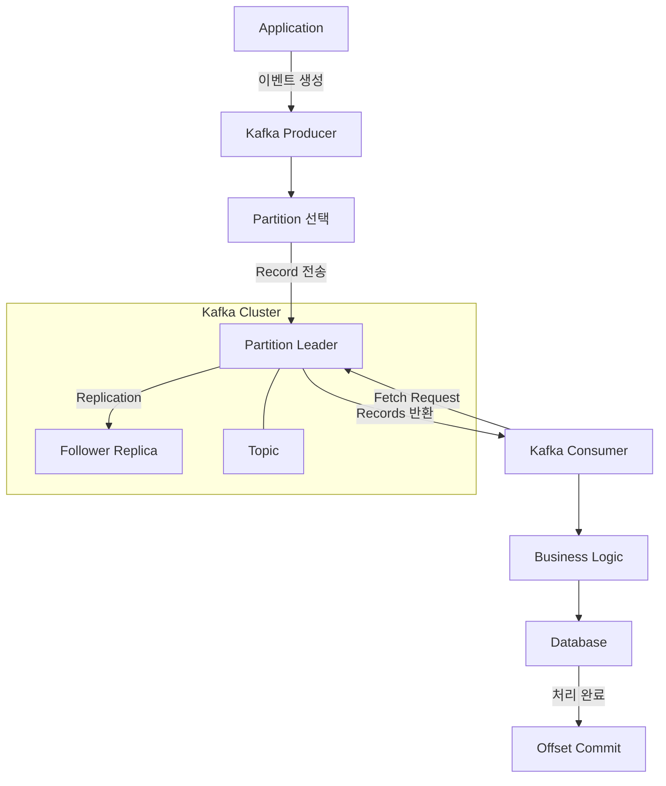

이 구조를 이해하려면 Producer와 Consumer의 책임을 구분해야 한다.

| 구성 요소 | 주요 역할 |
|---|---|
| Producer | 메시지 생성 및 전송 |
| Partitioner | 메시지가 저장될 Partition 결정 |
| Kafka Broker | 메시지 저장 및 클라이언트 요청 처리 |
| Partition Leader | 해당 Partition의 주요 읽기·쓰기 요청 처리 |
| Follower | Leader의 데이터 복제 |
| Consumer | Partition에서 메시지 조회 |
| Consumer Group | 여러 Consumer 간 Partition 분배 |
| Group Coordinator | Consumer Group 및 Offset 관리 |
| Offset Commit | Consumer의 재시작·재할당 시 사용할 읽기 위치 저장 |

Kafka의 데이터 처리는 크게 두 가지 방향으로 살펴볼 수 있다.

**Producer 관점**

```text
Application
    ↓
Producer
    ↓
Serialization
    ↓
Partition 선택
    ↓
Buffer / Batch
    ↓
Kafka Broker
    ↓
Partition Leader
    ↓
Follower Replication
```

**Consumer 관점**

```text
Kafka Partition
    ↓
Fetch Request
    ↓
Consumer Poll
    ↓
Message Processing
    ↓
Database / External API
    ↓
Offset Commit
```

두 흐름을 각각 이해한 뒤 연결하면 Kafka의 전체 아키텍처를 이해하기 쉬워진다.

---

## Kafka Producer란?

### Producer의 개념

Producer는 Kafka의 Topic에 메시지를 발행하는 애플리케이션 또는 클라이언트다.

예를 들어 다음 시스템들이 Producer가 될 수 있다.

- 주문 서비스
- 결제 서비스
- 알림 서비스
- 사용자 행동 수집기
- 로그 수집 시스템
- IoT 센서 수집기

Producer는 Kafka Topic에 Record를 전송한다.

Record에는 일반적으로 Key, Value, Timestamp, Headers 등의 정보가 포함될 수 있다.

예를 들어 주문 생성 이벤트를 생각해 보자.

```json
{
  "eventId": "evt-10001",
  "eventType": "OrderCreated",
  "orderId": "order-1001",
  "customerId": "customer-101",
  "amount": 45000
}
```

이 이벤트를 `commerce.orders.created.v1` Topic에 발행할 수 있다.

### Producer의 핵심 역할

Producer는 크게 두 가지 중요한 역할을 수행한다.

1. 메시지를 저장할 Topic의 Partition을 결정한다.
2. 해당 Partition의 Leader Broker에 메시지를 전송한다.

여기서 중요한 점은 **Producer가 Kafka Cluster의 아무 Broker에 메시지를 전송하는 것은 아니라는 것**이다.

메시지를 저장하려는 Partition의 Leader를 확인하고 해당 Broker에 요청한다.

---

## Producer는 어떤 Broker에 메시지를 전송할까?

다음과 같은 Kafka Cluster가 있다고 가정해 보자.

```text
Kafka Cluster

Broker 1
Broker 2
Broker 3
```

`peter-topic`의 Partition 0이 세 Broker에 복제되어 있다.

| Broker | 역할 |
|---|---|
| Broker 1 | Partition 0 Follower |
| Broker 2 | Partition 0 Leader |
| Broker 3 | Partition 0 Follower |

이 경우 Replication Factor는 3이다.

Leader 하나와 Follower 두 개, 총 세 Replica가 존재하기 때문이다.

### 데이터 전송 구조

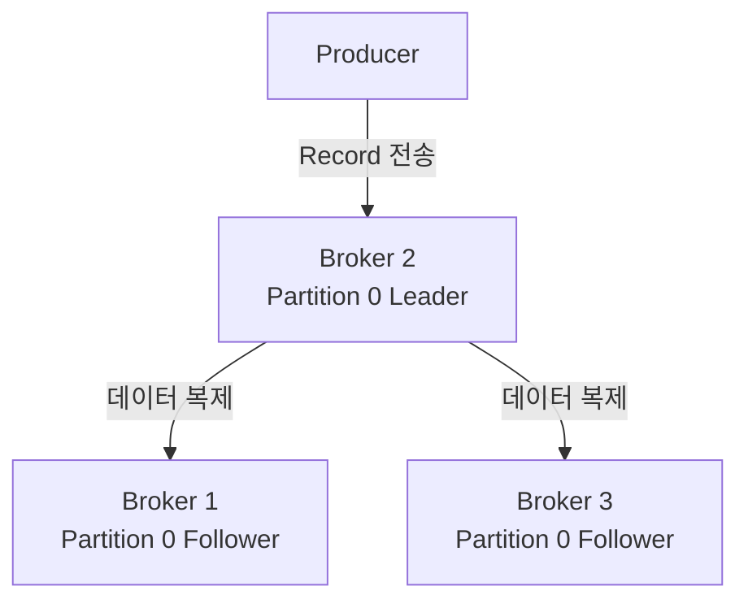

Producer는 Partition 0의 Leader인 Broker 2에 메시지를 전송한다.

Follower는 Leader의 데이터를 복제한다.

여기서 Follower 복제는 일반적으로 Follower가 Leader에 Fetch 요청을 보내 데이터를 가져오는 방식으로 이루어진다.

따라서 그림의 복제 화살표는 논리적인 데이터 복제 관계를 나타낸다.

### Producer가 Broker 1에 먼저 접속했다면?

Kafka에 처음 연결하는 과정에서 Broker 1에 접속했다고 가정해 보자.

그렇다고 모든 메시지를 Broker 1을 경유하여 전송하는 것은 아니다.

Producer는 Broker 1에서 Cluster Metadata를 확인할 수 있다.

Metadata에는 다음과 같은 정보가 포함된다.

- Topic 정보
- Partition 정보
- Partition Leader
- Broker 주소

Producer는 해당 정보를 이용하여 실제 메시지를 저장할 Partition의 Leader에 연결한다.

즉, **최초 연결에 사용한 Broker와 실제 메시지를 저장할 Broker는 다를 수 있다.**

---

## Producer의 bootstrap.servers란?

### bootstrap.servers의 개념

`bootstrap.servers`는 Producer가 Kafka Cluster에 처음 연결할 때 사용하는 Broker 주소 목록이다.

예를 들어 다음과 같이 설정할 수 있다.

```properties
bootstrap.servers=broker-1:9092,broker-2:9092,broker-3:9092
```

각 주소는 다음과 같은 형태를 가진다.

```text
hostname:port
```

Producer는 이 목록에 포함된 Broker 중 접근 가능한 서버를 통해 Kafka Cluster에 연결하고 Metadata를 조회한다.

### bootstrap.servers에 모든 Broker를 넣어야 할까?

반드시 모든 Broker를 지정해야 하는 것은 아니다.

Producer는 Bootstrap Broker를 통해 Cluster에 포함된 다른 Broker 정보를 확인할 수 있다.

하지만 하나의 Broker만 지정하는 것은 초기 연결 가용성 측면에서 불리할 수 있다.

예를 들어 다음과 같이 설정했다고 가정해 보자.

```properties
bootstrap.servers=broker-1:9092
```

Producer가 처음 실행되는 시점에 Broker 1이 중단되어 있다면 초기 연결에 실패할 수 있다.

반면 다음처럼 여러 Broker를 지정하면 다른 Broker를 통해 연결을 시도할 수 있다.

```properties
bootstrap.servers=broker-1:9092,broker-2:9092,broker-3:9092
```

따라서 운영 환경에서는 여러 Bootstrap 주소를 제공하는 것이 일반적으로 유리하다.

### Producer의 연결 과정

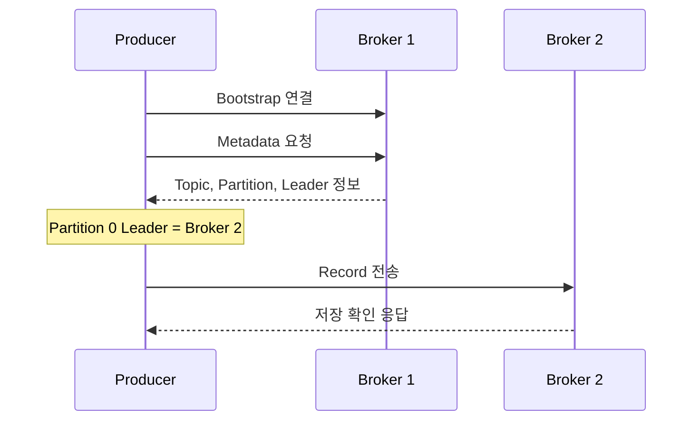

이 구조에서는 Broker 1이 Metadata를 제공한다.

실제 Record는 Partition Leader인 Broker 2에 전송한다.

### Kafka에는 Master Broker가 없을까?

Kafka에는 모든 메시지 요청을 처리하는 단일 Master Broker가 존재하지 않는다.

하지만 Kafka에 Leader 개념 자체가 없는 것은 아니다.

다음 두 Leader를 구분해야 한다.

| 구분 | 역할 |
|---|---|
| Partition Leader | 특정 Partition의 주요 읽기·쓰기 요청 처리 |
| Active Controller | Cluster Metadata와 Leader 선출 등의 관리 |

Producer는 데이터를 저장할 Partition의 Leader와 통신한다.

Cluster의 메타데이터와 상태 변경은 Controller가 관리한다.

### advertised.listeners와의 관계

Kafka 연결 문제를 분석할 때는 `bootstrap.servers`뿐 아니라 `advertised.listeners`도 중요하다.

`advertised.listeners`는 Broker가 클라이언트에 알려주는 접속 주소와 관련된 설정이다.

예를 들어 Docker 환경에서 다음 문제가 발생할 수 있다.

```text
Producer
   ↓
localhost:9092 접속 성공
   ↓
Metadata 조회 성공
   ↓
Broker가 내부 컨테이너 주소 반환
   ↓
Producer가 해당 주소에 접근하지 못함
   ↓
메시지 전송 실패
```

따라서 Kafka에 최초 연결은 성공하지만 실제 Producer 또는 Consumer 요청에서 연결 오류가 발생한다면 Broker가 광고하는 주소도 함께 확인해야 한다.

---

## Producer는 Partition을 어떻게 선택할까?

Producer는 Topic에 메시지를 전송할 때 저장할 Partition을 결정한다.

Partition 선택 방식은 Record의 Key와 Partition 지정 여부, Partitioner 설정에 따라 달라질 수 있다.

### Partition 선택 조건

| 조건 | 일반적인 동작 |
|---|---|
| Partition 직접 지정 | 지정한 Partition에 전송 |
| Partition 미지정, Key 존재 | 직렬화된 Key 기반으로 Partition 결정 |
| Partition과 Key 모두 없음 | 기본 Partitioner의 분배 방식 사용 |
| Custom Partitioner 사용 | 개발자가 정의한 분배 방식 사용 |

### Key가 있는 경우

다음과 같은 메시지를 생각해 보자.

```text
Key: order-1001

Value: OrderCreated
```

이후 같은 주문에 대한 결제 완료 이벤트가 발생한다.

```text
Key: order-1001

Value: PaymentCompleted
```

기본적인 Key 기반 분배 방식에서는 직렬화한 Key의 해시값을 이용하여 Partition을 선택한다.

Partition 구성과 분배 방식이 유지된다면 동일한 Key의 메시지는 같은 Partition으로 전달된다.

이를 통해 동일한 주문에 대한 이벤트의 순서를 관리할 수 있다.

다만 Partition 수나 Key 직렬화 방식이 변경되면 같은 Key가 다른 Partition에 할당될 수 있다.

따라서 **같은 Key는 어떤 상황에서도 항상 같은 Partition으로 전달된다는 설명은 정확하지 않다.**

### Key가 없는 경우

Key를 지정하지 않은 메시지는 어떤 Partition에 저장될까?

과거에는 Round Robin 방식으로 설명하는 경우가 많았다.

Round Robin은 다음과 같이 Partition을 순환하는 방식이다.

```text
Message A → Partition 0

Message B → Partition 1

Message C → Partition 2

Message D → Partition 0
```

하지만 현재 Java Kafka Producer의 기본 동작은 단순한 메시지별 Round Robin과 다르다.

Kafka는 Batch 효율을 높이기 위해 **Sticky Partitioning**을 활용한다.

Key가 없는 Record를 일정 기간 특정 Partition에 모아 Batch를 구성하고, 이후 다른 Partition을 선택하는 방식이다.

따라서 Kafka Producer의 분배 정책은 사용하는 Client 버전과 설정을 기준으로 이해해야 한다. [Apache Kafka](https://kafka.apache.org/44/configuration/producer-configs/?utm_source=chatgpt.com)

---

## Producer의 내부 동작 원리

Producer가 `send()`를 호출하면 즉시 Broker에 네트워크 요청을 보내고 모든 작업이 완료되는 것은 아니다.

일반적인 Java Kafka Producer는 내부 Buffer와 Batch를 활용하여 데이터를 비동기적으로 전송한다.

### Producer의 처리 흐름

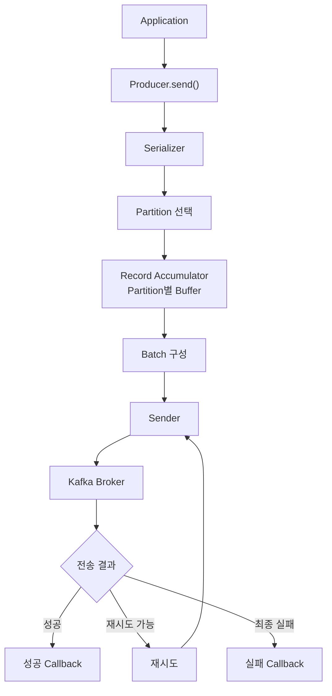

각 단계를 살펴보자.

### 1단계: 애플리케이션에서 메시지 생성

애플리케이션이 Kafka에 전송할 이벤트를 생성한다.

예를 들어 다음과 같다.

```json
{
  "orderId": "order-1001",
  "amount": 45000
}
```

### 2단계: 직렬화

Kafka Producer는 Serializer를 사용하여 Key와 Value를 Byte 데이터로 변환한다.

예를 들어 문자열을 전송한다면 `StringSerializer`를 사용할 수 있다.

### 3단계: Partition 선택

Producer는 Key와 Partitioner 설정 등을 이용하여 Record를 저장할 Partition을 결정한다.

### 4단계: Buffer에 Record 저장

Producer는 전송할 Record를 내부 Buffer에 저장한다.

이때 Partition별로 Record를 모아 Batch를 구성한다.

### 5단계: Batch 구성

같은 Partition에 전송할 Record를 묶는다.

이러한 방식은 여러 메시지를 개별 요청으로 전송하는 것보다 네트워크 효율을 높일 수 있다.

### 6단계: Sender가 Broker에 전송

Producer 내부의 Sender가 Broker에 Produce Request를 전송한다.

### 7단계: 전송 결과 처리

Broker는 설정된 `acks` 조건에 따라 응답한다.

Producer는 성공 여부를 Future 또는 Callback을 통해 확인할 수 있다.

여기서 중요한 사실은 다음과 같다.

**`send()` 메서드가 정상적으로 반환되었다고 Kafka에 메시지가 저장되었다는 의미는 아니다.**

비동기 전송의 최종 성공 여부는 Future나 Callback을 통해 확인해야 한다.

---

## Producer 주요 설정

Kafka Producer의 동작은 여러 설정을 통해 조절할 수 있다.

대표적인 설정은 다음과 같다.

| 설정 | 주요 역할 |
|---|---|
| `bootstrap.servers` | 최초 Kafka Cluster 연결 |
| `acks` | 메시지 저장 확인 수준 |
| `buffer.memory` | 전송 대기 Buffer 크기 |
| `compression.type` | 메시지 압축 방식 |
| `retries` | 재시도 횟수 |
| `batch.size` | Partition별 Batch 크기 |
| `linger.ms` | Batch를 모으기 위해 기다리는 시간 |
| `max.request.size` | Producer 요청의 최대 크기 |
| `request.timeout.ms` | 개별 요청의 응답 대기 시간 |
| `delivery.timeout.ms` | 메시지 전송 완료까지의 시간 한도 |
| `max.block.ms` | Buffer나 Metadata 확보 과정의 대기 시간 |
| `enable.idempotence` | Producer 재시도에 따른 중복 기록 방지 |

각 설정은 메시지 처리량과 지연 시간, 안정성에 영향을 준다.

따라서 단순히 값을 크게 설정하거나 작게 설정하는 것이 아니라 요구사항에 맞게 조절해야 한다.

---

## Producer의 acks란?

### acks의 개념

`acks`는 Producer가 Kafka Broker에 메시지를 전송한 후 어느 수준의 저장 확인을 기다릴 것인지 결정한다.

Kafka에서는 Partition의 Leader와 Follower가 데이터를 복제한다.

Producer는 이러한 복제 상태를 고려하여 메시지 전송을 성공으로 판단할 수 있다.

대표적인 설정은 다음과 같다.

```properties
acks=0
```

```properties
acks=1
```

```properties
acks=all
```

`acks=all`은 `acks=-1`과 같은 의미다.

### acks 설정 비교

| 설정 | 저장 확인 조건 | 특징 |
|---|---|---|
| `acks=0` | Broker 응답을 기다리지 않음 | 가장 약한 전달 확인 |
| `acks=1` | Leader 기록 확인 | Follower 복제 전 성공 가능 |
| `acks=all` | ISR 기반 기록 확인 | 가장 강한 저장 확인 |

여기서 반드시 이해해야 할 점은 **acks가 Consumer의 비즈니스 처리 완료 여부를 확인하는 설정은 아니라는 것**이다.

예를 들어 Producer가 `PaymentCompleted` 이벤트를 성공적으로 발행했다고 가정해 보자.

이것이 알림 발송이나 회원 권한 활성화가 완료되었다는 의미는 아니다.

`acks`는 어디까지나 Kafka에 메시지가 기록되었다는 사실을 어떤 수준으로 확인할 것인지 결정한다.

---

## acks=0의 동작 원리

`acks=0`은 Producer가 Broker의 저장 확인 응답을 기다리지 않는 방식이다.

### 처리 흐름

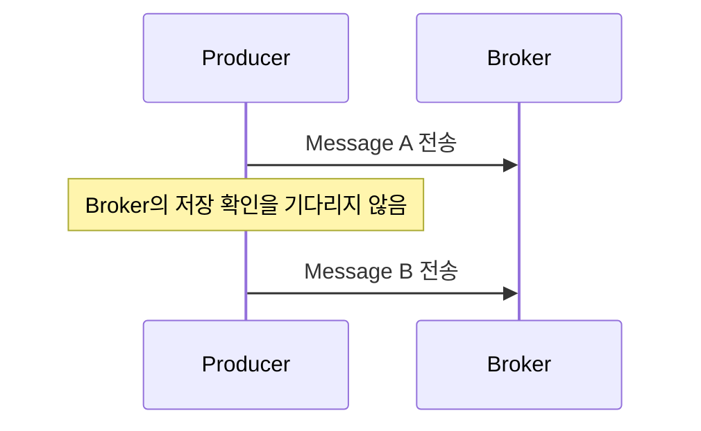

이 방식에서는 Broker가 메시지를 정상적으로 받았는지 확인하지 않는다.

따라서 다음 상황에서 데이터 손실 가능성이 존재한다.

```text
Producer
    ↓
Message A 전송
    ↓
네트워크 장애
    ↓
Broker가 Message A를 받지 못함
    ↓
Producer는 Broker 저장 실패를 확인하지 못함
```

### acks=0의 특징

장점은 Broker의 확인 응답을 기다리지 않는다는 것이다.

하지만 다음과 같은 위험이 있다.

- Broker가 메시지를 받았는지 확인하기 어렵다.
- 메시지가 저장되었는지 확인할 수 없다.
- 서버 측 저장 실패를 기반으로 재시도하기 어렵다.
- 장애 상황에서 데이터 유실 가능성이 커진다.

따라서 중요한 비즈니스 이벤트에서는 신중하게 사용해야 한다.

또한 `acks=0`이라고 직렬화 오류나 Metadata 조회 오류까지 모두 무시되는 것은 아니다.

Producer에서 발생할 수 있는 다른 오류는 여전히 처리해야 한다.

---

## acks=1의 동작 원리

`acks=1`은 Partition Leader가 메시지를 자신의 로그에 기록한 후 Producer에 성공 응답을 반환하는 방식이다.

Follower의 복제 완료까지 기다리지는 않는다.

### 처리 흐름

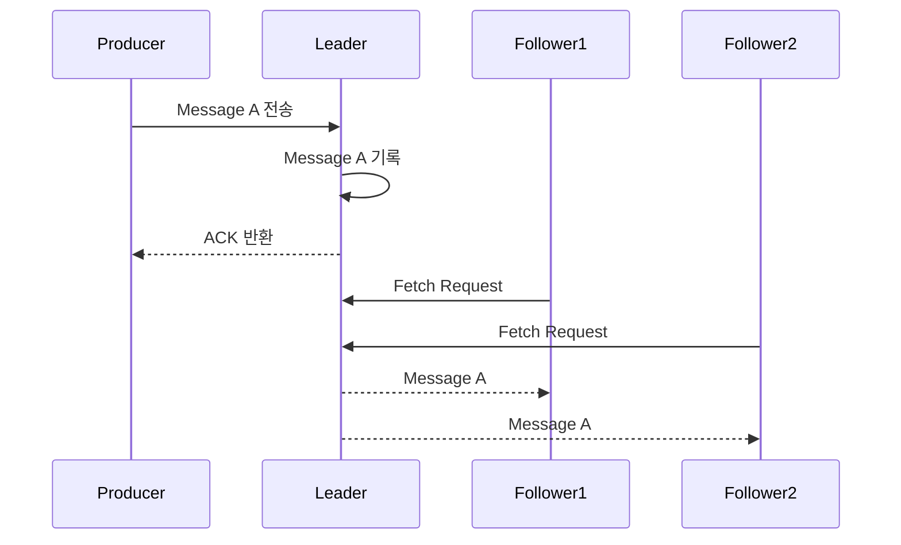

여기서 Producer가 ACK를 받은 시점을 살펴보자.

Leader는 Message A를 자신의 로그에 기록했다.

하지만 Follower들은 아직 Message A를 복제하지 않았을 수 있다.

이 시점에 Leader가 장애로 종료되면 어떤 일이 발생할까?

### acks=1에서 메시지 손실이 발생하는 상황

다음과 같은 구성이 있다고 가정해 보자.

| Broker | 역할 | 저장된 메시지 |
|---|---|---|
| Broker 1 | Follower | 없음 |
| Broker 2 | Leader | A |
| Broker 3 | Follower | 없음 |

Leader는 A 메시지를 기록한 후 ACK를 반환했다.

Producer는 전송이 성공했다고 판단했다.

하지만 Follower들은 아직 A 메시지를 복제하지 않았다.

이때 Broker 2가 장애로 종료되었다.

이후 Broker 1이 새로운 Leader로 승격되었다고 가정해 보자.

Broker 1에는 A 메시지가 없다.

따라서 **Producer가 성공 응답을 받았더라도 A 메시지가 유실될 수 있다.**

이것이 `acks=1`의 중요한 위험이다.

`acks=1`에서 발생할 수 있는 문제는 단순히 메시지가 손상되는 것이 아니라 **성공 응답을 받은 Record가 장애로 유실될 수 있다는 점**이다.

---

## acks=all의 동작 원리

`acks=all`은 ISR에 포함된 Replica의 기록 확인을 기준으로 Producer에 성공 응답을 반환하는 방식이다.

ISR은 In-Sync Replicas의 약자다.

Leader와 충분히 동기화된 Replica의 집합을 의미한다.

### 처리 흐름

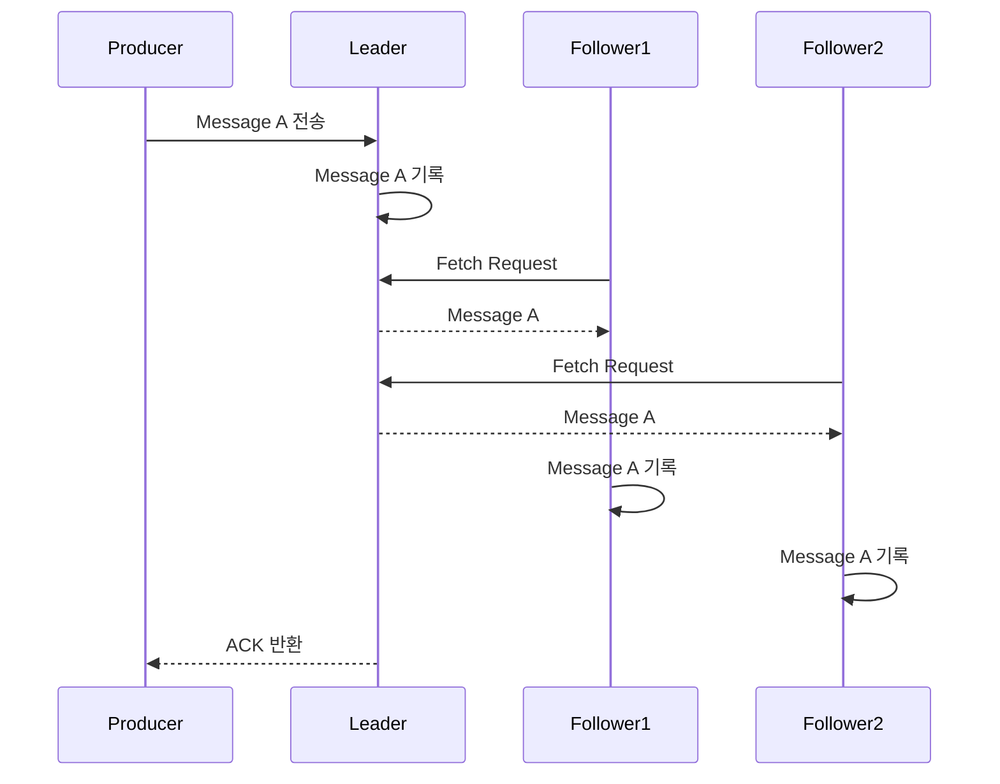

위 그림은 세 Replica가 모두 ISR에 포함되어 있고 정상적으로 복제된 상황을 나타낸다.

`acks=all`은 Kafka에서 제공하는 가장 강한 저장 확인 수준이다.

하지만 이 설정만으로 모든 데이터 손실을 방지할 수 있다고 이해해서는 안 된다.

왜냐하면 ISR의 개수가 달라질 수 있기 때문이다.

예를 들어 Replication Factor가 3이어도 현재 ISR에 Leader 하나만 남아 있을 수 있다.

이때 `min.insync.replicas`가 1이라면 Leader 하나만으로 쓰기가 성공할 수 있다.

따라서 `acks=all`을 사용할 때는 `min.insync.replicas`를 함께 이해해야 한다. [Apache Kafka](https://kafka.apache.org/44/configuration/producer-configs/?utm_source=chatgpt.com)

---

## min.insync.replicas와 acks의 관계

`min.insync.replicas`는 `acks=all`을 사용하는 쓰기 요청이 성공하기 위해 필요한 최소 동기화 Replica 수를 결정한다.

예를 들어 다음과 같은 환경을 가정해 보자.

```text
Replication Factor = 3

Leader = Broker 2

Follower 1 = Broker 1

Follower 2 = Broker 3
```

### min.insync.replicas=1

```properties
min.insync.replicas=1
```

현재 ISR에 Leader 하나만 남아 있어도 쓰기가 성공할 수 있다.

이 경우 `acks=all`을 사용하더라도 실제 복제본은 하나뿐일 수 있다.

따라서 Leader에 장애가 발생하면 데이터 손실 위험이 존재한다.

### min.insync.replicas=2

```properties
min.insync.replicas=2
```

최소 두 개의 ISR이 있어야 쓰기가 성공할 수 있다.

예를 들어 다음 상황이다.

| 현재 ISR | 쓰기 가능 여부 |
|---|---|
| Broker 1, 2, 3 | 성공 가능 |
| Broker 1, 2 | 성공 가능 |
| Broker 2 | 실패 |

이 구성에서는 Replica가 하나만 남은 상태에서 쓰기를 계속 성공 처리하는 위험을 줄일 수 있다.

### min.insync.replicas=3

```properties
min.insync.replicas=3
```

최소 세 개의 ISR이 필요하다.

따라서 Replica가 하나라도 ISR에서 이탈하면 새로운 쓰기가 실패할 수 있다.

### 전체 비교

Replication Factor가 3이고 Producer가 `acks=all`을 사용한다고 가정하자.

| 최소 ISR | 현재 ISR 수 | 쓰기 결과 |
|---:|---:|---|
| 1 | 3 | 현재 ISR 세 개의 확인 후 성공 가능 |
| 1 | 1 | Leader 하나만으로 성공 가능 |
| 2 | 3 | 현재 ISR 세 개의 확인 후 성공 가능 |
| 2 | 2 | 두 Replica의 확인 후 성공 가능 |
| 2 | 1 | 실패 |
| 3 | 3 | 세 Replica의 확인 후 성공 가능 |
| 3 | 2 | 실패 |

여기서 중요한 사실이 있다.

**`min.insync.replicas=2`는 항상 Replica 두 개의 ACK만 기다린다는 의미가 아니다.**

현재 ISR이 세 개라면 `acks=all`은 해당 ISR 전체의 기록 확인을 기준으로 동작한다.

`min.insync.replicas`는 쓰기를 허용하기 위한 최소 조건이다.

### 실무에서 많이 검토하는 조합

```text
Replication Factor = 3

min.insync.replicas = 2

acks = all
```

이 구성은 데이터 내구성과 일부 Broker 장애 상황에서의 쓰기 가용성을 함께 고려하기 위한 대표적인 출발점이다.

하지만 이 구성만으로 모든 장애에 대해 데이터 유실이 없다고 보장할 수는 없다.

Replica의 실제 배치와 Leader 선출 정책, Producer의 오류 처리 등이 함께 중요하다.

---

## Producer의 buffer.memory란?

### buffer.memory의 개념

`buffer.memory`는 Producer가 Kafka Broker에 전송할 Record를 일시적으로 보관하기 위해 사용하는 Buffer 메모리 크기다.

예를 들어 다음과 같이 설정할 수 있다.

```properties
buffer.memory=33554432
```

이는 32MiB에 해당한다.

### Buffer가 필요한 이유

Producer는 애플리케이션이 `send()`를 호출할 때마다 즉시 Broker에 네트워크 요청을 보내지 않을 수 있다.

여러 Record를 모아서 Batch로 전송하기 때문이다.

이 과정에서 Record를 잠시 저장할 공간이 필요하다.

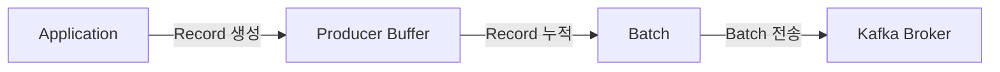

### Buffer가 가득 차면 어떻게 될까?

다음과 같은 상황을 생각해 보자.

Producer는 초당 10,000건의 메시지를 생성한다.

하지만 네트워크 문제로 Broker에 초당 2,000건만 전송할 수 있다.

그러면 Producer 내부에 전송 대기 메시지가 계속 누적된다.

결국 Buffer가 가득 찰 수 있다.

Buffer 공간을 확보하지 못하면 `send()` 호출이 대기할 수 있다.

이때 `max.block.ms`로 설정한 대기 시간을 초과하면 실패할 수 있다.

### buffer.memory를 크게 설정하면 해결될까?

일시적인 트래픽 증가에는 도움이 될 수 있다.

하지만 지속적으로 메시지 생성 속도가 전송 속도보다 빠르다면 Buffer를 크게 설정해도 근본적인 문제는 해결되지 않는다.

따라서 다음 항목을 함께 분석해야 한다.

- Producer 전송량
- Broker 처리량
- 네트워크 지연
- Batch 효율
- 메시지 크기
- 압축 설정

또한 `buffer.memory`는 Producer 전체 메모리 사용량의 엄격한 상한은 아니다.

압축과 진행 중인 요청 등에도 메모리가 필요할 수 있다.

---

## Producer의 batch.size란?

### batch.size의 개념

`batch.size`는 Producer가 동일한 Partition에 전송할 Record를 묶는 Batch 크기를 조절하는 설정이다.

예를 들어 다음과 같이 설정할 수 있다.

```properties
batch.size=16384
```

16KiB에 해당한다.

### Batch 전송이 필요한 이유

메시지를 한 건씩 전송한다고 가정해 보자.

```text
Message A → Network Request

Message B → Network Request

Message C → Network Request

Message D → Network Request
```

메시지마다 네트워크 요청이 발생하면 요청 처리에 필요한 비용이 증가할 수 있다.

반면 여러 Record를 하나의 Batch에 묶어 전송하면 요청 수를 줄일 수 있다.

```text
[Message A, B, C, D]

        ↓

Batch 전송
```

### Batch 전송 구조

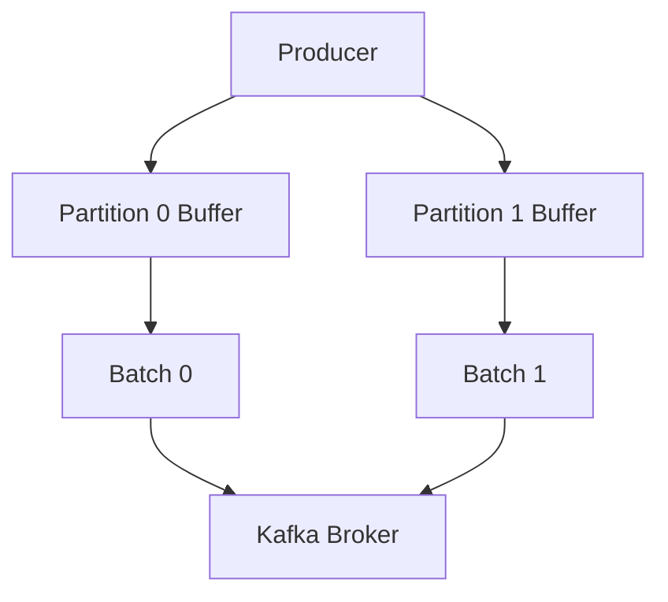

Kafka는 Partition별로 Batch를 구성한다.

따라서 서로 다른 Partition의 Record가 반드시 하나의 Record Batch로 합쳐지는 것은 아니다.

하나의 네트워크 Produce Request에는 여러 Partition의 Batch가 포함될 수 있다.

### batch.size를 크게 설정하면?

장점은 다음과 같다.

- Batch 효율 개선 가능
- 네트워크 요청 수 감소 가능
- 압축 효율 개선 가능

하지만 단점도 존재한다.

- Producer 메모리 사용량 증가 가능
- 낮은 메시지 유입량에서 Batch가 충분히 채워지지 않을 수 있음

따라서 적절한 Batch 크기는 실제 메시지 크기와 처리량을 기준으로 결정해야 한다.

---

## Producer의 linger.ms란?

`linger.ms`는 Producer가 Record를 더 모아 Batch를 구성하기 위해 기다릴 수 있는 시간을 조절한다.

예를 들어 다음과 같이 설정할 수 있다.

```properties
linger.ms=5
```

이 설정은 최대 약 5ms 동안 추가 Record를 모아 Batch를 구성하는 데 활용된다.

### linger.ms와 batch.size의 관계

Producer는 다음과 같은 조건에 따라 Batch를 전송할 수 있다.

- Batch가 충분히 채워진 경우
- `linger.ms`로 설정한 대기 시간이 지난 경우
- 그 밖에 Producer의 전송 조건이 충족된 경우

따라서 `linger.ms=5`라고 항상 정확히 5ms를 기다리는 것은 아니다.

### 설정에 따른 차이

| 설정 방향 | 장점 | 단점 |
|---|---|---|
| 작은 `batch.size` | 빠르게 Batch 구성 가능 | 요청 수 증가 가능 |
| 큰 `batch.size` | 높은 전송 효율 가능 | 메모리 사용 증가 가능 |
| 작은 `linger.ms` | 지연 시간 감소에 유리 | Batch 효율 감소 가능 |
| 큰 `linger.ms` | Batch 및 압축 효율 개선 가능 | 전송 지연 증가 가능 |

### Kafka 버전에 따른 기본값 차이

과거 Kafka에서는 `linger.ms`의 기본값이 0이었다.

하지만 Apache Kafka 4.0부터 기본값이 5ms로 변경되었다.

Batch 효율 개선이 전체 성능에 유리하다는 점이 반영된 변경이다. [Apache Kafka](https://kafka.apache.org/44/configuration/producer-configs/)

따라서 오래된 Kafka 버전의 설정 정보를 그대로 현재 버전에 적용해서는 안 된다.

---

## Producer의 compression.type이란?

`compression.type`은 Producer가 Record를 압축하여 전송할 때 사용하는 알고리즘을 지정한다.

대표적으로 다음 압축 방식을 지원한다.

```text
none

gzip

snappy

lz4

zstd
```

예를 들어 Zstd를 사용하려면 다음과 같이 설정할 수 있다.

```properties
compression.type=zstd
```

### 압축을 사용하는 이유

메시지 크기를 줄이면 다음 비용을 낮출 수 있다.

- 네트워크 대역폭
- Kafka Broker의 디스크 사용량
- 데이터 복제 트래픽

하지만 압축과 해제에는 CPU 연산이 필요하다.

따라서 압축률과 처리 속도 사이에 트레이드오프가 존재한다.

### 압축 알고리즘 비교

| 알고리즘 | 일반적인 특징 | 고려사항 |
|---|---|---|
| Gzip | 높은 압축률 가능 | CPU 비용 |
| Snappy | 빠른 압축과 해제 | 압축률 |
| LZ4 | 낮은 지연과 높은 처리 속도 | 압축률 |
| Zstd | 압축률과 속도의 균형 | 설정에 따른 CPU 비용 |

Kafka는 Record Batch 단위로 압축을 적용할 수 있다.

따라서 `batch.size`와 `linger.ms` 설정도 압축 효율에 영향을 줄 수 있다.

실무에서는 실제 이벤트 데이터를 이용하여 압축률과 CPU 사용량, 전송 시간을 비교하는 것이 좋다.

---

## Producer의 retries란?

### retries의 개념

`retries`는 Producer가 일시적인 전송 오류를 만났을 때 재시도할 수 있는 횟수와 관련된 설정이다.

예를 들어 다음과 같은 상황에서 재시도가 필요할 수 있다.

- 네트워크 오류
- Broker의 일시적인 응답 실패
- Partition Leader 변경
- 일시적인 요청 처리 실패

### 재시도 흐름

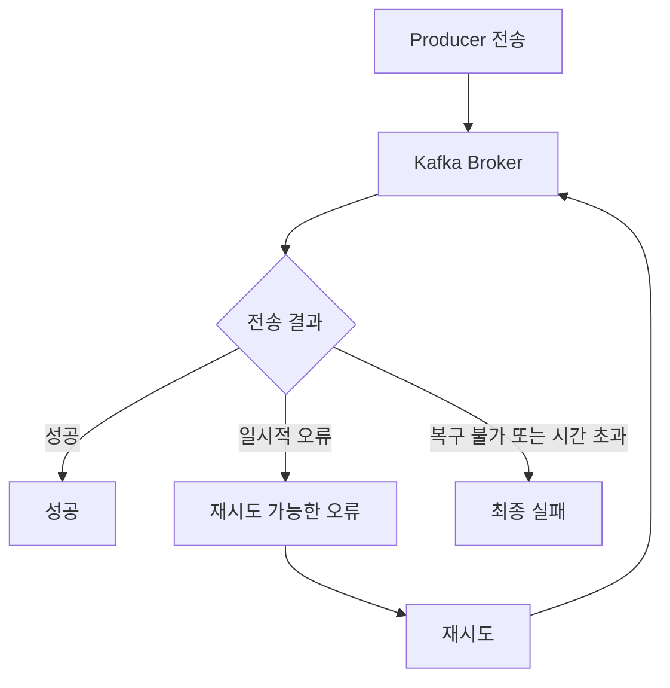

여기서 주의할 점은 `retries` 값을 크게 설정했다고 무한정 재시도하는 것은 아니라는 사실이다.

현재 Kafka Producer에서는 `delivery.timeout.ms`를 함께 고려해야 한다.

Kafka 4.4 공식 문서에서도 재시도 횟수만 직접 조절하기보다 `delivery.timeout.ms`를 통해 전체 전송 제한 시간을 관리하는 방식을 권장한다. [Apache Kafka](https://kafka.apache.org/44/javadoc/org/apache/kafka/clients/producer/KafkaProducer.html?utm_source=chatgpt.com)

---

## request.timeout.ms와 delivery.timeout.ms의 차이

Kafka Producer에서 Timeout 관련 설정을 이해할 때 다음 세 가지를 구분해야 한다.

| 설정 | 주요 역할 |
|---|---|
| `request.timeout.ms` | 개별 요청의 응답 대기 시간 |
| `delivery.timeout.ms` | Record 전송 결과를 확정하기까지의 전체 시간 한도 |
| `max.block.ms` | Metadata나 Buffer 확보 등 호출 과정의 대기 시간 |

### request.timeout.ms

```properties
request.timeout.ms=30000
```

개별 요청의 응답을 기다리는 시간을 조절한다.

예를 들어 Broker가 요청에 응답하지 않으면 Timeout이 발생할 수 있다.

### delivery.timeout.ms

```properties
delivery.timeout.ms=120000
```

Record 전송의 최종 결과를 알릴 때까지 허용하는 시간과 관련된다.

이 시간에는 다음 요소가 영향을 줄 수 있다.

- Buffer 대기
- Batch 대기
- Broker 응답 대기
- 재시도

### max.block.ms

```properties
max.block.ms=60000
```

`send()` 호출 과정에서 Metadata나 Buffer를 확보하지 못해 대기하는 시간을 제한한다.

### 세 설정의 관계

```text
Application
    ↓
send()
    ↓
Metadata / Buffer 확보
    └── max.block.ms
    ↓
Batch 대기 및 Broker 전송
    ├── request.timeout.ms
    ├── retries
    └── delivery.timeout.ms
    ↓
최종 성공 또는 실패
```

여기서 `delivery.timeout.ms`는 일반적으로 `linger.ms`와 `request.timeout.ms`의 합 이상으로 설정해야 한다.

또한 복구할 수 없는 오류가 발생하면 전체 Timeout이 지나기 전에 실패할 수 있다.

---

## Producer 재시도에서 중복 메시지가 발생하는 이유

다음과 같은 상황을 생각해 보자.

**1단계**

Producer가 Message A를 Kafka에 전송한다.

**2단계**

Broker가 Message A를 정상적으로 저장한다.

**3단계**

Broker가 성공 응답을 반환한다.

**4단계**

네트워크 문제로 Producer가 성공 응답을 받지 못한다.

**5단계**

Producer는 전송에 실패했다고 판단하여 재시도한다.

이 경우 Broker에는 이미 Message A가 저장되어 있다.

그런데 Producer가 다시 Message A를 전송하면 중복 기록이 발생할 수 있다.

### 재시도와 중복 기록

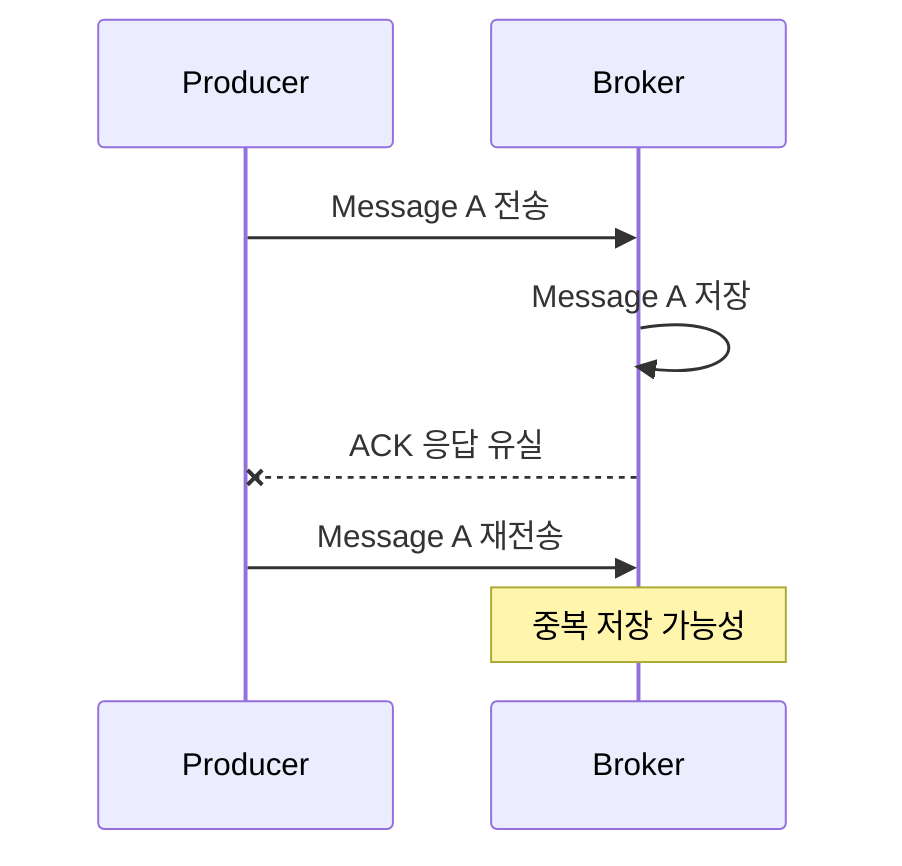

이 문제를 줄이기 위해 Kafka는 Idempotent Producer를 지원한다.

### enable.idempotence

```properties
enable.idempotence=true
```

Idempotent Producer는 Producer의 재시도 과정에서 같은 Record가 중복 기록되는 문제를 방지하는 데 활용된다.

다만 다음 두 상황은 구분해야 한다.

**Producer 내부 재시도로 같은 Record가 중복 전송되는 문제**

Kafka의 Idempotent Producer 기능으로 대응할 수 있다.

**애플리케이션이 동일한 업무 이벤트를 새로 생성하여 두 번 발행하는 문제**

별도의 이벤트 ID와 중복 방지 로직이 필요할 수 있다.

또한 Consumer가 동일한 Record를 두 번 처리하는 문제까지 `enable.idempotence`가 자동으로 해결하지는 않는다.

---

## Producer의 max.request.size란?

`max.request.size`는 Producer가 Broker에 전송하는 요청의 최대 크기를 조절하는 설정이다.

대표적인 기본값은 다음과 같다.

```properties
max.request.size=1048576
```

1MiB에 해당한다.

여기서 중요한 점은 이 설정이 단순히 **업무 메시지 한 건의 최대 크기**만을 의미하지 않는다는 것이다.

Producer의 요청에는 여러 Record Batch가 포함될 수 있다.

또한 이 설정은 비압축 Record Batch의 크기 제한에도 영향을 준다.

### 큰 메시지를 보내려면?

Producer의 `max.request.size`만 증가시키는 것으로는 충분하지 않을 수 있다.

다음 설정도 함께 확인해야 한다.

| 구성 요소 | 관련 설정 |
|---|---|
| Producer | `max.request.size` |
| Broker | `message.max.bytes` |
| Topic | `max.message.bytes` |
| Consumer | `fetch.max.bytes` |
| Consumer | `max.partition.fetch.bytes` |

또한 Kafka에서 큰 파일을 직접 전달해야 하는지부터 검토하는 것이 좋다.

예를 들어 이미지나 동영상 파일이라면 Object Storage에 저장하고 Kafka에는 파일 경로와 메타데이터를 전달하는 방식이 더 적합할 수 있다.

---

## Producer 설정 전체 예제

다음은 Java Kafka Producer에서 사용할 수 있는 설정 예제다.

```properties
bootstrap.servers=broker-1:9092,broker-2:9092,broker-3:9092

key.serializer=org.apache.kafka.common.serialization.StringSerializer
value.serializer=org.apache.kafka.common.serialization.StringSerializer

acks=all
enable.idempotence=true

buffer.memory=33554432

batch.size=16384
linger.ms=5

compression.type=zstd

max.request.size=1048576

request.timeout.ms=30000
delivery.timeout.ms=120000
max.block.ms=60000
```

### 주요 설정 정리

| 설정 | 값 | 목적 |
|---|---|---|
| bootstrap.servers | Broker 세 대 | 최초 연결 |
| key.serializer | StringSerializer | Key 직렬화 |
| value.serializer | StringSerializer | Value 직렬화 |
| acks | all | 저장 확인 강화 |
| enable.idempotence | true | Producer 재시도 중복 방지 |
| buffer.memory | 32MiB | 전송 대기 Buffer |
| batch.size | 16KiB | Batch 크기 |
| linger.ms | 5ms | Batch 대기 |
| compression.type | zstd | 압축 |
| max.request.size | 1MiB | 요청 크기 제한 |
| request.timeout.ms | 30초 | 개별 요청 Timeout |
| delivery.timeout.ms | 120초 | 전송 결과 제한 시간 |
| max.block.ms | 60초 | 호출 대기 시간 |

이 설정은 하나의 예시일 뿐이며 모든 서비스에 적합한 최적값은 아니다.

실제 운영 환경에서는 다음 요소를 기준으로 조정해야 한다.

- 메시지 크기
- 초당 발행량
- 허용 가능한 지연 시간
- 네트워크 환경
- Broker 처리량
- 데이터 중요도

특히 Producer의 설정만으로 Kafka 전체의 데이터 내구성이 결정되는 것은 아니다.

Topic의 Replication Factor와 `min.insync.replicas`도 함께 고려해야 한다.

---

## Java Producer 구현 예제

이제 Producer의 동작을 Java 코드로 살펴보자.

다음 예제는 Kafka의 표준 Java Client를 이용하여 문자열 이벤트를 전송하는 코드다.

### Producer 구현

```java
import org.apache.kafka.clients.producer.KafkaProducer;
import org.apache.kafka.clients.producer.ProducerConfig;
import org.apache.kafka.clients.producer.ProducerRecord;
import org.apache.kafka.clients.producer.RecordMetadata;
import org.apache.kafka.common.serialization.StringSerializer;

import java.util.Properties;
import java.util.concurrent.Future;
import java.util.concurrent.TimeUnit;

public class OrderEventProducer {

    private static final String TOPIC = "commerce.orders.created.v1";

    public static void main(String[] args) throws Exception {

        Properties properties = new Properties();

        properties.put(
            ProducerConfig.BOOTSTRAP_SERVERS_CONFIG,
            "localhost:9092"
        );

        properties.put(
            ProducerConfig.KEY_SERIALIZER_CLASS_CONFIG,
            StringSerializer.class.getName()
        );

        properties.put(
            ProducerConfig.VALUE_SERIALIZER_CLASS_CONFIG,
            StringSerializer.class.getName()
        );

        properties.put(
            ProducerConfig.ACKS_CONFIG,
            "all"
        );

        properties.put(
            ProducerConfig.ENABLE_IDEMPOTENCE_CONFIG,
            true
        );

        properties.put(
            ProducerConfig.COMPRESSION_TYPE_CONFIG,
            "zstd"
        );

        properties.put(
            ProducerConfig.LINGER_MS_CONFIG,
            5
        );

        try (KafkaProducer<String, String> producer =
                 new KafkaProducer<>(properties)) {

            String key = "order-1001";

            String value = """
                {
                  "eventId": "evt-10001",
                  "eventType": "OrderCreated",
                  "orderId": "order-1001",
                  "amount": 45000
                }
                """;

            ProducerRecord<String, String> record =
                new ProducerRecord<>(
                    TOPIC,
                    key,
                    value
                );

            Future<RecordMetadata> future = producer.send(record);

            RecordMetadata metadata =
                future.get(30, TimeUnit.SECONDS);

            System.out.println("Topic: " + metadata.topic());
            System.out.println("Partition: " + metadata.partition());
            System.out.println("Offset: " + metadata.offset());
        }
    }
}
```

### 코드의 처리 흐름

**1단계: Producer 설정 생성**

```java
Properties properties = new Properties();
```

Kafka Producer에 필요한 설정을 구성한다.

**2단계: Serializer 설정**

```java
StringSerializer.class.getName()
```

문자열 Key와 Value를 Byte 데이터로 변환한다.

**3단계: Producer 생성**

```java
new KafkaProducer<>(properties)
```

Producer Client를 생성한다.

**4단계: ProducerRecord 생성**

```java
new ProducerRecord<>(
    TOPIC,
    key,
    value
);
```

메시지를 발행할 Topic과 Key, Value를 정의한다.

**5단계: 메시지 전송**

```java
Future<RecordMetadata> future = producer.send(record);
```

비동기 전송을 요청한다.

**6단계: 전송 결과 확인**

```java
RecordMetadata metadata =
    future.get(30, TimeUnit.SECONDS);
```

최종 전송 결과를 확인한다.

### RecordMetadata의 의미

전송에 성공하면 다음 정보를 확인할 수 있다.

| 항목 | 의미 |
|---|---|
| topic | Record가 저장된 Topic |
| partition | Record가 저장된 Partition |
| offset | Partition 내부 위치 |

예를 들어 다음과 같은 결과가 나올 수 있다.

```text
Topic: commerce.orders.created.v1

Partition: 2

Offset: 150
```

이 출력은 설명을 위한 예시이며 실제 실행 결과는 아니다.

실제 Partition과 Offset은 Kafka Cluster의 상태에 따라 달라진다.

### Future.get()을 사용하는 이유

`send()`는 일반적으로 비동기 방식이다.

따라서 `send()`가 반환되었다는 이유만으로 Kafka에 Record가 저장되었다고 판단해서는 안 된다.

`Future.get()`을 사용하면 최종 전송 결과를 확인할 수 있다.

다만 대량의 이벤트를 처리하는 애플리케이션에서 모든 `send()` 호출 직후 `get()`으로 대기하면 비동기 전송의 장점이 감소할 수 있다.

따라서 운영 환경에서는 Callback 등을 활용한 비동기 결과 처리도 고려해야 한다.

---

## Kafka Consumer란?

### Consumer의 개념

Consumer는 Kafka Topic에 저장된 Record를 읽어 처리하는 애플리케이션 또는 클라이언트다.

예를 들어 주문 서비스가 `OrderCreated` 이벤트를 Kafka에 발행했다고 가정해 보자.

다음과 같은 Consumer가 이벤트를 사용할 수 있다.

- 알림 Consumer
- 배송 Consumer
- 분석 Consumer
- 검색 인덱싱 Consumer

Consumer는 Topic의 Partition에서 Record를 가져온다.

### Consumer의 주요 역할

Consumer는 크게 다음 두 가지 작업을 수행한다.

1. Kafka Partition에서 Record를 읽는다.
2. 읽은 Record를 실제 비즈니스 로직으로 처리한다.

그리고 추가로 중요한 작업이 있다.

**어디까지 처리했는지 Offset을 관리하는 것이다.**

Kafka에서는 Consumer가 메시지를 읽었다고 해당 Record가 즉시 삭제되지 않는다.

따라서 Consumer가 어느 위치까지 처리했는지를 관리해야 한다.

---

## Consumer는 메시지를 어떻게 가져올까?

Kafka Consumer는 일반적으로 Pull 기반으로 동작한다.

Pull 방식은 Consumer가 Broker에 직접 데이터를 요청하는 방식이다.

### Consumer의 처리 흐름

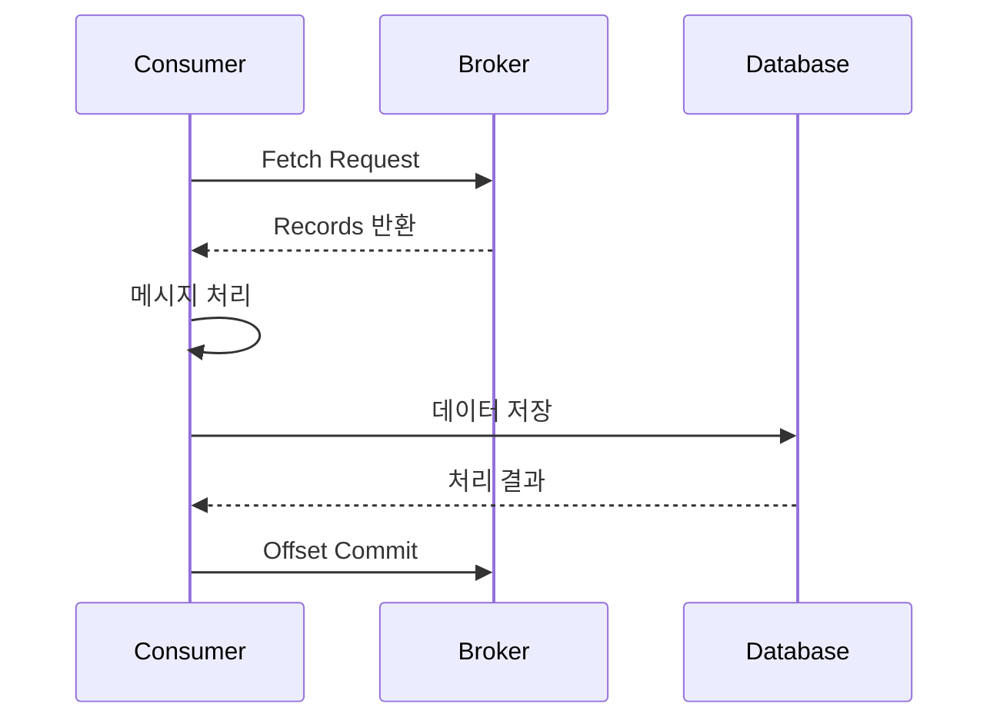

Consumer는 Fetch 요청을 통해 데이터를 읽는다.

그리고 실제 업무 처리를 수행한다.

업무 처리가 완료된 후에는 Offset을 Commit할 수 있다.

여기서 중요한 점은 **Consumer가 Record를 가져왔다는 사실과 업무 처리가 완료되었다는 사실이 다르다는 것**이다.

예를 들어 Consumer가 결제 완료 이벤트를 가져온 뒤 회원 권한을 활성화해야 한다고 가정해 보자.

Kafka에서 이벤트를 읽는 작업은 성공했다.

하지만 회원 데이터베이스에서 오류가 발생했다.

이 경우 이벤트를 읽었다고 해서 업무가 성공했다고 판단해서는 안 된다.

이러한 문제는 Offset Commit과 직접적으로 연결된다.

---

## Consumer의 Offset 읽기 방식

Consumer는 Partition의 Offset을 기준으로 데이터를 가져온다.

예를 들어 다음과 같은 Partition이 있다고 가정해 보자.

```text
Partition 0

Offset 0 → Message A

Offset 1 → Message B

Offset 2 → Message C

Offset 3 → Message D

Offset 4 → Message E
```

Consumer가 Offset 2부터 읽도록 설정되어 있다면 Message C부터 가져올 수 있다.

Kafka Consumer는 읽을 위치를 관리하며, 필요한 경우 위치를 변경하여 이미 읽은 데이터를 다시 가져올 수도 있다.

이것이 Kafka가 일반적인 작업 큐와 차별화되는 중요한 특징 중 하나다.

### Kafka에서 구분해야 하는 세 가지 위치

Consumer에서는 다음 세 가지 위치를 구분해야 한다.

| 위치 | 의미 |
|---|---|
| Consumer Position | 다음에 읽을 Record의 위치 |
| 실제 업무 처리 위치 | 비즈니스 로직이 완료된 위치 |
| Committed Offset | 재시작 또는 재할당 시 사용할 저장된 위치 |

예를 들어 다음과 같은 상황이 있을 수 있다.

```text
Kafka Partition

Offset 0
Offset 1
Offset 2
Offset 3
Offset 4
Offset 5
```

Consumer가 `poll()`을 통해 Offset 0~5를 가져왔다.

하지만 데이터베이스에는 Offset 0~3까지만 정상적으로 저장되었다.

이 경우 다음 위치가 서로 다를 수 있다.

```text
Consumer Position: 6

업무 처리 완료: Offset 3

안전하게 Commit할 위치: 4
```

따라서 Consumer가 읽은 위치를 그대로 Commit하면 안 되는 상황이 발생할 수 있다.

---

## Consumer의 bootstrap.servers란?

Producer와 마찬가지로 Consumer도 Kafka Cluster에 연결하기 위해 `bootstrap.servers`를 사용한다.

```properties
bootstrap.servers=broker-1:9092,broker-2:9092,broker-3:9092
```

Consumer는 Bootstrap Broker를 통해 Metadata를 확인한다.

이후 자신에게 할당된 Partition의 Leader 등에 Fetch 요청을 보낸다.

일반적으로 Consumer는 Leader에서 데이터를 읽지만, 별도의 Replica 선택 구성을 사용하여 Follower에서 읽는 방식도 가능하다.

---

## Consumer의 fetch.min.bytes란?

### fetch.min.bytes의 개념

`fetch.min.bytes`는 Broker가 Fetch 요청에 응답할 때 모으려고 하는 최소 데이터 크기를 설정한다.

예를 들어 다음과 같이 설정할 수 있다.

```properties
fetch.min.bytes=1
```

이 경우 Broker는 비교적 적은 데이터가 준비되어도 응답할 수 있다.

### fetch.min.bytes를 크게 설정하면?

예를 들어 다음과 같이 설정했다고 가정해 보자.

```properties
fetch.min.bytes=1048576
```

약 1MiB에 해당한다.

Broker는 가능한 한 설정된 크기만큼 데이터를 모아서 응답하려고 한다.

### 장점

- Fetch 요청 효율 개선 가능
- 네트워크 요청 수 감소 가능
- 대량 메시지 처리량 개선 가능

### 단점

- 데이터 유입량이 적으면 응답 지연이 증가할 수 있다.
- 저지연 처리가 필요한 환경에서는 불리할 수 있다.

따라서 `fetch.min.bytes`는 Consumer의 처리량과 응답 지연 사이의 균형을 조절하는 설정이라고 이해할 수 있다.

---

## fetch.max.wait.ms란?

`fetch.max.wait.ms`는 Broker가 Fetch 응답을 위해 데이터를 모으면서 기다릴 수 있는 시간을 제한한다.

예를 들어 다음과 같이 설정할 수 있다.

```properties
fetch.min.bytes=1048576
fetch.max.wait.ms=500
```

이 설정을 해석하면 다음과 같다.

Broker는 가능한 한 1MiB의 데이터를 모아서 응답하려고 한다.

하지만 500ms 동안 충분한 데이터가 모이지 않았다면 더 적은 데이터로 응답할 수 있다.

### fetch.min.bytes와 fetch.max.wait.ms 비교

| 설정 | 역할 |
|---|---|
| fetch.min.bytes | 응답을 위해 모으려는 최소 데이터 크기 |
| fetch.max.wait.ms | 데이터를 모으면서 기다리는 시간의 상한 |

두 설정은 함께 고려하는 것이 좋다.

예를 들어 실시간 알림 서비스에서는 Fetch 지연이 중요한 요소일 수 있다.

반면 대량 로그 분석 Consumer에서는 여러 메시지를 묶어 가져오는 것이 효율적일 수 있다.

---

## Consumer의 group.id란?

`group.id`는 Consumer가 속한 Consumer Group을 식별하는 값이다.

예를 들어 다음과 같이 설정할 수 있다.

```properties
group.id=order-notification
```

같은 `group.id`를 사용하는 Consumer들은 하나의 Consumer Group으로 동작한다.

반면 서로 다른 `group.id`를 사용하는 Consumer Group은 동일한 Topic의 데이터를 독립적으로 읽을 수 있다.

### Consumer Group 예제

```text
Topic: orders

Consumer Group A:
order-notification

Consumer Group B:
order-analytics

Consumer Group C:
order-search-index
```

각 Group은 서로 다른 업무를 담당한다.

알림 Group은 알림을 발송한다.

분석 Group은 통계를 계산한다.

검색 Group은 Elasticsearch 등의 검색 인덱스를 갱신한다.

### Consumer Group의 독립적인 처리

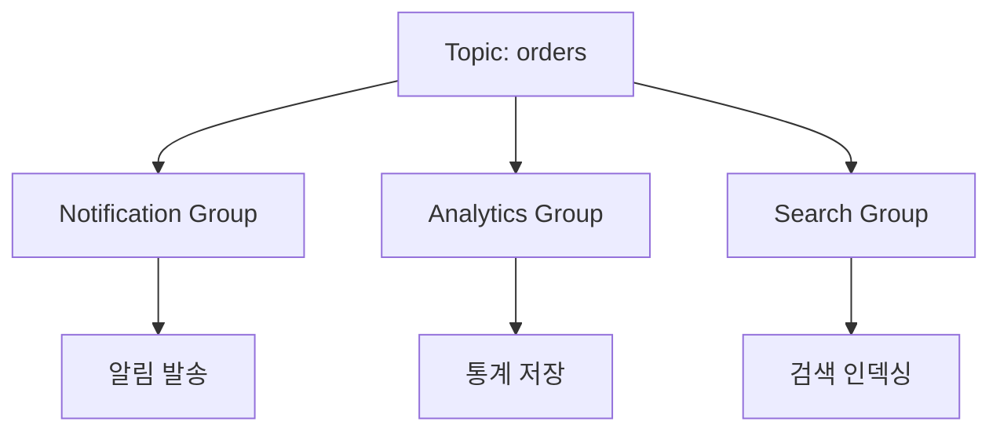

각 Group은 독립적으로 자신의 Offset을 관리할 수 있다.

따라서 분석 Consumer가 느리게 처리하더라도 알림 Consumer는 자신의 처리 속도로 이벤트를 읽을 수 있다.

---

## Consumer의 enable.auto.commit이란?

`enable.auto.commit`은 Consumer가 Offset을 자동으로 Commit할지 결정한다.

### 자동 Commit

```properties
enable.auto.commit=true
```

Consumer가 주기적으로 Offset을 Commit한다.

### 수동 Commit

```properties
enable.auto.commit=false
```

애플리케이션에서 명시적으로 Offset을 Commit해야 한다.

여기서 중요한 것은 어떤 방식이 항상 더 좋다고 단정할 수 없다는 점이다.

다만 **Kafka에서 메시지를 가져온 후 데이터베이스 저장이나 외부 API 호출처럼 중요한 업무를 수행한다면 Commit 시점을 직접 제어할 필요가 있다.**

자동 Commit과 수동 Commit의 차이는 뒤에서 장애 시나리오와 함께 살펴본다.

---

## Consumer의 auto.offset.reset이란?

`auto.offset.reset`은 Consumer Group에 유효한 Committed Offset이 없거나 기존 Offset을 더 이상 사용할 수 없을 때 읽기 시작 위치를 결정한다.

대표적으로 다음 세 가지 값을 사용한다.

```properties
auto.offset.reset=earliest
```

```properties
auto.offset.reset=latest
```

```properties
auto.offset.reset=none
```

### earliest

현재 Kafka에 보존되어 있는 가장 이른 Offset부터 읽는다.

예를 들어 다음과 같은 데이터가 있다고 가정해 보자.

```text
Offset 0
Offset 1
Offset 2
Offset 3
Offset 4
```

새로운 Consumer Group이 `earliest`를 사용하면 가장 이른 보존 위치부터 읽을 수 있다.

### latest

현재 로그의 끝에서 시작하여 이후에 추가되는 데이터를 읽는다.

예를 들어 Offset 0~4가 이미 저장되어 있고 새로운 Consumer Group이 `latest`로 시작했다면 기존 Record를 건너뛰고 이후에 추가되는 Record부터 읽을 수 있다.

### none

유효한 Offset이 없을 때 자동으로 시작 위치를 결정하지 않고 오류를 발생시킨다.

### 세 가지 설정 비교

| 설정 | 유효한 Offset이 없을 때 |
|---|---|
| earliest | 현재 보존된 가장 이른 위치부터 |
| latest | 현재 로그 끝에서 |
| none | 오류 발생 |

### earliest를 설정하면 매번 처음부터 읽을까?

아니다.

이 부분은 매우 중요하다.

`auto.offset.reset`은 유효한 Committed Offset이 없거나 사용할 수 없는 경우에 적용된다.

예를 들어 Consumer Group이 Offset 100을 Commit했다면 다음 실행 시 해당 저장 위치를 기준으로 이어서 처리한다.

```properties
auto.offset.reset=earliest
```

이렇게 설정되어 있어도 매번 Offset 0부터 읽는 것은 아니다.

마찬가지로 `latest`를 설정했다고 항상 가장 마지막 Offset으로 이동하는 것도 아니다.

### Kafka 4.x의 추가 Reset 방식

현재 Kafka에서는 시간 길이를 기준으로 시작 위치를 결정하는 `by_duration` 방식도 지원한다.

예를 들어 다음과 같은 형태다.

```properties
auto.offset.reset=by_duration:PT6M
```

이는 유효한 Offset이 없을 때 현재 시점에서 지정한 시간만큼 이전 위치를 기준으로 시작하도록 하는 방식이다.

단, 기존의 유효한 Committed Offset이 있는 Consumer가 매번 6분 전으로 돌아간다는 의미는 아니다.

Kafka 4.4 공식 문서에서도 `earliest`, `latest`, `none`, `by_duration`을 구분하여 설명한다. [Apache Kafka](https://kafka.apache.org/44/configuration/consumer-configs/?utm_source=chatgpt.com)

---

## Consumer의 fetch.max.bytes란?

`fetch.max.bytes`는 Broker의 Fetch 응답 전체 크기를 조절하는 설정이다.

예를 들어 다음과 같다.

```properties
fetch.max.bytes=52428800
```

약 50MiB에 해당한다.

### max.partition.fetch.bytes와 차이

Consumer에는 다음 설정도 존재한다.

```properties
max.partition.fetch.bytes=1048576
```

이 값은 Partition별 Fetch 데이터 크기와 관련된다.

| 설정 | 역할 |
|---|---|
| fetch.max.bytes | Fetch 응답 전체 크기 |
| max.partition.fetch.bytes | Partition별 Fetch 크기 |

단, 이 값들을 Consumer가 사용하는 전체 메모리의 엄격한 최대값으로 이해해서는 안 된다.

Kafka는 Consumer가 데이터를 계속 처리할 수 있도록 특정 조건에서 설정된 크기보다 큰 첫 Record Batch를 반환할 수 있다.

또한 실제 메모리 사용량에는 압축 해제와 역직렬화 비용도 포함된다.

---

## Consumer의 request.timeout.ms란?

`request.timeout.ms`는 Consumer가 Broker에 보낸 요청에 대한 응답을 기다리는 시간을 조절한다.

```properties
request.timeout.ms=30000
```

이 설정은 30초에 해당한다.

하지만 이 값이 Consumer의 비즈니스 로직 처리 시간을 제한하는 것은 아니다.

예를 들어 Consumer가 데이터베이스에 데이터를 저장하는 데 60초가 걸렸다고 해서 반드시 `request.timeout.ms=30000` 때문에 실패하는 것은 아니다.

이 설정은 Kafka Client 요청의 Timeout과 관련된다.

Consumer의 업무 처리 시간과 관련해서는 다른 설정도 중요하다.

---

## Consumer의 session.timeout.ms란?

### session.timeout.ms의 개념

`session.timeout.ms`는 Consumer Group에서 Consumer의 생존 여부를 판단하는 시간과 관련된다.

Consumer는 Group Coordinator에 Heartbeat를 전달하여 자신이 정상적으로 동작하고 있음을 알린다.

Coordinator는 일정 시간 동안 Heartbeat를 받지 못하면 해당 Consumer가 정상적으로 동작하지 않는다고 판단할 수 있다.

이후 Consumer Group의 Partition을 재할당하는 과정이 발생할 수 있다.

### Heartbeat 구조

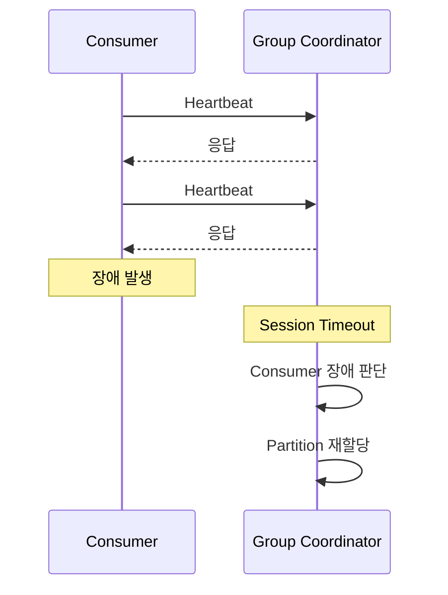

### session.timeout.ms가 너무 작다면?

일시적인 네트워크 지연이나 JVM 정지 등으로 Heartbeat가 늦어지는 상황에서도 장애로 판단될 가능성이 커질 수 있다.

이 경우 불필요한 Rebalancing이 발생할 수 있다.

### session.timeout.ms가 너무 크다면?

실제로 Consumer에 장애가 발생하더라도 이를 감지하는 데 시간이 오래 걸릴 수 있다.

따라서 장애 감지 속도와 일시적인 지연에 대한 허용 범위를 함께 고려해야 한다.

---

## session.timeout.ms와 max.poll.interval.ms의 차이

Consumer를 운영할 때는 `max.poll.interval.ms`도 중요하다.

두 설정은 서로 다른 문제를 다룬다.

### session.timeout.ms

Consumer가 Group Coordinator와 정상적으로 통신하고 있는지 확인한다.

### max.poll.interval.ms

Consumer가 `poll()`을 다시 호출하기까지 허용되는 최대 간격을 제한한다.

### 비교

| 설정 | 주요 목적 |
|---|---|
| session.timeout.ms | Consumer 생존 여부 판단 |
| max.poll.interval.ms | Consumer 애플리케이션의 소비 진행 여부 판단 |

### max.poll.interval.ms가 중요한 이유

Consumer가 Record 100개를 가져왔다고 가정해 보자.

그런데 각 Record를 처리하는 데 10초가 걸린다.

순차적으로 처리하면 전체 작업에 약 1,000초가 필요하다.

```text
100건 × 10초 = 1,000초
```

반면 `max.poll.interval.ms`가 다음과 같이 설정되어 있다.

```properties
max.poll.interval.ms=300000
```

이는 5분이다.

Consumer가 `poll()` 이후 너무 오랫동안 다음 `poll()`을 호출하지 못하면 Group 관리 측면에서 문제가 발생할 수 있다.

이 경우 Partition이 재할당되거나 Consumer의 정상적인 처리 흐름이 중단될 수 있다.

### 해결 방법

단순히 Timeout을 크게 늘리는 것보다 다음 방법을 함께 검토해야 한다.

- `max.poll.records` 감소
- Record 처리 시간 최적화
- 외부 API 호출 Timeout 설정
- 데이터베이스 처리량 개선
- 비동기 처리 구조 설계
- Partition별 완료 위치 관리

특히 비동기 처리 구조를 사용하는 경우에는 Record를 Worker에 전달한 시점과 실제 처리가 완료된 시점을 구분해야 한다.

---

## Kafka 버전에 따른 Consumer Group Protocol 차이

Kafka 4.0부터 새로운 Consumer Rebalance Protocol이 정식으로 제공된다.

이는 KIP-848을 기반으로 한다.

현재 Kafka에서는 대표적으로 다음 두 가지 Group Protocol을 구분할 수 있다.

```properties
group.protocol=classic
```

```properties
group.protocol=consumer
```

### Classic Protocol

기존 Consumer Group 방식이다.

Client 측에서 Heartbeat와 Session Timeout 등을 관리하는 설정을 사용한다.

대표적으로 다음 설정이 있다.

```properties
session.timeout.ms=45000

heartbeat.interval.ms=3000
```

### Consumer Protocol

Kafka 4.0부터 정식 제공되는 새로운 Consumer Rebalance Protocol이다.

Heartbeat 간격과 Session Timeout 등의 일부 설정을 Broker 측에서 관리한다.

따라서 새로운 Protocol을 사용하면서 기존 Client 설정을 그대로 적용할 수는 없다.

### 비교

| 항목 | Classic | Consumer |
|---|---|---|
| Group Protocol | 기존 방식 | 새로운 방식 |
| Rebalancing | Assignor에 따라 Eager·Cooperative | 점진적인 재할당 |
| Heartbeat 설정 | 주로 Client 측 | Broker 측 |
| Session Timeout | Client 설정 사용 | Broker 설정 사용 |
| 주요 목적 | 기존 Consumer Group 관리 | 확장성과 Rebalance 효율 개선 |

Kafka 4.4에서도 Java Consumer의 `group.protocol` 기본값은 `classic`이다.

새로운 Protocol을 사용하려면 명시적으로 설정해야 한다. [Apache Kafka](https://kafka.apache.org/44/operations/consumer-rebalance-protocol/)

따라서 Consumer 설정을 작성할 때는 어떤 Group Protocol을 사용할 것인지부터 명확하게 결정해야 한다.

---

## 여러 Partition에 저장된 메시지의 순서는 어떻게 될까?

Kafka에서는 Partition 내부의 Record 순서를 보장한다.

하지만 서로 다른 Partition 사이의 전역적인 순서는 보장하지 않는다.

이 개념은 실제 비즈니스 이벤트를 처리할 때 매우 중요하다.

### Producer가 메시지를 발행한 순서

Producer가 다음 메시지를 순서대로 생성했다고 가정해 보자.

```text
a

b

c

d

e

1

2

3

4

5
```

전체 발행 순서를 한 줄로 표현하면 다음과 같다.

```text
a → b → c → d → e → 1 → 2 → 3 → 4 → 5
```

### Kafka에 세 개의 Partition이 있는 경우

메시지가 다음과 같이 분배될 수 있다.

```text
Partition 0

b → e → 2 → 5
```

```text
Partition 1

a → d → 1 → 4
```

```text
Partition 2

c → 3
```

각 Partition 내부의 순서는 유지된다.

하지만 Consumer가 여러 Partition에서 데이터를 가져오면 다음과 같은 순서로 메시지를 관찰할 수 있다.

```text
a → d → 1 → 4 → b → e → 2 → 5 → c → 3
```

이 결과는 전체 발행 순서와 다르다.

그렇다고 Kafka의 순서 보장이 깨진 것은 아니다.

Kafka가 보장하는 순서의 범위는 Partition 내부이기 때문이다.

### Partition 내부 순서와 전체 순서 비교

| 구분 | 순서 보장 |
|---|---|
| 하나의 Partition 내부 | Record 기록 순서 보장 |
| 서로 다른 Partition 사이 | 전역 순서 보장하지 않음 |
| 동일 Key 기반 분배 | 조건이 유지되면 같은 Partition으로 분배 가능 |
| Consumer 내부 비동기 처리 | 완료 순서가 달라질 수 있음 |

---

## 메시지의 전체 순서를 보장하려면?

모든 메시지를 하나의 Partition에 저장하는 방법을 생각할 수 있다.

### Partition이 하나인 경우

```text
Topic: orders

Partition 0

Offset 0 → a
Offset 1 → b
Offset 2 → c
Offset 3 → d
Offset 4 → e
Offset 5 → 1
Offset 6 → 2
Offset 7 → 3
Offset 8 → 4
Offset 9 → 5
```

이렇게 구성하면 Partition 로그에 기록된 순서대로 메시지를 읽을 수 있다.

다만 여러 Producer가 동시에 전송하는 환경에서는 애플리케이션이 이벤트를 생성한 실제 시각의 전역 순서까지 보장되는 것은 아니다.

Kafka가 제공하는 것은 해당 Partition에 기록된 로그의 순서다.

### Partition을 하나로 구성할 때의 단점

Partition이 하나면 일반적인 Consumer Group에서 해당 Partition을 담당하는 Consumer도 한 시점에 하나다.

따라서 Partition 기반 병렬 처리에 제약이 발생한다.

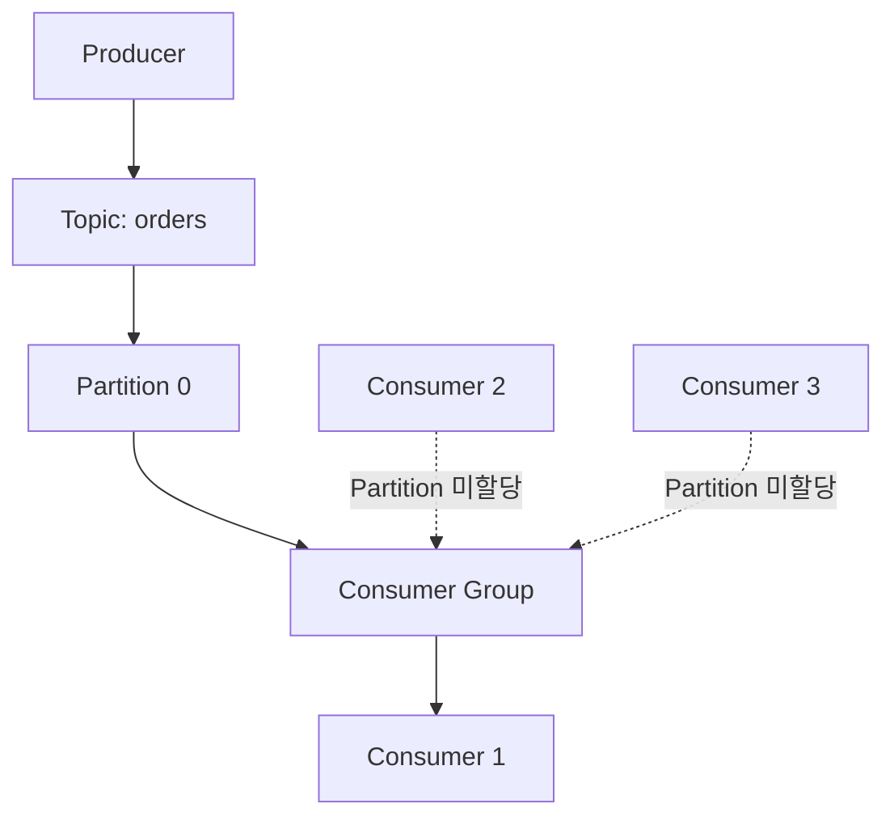

따라서 전체 순서 보장을 위해 Partition을 하나로 구성할 것인지, 특정 업무 식별자 단위로 순서를 보장하면서 여러 Partition을 사용할 것인지 판단해야 한다.

### 실무에서는 어떤 방식이 적합할까?

대부분의 비즈니스 시스템에서는 모든 이벤트의 전역 순서보다 특정 대상의 상태 변경 순서가 중요하다.

예를 들어 다음과 같다.

```text
order-1001

OrderCreated
→ PaymentCompleted
→ ShipmentStarted
```

```text
order-2001

OrderCreated
→ PaymentCompleted
→ ShipmentStarted
```

이 경우 `orderId`를 Kafka Key로 사용하여 같은 주문의 이벤트가 같은 Partition에 기록되도록 설계할 수 있다.

이렇게 하면 주문별 순서를 관리하면서도 여러 주문을 서로 다른 Partition에서 병렬 처리할 수 있다.

---

## Consumer Group이란?

### Consumer Group의 개념

Consumer Group은 여러 Consumer가 하나의 처리 목적을 위해 Partition을 나누어 처리하는 논리적인 그룹이다.

예를 들어 다음 Topic이 있다고 가정해 보자.

```text
Topic: peter-01

Partition 0

Partition 1

Partition 2
```

Consumer가 하나만 존재한다면 해당 Consumer가 세 Partition을 모두 담당할 수 있다.

### Consumer가 하나인 경우

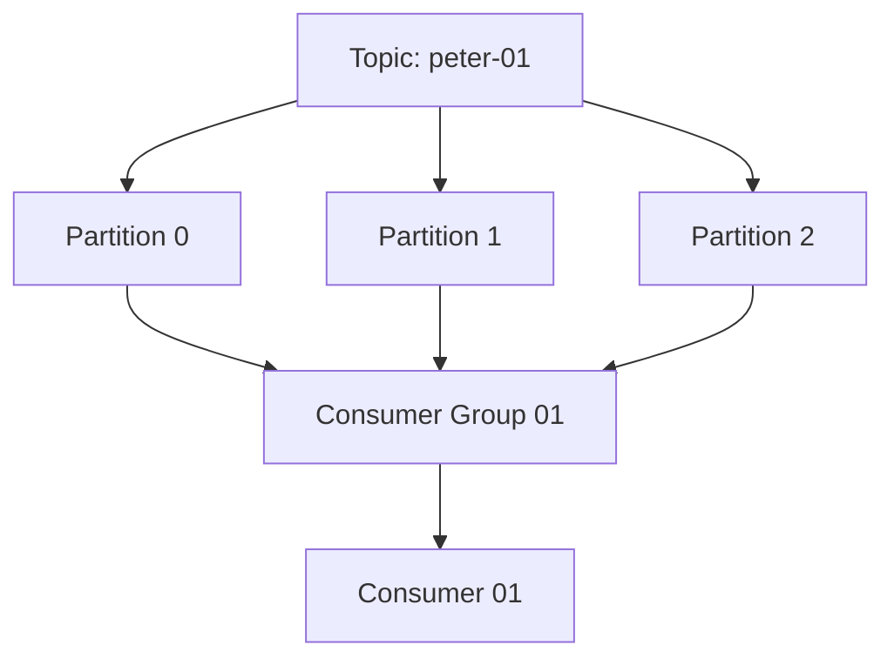

이후 메시지 처리량이 증가했다고 가정해 보자.

Consumer 하나로는 이벤트를 충분히 빠르게 처리하기 어렵다.

이때 Consumer를 추가하여 작업을 분산할 수 있다.

### Consumer가 세 개인 경우

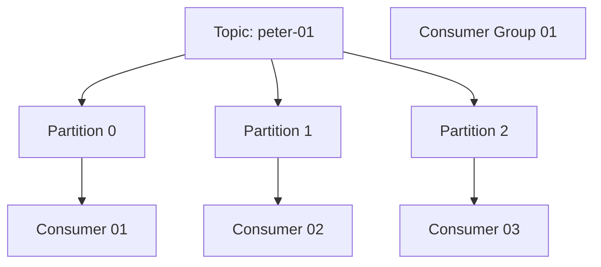

이제 세 Consumer가 Partition을 나누어 처리할 수 있다.

### Consumer Group의 장점

**첫 번째는 확장성이다.**

처리량이 증가하면 Consumer를 추가하여 Partition 처리를 분산할 수 있다.

**두 번째는 장애 대응이다.**

특정 Consumer에 장애가 발생하면 다른 Consumer가 해당 Partition을 이어받을 수 있다.

**세 번째는 독립적인 처리다.**

서로 다른 Consumer Group은 같은 Topic을 독립적으로 읽을 수 있다.

---

## Consumer를 많이 실행하면 무조건 빨라질까?

그렇지 않다.

일반적인 Consumer Group에서는 한 Partition이 같은 시점에 하나의 Consumer에게 할당된다.

따라서 Partition 수보다 Consumer 수가 많으면 일부 Consumer는 Partition을 할당받지 못할 수 있다.

### Partition 3개, Consumer 4개

```text
Partition 0 → Consumer 1

Partition 1 → Consumer 2

Partition 2 → Consumer 3

Consumer 4 → Partition 없음
```

Consumer 4는 대기 상태가 될 수 있다.

### Partition 4개, Consumer 4개

```text
Partition 0 → Consumer 1

Partition 1 → Consumer 2

Partition 2 → Consumer 3

Partition 3 → Consumer 4
```

이 경우 네 Consumer가 각각 하나의 Partition을 담당할 수 있다.

### Consumer와 Partition 수 비교

| Partition 수 | Consumer 수 | 일반적인 처리 구조 |
|---:|---:|---|
| 3 | 1 | 한 Consumer가 세 Partition 처리 |
| 3 | 2 | Consumer가 Partition을 나누어 처리 |
| 3 | 3 | 각 Consumer가 하나씩 처리 가능 |
| 3 | 4 | 최소 한 Consumer는 Partition 미할당 |
| 4 | 3 | 일부 Consumer가 두 Partition 처리 |
| 4 | 4 | 각 Consumer가 하나씩 처리 가능 |

따라서 Consumer를 늘리기 전에 Topic의 Partition 수를 확인해야 한다.

또한 병목이 Consumer의 처리 능력 때문인지도 분석해야 한다.

예를 들어 데이터베이스의 처리량이 이미 한계에 도달했다면 Consumer만 늘려도 성능이 개선되지 않을 수 있다.

참고로 이 설명은 일반적인 Consumer Group의 Partition 할당 모델을 기준으로 한다. Kafka의 Share Group은 Record 단위 협력 소비를 지원하는 별도 모델이므로 동일한 제약이 그대로 적용되지는 않는다.

---

## Rebalancing이란?

### Rebalancing의 개념

Rebalancing은 Consumer Group 내부에서 Partition의 담당 Consumer를 다시 할당하는 과정이다.

예를 들어 하나의 Consumer가 세 Partition을 담당하고 있다고 가정해 보자.

```text
Consumer 1

Partition 0
Partition 1
Partition 2
```

이후 Consumer 2와 Consumer 3을 추가한다.

그러면 Kafka는 Consumer Group의 Partition 할당을 변경할 수 있다.

```text
Consumer 1 → Partition 0

Consumer 2 → Partition 1

Consumer 3 → Partition 2
```

이처럼 Partition의 담당자가 변경되는 과정이 Rebalancing이다.

### Rebalancing이 발생하는 상황

대표적으로 다음과 같은 상황에서 발생할 수 있다.

1. Consumer가 새롭게 참여한 경우
2. Consumer가 정상적으로 종료된 경우
3. Consumer에 장애가 발생한 경우
4. Consumer Group의 구독 Topic이 변경된 경우
5. Topic의 Partition 수가 변경된 경우
6. Consumer가 Poll 관련 제한을 충족하지 못한 경우

### Rebalancing 구조

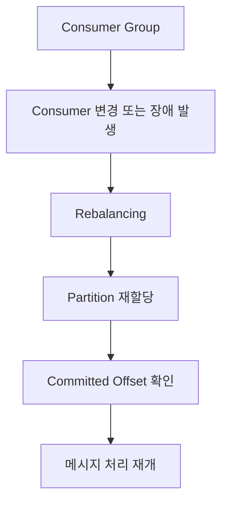

여기서 중요한 것은 Partition을 새롭게 할당받은 Consumer가 기존 Consumer의 처리 위치를 알아야 한다는 점이다.

이때 Committed Offset을 사용한다.

---

## Consumer 장애 시 Rebalancing

다음과 같은 Consumer Group이 있다고 가정해 보자.

```text
Topic: peter-01

Partition 0
Partition 1
Partition 2
Partition 3
```

세 Consumer가 Partition을 나누어 처리하고 있다.

```text
Consumer 1 → Partition 0

Consumer 2 → Partition 1

Consumer 3 → Partition 2, 3
```

이때 Consumer 2가 장애로 종료되었다.

Consumer Group은 Consumer 2가 담당하던 Partition 1을 다시 할당해야 한다.

### 장애 발생 후

```text
Consumer 1 → Partition 0, 1

Consumer 3 → Partition 2, 3
```

또는 할당 전략에 따라 다른 방식으로 분배될 수 있다.

### Rebalancing 시 발생할 수 있는 문제

Partition 담당자가 변경되면 새로운 Consumer는 해당 Partition의 마지막 Committed Offset을 확인해야 한다.

그런데 기존 Consumer가 일부 메시지를 처리한 후 Offset을 Commit하지 못했다면 어떻게 될까?

새 Consumer가 이미 처리된 메시지를 다시 읽을 수 있다.

따라서 **Rebalancing은 단순한 Partition 분배 기능이 아니라 중복 처리와 Offset 관리에 직접적인 영향을 주는 과정**이다.

---

## Rebalancing이 발생하면 Consumer Group 전체가 중단될까?

Kafka의 과거 Rebalancing 모델을 설명할 때 Group 전체의 처리가 일시적으로 중단된다는 설명이 자주 등장한다.

하지만 현재 Kafka에서는 Rebalancing 방식에 따라 영향 범위가 달라진다.

### Eager Rebalancing

전통적인 Eager 방식에서는 기존 Partition 할당을 회수하고 다시 분배하는 과정에서 Group 전체의 처리가 중단될 수 있다.

### Cooperative Rebalancing

Cooperative 방식은 변경이 필요한 Partition을 점진적으로 이동시키는 방식이다.

따라서 모든 Partition을 동시에 회수하는 방식보다 처리 중단 범위를 줄일 수 있다.

### 새로운 Consumer Rebalance Protocol

Kafka 4.0부터 정식으로 제공되는 Consumer Rebalance Protocol은 점진적인 Rebalancing을 통해 전체 동기화로 인한 중단을 줄이는 방향으로 설계되었다.

### 방식 비교

| 방식 | 특징 |
|---|---|
| Eager | Partition 할당을 전반적으로 회수하고 재할당 |
| Cooperative | 필요한 Partition을 점진적으로 재할당 |
| Consumer Protocol | Broker 중심의 점진적 Rebalancing |

따라서 **모든 Rebalancing이 반드시 Consumer Group 전체를 동일한 방식으로 중단시킨다는 설명은 현재 Kafka에서는 정확하지 않다.**

실제 영향은 사용하는 Group Protocol과 Partition Assignor, 애플리케이션의 처리 구조에 따라 달라진다. [Apache Kafka](https://kafka.apache.org/44/operations/consumer-rebalance-protocol/?utm_source=chatgpt.com)

---

## Rebalancing이 반복되면 왜 문제가 될까?

Rebalancing이 자주 발생하면 Consumer의 처리 성능과 안정성에 영향을 줄 수 있다.

예를 들어 다음과 같은 상황이다.

```text
Consumer 실행
    ↓
메시지 처리
    ↓
처리 지연
    ↓
max.poll.interval.ms 초과
    ↓
Rebalancing
    ↓
Partition 재할당
    ↓
다른 Consumer가 메시지 처리
    ↓
일부 메시지 재처리
```

이러한 문제가 반복되면 Consumer Lag이 증가하거나 중복 처리가 발생할 수 있다.

### 확인해야 할 항목

| 항목 | 확인 내용 |
|---|---|
| Consumer 상태 | 반복적으로 종료되는가? |
| Poll 간격 | 처리가 너무 오래 걸리는가? |
| 데이터베이스 | 응답 지연이 발생하는가? |
| 외부 API | Timeout이 증가하는가? |
| Session 설정 | 불필요하게 짧지 않은가? |
| 배포 방식 | Consumer가 동시에 대량으로 종료되는가? |
| Rebalance Protocol | 어떤 재할당 방식을 사용하는가? |

따라서 Rebalancing이 자주 발생한다면 단순히 Consumer 수를 늘리는 것보다 원인을 먼저 분석하는 것이 중요하다.

---

## Offset Commit이란?

### Offset Commit의 개념

Offset Commit은 Consumer가 재시작하거나 Partition을 새롭게 할당받았을 때 사용할 읽기 위치를 저장하는 작업이다.

Kafka Consumer Group의 Offset 정보는 일반적으로 Kafka의 내부 Topic인 다음 위치에 저장된다.

```text
__consumer_offsets
```

여기서 중요한 점은 **Committed Offset이 마지막으로 처리한 Record의 Offset이 아니라 다음에 읽을 위치를 나타낸다는 것**이다.

예를 들어 Consumer가 다음 Record까지 처리했다고 가정해 보자.

```text
Offset 0

Offset 1

Offset 2

Offset 3

Offset 4

Offset 5
```

Offset 5까지 정상적으로 처리했다면 Commit할 위치는 다음과 같다.

```text
Committed Offset = 6
```

즉, 다음에 읽어야 할 위치를 저장한다.

### Commit 구조

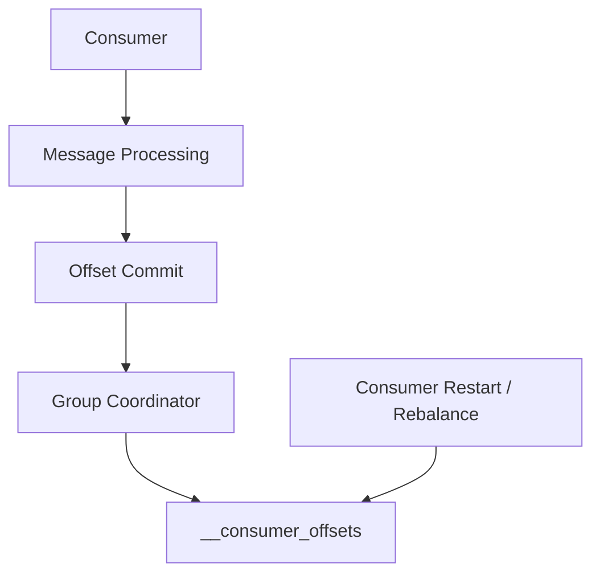

Consumer는 Group Coordinator를 통해 Offset Commit을 관리한다.

이후 다른 Consumer가 Partition을 할당받으면 저장된 위치를 기준으로 처리를 이어갈 수 있다.

---

## Committed Offset이 실제 처리 위치보다 뒤에 있다면?

다음과 같은 상황을 생각해 보자.

```text
Committed Offset = 4

실제 업무 처리 완료 = Offset 5
```

이 경우 Consumer는 Offset 4와 Offset 5의 처리를 완료했지만 Commit하지 못한 상태다.

이때 Consumer에 장애가 발생하면 어떻게 될까?

새로운 Consumer는 Committed Offset 4를 기준으로 읽기를 시작할 수 있다.

따라서 Offset 4와 Offset 5를 다시 처리할 수 있다.

### 중복 처리 시나리오

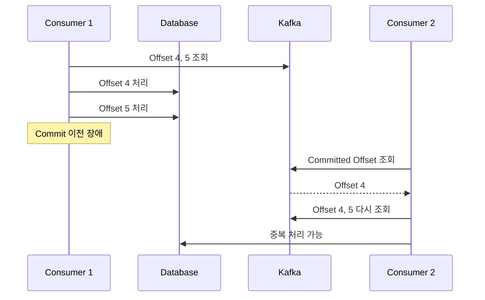

이러한 문제가 발생할 수 있기 때문에 Consumer에서 멱등성을 고려해야 한다.

---

## Committed Offset이 실제 처리 위치보다 앞에 있다면?

이번에는 반대 상황을 생각해 보자.

```text
Committed Offset = 6

실제 업무 처리 완료 = Offset 3
```

Consumer는 Offset 4와 Offset 5의 업무 처리를 완료하지 못했다.

하지만 Committed Offset은 이미 6으로 저장되어 있다.

이때 Consumer에 장애가 발생하면 새로운 Consumer는 Offset 6부터 읽을 수 있다.

따라서 Offset 4와 Offset 5를 처리하지 않고 건너뛰게 된다.

### 메시지 처리 누락 시나리오

```mermaid
sequenceDiagram
    participant C1 as Consumer 1
    participant Kafka
    participant DB as Database
    participant C2 as Consumer 2

    C1->>Kafka: Offset 4, 5 조회

    C1->>Kafka: Offset 6 Commit

    C1->>DB: 데이터 저장 시도

    DB--xC1: 저장 실패

    Note over C1: Consumer 장애

    C2->>Kafka: Committed Offset 조회

    Kafka-->>C2: Offset 6

    Note over C2: Offset 4, 5 건너뜀
```

이 상황에서는 Kafka에 Record가 남아 있더라도 Consumer Group의 정상적인 재개 경로에서 해당 Record를 건너뛸 수 있다.

물론 Offset을 수동으로 조정하여 재처리할 수는 있다.

하지만 장애가 발생할 때마다 수동 복구가 필요하다면 운영 복잡성이 증가한다.

### 중복과 누락 비교

| 상황 | 발생할 수 있는 문제 |
|---|---|
| 업무 처리 성공 후 Commit 이전 장애 | 중복 처리 |
| 업무 처리 이전에 Offset Commit | 업무 처리 누락 |

이 차이는 Kafka Consumer의 안정적인 처리를 설계할 때 가장 중요한 개념 중 하나다.

---

## 자동 Offset Commit이란?

자동 Commit은 Kafka Consumer가 일정한 주기에 따라 Offset을 Commit하는 방식이다.

### 설정

```properties
enable.auto.commit=true
```

Commit 간격은 다음 설정으로 조절할 수 있다.

```properties
auto.commit.interval.ms=5000
```

이는 5초를 의미한다.

Java Kafka Consumer의 대표적인 기본 자동 Commit 간격은 5초다.

여기서 설정 이름은 다음과 같다.

**`auto.commit.interval.ms`**

`auto.commit.intervals.ms`가 아니므로 주의해야 한다.

### 자동 Commit의 기본 흐름

```text
Consumer Poll
    ↓
Record 조회
    ↓
업무 처리
    ↓
자동 Commit 시점 도달
    ↓
Offset Commit
```

다만 Kafka Client는 애플리케이션의 실제 비즈니스 처리 성공 여부를 자동으로 알지 못한다.

또한 자동 Commit을 정확히 5초마다 독립적인 업무 처리 확인 Thread가 실행되는 방식으로 이해해서는 안 된다.

실제 동작은 Client와 Protocol에 따라 달라질 수 있으며, 중요한 것은 Commit 시점과 업무 처리 완료 시점이 일치하지 않을 수 있다는 점이다.

Kafka 공식 문서에서도 `enable.auto.commit`의 기본값과 `auto.commit.interval.ms` 설정을 설명한다. [Apache Kafka](https://kafka.apache.org/44/configuration/consumer-configs/)

---

## 자동 Commit에서 중복 처리가 발생하는 상황

다음과 같은 데이터가 있다고 가정해 보자.

| Offset | Payload |
|---:|---:|
| 0 | 1 |
| 1 | 2 |
| 2 | 3 |
| 3 | 4 |
| 4 | 5 |
| 5 | 6 |

Consumer 1이 메시지를 처리한다.

### 첫 번째 처리

```text
Payload 1 처리

Payload 2 처리

Commit Offset 2
```

### 두 번째 처리

```text
Payload 3 처리

Payload 4 처리

Commit Offset 4
```

### 세 번째 처리

```text
Payload 5 처리

Payload 6 처리

Commit 이전 Consumer 장애
```

이때 마지막 Committed Offset은 4다.

Consumer 1이 종료되고 Consumer 2가 Partition을 새롭게 할당받는다.

Consumer 2는 Offset 4부터 읽는다.

```text
Payload 5

Payload 6
```

따라서 이미 처리한 데이터를 다시 처리할 수 있다.

### 자동 Commit의 장점

- 설정이 간단하다.
- Offset 관리 코드를 직접 작성할 필요가 줄어든다.
- 업무 로직이 단순한 Consumer에서 유용할 수 있다.

### 자동 Commit의 고려사항

- Commit과 업무 처리 완료 시점이 다를 수 있다.
- 장애 시 중복 처리가 발생할 수 있다.
- 비동기 처리 구조에서는 처리 누락 위험도 존재한다.
- Commit 시점을 정교하게 제어하기 어렵다.

특히 Consumer가 Record를 별도 Worker에 전달한 후 바로 다음 `poll()`을 호출하는 구조에서는 실제 작업이 완료되지 않았는데 소비 위치가 Commit될 수 있으므로 주의해야 한다.

---

## 수동 Offset Commit이란?

수동 Commit은 애플리케이션이 명시적으로 Offset을 Commit하는 방식이다.

### 설정

```properties
enable.auto.commit=false
```

이 경우 Kafka Consumer는 애플리케이션에서 직접 Commit을 호출해야 한다.

대표적으로 다음 메서드를 사용할 수 있다.

```java
consumer.commitSync();
```

또는 다음 메서드를 사용할 수 있다.

```java
consumer.commitAsync();
```

### 수동 Commit의 기본 흐름

```mermaid
flowchart TD
    A["Consumer Poll"]

    B["Record 조회"]

    C["업무 처리"]

    D["Database Transaction"]

    E{"처리 성공?"}

    F["Offset Commit"]

    G["Retry / Error Handling"]

    A --> B
    B --> C
    C --> D
    D --> E

    E -->|"성공"| F
    E -->|"실패"| G
```

수동 Commit에서는 애플리케이션이 실제 업무 처리 완료 시점을 기준으로 Offset을 관리할 수 있다.

예를 들어 결제 완료 이벤트를 읽어 구독 권한을 활성화하는 시스템이라면 다음과 같이 처리할 수 있다.

```text
PaymentCompleted 수신
    ↓
구독 권한 활성화
    ↓
Database Commit 성공
    ↓
Kafka Offset Commit
```

이러한 순서는 처리 누락 위험을 줄이는 데 도움이 된다.

하지만 수동 Commit을 사용한다고 중복 처리가 완전히 사라지는 것은 아니다.

---

## 수동 Commit에서도 중복 처리가 발생하는 이유

다음과 같은 상황을 생각해 보자.

**1단계**

Consumer가 결제 완료 이벤트를 읽는다.

**2단계**

회원 데이터베이스에 구독 권한을 정상적으로 활성화한다.

**3단계**

데이터베이스 Transaction이 Commit된다.

**4단계**

Kafka Offset을 Commit하기 직전에 Consumer가 종료된다.

이 경우 데이터베이스에는 구독 권한이 활성화되어 있다.

하지만 Kafka에는 새로운 Offset이 Commit되지 않았다.

따라서 Consumer가 재시작하면 같은 이벤트를 다시 읽을 수 있다.

```text
Database Commit 성공

        ↓

Kafka Offset Commit 이전 장애

        ↓

동일 이벤트 재처리
```

이러한 문제는 데이터베이스 Transaction과 Kafka Offset Commit이 기본적으로 하나의 원자적인 작업이 아니기 때문에 발생한다.

### 수동 Commit의 한계

수동 Commit은 업무 처리와 Offset Commit의 순서를 제어할 수 있다.

하지만 두 작업 사이의 장애 구간 자체를 자동으로 제거하지는 않는다.

따라서 다음과 같은 방식을 함께 고려해야 한다.

- 이벤트 ID 기반 중복 방지
- Unique Constraint
- 처리 이력 테이블
- 멱등적인 Update
- 트랜잭션 범위 설계

---

## 멱등성을 이용한 Consumer 중복 처리 방지

멱등성(Idempotency)은 동일한 작업을 여러 번 수행하더라도 최종 결과가 한 번 수행한 것과 동일하도록 만드는 성질이다.

예를 들어 다음 이벤트가 있다고 가정해 보자.

```json
{
  "eventId": "evt-payment-10001",
  "eventType": "PaymentCompleted",
  "paymentId": "payment-10001",
  "subscriptionId": "subscription-10001"
}
```

Consumer가 이 이벤트를 두 번 읽을 수 있다.

하지만 구독 권한 활성화는 한 번만 수행해야 한다.

### 이벤트 처리 이력 테이블

다음과 같은 테이블을 구성할 수 있다.

```sql
CREATE TABLE processed_events (
    event_id VARCHAR(100) PRIMARY KEY,
    processed_at TIMESTAMP NOT NULL
);
```

Consumer는 이벤트를 처리할 때 해당 이벤트 ID가 이미 처리되었는지 확인할 수 있다.

중요한 점은 이벤트 처리 이력 저장과 실제 비즈니스 데이터 변경을 같은 데이터베이스 Transaction에서 처리해야 한다는 것이다.

### 멱등성 처리 구조

```mermaid
flowchart TD
    A["Kafka Event 수신"]

    B["Database Transaction 시작"]

    C{"이미 처리한 eventId?"}

    D["중복 처리 생략"]
    E["비즈니스 데이터 변경"]

    F["처리 이력 저장"]

    G["Database Commit"]

    H["Kafka Offset Commit"]

    A --> B
    B --> C

    C -->|"Yes"| D
    C -->|"No"| E

    E --> F

    D --> G
    F --> G

    G --> H
```

실제 구현에서는 단순한 `SELECT` 후 `INSERT`만으로 동시성 문제를 완전히 방지할 수는 없다.

따라서 `event_id`에 Unique Constraint를 적용하고 중복 삽입 시도를 적절하게 처리하는 것이 중요하다.

또한 중복 이벤트를 확인하는 로직과 비즈니스 데이터 변경이 동일한 Transaction에서 수행되도록 설계해야 한다.

---

## 비동기 Consumer에서 Offset Commit을 주의해야 하는 이유

Consumer가 여러 메시지를 병렬로 처리한다면 Offset Commit은 더욱 복잡해진다.

예를 들어 하나의 Partition에 다음 Record가 있다고 가정해 보자.

```text
Offset 10

Offset 11

Offset 12
```

Consumer가 세 Record를 서로 다른 Worker에서 병렬 처리한다.

처리 결과는 다음과 같다.

```text
Offset 10 → 완료

Offset 11 → 처리 중

Offset 12 → 완료
```

이때 Offset 12까지 완료되었다는 이유로 Offset 13을 Commit하면 안 된다.

왜냐하면 Offset 11의 처리가 아직 완료되지 않았기 때문이다.

만약 Offset 13을 Commit한 후 Consumer가 종료된다면 새로운 Consumer는 Offset 13부터 시작할 수 있다.

Offset 11의 업무 처리는 누락될 수 있다.

### 올바른 Commit 기준

같은 Partition에서는 **앞쪽 Record부터 연속해서 처리가 완료된 위치**를 기준으로 Commit해야 한다.

```text
Offset 10 → 완료

Offset 11 → 처리 중

Offset 12 → 완료

현재 안전하게 Commit할 위치: 11
```

Offset 11까지 완료되면 그때 Offset 13을 Commit할 수 있다.

단, Offset 12 역시 정상적으로 완료된 상태여야 한다.

### 실무에서의 선택

단순한 업무 처리에서는 Partition 내부를 순차적으로 처리하는 방식이 구현과 장애 복구를 이해하기 쉽다.

비동기 병렬 처리가 반드시 필요하다면 Partition별 완료 위치를 별도로 관리하는 구조를 설계해야 한다.

---

## Java Consumer 구현 예제

이제 Java Kafka Consumer에서 수동 Commit을 사용하는 예제를 살펴보자.

다음 코드는 하나의 Consumer가 Topic의 Record를 읽고, 전체 처리에 성공한 후 Offset을 Commit하는 기본적인 구조다.

### Consumer 구현

```java
import org.apache.kafka.clients.consumer.ConsumerConfig;
import org.apache.kafka.clients.consumer.ConsumerRecord;
import org.apache.kafka.clients.consumer.ConsumerRecords;
import org.apache.kafka.clients.consumer.KafkaConsumer;
import org.apache.kafka.common.serialization.StringDeserializer;

import java.time.Duration;
import java.util.Collections;
import java.util.Properties;

public class OrderEventConsumer {

    private static final String TOPIC = "commerce.orders.created.v1";

    public static void main(String[] args) {

        Properties properties = new Properties();

        properties.put(
            ConsumerConfig.BOOTSTRAP_SERVERS_CONFIG,
            "localhost:9092"
        );

        properties.put(
            ConsumerConfig.GROUP_ID_CONFIG,
            "order-notification"
        );

        properties.put(
            ConsumerConfig.KEY_DESERIALIZER_CLASS_CONFIG,
            StringDeserializer.class.getName()
        );

        properties.put(
            ConsumerConfig.VALUE_DESERIALIZER_CLASS_CONFIG,
            StringDeserializer.class.getName()
        );

        properties.put(
            ConsumerConfig.ENABLE_AUTO_COMMIT_CONFIG,
            false
        );

        properties.put(
            ConsumerConfig.AUTO_OFFSET_RESET_CONFIG,
            "earliest"
        );

        try (KafkaConsumer<String, String> consumer =
                 new KafkaConsumer<>(properties)) {

            consumer.subscribe(
                Collections.singletonList(TOPIC)
            );

            while (true) {

                ConsumerRecords<String, String> records =
                    consumer.poll(Duration.ofMillis(1000));

                for (ConsumerRecord<String, String> record : records) {

                    process(record);
                }

                if (!records.isEmpty()) {

                    consumer.commitSync();
                }
            }
        }
    }

    private static void process(
        ConsumerRecord<String, String> record
    ) {

        System.out.println(
            "Topic: " + record.topic()
        );

        System.out.println(
            "Partition: " + record.partition()
        );

        System.out.println(
            "Offset: " + record.offset()
        );

        System.out.println(
            "Key: " + record.key()
        );

        System.out.println(
            "Value: " + record.value()
        );

        // 실제 환경에서는 Database 저장이나
        // 외부 API 호출 등의 비즈니스 로직을 수행한다.
    }
}
```

### 코드의 처리 흐름

**1단계: Consumer 설정**

```java
properties.put(
    ConsumerConfig.ENABLE_AUTO_COMMIT_CONFIG,
    false
);
```

자동 Commit을 비활성화한다.

**2단계: Topic 구독**

```java
consumer.subscribe(
    Collections.singletonList(TOPIC)
);
```

Consumer Group에 참여하여 Topic을 구독한다.

**3단계: Record 조회**

```java
consumer.poll(Duration.ofMillis(1000));
```

Kafka Broker에서 Record를 가져온다.

**4단계: 비즈니스 처리**

```java
process(record);
```

Record의 정보를 이용하여 필요한 작업을 수행한다.

**5단계: Offset Commit**

```java
consumer.commitSync();
```

가져온 Record의 처리가 모두 정상적으로 완료된 후 Offset을 Commit한다.

### 주의할 점

이 코드는 기본적인 처리 흐름을 설명하기 위한 예제다.

`process()` 내부에서 오류가 발생하면 Commit 이전에 예외가 발생할 수 있다.

따라서 운영 환경에서는 다음 사항을 추가로 고려해야 한다.

- 예외 처리
- Retry 정책
- 중복 이벤트 방지
- Consumer 종료 처리
- Rebalance 중 처리 상태 관리
- 데이터베이스 Transaction
- 장애 알림

또한 `commitSync()`를 인자 없이 호출하면 현재 Consumer가 관리하는 소비 위치를 기준으로 Commit한다.

따라서 일부 Record만 처리한 후 Commit해야 하는 구조라면 Partition별 Offset을 명시적으로 관리해야 한다.

KafkaConsumer 공식 API에서도 Commit할 Offset은 다음에 읽을 Record의 위치여야 한다고 설명한다. [Apache Kafka](https://kafka.apache.org/44/javadoc/org/apache/kafka/clients/consumer/KafkaConsumer.html?utm_source=chatgpt.com)

---

## Partition별 Offset을 직접 Commit하는 방법

일부 Record만 정상적으로 처리되었을 때는 명시적으로 Offset을 지정할 수 있다.

예를 들어 다음과 같은 코드를 사용할 수 있다.

```java
import org.apache.kafka.clients.consumer.OffsetAndMetadata;
import org.apache.kafka.common.TopicPartition;

import java.util.Map;

TopicPartition partition =
    new TopicPartition(
        "commerce.orders.created.v1",
        0
    );

OffsetAndMetadata offset =
    new OffsetAndMetadata(11);

consumer.commitSync(
    Map.of(partition, offset)
);
```

이 코드는 Partition 0의 다음 읽기 위치를 Offset 11로 Commit한다.

즉, Offset 10까지 정상적으로 처리되었다는 전제에서 사용할 수 있다.

### 중요한 규칙

```text
마지막 정상 처리 Offset = 10

Commit Offset = 11
```

마지막으로 처리한 Offset 자체를 그대로 Commit하는 것이 아니다.

다음에 읽을 위치를 Commit해야 한다.

---

## Consumer 설정 전체 예제

다음은 일반적인 Java Kafka Consumer에서 수동 Commit을 사용하는 설정 예제다.

Classic Group Protocol을 명시하여 Session 및 Heartbeat 설정의 적용 범위를 맞췄다.

```properties
bootstrap.servers=broker-1:9092,broker-2:9092,broker-3:9092

group.id=order-notification
group.protocol=classic

key.deserializer=org.apache.kafka.common.serialization.StringDeserializer
value.deserializer=org.apache.kafka.common.serialization.StringDeserializer

enable.auto.commit=false

auto.offset.reset=earliest

fetch.min.bytes=1
fetch.max.wait.ms=500

fetch.max.bytes=52428800
max.partition.fetch.bytes=1048576

max.poll.records=100
max.poll.interval.ms=300000

request.timeout.ms=30000

session.timeout.ms=45000
heartbeat.interval.ms=3000
```

### 설정 항목 정리

| 설정 | 값 | 역할 |
|---|---|---|
| bootstrap.servers | Broker 세 대 | 최초 연결 |
| group.id | order-notification | Consumer Group 식별 |
| group.protocol | classic | Group Protocol |
| key.deserializer | StringDeserializer | Key 역직렬화 |
| value.deserializer | StringDeserializer | Value 역직렬화 |
| enable.auto.commit | false | 수동 Commit |
| auto.offset.reset | earliest | 유효한 Offset이 없을 때 시작 위치 |
| fetch.min.bytes | 1 | Fetch 최소 데이터 크기 |
| fetch.max.wait.ms | 500 | Fetch 대기 시간 |
| fetch.max.bytes | 50MiB | Fetch 응답 크기 |
| max.partition.fetch.bytes | 1MiB | Partition별 Fetch 크기 |
| max.poll.records | 100 | poll당 반환 Record 수 제한 |
| max.poll.interval.ms | 5분 | Poll 간격 제한 |
| request.timeout.ms | 30초 | 요청 Timeout |
| session.timeout.ms | 45초 | Session Timeout |
| heartbeat.interval.ms | 3초 | Heartbeat 간격 |

여기서 `max.poll.records=100`이 항상 적절한 것은 아니다.

Consumer의 처리 시간이 길다면 100건을 처리하는 동안 `max.poll.interval.ms`를 초과할 수 있다.

따라서 처리 시간을 측정한 후 적절한 값을 선택해야 한다.

---

## Kafka Consumer에서 자주 발생하는 장애

Producer와 Consumer의 주요 설정을 이해했다면 실제 운영에서 발생할 수 있는 문제를 연결해 볼 수 있다.

### 1. Producer 전송 지연

**증상**

Producer의 `send()` 호출이 오래 대기하거나 최종 전송 결과가 늦게 반환된다.

**확인할 항목**

- Broker 연결 상태
- `bootstrap.servers`
- `advertised.listeners`
- Producer Buffer 사용량
- Batch 설정
- 네트워크 지연
- Broker 부하

### 2. Producer Timeout

**증상**

메시지 전송이 Timeout으로 실패한다.

**확인할 항목**

- Partition Leader 상태
- ISR 상태
- `acks`
- `min.insync.replicas`
- `request.timeout.ms`
- `delivery.timeout.ms`
- Broker 처리량

### 3. Consumer Lag 증가

**증상**

Kafka에 이벤트가 계속 쌓이고 Consumer의 처리 위치가 뒤처진다.

**확인할 항목**

- Producer 유입량
- Consumer 처리량
- Partition 수
- Consumer 수
- 데이터베이스 응답 시간
- 외부 API 호출 지연

### 4. 반복적인 Rebalancing

**증상**

Consumer Group에서 Partition 재할당이 자주 발생한다.

**확인할 항목**

- Consumer 종료 여부
- Heartbeat 문제
- Session Timeout
- max.poll.interval.ms
- Consumer 배포 방식
- Group Protocol

### 5. 동일 이벤트의 중복 처리

**증상**

같은 이벤트가 여러 번 처리된다.

**확인할 항목**

- 데이터베이스 처리 후 Commit 이전 장애
- Rebalancing
- Consumer Retry
- 이벤트 멱등성
- Offset Commit 시점

### 6. 일부 이벤트 처리 누락

**증상**

Kafka에는 이벤트가 존재하지만 실제 비즈니스 처리가 수행되지 않았다.

**확인할 항목**

- 실제 처리 전에 Offset을 Commit했는가?
- 비동기 처리 완료를 기다렸는가?
- 실패한 Record를 건너뛰었는가?
- Consumer 예외 처리가 적절한가?
- 재처리 정책이 존재하는가?

### 장애 유형별 점검표

| 장애 현상 | 우선 점검 항목 |
|---|---|
| Producer 전송 지연 | Buffer, Broker 연결, Metadata |
| Producer Timeout | ISR, acks, Retry, Timeout |
| Consumer Lag 증가 | 처리량, Partition, DB 병목 |
| Rebalancing 반복 | Poll 지연, Session, Consumer 상태 |
| 이벤트 중복 처리 | Commit 시점, 멱등성 |
| 이벤트 처리 누락 | 선행 Commit, 비동기 처리 |
| Consumer 재시작 후 잘못된 위치 | group.id, Offset Reset |
| 큰 메시지 전송 실패 | Producer·Broker·Consumer 크기 제한 |

---

## Kafka 아키텍처에서 가장 중요한 10가지 설계 원칙

### 1. Producer 전송 성공과 Consumer 업무 성공을 구분한다

Producer의 성공은 Kafka 저장 확인과 관련된다.

Consumer의 업무 처리 완료를 의미하지 않는다.

따라서 후속 처리 결과가 중요한 경우 별도의 상태 관리가 필요하다.

### 2. 메시지 Key를 업무 단위로 설계한다

동일한 주문이나 사용자, 구독의 이벤트 순서가 중요하다면 적절한 Key를 사용해야 한다.

다만 Key가 특정 Partition에 지나치게 집중되지 않는지도 확인해야 한다.

### 3. 처리량과 지연 시간의 균형을 고려한다

Producer의 Batch와 압축은 처리량에 영향을 준다.

Consumer의 Fetch 설정도 처리량과 지연에 영향을 준다.

따라서 두 가지를 함께 측정해야 한다.

### 4. 중요한 이벤트는 저장 확인 수준을 강화한다

결제와 정산처럼 데이터가 중요한 시스템에서는 `acks=all`과 적절한 Replica 설정을 검토해야 한다.

하지만 Broker 내부의 내구성 설정만으로 전체 업무의 정합성이 확보되지는 않는다.

### 5. Producer의 재시도를 고려한다

일시적인 네트워크 오류는 언제든 발생할 수 있다.

따라서 재시도와 Timeout 설정을 함께 관리해야 한다.

또한 재시도에 따른 중복 기록 가능성을 고려해야 한다.

### 6. Consumer Group과 Partition 수를 함께 설계한다

일반적인 Consumer Group에서는 Partition 수가 병렬 처리 수준에 영향을 준다.

Consumer를 무조건 많이 실행하는 것보다 Partition 수와 처리량을 함께 고려해야 한다.

### 7. Rebalancing을 정상적인 운영 과정으로 이해한다

Consumer의 추가와 종료, 장애 등에 따라 Rebalancing은 발생할 수 있다.

따라서 Rebalancing을 완전히 없애는 것보다 그 영향 범위를 줄이고 안전하게 처리하도록 설계해야 한다.

### 8. Offset Commit 시점을 명확하게 정의한다

Offset Commit은 단순한 위치 저장 작업이 아니다.

실제 업무 처리의 성공과 실패를 어떻게 해석할지 결정하는 중요한 부분이다.

### 9. Consumer의 멱등성을 확보한다

수동 Commit을 사용하더라도 중복 처리는 발생할 수 있다.

따라서 중복 이벤트가 비즈니스 데이터에 잘못 반영되지 않도록 설계해야 한다.

### 10. Kafka 지표와 실제 업무 처리 결과를 함께 모니터링한다

Consumer Lag이 작다고 해서 모든 업무 처리가 완료되었다고 판단해서는 안 된다.

실제 데이터베이스 반영과 외부 API 호출 결과도 함께 관찰해야 한다.

---

## Producer와 Consumer 전체 아키텍처

지금까지 살펴본 내용을 하나의 구조로 정리하면 다음과 같다.

```mermaid
flowchart TD
    A["Application"]

    subgraph Producer["Kafka Producer"]
        B["Serializer"]
        C["Partitioner"]
        D["Record Accumulator"]
        E["Batch"]
        F["Sender"]
    end

    subgraph Cluster["Kafka Cluster"]
        G["Partition Leader"]
        H["Follower Replica"]
        I["Topic / Partitions"]
        J["Group Coordinator"]
        K["__consumer_offsets"]
    end

    subgraph Consumers["Consumer Group"]
        L["Consumer 1"]
        M["Consumer 2"]
        N["Consumer 3"]
    end

    O["Business Logic"]
    P["Database"]
    Q["Offset Commit"]

    A --> B
    B --> C
    C --> D
    D --> E
    E --> F

    F -->|"Produce Request"| G

    G -->|"Replication"| H
    G --- I

    I -->|"Fetch"| L
    I -->|"Fetch"| M
    I -->|"Fetch"| N

    L --> O
    M --> O
    N --> O

    O --> P
    P -->|"처리 완료"| Q

    Q --> J
    J --> K
```

이 구조는 Kafka의 데이터 처리 과정을 세 가지 영역으로 구분해서 보여준다.

### Producer 영역

Producer는 메시지를 직렬화하고 Partition을 선택한다.

이후 Buffer에서 Record를 모아 Batch로 구성하고 해당 Partition의 Leader에 전송한다.

### Kafka Cluster 영역

Kafka는 Producer가 전송한 Record를 Partition에 저장한다.

Leader와 Follower는 Replication을 수행한다.

Group Coordinator는 Consumer Group 및 Offset 관리와 관련된 요청을 처리한다.

### Consumer 영역

Consumer는 자신에게 할당된 Partition에서 Record를 읽는다.

이후 비즈니스 로직을 수행한다.

업무 처리가 완료되면 안전한 위치를 Commit한다.

세 영역은 서로 연결되어 있지만 책임이 다르다.

따라서 장애가 발생했을 때는 어느 단계에서 문제가 발생했는지 구분해야 한다.

---

## 주요 개념 정리

| 개념 | 설명 |
|---|---|
| Producer | Kafka에 Record를 발행하는 클라이언트 |
| bootstrap.servers | Kafka Cluster 최초 연결 주소 |
| Metadata | Topic, Partition, Leader 등의 클러스터 정보 |
| Partitioner | Record의 Partition 결정 |
| Record Accumulator | 전송 대기 Record를 모으는 내부 구조 |
| Batch | 여러 Record를 묶은 전송 단위 |
| acks | Broker 저장 확인 수준 |
| buffer.memory | Producer 전송 대기 Buffer 크기 |
| batch.size | Partition별 Batch 크기 |
| linger.ms | Batch를 모으기 위한 대기 시간 |
| compression.type | 압축 알고리즘 |
| retries | 전송 오류 재시도 |
| delivery.timeout.ms | 전송 결과 확정 시간 한도 |
| request.timeout.ms | 개별 요청 Timeout |
| max.block.ms | Metadata 또는 Buffer 확보 대기 |
| max.request.size | Producer 요청 크기 제한 |
| enable.idempotence | Producer 재시도 중복 기록 방지 |
| Consumer | Kafka Record를 읽는 클라이언트 |
| Consumer Group | Consumer가 Partition을 분담하는 그룹 |
| group.id | Consumer Group 식별자 |
| poll() | Kafka에서 Record를 가져오는 API |
| fetch.min.bytes | Fetch 응답의 최소 데이터 크기 기준 |
| fetch.max.wait.ms | Fetch 대기 시간 |
| fetch.max.bytes | Fetch 응답 크기 설정 |
| max.partition.fetch.bytes | Partition별 Fetch 크기 |
| auto.offset.reset | 유효한 Offset이 없을 때 시작 위치 |
| session.timeout.ms | Consumer Session 장애 감지 |
| max.poll.interval.ms | Poll 호출 간격 제한 |
| Rebalancing | Partition 담당 Consumer 재할당 |
| Offset Commit | 다음에 읽을 위치 저장 |
| __consumer_offsets | Consumer Group Offset 내부 저장소 |
| enable.auto.commit | 자동 Commit 여부 |
| commitSync() | 동기 Offset Commit |
| commitAsync() | 비동기 Offset Commit |
| Idempotency | 중복 처리 시에도 동일한 최종 결과 유지 |

---

## 정리

Apache Kafka의 Producer와 Consumer는 단순히 메시지를 보내고 받는 역할만 수행하지 않는다.

Producer는 Topic의 Partition을 결정하고 해당 Partition의 Leader Broker에 메시지를 전송한다.

이 과정에서 Serializer와 Partitioner, Buffer, Batch, Sender 등의 내부 구성 요소가 동작한다.

Producer는 `bootstrap.servers`를 이용하여 Kafka Cluster에 처음 연결한다.

이후 Metadata를 확인하여 실제 Record를 저장할 Partition의 Leader에 요청한다.

따라서 최초 접속한 Broker와 실제 데이터를 전송하는 Broker는 서로 다를 수 있다.

Producer의 주요 설정 중 `acks`는 메시지의 저장 확인 수준을 결정한다.

`acks=0`은 Broker의 저장 확인을 기다리지 않는다.

`acks=1`은 Leader의 로컬 로그 기록 확인을 기다린다.

`acks=all`은 ISR 기반의 저장 확인을 기다린다.

하지만 `acks=all`을 사용한다고 모든 장애에서 데이터 유실이 완전히 방지되는 것은 아니다.

Replication Factor와 `min.insync.replicas`, Leader 선출 정책 등을 함께 고려해야 한다.

Producer는 내부 Buffer와 Batch를 이용하여 메시지 전송 효율을 높인다.

`buffer.memory`는 전송 대기 Record를 보관하는 메모리 크기를 조절한다.

`batch.size`는 Partition별 Batch 크기를 조절한다.

`linger.ms`는 Batch를 모으기 위해 기다리는 시간을 조절한다.

`compression.type`은 메시지 압축 방식을 결정한다.

이러한 설정은 처리량과 응답 지연, CPU 사용량, 네트워크 사용량에 영향을 준다.

따라서 실제 워크로드를 기준으로 조절하는 것이 중요하다.

또한 Producer에서는 일시적인 장애에 대응하기 위한 재시도와 Timeout 설정이 중요하다.

`retries`는 재시도 횟수와 관련되고, `delivery.timeout.ms`는 전체 전송 결과의 제한 시간과 관련된다.

이 과정에서 Broker에 데이터가 저장되었지만 응답이 유실되는 상황이 발생할 수 있다.

이 경우 Producer가 재시도하면서 동일한 Record가 중복 기록될 위험이 있다.

Kafka의 Idempotent Producer 기능은 이러한 문제를 방지하는 데 도움이 된다.

하지만 애플리케이션이 같은 비즈니스 이벤트를 두 번 생성하는 문제나 Consumer의 중복 처리까지 자동으로 해결하는 것은 아니다.

Consumer는 Kafka에 저장된 Record를 읽어 처리한다.

Consumer는 자신에게 할당된 Partition과 읽을 Offset을 기준으로 데이터를 가져온다.

Kafka Consumer는 일반적으로 Pull 방식으로 Broker에 Fetch 요청을 전송한다.

여기서 중요한 점은 Consumer가 메시지를 가져왔다는 사실과 실제 업무 처리가 완료되었다는 사실이 다르다는 것이다.

Consumer는 `group.id`를 이용하여 Consumer Group에 참여할 수 있다.

같은 Consumer Group의 Consumer들은 Partition을 나누어 처리한다.

서로 다른 Consumer Group은 동일한 Topic의 데이터를 독립적으로 읽을 수 있다.

이를 통해 하나의 이벤트를 알림과 분석, 검색 등의 여러 서비스에서 활용할 수 있다.

그러나 Consumer 수를 늘린다고 처리량이 무조건 증가하는 것은 아니다.

일반적인 Consumer Group에서는 하나의 Partition을 한 시점에 하나의 Consumer가 담당한다.

따라서 Partition 수보다 Consumer 수가 많으면 일부 Consumer가 Partition을 할당받지 못할 수 있다.

또한 Kafka는 Partition 내부의 Record 순서를 보장하지만 서로 다른 Partition 사이의 전역 순서는 보장하지 않는다.

동일한 주문이나 사용자에 대한 이벤트 순서가 중요하다면 적절한 Kafka Key를 사용하여 같은 Partition에 기록되도록 설계하는 것이 좋다.

Consumer Group에서는 Consumer의 추가와 종료, 장애 등에 따라 Rebalancing이 발생할 수 있다.

Rebalancing은 Partition 담당자를 변경하는 과정이다.

기존 Consumer가 처리하던 Partition을 다른 Consumer가 이어받을 수 있다.

이때 새 Consumer는 저장된 Committed Offset을 기준으로 메시지를 읽는다.

따라서 Rebalancing은 Offset Commit과 밀접하게 연결된다.

Offset Commit은 마지막으로 처리한 Record의 Offset 자체가 아니라 다음에 읽을 위치를 저장한다.

예를 들어 Offset 5까지 처리했다면 Commit할 위치는 6이다.

Consumer의 실제 업무 처리 완료 위치와 Committed Offset이 일치하지 않으면 중복이나 누락 문제가 발생할 수 있다.

업무 처리가 완료되었지만 Commit하기 전에 Consumer가 종료되면 같은 메시지를 다시 처리할 수 있다.

반대로 실제 업무 처리가 완료되지 않았는데 Offset을 먼저 Commit하면 메시지 처리가 누락될 수 있다.

Kafka는 자동 Commit과 수동 Commit을 제공한다.

자동 Commit은 설정이 간단하지만 애플리케이션의 업무 처리 완료 여부를 자동으로 판단하지 않는다.

수동 Commit은 업무 처리 완료 이후 Offset을 저장하도록 제어할 수 있다.

하지만 수동 Commit을 사용해도 데이터베이스 Transaction과 Kafka Offset Commit 사이의 장애 구간은 남아 있다.

따라서 중요한 비즈니스 이벤트를 처리하는 Consumer에서는 멱등성 확보가 필요하다.

예를 들어 이벤트 ID와 Unique Constraint, 처리 이력 테이블 등을 활용하여 중복 이벤트가 실제 비즈니스 데이터에 잘못 반영되지 않도록 설계할 수 있다.

또한 비동기 Consumer에서는 Partition별로 연속해서 처리가 완료된 위치를 기준으로 Commit해야 한다.

마지막 Record의 처리가 끝났다는 이유만으로 그 앞에 있는 미처리 Record까지 Commit하면 업무 처리 누락이 발생할 수 있기 때문이다.

실제 운영에서는 Kafka의 설정뿐 아니라 시스템 전체의 상태를 함께 모니터링해야 한다.

Producer의 전송 지연과 Timeout, Broker의 ISR 상태, Consumer Lag, Rebalancing 발생 횟수, 실제 비즈니스 처리 결과 등을 함께 확인해야 한다.

특히 Consumer Lag이 작다고 해서 모든 업무 처리가 정상적으로 완료되었다고 단정해서는 안 된다.

Offset이 실제 처리보다 먼저 Commit되었다면 Kafka에서는 처리 지연이 없는 것처럼 보이더라도 데이터베이스에는 반영되지 않은 업무가 존재할 수 있다.

결국 Kafka의 Producer와 Consumer 아키텍처에서 가장 중요한 것은 다음 세 가지다.

**첫째, Producer가 메시지를 전송했다는 사실과 Kafka가 저장을 확인했다는 사실을 구분해야 한다.**

**둘째, Kafka에 메시지가 저장되었다는 사실과 Consumer의 비즈니스 처리가 완료되었다는 사실을 구분해야 한다.**

**셋째, Consumer의 실제 처리 완료 위치와 Committed Offset을 일관되게 관리해야 한다.**

이 세 가지를 이해하면 Kafka에서 발생하는 메시지 유실과 중복 처리, Consumer 장애, Rebalancing 등의 문제를 보다 체계적으로 분석할 수 있다.

### 한 줄 요약

**Kafka Producer는 메시지를 직렬화하고 Partition을 선택한 뒤 Buffer와 Batch를 활용하여 해당 Partition의 Leader에 전송한다. `acks`와 재시도, Timeout 설정은 전송의 안정성과 성능에 영향을 준다. Consumer는 자신에게 할당된 Partition에서 Offset을 기준으로 메시지를 읽으며, Consumer Group과 Rebalancing을 통해 처리 작업을 분산한다. 특히 Offset Commit은 실제 업무 처리 완료와 연결되어야 하며, 처리 후 Commit 이전의 장애에서는 중복이, 처리 전 Commit에서는 누락이 발생할 수 있으므로 수동 Commit과 멱등성, 장애 복구 전략을 함께 설계하는 것이 중요하다.**
