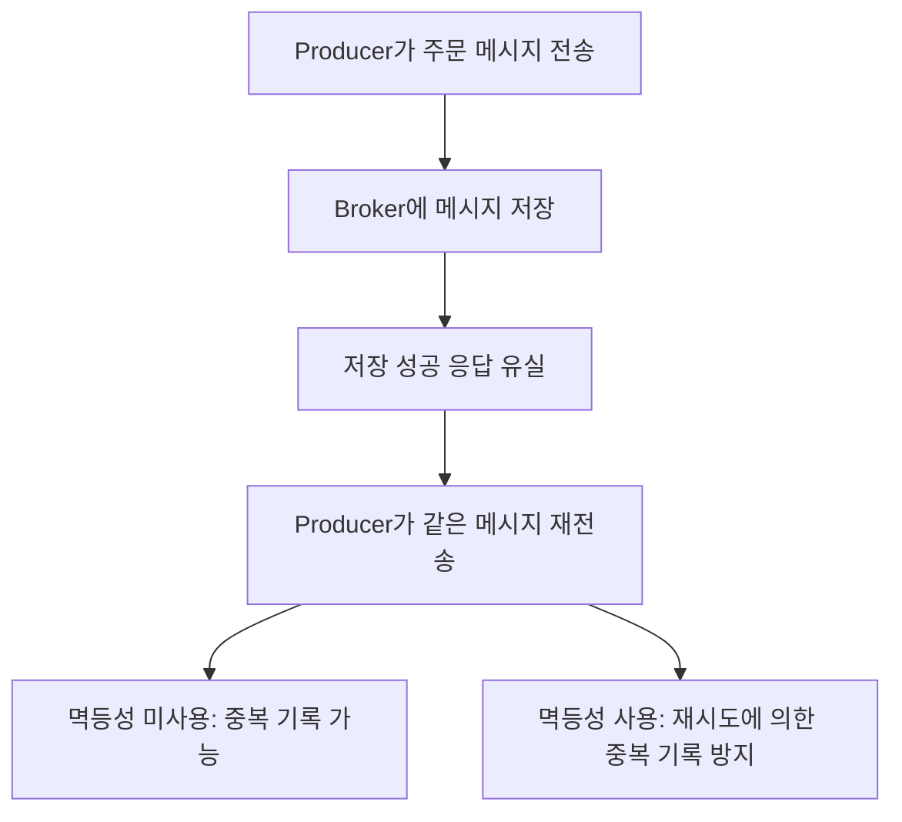

# 카프카 두 배로 활용하기

# 카프카 두 배로 활용하기

* toc
{:toc}

---

## Kafka를 더 안전하고 효율적으로 활용하기
Kafka를 운영하다 보면 두 가지 질문을 만나게 된다. 하나는 “같은 메시지가 두 번 처리되면 어떻게 할 것인가”이고, 다른 하나는 “데이터가 늘어났을 때 어디부터 개선해야 하는가”이다. 전자는 데이터의 정확성과 관련된 문제이고, 후자는 처리량과 지연 시간의 문제다. 둘은 별개로 보이지만, 실제로는 재시도 정책, 배치 크기, 오프셋 커밋 방식 같은 설정을 통해 서로 영향을 준다.

처리량을 높이려고 응답 확인을 생략하면 장애 시 데이터 유실을 알아차리기 어려워진다. 반대로 모든 요청을 하나씩 전송하고 결과를 기다리면 안정성은 유지하더라도 Kafka가 제공하는 배치 처리의 이점을 충분히 활용하지 못한다. 따라서 먼저 필요한 전달 보장 수준을 정하고, 그 조건을 유지하면서 병목을 줄이는 순서로 접근해야 한다.

## 멱등성과 중복 처리
### 재시도가 중복을 만드는 이유
주문 메시지를 보낸 Producer가 Broker의 응답을 받지 못했다고 가정해 보자. 실제로는 메시지가 저장되었는데 응답만 네트워크에서 유실되었을 수도 있다. Producer는 저장 실패와 응답 유실을 구분하기 어려우므로 재전송을 선택한다. 이때 같은 메시지가 다시 기록되면 Consumer는 하나의 주문을 두 번 처리할 수 있다. 중복 배송이나 중복 결제처럼 되돌리기 어려운 문제가 여기서 시작된다.

중복을 막기 위해 매번 모든 메시지를 검색하는 방식은 데이터가 늘수록 부담이 커진다. 전송 계층에서는 재시도를 식별할 수 있는 장치를 사용하고, 업무 처리 계층에서는 이벤트 식별자나 데이터베이스 제약 조건을 활용하는 편이 현실적이다. 두 계층이 해결하는 문제가 다르므로 한쪽의 설정만으로 전체 시스템의 중복 처리가 사라진다고 생각해서는 안 된다.

### 멱등성과 불변성의 차이
멱등성은 **같은 연산을 여러 번 수행해도 한 번 수행한 것과 같은 결과 상태가 유지되는 성질**이다. 수학적으로는 `f(f(x)) = f(x)`로 표현한다. 절댓값 함수는 이미 절댓값을 구한 결과에 다시 적용해도 값이 바뀌지 않는다. `f(x) = x × 1`도 결과가 원래 값인 `x`로 유지되므로 멱등적이다. 어떤 숫자에 1을 곱한 결과가 항상 1이 되는 것은 아니다.

데이터베이스에서는 `UPDATE users SET status = 'active' WHERE user_id = 1`처럼 상태를 특정 값으로 설정하는 작업이 대표적이다. 반면 `UPDATE accounts SET balance = balance + 1000 WHERE account_id = 1`은 실행할 때마다 잔액이 증가하므로 멱등적이지 않다. HTTP에서도 GET, PUT, DELETE는 의도된 효과를 기준으로 멱등적인 메서드다. DELETE의 첫 응답과 두 번째 응답이 달라도 최종적으로 대상이 삭제된 상태라면 멱등성에 어긋나지 않는다. 다만 실제 구현이 해당 의미를 지켜야 한다. [HTTP 멱등성 정의](https://www.rfc-editor.org/rfc/rfc9110.html#section-9.2.2)

불변성은 연산의 반복 여부가 아니라 데이터 자체를 변경하지 않는 성질이다. 기존 객체를 수정하지 않고 새 객체를 만드는 방식이 이에 해당한다. 불변 객체를 사용하더라도 결제 요청을 두 번 실행하면 두 번 결제될 수 있다. **불변성은 데이터 변경 방식에 관한 개념이고, 멱등성은 반복 실행의 효과에 관한 개념**이다.

## 메시지 전달 보장 방식
| 방식 | 핵심 의미 | 장애 시 고려할 점 | 적합한 상황 |
|---|---|---|---|
| At-most-once | 최대 한 번 전달·처리하도록 구성 | 재처리하지 않는 대신 일부 처리가 누락될 수 있음 | 일부 유실을 허용하는 측정·집계 데이터 |
| At-least-once | 성공을 확인할 때까지 재시도·재처리 | 이미 처리한 메시지가 다시 처리될 수 있음 | 누락보다 중복을 감당하기 쉬운 업무 |
| Exactly-once | 정해진 처리 범위에서 결과를 정확히 한 번 반영 | 트랜잭션과 처리 대상의 협력이 필요 | 중복 결과를 허용하기 어려운 데이터 처리 |

### At-least-once와 At-most-once
At-least-once 방식의 Consumer는 일반적으로 **메시지 처리 후 오프셋을 커밋**한다. 주문 저장까지 완료했지만 커밋 직전에 종료되면, 다음 Consumer는 이전 커밋 위치부터 메시지를 다시 읽는다. 주문 저장이 반복될 수 있지만 처리하지 않은 메시지를 먼저 건너뛰는 상황은 피할 수 있다. 이 때문에 At-least-once에서는 업무 로직의 멱등성이 중요하다. 단, 재시도 횟수와 기한이 소진되거나, 보관 기간이 지나거나, 복제본까지 손상되는 상황에서도 무조건 유실이 없다는 뜻은 아니다.

At-most-once 방식에서는 반대로 **처리 전에 오프셋을 커밋**할 수 있다. 커밋 후 실제 처리 전에 종료되면 Kafka에는 메시지가 남아 있어도 해당 Consumer Group은 이미 지나간 위치로 판단한다. Producer에서 응답을 기다리지 않고 재시도하지 않는 방식도 유실 가능성을 받아들이는 선택이다. 다만 비동기 전송과 `acks=0`은 다른 개념이며, At-most-once를 선택했다고 애플리케이션이 같은 주문을 새 메시지로 두 번 발행하는 문제까지 방지되는 것은 아니다.

### Exactly-once의 범위
Exactly-once는 “프로그램 코드가 어떤 장애에서도 딱 한 번만 실행된다”는 의미로 이해하면 곤란하다. 실패한 작업을 다시 실행하더라도 **최종적으로 관찰되는 처리 결과가 한 번만 반영되도록 만드는 것**에 가깝다. Kafka에서는 멱등성 Producer로 재전송 중복을 방지하고, 트랜잭션으로 여러 쓰기와 Consumer의 오프셋 갱신을 묶을 수 있다. 하지만 Broker에 한 번 기록되는 것과 외부 시스템에서 업무가 한 번 수행되는 것은 별도의 보장이다.

## 멱등성 Producer
### Producer ID와 시퀀스 번호
멱등성 Producer는 Producer ID와 파티션별 시퀀스 번호 등의 정보를 사용한다. 설명을 단순화하면 `PID=100, Seq=0`으로 메시지 `x`를 저장한 뒤, `PID=100, Seq=1`로 메시지 `y`를 저장하는 구조다. `y`의 응답이 유실되어 동일한 전송이 재시도되더라도 Broker는 이미 처리한 시퀀스임을 확인해 중복 기록을 방지한다. 결과적으로 파티션에는 `x, y, y`가 아니라 `x, y`가 남는다.

여기서 Producer ID는 주문 번호나 결제 번호가 아니다. Kafka가 전송 재시도를 식별하는 데 사용하는 정보이므로, 애플리케이션이 같은 주문을 별도의 `send()` 호출로 다시 발행하면 새로운 메시지로 취급될 수 있다. 프로세스를 재시작하고 같은 업무 데이터를 다시 발행하는 경우에도 일반적인 멱등성 설정만으로 업무 중복이 제거되지는 않는다. [KafkaProducer의 멱등성 보장 범위](https://kafka.apache.org/43/javadoc/org/apache/kafka/clients/producer/KafkaProducer.html)

### 주요 설정
다음은 멱등성 전송과 관련된 Producer 설정 예시다. 접속 주소, 인증 정보, Serializer 설정 등은 사용하는 환경에 맞게 별도로 구성해야 한다.
```properties
enable.idempotence=true
acks=all
max.in.flight.requests.per.connection=5
request.timeout.ms=30000
delivery.timeout.ms=120000
```
`enable.idempotence`는 재전송으로 인한 중복 기록 방지를 활성화한다. Kafka 3.0부터 기본값은 `true`지만, 관련 설정이 충돌하면 적용 결과가 달라질 수 있으므로 실제 구성을 확인해야 한다. 멱등성을 사용하려면 `acks=all`, `retries>0`, `max.in.flight.requests.per.connection<=5` 조건을 충족해야 한다. `max.in.flight`를 반드시 1로 낮춰야 하는 것은 아니며, 허용 범위 내에서는 멱등성을 유지하면서 여러 요청을 진행할 수 있다.

`request.timeout.ms`는 개별 요청의 응답 대기와 관련되고, `delivery.timeout.ms`는 버퍼 대기와 재시도를 포함한 전달 완료 기한을 제한한다. `retries`를 5로 설정하거나 최댓값으로 설정했다는 사실만으로 Exactly-once가 완성되지는 않는다. 일반적으로 재시도 기본값을 유지하면서 전달 기한을 조정하고, 최종 실패를 애플리케이션에서 어떻게 처리할지 정해야 한다. 또한 `acks=all`의 내구성은 토픽의 복제 계수와 `min.insync.replicas`를 함께 고려해야 한다. [Producer 설정 조건](https://kafka.apache.org/43/configuration/producer-configs/)

## Kafka 트랜잭션과 Exactly-once 처리
### 여러 쓰기를 하나의 결과로 묶기
하나의 주문을 처리하면서 주문 완료 토픽과 재고 변경 토픽에 각각 메시지를 기록한다고 가정해 보자. 첫 번째 전송만 성공하고 두 번째 전송이 실패하면 후속 시스템의 상태가 어긋날 수 있다. Kafka 트랜잭션은 여러 토픽과 파티션에 대한 쓰기를 하나의 커밋 또는 중단 단위로 묶는다. Producer에서는 `initTransactions()`로 초기화한 뒤 `beginTransaction()`, 메시지 전송, `commitTransaction()` 순서로 진행하며, 중단이 필요한 경우 `abortTransaction()`을 사용한다.

트랜잭션을 사용하려면 `transactional.id`를 설정한다. 이 값은 개별 주문 번호가 아니라 논리적인 트랜잭션 Producer를 식별하는 값이다. 동일한 논리적 Producer의 재시작을 연결할 수 있어야 하지만, 동시에 실행되는 서로 다른 Producer가 같은 값을 사용해서는 안 된다. 같은 식별자로 새로운 Producer가 초기화되면 이전 Producer가 더 이상 쓰지 못하도록 차단하는 fencing이 발생할 수 있다. 예외가 발생했을 때도 무조건 같은 Producer로 재시도하지 말고, 복구 가능한 오류와 Producer를 종료해야 하는 오류를 구분해야 한다.

### 처리 결과와 오프셋을 함께 커밋하기
Kafka에서 읽은 데이터를 가공해 다시 Kafka에 쓰는 구조라면, **출력 메시지와 입력 오프셋을 같은 트랜잭션으로 커밋**할 수 있다. 결과만 저장되고 오프셋은 갱신되지 않는 틈을 없애는 방식이다. 직접 구현할 때는 `sendOffsetsToTransaction()`으로 처리한 파티션의 다음 오프셋과 Consumer Group 정보를 전달한다. 예를 들어 오프셋 10까지 처리했다면 다음 시작 위치인 11을 전달한다. 이 경로에서는 Consumer 자동 커밋을 끄고 트랜잭션이 오프셋을 관리하도록 해야 한다.

후속 Consumer는 `isolation.level=read_committed`로 설정해야 중단된 트랜잭션의 메시지를 업무 처리 대상으로 받지 않는다. 트랜잭션 중단은 이미 기록한 데이터를 즉시 물리적으로 삭제한다는 뜻이 아니다. 기본값인 `read_uncommitted`에서는 중단된 트랜잭션의 데이터도 읽을 수 있다. 또한 `read_committed`는 하나의 트랜잭션에 포함된 모든 파티션의 메시지를 한 번의 `poll()`에서 묶어 반환한다는 보장도 아니다. 오래 열린 트랜잭션은 같은 파티션의 후속 데이터 가시성을 지연시킬 수 있으므로 트랜잭션을 짧게 유지하는 편이 좋다. [Consumer 트랜잭션 격리 설정](https://kafka.apache.org/43/configuration/consumer-configs/)

### 외부 데이터베이스와 결제는 별도 설계가 필요하다
Kafka 트랜잭션 안에서 외부 결제 API를 호출했다고 해서 결제까지 함께 롤백되지는 않는다. 결제는 성공했지만 Kafka 트랜잭션이 중단되면 메시지를 다시 읽는 과정에서 결제를 또 요청할 수 있다. 데이터베이스 갱신도 마찬가지다. 따라서 결제 시스템의 멱등성 키, 이벤트 ID에 대한 유일성 제약, 처리 이력과 업무 변경을 같은 데이터베이스 트랜잭션으로 저장하는 방식 등을 검토해야 한다. 데이터베이스 변경과 이벤트 발행 사이의 누락은 Transactional Outbox 같은 패턴으로 다룰 수 있지만, 발행 과정에서 발생할 수 있는 중복은 별도로 처리해야 한다. **Kafka 내부의 Exactly-once와 업무 전체의 Exactly-once는 같은 말이 아니다.** [Kafka 전달 보장의 범위](https://kafka.apache.org/43/design/design/)

## Kafka 성능 최적화
### 파티션과 Consumer 병렬성
일반적인 Consumer Group에서는 하나의 파티션을 같은 시점에 하나의 Consumer가 담당한다. 따라서 파티션이 4개인 토픽만 구독한다면 Consumer를 8개로 늘려도 8개 모두에게 파티션이 할당되지는 않는다. 파티션 수는 목표 처리량, Consumer 한 개의 처리 능력, 예상 최대 Consumer 수, Broker의 여유 자원을 함께 보고 결정해야 한다. Broker 수와 파티션 수를 반드시 같게 맞출 필요는 없으며, 파티션을 늘리는 것만으로 느린 데이터베이스가 빨라지는 것도 아니다.

키를 사용하면 관련 메시지를 같은 파티션으로 보내 순서 유지에 활용할 수 있다. 다만 특정 고객이나 상품에 트래픽이 몰리면 하나의 파티션만 과부하되는 핫 파티션이 생길 수 있다. 파티션 수를 변경하면 기본 키 기반 분배에서 같은 키가 향하는 파티션이 달라질 수 있다는 점도 고려해야 한다. 키가 없는 메시지는 클라이언트의 기본 배치·분산 전략을 먼저 확인하고, 균등 분산이 필요하다는 이유만으로 라운드 로빈을 적용하지 않는 편이 좋다. 파티션이 지나치게 많으면 메타데이터, 파일 핸들, 복제와 장애 복구 부담도 증가한다.

### Producer의 배치·압축·비동기 전송
배치 전송은 여러 레코드를 모아 네트워크 요청 비용을 나누는 방식이다. `batch.size`는 파티션별 배치 크기와 관련되고, `linger.ms`는 배치를 더 채우기 위해 기다릴 시간을 정한다. 배치가 충분히 크면 요청 수를 줄일 수 있지만, 트래픽이 적은 상황에서는 대기 시간이 늘어날 수 있다. 따라서 평균 처리량만 보지 말고 p95·p99 전송 지연도 함께 비교해야 한다. 활성 파티션이 많아지면 배치 버퍼에 필요한 메모리도 늘어난다.

압축은 네트워크와 저장 공간을 절약하는 대신 CPU를 사용한다. `gzip`, `snappy`, `lz4`, `zstd` 중 어떤 방식이 적합한지는 실제 데이터의 압축률과 CPU 비용으로 판단해야 한다. 이미 압축되었거나 반복이 적은 데이터는 효과가 작을 수 있다. 또한 Java Producer의 `send()`는 기본적으로 비동기이므로 매번 반환된 Future에 `get()`을 호출하면 메시지마다 기다리게 된다. 처리량이 중요하다면 비동기 완료 결과를 확인하되 실패를 누락하지 않도록 해야 한다. 버퍼 부족이나 메타데이터 조회 때문에 호출이 대기할 수 있으므로 비동기가 언제나 즉시 반환을 뜻하는 것은 아니다.

`acks=0`으로 바꾸어 수치를 높이는 것은 먼저 검토할 최적화가 아니다. 응답 확인을 생략하면 전송 실패를 확인하는 능력과 내구성 조건이 달라진다. 주문·결제 이벤트처럼 안정성이 중요한 데이터는 필요한 보장 수준을 고정한 상태에서 배치, 압축, 연결 재사용, 직렬화 비용을 개선하는 것이 우선이다.

### Consumer의 Fetch와 처리 로직
`fetch.min.bytes`를 높이면 Broker가 데이터를 더 모아 응답하도록 하여 요청 횟수를 줄일 수 있다. 데이터가 적을 때 추가되는 대기는 `fetch.max.wait.ms`와 함께 조정한다. 반면 `max.poll.records`는 한 번의 `poll()`에서 애플리케이션에 반환하는 레코드 수를 제한하는 설정으로, 네트워크 Fetch 크기 자체를 정하는 값은 아니다. 한 번에 너무 많이 받아 처리 시간이 길어지면 `max.poll.interval.ms`를 초과할 수 있으므로 최대 처리 시간을 기준으로 조정해야 한다.

Consumer Lag이 늘어난다면 Kafka 설정보다 업무 로직을 먼저 볼 필요가 있다. 메시지마다 실행되는 느린 SQL, 외부 API 응답 대기, 작은 단위의 반복 저장이 실제 병목일 수 있다. 스레드 풀로 처리량을 높일 수도 있지만 `KafkaConsumer` 인스턴스를 여러 스레드가 임의로 공유해서는 안 된다. 작업을 분리한다면 파티션별 순서, 완료 지점까지의 커밋, 리밸런싱 시 미완료 작업을 관리해야 한다. 무제한 큐 대신 제한된 큐와 `pause()`·`resume()` 등을 활용한 역압력 제어도 필요하다. [Consumer의 멀티스레드 처리 주의사항](https://kafka.apache.org/43/javadoc/org/apache/kafka/clients/consumer/KafkaConsumer.html)

### 하드웨어와 Broker 자원
디스크에서는 용량뿐 아니라 지속 쓰기 처리량, 읽기 지연, 복제와 복구 중의 성능을 확인해야 한다. SSD는 지연 시간과 여러 읽기가 섞이는 부하에서 유리하지만 모든 환경의 유일한 답은 아니다. 클라우드 디스크라면 디스크 성능 외에도 인스턴스의 스토리지 대역폭 제한을 확인해야 한다. 네트워크 역시 Producer 유입량뿐 아니라 복제 트래픽과 여러 Consumer Group으로 나가는 트래픽을 함께 감당해야 한다.

메모리는 JVM Heap만 크게 잡는 방식으로 접근하면 안 된다. Kafka는 운영체제의 Page Cache를 활용하므로 Heap에 너무 많은 메모리를 할당하면 파일 캐시에 사용할 공간이 줄어들 수 있다. CPU는 요청 처리, 압축, TLS, 직렬화 등의 비용을 함께 살펴본다. Broker의 네트워크·I/O 스레드 수와 소켓 버퍼도 조정할 수 있지만, 병목 확인 없이 늘리면 오히려 경합과 메모리 사용만 증가할 수 있다. [Kafka의 하드웨어와 운영체제 고려사항](https://kafka.apache.org/43/operations/hardware-and-os/)

### 데이터 형식과 직렬화
직렬화는 메모리의 데이터를 저장·전송 가능한 바이트 표현으로 바꾸는 과정이고, 역직렬화는 이를 애플리케이션이 사용할 구조로 복원하는 과정이다. 서로 다른 언어가 데이터를 주고받으려면 형식과 스키마가 호환되어야 한다. 단순히 직렬화했다는 이유만으로 언어 독립성이 생기지는 않는다.

JSON과 XML은 확인과 디버깅이 쉽지만 필드명 반복과 파싱 비용이 커질 수 있다. Avro, Protocol Buffers, MessagePack 같은 바이너리 형식은 데이터 크기와 처리 비용을 줄이는 후보가 된다. 다만 바이너리가 모든 데이터에서 항상 빠르다고 단정할 수는 없다. 실제 메시지 크기, 압축 후 크기, 직렬화 CPU, 스키마 변경과 장애 분석 비용까지 비교해야 한다. 특히 메시지 형식을 바꿀 때는 구버전 Producer와 Consumer가 함께 동작하는 기간의 호환성을 확인해야 한다.

## 운영에서 확인할 지표와 검증 방법
성능은 한 지표만으로 판단하기 어렵다. Producer에서는 전송 지연, 재시도·오류, 버퍼 대기를 보고, Broker에서는 요청 지연, 디스크·네트워크 사용량, 복제 지연과 ISR 변화를 확인한다. Consumer에서는 파티션별 Lag과 증가 속도, 실제 업무 처리 시간, 커밋 실패와 리밸런싱 빈도를 함께 살펴본다. Lag이 작더라도 업무 처리 전에 커밋하고 있다면 실제 처리 완료를 의미하지 않을 수 있다. [Kafka 모니터링 항목](https://kafka.apache.org/43/operations/monitoring/)

설정을 바꿀 때는 메시지 크기, 키 분포, 복제 조건과 전달 보장 수준을 유지하고 변경 전후를 비교해야 한다. 정상 상태의 초당 처리량뿐 아니라 응답 유실, 처리 후 커밋 전 종료, 트랜잭션 중단, Consumer 재시작 상황도 검증 대상이다. 최종 확인은 “Kafka에 메시지가 몇 개 있는가”에서 끝나지 않는다. 같은 이벤트가 다시 도착했을 때 주문·결제·재고 같은 업무 결과가 올바르게 유지되는지까지 확인해야 한다.

## 정리
Kafka의 멱등성 Producer는 전송 재시도로 인한 중복 기록을 줄이고, 트랜잭션은 여러 출력과 Consumer 오프셋을 함께 반영할 수 있게 한다. 그러나 외부 데이터베이스나 결제까지 자동으로 보호하지는 않으므로 업무 식별자와 멱등한 처리 구조를 함께 설계해야 한다.

성능 개선도 같은 기준에서 출발한다. 필요한 안정성을 먼저 정하고, 파티션 분배, 배치와 압축, Consumer 처리 로직, 디스크와 네트워크 순서로 병목을 확인한다. **빠르게 보내는 것보다 중요한 것은 필요한 정확성을 지키면서 지속적으로 처리할 수 있는 구조를 만드는 일이다.**
