# 카프카 두 배로 활용하기

# 카프카 두 배로 활용하기

* toc
{:toc}

---

## Apache Kafka 고급 활용: 멱등성, 메시지 전달 보장, Exactly-Once, 트랜잭션부터 성능 최적화까지

Apache Kafka를 이용하면 여러 시스템에서 발생하는 이벤트를 비동기적으로 전달하고, Consumer가 해당 이벤트를 독립적으로 처리하도록 구성할 수 있다.

하지만 Kafka를 실제 운영 환경에 도입하면 단순히 메시지를 보내고 받는 것보다 복잡한 문제를 만나게 된다.

대표적인 문제가 **메시지 중복 처리와 성능 최적화**다.

예를 들어 사용자가 온라인 쇼핑몰에서 상품을 주문했다고 가정해 보자.

주문 서비스는 주문 생성 이벤트를 Kafka에 전송한다. 이후 재고 서비스는 이벤트를 읽어 재고를 차감하고, 배송 서비스는 배송 정보를 생성한다.

그런데 네트워크 장애로 Producer가 Kafka Broker의 응답을 받지 못했다면 어떻게 될까?

Broker에는 이미 메시지가 저장되었지만 Producer는 이를 확인하지 못할 수 있다. 이때 Producer가 동일한 메시지를 재전송하면 중복 기록이 발생할 가능성이 있다.

Consumer에서도 비슷한 문제가 발생한다.

재고 서비스가 재고를 정상적으로 차감했지만 Offset을 Commit하기 전에 종료되었다면, 재시작 후 같은 이벤트를 다시 읽고 재고를 한 번 더 차감할 수 있다.

이러한 문제는 결제, 정산, 재고 관리처럼 데이터의 정확성이 중요한 시스템에서 심각한 장애로 이어질 수 있다.

반면 성능 측면에서는 다른 문제가 발생한다.

서비스 규모가 증가하여 초당 수천 건에서 수십만 건의 메시지가 발생한다면 Producer와 Consumer, Broker 모두 높은 처리량을 감당해야 한다.

이때 단순히 Broker나 Consumer 인스턴스를 늘리는 것이 항상 올바른 해결책은 아니다.

Partition 분배가 불균형하거나, Producer가 지나치게 작은 Batch를 전송하거나, Consumer가 느린 데이터베이스 쿼리를 반복한다면 하드웨어를 추가해도 기대한 성능을 얻지 못할 수 있다.

따라서 Kafka를 효과적으로 활용하기 위해서는 다음 두 가지 관점을 함께 이해해야 한다.

**첫 번째는 메시지의 정확성을 유지하는 방법이다.**

여기에는 멱등성(Idempotence), At-most-once, At-least-once, Exactly-once, Kafka Transaction 등이 포함된다.

**두 번째는 필요한 정확성을 유지하면서 처리량을 높이는 방법이다.**

여기에는 Partition 설계, Batch 전송, 압축, 비동기 처리, Consumer 병렬화, 하드웨어 및 운영체제 최적화, 직렬화 방식 개선 등이 포함된다.

이번 글에서는 이러한 개념을 실제 장애 시나리오와 Java 기반 백엔드 시스템을 중심으로 살펴본다.

---

## Kafka에서 메시지 중복이 발생하는 이유

### 분산 시스템에서는 요청 성공과 응답 성공이 다를 수 있다

먼저 일반적인 HTTP 요청을 생각해 보자.

사용자가 주문 버튼을 클릭하여 주문 생성 API를 호출했다.

```text
POST /orders
```

서버에서는 주문을 정상적으로 저장했다.

하지만 응답을 반환하는 과정에서 네트워크 문제가 발생했다.

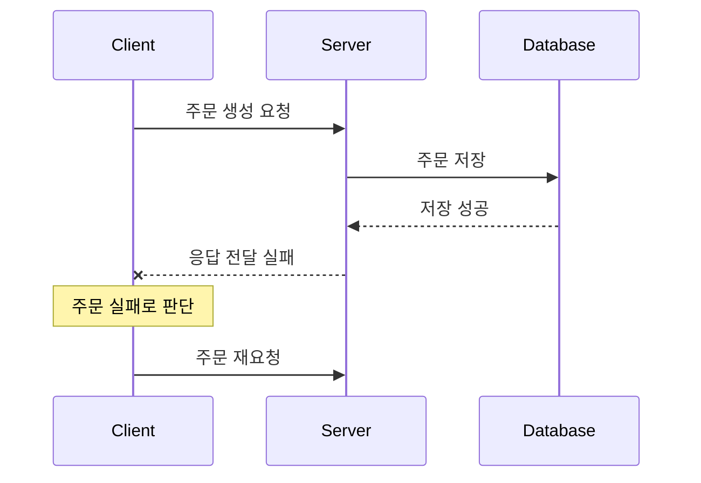

클라이언트는 주문이 실패했다고 판단하고 같은 요청을 다시 전송할 수 있다.

하지만 실제로는 첫 번째 주문이 이미 저장되었다.

서버가 중복 요청을 방지하지 않는다면 동일한 주문이 두 번 생성될 수 있다.

Kafka에서도 동일한 문제가 발생한다.

### Producer의 ACK 응답이 유실되는 경우

Producer가 Kafka Broker에 메시지 A를 전송했다고 가정해 보자.

Broker는 메시지 A를 정상적으로 저장했다.

이후 Broker가 Producer에 성공 응답을 반환한다.

하지만 응답이 네트워크에서 유실되었다.

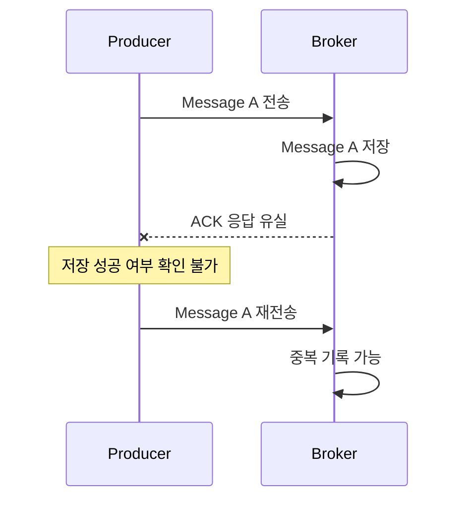

Producer 입장에서는 다음 두 상황을 명확하게 구분하기 어렵다.

- Broker가 메시지를 저장하지 못한 경우
- Broker는 저장했지만 ACK 응답만 유실된 경우

이러한 불확실성 때문에 재시도 과정에서 중복 메시지가 발생할 수 있다.

### Consumer에서도 중복 처리가 발생한다

Consumer가 Kafka에서 메시지를 읽어 데이터베이스에 저장한다고 가정해 보자.

```text
Kafka Consumer
    ↓
Message A 조회
    ↓
Database 저장 성공
    ↓
Offset Commit 이전 장애
```

Consumer가 다시 실행되면 마지막으로 Commit된 Offset부터 메시지를 읽는다.

따라서 Message A가 다시 전달될 수 있다.

이 경우 Kafka Broker에는 메시지가 하나만 저장되어 있어도 데이터베이스에는 동일한 작업이 두 번 반영될 수 있다.

여기서 중요한 점은 **Producer의 중복 기록과 Consumer의 중복 처리는 서로 다른 문제**라는 것이다.

| 구분 | Producer 중복 기록 | Consumer 중복 처리 |
|---|---|---|
| 발생 위치 | Producer → Kafka | Kafka → Consumer |
| 대표 원인 | ACK 유실 후 재시도 | 업무 처리 후 Offset Commit 실패 |
| 문제 | 동일 Record가 여러 번 저장될 수 있음 | 동일 Record의 업무 로직이 반복 실행됨 |
| 주요 대응 | Idempotent Producer | 업무 멱등성, 처리 이력, Offset 관리 |

따라서 Producer에서 중복 기록을 방지하더라도 Consumer의 업무 처리는 별도로 보호해야 한다.

---

## 멱등성(Idempotence)이란?

### 멱등성의 개념

멱등성은 동일한 연산을 여러 번 수행하더라도 최종 결과가 한 번 수행했을 때와 동일하게 유지되는 성질이다.

수학적으로는 다음과 같이 표현할 수 있다.

```text
f(f(x)) = f(x)
```

예를 들어 절댓값 함수가 있다.

```text
f(x) = |x|
```

다음 연산을 생각해 보자.

```text
f(-10) = 10

f(f(-10)) = f(10) = 10
```

절댓값을 한 번 적용하든 여러 번 적용하든 최종 결과는 동일하다.

따라서 절댓값 함수는 멱등성을 가진다.

### 1을 곱하는 연산도 멱등적일까?

다음 함수도 멱등성을 가진다.

```text
f(x) = x × 1
```

이 함수는 입력값을 그대로 반환한다.

```text
f(10) = 10

f(f(10)) = 10
```

주의할 점은 어떤 숫자에 1을 곱한 결과가 항상 1이 되는 것이 아니라는 것이다.

결과는 원래 값인 `x`다.

---

## 데이터베이스에서의 멱등성

백엔드 개발에서는 데이터베이스 연산을 통해 멱등성을 이해하기 쉽다.

### 멱등적인 UPDATE

다음 SQL을 생각해 보자.

```sql
UPDATE users
SET status = 'ACTIVE'
WHERE user_id = 1;
```

이 SQL을 한 번 실행하면 사용자의 상태가 `ACTIVE`가 된다.

동일한 SQL을 다시 실행해도 최종 상태는 `ACTIVE`다.

```text
1회 실행 → ACTIVE

2회 실행 → ACTIVE

3회 실행 → ACTIVE
```

따라서 최종 상태를 기준으로 멱등적인 연산이다.

### 멱등적이지 않은 UPDATE

반면 다음 SQL은 다르다.

```sql
UPDATE accounts
SET balance = balance + 1000
WHERE account_id = 1;
```

초기 잔액이 10,000원이라고 가정해 보자.

```text
1회 실행 → 11,000원

2회 실행 → 12,000원

3회 실행 → 13,000원
```

실행할 때마다 결과가 달라진다.

따라서 이 연산은 멱등적이지 않다.

### 비교

| 연산 | 멱등성 | 이유 |
|---|---|---|
| `SET status = 'ACTIVE'` | 멱등적 | 동일한 최종 상태 유지 |
| `SET balance = 10000` | 멱등적 | 같은 값으로 설정 |
| `SET balance = balance + 1000` | 비멱등적 | 실행할 때마다 증가 |
| `DELETE WHERE id = 1` | 멱등적 | 최종적으로 삭제된 상태 유지 |
| 재고 1개 차감 | 일반적으로 비멱등적 | 중복 실행 시 재고가 추가 차감됨 |

이러한 차이는 Kafka Consumer를 구현할 때 중요하다.

예를 들어 결제 완료 이벤트를 두 번 처리하더라도 구독 상태를 `ACTIVE`로 설정하는 작업은 최종 상태가 동일할 수 있다.

하지만 결제 완료 이벤트를 두 번 처리하면서 잔액을 두 번 차감한다면 심각한 문제가 발생할 수 있다.

---

## HTTP 메서드에서의 멱등성

HTTP에서도 멱등성은 중요한 개념이다.

대표적인 HTTP 메서드를 비교하면 다음과 같다.

| HTTP Method | 멱등성 의미 |
|---|---|
| GET | 동일한 조회 요청의 의도된 효과가 같음 |
| PUT | 동일한 리소스 상태를 반복해서 설정 |
| DELETE | 반복 삭제해도 최종적으로 대상이 삭제된 상태 |
| POST | 일반적으로 멱등성을 보장하지 않음 |

예를 들어 다음 요청을 생각해 보자.

```http
DELETE /users/1001
```

첫 번째 요청은 사용자를 삭제한다.

두 번째 요청에서는 해당 사용자가 이미 존재하지 않을 수 있다.

이때 첫 번째 요청은 `204 No Content`, 두 번째 요청은 `404 Not Found`를 반환할 수도 있다.

응답 코드가 다르더라도 최종적으로 해당 리소스가 삭제된 상태라면 멱등성의 의미에 어긋나지 않는다.

다만 HTTP Method가 멱등적으로 정의되어 있다는 사실과 실제 서버 구현이 올바르게 멱등성을 지킨다는 사실은 구분해야 한다.

HTTP 멱등성은 RFC 9110에서 정의한다. [kafka.apache.org](https://kafka.apache.org/design/?utm_source=chatgpt.com)

---

## 멱등성과 불변성의 차이

멱등성과 불변성(Immutability)은 서로 다른 개념이다.

### 멱등성

같은 연산을 여러 번 수행하더라도 최종 결과가 동일한 성질이다.

```java
user.setStatus("ACTIVE");
```

동일한 상태를 반복적으로 설정하더라도 최종 상태는 같다.

### 불변성

데이터를 생성한 이후 기존 객체의 상태를 변경하지 않는 성질이다.

예를 들어 Java의 Record는 불변 데이터 객체를 표현하는 데 활용할 수 있다.

```java
public record PaymentEvent(
    String paymentId,
    long amount
) {
}
```

기존 객체를 변경하지 않고 새로운 값을 가진 객체를 생성하는 방식이다.

### 차이점

| 구분 | 멱등성 | 불변성 |
|---|---|---|
| 관심 대상 | 연산의 반복 결과 | 데이터의 변경 가능성 |
| 핵심 질문 | 여러 번 실행해도 결과가 같은가? | 객체의 상태를 변경할 수 있는가? |
| 대표 사례 | 동일 상태로 UPDATE | 불변 객체 |
| Kafka 활용 | 중복 이벤트 처리 방지 | 이벤트 데이터의 변경 방지 |

불변 객체를 사용한다고 해서 결제 요청이 멱등적으로 처리되는 것은 아니다.

동일한 불변 객체를 이용하여 결제 API를 두 번 호출하면 실제 결제도 두 번 발생할 수 있다.

**불변성은 데이터 변경 방식에 관한 개념이고, 멱등성은 동일한 작업의 반복 실행 결과에 관한 개념이다.**

---

## Kafka의 메시지 전달 보장 방식

Kafka에서는 메시지가 얼마나 안정적으로 전달되고 처리되어야 하는지에 따라 전달 보장 방식을 구분한다.

대표적으로 세 가지가 있다.

1. At-most-once
2. At-least-once
3. Exactly-once

각 방식은 데이터의 정확성과 성능, 구현 복잡성 사이에서 서로 다른 선택을 제공한다.

### 전달 보장 방식 비교

| 구분 | At-most-once | At-least-once | Exactly-once |
|---|---|---|---|
| 의미 | 최대 한 번 | 적어도 한 번 | 정의된 범위에서 정확히 한 번 |
| 중복 처리 | 재시도하지 않는 경로에서 방지 | 발생 가능 | 최종 결과 중복 방지 |
| 데이터 누락 | 발생 가능 | 정상적인 재시도·보존 조건에서 방지 | 트랜잭션 범위 내에서 방지 |
| 재시도 | 제한적 또는 사용하지 않음 | 사용 | 멱등성 및 트랜잭션 활용 |
| 구현 복잡성 | 낮음 | 중간 | 높음 |
| 주요 활용 | 일부 로그, 측정 데이터 | 일반적인 비즈니스 이벤트 | Kafka 내부의 정합성이 중요한 스트림 처리 |

여기서 중요한 것은 **전달 보장 방식이 시스템 전체의 모든 장애에 대한 무조건적인 보증은 아니라는 점**이다.

예를 들어 At-least-once로 구성했더라도 메시지 보존 기간이 지나거나 모든 복제본이 손실되면 재처리가 불가능할 수 있다.

또한 Exactly-once를 사용하더라도 Kafka 외부의 결제 API나 데이터베이스까지 자동으로 하나의 트랜잭션으로 묶이는 것은 아니다.

따라서 각각의 보장 범위를 정확하게 이해해야 한다.

---

## At-least-once: 적어도 한 번 처리

### 개념

At-least-once는 메시지가 최소 한 번 이상 처리되도록 시도하는 방식이다.

데이터를 처리하지 않고 건너뛰는 상황을 피하기 위해 재시도를 허용한다.

하지만 재시도 과정에서 동일한 메시지가 여러 번 처리될 수 있다.

### Producer의 At-least-once

Producer는 Kafka에 메시지를 전송하고 ACK를 기다린다.

일시적인 오류로 ACK를 받지 못하면 재시도할 수 있다.

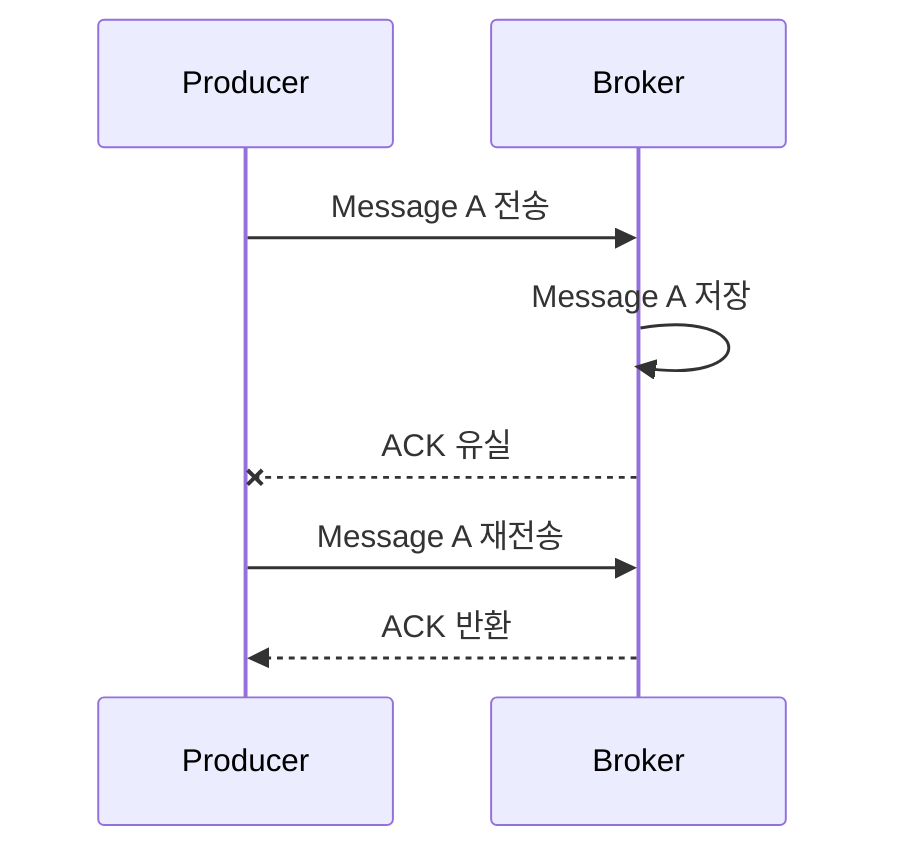

이 과정에서 멱등성 Producer를 사용하지 않으면 Message A가 중복 저장될 수 있다.

### Consumer의 At-least-once

Consumer에서는 일반적으로 메시지 처리 이후 Offset을 Commit한다.

```text
Record 조회
    ↓
업무 처리
    ↓
Database Commit
    ↓
Kafka Offset Commit
```

하지만 Database Commit 이후 Kafka Offset Commit 이전에 장애가 발생하면 동일한 메시지를 다시 처리할 수 있다.

### 장점

At-least-once는 메시지 누락을 피하는 데 적합한 방식이다.

특히 업무 데이터가 중요하고 중복 처리를 멱등적으로 구현할 수 있는 경우 유용하다.

예를 들어 다음과 같은 시스템에서 고려할 수 있다.

- 주문 이벤트 처리
- 결제 결과 반영
- 재고 변경
- 배송 상태 관리
- 데이터 파이프라인

다만 이러한 시스템에서는 Consumer의 중복 처리 방지 로직이 필요하다.

---

## At-most-once: 최대 한 번 처리

### 개념

At-most-once는 동일한 메시지를 다시 처리하지 않는 방향으로 구성하는 방식이다.

재처리를 수행하지 않으므로 일부 메시지가 처리되지 못할 수 있다.

### Producer의 At-most-once

대표적인 예시로 다음 설정을 생각할 수 있다.

```properties
acks=0
```

Producer는 Broker의 저장 확인 응답을 기다리지 않는다.

네트워크나 Broker에 문제가 발생해 메시지가 전달되지 않았더라도 저장 성공 여부를 확인하기 어렵다.

다만 `acks=0`은 확인 응답 정책일 뿐이며, 이것만으로 애플리케이션 전체에서 동일한 업무 이벤트가 절대 중복 생성되지 않는다는 의미는 아니다.

### Consumer의 At-most-once

Consumer에서는 업무 처리 전에 Offset을 Commit하는 방식으로 구성할 수 있다.

```text
Record 조회
    ↓
Offset Commit
    ↓
업무 처리
```

이 경우 Offset Commit 이후 업무 처리 이전에 장애가 발생하면 해당 메시지를 건너뛰게 된다.

### 장애 시나리오

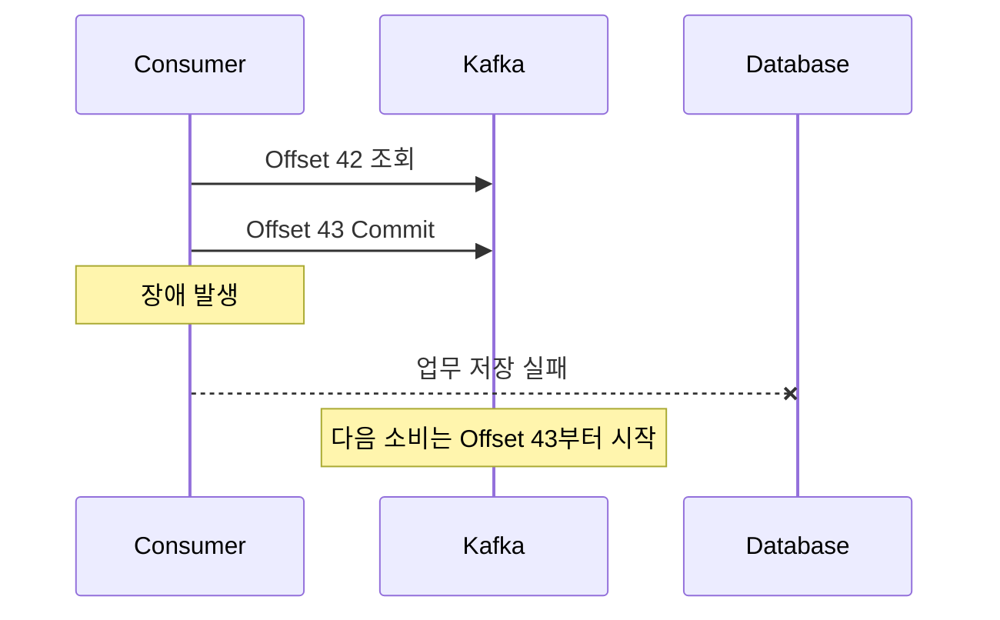

Kafka에 Offset 42의 Record가 남아 있더라도 해당 Consumer Group은 정상적인 재개 과정에서 Offset 43부터 읽는다.

따라서 Offset 42의 업무 처리가 누락될 수 있다.

### 적합한 활용 사례

일부 데이터 유실을 허용할 수 있는 시스템에서 검토할 수 있다.

예를 들어 다음과 같다.

- 일부 모니터링 지표
- 일시적인 센서 측정값
- 일부 사용자 행동 로그
- 높은 처리량이 우선인 통계 수집

하지만 중요한 금융 거래나 결제 이벤트에서 이러한 방식을 사용하는 것은 신중하게 판단해야 한다.

---

## Exactly-once: 정확히 한 번 처리

### Exactly-once의 개념

Exactly-once는 정의된 처리 범위 안에서 메시지의 처리 결과가 정확히 한 번 반영되도록 하는 보장이다.

여기서 중요한 것은 **코드가 실제로 한 번만 실행된다는 의미가 아니라는 점**이다.

장애로 인해 동일한 작업이 여러 번 시도될 수 있다.

하지만 최종적으로 관찰되는 처리 결과가 한 번만 반영되도록 구성하는 것이다.

예를 들어 다음과 같은 상황을 생각해 보자.

```text
Message A 처리 시도
    ↓
장애 발생
    ↓
Message A 재처리
    ↓
최종 결과는 한 번만 반영
```

이러한 처리를 구현하려면 재시도와 중복을 제어할 수 있는 메커니즘이 필요하다.

Kafka는 대표적으로 다음 두 가지 기능을 제공한다.

- Idempotent Producer
- Kafka Transaction

### Exactly-once가 필요한 이유

대규모 분산 시스템에서는 여러 장애가 발생할 수 있다.

| 장애 유형 | 발생할 수 있는 문제 |
|---|---|
| Broker 장애 | Record 복제 및 Leader 전환 문제 |
| Producer-Broker 네트워크 오류 | ACK 유실 및 중복 재전송 |
| Producer 장애 | 트랜잭션 중단 |
| Consumer 장애 | 처리 후 Commit 이전 종료 |
| Consumer Rebalancing | 동일 Record 재처리 |
| 외부 시스템 장애 | 업무 처리 결과와 Offset 불일치 |

Kafka의 Exactly-once 기능은 이러한 문제 중 **Kafka 내부의 메시지 기록과 스트림 처리 결과에 대한 정합성 문제**를 해결하는 데 활용할 수 있다.

반면 외부 시스템까지 포함한 업무 정합성은 별도의 설계가 필요하다. [kafka.apache.org](https://kafka.apache.org/44/design/design/?utm_source=chatgpt.com)

---

## Idempotent Producer란?

### 개념

Idempotent Producer는 Producer의 재시도 과정에서 동일한 Record가 Kafka 로그에 중복 기록되는 문제를 방지하는 기능이다.

Kafka 0.11부터 지원되었다.

설정은 다음과 같다.

```properties
enable.idempotence=true
```

Kafka 3.0부터는 충돌하는 설정이 없을 때 멱등성이 기본적으로 활성화된다.

하지만 현재 기본값이 `true`라고 해서 관련 설정을 확인할 필요가 없다는 의미는 아니다.

예를 들어 멱등성과 충돌하는 설정을 함께 사용하면 해당 기능이 비활성화되거나 설정 오류가 발생할 수 있다.

---

## Idempotent Producer의 동작 원리

Idempotent Producer를 이해하려면 다음 두 가지 개념을 알아야 한다.

**첫 번째는 Producer ID(PID)다.**

Kafka가 Producer의 전송을 식별하기 위해 사용하는 정보다.

**두 번째는 Sequence Number다.**

Producer가 Partition에 전송하는 Record Batch의 순서를 관리하는 데 사용되는 번호다.

이 두 정보를 이용하면 Broker가 이미 기록한 전송을 식별할 수 있다.

### 정상적인 메시지 전송

Producer가 메시지 X를 전송한다고 가정해 보자.

```text
Producer ID = 100

Sequence Number = 0

Message = X
```

Broker는 메시지를 저장한다.

```text
Partition 0

Offset 0 → X
```

이후 Producer에 ACK를 반환한다.

### 두 번째 메시지 전송

Producer가 메시지 Y를 전송한다.

```text
Producer ID = 100

Sequence Number = 1

Message = Y
```

Broker는 메시지를 저장한다.

```text
Partition 0

Offset 0 → X

Offset 1 → Y
```

여기까지는 일반적인 메시지 전송과 크게 다르지 않다.

### ACK가 유실된 경우

이번에는 Y 메시지를 저장한 뒤 ACK 응답이 유실되었다고 가정해 보자.

Producer는 Y 메시지를 다시 전송한다.

```text
Producer ID = 100

Sequence Number = 1

Message = Y
```

Broker는 Producer ID와 Sequence Number 등을 확인하여 해당 전송이 이미 처리되었다는 사실을 판단할 수 있다.

따라서 같은 Record Batch를 다시 기록하지 않는다.

### 멱등성 적용 전후

**멱등성 미사용**

```text
Producer
    ↓
Message X 전송
    ↓
Broker 저장: X
    ↓
Message Y 전송
    ↓
Broker 저장: X, Y
    ↓
ACK 유실
    ↓
Message Y 재전송
    ↓
Broker 저장: X, Y, Y
```

**멱등성 사용**

```text
Producer
    ↓
Message X 전송
    ↓
Broker 저장: X
    ↓
Message Y 전송
    ↓
Broker 저장: X, Y
    ↓
ACK 유실
    ↓
Message Y 재전송
    ↓
중복 Sequence 감지
    ↓
Broker 저장: X, Y
```

### 전체 구조

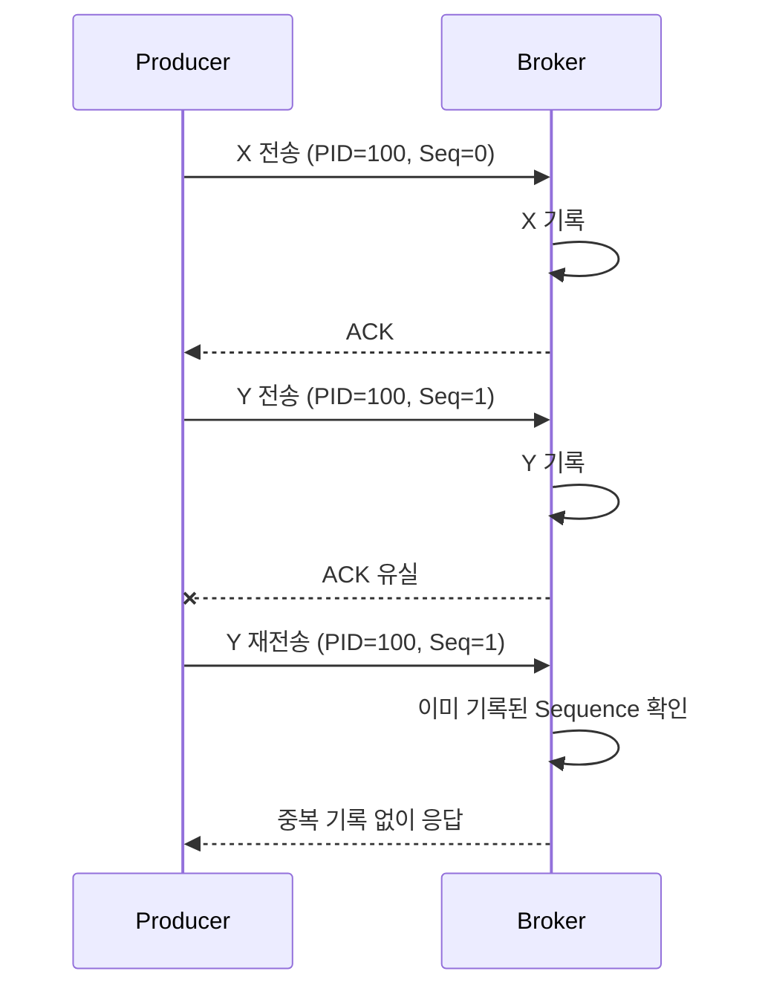

이를 통해 Kafka는 Producer 재시도로 인한 중복 기록을 방지할 수 있다.

---

## Idempotent Producer의 한계

Idempotent Producer를 사용하면 Kafka에 동일한 업무 이벤트가 절대 두 번 저장되지 않을까?

그렇지는 않다.

Idempotent Producer는 **Producer의 전송 재시도에 따른 중복 기록을 방지하는 기능**이다.

애플리케이션이 같은 업무 이벤트를 새롭게 생성하여 다시 발행하는 것까지 자동으로 방지하지는 않는다.

예를 들어 다음과 같은 상황이다.

```java
producer.send(
    new ProducerRecord<>(
        "payment-events",
        "payment-1001",
        paymentEvent
    )
);

producer.send(
    new ProducerRecord<>(
        "payment-events",
        "payment-1001",
        paymentEvent
    )
);
```

위 코드는 동일한 업무 이벤트를 두 번 발행한다.

Producer 입장에서는 서로 다른 두 번의 전송 요청이다.

따라서 `enable.idempotence=true`가 설정되어 있어도 두 Record가 모두 저장될 수 있다.

### Producer ID와 업무 ID의 차이

| 구분 | Producer ID | 업무 이벤트 ID |
|---|---|---|
| 목적 | 전송 재시도 식별 | 비즈니스 이벤트 식별 |
| 관리 주체 | Kafka | 애플리케이션 |
| 사용 범위 | Kafka Producer 프로토콜 | 주문·결제 등 업무 도메인 |
| 중복 방지 대상 | 동일 전송의 재시도 | 동일 업무 이벤트의 반복 처리 |

따라서 결제나 정산처럼 중복이 중요한 문제로 이어지는 시스템에서는 `paymentId`, `eventId`, `idempotencyKey` 등의 업무 식별자를 함께 사용해야 한다.

---

## Idempotent Producer의 주요 설정

멱등성 Producer를 사용하려면 관련 설정이 서로 호환되어야 한다.

대표적인 설정은 다음과 같다.

```properties
enable.idempotence=true

acks=all

max.in.flight.requests.per.connection=5

request.timeout.ms=30000

delivery.timeout.ms=120000
```

### 설정별 의미

| 설정 | 의미 |
|---|---|
| `enable.idempotence=true` | 전송 재시도에 따른 중복 기록 방지 |
| `acks=all` | ISR 기반 저장 확인 |
| `max.in.flight.requests.per.connection` | 응답을 기다리지 않고 진행할 수 있는 요청 수 |
| `request.timeout.ms` | 개별 요청 Timeout |
| `delivery.timeout.ms` | 전송 완료까지의 전체 시간 한도 |

멱등성을 활성화하려면 다음 조건이 필요하다.

```text
acks = all

retries > 0

max.in.flight.requests.per.connection <= 5
```

Kafka 4.4에서도 이러한 제약이 적용된다. [kafka.apache.org](https://kafka.apache.org/44/configuration/producer-configs/?utm_source=chatgpt.com)

### max.in.flight.requests.per.connection이란?

이 설정은 하나의 Broker 연결에서 ACK를 받지 않은 상태로 동시에 전송할 수 있는 요청의 최대 개수를 의미한다.

예를 들어 다음과 같이 설정할 수 있다.

```properties
max.in.flight.requests.per.connection=5
```

이 경우 응답을 기다리는 동안 최대 다섯 개의 요청을 진행할 수 있다.

### 반드시 1로 설정해야 할까?

그렇지 않다.

과거에는 재시도 시 메시지 순서가 변경되는 문제를 피하기 위해 `max.in.flight.requests.per.connection=1`을 사용하는 경우가 있었다.

하지만 멱등성 Producer를 사용하면 허용된 설정 범위인 5 이하에서 메시지 순서를 유지할 수 있다.

따라서 무조건 1로 낮추면 오히려 처리량을 불필요하게 제한할 수 있다.

### retries를 Integer.MAX_VALUE로 설정해야 할까?

반드시 그럴 필요는 없다.

현재 Kafka Producer는 재시도 횟수뿐 아니라 `delivery.timeout.ms`를 통해 전체 전송 기한을 관리한다.

Kafka 4.4의 Producer는 `retries`의 기본값도 매우 크게 설정되어 있다.

따라서 일반적으로는 재시도 횟수를 직접 제한하기보다 `delivery.timeout.ms`와 최종 실패 처리 정책을 중심으로 설계하는 것이 좋다.

**멱등성을 위한 설정을 갖추는 것과 업무 전체의 Exactly-once를 구현하는 것은 별개의 문제다.**

---

## Kafka Transaction이란?

### 트랜잭션이 필요한 이유

Idempotent Producer는 Producer가 특정 Partition에 Record를 전송할 때 발생하는 재시도 중복을 방지한다.

하지만 하나의 비즈니스 작업이 여러 Topic이나 Partition에 메시지를 기록해야 한다면 다른 문제가 발생할 수 있다.

예를 들어 주문 완료 후 다음 두 이벤트를 발행한다고 가정해 보자.

```text
orders-completed

inventory-updated
```

첫 번째 이벤트는 정상적으로 발행되었다.

하지만 두 번째 이벤트는 Broker 장애로 전송되지 못했다.

```text
OrderCompleted → 성공

InventoryUpdated → 실패
```

이 경우 두 이벤트를 사용하는 시스템의 상태가 서로 달라질 수 있다.

Kafka Transaction은 여러 Topic과 Partition에 대한 쓰기를 하나의 트랜잭션으로 묶을 수 있도록 지원한다.

### Kafka Transaction의 목적

하나의 트랜잭션에 포함된 여러 Record가 Commit되거나 Abort되도록 구성한다.

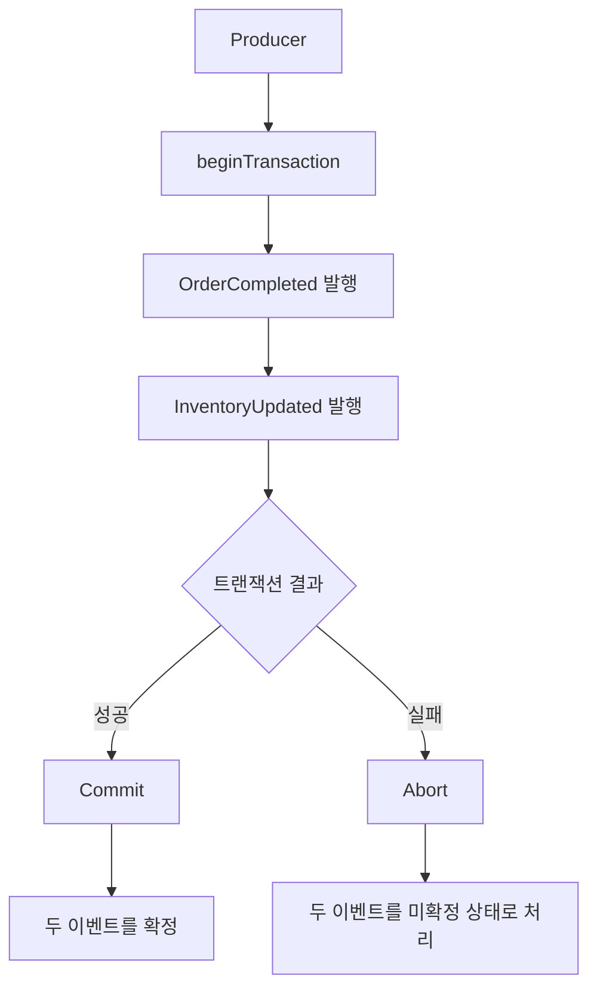

여기서 Abort된 Record는 Kafka 로그에서 즉시 물리적으로 삭제되는 것이 아니다.

Kafka는 트랜잭션 상태를 관리하며, Consumer의 Isolation Level에 따라 해당 Record의 노출 여부를 결정한다.

---

## transactional.id란?

Kafka Transaction을 사용하려면 Producer에 `transactional.id`를 설정해야 한다.

예를 들어 다음과 같다.

```properties
transactional.id=payment-event-processor-1
```

이 설정은 논리적인 Transactional Producer를 식별한다.

### transactional.id의 역할

`transactional.id`는 다음과 같은 역할과 관련된다.

- Producer의 트랜잭션 식별
- Producer 재시작 후 트랜잭션 상태 관리
- 이전 Producer 인스턴스의 쓰기 방지
- 여러 Topic과 Partition에 대한 원자적 쓰기

### transactional.id는 결제 ID일까?

아니다.

`transactional.id`는 개별 결제나 주문 ID를 저장하기 위한 값이 아니다.

Kafka Transaction을 수행하는 논리적인 Producer를 식별하는 값이다.

예를 들어 다음처럼 사용할 수 있다.

```text
payment-event-processor-0

payment-event-processor-1

payment-event-processor-2
```

여기서 주의할 점은 동시에 실행되는 서로 다른 Producer가 동일한 `transactional.id`를 공유해서는 안 된다는 것이다.

---

## Producer Fencing이란?

같은 `transactional.id`를 사용하는 새로운 Producer가 실행되면 Kafka는 이전 Producer가 더 이상 트랜잭션을 기록하지 못하도록 차단할 수 있다.

이를 Producer Fencing이라고 한다.

### Fencing이 필요한 이유

다음 상황을 생각해 보자.

**1단계**

Producer A가 Transaction ID `processor-1`로 실행 중이다.

**2단계**

네트워크 장애로 Producer A의 응답이 지연된다.

**3단계**

시스템은 Producer A가 종료되었다고 판단하고 Producer B를 실행한다.

**4단계**

Producer B도 같은 Transaction ID `processor-1`을 사용한다.

**5단계**

잠시 후 Producer A가 다시 메시지를 전송하려고 한다.

이때 Producer A와 Producer B가 동시에 데이터를 기록하면 잘못된 트랜잭션 결과가 발생할 수 있다.

Kafka는 새로운 Producer가 초기화되면 이전 Producer의 쓰기를 차단하여 이러한 문제를 방지한다.

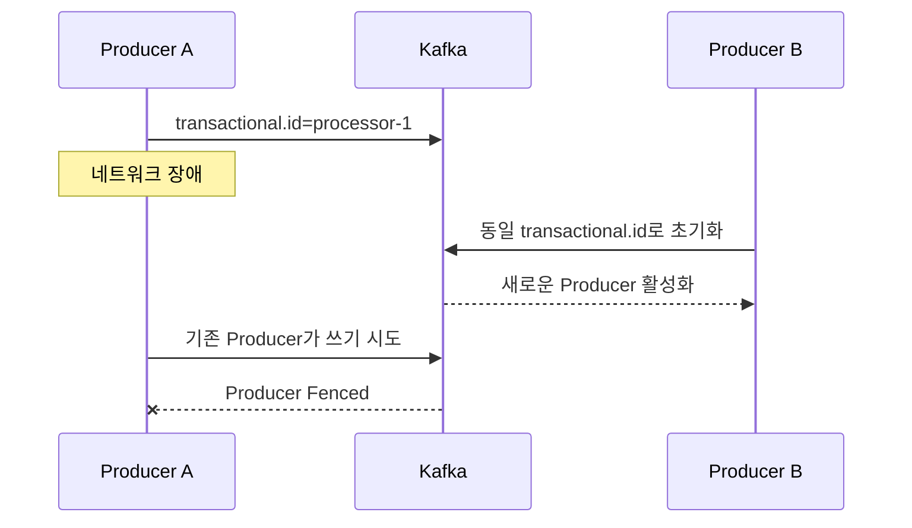

따라서 Transactional Producer에서 Fencing 오류가 발생했다면 무조건 같은 Producer 객체로 재시도해서는 안 된다.

Producer를 종료하고 올바른 복구 절차를 수행해야 할 수 있다.

---

## Kafka Transaction의 동작 순서

Kafka Transaction은 다음 API를 중심으로 동작한다.

| API | 역할 |
|---|---|
| `initTransactions()` | Transactional Producer 초기화 |
| `beginTransaction()` | 트랜잭션 시작 |
| `send()` | 트랜잭션 내 Record 전송 |
| `commitTransaction()` | 트랜잭션 Commit |
| `abortTransaction()` | 트랜잭션 Abort |
| `sendOffsetsToTransaction()` | 입력 Offset을 트랜잭션에 포함 |

### 기본 흐름

```text
Producer 생성
    ↓
initTransactions()
    ↓
beginTransaction()
    ↓
Record 전송
    ↓
Record 전송
    ↓
commitTransaction()
```

전송 과정에서 Abort가 필요한 오류가 발생했다면 다음과 같이 처리할 수 있다.

```text
beginTransaction()
    ↓
Record 전송
    ↓
Abort 가능한 오류 발생
    ↓
abortTransaction()
```

단, 모든 오류에 대해 `abortTransaction()`을 호출한 뒤 같은 Producer를 계속 재사용할 수 있는 것은 아니다.

Producer가 복구할 수 없는 오류 상태라면 종료 및 재생성이 필요하다.

Kafka 공식 Java API도 Transaction 초기화와 Commit, Abort 및 Producer Fencing을 구분하여 설명한다. [kafka.apache.org](https://kafka.apache.org/44/javadoc/org/apache/kafka/clients/producer/KafkaProducer.html?utm_source=chatgpt.com)

---

## Kafka Transaction과 Consumer Offset을 함께 관리하기

Kafka Transaction의 중요한 활용 방식 중 하나는 **Kafka에서 읽은 데이터를 가공하여 다시 Kafka에 기록하는 구조**다.

예를 들어 다음과 같은 시스템을 생각해 보자.

```text
orders Topic
    ↓
Order Processor
    ↓
completed-orders Topic
```

Consumer는 `orders` Topic에서 이벤트를 읽는다.

이후 비즈니스 로직을 수행하고 결과를 `completed-orders` Topic에 기록한다.

그런데 결과 메시지 기록은 성공했지만 입력 Offset Commit에 실패하면 어떻게 될까?

Consumer는 같은 입력 이벤트를 다시 읽어 결과 메시지를 중복 생성할 수 있다.

### Kafka Transaction을 활용한 구조

Kafka Transaction을 이용하면 다음 두 작업을 하나의 트랜잭션에 포함할 수 있다.

1. 출력 Topic에 Record 기록
2. 입력 Consumer Group의 Offset 갱신

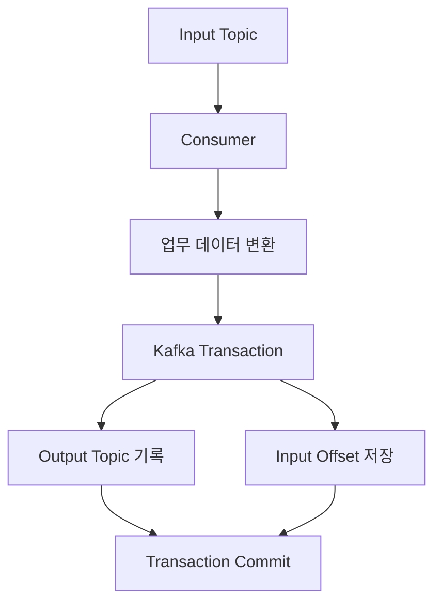

두 작업을 함께 Commit하면 결과만 기록되고 입력 Offset은 갱신되지 않는 문제를 방지할 수 있다.

### sendOffsetsToTransaction()

이때 사용할 수 있는 API가 다음 메서드다.

```java
producer.sendOffsetsToTransaction(
    offsets,
    consumer.groupMetadata()
);
```

첫 번째 인자에는 처리한 Partition의 다음 Offset을 전달한다.

두 번째 인자에는 Consumer Group의 메타데이터를 전달한다.

예를 들어 Offset 10까지 처리했다면 다음 값을 저장한다.

```text
마지막 처리 Offset = 10

Commit Offset = 11
```

Kafka Transaction과 함께 Offset을 관리하려면 Consumer의 자동 Commit을 비활성화해야 한다.

```properties
enable.auto.commit=false
```

이러한 구조는 Kafka에서 Kafka로 데이터를 처리하는 파이프라인에서 Exactly-once 의미론을 구현하는 데 활용할 수 있다.

---

## isolation.level이란?

Kafka Transaction을 사용하는 경우 Consumer의 Isolation Level도 중요하다.

대표적으로 다음 두 가지 설정이 있다.

```properties
isolation.level=read_uncommitted
```

```properties
isolation.level=read_committed
```

### read_uncommitted

Commit되지 않았거나 Abort된 트랜잭션의 Record도 읽을 수 있다.

Kafka Consumer의 기본값이다.

### read_committed

Commit된 트랜잭션의 Record만 업무 처리 대상으로 반환하도록 하는 설정이다.

Abort된 트랜잭션에 속한 Record는 반환하지 않는다.

### 비교

| 설정 | 설명 |
|---|---|
| `read_uncommitted` | Abort된 트랜잭션의 Record도 읽을 수 있음 |
| `read_committed` | Commit된 트랜잭션의 Record만 반환 |

### 트랜잭션 Abort 시나리오

다음과 같은 작업을 생각해 보자.

```text
Transaction 시작

Message A 전송

Message B 전송

Transaction Abort
```

`read_uncommitted` Consumer에서는 A와 B를 읽을 수 있다.

반면 `read_committed` Consumer는 Abort된 트랜잭션에 속한 A와 B를 반환하지 않는다.

### read_committed의 추가적인 특징

`read_committed`는 아직 완료되지 않은 트랜잭션이 존재할 때 해당 Partition의 후속 Record 가시성이 지연될 수 있다.

Kafka는 Last Stable Offset(LSO)을 기준으로 안전하게 반환할 수 있는 범위를 관리한다.

따라서 트랜잭션이 장시간 열려 있으면 Consumer의 데이터 조회 지연이 증가할 수 있다.

또한 여러 Partition에 기록한 트랜잭션 메시지가 반드시 하나의 `poll()`에서 동시에 반환되는 것은 아니다.

트랜잭션의 원자성과 Consumer의 Poll 반환 단위는 서로 다른 개념이다. [kafka.apache.org](https://kafka.apache.org/44/configuration/consumer-configs/?utm_source=chatgpt.com)

---

## Kafka의 Exactly-once가 외부 데이터베이스까지 보장할까?

Kafka Transaction을 사용하면 외부 데이터베이스의 변경도 함께 Rollback될까?

그렇지 않다.

이 부분은 실제 결제 시스템에서 특히 중요하다.

### 외부 결제 API 호출 시나리오

다음과 같은 Consumer가 있다고 가정해 보자.

```text
Kafka Consumer
    ↓
PaymentRequested 수신
    ↓
외부 PG사 결제 API 호출
    ↓
결제 성공
    ↓
Kafka Transaction Abort
```

외부 결제 API는 이미 성공했다.

하지만 Kafka Transaction은 Abort되었다.

Consumer가 같은 이벤트를 다시 읽으면 결제 API를 다시 호출할 수 있다.

이때 결제 제공자가 중복 요청 방지 기능을 제공하지 않거나 애플리케이션에서 중복 요청을 막지 않는다면 중복 결제가 발생할 수 있다.

### Kafka Transaction으로 보호할 수 있는 범위

| 작업 | Kafka Transaction만으로 원자성 보장 |
|---|---|
| 여러 Kafka Topic에 Record 기록 | 가능 |
| 여러 Kafka Partition에 Record 기록 | 가능 |
| Kafka 출력과 입력 Offset 갱신 | 가능 |
| 외부 RDBMS Transaction | 자동 보장하지 않음 |
| 외부 결제 API 호출 | 자동 보장하지 않음 |
| 이메일 발송 | 자동 보장하지 않음 |
| 외부 HTTP API 호출 | 자동 보장하지 않음 |

따라서 결제 시스템에서는 다음 요소를 함께 고려해야 한다.

- 결제 요청의 Idempotency Key
- 결제 상태 조회
- 결제 결과 대사
- 이벤트 처리 이력
- 데이터베이스 Unique Constraint
- Transactional Outbox
- 실패한 이벤트의 재처리

**Kafka 내부의 Exactly-once와 비즈니스 시스템 전체의 Exactly-once는 동일한 개념이 아니다.**

---

## 외부 데이터베이스에서 멱등성을 구현하는 방법

이제 실제 Consumer에서 중복 이벤트를 안전하게 처리하는 방법을 살펴보자.

재고 차감 이벤트를 예로 들어 보겠다.

### 재고 차감 이벤트

```json
{
  "eventId": "evt-10001",
  "eventType": "InventoryDecreaseRequested",
  "orderId": "order-1001",
  "productId": "product-1001",
  "quantity": 2
}
```

Consumer가 이 이벤트를 수신하면 상품 재고를 2개 차감해야 한다.

하지만 같은 이벤트가 두 번 전달되더라도 실제 재고는 한 번만 차감되어야 한다.

### 잘못된 구현

다음과 같은 구현을 생각해 보자.

```java
if (!processedEventRepository.existsById(eventId)) {

    inventoryService.decrease(productId, quantity);

    processedEventRepository.save(eventId);
}
```

문제는 이벤트 처리 이력을 조회하는 작업과 실제 재고 차감이 원자적으로 보호되지 않을 수 있다는 것이다.

예를 들어 두 Consumer가 동일한 이벤트를 동시에 처리한다고 가정해 보자.

```text
Consumer A → 처리 이력 없음 확인

Consumer B → 처리 이력 없음 확인

Consumer A → 재고 차감

Consumer B → 재고 차감
```

이 경우 재고가 두 번 차감될 수 있다.

따라서 단순히 중복 여부를 먼저 조회하는 것만으로는 충분하지 않다.

---

## Unique Constraint를 이용한 중복 처리 방지

이벤트 처리 이력 테이블에 Unique Constraint를 적용할 수 있다.

다음은 PostgreSQL 기준 예제다.

```sql
CREATE TABLE processed_events (
    consumer_name VARCHAR(100) NOT NULL,
    event_id VARCHAR(100) NOT NULL,
    processed_at TIMESTAMPTZ NOT NULL DEFAULT CURRENT_TIMESTAMP,

    PRIMARY KEY (consumer_name, event_id)
);
```

### consumer_name이 필요한 이유

하나의 이벤트는 여러 Consumer에서 처리될 수 있다.

예를 들어 다음과 같다.

```text
PaymentCompleted
    ↓
Membership Consumer
    ↓
Notification Consumer
    ↓
Analytics Consumer
```

Membership Consumer가 이미 처리했다고 해서 Notification Consumer의 처리를 막아서는 안 된다.

따라서 처리 이력은 이벤트 ID뿐 아니라 해당 이벤트를 처리하는 업무 Consumer를 함께 기준으로 관리할 수 있다.

### 이벤트 처리 이력 저장

PostgreSQL에서는 다음 구문을 사용할 수 있다.

```sql
INSERT INTO processed_events (
    consumer_name,
    event_id
)
VALUES (
    'inventory-consumer',
    'evt-10001'
)
ON CONFLICT DO NOTHING
RETURNING event_id;
```

처음 처리하는 이벤트라면 삽입한 `event_id`가 반환된다.

이미 처리한 이벤트라면 충돌이 발생하여 새로운 행이 삽입되지 않는다.

애플리케이션은 반환된 행의 존재 여부를 이용하여 처리 여부를 판단할 수 있다.

### 재고 변경과 처리 이력을 같은 Transaction에서 저장

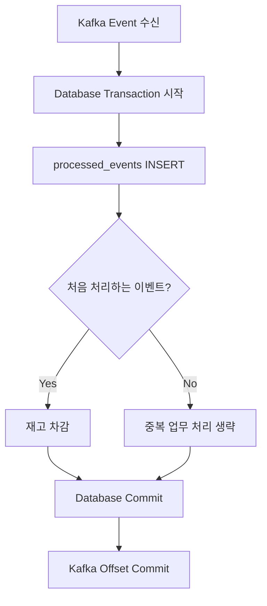

여기서 중요한 점은 다음 두 작업을 동일한 데이터베이스 Transaction에서 수행해야 한다는 것이다.

1. 이벤트 처리 이력 저장
2. 실제 재고 차감

재고 차감이 실패하면 이벤트 처리 이력도 Rollback해야 한다.

반대로 두 작업이 정상적으로 Commit되었다면 동일한 이벤트를 다시 수신해도 중복 재고 차감을 수행하지 않도록 할 수 있다.

### Database Commit 이후 Kafka Commit이 실패한다면?

다음 상황을 생각해 보자.

```text
Database Transaction Commit 성공

        ↓

Kafka Offset Commit 실패

        ↓

Consumer 재시작

        ↓

동일 이벤트 재수신
```

이때 Consumer는 이벤트 처리 이력을 확인할 수 있다.

이미 처리한 이벤트라면 재고 차감을 생략한다.

따라서 Kafka Consumer의 재처리가 발생하더라도 비즈니스 데이터의 중복 변경을 방지할 수 있다.

---

## Kafka 성능 최적화가 필요한 이유

Kafka는 높은 처리량을 제공하도록 설계된 분산 이벤트 스트리밍 플랫폼이다.

하지만 Kafka를 도입했다고 시스템 전체가 자동으로 높은 처리량을 가지는 것은 아니다.

실제 데이터 처리 경로에는 여러 구성 요소가 존재한다.

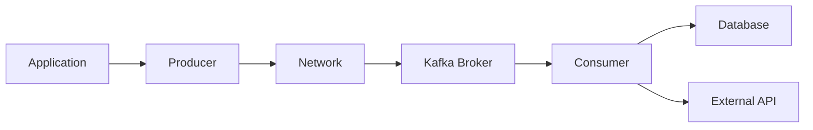

어느 하나의 구성 요소에서 병목이 발생하면 전체 처리량이 제한될 수 있다.

예를 들어 Producer가 초당 10,000건을 전송할 수 있다고 가정해 보자.

Kafka Broker는 초당 20,000건을 처리할 수 있다.

하지만 Consumer가 데이터베이스에 초당 3,000건만 저장할 수 있다면 전체 업무 처리량은 데이터베이스 처리 속도에 영향을 받는다.

```text
Producer: 10,000건/초

Kafka Broker: 20,000건/초

Consumer + Database: 3,000건/초
```

이 경우 Kafka Broker를 추가하더라도 데이터베이스 병목이 해결되지 않으면 전체 처리량은 크게 개선되지 않을 수 있다.

따라서 Kafka 성능 최적화에서는 **어느 구간이 실제 병목인지 확인하는 과정**이 중요하다.

---

## Kafka 성능 최적화의 기본 원칙

성능을 최적화할 때는 다음 순서로 접근하는 것이 좋다.

```text
성능 목표 정의
    ↓
현재 처리량 측정
    ↓
병목 구간 확인
    ↓
Producer 최적화
    ↓
Partition / Consumer 최적화
    ↓
Broker 자원 확인
    ↓
운영체제 및 하드웨어 검토
    ↓
변경 전후 성능 비교
```

여기서 중요한 점은 **정확성을 희생하여 성능만 높이는 접근을 피해야 한다는 것**이다.

예를 들어 결제 이벤트를 처리하는 Producer가 있다.

현재 `acks=all`을 사용하고 있다.

처리량을 높이기 위해 `acks=0`으로 변경하면 일부 상황에서 지연을 낮출 수 있다.

하지만 메시지 저장 실패를 확인하는 능력과 내구성 보장 수준도 달라진다.

따라서 먼저 필요한 전달 보장 수준을 결정하고, 그 조건을 유지하면서 병목을 개선하는 것이 적절하다.

---

## 성능 최적화 1: Partition을 이용한 병렬 처리

Kafka에서 Partition은 병렬 처리의 핵심 단위다.

일반적인 Consumer Group에서는 하나의 Partition을 같은 시점에 하나의 Consumer가 담당한다.

따라서 Partition 수가 Consumer의 병렬 처리 수준에 영향을 준다.

### Partition이 하나인 경우

```text
Topic: orders

Partition 0
    ↓
Consumer 1
```

Consumer 1이 모든 Record를 처리해야 한다.

### Partition이 네 개인 경우

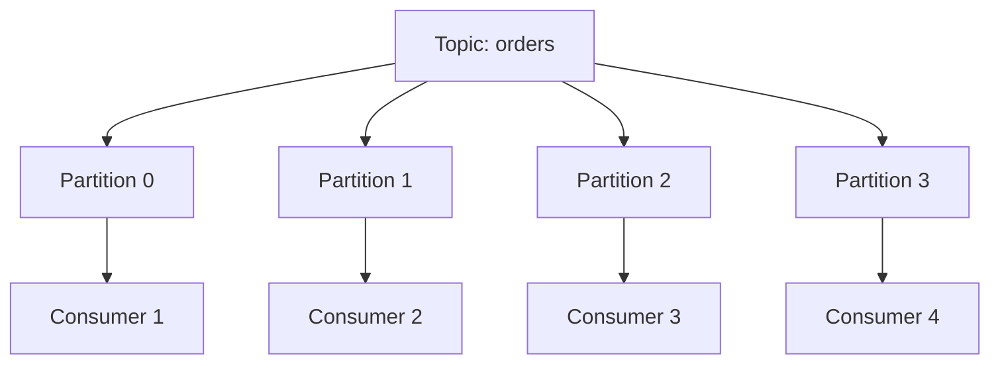

이 경우 네 Consumer가 Partition을 나누어 처리할 수 있다.

### Partition 수를 결정할 때 고려할 요소

| 요소 | 고려사항 |
|---|---|
| 목표 처리량 | 초당 처리해야 하는 메시지 수 |
| Consumer 처리량 | Consumer 한 개가 처리할 수 있는 메시지 수 |
| 예상 Consumer 수 | 향후 확장할 인스턴스 수 |
| Broker 수 | Partition을 배치할 서버 |
| Replication Factor | Replica 관리 비용 |
| Key 분포 | 특정 Partition으로 데이터가 집중되는지 |
| 장애 복구 | Partition 수 증가에 따른 복구 비용 |

### Partition 수가 많으면 무조건 좋을까?

그렇지 않다.

Partition이 증가하면 다음과 같은 관리 비용도 증가할 수 있다.

- Metadata 관리
- 파일 핸들 사용량
- Replica 복제 비용
- Leader Election 관리
- 장애 복구 시간
- Producer의 Batch 분산

따라서 Partition 수는 실제 처리량과 운영 자원을 기준으로 결정해야 한다.

---

## 성능 최적화 2: Partition Key와 데이터 분배 전략

Partition 수가 충분하더라도 데이터가 특정 Partition에 집중되면 전체 처리량이 제한될 수 있다.

### Hot Partition이란?

Hot Partition은 특정 Partition에 데이터나 요청이 지나치게 집중되는 현상이다.

예를 들어 사용자 ID를 Kafka Key로 사용한다고 가정해 보자.

```text
user-1001 → Partition 0

user-2001 → Partition 1

user-3001 → Partition 2
```

그런데 `user-1001`에 해당하는 이벤트가 매우 많이 발생한다.

```text
Partition 0: 100,000건/초

Partition 1: 10,000건/초

Partition 2: 10,000건/초
```

이 경우 Partition 0을 처리하는 Consumer에 부하가 집중될 수 있다.

다른 Consumer에 여유가 있어도 전체 처리량을 충분히 활용하지 못할 수 있다.

### 해결 방향

Partition Key를 설계할 때 다음 두 요소를 함께 고려해야 한다.

**첫 번째는 순서 보장이다.**

동일한 업무 대상의 이벤트를 같은 Partition에 저장하면 순서를 관리하기 쉬워진다.

**두 번째는 데이터 분산이다.**

특정 Key에 데이터가 지나치게 집중되면 Hot Partition이 발생할 수 있다.

### 순서 보장과 분산의 트레이드오프

| Key 전략 | 장점 | 고려사항 |
|---|---|---|
| `orderId` | 주문별 순서 관리 | 주문별 트래픽 분포 |
| `userId` | 사용자별 순서 관리 | 특정 사용자 집중 |
| `productId` | 상품별 순서 관리 | 인기 상품 집중 |
| Key 없음 | 분산에 유리할 수 있음 | 업무 대상별 순서 보장 어려움 |

### Round Robin을 무조건 사용해야 할까?

Key가 없는 메시지를 분산할 때 Round Robin을 고려할 수 있다.

하지만 현재 Kafka Java Producer는 Batch 효율과 Broker 상태 등을 고려하는 기본 Partition 분배 전략을 사용한다.

따라서 균등 분산이 필요하다는 이유만으로 무조건 Round Robin을 선택하기보다 실제 Key 분포와 Partition별 처리량을 확인하는 것이 좋다.

---

## 성능 최적화 3: Producer의 Batch 전송

Kafka Producer는 여러 Record를 Batch로 묶어 전송할 수 있다.

이러한 방식은 네트워크 요청 횟수를 줄이는 데 도움이 된다.

### 개별 메시지 전송

```text
Message A → Request 1

Message B → Request 2

Message C → Request 3

Message D → Request 4
```

### Batch 전송

```text
Message A
Message B
Message C
Message D
    ↓
Batch
    ↓
Request 1
```

### Batch 관련 주요 설정

```properties
batch.size=65536

linger.ms=10
```

이 예시에서 Batch 크기는 64KiB다.

`linger.ms=10`은 추가 Record를 모으기 위해 기다리는 시간을 조절한다.

### Batch 크기를 늘리면 발생하는 변화

장점은 다음과 같다.

- 네트워크 요청 수 감소 가능
- 요청당 전송 데이터 증가
- 압축 효율 개선 가능
- 처리량 개선 가능

반면 다음 사항을 고려해야 한다.

- Producer 메모리 사용량 증가
- 낮은 메시지 유입량에서 전송 지연 증가 가능
- Partition별 Batch가 충분히 채워지지 않을 수 있음

따라서 Batch 크기만 늘리는 것이 아니라 메시지 유입량과 Partition 수를 함께 확인해야 한다.

### 지연 시간도 함께 측정해야 한다

평균 처리량이 증가하더라도 일부 요청의 지연 시간이 크게 증가할 수 있다.

따라서 다음 지표를 함께 측정해야 한다.

- 평균 전송 지연
- p95 전송 지연
- p99 전송 지연
- 초당 전송 메시지 수
- Batch 크기
- Producer Buffer 사용량

특히 실시간 처리가 중요한 시스템에서는 처리량뿐 아니라 지연 시간도 성능 목표에 포함해야 한다.

---

## 성능 최적화 4: 메시지 압축

Kafka는 다양한 압축 방식을 지원한다.

대표적으로 다음과 같다.

```text
gzip

snappy

lz4

zstd
```

Producer에서는 다음과 같이 설정할 수 있다.

```properties
compression.type=zstd
```

### 압축을 사용하면 어떤 이점이 있을까?

압축을 사용하면 메시지 크기를 줄일 수 있다.

이는 다음 자원 사용량을 낮추는 데 도움이 될 수 있다.

- Producer와 Broker 사이의 네트워크 대역폭
- Broker의 디스크 공간
- Broker 간 Replication 트래픽
- Consumer로 전달되는 데이터 크기

### 압축의 비용

압축과 압축 해제에는 CPU가 사용된다.

따라서 모든 데이터에 대해 압축이 항상 성능을 개선하는 것은 아니다.

예를 들어 이미 압축된 이미지 파일을 다시 압축하면 얻는 이점이 작을 수 있다.

반면 JSON처럼 반복되는 필드명이 많은 데이터는 압축 효과가 클 수 있다.

### 압축 알고리즘 선택 기준

| 알고리즘 | 장점 | 고려사항 |
|---|---|---|
| Gzip | 높은 압축률 가능 | CPU 비용 |
| Snappy | 빠른 압축 및 해제 | 압축률 |
| LZ4 | 낮은 지연 | 압축률 |
| Zstd | 압축률과 처리 속도의 균형 | 압축 수준에 따른 CPU 비용 |

실무에서는 실제 메시지 데이터를 이용하여 다음 항목을 비교하는 것이 좋다.

```text
압축 전 메시지 크기

압축 후 메시지 크기

Producer CPU 사용량

Consumer CPU 사용량

네트워크 사용량

전체 처리량
```

Kafka의 Batch 압축과 Page Cache 등의 최적화는 높은 처리량을 제공하는 중요한 기반이다. [kafka.apache.org](https://kafka.apache.org/44/design/design/)

---

## 성능 최적화 5: Producer의 비동기 전송

Kafka Java Producer의 `send()`는 기본적으로 비동기 방식으로 동작한다.

Producer는 Record를 내부 Buffer에 저장하고 Sender가 전송을 처리한다.

### 비동기 전송 구조

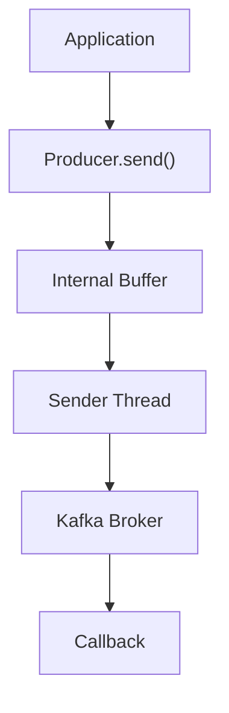

### 동기적으로 기다리는 방식

다음 코드를 생각해 보자.

```java
producer.send(record).get();
```

`send()`는 비동기 API지만 `get()`을 호출하면 전송 결과가 반환될 때까지 현재 스레드가 기다릴 수 있다.

메시지마다 이 방식을 반복하면 비동기 전송과 Batch 처리의 장점을 충분히 활용하지 못할 수 있다.

### Callback을 이용한 비동기 처리

```java
producer.send(record, (metadata, exception) -> {

    if (exception != null) {

        System.err.println(
            "Kafka 전송 실패: " + exception.getMessage()
        );

        return;
    }

    System.out.println(
        "Topic: " + metadata.topic()
            + ", Partition: " + metadata.partition()
            + ", Offset: " + metadata.offset()
    );
});
```

이 방식은 전송 결과를 비동기적으로 확인할 수 있다.

다만 Callback에서 오류를 기록하는 것만으로 모든 실패 처리가 완료되는 것은 아니다.

실제 업무에서는 다음과 같은 정책도 필요할 수 있다.

- 실패 이벤트 재처리
- 사용자 요청 실패 처리
- Outbox 기반 재발행
- 장애 알림
- 전송 결과 모니터링

또한 비동기 `send()`라고 해서 어떤 상황에서도 즉시 반환된다고 보장되는 것은 아니다.

Metadata를 조회하거나 Buffer 공간을 확보하는 과정에서 호출이 대기할 수 있다.

---

## 성능 최적화 6: Consumer Group을 통한 병렬 처리

Consumer의 처리량을 높이는 대표적인 방법은 같은 Consumer Group에 여러 Consumer를 실행하는 것이다.

예를 들어 Topic에 네 개의 Partition이 있다고 가정해 보자.

```text
Partition 0

Partition 1

Partition 2

Partition 3
```

Consumer가 하나라면 네 Partition의 이벤트를 모두 처리해야 한다.

반면 Consumer 네 개를 구성하면 Partition을 나누어 처리할 수 있다.

### Consumer 수에 따른 차이

| Partition 수 | Consumer 수 | 일반적인 최대 동시 Partition 담당 Consumer 수 |
|---:|---:|---:|
| 4 | 1 | 1 |
| 4 | 2 | 2 |
| 4 | 4 | 4 |
| 4 | 8 | 4 |

따라서 Consumer를 무조건 많이 실행하는 것이 아니라 Partition 수와 처리량을 함께 고려해야 한다.

### Consumer 증설 전 확인할 사항

Consumer Lag이 증가했다고 가정해 보자.

이때 Consumer 수를 늘리기 전에 다음 사항을 확인해야 한다.

- Consumer가 실제로 CPU 병목 상태인가?
- 데이터베이스 응답이 느린가?
- 외부 API 호출이 오래 걸리는가?
- 특정 Partition에 이벤트가 집중되는가?
- Consumer의 메시지 처리 로직이 비효율적인가?

예를 들어 데이터베이스가 초당 1,000건만 처리할 수 있는데 Consumer를 여러 개 추가하면 데이터베이스 연결 경합만 증가할 수 있다.

따라서 Consumer의 병렬 처리 수준은 전체 시스템의 처리 능력을 기준으로 결정해야 한다.

---

## 성능 최적화 7: Consumer Polling 설정

Kafka Consumer는 Broker에서 Record를 가져오기 위해 Fetch 요청을 수행한다.

이때 Fetch 관련 설정은 처리량과 지연 시간에 영향을 준다.

### fetch.min.bytes

Broker가 응답하기 전에 모으려고 하는 최소 데이터 크기를 설정한다.

```properties
fetch.min.bytes=1048576
```

이 예시는 1MiB다.

값을 크게 설정하면 더 많은 Record를 모아 전송할 수 있어 요청 효율을 높일 수 있다.

하지만 메시지 유입량이 적으면 응답 지연이 증가할 수 있다.

### fetch.max.wait.ms

Broker가 Fetch 응답을 위해 데이터를 기다리는 시간을 조절한다.

```properties
fetch.max.wait.ms=500
```

`fetch.min.bytes`와 함께 설정하는 것이 좋다.

### max.poll.records

Consumer의 `poll()` 호출에서 반환하는 최대 Record 수를 조절한다.

```properties
max.poll.records=500
```

이 설정은 한 번의 Poll에서 애플리케이션에 반환하는 Record 수를 제한한다.

네트워크 Fetch 응답 자체의 최대 크기를 설정하는 값은 아니다.

### max.poll.interval.ms와의 관계

Consumer가 한 번에 너무 많은 Record를 가져와 처리 시간이 길어지면 다음 `poll()` 호출까지의 간격이 증가한다.

이때 `max.poll.interval.ms`를 초과하면 Consumer Group의 Partition 재할당에 영향을 줄 수 있다.

따라서 `max.poll.records`는 업무 처리 시간과 함께 조절해야 한다.

### 예시

```text
Record 한 건 처리 시간: 100ms

max.poll.records: 500
```

모든 Record를 순차적으로 처리한다면 단순 계산으로 약 50초가 필요하다.

```text
500 × 100ms = 50,000ms
```

반면 Record 한 건의 처리 시간이 1초라면 약 500초가 필요하다.

이 경우 기본적인 `max.poll.interval.ms`보다 처리 시간이 길어질 수 있다.

따라서 실제 처리 시간의 분포를 측정하고 적절한 Poll 크기를 선택해야 한다.

---

## 성능 최적화 8: Consumer의 비즈니스 로직 개선

Kafka Consumer의 처리 속도가 느릴 때는 Kafka 자체보다 비즈니스 로직이 병목인 경우도 있다.

예를 들어 다음과 같은 Consumer를 생각해 보자.

```text
Kafka Record 수신
    ↓
Database SELECT
    ↓
Database UPDATE
    ↓
외부 API 호출
    ↓
처리 이력 INSERT
```

메시지마다 이러한 작업을 수행한다면 데이터베이스와 외부 API가 전체 처리량을 제한할 수 있다.

### 비효율적인 처리 구조

```text
Message 1 → DB Query

Message 2 → DB Query

Message 3 → DB Query

Message 4 → DB Query
```

각 메시지마다 개별 SQL을 수행한다.

### 개선할 수 있는 방향

업무 요구사항에 따라 다음 방법을 검토할 수 있다.

- 불필요한 쿼리 제거
- 적절한 Index 구성
- Batch Insert 또는 Batch Update
- 외부 API 호출 최소화
- 데이터베이스 Connection Pool 조정
- 캐시 활용
- 비동기 처리
- 처리 로직 분리

다만 Batch 처리나 비동기 처리가 모든 상황에서 적합한 것은 아니다.

예를 들어 메시지의 순서가 중요하거나 각 이벤트마다 독립적인 Transaction이 필요하다면 처리 방식에 제약이 존재할 수 있다.

---

## 성능 최적화 9: Consumer의 멀티스레드 처리

Consumer의 I/O 대기 시간이 길다면 별도의 Worker Thread를 사용하는 구조를 고려할 수 있다.

예를 들어 다음과 같다.

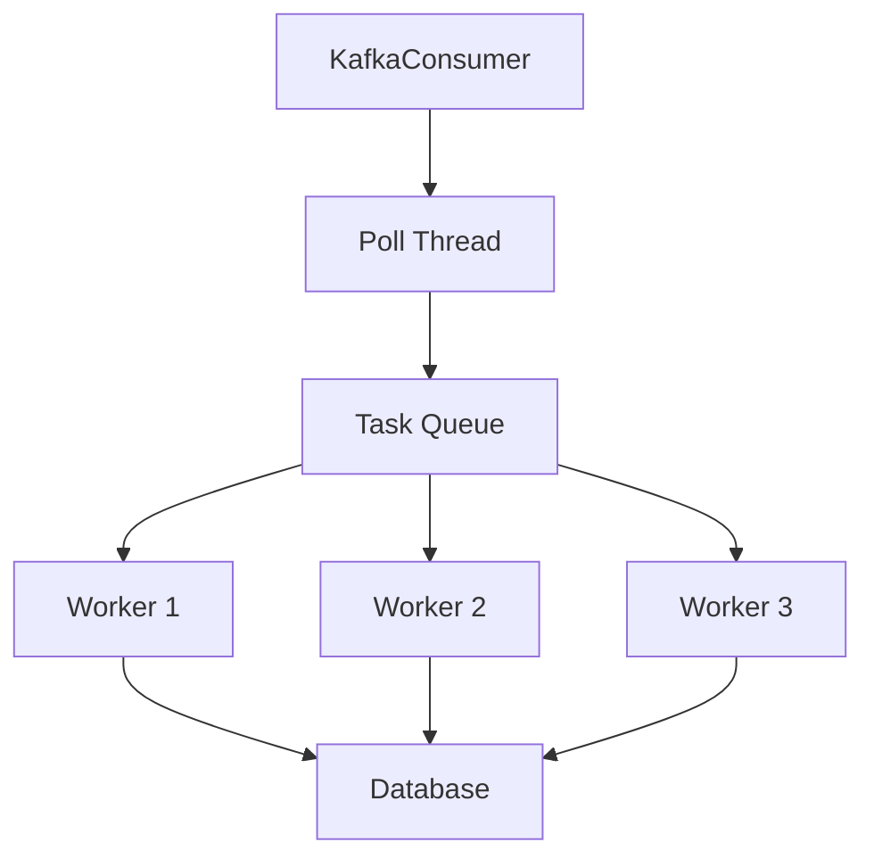

하지만 주의해야 할 점이 있다.

**KafkaConsumer 인스턴스는 일반적으로 여러 스레드에서 임의로 공유하여 동시에 사용하도록 설계된 객체가 아니다.**

따라서 여러 Worker가 동일한 Consumer 객체의 `poll()`이나 `commitSync()` 등을 무분별하게 호출하는 구조는 피해야 한다.

### 멀티스레드 처리에서 고려할 사항

1. Partition 내부의 순서 보장
2. Worker 처리 완료 여부
3. Offset Commit 위치
4. Rebalancing 시 미완료 작업
5. Queue 적체
6. Worker 장애
7. 메모리 사용량

특히 비동기 처리에서는 Offset 12가 완료되었더라도 Offset 11이 처리 중이라면 Offset 13을 Commit해서는 안 된다.

### Backpressure란?

Backpressure는 Consumer가 처리할 수 있는 양을 초과하는 작업이 유입될 때 데이터 수신 속도를 조절하는 방식이다.

예를 들어 Worker Queue가 가득 찼다면 Consumer가 계속 Record를 가져와 메모리에 쌓는 것은 위험하다.

이때 다음 API를 활용할 수 있다.

```java
consumer.pause(partitions);
```

처리 가능한 상태가 되면 다시 읽기를 재개할 수 있다.

```java
consumer.resume(partitions);
```

다만 Pause 상태에서도 Consumer Group 유지를 위한 Poll과 Heartbeat 관리가 필요하므로 전체 처리 루프를 무조건 중단하는 방식으로 구현해서는 안 된다.

---

## 성능 최적화 10: 디스크 성능

Kafka는 디스크 기반 로그 저장 구조를 사용한다.

따라서 디스크 성능은 Kafka Broker의 처리량에 중요한 영향을 준다.

### SSD를 사용하면 좋은 이유

SSD는 일반적으로 HDD보다 낮은 지연 시간과 높은 임의 I/O 성능을 제공한다.

특히 다음과 같은 작업에서 도움이 될 수 있다.

- 여러 Partition의 동시 읽기
- 오래된 Offset 재처리
- Consumer Lag 복구
- Replica 재동기화
- Broker 장애 복구

하지만 SSD를 사용한다는 사실만으로 전체 처리량이 보장되는 것은 아니다.

Kafka의 순차 쓰기 특성과 워크로드에 따라 디스크의 요구사항이 달라질 수 있다.

### 디스크에서 확인할 항목

| 항목 | 설명 |
|---|---|
| Write Throughput | 지속적인 로그 쓰기 처리량 |
| Read Throughput | Consumer 데이터 조회 처리량 |
| I/O Latency | 디스크 요청 지연 |
| Disk Utilization | 디스크 사용률 |
| Available Capacity | 남은 저장 공간 |
| Replica Recovery | 장애 복구 중 추가 I/O |

클라우드 환경에서는 디스크 자체의 성능뿐 아니라 인스턴스에 할당된 스토리지 대역폭 제한도 확인해야 한다.

---

## 성능 최적화 11: JVM Heap과 Page Cache

Kafka Broker는 Java 기반 애플리케이션이다.

따라서 JVM Heap 크기도 중요한 설정이다.

하지만 **JVM Heap을 무조건 크게 설정하는 것이 성능 개선으로 이어지는 것은 아니다.**

Kafka는 운영체제의 Page Cache를 적극적으로 활용한다.

### Page Cache란?

Page Cache는 운영체제가 디스크 데이터를 메모리에 캐싱하는 기능이다.

Kafka는 로그 파일을 디스크에 저장한다.

Consumer가 최근 데이터를 읽는 경우 해당 데이터가 Page Cache에 남아 있다면 실제 디스크 읽기 없이 데이터를 제공할 수 있다.

### Kafka와 Page Cache 구조

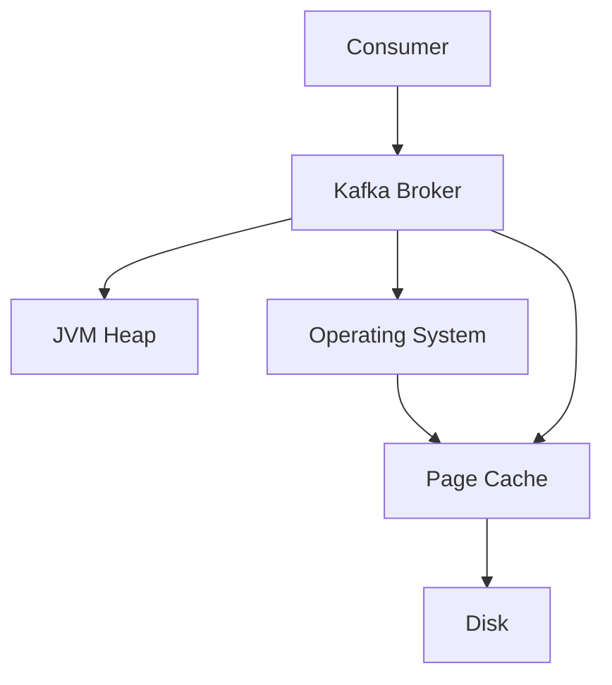

### JVM Heap이 지나치게 크다면?

운영체제에서 Page Cache로 사용할 수 있는 메모리가 줄어들 수 있다.

따라서 Kafka Broker의 메모리를 설계할 때는 다음 요소를 함께 고려해야 한다.

- JVM Heap
- 운영체제 메모리
- Page Cache
- 네트워크 Buffer
- Broker가 관리하는 Partition 수
- GC 비용

Kafka의 공식 설계 문서에서도 Page Cache와 Batch 처리, 효율적인 네트워크 전송이 성능에 중요한 역할을 한다고 설명한다. [kafka.apache.org](https://kafka.apache.org/44/design/design/)

---

## 성능 최적화 12: 네트워크와 CPU

### 네트워크

Kafka에서는 Producer와 Broker 사이에만 데이터가 이동하는 것이 아니다.

Broker 사이에서도 Replication 트래픽이 발생한다.

Consumer Group이 여러 개라면 동일한 데이터를 여러 시스템으로 전송해야 한다.

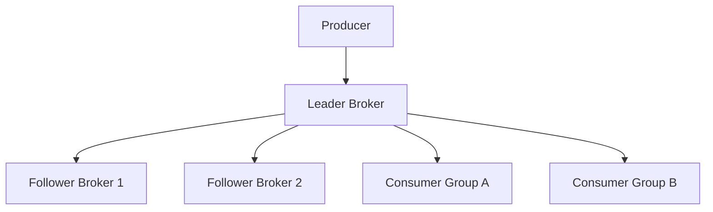

따라서 네트워크 사용량을 계산할 때는 다음 요소를 함께 고려해야 한다.

- Producer 유입량
- Broker 간 복제량
- Consumer Group별 데이터 전송량
- 장애 복구 중 복제 트래픽

대규모 시스템에서는 충분한 네트워크 대역폭이 필요할 수 있다.

### CPU

Kafka Broker의 CPU는 다음 작업에 사용될 수 있다.

- 요청 처리
- 메시지 검증
- 압축 관련 처리
- TLS 처리
- 네트워크 I/O
- Replica 관리

따라서 CPU 사용률이 높다면 어떤 작업에서 비용이 발생하는지 확인해야 한다.

### Broker Thread 설정

Kafka Broker에서는 다음과 같은 설정을 이용하여 처리 스레드 수를 조절할 수 있다.

```properties
num.network.threads=3

num.io.threads=8
```

`num.network.threads`는 네트워크 요청 처리와 관련된다.

`num.io.threads`는 요청 처리 및 디스크 작업과 관련된 스레드 수를 조절한다.

하지만 병목을 확인하지 않고 스레드 수를 무조건 늘리면 오히려 스레드 경합과 메모리 사용량이 증가할 수 있다.

따라서 설정 변경 전후로 처리량과 지연 시간을 측정해야 한다.

---

## 성능 최적화 13: 데이터 직렬화 방식

Kafka는 Record의 Key와 Value를 Byte 데이터로 처리한다.

따라서 Producer는 데이터를 직렬화해야 하고 Consumer는 역직렬화해야 한다.

### 직렬화란?

Serialization은 애플리케이션의 객체나 데이터를 저장 또는 전송 가능한 형태로 변환하는 과정이다.

예를 들어 Java 객체를 Kafka에 전송한다고 가정해 보자.

```java
public record OrderCreatedEvent(
    String orderId,
    long amount
) {
}
```

이 객체를 JSON으로 변환하면 다음과 같다.

```json
{
  "orderId": "order-1001",
  "amount": 45000
}
```

이후 Serializer는 해당 데이터를 Byte Array로 변환한다.

### 역직렬화란?

Deserialization은 저장되거나 전송된 데이터를 애플리케이션에서 사용할 수 있는 형태로 복원하는 과정이다.

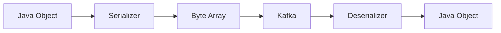

여기서 중요한 것은 직렬화를 사용한다고 자동으로 모든 프로그래밍 언어 사이에 호환성이 생기는 것은 아니라는 사실이다.

Producer와 Consumer가 동일한 데이터 형식과 스키마를 이해할 수 있어야 한다.

---

## JSON과 Binary 직렬화 비교

Kafka에서 사용할 수 있는 대표적인 직렬화 형식은 다음과 같다.

### 텍스트 기반

- JSON
- XML
- CSV

### 이진 기반

- Avro
- Protocol Buffers
- MessagePack

### 형식 비교

| 형식 | 특징 | 장점 | 고려사항 |
|---|---|---|---|
| JSON | 텍스트 기반 | 가독성, 디버깅 | 필드명 반복, 파싱 비용 |
| XML | 태그 기반 | 구조 표현 | 큰 데이터 크기 |
| CSV | 구분자 기반 | 단순한 표 데이터 | 복잡한 구조 표현 어려움 |
| Avro | 스키마 기반 Binary | 데이터 효율, 스키마 진화 | 스키마 관리 |
| Protobuf | 스키마 기반 Binary | 효율적인 크기와 처리 | 필드 번호 관리 |
| MessagePack | Binary 직렬화 | 비교적 작은 크기 | 별도 데이터 계약 관리 |

### Binary 형식을 사용하면 항상 빠를까?

그렇지는 않다.

일반적으로 이진 직렬화는 데이터 크기를 줄이는 데 유리할 수 있다.

하지만 실제 처리 성능은 다음 요소에 따라 달라진다.

- 메시지 크기
- 데이터 구조
- Serializer 구현
- 압축 방식
- CPU 성능
- 스키마 관리
- 디버깅 비용

따라서 JSON을 사용하고 있다는 이유만으로 반드시 Binary 형식으로 변경해야 하는 것은 아니다.

메시지 크기와 직렬화 CPU 사용량이 실제 병목인지 확인한 후 변경하는 것이 적절하다.

---

## Consumer Lag을 이용한 처리량 분석

Kafka Consumer의 처리량을 분석할 때 중요한 지표 중 하나가 Consumer Lag이다.

Consumer Lag은 Kafka에 기록된 데이터와 Consumer Group의 소비 위치 사이의 차이를 나타낸다.

하지만 Lag을 정확하게 해석하려면 Commit 정책도 함께 이해해야 한다.

### 처리량 예제

다음과 같은 상황을 생각해 보자.

```text
Producer 유입량: 1,000건/초

Consumer 처리량: 800건/초
```

Producer는 초당 1,000건을 발행한다.

하지만 Consumer는 초당 800건만 처리할 수 있다.

따라서 초당 200건의 이벤트가 누적된다.

```text
1,000 - 800 = 200건/초
```

### 10분 동안 지속된다면?

```text
200건/초 × 600초 = 120,000건
```

10분 후에는 약 12만 건의 처리가 밀릴 수 있다.

### 처리량별 적체 변화

| 상태 | 유입량 | 처리량 | 적체 변화 |
|---|---:|---:|---:|
| Consumer 병목 | 1,000건/초 | 800건/초 | 초당 200건 증가 |
| 유입량과 동일 | 1,000건/초 | 1,000건/초 | 기존 적체 유지 |
| 복구 여유 확보 | 1,000건/초 | 1,500건/초 | 초당 500건 감소 |

### 기존 적체를 복구하려면?

12만 건의 메시지가 누적되었다고 가정하자.

Consumer의 처리량을 초당 1,500건으로 높였다.

새로운 이벤트는 계속 초당 1,000건씩 유입된다.

따라서 기존 적체를 줄이는 속도는 초당 500건이다.

```text
1,500 - 1,000 = 500건/초
```

12만 건을 처리하는 데 필요한 시간은 다음과 같다.

```text
120,000 ÷ 500 = 240초
```

즉, 단순 계산으로 약 4분이다.

다만 이 수치는 메시지별 처리 비용이 일정하다는 가정에 따른 것이다.

실제 운영에서는 데이터베이스 경합과 Rebalancing, 외부 API 지연 등에 따라 복구 시간이 더 길어질 수 있다.

### 중요한 설계 원칙

**평상시 유입량만 처리할 수 있는 시스템은 장애 중 쌓인 데이터를 빠르게 복구하기 어렵다.**

따라서 운영 환경에서는 평상시 처리량뿐 아니라 장애 이후 적체를 얼마나 빠르게 해소할 수 있는지도 고려해야 한다.

---

## Consumer Lag이 작으면 정상일까?

그렇지 않을 수 있다.

Consumer Lag은 Kafka Offset을 기반으로 계산한다.

하지만 Offset이 실제 비즈니스 처리 완료와 일치하지 않는다면 Lag이 작아도 업무 처리가 누락되어 있을 수 있다.

예를 들어 다음과 같은 상황이다.

```text
Consumer가 Record 조회
    ↓
Offset Commit
    ↓
Database 저장 실패
```

Kafka 입장에서는 Offset이 Commit되었다.

따라서 Consumer Lag은 감소할 수 있다.

하지만 실제 업무 데이터는 저장되지 않았다.

반대로 데이터베이스 저장은 완료되었지만 Offset Commit이 지연되었다면 Lag이 실제 미처리 업무보다 크게 보일 수 있다.

따라서 Kafka에서는 다음 지표를 함께 관찰해야 한다.

- Consumer Lag
- 실제 업무 처리 성공 건수
- 업무 처리 실패 건수
- Retry 횟수
- 처리 지연 시간
- 가장 오래 대기한 이벤트의 시간
- Offset Commit 실패
- Rebalancing 횟수

**Kafka의 소비 위치와 실제 비즈니스 처리 완료 상태는 서로 다를 수 있다는 점을 항상 고려해야 한다.**

---

## Kafka 운영에서 확인해야 할 주요 지표

Kafka 성능을 분석할 때는 Producer와 Broker, Consumer를 구분하여 확인하는 것이 좋다.

### Producer 지표

| 지표 | 확인할 내용 |
|---|---|
| Record Send Rate | 초당 전송 Record 수 |
| Record Error Rate | 전송 오류 |
| Retry Rate | 재시도 증가 여부 |
| Request Latency | Broker 요청 지연 |
| Buffer Available Bytes | 남은 Buffer |
| Batch Size | 실제 Batch 크기 |
| Compression Rate | 압축 효율 |

### Broker 지표

| 지표 | 확인할 내용 |
|---|---|
| Request Latency | 요청 처리 지연 |
| Bytes In / Out | 네트워크 유입·유출 |
| Under-Replicated Partitions | 복제 상태 이상 |
| ISR Shrink | ISR 감소 |
| Disk Utilization | 디스크 사용량 |
| Network Utilization | 네트워크 사용량 |
| CPU Usage | CPU 사용량 |

### Consumer 지표

| 지표 | 확인할 내용 |
|---|---|
| Consumer Lag | 처리 위치 지연 |
| Records Consumed Rate | 초당 소비 Record 수 |
| Fetch Latency | Fetch 요청 지연 |
| Poll Interval | Poll 호출 간격 |
| Commit Latency | Offset Commit 지연 |
| Rebalance Rate | Rebalancing 발생 빈도 |
| Business Processing Time | 실제 업무 처리 시간 |

Kafka 공식 운영 문서에서도 Client와 Broker의 지표를 함께 모니터링하도록 설명한다. [kafka.apache.org](https://kafka.apache.org/44/operations/monitoring/?utm_source=chatgpt.com)

---

## Kafka 성능 최적화에서 자주 발생하는 실수

### 1. acks=0으로 변경하면 성능 최적화가 끝난다고 생각한다

ACK 확인을 생략하면 일부 상황에서 지연을 줄일 수 있다.

하지만 메시지 저장 실패를 확인하는 능력도 감소한다.

특히 결제와 정산처럼 데이터 손실이 중요한 문제로 이어지는 영역에서는 필요한 전달 보장 수준을 유지하는 것이 우선이다.

### 2. Partition 수를 무조건 늘린다

Partition을 늘리면 병렬 처리 수준을 높일 수 있다.

하지만 Broker의 Metadata와 파일 핸들, Replica 관리 비용도 증가한다.

또한 Consumer의 실제 병목이 데이터베이스라면 Partition을 늘려도 처리량이 증가하지 않을 수 있다.

### 3. Consumer 수만 늘린다

일반적인 Consumer Group에서 Partition 수보다 Consumer 수가 많으면 일부 Consumer는 Partition을 할당받지 못할 수 있다.

따라서 Consumer 증설 전 Partition 수를 확인해야 한다.

### 4. Producer에서 매번 Future.get()을 호출한다

비동기 Producer를 사용하더라도 모든 Record 전송 직후 결과를 기다리면 처리량이 제한될 수 있다.

따라서 비동기 Callback과 Batch 처리 등을 검토해야 한다.

### 5. JVM Heap을 무조건 크게 설정한다

Kafka는 운영체제 Page Cache를 활용한다.

Heap을 지나치게 크게 설정하면 Page Cache에 사용할 메모리가 줄어들 수 있다.

### 6. JSON을 사용한다는 이유만으로 Binary 형식으로 변경한다

직렬화 형식은 실제 성능 병목을 확인한 후 선택해야 한다.

Binary 형식이 모든 워크로드에서 무조건 우수한 것은 아니다.

### 7. Kafka Transaction이 외부 결제까지 보호한다고 생각한다

Kafka Transaction은 Kafka 내부의 쓰기와 Offset Commit에 대한 원자성을 제공할 수 있다.

하지만 외부 결제 API와 별도 데이터베이스 Transaction을 자동으로 묶지는 않는다.

### 8. Idempotent Producer를 사용하면 Consumer 중복 처리가 사라진다고 생각한다

Idempotent Producer는 Producer의 재시도 중복 기록을 방지한다.

Consumer가 업무 처리를 반복 실행하는 문제는 별도다.

### 9. Consumer Lag만 모니터링한다

Lag이 작더라도 실제 비즈니스 처리에 실패했을 수 있다.

따라서 업무 성공률과 처리 지연, Retry 등을 함께 확인해야 한다.

### 10. 정상 상황에서만 성능을 측정한다

평상시 처리량만 측정해서는 장애 대응 능력을 판단하기 어렵다.

실제 운영에서는 장애 이후 누적된 데이터를 얼마나 빠르게 복구할 수 있는지도 중요하다.

---

## Kafka 성능과 안정성을 검증하는 방법

설정을 변경할 때는 단순히 처리량이 증가했는지만 확인해서는 안 된다.

**정확성과 내구성에 대한 요구사항을 유지하면서 처리량이 개선되었는지** 확인해야 한다.

### 정상 상황 검증

다음 항목을 측정한다.

- 초당 Producer 전송량
- 초당 Consumer 처리량
- 평균 지연
- p95 지연
- p99 지연
- CPU 사용량
- 메모리 사용량
- 디스크 I/O
- 네트워크 사용량

### 장애 상황 검증

다음 시나리오를 검토한다.

| 시나리오 | 확인할 내용 |
|---|---|
| ACK 응답 유실 | Producer 재시도 중복 기록 여부 |
| Broker 장애 | 메시지 내구성 및 복구 |
| Producer 재시작 | 동일 업무 이벤트 중복 발행 여부 |
| Consumer 처리 후 Commit 전 장애 | 중복 업무 처리 여부 |
| Consumer Commit 후 업무 처리 실패 | 처리 누락 여부 |
| Transaction Abort | 미확정 Record 노출 여부 |
| Consumer Rebalancing | 미완료 작업과 Offset 관리 |
| 데이터베이스 장애 | Retry와 멱등성 |
| 트래픽 급증 | Consumer Lag 증가 및 복구 |

특히 결제와 재고 같은 시스템에서는 Kafka에 Record가 몇 개 존재하는지만 확인해서는 충분하지 않다.

최종적으로 다음 결과를 확인해야 한다.

```text
결제는 한 번만 승인되었는가?

재고는 정확한 수량만 차감되었는가?

동일 이벤트를 다시 처리해도 결과가 유지되는가?

장애 이후 누락된 이벤트를 재처리할 수 있는가?
```

이러한 관점으로 검증해야 실제 비즈니스 시스템의 안정성을 판단할 수 있다.

---

## 실무에서 적용할 12가지 개선 전략

Kafka의 고급 기능과 성능 최적화를 실제 시스템에 적용할 때는 다음 순서로 접근하는 것이 효과적이다.

### 1. 먼저 이벤트의 중요도를 분류한다

모든 Kafka 이벤트에 동일한 전달 보장 수준을 적용할 필요는 없다.

예를 들어 결제 승인 이벤트는 손실되면 심각한 문제가 발생한다.

반면 일부 모니터링 이벤트는 일시적인 누락을 허용할 수도 있다.

따라서 이벤트의 중요도에 따라 전달 보장 수준과 보존 기간, 복제 정책을 구분해야 한다.

### 2. 업무 중복 방지 Key를 설계한다

결제와 주문 이벤트에는 중복을 식별할 수 있는 업무 Key를 정의하는 것이 좋다.

예를 들어 `paymentId`, `orderId`, `eventId` 등을 활용할 수 있다.

특히 동일한 요청을 재시도할 때 새로운 결제 요청으로 처리하지 않도록 멱등성 Key를 유지하는 것이 중요하다.

### 3. Producer 전송 결과를 반드시 확인한다

비동기 Producer를 사용하더라도 전송 결과를 무시해서는 안 된다.

Callback이나 Future를 통해 최종 성공 여부를 확인하고 실패 시 처리 정책을 적용해야 한다.

### 4. Producer 멱등성을 활성화한다

전송 재시도가 발생하는 환경에서는 Idempotent Producer를 활용하는 것이 유리하다.

이를 통해 ACK 응답 유실과 같은 상황에서 중복 기록을 방지할 수 있다.

### 5. 여러 Kafka 쓰기의 원자성이 필요하면 Transaction을 검토한다

하나의 업무에서 여러 Topic에 메시지를 발행해야 하고 그 결과를 함께 확정해야 한다면 Kafka Transaction을 검토할 수 있다.

Kafka에서 읽고 다시 Kafka에 쓰는 구조에서는 출력과 입력 Offset을 동일한 Transaction으로 관리할 수도 있다.

### 6. 외부 데이터베이스에서는 별도의 멱등성을 구현한다

Kafka Transaction만으로 외부 데이터베이스의 중복 변경을 방지할 수는 없다.

따라서 이벤트 ID와 Unique Constraint, 처리 이력 테이블 등을 활용해야 한다.

실제 업무 변경과 처리 이력은 같은 데이터베이스 Transaction에서 Commit하는 것이 중요하다.

### 7. Partition 수를 실제 처리량 기준으로 설계한다

Partition 수는 예상 Consumer 수만으로 결정해서는 안 된다.

Partition별 처리량과 Key 분포, Broker의 리소스 사용량, 장애 복구 시간을 함께 고려해야 한다.

### 8. Batch와 압축을 먼저 최적화한다

Producer의 처리량이 부족하다고 해서 곧바로 Broker를 추가하기보다 Batch 크기와 압축 효율을 확인하는 것이 좋다.

특히 작은 Record를 대량으로 전송하는 시스템에서는 Batch 처리의 효과가 클 수 있다.

### 9. Consumer의 업무 처리 시간을 측정한다

Consumer Lag이 증가한다면 Kafka 설정뿐 아니라 실제 업무 처리 로직을 확인해야 한다.

느린 SQL과 외부 API 호출, 반복적인 데이터베이스 작업이 병목일 수 있다.

### 10. Consumer의 병렬 처리와 Commit을 함께 설계한다

Consumer에서 비동기 Worker를 사용한다면 완료되지 않은 앞선 Record를 건너뛰고 Offset을 Commit하지 않도록 해야 한다.

병렬 처리로 처리량을 높이는 것과 안전한 Offset 관리는 함께 설계해야 한다.

### 11. 장애 복구를 위한 여유 처리량을 확보한다

Consumer의 평상시 처리량이 Producer 유입량과 동일하다면 장애 중 누적된 이벤트를 빠르게 복구하기 어렵다.

따라서 장애 복구 목표에 맞는 여유 처리량을 확보해야 한다.

### 12. 성능과 정합성 지표를 함께 모니터링한다

Kafka의 처리량과 Consumer Lag만으로 시스템이 정상이라고 판단해서는 안 된다.

실제 주문과 결제, 재고 데이터가 올바르게 반영되었는지도 확인해야 한다.

**Kafka 운영의 목표는 단순히 메시지를 빠르게 처리하는 것이 아니라, 필요한 정확성을 유지하면서 지속적으로 데이터를 처리할 수 있는 시스템을 만드는 것이다.**

---

## 정리

Apache Kafka를 실제 운영 환경에서 안정적으로 활용하려면 메시지 전달 보장과 성능 최적화를 함께 이해해야 한다.

Kafka에서는 Producer와 Broker, Consumer 사이에서 다양한 장애가 발생할 수 있다.

특히 네트워크 장애로 인해 메시지는 저장되었지만 ACK 응답이 유실되는 상황이 발생할 수 있다.

Producer가 동일한 메시지를 재전송하면 중복 기록이 발생할 수 있다.

Consumer에서도 업무 처리 이후 Offset Commit 이전에 장애가 발생하면 동일한 Record를 다시 읽어 처리할 수 있다.

따라서 Kafka에서는 멱등성이 중요하다.

멱등성은 동일한 연산을 여러 번 수행하더라도 최종 결과가 한 번 수행했을 때와 동일하게 유지되는 성질이다.

Kafka에서는 이러한 개념을 이용하여 Producer의 재시도 중복 기록을 방지할 수 있다.

Kafka의 메시지 전달 보장 방식은 크게 At-most-once, At-least-once, Exactly-once로 구분할 수 있다.

At-most-once는 재처리를 하지 않는 대신 일부 데이터가 처리되지 않을 가능성을 허용한다.

At-least-once는 데이터 누락을 줄이기 위해 재시도를 허용하지만 동일한 메시지가 여러 번 처리될 수 있다.

Exactly-once는 정의된 처리 범위에서 최종 결과가 정확히 한 번 반영되도록 구성하는 방식이다.

Kafka는 Idempotent Producer와 Transaction을 이용하여 이러한 Exactly-once 의미론을 지원한다.

Idempotent Producer는 Producer ID와 Sequence Number 등의 정보를 활용하여 재시도 과정에서 동일한 Record가 중복 기록되는 문제를 방지한다.

하지만 애플리케이션이 동일한 업무 이벤트를 새롭게 생성하여 여러 번 전송하는 문제까지 자동으로 해결하지는 않는다.

Kafka Transaction은 여러 Topic과 Partition에 대한 쓰기를 하나의 Commit 또는 Abort 단위로 묶을 수 있다.

또한 Kafka에서 읽은 데이터를 가공하여 다시 Kafka에 쓰는 구조에서는 출력 Record와 입력 Offset을 같은 Transaction으로 Commit할 수 있다.

이때 Consumer는 `read_committed`를 사용하여 Abort된 트랜잭션의 Record를 업무 처리 대상으로 읽지 않도록 구성할 수 있다.

다만 Kafka Transaction은 외부 데이터베이스나 결제 API까지 자동으로 원자성을 제공하지 않는다.

따라서 결제와 재고처럼 데이터 정합성이 중요한 시스템에서는 이벤트 ID와 Unique Constraint, 멱등성 Key, 처리 이력 테이블 등의 추가적인 장치가 필요하다.

성능 최적화 역시 여러 관점에서 접근해야 한다.

Partition은 Kafka의 병렬 처리에 중요한 역할을 한다.

Partition 수를 늘리면 여러 Consumer가 동시에 다른 Partition을 처리할 수 있다.

하지만 Partition 수가 증가하면 Broker의 Metadata 관리와 파일 핸들, Replica 복제 비용도 증가할 수 있다.

따라서 Partition 수는 목표 처리량과 Consumer의 처리 능력, Broker의 자원 상태를 기준으로 결정해야 한다.

Producer에서는 Batch 전송과 압축, 비동기 전송이 중요하다.

Batch를 이용하면 여러 Record를 묶어 네트워크 요청 비용을 줄일 수 있다.

압축을 이용하면 네트워크와 디스크 사용량을 줄일 수 있다.

비동기 전송을 이용하면 애플리케이션이 메시지마다 Broker의 응답을 기다리는 비용을 줄일 수 있다.

하지만 이러한 최적화는 지연 시간과 CPU 사용량, 메모리 사용량에 영향을 줄 수 있으므로 실제 워크로드를 기준으로 설정해야 한다.

Consumer에서는 Consumer Group을 이용하여 여러 인스턴스가 Partition을 나누어 처리하도록 구성할 수 있다.

또한 Fetch 설정을 조절하여 한 번에 가져오는 데이터 크기와 응답 지연을 조절할 수 있다.

하지만 Consumer의 처리량이 낮은 원인이 느린 SQL이나 외부 API 호출이라면 Kafka 설정만 변경하는 것으로는 충분하지 않다.

따라서 실제 비즈니스 로직의 처리 시간을 측정하고 병목을 개선해야 한다.

하드웨어 측면에서는 디스크와 네트워크, CPU, 메모리를 함께 고려해야 한다.

특히 Kafka는 운영체제 Page Cache를 적극적으로 활용하므로 JVM Heap을 무조건 크게 설정하는 것은 적절하지 않을 수 있다.

데이터 직렬화 방식도 성능에 영향을 준다.

JSON과 XML은 가독성이 좋지만 데이터 크기와 파싱 비용이 증가할 수 있다.

Avro와 Protobuf, MessagePack 같은 Binary 형식은 데이터 크기와 처리 비용을 줄이는 데 도움이 될 수 있다.

그러나 모든 상황에서 Binary 형식이 무조건 빠르다고 단정할 수는 없다.

실제 메시지 크기와 직렬화 비용, 압축률, 운영 편의성을 함께 고려해야 한다.

마지막으로 Kafka에서는 성능과 안정성을 함께 모니터링해야 한다.

Producer의 전송 지연과 오류, Broker의 Replica 상태, Consumer Lag과 Rebalancing뿐 아니라 실제 비즈니스 데이터가 정상적으로 반영되었는지도 확인해야 한다.

Consumer Lag이 작더라도 업무 처리 이전에 Offset을 Commit했다면 일부 데이터가 실제로 처리되지 않았을 수 있다.

따라서 Kafka의 Offset과 실제 업무 처리 완료 상태를 구분해야 한다.

결국 Kafka를 효과적으로 활용하기 위해서는 다음 원칙이 중요하다.

**첫째, 메시지가 중복 전달되거나 다시 처리될 수 있다는 사실을 전제로 시스템을 설계해야 한다.**

**둘째, Kafka 내부의 멱등성과 Transaction이 보호하는 범위를 정확하게 이해해야 한다.**

**셋째, 성능을 개선할 때는 필요한 전달 보장 수준을 유지하면서 실제 병목을 해결해야 한다.**

이러한 원칙을 바탕으로 Kafka를 설계하면 높은 처리량과 데이터 정합성이 모두 중요한 백엔드 시스템을 보다 안정적으로 구축할 수 있다.

### 한 줄 요약

**Kafka는 Idempotent Producer와 Transaction을 이용하여 재시도에 따른 중복 기록을 방지하고, 정의된 Kafka 처리 범위에서 Exactly-once 의미론을 제공한다. 하지만 외부 데이터베이스와 결제 API까지 자동으로 보호하지는 않으므로 업무 멱등성을 별도로 설계해야 한다. 성능 최적화에서는 Partition, Batch, 압축, 비동기 전송, Consumer 병렬 처리, 하드웨어 및 직렬화 방식을 종합적으로 고려해야 하며, 필요한 데이터 정확성을 유지하면서 실제 시스템의 병목을 개선하는 것이 핵심이다.**
