# 카프카 성장과 고급 주제 알아보기

# 카프카 성장과 고급 주제 알아보기

* toc
{:toc}

---

## Apache Kafka 고급 기능 완벽 이해: Schema Registry, Kafka Connect, Kafka Streams, ksqlDB와 실시간 데이터 처리 아키텍처

Apache Kafka는 대규모 데이터를 안정적으로 전달하기 위한 분산 이벤트 스트리밍 플랫폼이다.

Kafka의 기본적인 사용 방식은 비교적 단순하다.

Producer가 Topic에 메시지를 발행하면 Consumer가 해당 메시지를 읽어 처리한다.

하지만 실제 서비스에서 Kafka를 운영하다 보면 단순한 메시지 전달만으로 해결하기 어려운 문제가 발생한다.

예를 들어 다음과 같은 상황을 생각해 보자.

- 주문 서비스에서 이벤트 필드를 변경했는데 기존 Consumer에서 역직렬화 오류가 발생한다.
- 여러 서비스가 Kafka에 연결되면서 데이터베이스 연동 코드를 반복적으로 작성해야 한다.
- MySQL에서 변경된 데이터를 실시간으로 Elasticsearch에 반영해야 한다.
- 실시간으로 발생하는 결제 이벤트를 집계하여 이상 거래를 탐지해야 한다.
- 사용자 행동 데이터를 분석하여 실시간 추천 시스템을 구축해야 한다.
- 수많은 이벤트를 SQL로 분석하고 싶지만 매번 별도의 Java 애플리케이션을 개발해야 한다.
- 서버 장애 이후 스트림 처리 상태를 복구해야 한다.

이러한 문제를 해결하기 위해 Kafka 생태계는 다양한 기능과 기술을 발전시켜 왔다.

대표적인 기술이 다음 네 가지다.

| 기술 | 주요 역할 | 해결하려는 문제 |
|---|---|---|
| Schema Registry | 데이터 구조 및 스키마 버전 관리 | Producer와 Consumer 사이의 데이터 호환성 |
| Kafka Connect | 외부 시스템과 Kafka 간 데이터 이동 | 반복적인 데이터 연동 개발 |
| Kafka Streams | Java 기반 실시간 이벤트 처리 | 스트림 변환, 필터링, 조인, 집계 |
| ksqlDB | SQL 기반 실시간 이벤트 처리 | 코드 작성 없이 선언적으로 스트림 처리 |

각 기술은 서로 다른 문제를 해결하지만 하나의 데이터 처리 아키텍처 안에서 함께 사용할 수도 있다.

예를 들어 주문 데이터베이스의 변경 사항을 Kafka Connect로 수집하고, Schema Registry로 이벤트 구조를 관리할 수 있다.

이후 Kafka Streams를 이용하여 데이터를 가공하고, ksqlDB로 실시간 집계를 수행할 수 있다.

이러한 구조를 이해하면 Kafka를 단순 메시지 브로커가 아니라 **데이터 수집, 전달, 변환, 분석을 연결하는 이벤트 처리 플랫폼**으로 활용할 수 있다.

---

## Kafka는 어떻게 성장해 왔을까?

### Kafka의 초기 목적

Kafka는 처음부터 모든 데이터 처리 기능을 제공하는 플랫폼으로 만들어진 것은 아니다.

초기에는 여러 시스템에서 발생하는 데이터를 안정적으로 수집하고 전달하는 것이 중요한 목적이었다.

기존 시스템에서는 데이터가 필요한 서비스마다 개별적인 연동을 구현하는 경우가 많았다.

예를 들어 다음과 같은 구조다.

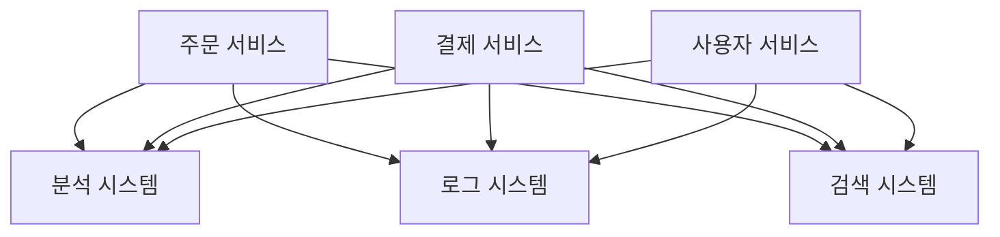

이러한 구조에서는 서비스와 데이터 소비 시스템이 증가할수록 연결 관계가 복잡해진다.

각 시스템은 데이터를 전송할 대상의 주소와 통신 방식, 장애 처리 로직 등을 알아야 한다.

Kafka를 도입하면 데이터 생산자와 소비자 사이의 직접적인 의존성을 줄일 수 있다.

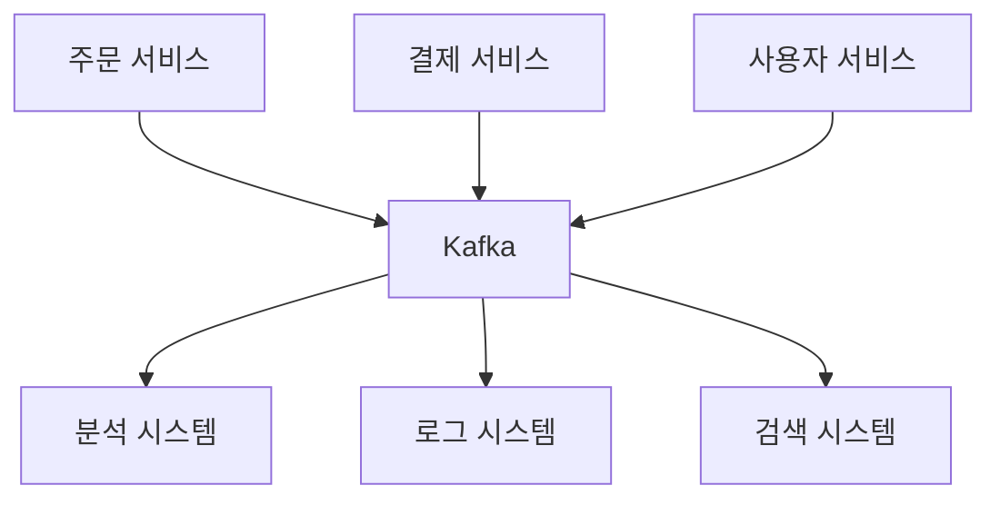

하지만 Kafka에 연결되는 시스템이 증가하면서 새로운 요구사항이 등장했다.

대표적으로 데이터 구조 관리와 외부 시스템 연동, 실시간 처리 기능이 필요해졌다.

### Kafka의 주요 발전 과정

Kafka의 주요 기능과 생태계가 발전한 과정을 살펴보면 다음과 같다.

| 시기 | 버전 또는 기술 | 주요 변화 |
|---|---|---|
| 2013년 12월 | Kafka 0.8 | Replication 도입 |
| 2015년 2월 | Confluent Platform 1.0 | Schema Registry를 포함한 스키마 관리 생태계 제공 |
| 2015년 11월 | Kafka 0.9 | Kafka Connect 도입 |
| 2016년 5월 | Kafka 0.10 | Kafka Streams 도입 |
| 2017년 8월 | KSQL 공개 | SQL 기반 스트림 처리 |
| 이후 | ksqlDB | KSQL을 발전시킨 이벤트 스트리밍 데이터베이스 |
| 2025년 | Kafka 4.0 | ZooKeeper 모드 제거, KRaft 기반 운영 |
| 2026년 | Kafka 4.4 | Kafka Streams와 클러스터 운영 기능 지속 개선 |

여기서 주의할 점이 있다.

**Schema Registry와 KSQL은 Apache Kafka Broker에 직접 내장된 기능으로 등장한 것이 아니다.**

Schema Registry는 Confluent Platform에서 제공하는 독립적인 스키마 관리 서비스다.

KSQL 역시 Confluent가 별도로 공개한 스트리밍 SQL 엔진이며, 이후 ksqlDB로 발전했다.

반면 Kafka Connect와 Kafka Streams는 Apache Kafka 프로젝트에서 제공하는 구성 요소다.

이러한 구분은 실제 시스템에 도입할 때 중요하다.

Kafka Broker를 설치했다고 Schema Registry나 ksqlDB가 자동으로 실행되는 것은 아니기 때문이다.

또한 각 기술은 서로 다른 라이선스와 배포 방식, 버전 호환성을 가질 수 있다.

---

## Kafka 생태계의 전체 아키텍처

Kafka와 주요 확장 기술이 함께 사용되는 구조를 살펴보자.

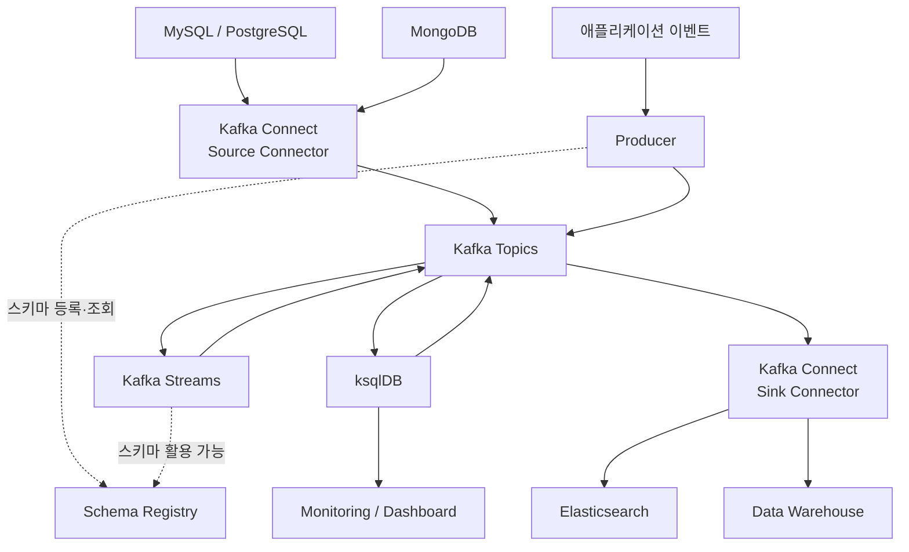

전체 구조를 역할별로 구분하면 다음과 같다.

**Schema Registry는 데이터의 구조를 관리한다.**

Kafka Connect는 외부 시스템과 데이터를 이동시킨다.

Kafka Streams는 애플리케이션 코드로 이벤트를 처리한다.

ksqlDB는 SQL을 이용하여 스트림을 변환하거나 집계한다.

따라서 네 기술은 서로를 완전히 대체하는 관계가 아니다.

각각의 책임을 이해하고 필요한 기능을 조합하는 것이 중요하다.

---

## Schema Registry란?

### Schema Registry의 개념

Schema Registry는 Producer와 Consumer가 사용하는 데이터 스키마를 등록하고 관리하는 시스템이다.

여기서 스키마(Schema)란 데이터의 구조와 형식을 정의하는 명세를 의미한다.

예를 들어 관계형 데이터베이스에서는 다음과 같이 테이블 구조를 정의할 수 있다.

```sql
CREATE TABLE orders (
    order_id VARCHAR(100) PRIMARY KEY,
    customer_id VARCHAR(100) NOT NULL,
    amount BIGINT NOT NULL,
    status VARCHAR(30) NOT NULL
);
```

이 SQL은 `orders` 테이블의 구조를 정의한다.

각 컬럼의 이름과 타입, 제약 조건 등을 명시한다.

Kafka에서도 비슷한 요구사항이 존재한다.

예를 들어 다음과 같은 주문 이벤트를 발행한다고 가정해 보자.

```json
{
  "orderId": "order-1001",
  "customerId": "customer-101",
  "amount": 45000,
  "status": "CREATED"
}
```

Producer와 Consumer는 최소한 다음 정보를 공유해야 한다.

- `orderId`는 문자열인가?
- `amount`는 정수인가?
- `customerId`는 필수인가?
- `status`에는 어떤 값이 들어오는가?
- 새로운 필드가 추가되면 기존 Consumer도 처리할 수 있는가?
- 과거 이벤트를 다시 읽어도 정상적으로 역직렬화할 수 있는가?

이러한 데이터 계약을 체계적으로 관리하기 위해 Schema Registry를 사용할 수 있다.

---

## Schema Registry가 필요한 이유

### Producer와 Consumer의 배포 시점은 다를 수 있다

주문 서비스와 알림 서비스가 서로 다른 팀에서 개발되고 있다고 가정해 보자.

주문 서비스는 Kafka에 주문 생성 이벤트를 발행한다.

알림 서비스는 해당 이벤트를 읽어 사용자에게 메시지를 전송한다.

초기 이벤트 구조는 다음과 같다.

```json
{
  "orderId": "order-1001",
  "amount": 45000
}
```

이후 주문 서비스에서 통화 정보를 추가했다.

```json
{
  "orderId": "order-1001",
  "amount": 45000,
  "currency": "KRW"
}
```

문제는 Producer와 Consumer가 항상 동시에 배포되지 않는다는 것이다.

주문 서비스는 새로운 이벤트 구조로 배포되었지만 알림 서비스는 이전 버전을 사용하고 있을 수 있다.

또한 Kafka에는 이전 구조로 기록된 이벤트가 남아 있을 수 있다.

따라서 새로운 Consumer는 과거 이벤트도 읽을 수 있어야 한다.

반대로 오래된 Consumer가 새로운 이벤트를 읽는 상황도 고려해야 한다.

이러한 문제를 스키마 호환성(Schema Compatibility) 문제라고 한다.

### 스키마 관리 없이 운영하면 발생하는 문제

| 문제 | 설명 |
|---|---|
| 필드 타입 변경 | Consumer 역직렬화 실패 |
| 필수 필드 추가 | 과거 이벤트를 정상적으로 읽지 못할 수 있음 |
| 필드 삭제 | 기존 Consumer의 업무 처리 오류 |
| 스키마 관리 부재 | Producer와 Consumer가 서로 다른 구조를 가정 |
| 버전 관리 부재 | 장애 발생 시 어떤 스키마를 사용했는지 추적하기 어려움 |
| 배포 시점 차이 | 구버전과 신버전이 공존하면서 호환성 문제 발생 |

Schema Registry를 사용하면 스키마를 중앙에서 관리하고 변경 시 호환성을 검사할 수 있다.

---

## Schema Registry의 전체 구조

Schema Registry는 Kafka Broker와 별도로 실행되는 애플리케이션이다.

Producer와 Consumer는 적절한 Serializer와 Deserializer를 이용하여 Schema Registry와 연동할 수 있다.

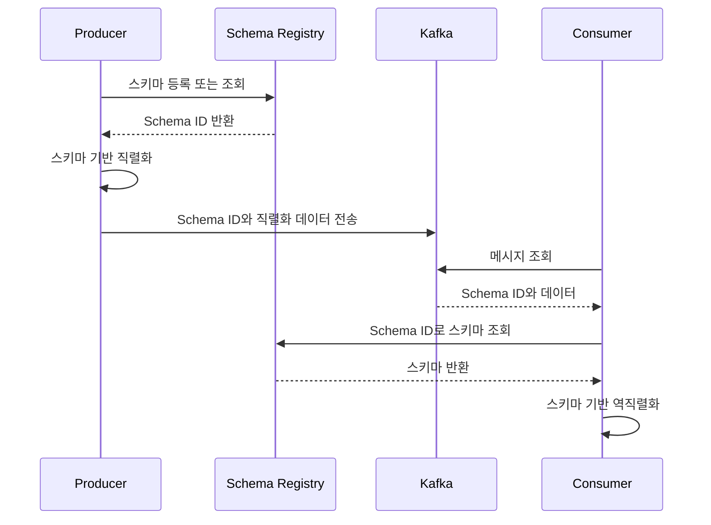

### 1단계: Producer가 스키마를 등록한다

Producer는 사용할 데이터 구조를 Schema Registry에 등록하거나 기존에 등록된 스키마를 조회한다.

### 2단계: Schema ID를 확인한다

Schema Registry는 등록된 스키마를 식별할 수 있는 ID를 제공한다.

### 3단계: Producer가 데이터를 직렬화한다

Producer는 Avro 등의 직렬화 형식을 이용하여 데이터를 Byte Array로 변환한다.

### 4단계: Kafka에 메시지를 전송한다

Confluent의 일반적인 직렬화 형식에서는 스키마 식별 정보와 직렬화된 데이터를 함께 전송한다.

### 5단계: Consumer가 메시지를 읽는다

Consumer는 Kafka에서 Record를 가져온다.

### 6단계: Consumer가 스키마를 조회한다

Consumer는 Schema ID를 이용하여 필요한 스키마를 확인한다.

### 7단계: 역직렬화한다

Consumer는 스키마를 이용하여 데이터를 애플리케이션 객체로 복원한다.

여기서 중요한 점은 **Producer와 Consumer가 매번 Schema Registry에 네트워크 요청을 보내야 하는 것은 아니라는 사실**이다.

일반적으로 Serializer와 Deserializer는 스키마 정보를 캐시할 수 있다.

따라서 같은 스키마를 사용하는 메시지에 대해 Registry 요청을 반복하지 않아도 되는 경우가 많다.

---

## Schema Registry는 Kafka에 스키마를 어떻게 저장할까?

Confluent Schema Registry는 스키마 메타데이터를 저장하기 위해 Kafka의 내부 저장용 Topic을 활용할 수 있다.

일반적으로 다음 Topic을 사용한다.

```text
_schemas
```

여기서 두 종류의 데이터를 구분해야 한다.

**첫 번째는 실제 업무 이벤트다.**

예를 들어 다음 Topic에 저장된다.

```text
commerce.orders.created.v1
```

**두 번째는 스키마 메타데이터다.**

Confluent Schema Registry는 등록된 스키마와 관련된 정보를 별도의 저장 구조로 관리한다.

따라서 Schema Registry가 Kafka에 스키마를 저장한다고 해서 모든 업무 메시지에 전체 Avro 스키마가 복사되어 저장되는 것은 아니다.

또한 Kafka Broker는 Schema Registry를 설치했다는 이유만으로 모든 Record의 업무 필드를 자동 검증하지 않는다.

스키마 기반 검증을 활용하려면 적절한 Serializer와 스키마 등록 정책을 구성해야 한다.

---

## Schema ID와 Schema Version의 차이

Schema Registry에서는 Schema ID와 Version을 구분해야 한다.

### Schema ID

등록된 스키마를 식별하는 값이다.

### Schema Version

특정 Subject 안에서 스키마가 변경된 이력을 나타내는 버전이다.

여기서 Subject는 Schema Registry가 스키마를 관리하는 논리적인 단위다.

대표적인 Subject 명명 방식은 다음과 같다.

```text
<topic-name>-key

<topic-name>-value
```

예를 들어 다음 Topic이 존재한다고 가정해 보자.

```text
commerce.orders.created.v1
```

Value에 대한 Subject는 다음과 같이 구성할 수 있다.

```text
commerce.orders.created.v1-value
```

이는 Confluent의 기본적인 TopicNameStrategy를 사용하는 경우의 예시다.

다른 Subject 명명 전략도 사용할 수 있다.

### Schema ID와 Version 비교

| 항목 | Schema ID | Schema Version |
|---|---|---|
| 목적 | 스키마 식별 | 변경 이력 관리 |
| 관리 관점 | 등록된 스키마 | Subject별 버전 |
| 활용 | 메시지 역직렬화 | 호환성 검사와 진화 관리 |
| 주의사항 | 버전 번호와 동일하지 않음 | 같은 ID 개념으로 취급하면 안 됨 |

Confluent의 전통적인 Wire Format은 다음과 같은 형태를 가진다.

```text
Magic Byte
    +
Schema ID
    +
Serialized Payload
```

일반적인 Schema ID 기반 형식에서는 다음과 같이 구성된다.

```text
1 Byte  → Magic Byte

4 Bytes → Schema ID

이후     → 직렬화된 데이터
```

다만 Confluent Platform의 최신 버전에서는 스키마 식별 정보를 Header로 전달하는 방식도 지원하므로 모든 배포 환경에서 동일한 Wire Format만 사용된다고 단정해서는 안 된다.

---

## Avro를 이용한 스키마 정의

Schema Registry와 함께 사용되는 대표적인 데이터 형식은 Apache Avro다.

Avro는 스키마를 이용하여 데이터를 직렬화하는 이진 데이터 형식이다.

### 주문 이벤트 스키마 V1

다음과 같은 스키마를 정의해 보자.

```json
{
  "type": "record",
  "name": "OrderCreated",
  "namespace": "com.example.events",
  "fields": [
    {
      "name": "orderId",
      "type": "string"
    },
    {
      "name": "amount",
      "type": "long"
    }
  ]
}
```

이 스키마는 다음 두 필드를 정의한다.

| 필드 | 타입 |
|---|---|
| orderId | string |
| amount | long |

예를 들어 다음과 같은 데이터를 표현할 수 있다.

```json
{
  "orderId": "order-1001",
  "amount": 45000
}
```

이후 새로운 요구사항이 발생했다고 가정해 보자.

주문 정보에 배송 지역을 추가해야 한다.

### 주문 이벤트 스키마 V2

```json
{
  "type": "record",
  "name": "OrderCreated",
  "namespace": "com.example.events",
  "fields": [
    {
      "name": "orderId",
      "type": "string"
    },
    {
      "name": "amount",
      "type": "long"
    },
    {
      "name": "regionId",
      "type": [
        "null",
        "string"
      ],
      "default": null
    }
  ]
}
```

새로운 필드가 추가되었다.

```json
{
  "name": "regionId",
  "type": ["null", "string"],
  "default": null
}
```

여기서 중요한 부분은 `default`다.

이전 버전의 메시지에는 `regionId`가 존재하지 않는다.

새로운 Reader가 과거 메시지를 읽을 때 기본값을 활용할 수 있도록 정의한 것이다.

### nullable과 default는 다르다

다음 설정을 살펴보자.

```json
{
  "name": "regionId",
  "type": ["null", "string"]
}
```

이 설정은 `null`을 허용한다.

하지만 과거 데이터에 해당 필드가 존재하지 않을 때 사용할 기본값까지 정의한 것은 아니다.

반면 다음 설정은 기본값을 명시한다.

```json
{
  "name": "regionId",
  "type": ["null", "string"],
  "default": null
}
```

**null 값을 허용하는 것과 존재하지 않는 필드를 어떻게 해석할 것인지는 서로 다른 문제다.**

이 차이를 이해하면 스키마 변경 과정에서 발생하는 호환성 문제를 줄일 수 있다.

---

## Schema Compatibility란?

Schema Compatibility는 서로 다른 버전의 스키마가 호환되는지를 판단하는 규칙이다.

Schema Registry에서는 대표적으로 다음과 같은 호환성 모드를 제공한다.

- BACKWARD
- FORWARD
- FULL
- BACKWARD_TRANSITIVE
- FORWARD_TRANSITIVE
- FULL_TRANSITIVE
- NONE

각 모드는 스키마 변경을 허용하는 범위가 다르다.

---

## BACKWARD Compatibility

BACKWARD는 **새로운 스키마를 사용하는 Consumer가 이전 스키마로 작성된 데이터를 읽을 수 있는지** 확인하는 방식이다.

예를 들어 다음과 같은 구조다.

```text
Producer V1
    ↓
Schema V1
    ↓
Kafka Topic
    ↓
Consumer V2
    ↓
Schema V2
```

새로운 Consumer가 과거 이벤트를 정상적으로 읽을 수 있어야 한다.

### BACKWARD가 중요한 이유

Kafka에는 과거에 기록된 데이터가 남아 있을 수 있다.

새로운 Consumer를 배포한 이후에도 이전 버전의 Producer가 발행한 메시지를 읽을 수 있어야 한다.

또한 장애 복구나 Offset Reset을 통해 오래된 이벤트를 다시 처리할 수도 있다.

따라서 새로운 Consumer가 과거 데이터를 읽을 수 있는지 확인하는 것이 중요하다.

### 일반적인 배포 전략

BACKWARD 호환성을 만족한다면 Consumer를 먼저 배포하는 전략을 검토할 수 있다.

```text
기존 Producer V1
기존 Consumer V1
        ↓
Consumer V2 배포
        ↓
Producer V2 배포
```

다만 실제 배포 순서는 데이터 형식과 변경 내용에 따라 달라질 수 있으므로 호환성 검사를 통과했다는 사실만으로 모든 업무 처리가 안전하다고 판단해서는 안 된다.

---

## FORWARD Compatibility

FORWARD는 **이전 스키마를 사용하는 Consumer가 새로운 스키마로 작성된 데이터를 읽을 수 있는지** 확인하는 방식이다.

```text
Producer V2
    ↓
Schema V2
    ↓
Kafka Topic
    ↓
Consumer V1
    ↓
Schema V1
```

새로운 Producer가 메시지를 발행하더라도 기존 Consumer가 정상적으로 처리할 수 있어야 한다.

### FORWARD가 필요한 상황

Producer를 먼저 배포해야 하는 환경을 생각해 볼 수 있다.

예를 들어 주문 서비스가 새로운 이벤트 필드를 추가했지만 여러 Consumer를 동시에 배포하기 어렵다면 기존 Consumer가 새 메시지를 처리할 수 있어야 한다.

이러한 상황에서 FORWARD 호환성이 중요하다.

---

## FULL Compatibility

FULL은 BACKWARD와 FORWARD를 모두 만족하는 방식이다.

즉, 다음 두 방향의 호환성을 확인한다.

```text
Producer V1 → Consumer V2

Producer V2 → Consumer V1
```

FULL Compatibility는 Producer와 Consumer가 서로 다른 시점에 배포되는 환경에서 유용할 수 있다.

하지만 모든 스키마 변경을 허용하는 것은 아니다.

호환성이 필요한 범위가 넓어질수록 사용할 수 있는 스키마 변경 방식도 제한될 수 있다.

---

## TRANSITIVE Compatibility

일반적인 BACKWARD와 FORWARD, FULL은 기본적으로 직전 버전과의 호환성을 검사한다.

반면 `_TRANSITIVE`가 붙으면 모든 이전 버전을 대상으로 호환성을 확인한다.

예를 들어 다음과 같은 스키마 변경 이력이 있다고 가정해 보자.

```text
Schema V1

Schema V2

Schema V3

Schema V4
```

### BACKWARD

V4를 등록할 때 주로 V3와의 호환성을 검사한다.

### BACKWARD_TRANSITIVE

V4를 등록할 때 V1, V2, V3와의 호환성을 확인한다.

### 호환성 비교

| 모드 | 호환성 방향 | 주요 비교 범위 |
|---|---|---|
| BACKWARD | 새로운 Reader → 이전 Writer | 직전 버전 |
| FORWARD | 이전 Reader → 새로운 Writer | 직전 버전 |
| FULL | 양방향 | 직전 버전 |
| BACKWARD_TRANSITIVE | 새로운 Reader → 모든 이전 Writer | 전체 이전 버전 |
| FORWARD_TRANSITIVE | 모든 이전 Reader → 새로운 Writer | 전체 이전 버전 |
| FULL_TRANSITIVE | 양방향 | 전체 이전 버전 |
| NONE | 호환성 검사 비활성화 | 검사하지 않음 |

Confluent Schema Registry의 기본 호환성 모드는 일반적으로 `BACKWARD`이며, `BACKWARD_TRANSITIVE`와는 다르다.

### 실무에서는 어떤 모드를 선택해야 할까?

Kafka Topic에 이벤트를 오래 보관하고 이전 데이터를 다시 처리해야 하는 경우에는 모든 이전 스키마와의 호환성이 중요할 수 있다.

반면 최근 버전만 처리하는 시스템에서는 직전 버전과의 호환성만 관리하는 방식도 검토할 수 있다.

중요한 것은 스키마 변경 주기와 데이터 보존 기간, Consumer의 배포 방식을 함께 고려하는 것이다.

---

## Schema Registry REST API 활용

Schema Registry는 REST API를 통해 스키마와 호환성 설정을 관리할 수 있다.

다음 예제는 Schema Registry가 `localhost:8081`에서 실행되고 있다고 가정한다.

### 등록된 Subject 조회

```bash
curl http://localhost:8081/subjects
```

이 명령어는 Registry에 등록된 Subject 목록을 조회한다.

예를 들어 다음과 같은 결과가 반환될 수 있다.

```json
[
  "commerce.orders.created.v1-value",
  "commerce.payments.completed.v1-value"
]
```

이는 결과 형식을 설명하기 위한 예시다.

### 특정 Subject의 버전 조회

```bash
curl http://localhost:8081/subjects/commerce.orders.created.v1-value/versions
```

다음과 같은 버전 목록을 확인할 수 있다.

```json
[
  1,
  2,
  3
]
```

### 최신 스키마 조회

```bash
curl http://localhost:8081/subjects/commerce.orders.created.v1-value/versions/latest
```

Subject의 최신 스키마 정보를 조회한다.

### 호환성 설정 조회

```bash
curl http://localhost:8081/config/commerce.orders.created.v1-value
```

### 호환성 설정 변경

```bash
curl -X PUT \
  http://localhost:8081/config/commerce.orders.created.v1-value \
  -H "Content-Type: application/vnd.schemaregistry.v1+json" \
  -d '{"compatibility":"BACKWARD_TRANSITIVE"}'
```

이 명령어는 해당 Subject의 호환성 모드를 `BACKWARD_TRANSITIVE`로 설정한다.

운영 환경에서는 이러한 설정 변경이 기존 Producer와 Consumer의 배포에 영향을 줄 수 있으므로 변경 전에 검토해야 한다.

---

## Schema Registry의 라이선스 이해하기

Schema Registry를 도입할 때 라이선스를 고려해야 한다.

여기서 Apache Kafka와 Confluent의 제품을 구분해야 한다.

Apache Kafka 자체는 Apache License 2.0을 기반으로 제공된다.

반면 Confluent Schema Registry의 기본 기능은 Confluent Community License와 관련된 조건을 가진다.

특히 **Confluent Community License를 비상업적 목적으로만 사용할 수 있는 라이선스라고 이해하면 부정확하다.**

이 라이선스는 일반적인 상업적 이용 자체를 일괄적으로 금지하는 방식이 아니다.

대표적으로 Confluent의 관련 서비스와 경쟁하는 형태의 SaaS 제공에 제한을 둔다.

또한 유료 확장 기능이나 다른 라이선스로 제공되는 구성 요소는 별도의 조건을 가질 수 있다.

따라서 도입할 때는 사용하는 제품과 버전, 배포 방식, 제공하려는 서비스의 형태를 함께 확인해야 한다.

---

## Kafka Connect란?

### Kafka Connect의 개념

Kafka Connect는 Kafka와 외부 시스템 사이에서 데이터를 이동하기 위한 프레임워크다.

외부 시스템은 다음과 같은 것들이 될 수 있다.

- MySQL
- PostgreSQL
- MongoDB
- Elasticsearch
- Amazon S3
- HDFS
- 파일 시스템
- 데이터 웨어하우스
- 다양한 SaaS 및 메시징 시스템

Kafka Connect를 사용하는 이유는 외부 시스템 연동을 위해 매번 별도의 Producer나 Consumer 애플리케이션을 개발하는 비용을 줄이기 위해서다.

### Kafka Connect를 사용하지 않는 경우

예를 들어 MySQL의 주문 데이터를 Kafka로 전송해야 한다고 가정해 보자.

직접 개발한다면 다음 작업이 필요할 수 있다.

1. MySQL 연결
2. 데이터 조회
3. 변경된 데이터 식별
4. Kafka Producer 실행
5. 데이터 전송
6. 실패 시 재시도
7. 마지막 처리 위치 저장
8. 장애 복구
9. 모니터링

연동 대상이 증가할 때마다 비슷한 기능을 반복 구현해야 한다.

Kafka Connect는 이러한 반복적인 데이터 이동 작업을 공통 프레임워크로 처리할 수 있도록 지원한다.

---

## Kafka Connect의 전체 구조

Kafka Connect는 데이터가 이동하는 방향에 따라 두 종류의 Connector를 구분한다.

**Source Connector**

외부 시스템에서 데이터를 가져와 Kafka에 기록한다.

**Sink Connector**

Kafka에 저장된 데이터를 외부 시스템으로 전달한다.

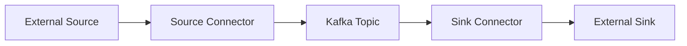

예를 들어 다음과 같은 데이터 파이프라인을 구성할 수 있다.

```text
PostgreSQL
    ↓
Source Connector
    ↓
Kafka
    ↓
Sink Connector
    ↓
Elasticsearch
```

### Source Connector의 역할

Source Connector는 외부 시스템의 데이터를 읽어 Kafka로 전달한다.

예를 들어 다음과 같은 작업을 수행할 수 있다.

- 데이터베이스 변경 데이터 수집
- 파일 읽기
- 외부 API 데이터 수집
- 로그 데이터 수집

### Sink Connector의 역할

Sink Connector는 Kafka에서 메시지를 읽어 외부 시스템에 전달한다.

예를 들어 다음과 같은 작업을 수행할 수 있다.

- Elasticsearch 인덱스 갱신
- 데이터 웨어하우스 적재
- Object Storage 저장
- 다른 데이터베이스 반영

다만 Kafka Connect를 설치하면 모든 외부 시스템용 Connector가 자동으로 제공되는 것은 아니다.

연동할 시스템에 맞는 플러그인과 드라이버를 별도로 설치해야 할 수 있다.

또한 Connector별 라이선스와 지원 버전을 확인해야 한다.

---

## CDC(Change Data Capture)와 Kafka Connect

Kafka Connect의 대표적인 활용 사례 중 하나는 CDC다.

CDC는 데이터베이스에서 발생한 변경 사항을 수집하는 기술이다.

예를 들어 다음 SQL이 실행되었다고 가정해 보자.

```sql
UPDATE orders
SET status = 'PAID'
WHERE order_id = 'order-1001';
```

CDC 시스템은 이러한 데이터 변경을 감지하여 이벤트로 전달할 수 있다.

### CDC 아키텍처

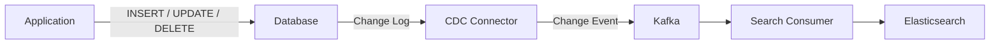

MySQL이나 PostgreSQL에서는 Debezium과 같은 CDC Connector를 활용하는 구성을 검토할 수 있다.

MongoDB에서는 Change Streams를 활용하는 Source Connector를 사용할 수 있다.

### CDC와 일반적인 JDBC Source는 다르다

여기서 주의할 점이 있다.

JDBC Source Connector를 사용한다고 무조건 데이터베이스의 모든 변경 이력을 수집하는 것은 아니다.

일반적인 JDBC Source는 증가하는 ID나 Timestamp 등을 기준으로 주기적으로 데이터를 조회하는 방식으로 동작할 수 있다.

반면 로그 기반 CDC는 데이터베이스의 변경 로그를 활용한다.

이러한 차이로 인해 삭제 이벤트 처리나 중간 변경 이력, 데이터베이스 부하 측면에서 동작이 달라질 수 있다.

따라서 단순히 Kafka Connect를 사용한다는 이유만으로 CDC의 모든 요구사항을 충족한다고 판단해서는 안 된다.

---

## MongoDB와 Elasticsearch 연동에 Kafka Connect 활용하기

MongoDB에 저장된 데이터를 Elasticsearch에서 검색하도록 구성하는 상황을 생각해 보자.

MongoDB는 업무 데이터를 저장한다.

Elasticsearch는 검색에 최적화된 인덱스를 관리한다.

두 시스템 사이의 데이터를 동기화할 필요가 있다.

Kafka Connect를 활용하면 다음과 같은 구조를 구성할 수 있다.

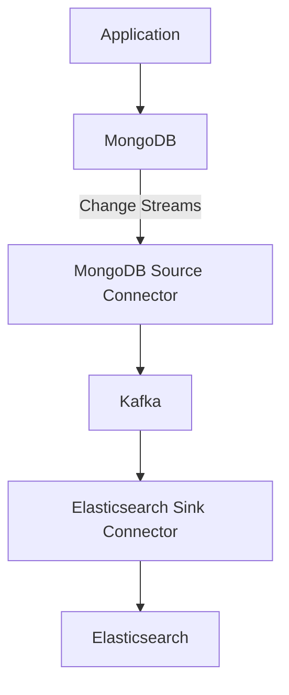

### MongoDB에서 데이터 변경

```javascript
db.products.updateOne(
  {
    _id: "product-1001"
  },
  {
    $set: {
      price: 45000
    }
  }
);
```

### 변경 이벤트 수집

MongoDB Source Connector는 적절한 설정을 통해 변경 데이터를 수집하고 Kafka에 기록할 수 있다.

### Elasticsearch 반영

Elasticsearch Sink Connector는 Kafka의 데이터를 읽어 검색 인덱스를 갱신한다.

이렇게 하면 업무 데이터베이스와 검색 시스템을 비동기적으로 연결할 수 있다.

### Monstache와의 차이

MongoDB와 Elasticsearch를 연결할 때는 Monstache와 같은 직접 연동 도구를 사용할 수도 있다.

두 방식은 목적이 일부 겹치지만 구조가 다르다.

| 구분 | Monstache 기반 연동 | Kafka Connect 기반 연동 |
|---|---|---|
| 기본 구조 | MongoDB → Elasticsearch | MongoDB → Kafka → Elasticsearch |
| Kafka 필요 여부 | 필수 아님 | 필요 |
| 주요 목적 | MongoDB와 Elasticsearch 동기화 | 범용 데이터 파이프라인 구축 |
| 데이터 재사용 | 연동 목적 중심 | 여러 Consumer가 동일 이벤트 활용 가능 |
| 운영 구성 | 비교적 단순할 수 있음 | Kafka와 Connect 운영 필요 |
| 확장 방향 | 검색 동기화 중심 | 검색, 분석, 알림 등 다양한 소비자 확장 |

검색 동기화만 필요한 경우에는 직접 연동이 더 단순할 수 있다.

반면 동일한 MongoDB 변경 이벤트를 검색과 분석, 알림 등 여러 시스템에서 활용해야 한다면 Kafka를 중간에 두는 구조가 유리할 수 있다.

다만 Kafka Connect를 도입한다고 자동으로 모든 데이터 정합성 문제가 해결되는 것은 아니다.

삭제 이벤트 처리와 초기 데이터 적재, 중복 반영, 이벤트 순서 등을 함께 설계해야 한다.

---

## Kafka Connect의 내부 구성 요소

Kafka Connect를 이해하려면 세 가지 개념을 구분해야 한다.

1. Connector
2. Task
3. Worker

각 구성 요소는 서로 다른 역할을 수행한다.

### Connector

Connector는 데이터 이동에 필요한 작업과 설정을 관리한다.

예를 들어 PostgreSQL의 주문 테이블을 Kafka로 전송하도록 설정할 수 있다.

Connector는 실제 작업을 여러 Task로 나눌 수 있다.

### Task

Task는 실제 데이터 읽기와 쓰기 작업을 수행한다.

Source Task는 외부 시스템에서 데이터를 읽는다.

Sink Task는 Kafka에서 데이터를 읽어 외부 시스템에 기록한다.

### Worker

Worker는 Connector와 Task를 실행하는 프로세스다.

Kafka Connect는 하나 이상의 Worker를 이용하여 작업을 실행할 수 있다.

---

## Connector, Task, Worker의 관계

다음과 같은 Source Connector가 있다고 가정해 보자.

```text
Connector A
```

이 Connector가 두 개의 Task를 생성한다.

```text
Task A1

Task A2
```

Worker가 세 개 존재한다면 Task를 다음과 같이 분산할 수 있다.

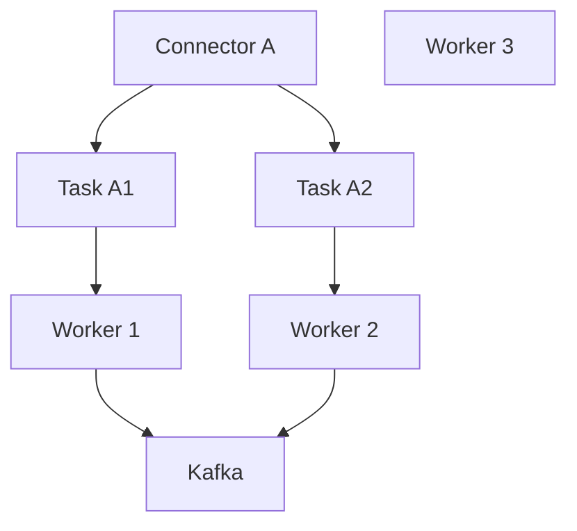

Worker 3은 현재 해당 Connector의 Task를 할당받지 않을 수도 있다.

또한 실제 배치는 다른 Connector와 Task의 존재 여부에 따라 달라질 수 있다.

### tasks.max란?

`tasks.max`는 Connector가 생성할 수 있는 Task 수의 상한을 지정하는 설정이다.

예를 들어 다음과 같다.

```properties
tasks.max=4
```

이 설정은 최대 네 개의 Task를 사용할 수 있다는 의미다.

**반드시 네 개의 Task가 생성된다는 의미는 아니다.**

Connector 자체가 병렬 처리를 지원하지 않거나 원본 시스템의 작업을 네 개로 분리할 수 없다면 실제 Task 수는 더 적을 수 있다.

### Task와 Kafka Partition은 같은 개념일까?

아니다.

Source Connector가 관리하는 작업 단위와 Kafka Topic의 Partition은 서로 다른 개념이다.

예를 들어 외부 시스템의 데이터가 네 구간으로 나뉘어 있다고 가정해 보자.

```text
Source Partition 1

Source Partition 2

Source Partition 3

Source Partition 4
```

두 개의 Task가 이를 처리할 수 있다.

```text
Task 1 → Source Partition 1, 2

Task 2 → Source Partition 3, 4
```

그 결과는 여러 Kafka Topic이나 Partition에 기록될 수 있다.

따라서 Source의 분할 단위와 Kafka Topic Partition을 동일한 것으로 이해해서는 안 된다.

---

## Worker를 늘리면 처리량도 증가할까?

반드시 그렇지는 않다.

예를 들어 다음과 같은 상황이다.

```text
Worker 수: 2

Task 수: 4
```

Worker를 여덟 개로 늘렸다고 가정해 보자.

```text
Worker 수: 8

Task 수: 4
```

실제로 실행되는 Task가 네 개라면 Worker를 추가해도 동시에 수행할 작업 수가 증가하지 않는다.

### Worker와 Task의 관계

| 변경 | 기대 효과 | 해결하지 못하는 문제 |
|---|---|---|
| Worker 증가 | Task 실행 자원 확대 | Task 수가 고정된 경우 병렬성 증가 없음 |
| tasks.max 증가 | Task 생성 상한 증가 | Connector가 지원하지 않으면 효과 없음 |
| Source 분할 확대 | Source 병렬 처리 가능성 증가 | 원본 시스템 자체의 처리 한계 |
| Kafka Partition 증가 | Sink 병렬 소비 가능성 증가 | Sink 저장소의 쓰기 성능 한계 |

따라서 Kafka Connect의 처리량이 부족하다면 다음 요소를 순서대로 확인하는 것이 좋다.

- Connector가 생성한 실제 Task 수
- Task별 처리량
- Worker의 CPU와 메모리
- Source 시스템의 읽기 성능
- Kafka Topic Partition 수
- Sink 시스템의 쓰기 성능

Kafka Connect는 Worker를 추가하는 것만으로 모든 연동 성능이 자동으로 향상되는 구조가 아니다.

---

## Kafka Connect의 실행 모드

Kafka Connect는 대표적으로 두 가지 실행 모드를 제공한다.

### Standalone Mode

Standalone Mode는 하나의 Worker 프로세스에서 Connector를 실행하는 방식이다.

구성이 단순하다.

따라서 개발 환경이나 제한적인 데이터 이동 작업에 활용할 수 있다.

다만 Worker가 종료되면 해당 Worker에서 실행 중이던 작업도 중단된다.

### Distributed Mode

Distributed Mode는 여러 Worker를 하나의 Connect Cluster로 구성하는 방식이다.

Connector와 Task를 여러 Worker에 분산 배치할 수 있다.

특정 Worker에 장애가 발생하면 다른 Worker로 Task를 재할당할 수 있다.

### 두 실행 모드 비교

| 항목 | Standalone | Distributed |
|---|---|---|
| Worker 수 | 단일 프로세스 | 여러 프로세스 |
| 구성 복잡성 | 낮음 | 상대적으로 높음 |
| 작업 분산 | 제한적 | 지원 |
| 장애 복구 | Worker 장애에 취약 | Task 재할당 가능 |
| 설정 관리 | 로컬 설정 중심 | Kafka 내부 Topic 활용 |
| 주요 활용 | 개발, 제한적인 작업 | 운영 환경 |

Distributed Mode에서는 Connector의 설정과 상태, Offset 정보를 Kafka 내부 Topic에 저장한다.

대표적인 설정은 다음과 같다.

```properties
config.storage.topic=connect-configs

offset.storage.topic=connect-offsets

status.storage.topic=connect-status
```

각 Topic은 서로 다른 역할을 가진다.

| 내부 Topic | 저장 내용 |
|---|---|
| config.storage.topic | Connector와 Task 설정 |
| offset.storage.topic | Source Connector의 처리 위치 |
| status.storage.topic | Connector와 Task 상태 |

이러한 상태 정보를 이용하여 Worker 장애 이후 작업을 복구할 수 있다.

---

## Kafka Connect REST API 활용

Kafka Connect Distributed Mode에서는 REST API를 통해 Connector를 등록하고 관리할 수 있다.

다음 예제는 Connect Worker가 `localhost:8083`에서 실행 중이라고 가정한다.

### Connector 목록 조회

```bash
curl http://localhost:8083/connectors
```

현재 등록된 Connector 목록을 확인한다.

### Connector 상태 조회

```bash
curl http://localhost:8083/connectors/example-source/status
```

다음과 같은 정보를 확인할 수 있다.

- Connector의 실행 상태
- Worker ID
- Task 목록
- 각 Task의 실행 상태
- 실패한 Task의 오류 정보

### Connector 재시작

```bash
curl -X POST \
  http://localhost:8083/connectors/example-source/restart
```

Connector 재시작을 요청한다.

실제 운영에서는 Connector 자체가 실행 중인지뿐 아니라 Task가 정상적으로 데이터를 처리하고 있는지도 확인해야 한다.

예를 들어 Connector 상태는 `RUNNING`이지만 일부 Task는 `FAILED` 상태일 수 있다.

따라서 Connector와 Task의 상태를 모두 모니터링해야 한다.

---

## Kafka Connect의 장애 복구와 중복 처리

Kafka Connect는 데이터 이동의 반복적인 개발 작업을 줄여 준다.

하지만 외부 시스템과 관련된 모든 장애를 자동으로 해결하는 것은 아니다.

예를 들어 Elasticsearch Sink Connector를 생각해 보자.

**1단계**

Kafka에서 상품 변경 이벤트를 읽는다.

**2단계**

Elasticsearch에 상품 정보를 저장한다.

**3단계**

Elasticsearch 저장이 성공한다.

**4단계**

Kafka Offset을 확정하기 전에 Sink Task가 종료된다.

**5단계**

Task가 복구되면서 동일한 이벤트를 다시 읽는다.

이 경우 같은 이벤트가 Elasticsearch에 다시 반영될 수 있다.

### 중복 문서가 발생하는 경우

매번 새로운 문서 ID를 생성한다면 동일한 상품이 여러 문서로 저장될 수 있다.

```text
Document ID: random-1001

Document ID: random-1002
```

### 업무 ID를 문서 ID로 사용하는 경우

반면 상품 ID를 문서 ID로 사용하면 같은 상품에 대한 변경을 동일한 문서에 반영하도록 설계할 수 있다.

```text
Document ID: product-1001
```

이 방식은 중복 문서 생성을 줄이는 데 도움이 된다.

하지만 오래된 이벤트가 새로운 이벤트보다 늦게 처리되는 상황까지 자동으로 해결하지는 않는다.

따라서 이벤트 버전이나 Timestamp, 순서 조건 등을 함께 고려해야 한다.

**Kafka Connect는 데이터 이동을 표준화하는 프레임워크이지 외부 시스템 전체의 무중복 처리를 보장하는 도구는 아니다.**

---

## Kafka Streams란?

### Kafka Streams의 개념

Kafka Streams는 Kafka에 저장된 데이터를 처리하고 분석하기 위한 Java 기반 스트림 처리 라이브러리다.

Kafka Streams를 이용하면 Kafka Topic에 저장된 이벤트를 읽어 다음과 같은 작업을 수행할 수 있다.

- Filtering
- Mapping
- Aggregation
- Grouping
- Joining
- Window Processing
- Stateful Processing

Kafka Streams는 별도의 독립적인 처리 서버를 반드시 설치해야 하는 구조가 아니다.

Java 애플리케이션에 라이브러리를 포함하여 실행할 수 있다.

예를 들어 Spring Boot 애플리케이션과 함께 Kafka Streams를 사용할 수도 있다.

---

## Stream Processing과 Batch Processing

Kafka Streams를 이해하려면 먼저 스트림 처리와 배치 처리의 차이를 알아야 한다.

### Stream Processing

Stream Processing은 데이터가 지속적으로 들어오는 상황에서 이벤트를 처리하는 방식이다.

예를 들어 결제 이벤트가 발생할 때마다 이상 거래 여부를 분석한다고 가정해 보자.

```text
Payment Event 발생
    ↓
Kafka Topic
    ↓
Stream Processing
    ↓
Fraud Detection
    ↓
Alert
```

이 구조에서는 이벤트가 도착할 때마다 필요한 처리를 수행한다.

### Batch Processing

Batch Processing은 일정 범위의 데이터를 모아 처리하는 방식이다.

예를 들어 하루 동안 발생한 결제 데이터를 집계하는 작업을 생각할 수 있다.

```text
하루 동안 결제 데이터 저장
    ↓
정해진 시간에 Batch 실행
    ↓
데이터 조회
    ↓
총매출 집계
    ↓
정산 결과 저장
```

### Stream과 Batch 비교

| 항목 | Stream Processing | Batch Processing |
|---|---|---|
| 처리 대상 | 지속적으로 유입되는 이벤트 | 일정 범위에 저장된 데이터 |
| 처리 시점 | 이벤트 도착에 따라 지속 처리 | 지정된 시점 또는 주기 |
| 대표 목적 | 실시간 대응 | 대량 데이터 정산·분석 |
| 주요 사례 | 이상 거래 탐지, 실시간 추천 | 일별 매출, 정산 |
| 상태 관리 | 이전 이벤트 상태가 필요할 수 있음 | 처리 범위의 데이터 조회 |
| 주요 고려사항 | 지연 이벤트, 상태 복구 | 처리 시간, 데이터 범위 |

두 방식은 서로 대체하는 관계만은 아니다.

실제 시스템에서는 실시간 처리와 배치 처리를 함께 사용하는 경우가 많다.

---

## Stream과 Batch를 함께 사용하는 이유

실시간 집계는 빠른 결과를 제공한다.

하지만 이벤트 유실이나 지연, 중복 처리 등의 문제로 집계 결과가 나중에 변경될 수 있다.

반면 배치 처리는 이미 저장된 데이터의 일정 범위를 다시 계산하는 데 유리하다.

예를 들어 결제 시스템에서는 다음과 같이 활용할 수 있다.

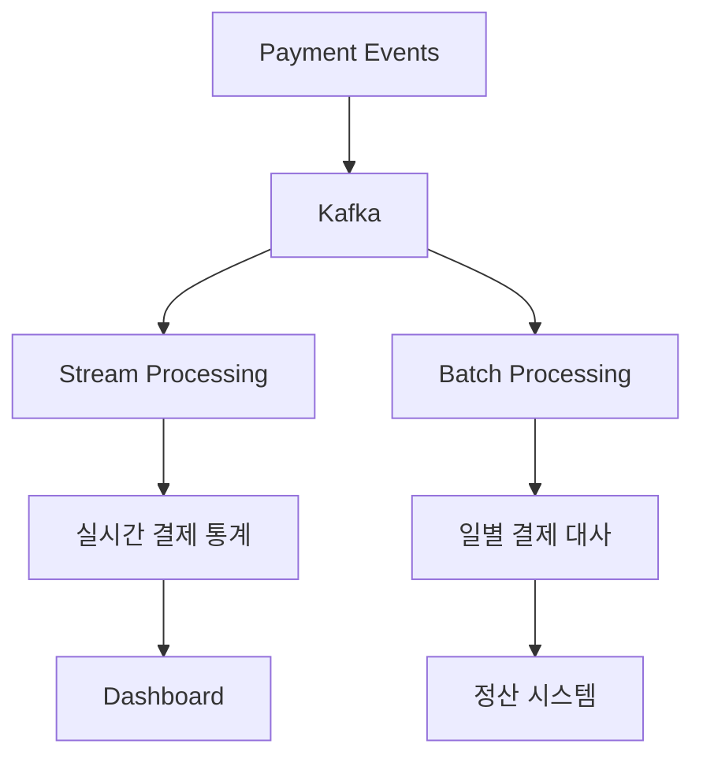

실시간 처리는 사용자에게 빠른 통계를 제공한다.

배치 처리는 일정 기간의 결제 데이터를 다시 검증하거나 정산하는 역할을 수행할 수 있다.

이러한 구조는 실시간성과 정확성을 함께 고려하는 방법 중 하나다.

다만 스트림 처리를 사용한다고 항상 결과가 정확하거나 배치 처리보다 우수하다고 단정할 수는 없다.

정확성은 데이터 보존과 이벤트 시간, 중복 처리, 집계 로직 등에 따라 달라진다.

---

## Stateless Processing이란?

### 무상태 처리의 개념

Stateless Processing은 이전 이벤트의 처리 결과를 저장하지 않고 현재 이벤트만으로 결과를 결정하는 방식이다.

예를 들어 다음과 같은 주문 이벤트가 있다고 가정해 보자.

```json
{
  "orderId": "order-1001",
  "amount": 45000,
  "status": "COMPLETED"
}
```

이 이벤트에서 `status`가 `COMPLETED`인 메시지만 선택한다면 이전 이벤트의 상태가 필요하지 않다.

따라서 Stateless Processing으로 구현할 수 있다.

### 대표적인 Stateless 연산

- filter
- map
- mapValues
- 일부 flatMap 연산

### Stateless Processing 구조

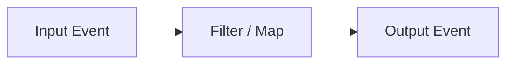

각 이벤트는 독립적으로 처리될 수 있다.

따라서 일반적으로 상태 기반 처리보다 구조가 단순하다.

---

## Stateful Processing이란?

### 상태 기반 처리의 개념

Stateful Processing은 이전 이벤트의 처리 결과를 참조하여 현재 이벤트를 처리하는 방식이다.

예를 들어 사용자의 최근 10분 동안의 상품 조회 횟수를 계산한다고 가정해 보자.

다음과 같은 이벤트가 발생했다.

```text
10:00:00 → user-1001 상품 조회

10:01:00 → user-1001 상품 조회

10:02:00 → user-1001 상품 조회
```

세 번째 이벤트가 들어왔을 때 최근 조회 횟수를 계산하려면 이전 이벤트의 정보가 필요하다.

따라서 상태를 저장해야 한다.

### Stateful Processing 구조

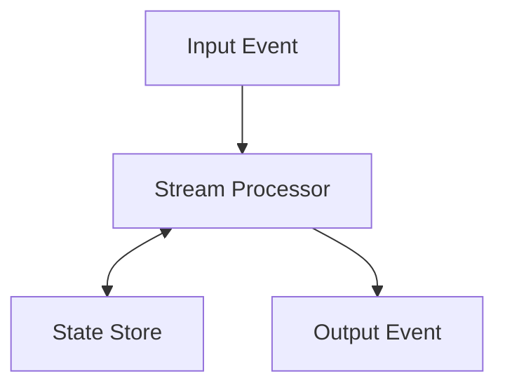

Stream Processor는 State Store에 저장된 기존 상태를 조회한다.

이후 새로운 이벤트를 반영하여 상태를 갱신한다.

### 대표적인 Stateful 연산

- count
- aggregate
- reduce
- windowed aggregation
- join

### 무상태와 상태 기반 처리 비교

| 항목 | Stateless | Stateful |
|---|---|---|
| 이전 이벤트 참조 | 필요하지 않음 | 필요 |
| 상태 저장소 | 일반적으로 필요하지 않음 | 필요 |
| 대표 연산 | filter, map | count, aggregate, join |
| 장애 복구 | 상대적으로 단순 | 상태 복원 필요 |
| 활용 사례 | 이벤트 필터링 | 실시간 집계, 추천, 이상 탐지 |

---

## Kafka Streams의 State Store

Kafka Streams에서는 상태 기반 처리를 위해 State Store를 사용할 수 있다.

State Store는 처리 애플리케이션이 필요한 상태를 저장하는 공간이다.

대표적으로 Key-Value 형태의 상태를 관리할 수 있다.

예를 들어 사용자별 조회 횟수를 저장한다고 가정해 보자.

```text
user-1001 → 3

user-1002 → 5

user-1003 → 1
```

새로운 조회 이벤트가 발생하면 기존 값을 확인하고 갱신할 수 있다.

### State Store의 장애 복구

Kafka Streams는 일반적인 상태 기반 처리에서 Changelog Topic을 이용하여 상태 변경 이력을 기록하고 복구할 수 있다.

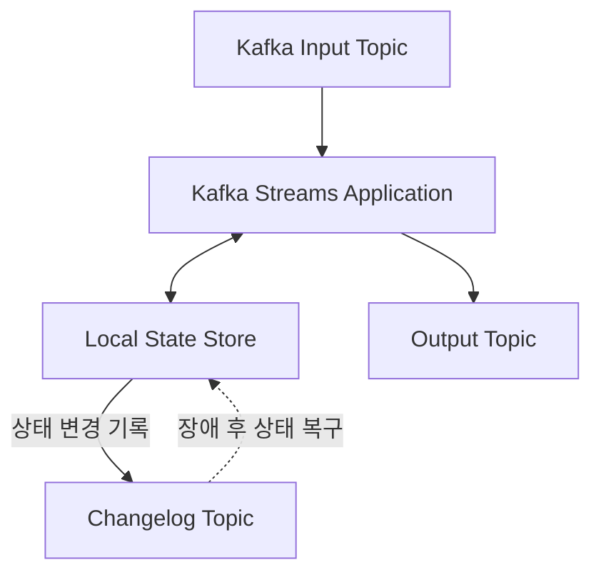

애플리케이션이 종료되더라도 Changelog Topic에 저장된 데이터를 활용하여 상태를 복원할 수 있다.

하지만 State Store의 복구가 언제나 즉시 완료되는 것은 아니다.

복원해야 할 데이터가 많으면 시간이 오래 걸릴 수 있다.

따라서 다음 요소를 함께 고려해야 한다.

- State Store의 크기
- 로컬 디스크 용량
- Changelog Topic의 보존 정책
- 상태 복구 시간
- Stream Task 재할당
- Standby Replica 구성

Kafka Streams의 Task와 상태 저장 및 복구 방식은 Apache Kafka의 공식 아키텍처에서 설명한다.

---

## Kafka Streams의 Processor Topology

Kafka Streams는 데이터 처리 흐름을 Topology로 표현한다.

Topology는 여러 Processor를 연결한 처리 구조다.

대표적인 구성 요소는 다음과 같다.

1. Source Processor
2. Stream Processor
3. Sink Processor

### Source Processor

Source Processor는 Kafka Topic에서 Record를 읽어 다음 Processor에 전달한다.

### Stream Processor

Stream Processor는 Record에 대해 필요한 연산을 수행한다.

예를 들어 데이터를 필터링하거나 변환하고 집계한다.

### Sink Processor

Sink Processor는 처리한 결과를 Kafka Topic에 기록한다.

### Processor Topology 구조

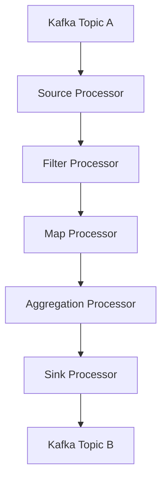

여기서 중요한 점은 모든 Processor가 별도의 Kafka Topic과 일대일로 대응하는 것은 아니라는 사실이다.

Kafka Streams의 여러 연산은 애플리케이션 내부에서 연속적으로 실행될 수 있다.

다만 Repartitioning이나 Changelog 등 일부 작업을 위해 내부 Kafka Topic이 생성될 수 있다.

---

## Kafka Streams의 Stream Thread와 Task

Kafka Streams는 Stream Thread와 Task를 이용하여 데이터를 병렬로 처리한다.

### Task란?

Task는 Kafka Streams에서 입력 Partition을 기반으로 정의되는 처리 작업 단위다.

Task에는 처리할 입력 Partition이 할당된다.

하나의 Task는 여러 Source Topic의 Partition을 함께 처리할 수도 있다.

### Stream Thread란?

Stream Thread는 Task를 실행하는 스레드다.

하나의 Stream Thread가 여러 Task를 실행할 수 있다.

### 전체 구조

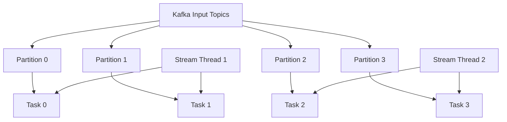

Kafka Streams의 병렬 처리 수준은 입력 Partition과 Topology 구조에 영향을 받는다.

따라서 Stream Thread 수를 늘린다고 무조건 처리량이 증가하는 것은 아니다.

실행할 수 있는 Task의 수와 실제 처리 병목을 함께 고려해야 한다.

---

## Event Time과 Processing Time

실시간 데이터 처리에서는 시간의 의미를 명확하게 구분해야 한다.

대표적으로 Event Time과 Processing Time이 있다.

### Event Time

실제 이벤트가 발생한 시각이다.

예를 들어 사용자가 상품을 조회한 시각을 의미한다.

### Processing Time

스트림 처리 애플리케이션이 이벤트를 처리한 시각이다.

두 시각은 같을 수도 있지만 항상 같지는 않다.

### 예제

다음과 같은 상품 조회 이벤트가 발생했다고 가정해 보자.

| 이벤트 | 실제 발생 시각 | 처리 시각 |
|---|---|---|
| A | 12:00:10 | 12:00:11 |
| B | 12:00:50 | 12:01:05 |
| C | 12:01:02 | 12:01:03 |

이벤트 B는 실제로 12시 00분 50초에 발생했다.

하지만 네트워크 지연으로 인해 12시 01분 05초에 처리되었다.

### Event Time 기준 집계

12시 00분부터 12시 01분 사이에 발생한 이벤트를 집계한다면 A와 B가 포함된다.

### Processing Time 기준 집계

처리 애플리케이션에 도착한 시각을 기준으로 집계한다면 B는 12시 01분 구간에 포함될 수 있다.

따라서 같은 데이터라도 어떤 시간을 기준으로 집계하는지에 따라 결과가 달라진다.

**실시간 분석에서는 처리 속도뿐 아니라 어떤 시간을 기준으로 데이터를 계산하는지가 중요하다.**

---

## Window Processing이란?

Window Processing은 스트림 데이터를 일정한 시간 구간으로 나누어 처리하는 방식이다.

예를 들어 최근 1분 동안 발생한 상품 조회 횟수를 계산할 수 있다.

### Tumbling Window

Tumbling Window는 서로 겹치지 않는 고정된 시간 구간을 사용한다.

예를 들어 30초 Window를 설정하면 다음과 같이 구분된다.

```text
12:00:00 ~ 12:00:30

12:00:30 ~ 12:01:00

12:01:00 ~ 12:01:30
```

각 이벤트는 해당하는 하나의 Window에 속한다.

### Hopping Window

Hopping Window는 일정한 간격으로 이동하는 Window다.

Window의 크기와 이동 간격에 따라 서로 겹칠 수 있다.

예를 들어 다음과 같이 구성할 수 있다.

```text
Window Size: 60초

Advance: 30초
```

```text
12:00:00 ~ 12:01:00

12:00:30 ~ 12:01:30

12:01:00 ~ 12:02:00
```

하나의 이벤트가 여러 Window에 포함될 수 있다.

### Session Window

Session Window는 이벤트 사이의 비활성 시간 등을 기준으로 데이터 묶음을 구분한다.

예를 들어 사용자가 일정 시간 동안 계속 상품을 조회하다가 일정 기간 활동하지 않으면 하나의 Session을 종료하는 방식이다.

### Window 비교

| 종류 | 특징 | 활용 |
|---|---|---|
| Tumbling | 겹치지 않는 고정 구간 | 분당 주문 수 |
| Hopping | 겹칠 수 있는 고정 구간 | 이동 평균, 최근 5분 지표 |
| Session | 비활성 시간 기준 | 사용자 방문 세션 |

---

## Grace Period란?

### Grace Period의 개념

Grace Period는 Window 처리에서 늦게 도착한 이벤트를 얼마나 허용할 것인지 정의하는 기간이다.

예를 들어 다음과 같은 Window가 있다고 가정해 보자.

```text
Window:

12:00:00 ~ 12:01:00
```

이 Window에 속하는 이벤트가 네트워크 지연으로 12시 01분 05초에 도착했다.

처리 시스템은 이미 다음 Window의 이벤트를 처리하고 있을 수 있다.

이때 늦게 도착한 이벤트를 이전 Window에 반영할 것인지 결정해야 한다.

### Grace Period가 필요한 이유

모든 이벤트가 발생한 순서대로 정확하게 도착하는 것은 아니다.

다음과 같은 이유로 이벤트가 늦게 도착할 수 있다.

- 네트워크 지연
- Producer 재시도
- 일시적인 Broker 장애
- Consumer 처리 지연
- 시스템 간 시간 차이

Grace Period는 이러한 지연 이벤트를 처리하기 위한 정책이다.

### Grace Period의 트레이드오프

| 설정 방향 | 장점 | 단점 |
|---|---|---|
| 짧은 Grace Period | 결과를 빠르게 확정 가능 | 늦게 도착한 이벤트 제외 가능 |
| 긴 Grace Period | 지연 이벤트를 더 많이 반영 가능 | 상태 유지 비용 및 결과 확정 지연 증가 |

여기서 Grace Period는 단순히 서버가 설정된 시간만큼 기다렸다가 집계를 종료한다는 의미가 아니다.

Kafka Streams와 ksqlDB는 이벤트 시간의 진행과 Window 종료 조건을 기준으로 늦은 이벤트의 허용 여부를 결정한다.

따라서 실제 운영에서는 Stream Time의 진행과 이벤트 Timestamp를 함께 이해해야 한다.

---

## Java로 Kafka Streams 구현하기

Kafka Streams의 개념을 Java 코드로 살펴보자.

다음 예제는 사용자별 상품 조회 횟수를 30초 단위로 계산한다.

입력 Topic에는 다음과 같은 Record가 들어온다고 가정한다.

```text
Topic: pageviews

Key: user-1001

Value: product-1001
```

동일한 사용자가 여러 상품을 조회하면 조회 횟수를 집계한다.

### Gradle 설정

```groovy
plugins {
    id 'java'
}

repositories {
    mavenCentral()
}

dependencies {
    implementation 'org.apache.kafka:kafka-streams:4.4.0'
}
```

Kafka Streams 4.4.0을 기준으로 작성한 예제다.

### Kafka Streams 코드

```java
import org.apache.kafka.common.serialization.Serdes;

import org.apache.kafka.streams.KafkaStreams;
import org.apache.kafka.streams.KeyValue;
import org.apache.kafka.streams.StreamsBuilder;
import org.apache.kafka.streams.StreamsConfig;
import org.apache.kafka.streams.Topology;

import org.apache.kafka.streams.kstream.Consumed;
import org.apache.kafka.streams.kstream.Grouped;
import org.apache.kafka.streams.kstream.KStream;
import org.apache.kafka.streams.kstream.Materialized;
import org.apache.kafka.streams.kstream.Produced;
import org.apache.kafka.streams.kstream.TimeWindows;

import java.time.Duration;
import java.util.Properties;

public class PageViewCountApplication {

    public static void main(String[] args) {

        Properties properties = new Properties();

        properties.put(
            StreamsConfig.APPLICATION_ID_CONFIG,
            "pageview-count-application"
        );

        properties.put(
            StreamsConfig.BOOTSTRAP_SERVERS_CONFIG,
            "localhost:9092"
        );

        properties.put(
            StreamsConfig.DEFAULT_KEY_SERDE_CLASS_CONFIG,
            Serdes.String().getClass()
        );

        properties.put(
            StreamsConfig.DEFAULT_VALUE_SERDE_CLASS_CONFIG,
            Serdes.String().getClass()
        );

        StreamsBuilder builder = new StreamsBuilder();

        KStream<String, String> pageviews =
            builder.stream(
                "pageviews",
                Consumed.with(
                    Serdes.String(),
                    Serdes.String()
                )
            );

        pageviews
            .filter((userId, productId) ->
                userId != null && productId != null
            )
            .groupByKey(
                Grouped.with(
                    Serdes.String(),
                    Serdes.String()
                )
            )
            .windowedBy(
                TimeWindows.ofSizeAndGrace(
                    Duration.ofSeconds(30),
                    Duration.ofSeconds(10)
                )
            )
            .count(
                Materialized.as("pageview-count-store")
            )
            .toStream()
            .map((windowedUserId, count) ->
                KeyValue.pair(
                    windowedUserId.key()
                        + "@"
                        + windowedUserId.window().startTime(),
                    count.toString()
                )
            )
            .to(
                "pageview-counts",
                Produced.with(
                    Serdes.String(),
                    Serdes.String()
                )
            );

        Topology topology = builder.build();

        KafkaStreams streams =
            new KafkaStreams(
                topology,
                properties
            );

        Runtime.getRuntime().addShutdownHook(
            new Thread(streams::close)
        );

        streams.start();
    }
}
```

### 코드의 동작 과정

**첫 번째는 입력 Topic을 읽는 것이다.**

```java
builder.stream("pageviews", ...);
```

`pageviews` Topic에서 Record를 읽는다.

**두 번째는 유효한 데이터를 필터링하는 것이다.**

```java
.filter((userId, productId) ->
    userId != null && productId != null
)
```

사용자 ID와 상품 ID가 존재하는 Record만 처리한다.

**세 번째는 사용자 ID로 그룹화하는 것이다.**

```java
.groupByKey(...)
```

동일한 사용자 ID를 가진 이벤트를 집계한다.

**네 번째는 Window를 구성하는 것이다.**

```java
.windowedBy(
    TimeWindows.ofSizeAndGrace(
        Duration.ofSeconds(30),
        Duration.ofSeconds(10)
    )
)
```

30초 단위 Window와 10초 Grace Period를 구성한다.

**다섯 번째는 이벤트 수를 계산하는 것이다.**

```java
.count(...)
```

각 사용자와 Window에 해당하는 이벤트 수를 계산한다.

**여섯 번째는 결과 Topic에 기록하는 것이다.**

```java
.to("pageview-counts", ...);
```

집계 결과를 Kafka Topic에 저장한다.

### 실행 결과 예시

동일한 사용자가 같은 Window에서 세 번 상품을 조회했다고 가정해 보자.

```text
user-1001 → product-1001

user-1001 → product-2001

user-1001 → product-3001
```

결과 Topic에는 다음과 같은 집계 변경이 기록될 수 있다.

```text
user-1001@<window-start> → 1

user-1001@<window-start> → 2

user-1001@<window-start> → 3
```

이 결과는 처리 흐름을 설명하기 위한 예시다.

실제 기록 시점과 결과는 입력 Record의 Timestamp, Window 상태, 처리 순서 등에 따라 달라질 수 있다.

또한 이 Java 예제는 Kafka Record의 Timestamp를 기반으로 Window를 처리한다.

Payload 내부에 별도의 업무 발생 시각이 존재한다면 해당 필드를 이용할 수 있도록 Timestamp Extractor를 구성해야 한다.

---

## KSQL과 ksqlDB란?

### KSQL의 등장 배경

Kafka Streams는 Java 애플리케이션에서 스트림 처리를 구현하는 데 유용하다.

하지만 모든 데이터 가공과 집계를 Java 코드로 작성해야 한다면 개발 비용이 증가할 수 있다.

예를 들어 다음과 같은 요구사항이 있다고 가정해 보자.

- 여성 사용자의 상품 조회만 선택한다.
- 사용자 정보를 조회 이벤트와 결합한다.
- 특정 지역의 이벤트만 필터링한다.
- 30초마다 지역별 조회 횟수를 계산한다.
- 결과를 새로운 Kafka Topic에 기록한다.

Kafka Streams에서는 이러한 작업을 Java 코드로 구현할 수 있다.

반면 SQL에 익숙한 개발자라면 SQL과 유사한 문법으로 처리 흐름을 선언하는 방식이 더 편리할 수 있다.

이러한 요구사항을 해결하기 위해 KSQL이 등장했다.

### KSQL과 ksqlDB의 관계

KSQL은 2017년 Confluent가 공개한 스트리밍 SQL 엔진이다.

이후 기능이 발전하면서 ksqlDB라는 이름으로 제공되고 있다.

현재는 ksqlDB라는 이름을 기준으로 이해하는 것이 적절하다.

ksqlDB는 Kafka Streams를 기반으로 동작하는 SQL 중심의 스트림 처리 시스템이다.

단순히 한 번 SQL을 실행하고 끝나는 데이터베이스 질의뿐 아니라 지속적으로 발생하는 이벤트를 처리하는 Query를 구성할 수 있다.

---

## ksqlDB의 전체 아키텍처

ksqlDB는 크게 다음 구성 요소로 이해할 수 있다.

1. ksqlDB Server
2. ksqlDB Engine
3. REST API
4. ksqlDB CLI
5. Kafka Cluster

### ksqlDB Server

SQL 요청을 받아 분석하고 실행한다.

### ksqlDB Engine

SQL을 해석하고 실제 스트림 처리 작업을 구성한다.

### REST API

외부 클라이언트가 SQL을 제출하거나 결과를 조회할 수 있도록 한다.

### ksqlDB CLI

개발자가 SQL을 직접 작성하고 실행할 수 있는 도구다.

### 전체 구조

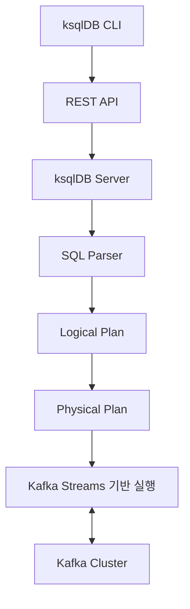

### SQL 실행 과정

ksqlDB에 SQL을 전달하면 다음 과정으로 처리할 수 있다.

```text
SQL 입력
    ↓
SQL Parsing
    ↓
Query 분석
    ↓
Logical Plan 생성
    ↓
Physical Plan 생성
    ↓
Stream Processing 실행
    ↓
Kafka Topic 읽기 및 쓰기
```

이러한 구조를 이용하면 SQL을 통해 Kafka Topic 사이의 데이터 처리 흐름을 구성할 수 있다.

---

## ksqlDB의 Metadata 관리

ksqlDB는 Stream과 Table의 정의, 지속 Query 등의 정보를 관리해야 한다.

이러한 정보는 서버 내부의 상태와 Kafka의 Command Topic 등을 이용하여 관리된다.

대표적으로 다음과 같은 정보가 관리 대상이다.

- Stream 정의
- Table 정의
- 지속 Query
- 데이터 처리 Topology
- Query 설정

ksqlDB의 Command Topic은 서버가 재시작하거나 새로운 서버가 추가될 때 정의를 재구성하는 데 활용될 수 있다.

다만 Command Topic의 정확한 이름은 ksqlDB의 설정에 따라 달라진다.

따라서 이를 항상 `ksql_commands`라는 고정된 Topic으로 이해해서는 안 된다.

ksqlDB는 Kafka Streams 기반의 처리 기능을 활용하며, 상태 저장과 복구에도 관련 Kafka Topic과 로컬 상태를 사용한다.

---

## ksqlDB의 STREAM과 TABLE

ksqlDB에서 중요한 데이터 모델은 STREAM과 TABLE이다.

두 개념은 비슷해 보이지만 데이터를 해석하는 방식이 다르다.

### STREAM

STREAM은 시간에 따라 계속 발생하는 이벤트의 연속을 나타낸다.

예를 들어 사용자의 상품 조회 이벤트가 다음과 같이 발생했다고 가정해 보자.

```text
user-1001 → product-1001

user-1001 → product-2001

user-1001 → product-3001
```

세 이벤트는 각각 독립적인 사실이다.

동일한 사용자가 여러 번 상품을 조회했다는 기록이 유지된다.

### TABLE

TABLE은 Key별 현재 상태를 나타낸다.

예를 들어 사용자 상태 변경 이벤트가 다음과 같이 발생했다고 가정해 보자.

```text
user-1001 → BASIC

user-1001 → PREMIUM

user-1001 → VIP
```

TABLE 관점에서는 동일한 Key에 대해 새로운 값이 이전 상태를 갱신한다.

따라서 현재 상태는 다음과 같이 표현된다.

```text
user-1001 → VIP
```

### STREAM과 TABLE 비교

| 구분 | STREAM | TABLE |
|---|---|---|
| 의미 | 이벤트의 연속 | Key별 현재 상태 |
| 데이터 모델 | Append 중심 | Update 중심 |
| 동일 Key의 새 Record | 새로운 이벤트 | 기존 상태 갱신 |
| 대표 사례 | 클릭, 주문 생성 | 사용자 상태, 상품 정보 |
| 주요 활용 | 이벤트 필터링, 집계 | 현재 상태 조회, Join |

여기서 TABLE이 Kafka 로그에 저장된 과거 Record를 직접 수정하는 것은 아니다.

Kafka 로그에는 변경 이벤트가 기록된다.

TABLE은 이러한 이벤트를 해석하여 현재 상태를 구성한다.

또한 Kafka에서 Value가 `null`인 Tombstone은 특정 Key의 상태를 삭제하는 데 활용할 수 있다.

---

## ksqlDB에서 STREAM 생성하기

이제 실제 SQL을 이용하여 Stream을 정의해 보자.

다음 예제는 사용자별 상품 조회 이벤트를 처리하는 시스템이다.

입력 Kafka Topic은 다음과 같다.

```text
my-pageviews-topic
```

먼저 Stream을 정의한다.

```sql
CREATE STREAM pageviews (
    user_id VARCHAR KEY,
    viewtime BIGINT,
    page_id VARCHAR
) WITH (
    KAFKA_TOPIC = 'my-pageviews-topic',
    PARTITIONS = 1,
    KEY_FORMAT = 'KAFKA',
    VALUE_FORMAT = 'JSON',
    TIMESTAMP = 'viewtime'
);
```

### SQL의 의미

**CREATE STREAM**

새로운 Stream을 정의한다.

**user_id VARCHAR KEY**

Kafka Record의 Key에 저장된 사용자 ID를 사용한다.

**viewtime BIGINT**

조회 이벤트가 발생한 시각을 Unix Epoch Milliseconds 형태로 저장한다.

**page_id VARCHAR**

조회한 상품 또는 콘텐츠의 식별자다.

**KAFKA_TOPIC**

연결할 실제 Kafka Topic을 지정한다.

**PARTITIONS**

새로운 Topic을 생성해야 하는 경우 Partition 수를 지정한다.

**KEY_FORMAT**

Kafka Record Key의 직렬화 형식을 지정한다.

**VALUE_FORMAT**

Kafka Record Value의 직렬화 형식을 지정한다.

**TIMESTAMP**

Window나 시간 기반 처리에서 사용할 이벤트 Timestamp 컬럼을 지정한다.

### JSON과 Kafka Key의 차이

다음과 같은 Record가 있다고 가정해 보자.

**Kafka Key**

```text
u1
```

**Kafka Value**

```json
{
  "viewtime": 1760000010000,
  "page_id": "product-1001"
}
```

`user_id`는 Kafka Key다.

따라서 JSON Value 내부에 반드시 `user_id`를 중복 저장해야 하는 것은 아니다.

이는 Stream의 Key 컬럼 정의와 직렬화 방식에 따라 달라진다.

---

## ksqlDB에서 TABLE 생성하기

이번에는 사용자 정보를 나타내는 TABLE을 정의해 보자.

사용자 정보는 다음과 같다.

```text
user_id

usertimestamp

gender

region_id
```

다음 SQL을 사용할 수 있다.

```sql
CREATE TABLE users (
    user_id VARCHAR PRIMARY KEY,
    usertimestamp BIGINT,
    gender VARCHAR,
    region_id VARCHAR
) WITH (
    KAFKA_TOPIC = 'my-users-topic',
    PARTITIONS = 1,
    KEY_FORMAT = 'KAFKA',
    VALUE_FORMAT = 'JSON'
);
```

### PRIMARY KEY의 역할

`user_id`를 TABLE의 Primary Key로 정의했다.

따라서 같은 사용자 ID에 새로운 데이터가 들어오면 해당 사용자의 현재 상태가 갱신된다.

예를 들어 다음 데이터가 있다고 가정해 보자.

```text
u1 → FEMALE, Region_8
```

이후 지역이 변경된다.

```text
u1 → FEMALE, Region_9
```

TABLE은 현재 상태를 다음과 같이 관리할 수 있다.

```text
u1 → FEMALE, Region_9
```

사용자 지역이 변경되었다는 사실과 과거 이벤트 전체를 다시 처리한다는 사실은 서로 다르다.

이 차이는 이후 Stream-Table Join을 이해할 때 중요하다.

---

## Stream과 Table을 Join하기

이제 상품 조회 이벤트에 사용자 정보를 결합해 보자.

### 입력 Stream

```text
pageviews
```

상품 조회 이벤트가 저장된다.

### 입력 Table

```text
users
```

사용자 성별과 지역 등의 현재 상태가 저장된다.

두 데이터를 `user_id`로 연결한다.

### 전체 구조

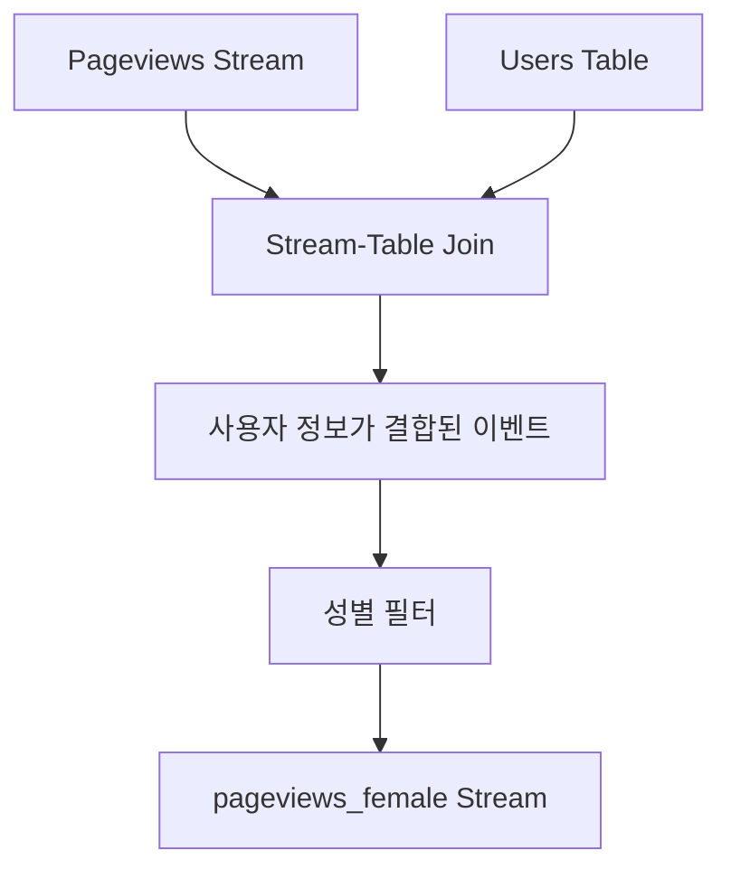

### SQL 작성

```sql
CREATE STREAM pageviews_female
WITH (
    KAFKA_TOPIC = 'pageviews-female',
    VALUE_FORMAT = 'JSON'
) AS
SELECT
    p.user_id AS user_id,
    p.page_id,
    u.region_id,
    u.gender
FROM pageviews p
LEFT JOIN users u
    ON p.user_id = u.user_id
WHERE u.gender = 'FEMALE'
EMIT CHANGES;
```

### SQL의 처리 과정

**첫 번째는 pageviews Stream을 읽는 것이다.**

```sql
FROM pageviews p
```

**두 번째는 users Table과 Join하는 것이다.**

```sql
LEFT JOIN users u
    ON p.user_id = u.user_id
```

사용자 ID를 기준으로 사용자 정보를 결합한다.

**세 번째는 여성 사용자만 선택하는 것이다.**

```sql
WHERE u.gender = 'FEMALE'
```

**네 번째는 결과 Stream을 생성하는 것이다.**

```sql
CREATE STREAM pageviews_female
```

결과는 새로운 Kafka Topic에 기록된다.

---

## LEFT JOIN인데 데이터가 제외되는 이유

앞의 SQL에는 중요한 특징이 있다.

다음 구문을 살펴보자.

```sql
LEFT JOIN users u
    ON p.user_id = u.user_id
WHERE u.gender = 'FEMALE'
```

LEFT JOIN은 왼쪽 Stream의 이벤트를 기준으로 동작한다.

사용자 정보를 찾지 못하면 오른쪽 Table의 필드는 `NULL`이 될 수 있다.

하지만 이후 WHERE 조건이 실행된다.

```sql
WHERE u.gender = 'FEMALE'
```

사용자 정보가 없는 경우 `u.gender`는 `NULL`이다.

따라서 조건을 만족하지 못해 결과에서 제외된다.

즉, 이 Query는 LEFT JOIN을 사용하지만 최종 결과에서는 사용자 정보가 없는 이벤트를 제외한다.

### 처리 결과 비교

| 조회 이벤트 | 사용자 정보 | 결과 |
|---|---|---|
| u1 조회 | FEMALE | 포함 |
| u2 조회 | MALE | 제외 |
| u3 조회 | 없음 | 제외 |

이러한 동작을 이해하지 못하면 JOIN을 사용했는데 일부 이벤트가 사라졌다고 잘못 판단할 수 있다.

또한 Stream-Table Join에서는 일반적으로 이벤트가 처리되는 시점의 Table 상태를 활용한다.

따라서 사용자 정보가 나중에 도착했다고 해서 과거 조회 이벤트가 자동으로 모두 다시 Join되는 것은 아니다.

---

## 특정 지역의 이벤트만 필터링하기

앞에서 생성한 `pageviews_female` Stream을 이용하여 특정 지역의 이벤트만 추출할 수 있다.

예를 들어 Region_8과 Region_9에 해당하는 이벤트만 선택한다고 가정해 보자.

```sql
CREATE STREAM pageviews_enriched_r8_r9 AS
SELECT
    *
FROM pageviews_female
WHERE region_id IN ('Region_8', 'Region_9')
EMIT CHANGES;
```

이 Query는 기존 Stream에서 조건을 만족하는 Record만 선택하여 새로운 Stream을 생성한다.

### 처리 흐름

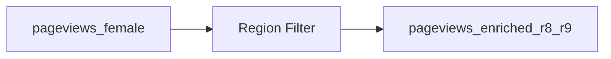

이 과정은 이전 집계 결과를 참조하지 않고 현재 이벤트의 필드만 확인한다.

따라서 Stateless Processing의 대표적인 예시다.

---

## Tumbling Window를 이용한 실시간 집계

이번에는 여성 사용자의 지역별 조회 횟수를 계산해 보자.

다음 조건을 적용한다.

- 여성 사용자
- 지역별 집계
- 30초 단위
- 조회 횟수 2건 이상
- 지연 이벤트를 10초 동안 허용

### SQL 작성

```sql
CREATE TABLE pageviews_regions
WITH (
    KAFKA_TOPIC = 'pageviews-regions',
    KEY_FORMAT = 'JSON',
    VALUE_FORMAT = 'JSON'
) AS
SELECT
    gender,
    region_id,
    COUNT(*) AS pageview_count
FROM pageviews_female
WINDOW TUMBLING (
    SIZE 30 SECONDS,
    GRACE PERIOD 10 SECONDS
)
GROUP BY
    gender,
    region_id
HAVING COUNT(*) > 1
EMIT CHANGES;
```

### WINDOW TUMBLING

```sql
WINDOW TUMBLING (
    SIZE 30 SECONDS,
    GRACE PERIOD 10 SECONDS
)
```

겹치지 않는 30초 Window를 구성한다.

또한 지연 이벤트에 대한 Grace Period를 10초로 설정한다.

### GROUP BY

```sql
GROUP BY
    gender,
    region_id
```

성별과 지역을 기준으로 이벤트를 그룹화한다.

### COUNT(*)

```sql
COUNT(*) AS pageview_count
```

해당 Window에 포함된 이벤트 수를 계산한다.

여기서 중요한 점은 `COUNT(*)`가 사용자 수를 의미하지 않는다는 것이다.

동일한 사용자가 같은 Window에서 상품을 세 번 조회했다면 세 건으로 계산된다.

### HAVING

```sql
HAVING COUNT(*) > 1
```

조회 횟수가 1건을 초과한 결과만 선택한다.

### EMIT CHANGES

```sql
EMIT CHANGES
```

집계 결과의 변경 사항을 지속적으로 출력한다.

즉, SQL을 한 번 실행하여 고정된 결과만 반환하는 것이 아니라 새 이벤트가 들어오면서 집계 결과가 갱신될 수 있다.

---

## Window 집계 결과 이해하기

다음과 같은 이벤트가 발생했다고 가정해 보자.

| 사용자 | 성별 | 지역 | 이벤트 발생 시각 |
|---|---|---|---|
| u1 | FEMALE | Region_8 | 12:00:10 |
| u1 | FEMALE | Region_8 | 12:00:20 |
| u2 | FEMALE | Region_8 | 12:00:25 |
| u3 | FEMALE | Region_9 | 12:00:15 |
| u4 | MALE | Region_8 | 12:00:18 |

30초 Tumbling Window를 사용하면 다음 구간에 포함된다.

```text
12:00:00 ~ 12:00:30
```

### Region_8

여성 사용자의 조회 이벤트가 세 건이다.

```text
u1 → 2건

u2 → 1건

총 3건
```

따라서 결과는 다음과 같다.

```text
gender = FEMALE

region_id = Region_8

pageview_count = 3
```

### Region_9

여성 사용자의 조회 이벤트가 한 건이다.

```text
u3 → 1건
```

하지만 다음 조건을 만족하지 않는다.

```sql
HAVING COUNT(*) > 1
```

따라서 최종 결과에서 제외된다.

### 남성 사용자의 이벤트

앞선 `pageviews_female` Stream에서 이미 제외되었으므로 최종 집계에도 포함되지 않는다.

---

## ksqlDB에서 데이터 처리 결과 확인하기

ksqlDB에서는 여러 명령어를 이용하여 Stream과 Table, 지속 Query의 상태를 확인할 수 있다.

### Stream 목록 조회

```sql
SHOW STREAMS;
```

정의된 Stream 목록을 확인한다.

### Table 목록 조회

```sql
SHOW TABLES;
```

정의된 Table 목록을 확인한다.

### Query 목록 조회

```sql
SHOW QUERIES;
```

현재 실행 중인 지속 Query 등을 확인할 수 있다.

### Stream 상세 조회

```sql
DESCRIBE pageviews_female EXTENDED;
```

Stream의 정의와 관련 Query, 실행 정보 등을 확인할 수 있다.

### Table 상세 조회

```sql
DESCRIBE pageviews_regions EXTENDED;
```

집계 결과 Table과 관련된 정보를 확인한다.

### 실시간 결과 조회

```sql
SELECT *
FROM pageviews_regions
EMIT CHANGES;
```

지속적으로 갱신되는 결과를 관찰할 수 있다.

이는 Push Query다.

### Push Query와 Pull Query 비교

| 항목 | Push Query | Pull Query |
|---|---|---|
| 처리 방식 | 변경 사항을 지속적으로 반환 | 현재 결과 조회 |
| 대표 문법 | `EMIT CHANGES` | 일반적인 SELECT |
| 활용 | 실시간 모니터링 | 현재 상태 조회 |
| 고려사항 | 지속적인 연결 및 출력 | 조회 가능한 상태 저장소 |

ksqlDB는 이러한 Query 방식을 이용하여 실시간 데이터 처리와 현재 상태 조회를 지원한다.

---

## ksqlDB에서 결과가 나오지 않는 이유

Query가 정상적으로 생성되었는데 결과가 출력되지 않는 경우가 있다.

이때는 다음 항목을 확인해야 한다.

### 1. Kafka Topic에 실제 데이터가 존재하는가?

먼저 입력 Topic에 Record가 저장되어 있는지 확인해야 한다.

### 2. Kafka Key가 올바르게 설정되었는가?

앞의 예제에서는 `user_id`를 Kafka Key로 사용한다.

따라서 사용자 ID가 JSON Value에만 존재하고 Kafka Key에는 없다면 기대한 JOIN 결과가 나오지 않을 수 있다.

### 3. 사용자 TABLE의 상태가 준비되었는가?

Stream-Table Join에서는 사용자 정보가 먼저 처리되어야 한다.

단순히 사용자 정보를 발행했다는 사실만으로 TABLE의 상태가 즉시 준비되었다고 가정해서는 안 된다.

### 4. JOIN 조건을 만족하는가?

사용자 ID가 일치하는지 확인해야 한다.

또한 두 입력 데이터의 Key 형식과 Partition 분배 방식도 고려해야 한다.

### 5. WHERE 조건에서 제외되었는가?

```sql
WHERE u.gender = 'FEMALE'
```

남성 사용자와 사용자 정보가 없는 이벤트는 제외된다.

### 6. Window가 서로 다른가?

두 이벤트가 같은 30초 Window에 속하지 않으면 서로 다른 집계로 계산된다.

### 7. HAVING 조건을 만족하는가?

```sql
HAVING COUNT(*) > 1
```

조회 횟수가 한 건이라면 결과에 포함되지 않을 수 있다.

### 8. 이벤트 시간이 올바른가?

`viewtime`이 Unix Epoch Milliseconds가 아니라 Seconds로 저장되었다면 Window 처리 결과가 잘못될 수 있다.

### 9. Grace Period를 초과했는가?

늦게 도착한 이벤트가 허용 범위를 초과하면 집계에서 제외될 수 있다.

이러한 항목을 단계별로 확인하면 Query 자체의 오류와 입력 데이터 문제를 구분하기 쉬워진다.

---

## ksqlDB의 Stream-Table Join에서 주의할 점

Stream과 Table을 Join할 때는 Key와 Partition의 관계를 이해해야 한다.

예를 들어 다음과 같은 입력이 있다.

```text
pageviews Stream

Key = u1
```

```text
users Table

Primary Key = u1
```

두 데이터를 Join하려면 동일한 사용자 ID를 기준으로 데이터가 연결되어야 한다.

일반적인 Stream-Table Join에서는 입력 데이터가 호환되는 방식으로 Partition되어 있어야 한다.

### Partition 수만 같으면 충분할까?

그렇지는 않다.

예를 들어 두 Topic의 Partition 수가 모두 네 개라고 가정해 보자.

하지만 서로 다른 Partitioner를 사용하여 동일한 사용자 ID가 다른 Partition에 저장될 수 있다.

```text
pageviews

u1 → Partition 0
```

```text
users

u1 → Partition 2
```

이 경우 기대한 Join 결과가 나오지 않을 수 있다.

따라서 다음 요소를 확인해야 한다.

- Kafka Key
- Key 직렬화 방식
- Partition 수
- Partition 분배 전략
- Join에 사용하는 컬럼
- Table의 Primary Key

ksqlDB 공식 문서에서도 일반적인 Stream-Table Join을 위해 Co-partitioning 조건을 고려하도록 설명한다.

---

## ksqlDB와 Kafka Streams의 차이

Kafka Streams와 ksqlDB는 모두 Kafka 이벤트를 처리할 수 있다.

하지만 사용하는 방식과 적합한 작업이 다르다.

### Kafka Streams

Kafka Streams는 Java 라이브러리다.

애플리케이션 코드로 처리 로직을 구성한다.

따라서 복잡한 비즈니스 로직이나 기존 Java 애플리케이션과의 통합에 유리하다.

### ksqlDB

ksqlDB는 SQL 기반으로 스트림 처리 로직을 구성한다.

따라서 필터링과 변환, 집계, Join 등을 선언적인 방식으로 표현할 수 있다.

### 비교

| 항목 | Kafka Streams | ksqlDB |
|---|---|---|
| 개발 방식 | Java 코드 | SQL |
| 실행 구조 | 애플리케이션 라이브러리 | 별도 서버 및 SQL 실행 |
| 복잡한 비즈니스 로직 | 유연하게 구현 가능 | SQL과 확장 기능의 제약 |
| 상태 기반 처리 | 지원 | 지원 |
| Window 처리 | 지원 | 지원 |
| Join | 지원 | 지원 |
| 개발 자유도 | 높음 | 선언적 처리 중심 |
| 주요 활용 | 비즈니스 이벤트 처리 | 실시간 분석 및 데이터 변환 |

### 언제 Kafka Streams를 선택해야 할까?

예를 들어 구독 결제 이벤트를 처리한다고 가정해 보자.

다음과 같은 복잡한 업무 규칙이 존재한다.

- 결제 수단별 처리 방식이 다르다.
- 사용자 국가에 따라 비즈니스 규칙이 다르다.
- 구독 상태에 따라 후속 처리가 달라진다.
- 여러 외부 시스템과 연동해야 한다.

이러한 로직은 Java 애플리케이션에서 구현하는 것이 더 적합할 수 있다.

### 언제 ksqlDB를 선택해야 할까?

반면 다음과 같은 요구사항을 생각해 보자.

- 1분 동안 발생한 결제 성공 건수 계산
- 국가별 결제 금액 집계
- 특정 조건의 이벤트 필터링
- 사용자 정보와 이벤트 Join
- 실시간 대시보드용 집계 Topic 생성

이러한 작업은 ksqlDB를 활용하여 SQL 중심으로 구현하는 것을 검토할 수 있다.

---

## Kafka Connect와 Kafka Streams의 차이

Kafka Connect와 Kafka Streams는 모두 Kafka를 중심으로 데이터를 다룬다.

하지만 주요 목적이 다르다.

### Kafka Connect

외부 시스템과 Kafka 사이에서 데이터를 이동하는 데 초점을 맞춘다.

```text
Database
    ↓
Kafka Connect
    ↓
Kafka
```

### Kafka Streams

Kafka에 저장된 이벤트를 변환하거나 분석하는 데 초점을 맞춘다.

```text
Kafka Input Topic
    ↓
Kafka Streams
    ↓
Kafka Output Topic
```

### 비교

| 구분 | Kafka Connect | Kafka Streams |
|---|---|---|
| 주요 목적 | 데이터 연동 | 데이터 처리 |
| 입력 | 외부 시스템 또는 Kafka | Kafka Topic |
| 출력 | Kafka 또는 외부 시스템 | Kafka Topic |
| 개발 방식 | Connector 설정 및 확장 | Java 코드 |
| 주요 기능 | Source/Sink 연동 | Filter, Map, Join, Aggregate |
| 대표 사례 | DB CDC, Elasticsearch 연동 | 실시간 통계, 이상 탐지 |

이 두 기술은 경쟁 관계라기보다 함께 사용할 수 있는 기술이다.

예를 들어 Kafka Connect로 데이터베이스 변경 이벤트를 수집하고 Kafka Streams에서 이를 가공할 수 있다.

---

## Kafka 기반 실시간 데이터 플랫폼 설계

지금까지 살펴본 기술을 조합하면 다음과 같은 구조를 구성할 수 있다.

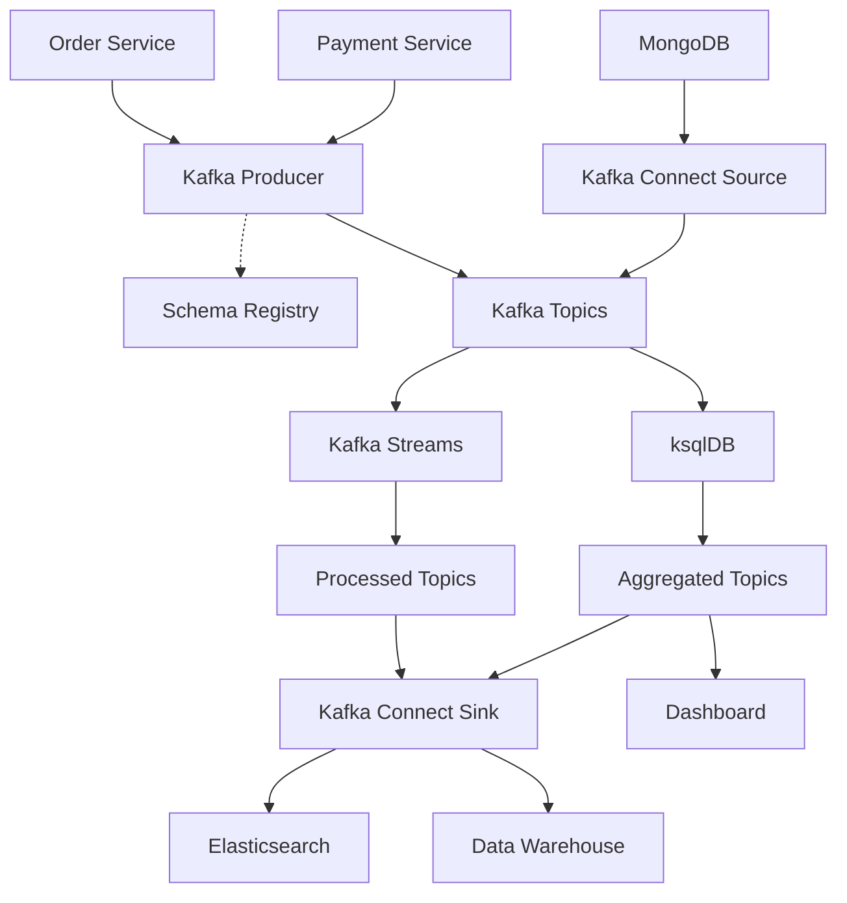

각 영역의 역할을 살펴보자.

### 데이터 생산 영역

주문 서비스와 결제 서비스에서 이벤트를 발생시킨다.

MongoDB의 변경 사항은 Source Connector를 통해 수집할 수 있다.

### 데이터 계약 관리 영역

Schema Registry에서 이벤트의 스키마를 관리한다.

Producer와 Consumer는 호환 가능한 데이터 구조를 사용하도록 구성할 수 있다.

### 이벤트 저장 및 전달 영역

Kafka는 이벤트를 Topic과 Partition에 저장한다.

여러 Consumer Group이 같은 이벤트를 독립적으로 처리할 수 있다.

### 실시간 처리 영역

Kafka Streams는 복잡한 비즈니스 이벤트를 변환한다.

ksqlDB는 SQL을 이용하여 실시간 집계와 Join을 수행한다.

### 데이터 활용 영역

Elasticsearch는 검색 서비스를 제공한다.

데이터 웨어하우스는 장기 분석 데이터를 저장한다.

Dashboard는 실시간 집계 결과를 표시한다.

이렇게 각 시스템의 책임을 분리하면 하나의 Kafka 이벤트를 여러 목적으로 재사용할 수 있다.

---

## 실무 활용 사례 12가지

Kafka의 고급 기능은 단독으로도 사용할 수 있지만 실제 서비스에서는 여러 기술을 조합할 때 가치가 커질 수 있다.

### 1. 주문 이벤트의 스키마 버전 관리

주문 서비스에서 발행하는 `OrderCreated` 이벤트의 구조를 Schema Registry로 관리한다.

새로운 필드가 추가되거나 기존 필드의 타입이 변경될 때 호환성을 검사한다.

이 방식은 여러 Consumer를 동시에 배포하기 어려운 환경에서 유용하다.

특히 이벤트 보존 기간이 길거나 과거 데이터를 다시 처리해야 한다면 Transitive Compatibility의 필요성을 검토할 수 있다.

### 2. 결제 이벤트의 데이터 계약 관리

결제 이벤트에는 결제 ID와 금액, 통화, 상태 등의 정보가 포함된다.

이러한 필드의 구조가 잘못 변경되면 후속 정산이나 회원 권한 처리에 영향을 줄 수 있다.

Schema Registry를 사용하면 필드 구조와 버전을 관리할 수 있다.

하지만 금액이 음수가 아니어야 한다거나 통화 코드가 허용된 값이어야 한다는 업무 규칙까지 자동으로 보장하는 것은 아니므로 별도의 검증이 필요하다.

### 3. PostgreSQL CDC 기반 데이터 파이프라인

PostgreSQL에서 발생하는 변경 이벤트를 CDC Connector를 통해 Kafka에 수집한다.

수집된 이벤트는 검색과 분석, 알림 등 여러 Consumer가 활용할 수 있다.

데이터베이스 변경 내용을 각각의 외부 시스템에 직접 전달하는 대신 Kafka를 중심으로 연결할 수 있다.

다만 초기 데이터 적재와 변경 로그 보존, Connector 장애 복구를 함께 고려해야 한다.

### 4. MongoDB와 Elasticsearch 검색 동기화

MongoDB 변경 이벤트를 Kafka에 전달하고 Elasticsearch Sink Connector를 통해 검색 인덱스를 갱신한다.

이 구조는 업무 데이터베이스와 검색 시스템을 분리하는 데 도움이 된다.

특히 동일한 변경 이벤트를 분석 시스템에서도 사용한다면 Kafka를 중심으로 데이터를 재사용할 수 있다.

단, Elasticsearch에서 중복 문서가 생성되지 않도록 Document ID와 이벤트 순서 정책을 정의해야 한다.

### 5. 실시간 사용자 행동 분석

사용자의 상품 조회와 클릭 이벤트를 Kafka에 수집한다.

Kafka Streams를 이용하여 사용자별 최근 조회 횟수나 특정 상품에 대한 관심도를 계산할 수 있다.

이전 행동 이력을 참조해야 하는 경우 State Store를 사용할 수 있다.

다만 State Store 크기와 복구 시간도 함께 고려해야 한다.

### 6. 실시간 이상 결제 탐지

결제 이벤트를 Kafka에 전달하고 Kafka Streams에서 일정 시간 동안의 결제 횟수와 금액을 분석한다.

예를 들어 짧은 시간 동안 특정 사용자에게 비정상적으로 많은 결제 요청이 발생하는 경우를 감지할 수 있다.

이러한 처리는 Window Processing과 Stateful Processing을 활용할 수 있다.

다만 실제 차단 정책은 정상 사용자에게 영향을 줄 수 있으므로 단순 집계 결과만으로 결정해서는 안 된다.

### 7. 지역별 실시간 매출 Dashboard

결제 이벤트를 ksqlDB에서 지역별로 집계한다.

30초 또는 1분 단위로 매출 합계와 결제 건수를 계산할 수 있다.

Dashboard는 집계 결과 Topic을 구독하여 실시간으로 화면을 갱신할 수 있다.

이때 늦게 도착한 결제 이벤트에 따라 집계 결과가 변경될 수 있으므로 잠정 집계와 확정 집계의 의미를 구분해야 한다.

### 8. 회원 상태와 행동 이벤트 Join

사용자 정보는 TABLE로 관리하고 사용자 행동 이벤트는 STREAM으로 관리한다.

이후 사용자 ID를 기준으로 Join하여 성별과 지역, 회원 등급 등의 정보를 결합할 수 있다.

이 방식은 개인화 분석이나 사용자 세그먼트 분석에 활용할 수 있다.

단, Stream-Table Join에서는 사용자 정보의 적재 상태와 이벤트 처리 순서가 결과에 영향을 준다.

### 9. 로그 데이터 파이프라인 구축

애플리케이션과 서버에서 발생하는 로그를 Kafka에 수집한다.

Kafka Connect를 통해 검색 시스템이나 장기 보관 저장소로 전달할 수 있다.

이렇게 하면 로그 생산 시스템과 저장 시스템을 분리할 수 있다.

다만 로그 데이터는 유입량이 많을 수 있으므로 Partition 수와 보존 기간, 저장 공간, 압축 정책을 함께 설계해야 한다.

### 10. 실시간 분석과 배치 대사 결합

Kafka Streams나 ksqlDB로 실시간 결제 통계를 계산한다.

이후 별도 배치 시스템에서 실제 결제 데이터와 정산 데이터를 다시 확인할 수 있다.

실시간 처리로 빠른 지표를 제공하면서 배치 대사로 차이를 점검하는 구조다.

이는 빠른 분석 결과와 최종 정합성을 모두 중요하게 생각하는 시스템에서 유용하다.

### 11. 데이터 웨어하우스 자동 적재

Kafka에 저장된 이벤트를 Sink Connector를 통해 데이터 웨어하우스로 전달한다.

이렇게 하면 여러 서비스가 분석 시스템에 직접 데이터를 적재하지 않아도 된다.

데이터 웨어하우스는 장기 데이터 분석과 보고서 작성 등에 활용할 수 있다.

이때 Sink Connector의 재시도와 중복 적재, 데이터 형식 변경에 대한 대응이 필요하다.

### 12. 이벤트 기반 데이터 플랫폼 구축

Schema Registry로 이벤트 구조를 관리한다.

Kafka Connect로 외부 데이터를 수집한다.

Kafka Streams로 복잡한 이벤트를 처리한다.

ksqlDB로 실시간 집계를 구성한다.

마지막으로 여러 Sink Connector를 이용하여 검색과 분석 시스템에 결과를 전달한다.

이처럼 기술별 역할을 구분하면 새로운 데이터 소비 시스템이 추가될 때 기존 Producer에 대한 변경을 줄일 수 있다.

다만 모든 기술을 처음부터 도입하는 것이 반드시 좋은 것은 아니다.

시스템 규모와 요구사항에 비해 운영 복잡성이 지나치게 증가할 수 있기 때문이다.

---

## Kafka 고급 기능 도입 시 고려해야 할 사항

### 1. 모든 시스템에 Schema Registry가 필요한 것은 아니다

이벤트 구조가 단순하고 변경 빈도가 낮으며 Producer와 Consumer가 소수라면 별도의 스키마 관리 시스템이 과도한 구성이 될 수도 있다.

반면 여러 팀과 서비스가 하나의 Topic을 사용하고 스키마 변경이 자주 발생한다면 도입 가치를 검토할 수 있다.

### 2. Kafka Connect가 모든 연동 개발을 없애지는 않는다

Kafka Connect는 반복적인 데이터 이동 작업을 줄여 준다.

하지만 필요한 Connector가 없거나 특수한 변환 로직이 존재하면 직접 개발해야 할 수 있다.

또한 Connector 설치와 접근 권한, 장애 복구, 데이터 매핑 등은 여전히 운영해야 한다.

### 3. Kafka Streams는 상태 복구를 고려해야 한다

Stateless Processing은 비교적 단순하다.

하지만 Stateful Processing에서는 상태 저장과 복구가 필요하다.

따라서 State Store의 크기와 Changelog Topic, 복구 시간을 함께 설계해야 한다.

### 4. ksqlDB는 모든 SQL 데이터베이스를 대체하지 않는다

ksqlDB는 Kafka 이벤트를 지속적으로 처리하는 시스템이다.

따라서 일반적인 관계형 데이터베이스와 동일하게 모든 SQL 기능이나 트랜잭션 기능을 제공한다고 생각해서는 안 된다.

또한 Kafka의 데이터 보존 정책이 적용되므로 과거 모든 데이터를 무제한으로 조회할 수 있는 분석 시스템으로 이해해서도 안 된다.

### 5. 스키마 호환성과 업무 호환성은 다르다

새로운 스키마가 과거 메시지를 읽을 수 있다고 해서 모든 비즈니스 로직이 정상적으로 동작하는 것은 아니다.

예를 들어 `region_id`가 `null`인 과거 메시지를 역직렬화할 수 있어도 업무 로직에서 반드시 지역 정보가 필요하다면 처리가 실패할 수 있다.

따라서 구조적 호환성과 업무적 호환성을 각각 확인해야 한다.

### 6. Partition 분배를 확인해야 한다

Stream-Table Join이나 Kafka Streams의 상태 기반 처리에서는 Key와 Partition 분배가 중요하다.

동일한 Key의 데이터가 서로 다른 Partition에 잘못 분배되면 기대한 결과가 나오지 않을 수 있다.

### 7. 이벤트 시간 정책을 정의해야 한다

실시간 집계에서는 어떤 Timestamp를 사용할 것인지 결정해야 한다.

또한 늦게 도착한 이벤트를 얼마나 허용할 것인지도 정의해야 한다.

이러한 정책은 집계 결과의 의미와 정확성에 영향을 준다.

### 8. 장애 복구 시 중복 처리를 고려해야 한다

Kafka Connect의 Task가 재시작되거나 Kafka Streams의 상태가 복구되는 과정에서 이벤트가 재처리될 수 있다.

따라서 외부 시스템에 데이터를 기록하는 경우에는 멱등성과 중복 처리 정책이 필요하다.

### 9. 상태 저장소와 내부 Topic을 함께 운영해야 한다

Kafka Streams와 ksqlDB는 상태 기반 처리와 복구를 위해 내부 Topic과 State Store를 사용할 수 있다.

따라서 업무 Topic만 관리하면 된다고 생각해서는 안 된다.

### 10. 라이선스와 운영 환경을 구분해야 한다

Apache Kafka와 Confluent Schema Registry, ksqlDB, 개별 Connector는 라이선스와 제공 방식이 다를 수 있다.

도입할 기술의 배포 조건과 운영 요구사항을 확인해야 한다.

### 11. 기술 도입보다 실제 문제 해결이 우선이다

Kafka Connect를 사용하면 반복적인 데이터 이동 개발을 줄일 수 있다.

Kafka Streams는 Java 기반 스트림 처리에 유리하다.

ksqlDB는 SQL 중심의 실시간 집계에 적합할 수 있다.

하지만 기능이 존재한다는 이유만으로 모두 도입하면 오히려 운영 복잡성이 증가할 수 있다.

### 12. 데이터 처리의 성공 기준을 명확하게 정의해야 한다

예를 들어 데이터베이스에서 Kafka로 이벤트가 전달되었다고 해서 검색 인덱스 반영까지 완료된 것은 아니다.

마찬가지로 ksqlDB Query가 정상적으로 실행 중이라고 해서 모든 업무 데이터가 정확하게 집계되었다고 단정할 수는 없다.

따라서 각 처리 단계에서 어떤 상태를 성공으로 판단할지 정의하고 모니터링해야 한다.

---

## Kafka 고급 기능 선택 기준

실제 프로젝트에서 어떤 기술을 사용할지 결정할 때는 다음 기준으로 접근할 수 있다.

| 요구사항 | 우선 검토할 기술 |
|---|---|
| 이벤트 필드와 타입 관리 | Schema Registry |
| Producer·Consumer 스키마 호환성 | Schema Registry |
| MySQL 데이터를 Kafka로 수집 | Kafka Connect Source |
| MongoDB 변경 이벤트 수집 | Kafka Connect Source |
| Kafka 데이터를 Elasticsearch에 반영 | Kafka Connect Sink |
| Kafka 데이터를 S3에 저장 | Kafka Connect Sink |
| Java 기반 복잡한 이벤트 처리 | Kafka Streams |
| 사용자별 실시간 집계 | Kafka Streams |
| 이전 이벤트 상태를 참조하는 처리 | Kafka Streams |
| SQL 기반 이벤트 필터링 | ksqlDB |
| SQL 기반 실시간 통계 | ksqlDB |
| Stream과 Table Join | Kafka Streams 또는 ksqlDB |
| 여러 시스템에 데이터를 수집·변환·전달 | Kafka Connect + Streams 또는 ksqlDB |

각 기술의 주요 목적은 다음과 같이 정리할 수 있다.

```text
Schema Registry
    → 데이터 계약 관리

Kafka Connect
    → 외부 시스템 연동

Kafka Streams
    → Java 기반 스트림 처리

ksqlDB
    → SQL 기반 스트림 처리
```

---

## 정리

Apache Kafka는 초기에는 대규모 메시지를 안정적으로 전달하는 분산 메시징 시스템으로 발전했다.

이후 Kafka에 연결되는 서비스와 데이터가 증가하면서 데이터 구조 관리와 외부 시스템 연동, 실시간 처리 기능에 대한 요구가 커졌다.

이러한 요구사항을 해결하기 위해 Kafka Connect와 Kafka Streams가 도입되었으며, Schema Registry와 ksqlDB 같은 주변 생태계도 함께 성장했다.

Schema Registry는 Producer와 Consumer 사이에서 사용하는 데이터 구조를 관리하는 시스템이다.

스키마를 등록하고 버전별로 관리하며 호환성을 검사할 수 있다.

이를 통해 Producer와 Consumer가 서로 다른 시점에 배포되더라도 데이터 구조의 호환성을 유지하도록 지원할 수 있다.

대표적인 호환성 모드에는 BACKWARD, FORWARD, FULL이 있다.

BACKWARD는 새로운 Consumer가 이전 데이터를 읽을 수 있는지 확인한다.

FORWARD는 이전 Consumer가 새로운 데이터를 읽을 수 있는지 확인한다.

FULL은 두 방향을 모두 만족하는지 확인한다.

또한 TRANSITIVE 모드를 이용하면 직전 버전뿐 아니라 모든 이전 버전과의 호환성을 검사할 수 있다.

하지만 스키마 호환성 검사를 통과했다고 해서 모든 비즈니스 로직이 정상적으로 동작하는 것은 아니다.

따라서 데이터 구조의 호환성과 실제 업무 처리의 호환성을 함께 검증해야 한다.

Kafka Connect는 외부 시스템과 Kafka 사이에서 데이터를 이동하기 위한 프레임워크다.

Source Connector는 외부 데이터를 Kafka로 수집한다.

Sink Connector는 Kafka의 데이터를 외부 시스템으로 전달한다.

Kafka Connect는 Connector와 Task, Worker라는 구성 요소를 이용하여 데이터 이동 작업을 관리한다.

Connector는 작업을 정의하고 Task는 실제 데이터를 이동시킨다.

Worker는 Connector와 Task를 실행하는 프로세스다.

Kafka Connect는 Standalone Mode와 Distributed Mode를 제공한다.

Distributed Mode에서는 여러 Worker에 Task를 분산할 수 있으며 Worker 장애 이후 Task를 재할당할 수 있다.

하지만 Worker 수를 늘린다고 실제 Task 수가 자동으로 증가하는 것은 아니다.

따라서 처리량을 개선하려면 Connector가 지원하는 병렬 처리 수준과 Source 및 Sink 시스템의 성능을 함께 확인해야 한다.

또한 Kafka Connect는 외부 시스템을 연결하는 반복적인 개발 비용을 줄여 주지만 중복 데이터 반영과 장애 복구 문제를 모두 자동으로 해결하지는 않는다.

Kafka Streams는 Kafka에 저장된 이벤트를 Java 애플리케이션에서 처리하기 위한 라이브러리다.

Kafka Streams를 이용하면 Filtering과 Mapping, Aggregation, Joining 등의 작업을 수행할 수 있다.

Kafka Streams에서는 Stateless Processing과 Stateful Processing을 구분해야 한다.

Stateless Processing은 현재 이벤트만으로 결과를 결정한다.

Stateful Processing은 이전 이벤트의 처리 결과를 참조한다.

Stateful Processing을 수행하려면 상태 저장소가 필요하며 Kafka Streams는 State Store와 Changelog Topic 등을 이용하여 상태를 관리하고 복구할 수 있다.

Kafka Streams는 Source Processor와 Stream Processor, Sink Processor를 연결한 Processor Topology를 구성한다.

이후 Task와 Stream Thread를 이용하여 데이터를 병렬로 처리한다.

또한 시간 기반 처리에서는 Event Time과 Processing Time을 구분해야 한다.

Event Time은 실제 이벤트가 발생한 시각이다.

Processing Time은 처리 애플리케이션이 이벤트를 처리하는 시각이다.

두 시각이 다를 수 있기 때문에 실시간 집계에서는 어떤 시간을 기준으로 계산하는지가 중요하다.

Kafka Streams는 Window Processing을 지원한다.

대표적으로 Tumbling Window와 Hopping Window, Session Window가 있다.

또한 Grace Period를 이용하여 늦게 도착한 이벤트를 허용하는 범위를 설정할 수 있다.

ksqlDB는 SQL을 이용하여 Kafka 이벤트를 처리하는 시스템이다.

Kafka Streams 기반의 기능을 SQL 중심으로 표현할 수 있다.

ksqlDB에서는 STREAM과 TABLE이라는 데이터 모델을 사용한다.

STREAM은 이벤트의 연속을 의미한다.

TABLE은 Key별 현재 상태를 의미한다.

따라서 같은 Key의 새로운 Record가 들어왔을 때 STREAM에서는 새로운 이벤트로 다루지만 TABLE에서는 기존 상태를 갱신하는 방식으로 해석한다.

ksqlDB에서는 SQL을 이용하여 Stream과 Table을 정의하고 데이터를 필터링하거나 Join할 수 있다.

또한 Window와 GROUP BY, COUNT 등의 기능을 이용하여 실시간 집계를 수행할 수 있다.

예를 들어 사용자별 조회 이벤트를 사용자 정보 TABLE과 Join하고, 특정 조건에 해당하는 이벤트를 선택한 뒤 지역별로 30초 단위 조회 횟수를 계산할 수 있다.

다만 Stream-Table Join에서는 Key와 Partition 분배, 사용자 정보의 처리 시점이 중요하다.

또한 Window 집계에서는 이벤트 Timestamp와 Grace Period가 결과에 영향을 준다.

따라서 SQL이 정상적으로 실행되었다는 사실만으로 최종 집계가 올바르다고 판단해서는 안 된다.

실제 운영에서는 입력 데이터와 중간 처리 결과, 최종 집계를 단계별로 검증해야 한다.

Kafka의 고급 기능을 도입할 때는 각각의 기술이 해결하는 문제를 구분해야 한다.

Schema Registry는 데이터 계약 관리에 초점을 맞춘다.

Kafka Connect는 외부 시스템과의 데이터 이동에 초점을 맞춘다.

Kafka Streams는 Java 애플리케이션 기반의 실시간 처리에 초점을 맞춘다.

ksqlDB는 SQL 기반의 선언적인 실시간 처리에 초점을 맞춘다.

이러한 기술들은 하나의 시스템에서 함께 사용할 수도 있지만 모든 기술을 무조건 도입해야 하는 것은 아니다.

실제 서비스에서는 데이터 구조 변경이 자주 발생하는지, 외부 연동 코드가 반복되는지, 상태 기반 처리가 필요한지, SQL 기반 분석이 유리한지 등을 검토해야 한다.

또한 기술을 도입한 이후에도 스키마 호환성과 메시지 순서, 상태 복구, 이벤트 시간, 중복 처리 등의 문제를 지속적으로 관리해야 한다.

결국 Kafka를 데이터 처리 플랫폼으로 활용하기 위해 가장 중요한 것은 단순히 여러 기능을 사용하는 것이 아니다.

**데이터가 어떤 구조로 생성되고, 어디로 이동하며, 어떤 방식으로 처리되고, 장애 이후 어떻게 복구되는지 전체 흐름을 설계하는 것이다.**

이러한 관점에서 Kafka의 고급 기능을 이해하면 여러 시스템을 안정적으로 연결하고 실시간 데이터 처리와 분석을 수행하는 이벤트 기반 아키텍처를 구축할 수 있다.

### 한 줄 요약

**Kafka는 메시지 전달 기능을 기반으로 Schema Registry를 통한 데이터 계약 관리, Kafka Connect를 통한 외부 시스템 연동, Kafka Streams를 통한 Java 기반 실시간 처리, ksqlDB를 통한 SQL 기반 스트림 처리로 활용 범위를 확장할 수 있다. 각 기술은 서로 다른 문제를 해결하므로 스키마 호환성, 데이터 이동, 상태 저장, 이벤트 시간 및 장애 복구 요구사항에 따라 적절하게 선택하고 조합하는 것이 중요하다.**
