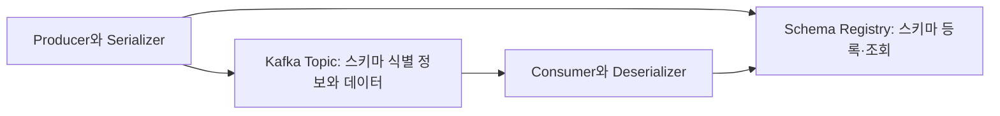

# 카프카 성장과 고급 주제 알아보기

# 카프카 성장과 고급 주제 알아보기

* toc
{:toc}

---

## Kafka의 성장과 고급 기능
Kafka를 메시지를 전달하는 시스템으로만 사용하면 Producer, Topic, Consumer만으로도 기본적인 구성을 만들 수 있다. 하지만 연결되는 서비스와 데이터가 늘어나면 다른 문제가 나타난다. 메시지 구조를 변경했을 때 기존 Consumer가 계속 동작해야 하고, 외부 데이터베이스와의 연동 코드를 반복해서 작성해야 하며, 들어오는 이벤트를 실시간으로 가공하거나 집계해야 한다.

Schema Registry, Kafka Connect, Kafka Streams, ksqlDB는 이러한 문제를 서로 다른 위치에서 해결한다. 각각 **데이터 계약 관리, 외부 시스템 연동, 애플리케이션 기반 스트림 처리, SQL 기반 스트림 처리**를 담당한다. 이름이 함께 등장하더라도 모두 Kafka Broker에 내장된 기능은 아니라는 점부터 구분할 필요가 있다.

### Kafka가 메시징을 넘어 확장된 과정
Kafka 0.8은 2013년 12월 정식 출시되었으며, 복제를 통해 Broker 장애에 대응할 수 있는 기반을 갖추었다. 이후 2015년 11월의 0.9에서는 Kafka Connect가, 2016년 5월의 0.10에서는 Kafka Streams가 등장했다. 외부 데이터를 안정적으로 가져오는 기능과 가져온 데이터를 처리하는 기능이 더해지면서 Kafka의 활용 범위가 넓어진 것이다. [Kafka 릴리스 이력](https://kafka.apache.org/community/downloads/)

Schema Registry는 Kafka 0.8.2 본체에 추가된 기능으로 이해하면 안 된다. 2015년 2월 공개된 Confluent Platform 1.0에는 Kafka 0.8.2 기반 배포판과 함께 스키마 관리 계층이 제공되었다. KSQL 역시 2017년 8월 Confluent가 별도로 공개한 스트리밍 SQL 엔진이며, 이후 ksqlDB로 발전했다. **Apache Kafka의 기능 확장과 주변 생태계의 성장은 연결되어 있지만 동일한 릴리스 체계는 아니다.** [Confluent Platform 1.0](https://www.confluent.io/blog/announcing-the-confluent-platform-1-0/), [KSQL 공개](https://www.confluent.io/ko-kr/press-release/confluent-releases-ksql-streaming-sql-engine-apache-kafka/)

## Schema Registry: 메시지 구조를 계약으로 관리하기
### 스키마가 필요한 이유
스키마는 데이터의 필드, 자료형, 기본값, 구조적 제약 등을 정의하는 명세다. 관계형 데이터베이스의 테이블 정의도 스키마의 한 형태지만, 스키마가 데이터베이스나 DDL에만 한정되는 것은 아니다. Kafka에서도 주문 번호가 문자열인지 숫자인지, 어떤 필드가 필수인지처럼 Producer와 Consumer가 공유해야 할 데이터 구조가 존재한다.

예를 들어 Producer가 `user_id`를 숫자에서 문자열로 변경하거나 기존 필드를 삭제하면, 배포되지 않은 Consumer 또는 과거 메시지를 재처리하는 Consumer에서 역직렬화 오류가 발생할 수 있다. 같은 팀에서 개발하더라도 배포 시점과 처리하는 데이터의 버전이 다르므로 문제가 사라지지는 않는다. 스키마 관리는 현재 연결된 서비스뿐 아니라 **과거 데이터와 미래 버전 사이의 계약**을 다루는 작업이다.

### 등록·직렬화·역직렬화 과정
Schema Registry는 스키마를 등록하고 조회하며 버전과 호환성을 관리하는 별도의 애플리케이션이다. Confluent Schema Registry는 Avro뿐 아니라 Protobuf와 JSON Schema도 지원한다. 일반적인 연동에서는 Serializer가 스키마를 등록하거나 조회한 뒤 스키마 식별 정보와 데이터를 전송하고, Deserializer는 식별 정보를 통해 필요한 스키마를 찾아 데이터를 해석한다. 클라이언트는 스키마를 캐시할 수 있으므로 메시지마다 Registry를 호출해야 하는 것은 아니다.

스키마 ID와 버전은 같은 개념이 아니다. Confluent Schema Registry에서 버전은 Subject라는 관리 단위 안에서 증가하며, 스키마 ID는 스키마를 식별하는 데 사용된다. 또한 Registry를 설치했다고 Apache Kafka Broker가 모든 메시지의 필드와 업무 규칙을 자동 검증하지는 않는다. 적절한 Serializer와 등록 정책을 사용해야 하며, “금액이 음수가 아니어야 한다” 같은 업무 검증도 별도로 필요하다. [Schema Registry 개요](https://docs.confluent.io/platform/current/schema-registry/index.html)

### 스키마 호환성과 변경 순서
**BACKWARD**는 새로운 스키마의 Consumer가 이전 스키마로 작성된 데이터를 읽을 수 있다는 의미다. **FORWARD**는 이전 스키마의 Consumer가 새로운 스키마로 작성된 데이터를 읽을 수 있다는 의미이며, **FULL**은 두 방향을 모두 만족하는 경우다. 기본 호환성 검사는 일반적으로 직전 버전과 비교하고, `_TRANSITIVE`가 붙으면 같은 Subject의 모든 이전 버전까지 비교한다. 오래 보관된 이벤트를 재처리해야 한다면 직전 버전만 통과하는 것으로 충분한지 살펴봐야 한다.

Avro에서 새 필드를 추가할 때는 과거 데이터에 그 필드가 없다는 상황을 고려해야 한다. 예를 들어 `region_id`를 `["null", "string"]` 타입으로 추가하고 기본값을 `null`로 두면 새로운 Reader가 과거 데이터를 해석하는 데 활용할 수 있다. 다만 nullable이라는 사실과 기본값이 있다는 사실은 다르다. 호환성 규칙도 Avro, Protobuf, JSON Schema마다 다르므로 “필드 추가는 항상 안전하다”라고 일반화해서는 안 된다. 배포 역시 호환 방향에 따라 Consumer 또는 Producer를 먼저 변경하는 순서를 정해야 한다. [스키마 호환성 규칙](https://docs.confluent.io/platform/current/schema-registry/fundamentals/schema-evolution.html)

라이선스도 Kafka 본체와 구분해야 한다. Confluent Schema Registry를 “비상업적인 용도로만 사용할 수 있다”라고 설명하는 것은 부정확하다. Confluent Community License는 상업적 이용 전체를 금지하는 조건이 아니라 해당 소프트웨어를 제공하는 경쟁 SaaS 등의 용도에 제한을 둔다. 실제 도입 시에는 사용하는 버전·모듈·유료 확장 기능의 조건을 확인해야 한다. [Confluent 라이선스 설명](https://www.confluent.io/confluent-community-license-faq/)

## Kafka Connect: 외부 시스템과 Kafka 연결하기
### Source와 Sink
Kafka Connect는 데이터베이스, 파일 시스템, 검색 시스템, 오브젝트 스토리지 등과 Kafka 사이의 데이터 이동을 위한 프레임워크다. **Source Connector**는 외부 데이터를 Kafka로 가져오며, **Sink Connector**는 Kafka의 데이터를 외부 시스템으로 내보낸다. 데이터베이스 변경을 Kafka로 수집하고, 그 결과를 검색 엔진이나 분석 저장소로 전달하는 구성이 대표적이다.

MySQL, PostgreSQL, MongoDB, FTP, HDFS, S3, ActiveMQ 등과의 연결은 해당 시스템에 맞는 커넥터를 통해 구현할 수 있다. 다만 Kafka Connect를 설치하면 모든 연동이 기본 제공되는 것은 아니다. 플러그인 설치, 드라이버, 접근 권한, 데이터 매핑, 라이선스를 확인해야 하며, 필요한 커넥터가 없으면 직접 개발해야 할 수도 있다. 기존 커넥터를 재사용하면 반복 코드를 줄일 수 있지만 운영 설정까지 사라지는 것은 아니다.

### Connector·Task·Worker의 역할
Connector는 복사할 데이터와 작업 구성을 정의하고 이를 Task로 나눈다. Task는 실제 읽기·쓰기 작업을 수행하며, Worker는 Connector와 Task를 실행하는 프로세스다. 예를 들어 하나의 Source Connector가 작업을 두 Task로 나누고, 각 Task를 서로 다른 Worker에서 실행할 수 있다. 이때 Worker를 늘리는 것과 Task 수를 늘리는 것은 다른 작업이다. [Connector와 Task의 구분](https://kafka.apache.org/36/kafka-connect/connector-development-guide/)

`tasks.max`는 생성 가능한 Task 수의 **상한**이다. 10으로 설정해도 커넥터나 원본 시스템이 병렬 작업을 지원하지 않으면 10개가 생성되지 않는다. Source가 관리하는 테이블·파일·로그 구간 같은 분할 단위도 Kafka 토픽 파티션과 동일하지 않다. 원본 작업 구간 네 개를 Task 두 개가 나누어 처리하면서 여러 토픽으로 기록할 수도 있다. Sink에서는 입력 토픽 파티션이 병렬 소비의 제약이 될 수 있으므로 Source와 Sink의 확장 조건을 구분해야 한다.

### 실행 모드와 장애 복구
Standalone 모드는 단일 Worker에서 실행하여 구성이 단순하고 테스트나 제한된 작업에 적합하다. Distributed 모드는 여러 Worker에 작업을 배치하고, 설정·상태·Source 오프셋 등을 내부 Kafka 토픽에 저장한다. Worker 장애 시 다른 Worker로 작업을 재배치할 수 있지만, 이것이 외부 저장소까지 포함한 무조건적인 무중복 처리를 뜻하지는 않는다. 커넥터의 전달 보장과 외부 시스템의 쓰기 방식을 함께 확인해야 한다. [Kafka Connect 실행과 설정](https://kafka.apache.org/43/kafka-connect/user-guide/)

운영에서는 Worker가 살아 있다는 사실만 확인해서는 부족하다. 개별 Task의 실패, 재시도, 원본 시스템의 로그 보관 기간, Sink의 처리 지연도 확인해야 한다. 분산 실행은 장애에 대응할 수 있는 기반이며, 실패한 데이터를 어떻게 복구할지는 커넥터와 업무 특성에 맞게 정해야 한다.

## Kafka Streams: 이벤트를 애플리케이션에서 처리하기
### 스트림 처리와 배치 처리
스트림 처리는 계속 도착하는 이벤트를 대상으로 필터링, 변환, 조인, 집계 등을 수행하는 방식이다. 배치 처리는 보통 이미 저장된 일정 범위의 데이터를 모아 처리한다. 결제 직후 이상 거래를 탐지하는 작업에는 스트림 처리가, 하루치 매출 정산에는 배치 처리가 어울린다. 두 방식은 대체 관계만은 아니다. 실시간 결과를 제공하면서 배치로 대사하거나, 보관된 이벤트를 재생해 결과를 다시 만들 수도 있다.

스트림 처리라고 항상 더 많은 데이터를 분석하거나 더 정확한 것은 아니다. 정확성은 이벤트 유실·중복, 늦은 도착, 계산 로직, 보관 범위에 영향을 받는다. 공유 데이터베이스를 조회하지 않고 로컬 상태를 활용할 수는 있지만, Kafka와 애플리케이션 실행 환경까지 불필요해지는 것도 아니다.

### 무상태 처리와 상태 기반 처리
무상태 처리는 현재 이벤트만으로 결과를 결정한다. 필드명을 변경하거나 특정 조건의 메시지를 거르는 작업이 이에 해당한다. 상태 기반 처리는 이전 결과나 다른 이벤트를 참조한다. 사용자별 최근 구매 합계, 일정 시간의 접속 횟수, 사용자 정보와 클릭 이벤트의 조인 등이 대표적이다. 추천 시스템도 과거 행동을 참조한다면 상태 기반 처리가 된다.

상태 기반 처리에는 상태 저장소가 필요하다. Kafka Streams는 애플리케이션에 포함하는 라이브러리로, 집계·조인 등에 사용할 로컬 State Store와 복구 기능을 제공한다. 일반적인 설정에서는 변경 로그 토픽을 활용해 상태를 복원할 수 있지만, 복구할 데이터가 많으면 시간이 걸린다. 상태 용량, 로컬 디스크, 복원 시간과 필요한 Standby 구성을 함께 계획해야 한다. [Kafka Streams 상태 저장과 복구](https://kafka.apache.org/43/streams/architecture/)

### 토폴로지·Task·시간
Kafka Streams의 처리 흐름은 토폴로지로 표현한다. Source Processor가 입력 토픽을 읽고, 중간 Processor가 변환·집계를 수행하며, Sink Processor가 결과를 토픽에 기록한다. 모든 중간 연산마다 Kafka 토픽이 생성되는 것은 아니지만, 재파티셔닝이나 상태 복구를 위해 내부 토픽이 사용될 수 있다. Task는 입력 파티션에 기반한 작업 단위이고 Stream Thread가 이를 실행한다. 하나의 Thread가 여러 Task를 처리할 수 있으며, 복잡한 토폴로지에서는 하위 토폴로지별 입력 파티션 구조를 기준으로 병렬성을 판단해야 한다.

시간도 구분해야 한다. Event Time은 사건이 발생한 시간이고 Processing Time은 애플리케이션이 처리하는 시간이다. 12시의 클릭이 네트워크 지연으로 12시 1분에 도착할 수 있기 때문이다. Window는 이벤트를 시간 구간으로 묶고, Grace Period는 늦게 도착한 이벤트를 어느 범위까지 받아들일지 정한다. 실시간 집계에는 처리 속도뿐 아니라 이 시간 정책이 결과의 의미를 결정한다. [Kafka Streams 핵심 개념](https://kafka.apache.org/43/streams/core-concepts/)

## KSQL과 ksqlDB: SQL로 스트림 처리하기
### 실행 구조와 데이터 모델
ksqlDB는 Kafka Streams 기반의 처리 기능을 SQL로 표현하는 시스템이다. CLI나 REST 클라이언트가 서버에 SQL을 전달하면 서버가 분석·실행 계획을 만들고 지속적인 처리 작업을 수행한다. 대화형 모드에서는 명령을 내부 Command Topic에 기록하여 서버가 재시작하거나 추가될 때 정의를 재구성할 수 있다. 내부 토픽 이름은 `ksql.service.id` 등에 따라 달라지므로 항상 `ksql_commands`로 고정되는 것은 아니다. [ksqlDB 아키텍처](https://docs.confluent.io/platform/current/ksqldb/operate-and-deploy/how-it-works.html)

**STREAM은 사건의 연속이고 TABLE은 키별 현재 상태**다. STREAM에서 같은 사용자 키로 클릭 세 건이 들어오면 서로 다른 세 이벤트다. TABLE에서는 같은 키의 새 값이 기존 상태를 갱신하며, 값이 `null`인 Tombstone은 해당 키의 삭제를 의미한다. TABLE도 Kafka 로그의 과거 레코드를 직접 수정하는 방식은 아니다. 변경 이벤트를 해석하여 현재 상태를 구성하는 것이다. [STREAM과 TABLE의 키 처리](https://docs.confluent.io/platform/current/ksqldb/developer-guide/ksqldb-reference/create-table.html)

### 페이지 조회와 사용자 정보를 결합하기
다음은 ksqlDB SQL 예제다. Kafka와 ksqlDB가 연결되어 있고 토픽 생성·읽기·쓰기 권한이 있다고 가정한다. 입력 토픽은 실습을 단순하게 하기 위해 각각 파티션 하나로 구성한다. 기존 토픽이 있다면 파티션 수와 직렬화 형식이 일치해야 한다. `user_id`는 JSON Value의 일반 필드가 아니라 Kafka 메시지 Key로 전달하며, `viewtime`은 Unix epoch 기준 밀리초 값이다.
```sql
SET 'auto.offset.reset' = 'earliest';

CREATE STREAM pageviews (
    user_id VARCHAR KEY, viewtime BIGINT, page_id VARCHAR
) WITH (
    KAFKA_TOPIC='my-pageviews-topic', PARTITIONS=1,
    KEY_FORMAT='KAFKA', VALUE_FORMAT='JSON', TIMESTAMP='viewtime'
);

CREATE TABLE users (
    user_id VARCHAR PRIMARY KEY, usertimestamp BIGINT,
    gender VARCHAR, region_id VARCHAR
) WITH (
    KAFKA_TOPIC='my-users-topic', PARTITIONS=1,
    KEY_FORMAT='KAFKA', VALUE_FORMAT='JSON'
);

CREATE STREAM pageviews_female
WITH (KAFKA_TOPIC='pageviews-female', VALUE_FORMAT='JSON') AS
SELECT p.user_id AS user_id, p.page_id, u.region_id, u.gender
FROM pageviews p LEFT JOIN users u ON p.user_id = u.user_id
WHERE u.gender = 'FEMALE'
EMIT CHANGES;

CREATE STREAM pageviews_enriched_r8_r9 AS
SELECT * FROM pageviews_female
WHERE region_id IN ('Region_8', 'Region_9')
EMIT CHANGES;

CREATE TABLE pageviews_regions
WITH (KAFKA_TOPIC='pageviews-regions', KEY_FORMAT='JSON', VALUE_FORMAT='JSON') AS
SELECT gender, region_id, COUNT(*) AS pageview_count
FROM pageviews_female
WINDOW TUMBLING (SIZE 30 SECONDS, GRACE PERIOD 10 SECONDS)
GROUP BY gender, region_id HAVING COUNT(*) > 1
EMIT CHANGES;
```
`KAFKA_TOPIC`은 연결할 물리 토픽, `KEY_FORMAT`과 `VALUE_FORMAT`은 Key와 Value의 직렬화 형식이다. `KEY`와 `PRIMARY KEY`는 Key에서 읽을 컬럼을 지정한다. `TIMESTAMP='viewtime'`은 페이지 조회의 Event Time을 명시하며, `users.usertimestamp`는 이 예제에서 일반 데이터 컬럼으로 유지한다. 일반 `JSON` 형식은 Schema Registry를 사용하지 않으며, Registry 연동이 필요하다면 `AVRO`, `PROTOBUF`, `JSON_SR` 등과 관련 설정을 별도로 구성해야 한다. [스트림 정의와 시간 설정](https://docs.confluent.io/platform/current/ksqldb/developer-guide/ksqldb-reference/create-stream.html)

조인은 사용자 키로 페이지 조회에 사용자 정보를 붙인다. 입력 양쪽의 Key 형식과 파티셔닝이 맞아야 하며, 예제에서는 동일한 문자열 Key와 파티션 수를 사용한다. `LEFT JOIN`이지만 `WHERE u.gender='FEMALE'` 조건 때문에 사용자 정보가 없는 결과는 제외된다. 따라서 사용자 데이터를 먼저 적재해야 한다. 이후 사용자 정보가 도착했다고 이미 처리한 페이지 조회가 자동으로 다시 조인되는 것은 아니다. `auto.offset.reset='earliest'` 역시 두 입력 사이의 처리 순서를 보장하지는 않는다. [스트림과 테이블의 조인 조건](https://docs.confluent.io/platform/current/ksqldb/developer-guide/joins/join-streams-and-tables.html)

마지막 집계는 성별·지역별 페이지 조회 수를 겹치지 않는 30초 구간으로 계산한다. `COUNT(*)`는 사용자 수가 아니라 **이벤트 수**이므로 동일 사용자의 반복 조회도 포함된다. `HAVING`은 집계 건수가 1을 초과한 결과만 내보내며, `EMIT CHANGES`는 집계가 갱신되는 동안 변경 결과를 출력한다. 10초의 Grace Period는 이벤트 시간 진행을 기준으로 늦은 데이터를 허용하는 범위이지, 서버가 매번 10초를 기다린 뒤 종료한다는 의미가 아니다. [시간과 Window 처리](https://docs.confluent.io/platform/current/ksqldb/concepts/time-and-windows-in-ksqldb-queries.html)

`SHOW QUERIES;`로 지속 쿼리를 확인하고, `DESCRIBE pageviews_regions EXTENDED;`로 생성된 처리 정보를 살펴볼 수 있다. `SELECT * FROM pageviews_regions EMIT CHANGES;`는 변경 결과를 계속 관찰하는 Push Query다. 선언만 성공하고 데이터가 나오지 않는다면 입력 메시지의 Key·JSON 구조, 사용자 정보의 선행 적재, 처리 로그와 이벤트 시간을 차례로 확인해야 한다. 기존 데이터를 재처리할 수도 있지만 Kafka에 남아 있는 보관 범위 안에서만 가능하므로, ksqlDB를 무제한 과거 데이터 분석 엔진으로 생각해서는 안 된다.

## 정리
Schema Registry는 메시지의 구조와 변경 규칙을 관리하고, Kafka Connect는 외부 시스템과의 데이터 이동을 담당한다. Kafka Streams는 애플리케이션 코드로 이벤트 처리 흐름을 구성하며, ksqlDB는 이를 SQL 중심으로 표현할 수 있게 한다.

이 도구들을 모두 도입하는 것이 목표는 아니다. 메시지 계약이 자주 깨지는지, 연동 코드가 반복되는지, 상태 기반 계산이 필요한지부터 확인해야 한다. 특히 데이터 구조의 호환성, 처리 순서, 상태 복구와 이벤트 시간은 도구가 대신 결정해 주지 않는다. 각 기능이 보장하는 범위를 이해하고 업무에 맞는 규칙을 정해야 Kafka를 데이터 처리 플랫폼으로 안정적으로 활용할 수 있다.
