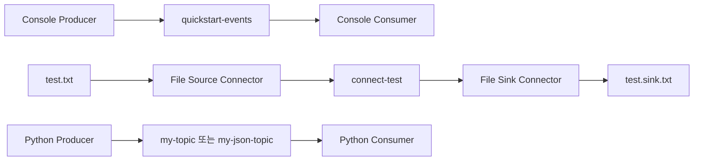
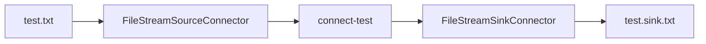

# 카프카 시작하기

# 카프카 시작하기

* toc
{:toc}

---

## Kafka 시작하기: 설치부터 Python 애플리케이션 연동까지

Kafka를 처음 실행할 때는 여러 Broker로 클러스터를 구성하기보다, 하나의 Broker에서 메시지가 저장되고 읽히는 흐름을 확인하는 편이 이해하기 쉽다. 여기에 Kafka Connect와 간단한 Python 코드를 연결하면 콘솔 도구, 데이터 연동 프레임워크, 애플리케이션 클라이언트가 같은 Kafka를 어떻게 사용하는지도 확인할 수 있다.

이번 실습에서는 다음 순서로 진행한다.

1. KRaft 모드로 Kafka를 실행한다.
2. 토픽을 만들고 콘솔에서 메시지를 주고받는다.
3. Kafka Connect로 파일의 내용을 다른 파일로 전달한다.
4. Python으로 문자열과 JSON 메시지를 송수신한다.
5. Consumer Group과 오프셋이 재실행에 미치는 영향을 확인한다.



모든 구성요소는 로컬 환경에서 실행한다. 단일 Broker와 복제 계수 1을 사용하므로 장애 복구나 고가용성을 검증하는 구성은 아니다.

## Kafka 설치와 실행

### 실습 환경 준비

명령어는 macOS 또는 Linux의 Bash 계열 셸을 기준으로 작성한다. Windows에서는 WSL2의 Linux 터미널에서 진행하면 같은 명령을 사용할 수 있다. PowerShell과 Bash의 환경변수·줄바꿈 문법을 섞어 사용하지 않도록 주의한다.

필요한 구성은 다음과 같다.

| 항목 | 실습 기준 |
|---|---|
| Java | JDK 17 이상 |
| Kafka | 4.0.2 바이너리 배포본 |
| Python | 3.10 이상 |
| Python 클라이언트 | `kafka-python==3.0.12` |
| Broker 접속 주소 | `localhost:9092` |
| 실행 방식 | KRaft 단일 노드 |

Kafka 4.0 계열은 ZooKeeper 없이 KRaft로 실행한다. 이번에는 재현할 버전을 4.0.2로 고정하며, 이것이 최신 메이저 버전이라는 의미는 아니다. 운영 환경에서는 지원 상태와 보안 수정 사항을 별도로 확인해야 한다. [Kafka 4.0 실행 환경](https://kafka.apache.org/40/getting-started/quickstart/)

먼저 Java와 Python을 확인한다.

```bash
java -version
python3 --version
```

Java가 여러 개 설치되어 있다면 Kafka가 사용하는 `JAVA_HOME`도 확인한다.

```bash
echo "$JAVA_HOME"
```

### 다운로드와 압축 해제

실습용 디렉터리에서 Kafka를 내려받는다. 이전 버전은 일반 다운로드 미러에서 내려갈 수 있으므로, 고정 버전의 재현에는 Apache 보관소를 사용한다.

```bash
mkdir -p "$HOME/kafka-lab"
cd "$HOME/kafka-lab"

curl -fLO https://archive.apache.org/dist/kafka/4.0.2/kafka_2.13-4.0.2.tgz
tar -xzf kafka_2.13-4.0.2.tgz
cd kafka_2.13-4.0.2
```

파일 이름의 `2.13`은 Scala 바이너리 버전이고, Kafka 버전은 `4.0.2`다. Python 클라이언트를 사용하기 위해 Scala를 별도로 설치할 필요는 없다.

압축을 풀면 주요 디렉터리는 다음과 같이 구성된다.

| 디렉터리 | 용도 |
|---|---|
| `bin` | Broker 실행, 토픽 관리, 콘솔 송수신 등 실행 도구 |
| `config` | Broker와 Connect 등의 설정 파일 |
| `libs` | Kafka 실행 라이브러리와 일부 플러그인 |
| `licenses` | 포함된 구성요소의 라이선스 정보 |

이후 명령어는 별도 안내가 없다면 **압축을 해제한 Kafka 디렉터리에서 실행한다.**

### 클러스터 식별자 생성과 저장소 초기화

최초 실행 전에 클러스터 식별자를 생성한다.

```bash
KAFKA_CLUSTER_ID="$(bin/kafka-storage.sh random-uuid)"
```

이 값은 클러스터를 식별하는 ID다. 토픽 이름이나 Consumer Group ID와는 다른 개념이다.

생성한 ID로 저장소를 초기화한다.

```bash
bin/kafka-storage.sh format \
  --standalone \
  -t "$KAFKA_CLUSTER_ID" \
  -c config/server.properties
```

`--standalone`은 단일 Controller로 시작하는 개발용 구성을 초기화할 때 사용한다. 이 설정으로 실행되는 노드는 Broker와 Controller 역할을 함께 수행한다. Connect의 standalone 실행 모드와는 별개의 옵션이다.

**저장소 포맷은 최초 초기화 단계이지, Kafka를 시작할 때마다 반복하는 작업이 아니다.** 기존 데이터를 유지하고 재시작할 때는 다시 UUID를 생성하거나 포맷하지 않는다.

기본 설정에서는 `/tmp/kraft-combined-logs` 같은 임시 경로를 사용할 수 있다. 여기에는 단순 실행 로그가 아니라 Kafka 데이터와 메타데이터가 저장된다. 장기간 보관할 환경에서는 임시 디렉터리 대신 영속 경로를 사용해야 한다.

### Broker 실행

첫 번째 터미널에서 Kafka를 실행한다.

```bash
bin/kafka-server-start.sh config/server.properties
```

정상적으로 시작되면 다음과 같은 의미의 로그를 확인할 수 있다.

```text
Kafka Server started
```

이 터미널은 Broker 프로세스가 실행되는 동안 유지한다. 토픽 생성과 메시지 송수신은 다른 터미널에서 진행한다.

기본 실습 설정에는 인증과 암호화가 적용되어 있지 않다. 공용 서버에서 그대로 실행하거나 9092·9093 포트를 인터넷에 공개해서는 안 된다.

## 토픽 생성과 콘솔 메시지 송수신

### 토픽 생성

새 터미널에서 Kafka 디렉터리로 이동한다.

```bash
cd "$HOME/kafka-lab/kafka_2.13-4.0.2"
```

파티션 1개, 복제 계수 1인 토픽을 명시적으로 생성한다.

```bash
bin/kafka-topics.sh \
  --bootstrap-server localhost:9092 \
  --create \
  --topic quickstart-events \
  --partitions 1 \
  --replication-factor 1
```

정상 생성 시 다음과 같은 메시지가 출력된다.

```text
Created topic quickstart-events.
```

`--bootstrap-server`는 클러스터 메타데이터를 처음 조회할 접속 주소다. 클러스터의 모든 Broker 주소를 적어야 한다는 뜻은 아니다. 다만 실제 서비스에서는 초기 접속 장애에 대비해 여러 주소를 사용하는 편이 좋다.

### 토픽 상태 확인

```bash
bin/kafka-topics.sh \
  --bootstrap-server localhost:9092 \
  --describe \
  --topic quickstart-events
```

출력에서 확인할 핵심 항목은 다음과 같다.

| 항목 | 확인 내용 |
|---|---|
| `PartitionCount` | 파티션 수가 1인지 |
| `ReplicationFactor` | 복제 계수가 1인지 |
| `Leader` | 해당 파티션을 담당하는 Leader Broker |
| `Replicas` | 파티션 복제본을 가진 Broker 목록 |
| `Isr` | 동기화 상태를 유지하는 복제본 목록 |

현재는 복제본이 하나뿐이므로 `acks=all`을 사용하더라도 다른 Broker에 복제되는 것은 아니다. 응답 정책과 실제 복제 구성은 함께 판단해야 한다.

### 콘솔 Producer로 메시지 전송

```bash
bin/kafka-console-producer.sh \
  --bootstrap-server localhost:9092 \
  --topic quickstart-events
```

입력 대기 상태가 되면 다음 문장을 한 줄씩 입력한다.

```text
This is my first event
This is my second event
This is my third event
```

기본 콘솔 Producer는 한 줄을 하나의 메시지로 처리한다. 입력을 마치면 `Ctrl+C`로 종료한다.

이 실습에서는 Key를 지정하지 않았으므로 메시지 Key는 `null`이다. Value는 입력한 문자열을 바이트로 변환한 데이터다.

### 콘솔 Consumer로 메시지 읽기

```bash
bin/kafka-console-consumer.sh \
  --bootstrap-server localhost:9092 \
  --topic quickstart-events \
  --from-beginning
```

정상적으로 읽으면 입력한 세 문장이 출력된다. 이후 화면이 멈춘 것처럼 보여도 오류가 아니라 새 메시지를 기다리는 상태다. Producer를 다른 터미널에서 다시 실행해 문장을 추가하면 Consumer에 이어서 표시된다.

Consumer를 종료해도 읽은 메시지가 즉시 삭제되지는 않는다. Kafka에서는 메시지 보관 정책과 Consumer의 읽기 위치를 따로 관리한다. 따라서 보관 중인 데이터는 다른 Consumer Group이 독립적으로 읽을 수 있다.

다만 `--from-beginning`을 “기존 커밋 위치와 관계없이 항상 처음부터 읽는 옵션”으로 이해해서는 안 된다. 이미 오프셋이 저장된 그룹은 해당 위치를 우선 사용한다. 처음부터 다시 확인하려면 새 그룹을 명시하는 방법이 간단하다.

```bash
bin/kafka-console-consumer.sh \
  --bootstrap-server localhost:9092 \
  --topic quickstart-events \
  --group quickstart-replay-01 \
  --from-beginning
```

같은 이름의 그룹을 이미 사용했다면 다른 그룹 이름으로 변경한다.

## Kafka Connect로 파일 연결하기

### 파일에서 파일로 이어지는 구조

이번에는 파일에 추가한 문장을 Kafka 토픽에 기록하고, 이를 다시 다른 파일로 저장한다.



Source Connector와 Sink Connector 두 개를 **하나의 standalone Worker 프로세스에서 함께 실행한다.** Connector마다 독립적인 Worker를 실행하는 구성이 아니다.

FileStream Connector는 동작을 익히기 위한 예제다. 운영 로그 수집이나 파일 전송 시스템을 이 예제만으로 대체하는 것은 적절하지 않다.

### Worker 설정

`config/connect-standalone.properties`를 다음과 같이 구성한다. 기존 파일을 수정할 때는 같은 설정을 반복해서 추가하지 말고 최종 값이 무엇인지 확인한다.

```properties
bootstrap.servers=localhost:9092

key.converter=org.apache.kafka.connect.json.JsonConverter
value.converter=org.apache.kafka.connect.json.JsonConverter
key.converter.schemas.enable=true
value.converter.schemas.enable=true

offset.storage.file.filename=connect.offsets
offset.flush.interval.ms=1000

plugin.path=libs/connect-file-4.0.2.jar
listeners=http://127.0.0.1:8083
```

각 설정의 의미는 다음과 같다.

- `bootstrap.servers`: Connect가 사용할 Kafka 접속 주소다.
- `key.converter`, `value.converter`: Connect 내부 데이터와 Kafka 메시지 바이트 사이의 변환을 담당한다.
- `schemas.enable`: JSON에 스키마 정보를 함께 포함할지 결정한다.
- `offset.storage.file.filename`: standalone Source의 읽기 위치를 저장할 파일이다.
- `offset.flush.interval.ms`: 오프셋 저장 주기를 조정한다.
- `plugin.path`: Connector 플러그인을 검색할 경로다.
- `listeners`: Worker의 REST API를 로컬 주소에 바인딩한다.

상대 경로는 실행 위치에 영향을 받는다. 이번에는 Kafka 설치 디렉터리에서 실행하는 것을 전제로 한다. 운영에서는 플러그인과 상태 파일의 경로를 명확하게 관리하는 편이 좋다. [Connect Worker와 Connector 구성](https://kafka.apache.org/40/kafka-connect/user-guide/)

### Source와 Sink 설정

`config/connect-file-source.properties`는 다음과 같이 작성한다.

```properties
name=local-file-source
connector.class=org.apache.kafka.connect.file.FileStreamSourceConnector
tasks.max=1
file=test.txt
topic=connect-test
```

`file`은 읽을 파일이고, `topic`은 기록할 대상 토픽이다. `tasks.max=1`은 Task의 최대 개수를 1로 제한한다.

`config/connect-file-sink.properties`는 다음과 같다.

```properties
name=local-file-sink
connector.class=org.apache.kafka.connect.file.FileStreamSinkConnector
tasks.max=1
file=test.sink.txt
topics=connect-test
```

Sink에서는 읽을 토픽을 `topics`로 지정한다. Source의 `topic`과 철자가 다르므로 주의한다.

### 파일 준비와 Connect 실행

입력 파일을 생성하고 대상 토픽을 만든다.

```bash
printf 'foo\nbar\n' > test.txt

bin/kafka-topics.sh \
  --bootstrap-server localhost:9092 \
  --create \
  --topic connect-test \
  --partitions 1 \
  --replication-factor 1
```

이제 다른 터미널에서 Worker를 실행한다.

```bash
bin/connect-standalone.sh \
  config/connect-standalone.properties \
  config/connect-file-source.properties \
  config/connect-file-sink.properties
```

첫 번째 인수는 Worker 설정이고, 나머지는 실행할 Connector 설정이다. 정상적으로 처리되면 `test.sink.txt`에 다음 내용이 저장된다.

```text
foo
bar
```

결과 파일을 확인한다.

```bash
tail -f test.sink.txt
```

다른 터미널에서 원본 파일에 한 줄을 추가한다.

```bash
printf 'third line\n' >> test.txt
```

잠시 뒤 결과 파일에도 같은 문장이 추가되어야 한다. 원본을 덮어쓰는 `>`가 아니라 뒤에 추가하는 `>>`를 사용하는 것이 중요하다.

### Kafka에 저장된 실제 메시지 확인

```bash
bin/kafka-console-consumer.sh \
  --bootstrap-server localhost:9092 \
  --topic connect-test \
  --from-beginning
```

설정한 JSON Converter 때문에 메시지는 다음과 같은 구조로 보인다.

```json
{"schema":{"type":"string","optional":false},"payload":"foo"}
```

파일에는 `foo`만 있는데 토픽에는 `schema`와 `payload`가 붙는다. 이것은 Kafka가 자동으로 만든 포맷이 아니라 **Connect의 JsonConverter가 만든 표현**이다. Sink는 이를 다시 Connect 데이터로 변환해 파일에 문자열을 기록한다.

이때 JSON 안에 포함된 `schema`는 Schema Registry를 사용했다는 뜻이 아니다. Registry 연동 여부와 Converter의 스키마 포함 옵션은 구분해야 한다.

## Python Producer와 Consumer 구현

### 가상환경과 라이브러리 설치

Kafka 디렉터리 안에 Python 실습 폴더를 만든다.

```bash
mkdir python-lab
cd python-lab

python3 -m venv .venv
source .venv/bin/activate

python -m pip install "kafka-python==3.0.12"
```

새 터미널에서도 Python을 실행하기 전에 같은 가상환경을 활성화한다. Kafka를 종료했다면 Broker부터 다시 시작하되, 기존 저장소를 다시 포맷하지 않는다.

문자열과 JSON 예제를 서로 다른 토픽으로 분리한다. Kafka 설치 디렉터리에서 다음 명령을 실행한다.

```bash
bin/kafka-topics.sh \
  --bootstrap-server localhost:9092 \
  --create --topic my-topic \
  --partitions 1 --replication-factor 1

bin/kafka-topics.sh \
  --bootstrap-server localhost:9092 \
  --create --topic my-json-topic \
  --partitions 1 --replication-factor 1
```

Broker의 `auto.create.topics.enable`이 활성화되어 있으면 토픽이 자동 생성될 수도 있다. 하지만 오타로 잘못된 토픽이 만들어지거나 기본 파티션·복제 설정이 적용되는 일을 피하기 위해 이번에는 명시적으로 생성한다.

### Producer 작성

`producer.py`는 기본 실행 시 문자열 다섯 개를 보내고, `--json` 옵션을 사용하면 JSON 메시지 세 개를 보낸다.

```python
import argparse
import json
from datetime import datetime, timezone

from kafka import KafkaProducer
from kafka.errors import KafkaError


def produce_messages(as_json):
    topic = "my-json-topic" if as_json else "my-topic"

    def serialize(value):
        if as_json:
            return json.dumps(value, ensure_ascii=False).encode("utf-8")
        return value.encode("utf-8")

    producer = KafkaProducer(
        bootstrap_servers=["localhost:9092"],
        value_serializer=serialize,
        acks="all",
        enable_idempotence=True,
    )

    try:
        count = 3 if as_json else 5
        for i in range(count):
            if as_json:
                message = {
                    "message_id": i + 1,
                    "timestamp": datetime.now(timezone.utc).isoformat(),
                    "data": {"value": i * 10, "status": "processing"},
                }
            else:
                message = f"Hello, Kafka! Message number: {i}"

            future = producer.send(topic, value=message)
            metadata = future.get(timeout=10)
            print(
                f"Sent: topic={metadata.topic}, "
                f"partition={metadata.partition}, offset={metadata.offset}"
            )

        producer.flush(timeout=10)
    finally:
        producer.close(timeout=10)


if __name__ == "__main__":
    parser = argparse.ArgumentParser()
    parser.add_argument("--json", action="store_true")
    args = parser.parse_args()

    try:
        produce_messages(args.json)
    except KafkaError as error:
        raise SystemExit(f"Producer failed: {error}")
    except KeyboardInterrupt:
        raise SystemExit(130)
```

`value_serializer`는 문자열이나 딕셔너리를 Kafka에 전달할 바이트로 변환한다. JSON 모드에서는 딕셔너리를 JSON 문자열로 만든 뒤 UTF-8로 인코딩한다. 일반 문자열과 JSON을 같은 토픽에 섞지 않는 이유는 Consumer가 일관된 방식으로 역직렬화하도록 하기 위해서다.

`send()`는 비동기로 동작하고 Future를 반환한다. 이번에는 메시지별 결과를 확인하기 위해 곧바로 `get()`을 호출하므로, 애플리케이션 관점에서는 한 건씩 기다리는 형태다. 대량 전송의 처리량을 높이는 예제는 아니며, 비동기 완료와 오류를 확인하는 가장 단순한 흐름이다.

`flush()`는 이전 전송들의 완료를 기다리지만 모든 메시지의 성공을 대신 판단해 주는 것은 아니다. 개별 전송 결과는 Future 등으로 확인해야 한다. 또한 `get()`의 대기 시간이 만료되었다고 메시지가 반드시 저장되지 않았다는 뜻도 아니다. 결과가 불확실한 상태에서 업무 메시지를 무조건 새로 발행하면 중복될 수 있다. [Python Producer의 전송·종료 API](https://kafka-python.readthedocs.io/en/master/apidoc/KafkaProducer.html)

### Consumer 작성

`consumer.py`도 같은 방식으로 문자열과 JSON 모드를 지원한다. 받은 배치를 순서대로 처리하고, 배치 전체가 완료된 뒤 오프셋을 커밋한다.

```python
import argparse
import json

from kafka import KafkaConsumer
from kafka.errors import KafkaError


def consume_messages(as_json, group):
    topic = "my-json-topic" if as_json else "my-topic"
    group_id = group or (
        "my-json-consumer-group" if as_json else "my-consumer-group"
    )

    def deserialize(raw):
        if raw is None:
            return None
        text = raw.decode("utf-8")
        return json.loads(text) if as_json else text

    consumer = KafkaConsumer(
        topic,
        bootstrap_servers=["localhost:9092"],
        group_id=group_id,
        auto_offset_reset="earliest",
        enable_auto_commit=False,
        value_deserializer=deserialize,
    )

    try:
        print(f"Listening: topic={topic}, group={group_id}")
        while True:
            batches = consumer.poll(timeout_ms=1000, max_records=100)
            if not batches:
                continue

            for records in batches.values():
                for message in records:
                    print(
                        f"Received: topic={message.topic}, "
                        f"partition={message.partition}, "
                        f"offset={message.offset}, key={message.key}"
                    )
                    print(f"Value: {message.value}")

            consumer.commit()
    except KeyboardInterrupt:
        print("Stopping consumer...")
    finally:
        consumer.close(autocommit=False)


if __name__ == "__main__":
    parser = argparse.ArgumentParser()
    parser.add_argument("--json", action="store_true")
    parser.add_argument("--group")
    args = parser.parse_args()

    try:
        consume_messages(args.json, args.group)
    except (KafkaError, ValueError) as error:
        raise SystemExit(f"Consumer failed: {error}")
```

`enable_auto_commit=False`로 자동 커밋을 끄고, `poll()`로 받은 레코드를 모두 처리한 다음 `commit()`한다. 중간에 처리나 역직렬화가 실패하면 다음 커밋으로 넘어가지 않고 종료한다. 따라서 처리하지 않은 메시지를 성공한 것으로 건너뛰지 않는다.

이 예제의 처리는 화면 출력뿐이지만, 데이터베이스 저장으로 바꾸면 **저장 성공 후 커밋 전 종료** 구간에서 중복 처리가 발생할 수 있다. 수동 커밋이 Exactly-once를 자동으로 만들어 주는 것은 아니다. 메시지마다 커밋하는 것보다 배치 커밋이 효율적일 수 있지만, 실패 시 다시 처리할 범위도 커진다.

또한 `KafkaConsumer`는 여러 스레드에서 임의로 공유하는 객체가 아니다. 여기서는 한 스레드에서 조회·처리·커밋을 순차 수행한다. [Python Consumer의 오프셋과 스레드 사용](https://kafka-python.readthedocs.io/en/master/apidoc/KafkaConsumer.html)

## Python 송수신 결과 확인

### 문자열 메시지

가상환경을 활성화한 터미널에서 Consumer를 실행한다.

```bash
python consumer.py
```

다른 터미널에서 같은 가상환경을 활성화하고 Producer를 실행한다.

```bash
python producer.py
```

처음 생성한 빈 토픽이라면 Producer에 다음과 같은 결과가 나타난다.

```text
Sent: topic=my-topic, partition=0, offset=0
Sent: topic=my-topic, partition=0, offset=1
Sent: topic=my-topic, partition=0, offset=2
Sent: topic=my-topic, partition=0, offset=3
Sent: topic=my-topic, partition=0, offset=4
```

Consumer에서는 각 메시지의 토픽, 파티션, 오프셋, Key와 Value를 확인할 수 있다. Key를 보내지 않았으므로 `None`으로 표시된다.

이미 메시지가 있는 토픽에서는 오프셋이 0부터 시작하지 않는다. 오프셋은 Producer를 재실행할 때 초기화되는 전송 순번이 아니라 파티션 안의 위치다.

### JSON 메시지

JSON Consumer와 Producer를 각각 실행한다.

```bash
python consumer.py --json
```

```bash
python producer.py --json
```

Consumer에서 확인하는 Value는 문자열이 아니라 Python 딕셔너리다. 중첩된 `data`도 딕셔너리로 복원된다.

```text
Value: {'message_id': 1, 'timestamp': '...', 'data': {'value': 0, 'status': 'processing'}}
```

JSON 모드에서는 `None`인 Value를 먼저 구분한다. Kafka에서는 Value가 `null`인 메시지를 사용할 수 있으며, 빈 바이트와 `null`은 같은 값이 아니다.

`message_id`는 예제를 단순하게 만들기 위해 실행마다 1부터 시작한다. 운영에서 중복 처리 식별자로 사용하려면 재실행해도 같은 업무 이벤트를 식별할 수 있는 안정적인 ID를 설계해야 한다.

### Consumer 재실행과 `earliest`

Consumer를 종료한 뒤 같은 명령으로 다시 실행하면, 커밋이 완료된 메시지는 다시 나오지 않을 수 있다. `auto_offset_reset="earliest"`는 실행할 때마다 처음부터 읽는 설정이 아니기 때문이다.

이 설정은 유효한 커밋 오프셋이 없거나 기존 위치를 더 이상 사용할 수 없을 때 시작 위치를 정한다. `latest` 역시 “마지막 메시지 한 개를 읽는다”가 아니라 해당 시점의 로그 끝에서 이후 데이터를 기다리는 의미다.

전체 내용을 독립적으로 다시 확인하려면 새 그룹을 사용한다.

```bash
python consumer.py --group my-consumer-replay-01
python consumer.py --json --group my-json-replay-01
```

같은 그룹의 Consumer를 두 개 실행했는데 하나만 메시지를 받는다면 파티션 수도 확인한다. 이번 토픽은 파티션이 하나이므로 같은 그룹에서 동시에 이를 담당하는 Consumer도 하나다.

## 자주 발생하는 문제와 확인 순서

| 현상 | 먼저 확인할 내용 |
|---|---|
| `NoBrokersAvailable` | Broker 실행 여부, 접속 주소, 포트, 네트워크 |
| 초기 접속 후 통신 실패 | Broker가 알리는 `advertised.listeners` 주소의 접근 가능 여부 |
| 토픽 생성 실패 | 같은 이름 존재 여부, 권한, Broker 수와 복제 계수 |
| Connect 플러그인을 찾지 못함 | `plugin.path`, JAR 버전, 실행 디렉터리 |
| 결과 파일이 생성되지 않음 | Connector·Task 오류, 토픽, 파일 권한, 상대 경로 |
| Consumer에 과거 메시지가 나오지 않음 | 그룹의 커밋 오프셋과 토픽 보관 상태 |
| JSON 역직렬화 실패 | 다른 형식의 데이터가 섞였는지, 인코딩과 메시지 구조 |
| 같은 그룹의 Consumer 일부가 대기 | 파티션 수보다 Consumer가 많은지 |

특히 `localhost`는 프로그램이 실행되는 환경을 기준으로 한다. Docker 컨테이너나 다른 서버 안에서 실행하면 개발 PC의 Kafka를 뜻하지 않는다. 초기 접속 주소만 바꾸는 것으로 해결되지 않고, Broker가 메타데이터로 알려 주는 주소까지 클라이언트에서 접근 가능해야 한다.

Connect에서는 상태 파일과 결과 파일의 역할도 구분해야 한다. `test.sink.txt`만 삭제해도 Sink의 Consumer Group 오프셋은 그대로 남을 수 있으므로 과거 데이터가 자동 복원되지 않는다. 반대로 Source의 `connect.offsets`를 잃으면 이미 읽었던 파일 내용을 다시 발행할 수 있다.

## 실습 종료와 데이터 정리

먼저 Python·콘솔 Producer와 Consumer, Connect Worker를 `Ctrl+C`로 종료하고 마지막에 Broker를 종료한다. 종료 처리에는 시간이 걸릴 수 있으므로 즉시 `Ctrl+C`를 반복하지 않는다. 종료 중 표시된 `KeyboardInterrupt`만으로 Kafka 데이터가 손상되었다고 단정해서도 안 된다.

프로세스 종료와 데이터 삭제는 별개의 작업이다. 나중에 이어서 실습하려면 Broker 데이터와 Connect 오프셋을 유지한다. 완전히 초기화할 때만 다음 대상을 구분해 정리한다.

- Broker 설정의 `log.dirs`와 별도로 지정한 `metadata.log.dir`
- standalone Source의 `connect.offsets`
- 입력·출력 파일인 `test.txt`, `test.sink.txt`
- Broker 내부에 저장된 토픽과 Consumer Group 오프셋

공용 `/tmp` 경로를 무조건 삭제하는 명령은 다른 실습의 데이터까지 지울 수 있다. 실제 설정과 대상을 확인하고, 초기화한 저장소에 대해서만 다음 실행 전에 다시 포맷해야 한다.

## 정리

이번 실습은 Kafka를 실행하는 것에서 시작해 콘솔, Connect, Python 클라이언트까지 연결하는 과정이다. 콘솔에서는 메시지 저장과 조회를, Connect에서는 Source·Converter·Sink의 관계를, Python에서는 직렬화와 비동기 전송 결과, Consumer Group과 커밋을 확인할 수 있다.

핵심은 **메시지를 보냈다는 사실과 업무 처리가 완료되었다는 사실을 구분하는 것**이다. Producer의 성공 응답은 Consumer의 처리 완료를 뜻하지 않고, Consumer의 종료는 메시지 삭제를 뜻하지 않는다. 이 차이를 이해하면 이후 배치 전송, 재시도, 스키마 관리와 장애 복구를 다룰 때도 동작을 훨씬 정확하게 판단할 수 있다.
