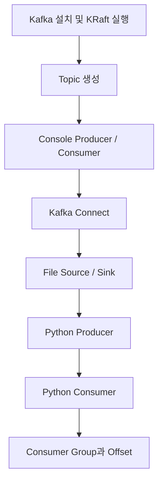
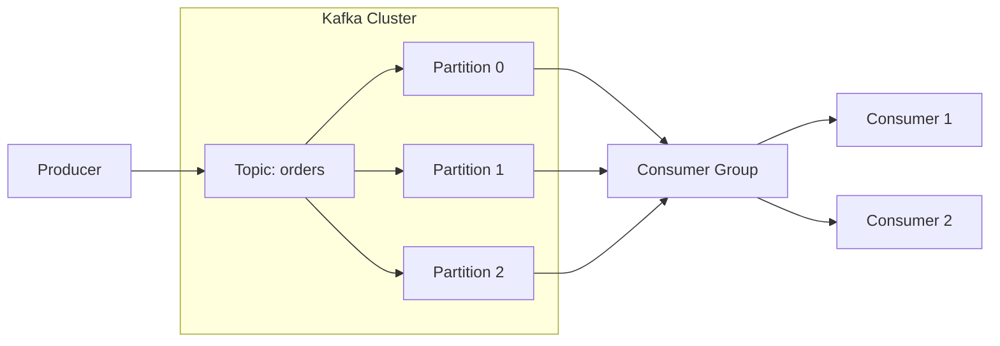
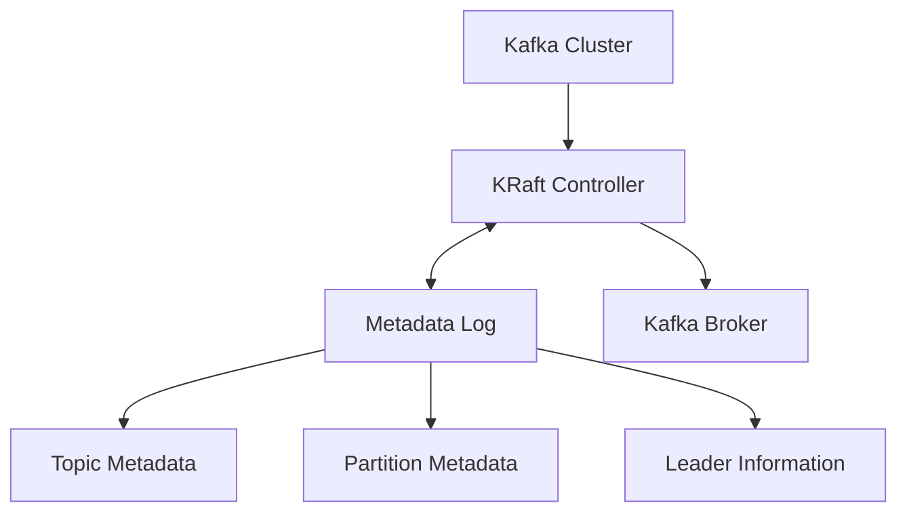
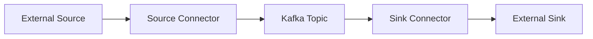
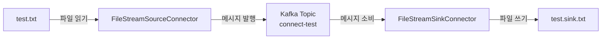
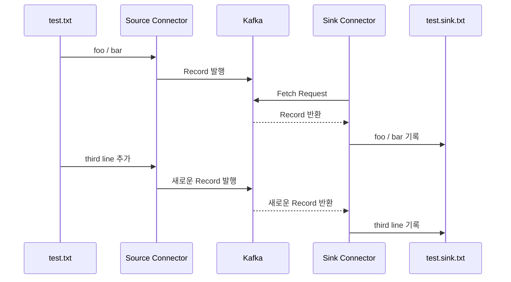
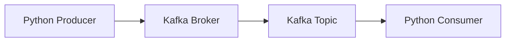
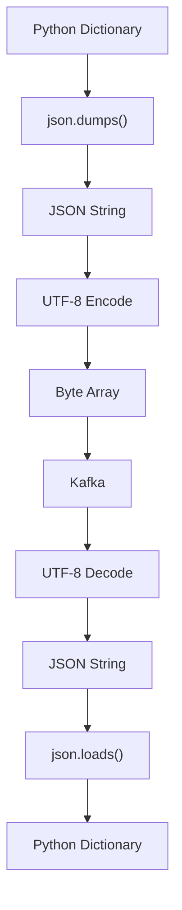
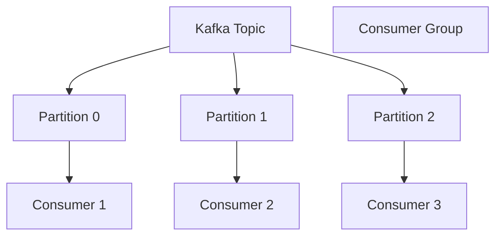
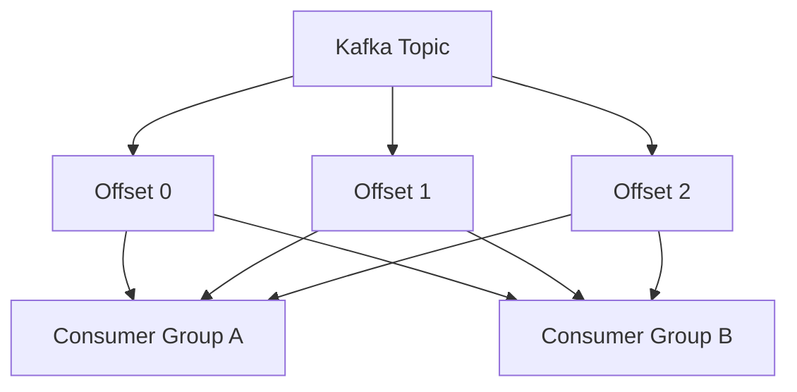

# 카프카 시작하기

# 카프카 시작하기

* toc
{:toc}

---

### Apache Kafka 시작하기: KRaft 설치부터 Kafka Connect, Python Producer·Consumer 구현까지

Apache Kafka는 대규모 데이터를 안정적으로 저장하고 전달하기 위한 분산 이벤트 스트리밍 플랫폼이다.

Kafka의 기본적인 동작 구조는 비교적 단순하다.

Producer가 Topic에 메시지를 전송하면 Kafka Broker가 이를 저장하고, Consumer가 필요한 메시지를 읽어 처리한다.

하지만 실제로 Kafka를 사용하기 위해서는 단순히 Producer와 Consumer의 개념을 이해하는 것만으로는 부족하다.

Kafka를 실행하고, Topic을 생성하고, 애플리케이션에서 메시지를 전송하고 소비하는 전체 과정을 이해해야 한다.

특히 Kafka는 일반적인 메시지 큐와 달리 메시지를 읽었다는 이유만으로 해당 메시지를 삭제하지 않는다.

메시지는 Kafka의 보존 정책에 따라 유지되며, Consumer는 Offset을 기준으로 자신이 읽을 위치를 관리한다.

따라서 Kafka를 직접 실행하면 다음과 같은 중요한 질문을 확인할 수 있다.

- Kafka Broker는 어떻게 실행되는가?
- ZooKeeper 없이 Kafka Cluster를 구성할 수 있는가?
- Topic과 Partition은 어떻게 생성되는가?
- Producer가 전송한 메시지는 어디에 저장되는가?
- Consumer가 메시지를 읽은 후에도 데이터가 남아 있는 이유는 무엇인가?
- Kafka Connect는 Producer와 Consumer를 직접 개발하는 방식과 무엇이 다른가?
- Python에서는 Kafka에 메시지를 어떻게 전송하는가?
- 문자열과 JSON 메시지는 어떻게 직렬화하고 역직렬화하는가?
- Consumer를 재실행했을 때 이전 메시지를 다시 읽지 않는 이유는 무엇인가?
- 메시지 전송에 성공한 것과 실제 업무 처리가 완료된 것은 어떻게 다른가?

이번 글에서는 이러한 내용을 실제 명령어와 코드를 통해 살펴본다.

전체 구성은 다음과 같다.



모든 예제는 로컬 환경에서 단일 Kafka Broker를 실행하는 것을 기준으로 한다.

**단일 Broker와 Replication Factor 1을 사용하는 구성은 Kafka의 기본 동작을 확인하기 위한 환경이며, 실제 운영 환경의 고가용성을 보장하는 구성은 아니다.**

---

### Kafka란?

#### Kafka의 기본 구조

Kafka는 Producer와 Consumer 사이에서 데이터를 저장하고 전달하는 역할을 수행한다.

기본적인 구성 요소는 다음과 같다.

| 구성 요소 | 설명 |
|---|---|
| Producer | Kafka에 메시지를 발행하는 애플리케이션 |
| Broker | 메시지를 저장하고 요청을 처리하는 Kafka 서버 |
| Topic | 메시지를 논리적으로 구분하는 이름 |
| Partition | Topic의 데이터를 분산하여 저장하는 단위 |
| Consumer | Kafka에 저장된 메시지를 읽는 애플리케이션 |
| Consumer Group | 여러 Consumer가 Partition을 나누어 처리하는 그룹 |
| Offset | Partition 내부에서 메시지의 위치를 나타내는 값 |

전체 구조는 다음과 같다.



Producer는 Topic에 Record를 전송한다.

Kafka는 해당 Record를 Partition에 기록한다.

Consumer는 자신에게 할당된 Partition에서 Record를 읽는다.

여기서 중요한 개념은 **메시지를 저장하는 것과 소비하는 것이 서로 독립적인 작업**이라는 사실이다.

예를 들어 Consumer가 메시지를 읽었다고 해서 Kafka에 저장된 Record가 즉시 삭제되지는 않는다.

Kafka는 설정된 보존 정책에 따라 Record를 유지하며, 다른 Consumer Group은 동일한 Record를 독립적으로 읽을 수 있다.

이러한 특성 때문에 Kafka는 단순 작업 큐뿐 아니라 이벤트 스트리밍과 데이터 파이프라인에도 활용된다.

---

### Kafka 설치 환경 준비

#### Kafka 실행에 필요한 구성 요소

Kafka를 실행하기 위해서는 Java 실행 환경이 필요하다.

Kafka 4.0의 Broker와 관리 도구는 Java 17 이상을 요구한다.

Python 애플리케이션을 개발할 때는 별도의 Python 클라이언트를 사용한다.

이번 글에서는 다음 환경을 기준으로 한다.

| 항목 | 사용 버전 및 설정 |
|---|---|
| 운영체제 | macOS 또는 Linux |
| Java | JDK 17 이상 |
| Apache Kafka | 4.0.2 |
| Python | 3.10 이상 |
| Kafka Python Client | kafka-python 3.0.12 |
| Broker 주소 | localhost:9092 |
| Controller 주소 | localhost:9093 |
| Kafka 실행 방식 | KRaft |
| Broker 수 | 1 |
| 기본 Replication Factor | 1 |

Kafka 4.0.2는 전체 과정을 일관된 환경에서 재현하기 위해 선택한 고정 버전이다.

2026년 11월 기준 Apache Kafka 4.4까지 공개되어 있으므로, 이 예제의 버전을 최신 릴리스와 동일한 것으로 이해해서는 안 된다.

Kafka 4.0 계열에서는 ZooKeeper 기반 실행 모드가 제거되었으며 KRaft를 사용한다.

#### Java 버전 확인

터미널에서 다음 명령어를 실행한다.

```bash
java -version
```

설치된 Java 버전을 확인할 수 있다.

출력 예시는 다음과 같다.

```text
openjdk version "17.0.x"
OpenJDK Runtime Environment
OpenJDK 64-Bit Server VM
```

실제 출력은 설치된 Java 배포판과 버전에 따라 달라진다.

Java가 여러 개 설치되어 있다면 `JAVA_HOME`을 확인하는 것도 좋다.

```bash
echo "$JAVA_HOME"
```

Kafka 실행 스크립트가 어떤 Java 환경을 사용할지 확인할 수 있다.

#### Python 버전 확인

```bash
python3 --version
```

출력 예시는 다음과 같다.

```text
Python 3.10.11
```

Python은 Kafka Broker 자체를 실행하는 데 필요한 것은 아니다.

이후 Python Producer와 Consumer를 구현할 때 사용한다.

---

### Kafka 다운로드 및 설치

#### Kafka 바이너리 다운로드

먼저 작업할 디렉터리를 생성한다.

```bash
mkdir -p "$HOME/kafka-lab"

cd "$HOME/kafka-lab"
```

`mkdir -p`는 지정한 디렉터리가 존재하지 않으면 생성한다.

`cd`는 현재 작업 디렉터리를 이동하는 명령어다.

이제 Kafka를 다운로드한다.

```bash
curl -fLO \
  https://archive.apache.org/dist/kafka/4.0.2/kafka_2.13-4.0.2.tgz
```

`curl`의 옵션은 다음과 같다.

| 옵션 | 설명 |
|---|---|
| `-f` | HTTP 요청이 실패하면 오류를 반환 |
| `-L` | Redirect가 발생하면 이동 |
| `-O` | 원격 파일 이름으로 저장 |

여기서는 Apache Archive에 저장된 Kafka 4.0.2 바이너리를 사용한다.

Kafka의 이전 릴리스는 일반 다운로드 미러에서 제공되지 않을 수 있으므로, 고정된 버전을 다시 설치해야 할 때 Archive가 유용하다.

#### 파일 이름 이해하기

다운로드한 파일 이름은 다음과 같다.

```text
kafka_2.13-4.0.2.tgz
```

여기서 두 버전을 구분해야 한다.

```text
2.13
```

Scala 바이너리 버전을 의미한다.

```text
4.0.2
```

Apache Kafka 버전을 의미한다.

Kafka의 일부 구성 요소는 Scala를 기반으로 개발되었기 때문에 배포 파일 이름에 Scala 버전이 포함되어 있다.

하지만 Kafka를 실행하기 위해 Scala 개발 환경을 별도로 설치해야 한다는 의미는 아니다.

#### 압축 해제

다운로드가 완료되면 다음 명령어를 실행한다.

```bash
tar -xzf kafka_2.13-4.0.2.tgz
```

옵션의 의미는 다음과 같다.

| 옵션 | 설명 |
|---|---|
| `-x` | 파일 추출 |
| `-z` | gzip 압축 해제 |
| `-f` | 대상 파일 지정 |

압축 해제가 완료되면 Kafka 디렉터리로 이동한다.

```bash
cd kafka_2.13-4.0.2
```

디렉터리의 내용을 확인한다.

```bash
ls -al
```

대표적으로 다음 구성 요소가 존재한다.

```text
bin
config
libs
licenses
LICENSE
NOTICE
```

#### Kafka 디렉터리 구조

| 디렉터리 | 역할 |
|---|---|
| `bin` | Kafka 실행 및 관리 명령어 |
| `config` | Broker와 Connect 등의 설정 |
| `libs` | Kafka 실행에 필요한 라이브러리 |
| `licenses` | 포함된 소프트웨어의 라이선스 정보 |
| `LICENSE` | 라이선스 정보 |
| `NOTICE` | 관련 고지 사항 |

가장 많이 사용하는 디렉터리는 `bin`과 `config`다.

예를 들어 다음과 같은 명령어가 `bin`에 존재한다.

```text
kafka-server-start.sh

kafka-storage.sh

kafka-topics.sh

kafka-console-producer.sh

kafka-console-consumer.sh

connect-standalone.sh
```

각 명령어는 Kafka 실행과 Topic 관리, 메시지 송수신, 외부 시스템 연결 등에 사용된다.

---

### KRaft란?

#### Kafka가 ZooKeeper 없이 동작하는 이유

Kafka는 과거에 Cluster Metadata 관리를 위해 Apache ZooKeeper를 사용했다.

ZooKeeper는 분산 시스템에서 구성 정보와 상태를 관리하는 데 활용되는 기술이다.

Kafka에서도 Broker와 Controller, Topic 및 Partition 관련 메타데이터를 관리하는 데 사용되었다.

하지만 ZooKeeper를 별도로 운영해야 한다는 점에서 시스템 구성과 장애 대응이 복잡해질 수 있었다.

이러한 문제를 해결하기 위해 Kafka는 KRaft를 도입했다.

KRaft는 Kafka의 자체적인 Raft 기반 메타데이터 합의 메커니즘이다.

Kafka 4.0부터는 ZooKeeper 모드가 제거되었으므로 KRaft 기반으로 실행해야 한다.

#### KRaft의 기본 구조



KRaft Controller는 Kafka Cluster의 메타데이터를 관리한다.

여러 Controller로 구성된 환경에서는 Controller Quorum을 통해 메타데이터 변경에 대한 합의를 수행한다.

반면 Broker는 실제 메시지 저장과 읽기·쓰기 요청 처리를 담당한다.

로컬 환경에서는 하나의 Kafka 프로세스가 Broker와 Controller 역할을 동시에 수행할 수 있다.

이를 Combined Mode라고 한다.

다만 실제 운영 환경에서는 가용성과 장애 격리를 위해 별도의 Controller 구성을 검토해야 한다.

---

### Kafka Cluster ID 생성

#### Cluster ID란?

Kafka는 Cluster를 식별하기 위해 Cluster ID를 사용한다.

Cluster ID는 다음과 같은 식별자들과 다르다.

| 식별자 | 의미 |
|---|---|
| Cluster ID | Kafka Cluster 자체의 식별자 |
| Broker ID / Node ID | Kafka 노드 식별자 |
| Topic Name | 메시지를 논리적으로 구분하는 이름 |
| Consumer Group ID | Consumer Group 식별자 |

Cluster ID는 Kafka 저장소를 초기화할 때 필요하다.

#### Cluster ID 생성 명령어

Kafka 설치 디렉터리에서 다음 명령어를 실행한다.

```bash
KAFKA_CLUSTER_ID="$(bin/kafka-storage.sh random-uuid)"
```

이 명령어는 `kafka-storage.sh`를 이용하여 새로운 UUID를 생성한다.

그리고 생성된 값을 `KAFKA_CLUSTER_ID` 환경변수에 저장한다.

값을 확인하려면 다음 명령어를 실행한다.

```bash
echo "$KAFKA_CLUSTER_ID"
```

UUID 형태의 값이 출력된다.

실제 값은 실행할 때마다 달라질 수 있다.

---

### Kafka 저장소 초기화

#### kafka-storage.sh format

Kafka를 최초 실행하기 전에 저장소를 초기화해야 한다.

다음 명령어를 사용한다.

```bash
bin/kafka-storage.sh format \
  --standalone \
  -t "$KAFKA_CLUSTER_ID" \
  -c config/server.properties
```

각 옵션의 의미는 다음과 같다.

| 옵션 | 설명 |
|---|---|
| `format` | Kafka 저장소 초기화 |
| `--standalone` | 단일 Controller용 초기화 |
| `-t` | Cluster ID 지정 |
| `-c` | Kafka 설정 파일 지정 |

정상적으로 실행되면 다음과 비슷한 결과가 출력될 수 있다.

```text
Formatting dynamic metadata voter directory
/tmp/kraft-combined-logs
```

이 경로는 Kafka 4.0.2의 기본 구성에서 사용될 수 있는 저장 경로다.

실제 경로는 `config/server.properties` 설정에 따라 달라진다.

#### 저장소 Format에서 주의할 점

**저장소 초기화는 Kafka를 실행할 때마다 수행하는 작업이 아니다.**

최초 실행 시 저장소를 준비하는 과정이다.

이미 Kafka 데이터가 존재하는 환경에서 무분별하게 저장소를 초기화하거나 삭제하면 기존 Topic과 메시지, 메타데이터가 손실될 수 있다.

따라서 다음 두 상황을 구분해야 한다.

**최초 설치**

```text
Cluster ID 생성
    ↓
저장소 Format
    ↓
Broker 실행
```

**기존 Kafka 재시작**

```text
기존 저장소 유지
    ↓
Broker 실행
```

또한 `--standalone`은 Kafka의 단일 Controller 초기화에 사용하는 옵션이다.

뒤에서 살펴볼 Kafka Connect의 Standalone Mode와는 다른 개념이다.

---

### Kafka Broker 실행

#### Broker 시작

이제 Kafka Broker를 실행한다.

```bash
bin/kafka-server-start.sh config/server.properties
```

Kafka 서버가 실행되면서 로그가 출력된다.

정상적으로 시작되면 다음과 같은 로그를 확인할 수 있다.

```text
Kafka Server started
```

Kafka 4.0.2에서는 Broker와 Controller가 함께 동작하는 단일 노드 구성을 사용할 수 있다.

기본적인 접속 구조는 다음과 같다.

```text
Kafka Broker

localhost:9092
```

```text
KRaft Controller

localhost:9093
```

다만 실제 Listener 주소와 포트는 설정 파일에 따라 달라질 수 있다.

#### Kafka 실행 상태 확인

Kafka Broker가 실행 중인 터미널에서는 계속 로그가 출력될 수 있다.

이는 정상적인 동작이다.

Broker를 실행한 터미널은 유지하고, 새로운 터미널을 열어 Topic을 생성하거나 메시지를 전송한다.

#### Broker와 Controller의 차이

| 구분 | Broker | Controller |
|---|---|---|
| 주요 역할 | 메시지 저장 및 요청 처리 | Cluster Metadata 관리 |
| 주요 작업 | Produce, Fetch | 메타데이터 변경 및 Leader 관리 |
| 데이터 | Topic과 Partition의 메시지 | Cluster Metadata |
| KRaft 단일 노드 | 함께 실행 가능 | 함께 실행 가능 |

Kafka 4.0의 KRaft 실행 방식은 Apache Kafka 공식 실행 절차에서도 확인할 수 있다.

---

### Kafka Topic 생성하기

#### Topic이란?

Topic은 Kafka에서 메시지를 논리적으로 구분하는 이름이다.

예를 들어 다음과 같은 Topic을 생성할 수 있다.

```text
orders

payments

notifications
```

각 Topic은 서로 다른 종류의 데이터를 저장하는 데 사용할 수 있다.

이번에는 다음 이름의 Topic을 생성한다.

```text
quickstart-events
```

#### Topic 생성 명령어

새로운 터미널을 열고 Kafka 설치 디렉터리로 이동한다.

```bash
cd "$HOME/kafka-lab/kafka_2.13-4.0.2"
```

다음 명령어로 Topic을 생성한다.

```bash
bin/kafka-topics.sh \
  --bootstrap-server localhost:9092 \
  --create \
  --topic quickstart-events \
  --partitions 1 \
  --replication-factor 1
```

각 옵션의 의미는 다음과 같다.

| 옵션 | 설명 |
|---|---|
| `--bootstrap-server` | Kafka Broker 접속 주소 |
| `--create` | Topic 생성 |
| `--topic` | 생성할 Topic 이름 |
| `--partitions` | Partition 개수 |
| `--replication-factor` | Partition 복제본 개수 |

정상적으로 생성되면 다음 메시지가 출력된다.

```text
Created topic quickstart-events.
```

#### Partition을 하나로 생성하는 이유

이번 환경에서는 Kafka Broker가 하나만 존재한다.

따라서 Partition을 하나로 구성하고 Replication Factor도 1로 설정한다.

```text
Topic: quickstart-events

Partition 0

Replication Factor: 1
```

이 구성에서는 Partition 0의 데이터를 다른 Broker에 복제하지 않는다.

따라서 Broker 자체가 손실되면 데이터를 복구할 수 없을 수 있다.

실제 운영 환경에서는 데이터 중요도에 맞는 Broker 수와 Replication Factor를 선택해야 한다.

---

### Topic 상태 확인하기

생성한 Topic의 상태를 확인하려면 다음 명령어를 실행한다.

```bash
bin/kafka-topics.sh \
  --bootstrap-server localhost:9092 \
  --describe \
  --topic quickstart-events
```

다음과 비슷한 결과가 출력된다.

```text
Topic: quickstart-events
PartitionCount: 1
ReplicationFactor: 1

Topic: quickstart-events
Partition: 0
Leader: 1
Replicas: 1
Isr: 1
```

실제 출력에는 Topic ID나 추가 메타데이터가 포함될 수 있다.

#### 출력 항목 이해하기

| 항목 | 설명 |
|---|---|
| Topic | Topic 이름 |
| PartitionCount | Partition 수 |
| ReplicationFactor | 복제본 수 |
| Partition | Partition 번호 |
| Leader | 해당 Partition의 Leader Broker |
| Replicas | 복제본을 보유한 Broker |
| Isr | Leader와 동기화된 Replica 집합 |

여기서는 Broker 1이 Partition 0의 Leader다.

Replication Factor가 1이므로 Replica도 Broker 1 하나뿐이다.

따라서 ISR에도 Broker 1이 포함된다.

#### Replication Factor가 1일 때 acks=all의 의미

Producer에서 `acks=all`을 설정했다고 가정해 보자.

이 경우 가장 강한 저장 확인 수준을 사용한다.

하지만 실제 Replica가 하나뿐이라면 다른 Broker로의 복제는 발생하지 않는다.

따라서 다음 두 개념을 반드시 구분해야 한다.

**acks는 Producer가 어떤 수준의 저장 확인을 기다릴지 결정한다.**

**Replication Factor는 실제로 몇 개의 복제본을 유지할지 결정한다.**

Producer 설정만으로 Kafka의 고가용성을 보장할 수는 없다.

---

### Console Producer 사용하기

#### Console Producer란?

Kafka는 터미널에서 간단하게 메시지를 전송할 수 있는 Console Producer를 제공한다.

별도의 Java나 Python 코드를 작성하지 않아도 Kafka에 메시지를 전송할 수 있다.

#### Console Producer 실행

다음 명령어를 실행한다.

```bash
bin/kafka-console-producer.sh \
  --bootstrap-server localhost:9092 \
  --topic quickstart-events
```

명령어를 실행하면 입력 대기 상태가 된다.

다음 문자열을 한 줄씩 입력한다.

```text
This is my first event
This is my second event
This is my third event
```

기본적인 Console Producer에서는 한 줄이 하나의 Kafka Record로 처리된다.

따라서 세 줄을 입력했다면 세 개의 Record가 전송된다.

#### 메시지는 어떤 형태로 저장될까?

이번에는 Key를 지정하지 않았다.

따라서 Record는 개념적으로 다음과 같다.

```text
Topic: quickstart-events

Key: null

Value: This is my first event
```

Kafka는 Value를 Byte 데이터로 저장한다.

Console Producer가 입력 문자열을 직렬화하여 Kafka에 전송하는 것이다.

입력이 완료되었다면 `Ctrl+C`를 눌러 종료할 수 있다.

---

### Console Consumer 사용하기

#### Console Consumer란?

Console Consumer는 Kafka Topic에 저장된 메시지를 터미널에서 읽기 위한 도구다.

앞에서 전송한 세 개의 메시지를 확인해 보자.

#### Consumer 실행

```bash
bin/kafka-console-consumer.sh \
  --bootstrap-server localhost:9092 \
  --topic quickstart-events \
  --from-beginning
```

다음과 같은 결과를 확인할 수 있다.

```text
This is my first event
This is my second event
This is my third event
```

세 개의 메시지를 읽었다.

하지만 Consumer 프로세스는 바로 종료되지 않는다.

새로운 Record가 들어오기를 기다리는 상태로 유지된다.

다른 터미널에서 Console Producer를 실행하고 새로운 문자열을 입력하면 Consumer에서 해당 메시지를 확인할 수 있다.

#### Consumer가 메시지를 읽으면 삭제될까?

Kafka에서는 Consumer가 메시지를 읽었다고 해서 해당 메시지가 즉시 삭제되지 않는다.

Kafka는 메시지 보존 정책에 따라 데이터를 유지한다.

Consumer는 자신이 읽을 위치를 Offset으로 관리한다.

따라서 다른 Consumer Group은 같은 Topic의 메시지를 독립적으로 읽을 수 있다.

이것이 Kafka와 일반적인 작업 큐 사이의 중요한 차이점이다.

---

### --from-beginning 옵션 이해하기

#### --from-beginning의 의미

다음 옵션을 살펴보자.

```bash
--from-beginning
```

이 옵션은 유효한 Committed Offset이 없는 Consumer Group이 현재 보존된 가장 이른 메시지부터 읽도록 하는 데 사용된다.

여기서 중요한 점이 있다.

**`--from-beginning`을 사용했다고 매번 무조건 Offset 0부터 읽는 것은 아니다.**

Consumer Group에 이미 유효한 Committed Offset이 존재한다면 해당 위치를 기준으로 읽는다.

#### Consumer Group이 없는 경우

새로운 Consumer Group이 Topic을 읽는다고 가정해 보자.

```text
Topic: quickstart-events

Offset 0 → Event A
Offset 1 → Event B
Offset 2 → Event C
```

새로운 Consumer Group에 유효한 Committed Offset이 없다면 `--from-beginning`을 이용하여 현재 보존된 가장 이른 위치부터 읽을 수 있다.

#### 이미 Commit된 Offset이 있는 경우

Consumer Group의 Committed Offset이 3이라고 가정해 보자.

```text
Committed Offset = 3
```

이 경우 같은 Group으로 다시 실행하면 Offset 3부터 이후 메시지를 읽는다.

따라서 이전에 처리한 A, B, C가 다시 출력되지 않을 수 있다.

#### 처음부터 다시 읽는 방법

새로운 Consumer Group을 지정하면 독립적인 읽기 위치를 사용할 수 있다.

```bash
bin/kafka-console-consumer.sh \
  --bootstrap-server localhost:9092 \
  --topic quickstart-events \
  --group quickstart-replay-01 \
  --from-beginning
```

다른 Group을 사용하면 기존 Group의 Offset에 영향을 받지 않고 메시지를 읽을 수 있다.

단, Kafka의 보존 기간이 지나 삭제된 데이터까지 복구할 수 있는 것은 아니다.

---

### Kafka Connect란?

#### Kafka Connect를 사용하는 이유

지금까지는 Console Producer와 Consumer를 직접 실행하여 메시지를 주고받았다.

하지만 실제 서비스에서는 Kafka와 외부 시스템을 연결해야 하는 경우가 많다.

예를 들어 다음과 같은 요구사항이 존재할 수 있다.

- 데이터베이스 변경 사항을 Kafka에 전달한다.
- 파일 데이터를 Kafka에 수집한다.
- Kafka의 메시지를 Elasticsearch에 저장한다.
- Kafka에 저장된 이벤트를 데이터 웨어하우스로 전달한다.

이러한 기능을 직접 개발하려면 Producer와 Consumer 코드뿐 아니라 장애 복구와 Offset 관리 기능도 구현해야 한다.

Kafka Connect는 이러한 반복적인 데이터 이동 작업을 표준화하기 위한 프레임워크다.

#### Source Connector와 Sink Connector

Kafka Connect에서는 데이터 이동 방향에 따라 두 가지 Connector를 구분한다.

**Source Connector**

외부 시스템의 데이터를 읽어 Kafka에 기록한다.

**Sink Connector**

Kafka에서 데이터를 읽어 외부 시스템에 기록한다.



이번에는 파일을 이용하여 Kafka Connect의 동작을 확인한다.

---

### Kafka Connect로 파일 데이터를 전달하기

#### 전체 아키텍처

다음과 같은 데이터 처리 구조를 구성한다.



이 구조의 동작 과정은 다음과 같다.

첫 번째로 `test.txt` 파일에 문자열을 저장한다.

두 번째로 FileStream Source Connector가 파일을 읽는다.

세 번째로 읽은 문자열을 Kafka Topic에 전송한다.

네 번째로 FileStream Sink Connector가 해당 Topic에서 메시지를 읽는다.

마지막으로 읽은 메시지를 `test.sink.txt` 파일에 저장한다.

이 과정을 통해 Kafka Connect에서 Source와 Sink가 어떤 역할을 수행하는지 이해할 수 있다.

---

### Kafka Connect Plugin 설정

#### plugin.path가 필요한 이유

Kafka Connect는 Connector를 플러그인 형태로 로딩할 수 있다.

하지만 모든 Connector가 기본 실행 경로에 포함되는 것은 아니다.

Kafka 4.0.2의 FileStream Connector를 사용하려면 해당 JAR 파일의 위치를 Connect Worker에 알려 주어야 한다.

이번 환경에서는 다음 파일을 사용한다.

```text
libs/connect-file-4.0.2.jar
```

#### Plugin 설정

다음 파일을 수정한다.

```text
config/connect-standalone.properties
```

여기에 `plugin.path`를 설정한다.

```properties
plugin.path=libs/connect-file-4.0.2.jar
```

다만 운영 환경에서는 상대 경로보다 절대 경로를 사용하는 것이 실행 위치에 따른 문제를 줄이는 데 유리하다.

또한 기존 설정 파일에 같은 Key를 반복적으로 추가하지 않도록 주의해야 한다.

#### Kafka Connect Worker 전체 설정 예제

다음은 이번 예제에서 사용할 설정이다.

```properties
bootstrap.servers=localhost:9092

key.converter=org.apache.kafka.connect.json.JsonConverter
value.converter=org.apache.kafka.connect.json.JsonConverter

key.converter.schemas.enable=true
value.converter.schemas.enable=true

offset.storage.file.filename=connect.offsets
offset.flush.interval.ms=1000

plugin.path=libs/connect-file-4.0.2.jar

listeners=http://127.0.0.1:8083
```

각 항목의 의미는 다음과 같다.

| 설정 | 설명 |
|---|---|
| bootstrap.servers | Kafka Broker 주소 |
| key.converter | Kafka Key의 변환 방식 |
| value.converter | Kafka Value의 변환 방식 |
| key.converter.schemas.enable | Key의 스키마 포함 여부 |
| value.converter.schemas.enable | Value의 스키마 포함 여부 |
| offset.storage.file.filename | Source Offset 저장 파일 |
| offset.flush.interval.ms | Offset 저장 주기 |
| plugin.path | Connector 플러그인 경로 |
| listeners | Connect REST API Listener |

여기서 `offset.storage.file.filename`은 중요한 설정이다.

Kafka Connect의 Standalone Mode에서는 Source Connector가 원본 데이터를 어디까지 읽었는지 로컬 파일에 저장할 수 있다.

이를 통해 재실행 시 마지막 처리 위치를 복구할 수 있다.

---

### Source Connector 설정

다음 파일을 작성한다.

```text
config/connect-file-source.properties
```

전체 설정은 다음과 같다.

```properties
name=local-file-source

connector.class=org.apache.kafka.connect.file.FileStreamSourceConnector

tasks.max=1

file=test.txt

topic=connect-test
```

#### 주요 설정 설명

**name**

Connector를 식별하는 이름이다.

```properties
name=local-file-source
```

**connector.class**

사용할 Connector 구현체를 지정한다.

```properties
connector.class=org.apache.kafka.connect.file.FileStreamSourceConnector
```

**tasks.max**

생성 가능한 Task 수의 상한을 지정한다.

```properties
tasks.max=1
```

**file**

읽을 원본 파일을 지정한다.

```properties
file=test.txt
```

**topic**

읽은 데이터를 발행할 Kafka Topic을 지정한다.

```properties
topic=connect-test
```

Source Connector는 `test.txt`를 읽어 `connect-test` Topic에 Record를 발행한다.

---

### Sink Connector 설정

다음 파일을 작성한다.

```text
config/connect-file-sink.properties
```

전체 설정은 다음과 같다.

```properties
name=local-file-sink

connector.class=org.apache.kafka.connect.file.FileStreamSinkConnector

tasks.max=1

file=test.sink.txt

topics=connect-test
```

Sink Connector는 Kafka에서 Record를 읽어 `test.sink.txt`에 저장한다.

여기서 Source Connector와 Sink Connector의 설정 차이를 확인해야 한다.

| Connector | 설정 | 의미 |
|---|---|---|
| Source | `topic=connect-test` | 발행할 Topic |
| Sink | `topics=connect-test` | 읽을 Topic |

Source에서는 `topic`을 사용한다.

Sink에서는 `topics`를 사용한다.

설정 이름이 다르므로 주의해야 한다.

---

### Kafka Connect 실행하기

#### 입력 파일 생성

Kafka 설치 디렉터리에서 다음 명령어를 실행한다.

```bash
printf 'foo\nbar\n' > test.txt
```

이 명령어는 `test.txt` 파일을 생성하고 두 줄의 문자열을 기록한다.

```text
foo
bar
```

`printf`를 사용하면 줄바꿈 문자를 명확하게 지정할 수 있다.

#### Kafka Topic 생성

Kafka Connect가 사용할 Topic을 생성한다.

```bash
bin/kafka-topics.sh \
  --bootstrap-server localhost:9092 \
  --create \
  --topic connect-test \
  --partitions 1 \
  --replication-factor 1
```

이제 Kafka Connect를 실행할 준비가 완료되었다.

#### Kafka Connect 실행

다음 명령어를 실행한다.

```bash
bin/connect-standalone.sh \
  config/connect-standalone.properties \
  config/connect-file-source.properties \
  config/connect-file-sink.properties
```

이 명령어에는 세 개의 설정 파일이 사용된다.

| 순서 | 파일 | 역할 |
|---|---|---|
| 첫 번째 | connect-standalone.properties | Worker 설정 |
| 두 번째 | connect-file-source.properties | Source Connector |
| 세 번째 | connect-file-sink.properties | Sink Connector |

여기서 중요한 점은 **Source와 Sink가 각각 별도의 Connect Worker로 실행되는 것이 아니라는 사실**이다.

이번에는 하나의 Standalone Worker에서 두 Connector를 함께 실행한다.

---

### Kafka Connect 실행 결과 확인하기

#### Sink 파일 확인

Kafka Connect가 정상적으로 실행되면 다음 파일이 생성된다.

```text
test.sink.txt
```

내용을 확인한다.

```bash
cat test.sink.txt
```

다음과 같은 결과를 확인할 수 있다.

```text
foo
bar
```

원본 파일에 저장한 데이터가 Kafka를 거쳐 결과 파일에 기록되었다.

#### 파일에 새로운 데이터 추가

이번에는 Kafka Connect를 종료하지 않고 원본 파일에 데이터를 추가해 보자.

```bash
printf 'third line\n' >> test.txt
```

여기서 `>>`는 파일 뒤에 새로운 내용을 추가하는 연산자다.

반면 `>`는 기존 파일 내용을 덮어쓸 수 있다.

파일에 계속 들어오는 데이터를 확인하려면 다음 명령어를 사용할 수 있다.

```bash
tail -f test.sink.txt
```

`tail -f`는 파일의 마지막 부분을 출력하면서 새로운 내용이 추가되는지 계속 확인한다.

정상적으로 동작하면 다음 내용이 추가된다.

```text
third line
```

#### 전체 동작 순서



이처럼 Kafka Connect는 데이터 수집과 전달을 지속적으로 수행할 수 있다.

---

### Kafka Connect가 저장한 메시지 확인하기

지금까지는 파일의 입력과 출력만 확인했다.

하지만 실제로는 Kafka Topic에 Record가 저장된다.

다음 명령어를 실행해 보자.

```bash
bin/kafka-console-consumer.sh \
  --bootstrap-server localhost:9092 \
  --topic connect-test \
  --from-beginning
```

다음과 같은 형태의 메시지를 확인할 수 있다.

```json
{"schema":{"type":"string","optional":false},"payload":"foo"}
```

```json
{"schema":{"type":"string","optional":false},"payload":"bar"}
```

#### 파일에는 foo만 있는데 Kafka에는 JSON이 저장되는 이유

원본 파일에는 다음 문자열만 존재한다.

```text
foo
```

하지만 Kafka에는 다음과 같은 구조가 기록되었다.

```json
{
  "schema": {
    "type": "string",
    "optional": false
  },
  "payload": "foo"
}
```

이는 Kafka Connect의 JSON Converter가 적용되었기 때문이다.

앞에서 다음 설정을 사용했다.

```properties
value.converter=org.apache.kafka.connect.json.JsonConverter

value.converter.schemas.enable=true
```

Connect는 내부 데이터 모델을 Kafka에 저장할 수 있는 Byte 데이터로 변환해야 한다.

여기서는 JSON Converter를 사용하며 스키마 정보를 포함하도록 설정했다.

따라서 `schema`와 `payload`를 가진 JSON 형식으로 저장된다.

#### schema와 payload의 의미

**schema**

데이터 구조를 설명한다.

```json
{
  "type": "string",
  "optional": false
}
```

**payload**

실제 데이터다.

```json
"foo"
```

Sink Connector는 이 데이터를 다시 Connect 내부 형태로 변환한 뒤 파일에 기록한다.

#### Schema Registry와의 차이

이 JSON에 `schema`라는 필드가 존재한다고 해서 Schema Registry를 사용한 것은 아니다.

이번 예제는 Kafka Connect의 JSON Converter가 스키마 정보를 메시지에 포함하는 방식이다.

Schema Registry는 별도의 스키마 등록·관리 서비스를 제공하는 기술이다.

두 개념은 구분해야 한다.

---

### Kafka Connect의 Source Offset 관리

Kafka Connect는 단순히 파일을 읽고 쓰는 것 이상의 기능을 제공한다.

특히 어디까지 데이터를 읽었는지 관리하는 기능이 중요하다.

#### Source Offset이 필요한 이유

다음과 같은 파일이 있다고 가정해 보자.

```text
foo
bar
third line
```

Source Connector가 이 파일을 끝까지 읽었다.

그런데 Connect Worker가 종료되었다.

이후 Worker가 재시작되면 어떤 위치부터 파일을 읽어야 할까?

처리 위치가 없다면 매번 파일 처음부터 읽게 될 수 있다.

그러면 같은 메시지가 Kafka에 반복적으로 기록될 수 있다.

이를 방지하기 위해 Source Connector는 처리 위치를 관리한다.

이번 Standalone 환경에서는 다음 설정을 사용했다.

```properties
offset.storage.file.filename=connect.offsets
```

따라서 Source Connector는 해당 파일을 통해 읽기 위치를 저장하고 복구할 수 있다.

#### Source Offset과 Consumer Offset의 차이

| 구분 | Source Offset | Consumer Offset |
|---|---|---|
| 의미 | 외부 원본을 어디까지 읽었는가? | Kafka를 어디까지 소비했는가? |
| 관리 대상 | 파일, DB 로그 등 | Kafka Partition |
| 주요 사용 | Source Connector | Consumer 및 Sink Connector |
| 장애 시 역할 | 외부 데이터 읽기 위치 복구 | Kafka 메시지 읽기 위치 복구 |

두 Offset은 서로 다른 위치를 나타낸다.

따라서 Source와 Sink의 장애 복구를 동일한 문제로 이해해서는 안 된다.

#### 결과 파일만 삭제하면 다시 생성될까?

반드시 그렇지는 않다.

예를 들어 `test.sink.txt`를 삭제했다고 가정해 보자.

하지만 Sink Connector의 Consumer Group에는 이미 처리한 Kafka Offset이 저장되어 있을 수 있다.

이 경우 결과 파일만 삭제해도 과거 Kafka Record를 자동으로 처음부터 다시 읽지는 않을 수 있다.

반대로 Source의 Offset 상태 파일을 삭제하면 이미 읽은 원본 파일 내용을 다시 발행할 위험이 있다.

따라서 Kafka Connect를 운영할 때는 다음 상태를 구분해야 한다.

- 원본 데이터
- Source Offset
- Kafka Topic
- Sink Consumer Offset
- 최종 결과 데이터

이러한 상태는 장애 복구 시 중요한 기준이 된다.

---

### Python으로 Kafka 애플리케이션 개발하기

이제 Console 도구와 Kafka Connect를 넘어 Python 애플리케이션에서 직접 Kafka를 사용해 보자.

Python에서는 Kafka Client 라이브러리를 이용하여 Producer와 Consumer를 구현할 수 있다.

이번에는 `kafka-python`을 사용한다.

#### Python 클라이언트의 역할

Python 애플리케이션은 Kafka Broker에 직접 연결한다.

전체 구조는 다음과 같다.



Producer는 메시지를 직렬화하여 Kafka에 발행한다.

Consumer는 Kafka에서 Byte 데이터를 읽고 역직렬화하여 Python 객체로 변환한다.

---

### Python 가상환경 생성

#### 가상환경이 필요한 이유

Python 프로젝트마다 사용하는 라이브러리와 버전이 다를 수 있다.

가상환경을 이용하면 프로젝트별로 독립적인 패키지 환경을 구성할 수 있다.

먼저 Kafka 설치 디렉터리에서 작업 폴더를 생성한다.

```bash
mkdir -p python-lab

cd python-lab
```

가상환경을 생성한다.

```bash
python3 -m venv .venv
```

가상환경을 활성화한다.

```bash
source .venv/bin/activate
```

활성화된 환경에서 Kafka Client를 설치한다.

```bash
python -m pip install "kafka-python==3.0.12"
```

이번에는 클라이언트 버전을 고정한다.

버전을 고정하면 동일한 코드에서 라이브러리 변경에 따른 차이를 줄일 수 있다.

설치된 패키지를 확인하려면 다음 명령어를 사용할 수 있다.

```bash
python -m pip show kafka-python
```

`kafka-python` 3.x에서는 멱등성 Producer도 지원한다.

다만 사용하는 라이브러리 버전에 따라 기본 설정과 API가 달라질 수 있으므로 주의해야 한다.

---

### Python 애플리케이션을 위한 Topic 생성

문자열과 JSON 메시지를 서로 다른 Topic에 저장할 것이다.

다음 두 Topic을 사용한다.

```text
my-topic
```

```text
my-json-topic
```

먼저 Kafka 설치 디렉터리에서 다음 명령어를 실행한다.

#### 문자열 Topic 생성

```bash
bin/kafka-topics.sh \
  --bootstrap-server localhost:9092 \
  --create \
  --topic my-topic \
  --partitions 1 \
  --replication-factor 1
```

#### JSON Topic 생성

```bash
bin/kafka-topics.sh \
  --bootstrap-server localhost:9092 \
  --create \
  --topic my-json-topic \
  --partitions 1 \
  --replication-factor 1
```

두 Topic의 Partition 수는 각각 하나다.

따라서 각 Topic에 저장된 Record는 Partition 0에 기록된다.

---

### Kafka Topic 자동 생성 이해하기

Kafka에는 존재하지 않는 Topic에 대한 접근 시 자동 생성할지를 결정하는 설정이 있다.

```properties
auto.create.topics.enable=true
```

이 설정이 활성화되어 있고 클라이언트 요청과 권한 등의 조건이 충족되면 Topic이 자동으로 생성될 수 있다.

예를 들어 Producer에서 다음 Topic에 메시지를 전송했다고 가정해 보자.

```text
my-topic
```

그런데 해당 Topic이 존재하지 않는다.

자동 생성이 활성화되어 있다면 Broker가 Topic을 생성할 수 있다.

이때 Partition 수와 Replication Factor는 Broker의 기본 설정 등에 영향을 받는다.

#### 자동 생성의 장점

개발 환경에서는 Topic을 미리 생성하지 않아도 되므로 편리할 수 있다.

#### 자동 생성의 단점

운영 환경에서는 예상하지 못한 Topic이 생성될 수 있다.

예를 들어 Topic 이름에 오타가 발생했다고 가정해 보자.

```text
payment-events
```

원래 사용하려는 Topic 이름이다.

그런데 다음과 같이 입력했다.

```text
payments-events
```

자동 생성이 활성화되어 있다면 잘못된 이름의 Topic이 생성될 수 있다.

따라서 운영 환경에서는 Topic 자동 생성 여부를 신중하게 결정하는 것이 좋다.

이번에는 Topic을 명시적으로 생성하는 방식을 사용한다.

---

### Python Producer 구현

#### Producer의 역할

Producer는 Kafka Topic에 Record를 전송하는 애플리케이션이다.

이번 예제에서는 다음 두 종류의 메시지를 전송한다.

**문자열 메시지**

```text
Hello, Kafka! Message number: 0
```

**JSON 메시지**

```json
{
  "message_id": 1,
  "timestamp": "2026-11-23T00:00:00+00:00",
  "data": {
    "value": 0,
    "status": "processing"
  }
}
```

문자열과 JSON을 같은 코드에서 처리하되, 실행 옵션에 따라 Topic을 구분하도록 구현한다.

---

### Python Producer 전체 코드

다음 내용을 `producer.py` 파일로 저장한다.

```python
import argparse
import json

from datetime import datetime, timezone

from kafka import KafkaProducer
from kafka.errors import KafkaError


def produce_messages(as_json):
    topic = "my-json-topic" if as_json else "my-topic"

    def serialize(value):
        if as_json:
            return json.dumps(
                value,
                ensure_ascii=False
            ).encode("utf-8")

        return value.encode("utf-8")

    producer = KafkaProducer(
        bootstrap_servers=["localhost:9092"],
        value_serializer=serialize,
        acks="all",
        enable_idempotence=True,
    )

    try:
        count = 3 if as_json else 5

        for i in range(count):

            if as_json:
                message = {
                    "message_id": i + 1,
                    "timestamp": datetime.now(
                        timezone.utc
                    ).isoformat(),
                    "data": {
                        "value": i * 10,
                        "status": "processing"
                    }
                }

            else:
                message = (
                    f"Hello, Kafka! Message number: {i}"
                )

            future = producer.send(
                topic,
                value=message
            )

            metadata = future.get(timeout=10)

            print(
                f"Sent: topic={metadata.topic}, "
                f"partition={metadata.partition}, "
                f"offset={metadata.offset}"
            )

        producer.flush(timeout=10)

    finally:
        producer.close(timeout=10)


if __name__ == "__main__":

    parser = argparse.ArgumentParser()

    parser.add_argument(
        "--json",
        action="store_true"
    )

    args = parser.parse_args()

    try:
        produce_messages(args.json)

    except KafkaError as error:
        raise SystemExit(
            f"Producer failed: {error}"
        )

    except KeyboardInterrupt:
        raise SystemExit(130)
```

이 코드는 Kafka에 문자열 또는 JSON 메시지를 전송하는 기본적인 Producer를 구현한다.

이제 중요한 부분을 나누어 살펴보자.

---

### Python Producer 코드 분석

#### 1. Kafka Broker 주소 설정

```python
bootstrap_servers=["localhost:9092"]
```

Producer가 최초로 연결할 Kafka Broker의 주소를 지정한다.

이 주소를 통해 Cluster Metadata를 확인한다.

여러 Broker가 존재한다면 다음과 같이 지정할 수 있다.

```python
bootstrap_servers=[
    "broker-1:9092",
    "broker-2:9092",
    "broker-3:9092"
]
```

모든 Broker를 반드시 지정해야 하는 것은 아니다.

하지만 초기 연결 장애에 대응하기 위해 여러 주소를 지정하는 것이 일반적으로 유리하다.

#### 2. Topic 선택

```python
topic = "my-json-topic" if as_json else "my-topic"
```

`--json` 옵션이 있는 경우 JSON Topic을 사용한다.

그렇지 않으면 문자열 Topic을 사용한다.

이렇게 구분하면 Consumer의 역직렬화 방식을 명확하게 관리할 수 있다.

#### 3. Serializer 설정

```python
def serialize(value):
    if as_json:
        return json.dumps(
            value,
            ensure_ascii=False
        ).encode("utf-8")

    return value.encode("utf-8")
```

Kafka는 Record Value를 Byte 데이터로 처리한다.

따라서 Python 문자열이나 Dictionary를 그대로 전송하는 것이 아니라 Byte 형태로 변환해야 한다.

문자열은 UTF-8로 인코딩한다.

```python
value.encode("utf-8")
```

JSON은 먼저 문자열로 변환한다.

```python
json.dumps(value)
```

이후 UTF-8로 인코딩한다.

```python
json.dumps(value).encode("utf-8")
```

#### 4. KafkaProducer 생성

```python
producer = KafkaProducer(
    bootstrap_servers=["localhost:9092"],
    value_serializer=serialize,
    acks="all",
    enable_idempotence=True,
)
```

Producer를 생성한다.

여기서는 두 가지 안정성 관련 설정을 추가했다.

```python
acks="all"
```

Kafka Broker의 저장 확인 수준을 강화한다.

```python
enable_idempotence=True
```

Producer 재시도 과정에서 동일한 Record가 중복 기록되는 문제를 방지하도록 한다.

다만 이번 Kafka Cluster는 Replication Factor가 1이다.

따라서 `acks="all"`을 사용하더라도 Broker 간 복제에 의한 장애 내구성이 확보되는 것은 아니다.

#### 5. 메시지 전송

```python
future = producer.send(
    topic,
    value=message
)
```

`send()`는 비동기 방식으로 동작한다.

Producer는 내부 Buffer와 Batch를 이용하여 메시지를 전송할 수 있다.

이때 Future 객체가 반환된다.

#### 6. 전송 결과 확인

```python
metadata = future.get(timeout=10)
```

Future를 통해 전송 결과를 확인한다.

`timeout=10`은 결과를 기다릴 최대 시간을 지정한다.

전송에 성공했다면 `RecordMetadata`에서 다음 정보를 확인할 수 있다.

- Topic
- Partition
- Offset

#### 7. 전송 결과 출력

```python
print(
    f"Sent: topic={metadata.topic}, "
    f"partition={metadata.partition}, "
    f"offset={metadata.offset}"
)
```

메시지가 저장된 위치를 확인할 수 있다.

#### 8. flush()

```python
producer.flush(timeout=10)
```

Producer의 전송 대기 작업이 완료될 때까지 기다린다.

하지만 `flush()`가 반환되었다는 사실만으로 모든 개별 Record의 업무적 성공을 보장한다고 이해해서는 안 된다.

실패 여부는 Future나 Callback을 통해 확인해야 한다.

#### 9. close()

```python
producer.close(timeout=10)
```

Producer가 사용하는 네트워크 연결과 내부 자원을 정리한다.

애플리케이션 종료 시에는 이러한 자원을 정상적으로 반환하는 것이 중요하다.

---

### Python Producer 실행하기

#### 문자열 메시지 전송

다음 명령어를 실행한다.

```bash
python producer.py
```

문자열 메시지 다섯 개를 전송한다.

처음 생성한 빈 Topic이라면 다음과 같은 결과를 확인할 수 있다.

```text
Sent: topic=my-topic, partition=0, offset=0
Sent: topic=my-topic, partition=0, offset=1
Sent: topic=my-topic, partition=0, offset=2
Sent: topic=my-topic, partition=0, offset=3
Sent: topic=my-topic, partition=0, offset=4
```

여기서 중요한 부분은 Offset이다.

```text
offset=0

offset=1

offset=2

offset=3

offset=4
```

Kafka는 Partition 내부에 Record를 저장하면서 Offset을 부여한다.

이번에는 Partition이 하나뿐이므로 다섯 Record가 동일한 Partition에 순차적으로 저장된다.

#### Producer를 다시 실행하면 Offset이 초기화될까?

아니다.

Producer를 다시 실행해도 기존 Topic에 저장된 Offset은 초기화되지 않는다.

예를 들어 처음 다섯 개의 Record가 Offset 0~4에 저장되었다면 새로운 Record는 일반적으로 그 이후 Offset에 저장된다.

Offset은 Producer의 실행 횟수가 아니라 Kafka Partition 로그의 위치를 나타내기 때문이다.

---

### Python Consumer 구현

#### Consumer의 역할

Consumer는 Kafka Topic에 저장된 Record를 읽고 필요한 작업을 수행한다.

이번 예제에서는 다음 정보를 출력한다.

- Topic
- Partition
- Offset
- Key
- Value

또한 Consumer Group을 지정하고, Record 처리가 완료되면 Offset을 수동으로 Commit하도록 구현한다.

#### Consumer Group 사용

다음 Group을 사용한다.

```text
my-consumer-group
```

JSON 메시지를 읽을 때는 다음 Group을 사용한다.

```text
my-json-consumer-group
```

두 Group은 서로 독립적으로 Offset을 관리한다.

---

### Python Consumer 전체 코드

다음 내용을 `consumer.py` 파일로 저장한다.

```python
import argparse
import json

from kafka import KafkaConsumer
from kafka.errors import KafkaError


def consume_messages(as_json, group):

    topic = (
        "my-json-topic"
        if as_json
        else "my-topic"
    )

    group_id = group or (
        "my-json-consumer-group"
        if as_json
        else "my-consumer-group"
    )

    def deserialize(raw):

        if raw is None:
            return None

        text = raw.decode("utf-8")

        return (
            json.loads(text)
            if as_json
            else text
        )

    consumer = KafkaConsumer(
        topic,
        bootstrap_servers=["localhost:9092"],
        group_id=group_id,
        auto_offset_reset="earliest",
        enable_auto_commit=False,
        value_deserializer=deserialize,
    )

    try:
        print(
            f"Listening: topic={topic}, "
            f"group={group_id}"
        )

        while True:

            batches = consumer.poll(
                timeout_ms=1000,
                max_records=100
            )

            if not batches:
                continue

            for records in batches.values():

                for message in records:

                    print(
                        f"Received: topic={message.topic}, "
                        f"partition={message.partition}, "
                        f"offset={message.offset}, "
                        f"key={message.key}"
                    )

                    print(
                        f"Value: {message.value}"
                    )

            consumer.commit()

    except KeyboardInterrupt:
        print("Stopping consumer...")

    finally:
        consumer.close(autocommit=False)


if __name__ == "__main__":

    parser = argparse.ArgumentParser()

    parser.add_argument(
        "--json",
        action="store_true"
    )

    parser.add_argument(
        "--group"
    )

    args = parser.parse_args()

    try:
        consume_messages(
            args.json,
            args.group
        )

    except (KafkaError, ValueError) as error:
        raise SystemExit(
            f"Consumer failed: {error}"
        )
```

이 코드는 Kafka에서 Record를 가져온 후 처리하는 기본적인 Consumer 구조를 보여 준다.

---

### Python Consumer 코드 분석

#### 1. Consumer Group 설정

```python
group_id = group or (
    "my-json-consumer-group"
    if as_json
    else "my-consumer-group"
)
```

Consumer Group을 지정한다.

같은 Group에 속한 Consumer들은 Partition을 나누어 처리할 수 있다.

반면 다른 Group을 사용하는 Consumer는 동일한 Topic의 데이터를 독립적으로 읽을 수 있다.

#### 2. Deserializer 설정

```python
def deserialize(raw):

    if raw is None:
        return None

    text = raw.decode("utf-8")

    return (
        json.loads(text)
        if as_json
        else text
    )
```

Kafka에서 읽은 Byte 데이터를 Python에서 사용할 수 있는 객체로 복원한다.

문자열은 UTF-8로 디코딩한다.

JSON은 디코딩한 문자열을 Python Dictionary로 변환한다.

```python
json.loads(text)
```

이 함수는 JSON 문자열을 Python 객체로 변환한다.

#### 3. auto_offset_reset

```python
auto_offset_reset="earliest"
```

유효한 Committed Offset이 없는 경우 가장 이른 보존 위치부터 읽도록 설정한다.

하지만 Consumer를 실행할 때마다 처음부터 읽는다는 의미는 아니다.

이미 해당 Consumer Group에 유효한 Committed Offset이 존재하면 그 위치를 사용한다.

#### 4. 자동 Commit 비활성화

```python
enable_auto_commit=False
```

Kafka Consumer의 자동 Offset Commit을 비활성화한다.

Offset을 언제 Commit할지 애플리케이션에서 직접 결정하기 위해서다.

#### 5. poll()

```python
batches = consumer.poll(
    timeout_ms=1000,
    max_records=100
)
```

Kafka에서 Record를 가져온다.

`timeout_ms=1000`은 Poll 과정에서 기다릴 시간을 설정한다.

`max_records=100`은 한 번에 반환할 Record 수를 제한한다.

#### 6. Record 처리

```python
for records in batches.values():

    for message in records:

        print(message.value)
```

반환된 Record를 순회하면서 값을 처리한다.

이번에는 화면 출력만 수행한다.

실제 백엔드 시스템에서는 다음과 같은 업무 로직이 들어갈 수 있다.

- 데이터베이스 저장
- 회원 상태 변경
- 알림 발송
- 결제 상태 반영
- 통계 집계

#### 7. Offset Commit

```python
consumer.commit()
```

가져온 Record를 모두 처리한 후 Offset을 Commit한다.

여기서 중요한 점은 Commit 위치가 마지막 처리 Record의 Offset 자체가 아니라 다음에 읽을 위치라는 것이다.

예를 들어 Offset 4까지 처리했다면 일반적으로 다음 위치인 Offset 5를 Commit한다.

#### 8. Consumer 종료

```python
consumer.close(autocommit=False)
```

Consumer가 사용하는 자원을 정리한다.

자동 Commit을 비활성화한 구성에서는 업무 처리가 완료된 위치만 명시적으로 Commit하도록 관리할 수 있다.

---

### Python Consumer 실행하기

#### 문자열 Consumer 실행

가상환경을 활성화한 터미널에서 다음 명령어를 실행한다.

```bash
python consumer.py
```

Consumer는 `my-topic`을 구독한다.

다른 터미널에서 Producer를 실행한다.

```bash
python producer.py
```

Consumer에서는 다음과 비슷한 결과를 확인할 수 있다.

```text
Listening: topic=my-topic, group=my-consumer-group

Received: topic=my-topic, partition=0, offset=0, key=None
Value: Hello, Kafka! Message number: 0

Received: topic=my-topic, partition=0, offset=1, key=None
Value: Hello, Kafka! Message number: 1

Received: topic=my-topic, partition=0, offset=2, key=None
Value: Hello, Kafka! Message number: 2

Received: topic=my-topic, partition=0, offset=3, key=None
Value: Hello, Kafka! Message number: 3

Received: topic=my-topic, partition=0, offset=4, key=None
Value: Hello, Kafka! Message number: 4
```

이는 처음 생성한 Topic에서 메시지를 읽는 상황의 출력 예시다.

#### Key가 None인 이유

Producer에서 다음과 같이 메시지를 전송했다.

```python
producer.send(
    topic,
    value=message
)
```

Key를 지정하지 않았다.

따라서 Consumer에서 다음과 같이 출력된다.

```text
key=None
```

실제 서비스에서는 업무 식별자를 Kafka Key로 사용하는 경우가 많다.

예를 들어 주문 이벤트라면 `orderId`를 Key로 사용할 수 있다.

---

### Python에서 JSON 메시지 전송하기

#### JSON 메시지가 필요한 이유

실제 백엔드 애플리케이션에서는 단순 문자열보다 구조화된 이벤트를 주고받는 경우가 많다.

예를 들어 주문 생성 이벤트는 다음과 같다.

```json
{
  "eventId": "evt-10001",
  "orderId": "order-1001",
  "amount": 45000,
  "status": "CREATED"
}
```

이러한 구조화된 데이터는 JSON이나 Avro, Protobuf 등의 형식으로 직렬화할 수 있다.

이번에는 JSON을 사용한다.

#### JSON Producer 실행

다음 명령어를 실행한다.

```bash
python producer.py --json
```

`--json` 옵션을 사용하면 `my-json-topic`에 세 개의 JSON 메시지를 전송한다.

처음 생성한 빈 Topic이라면 다음과 같은 결과를 확인할 수 있다.

```text
Sent: topic=my-json-topic, partition=0, offset=0
Sent: topic=my-json-topic, partition=0, offset=1
Sent: topic=my-json-topic, partition=0, offset=2
```

---

### Python JSON Consumer 실행하기

JSON Consumer를 실행한다.

```bash
python consumer.py --json
```

Consumer는 `my-json-topic`을 구독한다.

Value는 JSON 문자열에서 Python Dictionary로 복원된다.

예를 들어 다음과 같은 결과를 확인할 수 있다.

```text
Received: topic=my-json-topic, partition=0, offset=0, key=None

Value: {
    'message_id': 1,
    'timestamp': '...',
    'data': {
        'value': 0,
        'status': 'processing'
    }
}
```

실제 출력에서는 Python Dictionary가 한 줄로 표시될 수 있다.

#### JSON 직렬화와 역직렬화 흐름



Producer와 Consumer는 동일한 데이터 형식을 이해해야 한다.

Producer는 JSON으로 전송했는데 Consumer가 단순 문자열로만 처리하도록 구현되어 있다면 원하는 객체 구조로 복원되지 않는다.

반대로 JSON Consumer가 일반 문자열 메시지를 읽으면 `json.loads()`에서 오류가 발생할 수 있다.

따라서 Topic별 메시지 형식과 데이터 계약을 관리하는 것이 중요하다.

---

### JSON 메시지의 null과 빈 데이터 구분하기

Kafka에서는 Record Value에 `null`을 사용할 수 있다.

Python에서는 이러한 값이 `None`으로 표현될 수 있다.

하지만 다음 두 값은 다르다.

```python
None
```

```python
b""
```

첫 번째는 값 자체가 존재하지 않는 경우다.

두 번째는 길이가 0인 Byte Array다.

이 차이는 JSON 역직렬화에서 중요하다.

예를 들어 다음 코드를 사용했다고 가정해 보자.

```python
json.loads(raw.decode("utf-8"))
```

`raw`가 `None`이면 `decode()`를 호출할 수 없다.

또한 `raw`가 빈 Byte Array라면 JSON 데이터가 없기 때문에 파싱 오류가 발생할 수 있다.

따라서 필요한 경우 `None`과 빈 데이터의 처리 정책을 구분해야 한다.

이번 예제에서는 다음과 같이 `None`을 먼저 처리한다.

```python
if raw is None:
    return None
```

실제 서비스에서는 메시지 형식에 따라 빈 Payload를 오류로 처리하거나 별도 의미를 부여할 수도 있다.

---

### Consumer Group과 Offset 이해하기

#### Consumer Group이 필요한 이유

Kafka에서는 하나의 Topic을 여러 Consumer가 읽을 수 있다.

이때 같은 Consumer Group에 속한 Consumer들은 일반적으로 Partition을 나누어 처리한다.

예를 들어 Topic에 세 Partition이 있다고 가정해 보자.

```text
Partition 0

Partition 1

Partition 2
```

Consumer Group에 세 Consumer가 있다면 각각 하나의 Partition을 담당할 수 있다.



반면 이번 예제에서는 Partition이 하나다.

따라서 같은 Consumer Group에 Consumer를 두 개 실행해도 일반적인 Partition 할당 모델에서는 한 Consumer만 해당 Partition을 담당한다.

다른 Consumer는 Partition을 할당받지 못할 수 있다.

---

### Consumer를 다시 실행했는데 메시지가 나오지 않는 이유

Consumer를 한 번 실행하여 메시지를 모두 처리했다고 가정해 보자.

이후 `Ctrl+C`로 종료한다.

다시 다음 명령어를 실행한다.

```bash
python consumer.py
```

그런데 이전에 읽었던 메시지가 출력되지 않을 수 있다.

왜 그럴까?

Consumer Group의 Committed Offset이 저장되어 있기 때문이다.

#### 예제

다음 Record가 있다고 가정해 보자.

```text
Offset 0 → Message A

Offset 1 → Message B

Offset 2 → Message C

Offset 3 → Message D

Offset 4 → Message E
```

Consumer는 모든 메시지를 처리했다.

이후 다음 위치를 Commit했다.

```text
Committed Offset = 5
```

Consumer를 다시 실행하면 Offset 5부터 읽기 시작한다.

기존 메시지는 이미 처리한 것으로 간주한다.

#### earliest가 적용되지 않는 이유

다음 설정을 사용했더라도 마찬가지다.

```python
auto_offset_reset="earliest"
```

이 설정은 유효한 Committed Offset이 없거나 기존 위치를 더 이상 사용할 수 없을 때 적용된다.

이미 유효한 Committed Offset이 존재하면 해당 위치가 우선한다.

---

### 새로운 Consumer Group으로 메시지 다시 읽기

과거 메시지를 다시 확인하고 싶다면 새로운 Consumer Group을 사용할 수 있다.

다음 명령어를 실행한다.

```bash
python consumer.py --group my-consumer-replay-01
```

이 Group은 기존의 `my-consumer-group`과 독립적인 Offset을 사용한다.

따라서 유효한 Committed Offset이 없다면 `earliest` 설정에 따라 현재 보존된 가장 이른 메시지부터 읽을 수 있다.

JSON 메시지도 마찬가지다.

```bash
python consumer.py \
  --json \
  --group my-json-replay-01
```

#### Consumer Group과 메시지 재처리



서로 다른 Consumer Group은 동일한 Kafka Record를 독립적으로 소비할 수 있다.

따라서 하나의 Topic에서 발생하는 이벤트를 알림 시스템과 분석 시스템, 검색 시스템이 각각 읽도록 구성할 수 있다.

---

### Consumer Offset Commit이 중요한 이유

#### 메시지 조회와 업무 처리 완료는 다르다

Consumer가 Kafka에서 메시지를 읽었다고 해서 실제 업무가 완료된 것은 아니다.

예를 들어 결제 완료 이벤트를 읽는 Consumer가 있다고 가정해 보자.

```text
PaymentCompleted Event
    ↓
Consumer
    ↓
회원 구독 권한 활성화
    ↓
Database Commit
    ↓
Kafka Offset Commit
```

Consumer는 이벤트를 읽은 뒤 데이터베이스를 변경해야 한다.

그런데 데이터베이스 저장에 실패했다면 어떻게 될까?

Kafka에서 이벤트를 읽었다는 사실만으로 업무가 성공했다고 판단해서는 안 된다.

따라서 실제 데이터베이스 저장 완료와 Offset Commit의 순서를 고려해야 한다.

---

### 자동 Commit과 수동 Commit의 차이

#### 자동 Commit

```python
enable_auto_commit=True
```

Consumer가 자동으로 Offset을 Commit하도록 설정한다.

구현은 간단하지만 실제 업무 처리 완료 시점과 Commit 시점이 일치하지 않을 수 있다.

#### 수동 Commit

```python
enable_auto_commit=False
```

애플리케이션에서 직접 Commit을 호출한다.

```python
consumer.commit()
```

예를 들어 다음과 같이 처리할 수 있다.

```text
Record 조회
    ↓
업무 처리
    ↓
Database Commit
    ↓
Kafka Offset Commit
```

이 구조는 처리 누락을 줄이는 데 도움이 된다.

하지만 수동 Commit만으로 Exactly-once가 자동으로 보장되는 것은 아니다.

#### 수동 Commit에서도 중복 처리가 발생하는 경우

다음 상황을 생각해 보자.

```text
Record 조회
    ↓
Database 저장 성공
    ↓
Kafka Offset Commit 이전 장애
    ↓
Consumer 재시작
    ↓
같은 Record 다시 조회
```

데이터베이스에는 이미 결과가 반영되었다.

하지만 Kafka에는 처리 완료 위치가 저장되지 않았다.

따라서 동일한 업무가 다시 실행될 수 있다.

이러한 문제를 방지하려면 이벤트 ID와 Unique Constraint, 처리 이력 테이블 등의 멱등성 전략이 필요하다.

**Kafka의 Offset Commit은 메시지 소비 위치를 관리하는 기능이지 외부 데이터베이스의 Transaction을 자동으로 보호하는 기능은 아니다.**

---

### Kafka Consumer Group 상태 확인하기

Consumer Group의 상태를 확인하려면 Kafka CLI를 사용할 수 있다.

다음 명령어를 실행한다.

```bash
bin/kafka-consumer-groups.sh \
  --bootstrap-server localhost:9092 \
  --list
```

Consumer Group 목록을 확인한다.

특정 Group의 상태를 확인하려면 다음과 같이 실행한다.

```bash
bin/kafka-consumer-groups.sh \
  --bootstrap-server localhost:9092 \
  --describe \
  --group my-consumer-group
```

일반적으로 다음 정보를 확인할 수 있다.

| 항목 | 의미 |
|---|---|
| GROUP | Consumer Group 이름 |
| TOPIC | 구독 Topic |
| PARTITION | Partition 번호 |
| CURRENT-OFFSET | Group의 Committed Offset |
| LOG-END-OFFSET | Kafka 로그 끝의 Offset |
| LAG | 현재 소비 위치와 로그 끝 사이의 차이 |

예를 들어 다음과 같은 상태를 생각해 보자.

```text
CURRENT-OFFSET = 5

LOG-END-OFFSET = 10

LAG = 5
```

Consumer Group의 읽기 위치가 로그 끝보다 다섯 Record 뒤처져 있다는 의미다.

다만 Consumer Lag은 Kafka Offset 기반의 지표다.

따라서 Lag이 0이라고 해서 데이터베이스 반영이나 외부 API 호출까지 모두 성공했다고 단정해서는 안 된다.

---

### Kafka에서 자주 발생하는 오류

#### NoBrokersAvailable

Python Consumer나 Producer에서 다음 오류가 발생할 수 있다.

```text
NoBrokersAvailable
```

이 경우 다음 항목을 확인한다.

- Kafka Broker가 실행 중인가?
- `localhost:9092`에 접근할 수 있는가?
- Broker의 Listener 주소가 올바른가?
- Kafka 프로세스가 정상적으로 시작되었는가?

#### advertised.listeners 문제

Kafka에서는 최초 Bootstrap 연결에 성공했더라도 이후 실제 Broker와 통신하지 못하는 문제가 발생할 수 있다.

예를 들어 Docker 환경에서 Broker가 내부 컨테이너 주소를 클라이언트에 알려 주는 경우다.

```text
Python Producer
    ↓
Bootstrap 연결 성공
    ↓
Kafka Metadata 수신
    ↓
Broker 내부 주소 확인
    ↓
해당 주소에 접근 불가
    ↓
메시지 전송 실패
```

이러한 문제에서는 `bootstrap.servers`뿐 아니라 Broker의 `advertised.listeners` 설정도 확인해야 한다.

#### Topic이 존재하지 않는 경우

Producer가 존재하지 않는 Topic에 메시지를 전송하려고 할 수 있다.

이때 자동 Topic 생성이 비활성화되어 있거나 권한이 없다면 오류가 발생할 수 있다.

따라서 Topic을 명시적으로 생성하고 상태를 확인하는 것이 좋다.

#### JSON 역직렬화 오류

Producer와 Consumer가 서로 다른 직렬화 형식을 사용하면 오류가 발생할 수 있다.

예를 들어 Producer는 일반 문자열을 전송했는데 Consumer가 JSON으로 해석하려고 한다면 `json.loads()`가 실패할 수 있다.

따라서 Topic에 저장되는 데이터 형식을 일관되게 관리해야 한다.

#### Connect Plugin을 찾지 못하는 경우

FileStream Connector가 로딩되지 않는다면 다음 항목을 확인해야 한다.

```properties
plugin.path=libs/connect-file-4.0.2.jar
```

실제 JAR 파일이 존재하는지 확인한다.

```bash
ls -l libs/connect-file-4.0.2.jar
```

또한 Kafka 설치 디렉터리에서 Connect를 실행하고 있는지도 확인해야 한다.

상대 경로 설정은 실행 위치에 영향을 받기 때문이다.

---

### Kafka 운영에서 확인해야 할 항목

Kafka를 실제 서비스에서 사용하려면 단순히 메시지가 전송되는지만 확인해서는 안 된다.

Producer와 Broker, Consumer의 상태를 함께 관찰해야 한다.

| 영역 | 확인할 항목 |
|---|---|
| Producer | 전송 성공률, 오류, Retry |
| Broker | Disk, Network, ISR |
| Topic | Partition 수, Replication Factor |
| Consumer | Consumer Lag, 처리 속도 |
| Consumer Group | Rebalancing, Offset Commit |
| Kafka Connect | Connector 상태, Task 상태 |
| 데이터 처리 | 실제 업무 성공·실패 건수 |

특히 다음 세 가지를 구분하는 것이 중요하다.

**첫 번째는 Producer가 메시지 전송을 요청했다는 사실이다.**

**두 번째는 Kafka Broker가 메시지 저장을 확인했다는 사실이다.**

**세 번째는 Consumer가 메시지를 읽고 실제 업무 처리를 완료했다는 사실이다.**

이 세 단계는 서로 다른 작업이다.

따라서 Producer의 전송 성공이 Consumer의 업무 처리 완료를 의미하지 않는다.

---

### Kafka 종료 및 정리

#### 실행 중인 프로세스 종료

작업이 끝나면 실행 중인 프로세스를 종료한다.

권장하는 종료 순서는 다음과 같다.

```text
Python Producer / Consumer 종료
    ↓
Console Producer / Consumer 종료
    ↓
Kafka Connect 종료
    ↓
Kafka Broker 종료
```

각 터미널에서 `Ctrl+C`를 눌러 종료할 수 있다.

Kafka Broker는 마지막에 종료하는 것이 좋다.

#### Broker 종료와 데이터 삭제는 다르다

Kafka Broker를 종료했다고 데이터가 삭제되는 것은 아니다.

기존 Topic과 Record는 저장소에 남아 있을 수 있다.

따라서 Broker를 다시 실행하면 저장된 데이터를 계속 사용할 수 있다.

#### 저장소 경로 확인

Kafka가 사용하는 데이터 저장 경로는 설정 파일을 통해 확인할 수 있다.

```bash
grep -E \
  '^[[:space:]]*(log.dirs|metadata.log.dir)=' \
  config/server.properties
```

이 명령어는 Kafka의 데이터 및 메타데이터 저장 위치와 관련된 설정을 확인하는 데 사용한다.

예를 들어 다음과 같은 경로가 사용될 수 있다.

```text
/tmp/kraft-combined-logs
```

하지만 실제 경로는 설정에 따라 달라질 수 있다.

#### 저장소를 삭제할 때 주의할 점

Kafka 데이터 저장 디렉터리에는 단순 로그뿐 아니라 다음 정보가 포함될 수 있다.

- Topic 데이터
- Partition 로그
- Cluster Metadata
- Consumer Group Offset
- Producer 상태 정보

따라서 저장소 디렉터리를 무분별하게 삭제해서는 안 된다.

완전히 새로운 로컬 환경으로 초기화해야 하는 경우에만 실제 저장 경로를 확인한 후 해당 환경의 데이터를 정리해야 한다.

특히 여러 Kafka 환경이 같은 파일 시스템을 사용하는 경우 공용 디렉터리를 삭제하면 다른 작업에도 영향을 줄 수 있다.

---

### 실무에서 활용할 수 있는 12가지 개선 방향

#### 1. 개발과 운영 환경의 Kafka 설정을 분리한다

로컬 환경에서는 Broker 하나로 기본 동작을 확인할 수 있다.

하지만 운영 환경에서는 Replication Factor와 Controller 구성, 저장소 영속성, 보안 설정 등을 함께 고려해야 한다.

따라서 로컬 설정을 운영 환경에 그대로 사용하는 것은 적절하지 않다.

#### 2. Topic을 명시적으로 생성하고 관리한다

운영 환경에서는 Topic 자동 생성으로 인해 의도하지 않은 Topic이 생길 수 있다.

따라서 Topic 이름과 Partition 수, Replication Factor 등을 명시적으로 관리하는 방식을 검토할 수 있다.

#### 3. Producer의 전송 결과를 확인한다

Producer의 `send()` 호출이 정상적으로 반환되었다고 Kafka에 메시지가 저장되었다는 의미는 아니다.

따라서 Future나 Callback을 통해 최종 전송 결과를 확인해야 한다.

#### 4. Producer의 멱등성을 활용한다

Kafka 전송 과정에서는 ACK 유실로 인해 동일한 Record가 재전송될 수 있다.

Idempotent Producer는 이러한 재시도 중복 기록을 방지하는 데 도움이 된다.

하지만 동일한 업무 이벤트가 애플리케이션에서 새로 생성되어 여러 번 발행되는 문제까지 자동으로 해결하지는 않는다.

#### 5. Kafka Key를 업무 기준으로 설계한다

실제 서비스에서는 주문 ID나 사용자 ID 등을 Kafka Key로 사용할 수 있다.

이를 통해 동일한 업무 대상의 이벤트가 같은 Partition으로 전달되도록 설계할 수 있다.

다만 Partition 수와 분배 방식이 변경되면 Key의 Partition 매핑도 변경될 수 있다.

#### 6. Consumer Group을 처리 목적별로 분리한다

하나의 Topic을 여러 시스템에서 활용해야 한다면 Consumer Group을 분리할 수 있다.

예를 들어 주문 이벤트를 알림과 분석, 검색에서 독립적으로 소비하도록 구성할 수 있다.

이렇게 하면 하나의 Consumer Group의 처리 지연이 다른 Group의 Offset에 직접 영향을 주지 않는다.

#### 7. Offset Commit을 실제 처리 완료와 연결한다

Consumer가 Record를 읽었다는 사실과 데이터베이스 저장이 성공했다는 사실은 다르다.

따라서 중요한 업무에서는 처리 완료 후 Offset을 Commit하도록 구성할 필요가 있다.

#### 8. Consumer의 멱등성을 확보한다

수동 Commit을 사용하더라도 Database Commit 이후 Offset Commit 이전에 장애가 발생할 수 있다.

따라서 동일한 이벤트를 다시 처리해도 비즈니스 데이터가 잘못 변경되지 않도록 해야 한다.

#### 9. Kafka Connect의 상태를 함께 관리한다

Kafka Connect에서는 Source Offset과 Sink Offset이 서로 다르다.

따라서 Connector를 재시작하거나 결과 파일을 초기화할 때 각각의 처리 위치를 확인해야 한다.

#### 10. 데이터 형식을 일관되게 관리한다

Producer와 Consumer는 동일한 데이터 형식을 이해해야 한다.

문자열과 JSON, Avro, Protobuf 등의 형식을 사용하는 경우에는 직렬화 방식과 스키마를 함께 관리해야 한다.

#### 11. Consumer Lag과 실제 업무 처리 결과를 함께 확인한다

Consumer Lag은 Kafka의 읽기 위치를 나타내는 지표다.

하지만 실제 데이터베이스 반영 여부까지 나타내지는 않는다.

따라서 업무 처리 성공률과 실패 건수, Retry 횟수 등도 함께 모니터링해야 한다.

#### 12. 장애 상황에서 재처리가 가능한 구조를 설계한다

Kafka에서는 Consumer Group을 변경하거나 Offset을 조정하여 메시지를 다시 읽을 수 있다.

하지만 Kafka의 보존 정책에 따라 삭제된 데이터는 다시 읽을 수 없다.

따라서 이벤트의 중요도에 맞는 보존 기간과 장애 복구 전략을 함께 설계해야 한다.

---

### 정리

Apache Kafka를 사용하기 위해서는 Producer와 Consumer의 개념뿐 아니라 Broker 실행과 Topic 관리, 메시지 송수신, Offset 관리까지 전체적인 데이터 흐름을 이해해야 한다.

Kafka 4.0부터는 ZooKeeper 모드가 제거되었으며 KRaft 기반으로 실행한다.

KRaft는 Kafka Cluster의 메타데이터를 자체적으로 관리하기 위한 구조다.

로컬 개발 환경에서는 하나의 Kafka 프로세스에서 Broker와 Controller를 함께 실행할 수 있다.

Kafka를 최초 실행할 때는 Cluster ID를 생성하고 저장소를 초기화해야 한다.

이후 `kafka-server-start.sh`를 이용하여 Broker를 실행한다.

여기서 저장소 초기화는 최초 구성 단계이며 Kafka를 재시작할 때마다 반복하는 작업이 아니다.

Kafka Broker가 실행되면 `kafka-topics.sh`를 이용하여 Topic을 생성할 수 있다.

Topic은 메시지를 논리적으로 구분하는 이름이며, 실제 데이터는 Partition에 저장된다.

이번에는 Partition 하나와 Replication Factor 1인 Topic을 생성했다.

이 구성은 Kafka의 기본 동작을 이해하기에 적합하지만 Broker 장애에 대한 고가용성을 제공하지는 않는다.

Console Producer와 Consumer를 이용하면 별도의 애플리케이션 코드를 작성하지 않고도 메시지를 전송하고 읽을 수 있다.

Console Producer는 사용자가 입력한 문자열을 Kafka Topic에 전송한다.

Console Consumer는 Topic에서 메시지를 읽어 출력한다.

이 과정에서 중요한 특징은 Consumer가 메시지를 읽었다고 해당 메시지가 즉시 삭제되지 않는다는 사실이다.

Kafka는 보존 정책에 따라 메시지를 유지하며 Consumer는 Offset을 기준으로 읽기 위치를 관리한다.

또한 다른 Consumer Group은 동일한 Topic의 데이터를 독립적으로 읽을 수 있다.

Kafka Connect는 외부 시스템과 Kafka 사이의 데이터 이동을 위한 프레임워크다.

Source Connector는 외부 데이터를 Kafka에 기록한다.

Sink Connector는 Kafka의 데이터를 외부 시스템에 기록한다.

파일 기반 예제에서는 `test.txt`의 문자열을 Source Connector가 읽어 Kafka에 전송하고, Sink Connector가 이를 다시 `test.sink.txt`에 저장했다.

이를 통해 Kafka Connect의 Source와 Sink가 어떤 역할을 수행하는지 확인할 수 있다.

Kafka Connect에서는 Connector와 Task, Worker의 역할을 구분해야 한다.

이번 예제에서는 하나의 Standalone Worker 안에서 Source Connector와 Sink Connector를 함께 실행했다.

또한 Connect의 JSON Converter를 이용하여 문자열 데이터를 스키마 정보가 포함된 JSON 형태로 Kafka에 저장했다.

이때 JSON Converter의 스키마 정보와 별도 서비스인 Schema Registry는 서로 다른 개념이다.

Python에서는 `kafka-python` 라이브러리를 이용하여 Producer와 Consumer를 구현할 수 있다.

Producer는 Serializer를 통해 Python 문자열이나 Dictionary를 Byte 데이터로 변환하여 Kafka에 전송한다.

Consumer는 Deserializer를 통해 Kafka의 Byte 데이터를 다시 Python 객체로 복원한다.

문자열 메시지에서는 UTF-8 인코딩과 디코딩을 사용했다.

JSON 메시지에서는 `json.dumps()`와 `json.loads()`를 이용하여 직렬화와 역직렬화를 수행했다.

Producer의 `send()`는 기본적으로 비동기 방식이다.

따라서 메시지 전송 결과를 확인하려면 Future 등을 활용해야 한다.

이번 예제에서는 `future.get()`을 이용하여 Topic과 Partition, Offset 정보를 확인했다.

Consumer는 `poll()`을 통해 Kafka에서 메시지를 가져온다.

이후 업무 처리가 완료되면 Offset을 Commit할 수 있다.

Offset Commit은 Consumer가 재시작하거나 Partition을 새롭게 할당받았을 때 사용할 읽기 위치를 저장하는 작업이다.

여기서 중요한 점은 Committed Offset이 마지막으로 처리한 Record의 Offset 자체가 아니라 다음에 읽을 위치라는 사실이다.

또한 `auto_offset_reset="earliest"`를 사용했다고 Consumer가 실행될 때마다 처음부터 메시지를 읽는 것은 아니다.

유효한 Committed Offset이 존재하면 해당 위치를 기준으로 읽는다.

과거 메시지를 다시 확인하려면 새로운 Consumer Group을 사용하는 방법을 고려할 수 있다.

다만 Kafka에서 이미 삭제된 메시지까지 복구할 수 있는 것은 아니다.

실제 운영 환경에서는 메시지 전송과 업무 처리의 성공 여부를 구분해야 한다.

Producer가 Kafka에 메시지를 저장하는 작업에 성공했다고 Consumer의 데이터베이스 처리까지 완료되었다는 의미는 아니다.

마찬가지로 Consumer가 메시지를 읽었다는 사실과 Offset을 Commit했다는 사실도 다르다.

따라서 중요한 비즈니스 이벤트를 처리할 때는 실제 업무 처리 완료와 Offset Commit의 관계를 명확하게 설계해야 한다.

수동 Commit을 사용하더라도 데이터베이스 저장 이후 Kafka Commit 이전에 장애가 발생하면 동일한 이벤트를 다시 처리할 수 있다.

이러한 상황에서는 이벤트 ID와 Unique Constraint 등의 멱등성 전략이 필요하다.

결국 Kafka의 기본적인 실행 과정을 이해할 때 가장 중요한 것은 다음 세 가지다.

**첫째, Kafka는 Topic과 Partition을 기반으로 메시지를 저장하며 Consumer가 읽었다는 이유만으로 메시지를 즉시 삭제하지 않는다.**

**둘째, Producer와 Consumer는 직렬화와 역직렬화를 통해 Kafka의 Byte 데이터를 주고받으며, Consumer Group과 Offset을 통해 독립적인 소비 위치를 관리한다.**

**셋째, 메시지 전송 성공과 실제 비즈니스 처리 완료는 서로 다른 단계이므로 Offset Commit과 장애 복구, 중복 처리 방지 전략을 함께 설계해야 한다.**

이러한 기본 개념을 이해하면 이후 Kafka의 Partition 설계와 Replication, Consumer Group, Rebalancing, Exactly-once, Kafka Connect 및 Kafka Streams를 보다 체계적으로 활용할 수 있다.

#### 한 줄 요약

**Apache Kafka는 KRaft 기반으로 실행하며 Topic과 Partition에 메시지를 저장한다. Console Producer와 Consumer를 이용하면 기본적인 메시지 송수신을 확인할 수 있고, Kafka Connect를 이용하면 외부 시스템과 Kafka 사이의 데이터 이동을 구성할 수 있다. Python에서는 kafka-python의 Producer와 Consumer를 이용하여 문자열과 JSON 메시지를 송수신할 수 있으며, 실제 운영에서는 Consumer Group과 Offset Commit, 직렬화 방식, 중복 처리 및 장애 복구를 함께 고려하는 것이 중요하다.**

---

#### 참고 문서

- Apache Kafka 4.0 Quickstart — Kafka 설치, KRaft 실행, Topic 및 Connect 사용
- Apache Kafka Connect User Guide — Connector, Worker, Task 및 실행 모드
- kafka-python Producer API — 비동기 전송, Future, 멱등성 설정
- kafka-python Consumer API — Poll, Offset Commit, Consumer Group
- kafka-python 3.0.12 — 패키지 버전 및 Python 호환성
