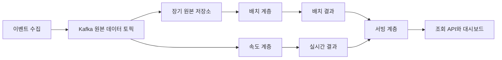
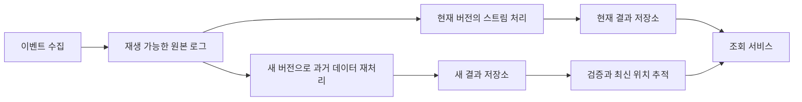
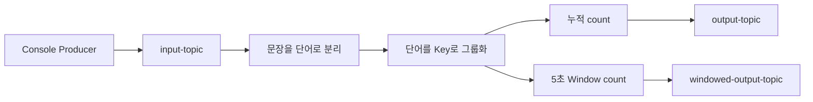

# 일반 애플리케이션 실전 사용 사례 알아보기

# 일반 애플리케이션 실전 사용 사례 알아보기

* toc
{:toc}

---

## Lambda와 Kappa 아키텍처로 이해하는 Kafka 실전 활용

실시간 대시보드에는 방금 발생한 이벤트가 빠르게 반영되어야 한다. 반면 정산이나 장기 통계에서는 과거 데이터를 다시 계산해 결과를 검증할 수 있어야 한다. 빠른 반응과 재계산 가능한 결과를 함께 요구받을 때 자주 등장하는 설계가 Lambda 아키텍처와 Kappa 아키텍처다.

두 아키텍처의 차이는 단순히 배치를 사용하는지 여부에 있지 않다. **실시간 처리와 과거 데이터 재처리를 어떤 실행 경로로 구현하고, 계산 결과를 어떻게 교체하거나 병합하는지**가 핵심이다.

이 차이를 먼저 살펴본 뒤, Kafka Streams로 단어 수를 집계하는 애플리케이션을 구현한다. 누적 집계와 5초 윈도 집계를 비교하면 스트림 처리에서 상태와 시간이 어떤 역할을 하는지 확인할 수 있다.

## Lambda 아키텍처

### 배치 결과와 실시간 결과를 함께 사용하기

Lambda 아키텍처는 데이터를 배치 처리 경로와 실시간 처리 경로에 함께 전달하고, 두 결과를 결합해 조회하는 구조다.

예를 들어 전체 방문 기록을 대상으로 일별 통계를 계산하는 동안에도 새로운 방문 이벤트는 계속 발생한다. 배치 결과만 제공하면 최신 데이터가 빠지고, 실시간 결과만 제공하면 전체 데이터를 재계산하고 검증하는 경로가 부족할 수 있다. Lambda는 두 경로를 나누어 이 요구를 처리한다.



| 계층 | 역할 | 주요 고려 사항 |
|---|---|---|
| 배치 계층 | 보존한 원본으로 전체 또는 큰 범위를 재계산 | 원본 보존, 처리 시간, 결과 검증 |
| 속도 계층 | 새로 들어오는 이벤트를 증분 처리 | 낮은 지연, 상태 관리, 지연 이벤트 |
| 서빙 계층 | 계산 결과를 조회 가능한 형태로 제공 | 결과 병합, 기준 시점, 중복 집계 방지 |

배치 계층은 원본 데이터를 보존하고 주기적으로 결과를 만든다. 속도 계층은 배치 결과에 아직 포함되지 않은 최근 데이터를 빠르게 반영한다. 서빙 계층에서는 두 결과를 조합하거나, 조회 API가 각 결과를 읽어 통합된 응답을 구성할 수 있다.

이 구조는 배치와 실시간 처리를 병행하는 설계이며, AWS Lambda 함수나 서버리스 실행 방식과는 관계없는 개념이다.

### 결과를 단순히 더하면 안 되는 이유

배치 집계가 특정 기준 시점까지의 방문 수 1,000건을 계산했다고 가정해 보자. 실시간 계층의 100건 중 30건이 이미 배치 결과에 포함되어 있다면 두 값을 단순히 더한 1,100건은 잘못된 결과다.

따라서 배치가 반영한 데이터의 경계를 식별해야 한다. 파티션별 오프셋, 이벤트 시간과 지연 허용 정책, 처리한 이벤트 식별자 등을 활용해 중복되거나 누락되는 범위를 관리한다. 시간이 늦게 도착한 이벤트도 있으므로 현재 시각만으로 경계를 나누는 방식은 충분하지 않을 수 있다.

새 배치 결과가 준비되면 해당 범위의 실시간 결과를 어떻게 제외하거나 대체할지도 정해야 한다. **병합 기준과 결과 교체 절차가 Lambda 아키텍처의 중요한 구현 부분**이다.

### 장점과 운영 부담

Lambda는 전체 재계산과 최신 데이터 반영을 서로 다른 처리 방식으로 최적화할 수 있다. 배치에는 대규모 스캔에 적합한 엔진을, 실시간 경로에는 Kafka Streams·Samza·Storm 같은 처리 엔진을 선택할 수 있다. 다만 스트림 처리가 반드시 근사치만 제공하는 것은 아니다. 정확성은 계산 방식, 데이터 도착 조건과 처리 보장에 따라 달라진다.

가장 큰 부담은 같은 업무 규칙을 두 경로에서 유지하는 일이다. 필터 조건이나 금액 계산식이 한쪽에서만 수정되면 결과가 달라진다. 두 파이프라인의 배포·모니터링과 서빙 계층의 병합 로직도 관리해야 한다.

두 경로를 나누면 일부 장애를 격리하기 유리하지만, 한쪽 장애가 다른 쪽에 절대 영향을 주지 않는다는 뜻은 아니다. 원본 저장소, Kafka, 네트워크와 조회 시스템을 공유한다면 장애 영향이 함께 나타날 수 있다. [Lambda의 배치·실시간 처리 모델](https://nathanmarz.com/blog/how-to-beat-the-cap-theorem.html)

운영 데이터 수집 시스템에서도 비슷한 구성을 볼 수 있다. 물리 서버·가상머신·EC2에서 수집한 지표나 Jenkins·Docker 기반 작업 이벤트를 Kafka로 모은 뒤, 실시간 경보와 장기 보고서를 별도 경로로 계산하는 방식이다. Redis, OpenTSDB, MySQL 같은 저장소와 Grafana, REST API를 목적에 맞게 연결할 수 있지만, 특정 도구 목록 자체가 Lambda 아키텍처를 정의하는 것은 아니다.

## Kappa 아키텍처

### 같은 처리 로직으로 과거 이벤트까지 다시 계산하기

Kappa 아키텍처는 실시간 경로와 배치 경로에 같은 로직을 두 번 구현하는 부담을 줄이려는 접근이다. 이벤트를 재생 가능한 로그로 보존하고, 현재 데이터와 과거 데이터 모두를 스트림 처리 코드로 계산한다.



정상 운영 중에는 하나의 처리 경로가 최신 이벤트를 계속 반영한다. 로직을 수정해 재계산해야 할 때는 보존된 과거 이벤트를 읽어 새로운 결과를 만든다.

여기서 단일 처리 파이프라인은 프로세스가 항상 하나만 실행된다는 의미가 아니다. 재처리 중에는 기존 버전과 새 버전을 함께 실행할 수 있다. 중요한 것은 배치와 실시간을 위해 서로 다른 계산 로직을 유지하지 않는다는 점이다.

### 재처리는 새 결과를 만든 뒤 전환하기

운영 결과에 과거 이벤트를 다시 더하면 누적 집계가 중복될 수 있다. 다음과 같이 결과를 분리하는 편이 안전하다.

1. 기존 애플리케이션은 현재 결과를 계속 제공한다.
2. 새 애플리케이션이 보존된 데이터를 처음부터 읽는다.
3. 재처리 결과는 별도의 토픽이나 테이블에 저장한다.
4. 최신 처리 위치와 결과를 검증한다.
5. 조회 대상을 새 결과로 전환한다.

Kafka Streams에서는 새 `application.id`를 사용해 기존 애플리케이션과 처리 위치·내부 상태를 분리할 수 있다. 출력 대상도 함께 분리해야 기존 결과와 재계산 결과가 섞이지 않는다. [Kappa의 재처리와 결과 전환 방식](https://www.oreilly.com/radar/questioning-the-lambda-architecture/)

### 원본 보존과 상태 관리가 전제다

Kappa에서 처음부터 다시 처리한다는 말은 **현재 보존된 범위의 처음부터**라는 의미다. 보관 기간이 지난 Kafka 데이터는 오프셋을 바꾼다고 복구되지 않는다. 키별 최신 값만 남기는 압축 토픽 역시 모든 과거 이벤트를 보존하는 로그와 같지 않다.

재처리를 위해서는 다음 조건을 함께 검토해야 한다.

- 재계산에 필요한 기간만큼 원본 이벤트가 남아 있는가?
- 과거 스키마를 현재 코드로 읽을 수 있는가?
- 당시의 참조 데이터와 시간 기준을 재현할 수 있는가?
- 재처리가 실시간 처리의 자원을 과도하게 사용하지 않는가?
- 결제·알림 같은 외부 작업이 다시 실행되지 않도록 통제하는가?

복잡한 상태 기반 연산은 저장 공간과 복구 비용이 크고, 매우 오래된 데이터를 다시 읽는 데 상당한 시간이 걸릴 수 있다. 대규모 조인이나 전체 데이터 스캔은 별도 배치 엔진이 더 효율적일 수도 있다.

### Lambda와 Kappa 비교

| 기준 | Lambda | Kappa |
|---|---|---|
| 계산 경로 | 배치와 실시간 경로 분리 | 스트림 처리 모델 중심 |
| 과거 데이터 재계산 | 배치 경로 활용 | 보존 로그 재생 |
| 주요 개발 부담 | 두 경로의 업무 규칙 일치 | 재생 가능한 처리와 상태 관리 |
| 주요 운영 부담 | 두 파이프라인과 결과 병합 | 재처리 자원과 결과 전환 |
| 유리한 상황 | 배치와 실시간의 계산 특성이 크게 다름 | 같은 로직으로 실시간·재처리가 가능함 |

Kafka나 ksqlDB를 사용한다고 자동으로 Kappa가 되는 것은 아니다. 단기·장기 토픽을 SQL로 읽는 구성도 원본 보존, 재처리 방식과 결과 교체 절차까지 갖추어야 이 설계의 이점을 얻을 수 있다.

## Kafka Streams 단어 집계 실습

### 실습 목표와 구성

이번에는 입력 문장을 단어로 나누고, 단어별 등장 횟수를 출력한다. 같은 프로젝트에서 두 가지 모드를 실행한다.

| 모드 | 입력 토픽 | 출력 토픽 | 집계 기준 |
|---|---|---|---|
| 누적 집계 | `input-topic` | `output-topic` | 애플리케이션이 처리한 전체 범위 |
| 윈도 집계 | `input-topic` | `windowed-output-topic` | 레코드 시각 기준 5초 구간 |



Kafka Streams는 Java 애플리케이션에 포함하는 라이브러리다. 별도 Streams 서버를 설치하는 방식이 아니다. 이번 실습에서는 Spring Boot 없이 Java 프로그램으로 실행한다. ksqlDB를 사용하는 경우에는 SQL로 처리 로직을 작성할 수 있으므로 모든 사용자가 Java 코드를 작성해야 하는 것은 아니다.

### 사전 조건

- JDK 17 이상
- Maven
- `localhost:9092`에서 실행 중인 Kafka Broker
- Kafka 4.0.2와 같은 버전의 Streams 라이브러리
- Bash 계열 터미널 또는 Windows의 WSL2

Kafka 설치와 저장소 초기화는 완료된 상태를 전제로 한다. 기존 데이터를 유지할 때는 Broker만 다시 시작하고 저장소를 재포맷하지 않는다.

프로젝트 구조는 다음과 같다.

```text
wordcount-demo/
├── pom.xml
└── src/main/java/demo/
    └── WordCountApp.java
```

### Maven 설정

`pom.xml`은 다음과 같이 구성한다.

```xml
<project xmlns="http://maven.apache.org/POM/4.0.0"
         xmlns:xsi="http://www.w3.org/2001/XMLSchema-instance"
         xsi:schemaLocation="http://maven.apache.org/POM/4.0.0 https://maven.apache.org/xsd/maven-4.0.0.xsd">
    <modelVersion>4.0.0</modelVersion>

    <groupId>demo</groupId>
    <artifactId>wordcount-demo</artifactId>
    <version>1.0.0</version>

    <properties>
        <maven.compiler.release>17</maven.compiler.release>
        <project.build.sourceEncoding>UTF-8</project.build.sourceEncoding>
    </properties>

    <dependencies>
        <dependency>
            <groupId>org.apache.kafka</groupId>
            <artifactId>kafka-streams</artifactId>
            <version>4.0.2</version>
        </dependency>
        <dependency>
            <groupId>org.slf4j</groupId>
            <artifactId>slf4j-simple</artifactId>
            <version>1.7.36</version>
            <scope>runtime</scope>
        </dependency>
    </dependencies>

    <build>
        <plugins>
            <plugin>
                <groupId>org.apache.maven.plugins</groupId>
                <artifactId>maven-compiler-plugin</artifactId>
                <version>3.13.0</version>
            </plugin>
            <plugin>
                <groupId>org.apache.maven.plugins</groupId>
                <artifactId>maven-dependency-plugin</artifactId>
                <version>3.8.1</version>
            </plugin>
        </plugins>
    </build>
</project>
```

`kafka-streams`는 DSL과 실행 엔진을 제공한다. `slf4j-simple`은 실습에서 로그를 확인하기 위한 구현체다. 여기서는 Kafka 4.0.2의 SLF4J 의존성에 맞추어 1.7.36을 사용한다. 다른 프로젝트에 적용할 때는 기존 로깅 구현과 중복되지 않도록 해야 한다.

## 집계 애플리케이션 구현

### 전체 코드

`WordCountApp.java`는 기본 실행 시 누적 집계, `window` 인수를 전달하면 윈도 집계로 동작한다.

```java
package demo;

import org.apache.kafka.clients.consumer.ConsumerConfig;
import org.apache.kafka.common.serialization.Serdes;
import org.apache.kafka.streams.KafkaStreams;
import org.apache.kafka.streams.KeyValue;
import org.apache.kafka.streams.StreamsBuilder;
import org.apache.kafka.streams.StreamsConfig;
import org.apache.kafka.streams.errors.StreamsUncaughtExceptionHandler;
import org.apache.kafka.streams.kstream.Grouped;
import org.apache.kafka.streams.kstream.KGroupedStream;
import org.apache.kafka.streams.kstream.KStream;
import org.apache.kafka.streams.kstream.KTable;
import org.apache.kafka.streams.kstream.Materialized;
import org.apache.kafka.streams.kstream.Produced;
import org.apache.kafka.streams.kstream.TimeWindows;
import org.apache.kafka.streams.kstream.Windowed;

import java.time.Duration;
import java.util.Arrays;
import java.util.Locale;
import java.util.Properties;
import java.util.concurrent.CountDownLatch;
import java.util.concurrent.atomic.AtomicReference;

public class WordCountApp {

    public static void main(String[] args) throws InterruptedException {
        boolean windowed = args.length > 0 && "window".equals(args[0]);
        String applicationId = windowed
                ? "wordcount-window-application"
                : "wordcount-application";

        Properties props = new Properties();
        props.put(StreamsConfig.APPLICATION_ID_CONFIG, applicationId);
        props.put(StreamsConfig.BOOTSTRAP_SERVERS_CONFIG, "localhost:9092");
        props.put(
                StreamsConfig.DEFAULT_KEY_SERDE_CLASS_CONFIG,
                Serdes.StringSerde.class
        );
        props.put(
                StreamsConfig.DEFAULT_VALUE_SERDE_CLASS_CONFIG,
                Serdes.StringSerde.class
        );
        props.put(ConsumerConfig.AUTO_OFFSET_RESET_CONFIG, "earliest");
        props.put(StreamsConfig.STATE_DIR_CONFIG, "./state");
        props.put(StreamsConfig.REPLICATION_FACTOR_CONFIG, 1);
        props.put(StreamsConfig.STATESTORE_CACHE_MAX_BYTES_CONFIG, 0L);
        props.put(StreamsConfig.COMMIT_INTERVAL_MS_CONFIG, 100);

        StreamsBuilder builder = new StreamsBuilder();
        KStream<String, String> textLines = builder.stream("input-topic");

        KStream<String, String> words = textLines
                .filter((key, line) -> line != null)
                .flatMapValues(line -> Arrays.asList(
                        line.toLowerCase(Locale.ROOT)
                                .split("[^\\p{L}\\p{N}]+")
                ))
                .filter((key, word) -> !word.isBlank());

        KGroupedStream<String, String> groupedWords = words.groupBy(
                (key, word) -> word,
                Grouped.with(Serdes.String(), Serdes.String())
        );

        if (windowed) {
            KTable<Windowed<String>, Long> counts = groupedWords
                    .windowedBy(TimeWindows.ofSizeAndGrace(
                            Duration.ofSeconds(5),
                            Duration.ofSeconds(2)
                    ))
                    .count(Materialized.as("window-counts"));

            counts.toStream()
                    .map((word, count) -> KeyValue.pair(
                            word.window().start() + ":" + word.key(),
                            count
                    ))
                    .to(
                            "windowed-output-topic",
                            Produced.with(Serdes.String(), Serdes.Long())
                    );
        } else {
            KTable<String, Long> counts = groupedWords
                    .count(Materialized.as("word-counts"));

            counts.toStream().to(
                    "output-topic",
                    Produced.with(Serdes.String(), Serdes.Long())
            );
        }

        CountDownLatch stopped = new CountDownLatch(1);
        AtomicReference<Throwable> failure = new AtomicReference<>();
        KafkaStreams streams = new KafkaStreams(builder.build(), props);

        streams.setUncaughtExceptionHandler(error -> {
            failure.compareAndSet(null, error);
            error.printStackTrace(System.err);
            return StreamsUncaughtExceptionHandler
                    .StreamThreadExceptionResponse.SHUTDOWN_CLIENT;
        });

        streams.setStateListener((newState, oldState) -> {
            if (newState == KafkaStreams.State.ERROR
                    || newState == KafkaStreams.State.NOT_RUNNING) {
                stopped.countDown();
            }
        });

        Runtime.getRuntime().addShutdownHook(new Thread(() -> {
            try {
                streams.close(Duration.ofSeconds(30));
            } finally {
                stopped.countDown();
            }
        }, "streams-shutdown"));

        try {
            streams.start();
            stopped.await();
        } finally {
            streams.close(Duration.ofSeconds(30));
        }

        if (failure.get() != null) {
            throw new IllegalStateException(
                    "Stream processing failed", failure.get()
            );
        }
    }
}
```

### 애플리케이션 설정의 의미

`application.id`는 단순한 화면 표시용 이름이 아니다. Consumer Group, 내부 토픽의 이름 공간과 상태 관리에 사용된다. 같은 ID의 인스턴스는 같은 논리적 애플리케이션으로 작업을 나누고, 다른 ID는 독립적으로 입력을 처리한다. 누적 집계와 윈도 집계의 ID를 다르게 지정한 이유다.

`Serde`는 Serializer와 Deserializer를 묶은 인터페이스이고, `Serdes`는 기본 구현을 제공하는 클래스다. 입력은 문자열이지만 집계 결과는 `Long`이므로 출력에서 `Produced.with(Serdes.String(), Serdes.Long())`을 명시한다.

`state.dir`에는 로컬 상태가 저장된다. `replication.factor=1`은 단일 Broker 실습에서 내부 토픽도 생성할 수 있게 하기 위한 설정이며, 운영의 고가용성 기준으로 사용해서는 안 된다.

또한 결과 변화를 쉽게 관찰하도록 집계 캐시를 끄고 커밋 주기를 짧게 설정했다. 이는 실습 편의를 위한 선택이다. 운영에서는 캐시와 배치 효과를 활용하는 편이 처리량과 출력 트래픽에 유리할 수 있다. [Streams 애플리케이션 설정](https://kafka.apache.org/40/streams/developer-guide/config-streams/)

### 문장 분리와 단어별 그룹화

`flatMapValues()`는 하나의 문장을 여러 단어 레코드로 펼친다. 정규식은 문자와 숫자가 아닌 구간을 구분자로 사용하므로 공백뿐 아니라 쉼표와 느낌표도 분리한다. `null` Value와 빈 단어는 제외한다.

`Locale.ROOT`는 실행 환경의 기본 로케일에 따라 소문자 변환 결과가 달라지는 일을 피하기 위한 설정이다.

이후 `groupBy((key, word) -> word)`가 단어를 새로운 Key로 사용한다. 입력 문장의 Key가 아니라 단어별로 집계해야 하기 때문이다. 여러 파티션에서 같은 단어를 모아야 하므로 이 과정에서 내부 재파티셔닝 토픽이 만들어질 수 있다.

`count()`는 각 레코드에 곧바로 숫자 1을 출력하는 작업이 아니다. 그룹별 상태를 유지하면서 개수를 증가시키고 `KTable`을 만든다. `KTable`은 단어별 최신 개수를 나타내지만, 이를 `toStream()`으로 출력하면 **최신 상태의 변경 내역**이 토픽에 기록된다.

## 누적 단어 수 집계 실행

### 토픽 생성과 빌드

Kafka 설치 디렉터리에서 토픽을 생성한다.

```bash
bin/kafka-topics.sh \
  --bootstrap-server localhost:9092 \
  --create --if-not-exists \
  --topic input-topic \
  --partitions 1 --replication-factor 1

bin/kafka-topics.sh \
  --bootstrap-server localhost:9092 \
  --create --if-not-exists \
  --topic output-topic \
  --partitions 1 --replication-factor 1

bin/kafka-topics.sh \
  --bootstrap-server localhost:9092 \
  --create --if-not-exists \
  --topic windowed-output-topic \
  --partitions 1 --replication-factor 1
```

이미 존재하는 토픽은 그대로 사용한다. `--if-not-exists`는 기존 토픽을 비우거나 파티션 설정을 변경하는 옵션이 아니다.

Java 프로젝트 디렉터리에서는 다음 명령으로 빌드하고 의존성을 모은다.

```bash
mvn clean package dependency:copy-dependencies
```

누적 집계를 실행한다.

```bash
java -cp "target/classes:target/dependency/*" demo.WordCountApp
```

위 Classpath 구분자는 macOS·Linux·WSL2 기준이다. 프로그램이 실행 중인 터미널은 유지한다.

### 입력과 출력 확인

Kafka 설치 디렉터리의 다른 터미널에서 Producer를 실행한다.

```bash
bin/kafka-console-producer.sh \
  --bootstrap-server localhost:9092 \
  --topic input-topic
```

다음 세 줄을 입력한다.

```text
hello world
kafka streams example
example kafka message
```

또 다른 터미널에서 결과를 읽는다.

```bash
bin/kafka-console-consumer.sh \
  --bootstrap-server localhost:9092 \
  --topic output-topic \
  --from-beginning \
  --property print.key=true \
  --property print.value=true \
  --property key.deserializer=org.apache.kafka.common.serialization.StringDeserializer \
  --property value.deserializer=org.apache.kafka.common.serialization.LongDeserializer
```

출력 Value는 숫자처럼 보이더라도 실제로는 `LongSerializer`로 인코딩된 바이트다. `LongDeserializer`를 지정하지 않으면 사람이 읽기 어려운 문자가 보일 수 있다.

새로운 입력·상태에서 세 문장을 처리한 뒤 단어별 최신 값은 다음과 같다.

| 단어 | 최신 개수 |
|---|---:|
| hello | 1 |
| world | 1 |
| kafka | 2 |
| streams | 1 |
| example | 2 |
| message | 1 |

그러나 콘솔 출력이 반드시 이 여섯 행만으로 끝나는 것은 아니다. 예를 들어 `kafka`가 처음 등장하면 `kafka → 1`, 두 번째 등장하면 `kafka → 2`가 기록된다. 출력 토픽은 최종 테이블을 한 번 보여 주는 화면이 아니라 상태 갱신 이벤트를 담는다.

코드에서는 캐시를 껐으므로 이런 중간 변화를 관찰하기 쉽다. 캐시를 사용하면 중간 갱신이 합쳐져 일부 결과만 출력될 수 있다. [KTable 집계 캐시와 출력](https://kafka.apache.org/40/streams/developer-guide/memory-mgmt/)

## 5초 윈도 기반 집계

### 누적 집계와 무엇이 달라지는가

누적 집계는 `kafka`의 전체 등장 횟수를 계속 증가시킨다. 윈도 집계는 같은 단어라도 시간 구간마다 별도의 값을 유지한다.

5초 Tumbling Window는 서로 겹치지 않는 구간으로 나뉜다.

```text
[00초, 05초)
[05초, 10초)
[10초, 15초)
```

시작은 포함하고 끝은 포함하지 않는다. 정확히 5초 시각의 이벤트는 두 번째 구간에 속한다. 구간은 애플리케이션을 실행한 시각이 아니라 Unix Epoch 기준으로 정렬된다.

코드에서는 다음 API로 윈도 크기와 지연 허용 범위를 명시했다.

```java
TimeWindows.ofSizeAndGrace(
        Duration.ofSeconds(5),
        Duration.ofSeconds(2)
)
```

Kafka Streams 4.0에서는 예전의 `TimeWindows.of(...)` 대신 크기와 Grace Period를 명확히 지정하는 API를 사용한다. 지연 허용이 필요 없다면 `ofSizeWithNoGrace(...)`를 선택할 수 있지만, 늦은 이벤트가 제외되는 조건을 이해해야 한다. [TimeWindows API와 구간 정의](https://kafka.apache.org/40/javadoc/org/apache/kafka/streams/kstream/TimeWindows.html)

### 윈도 집계 실행

누적 집계를 `Ctrl+C`로 종료하고 Java 프로젝트 디렉터리에서 윈도 모드를 실행한다.

```bash
java -cp "target/classes:target/dependency/*" demo.WordCountApp window
```

다른 `application.id`를 사용하므로 입력 토픽에 남아 있는 과거 메시지도 독립적으로 처리한다. 그 결과가 먼저 보일 수 있다.

Kafka 설치 디렉터리에서 윈도 출력 토픽을 읽는다.

```bash
bin/kafka-console-consumer.sh \
  --bootstrap-server localhost:9092 \
  --topic windowed-output-topic \
  --from-beginning \
  --property print.key=true \
  --property print.value=true \
  --property key.deserializer=org.apache.kafka.common.serialization.StringDeserializer \
  --property value.deserializer=org.apache.kafka.common.serialization.LongDeserializer
```

출력 Key는 `윈도 시작 시각:단어` 형식이다. 원래 `Windowed<String>`인 키를 문자열로 바꾸어 일반 문자열 Deserializer로 확인할 수 있게 했다.

### 다른 구간으로 나뉘는지 확인하기

Kafka 설치 디렉터리에서 다음 입력을 보낸다.

```bash
printf 'windowdemo windowdemo\n' |
  bin/kafka-console-producer.sh \
    --bootstrap-server localhost:9092 \
    --topic input-topic

sleep 6

printf 'windowdemo\n' |
  bin/kafka-console-producer.sh \
    --bootstrap-server localhost:9092 \
    --topic input-topic
```

기본적인 레코드 타임스탬프 설정이라면 첫 번째 문장의 두 단어는 같은 시각을 가지므로 같은 윈도에 포함된다. 6초 뒤 보낸 단어는 다른 5초 구간에 들어간다.

해당 단어를 이전에 입력하지 않았다면 다음 형태의 갱신을 확인할 수 있다.

```text
<첫 번째 윈도 시작 시각>:windowdemo    1
<첫 번째 윈도 시작 시각>:windowdemo    2
<두 번째 윈도 시작 시각>:windowdemo    1
```

실제 Key에는 밀리초 단위 Unix 시간이 출력된다. 같은 단어라도 윈도가 바뀌면 별도의 집계가 된다는 점이 핵심이다.

### 5초 윈도는 5초마다 한 번 출력하는 타이머가 아니다

현재 코드는 윈도 안에 이벤트가 들어올 때마다 집계 값을 갱신한다. 5초가 지난 뒤 확정 결과만 한 번 출력하는 프로그램이 아니다.

또한 기본적으로 Kafka 레코드의 타임스탬프를 기준으로 처리한다. 애플리케이션이 실제로 읽은 시각과 이벤트의 시각이 다를 수 있다. 사용자 정의 이벤트 시간이 필요하면 메시지의 시간 필드와 `TimestampExtractor`를 설계해야 한다.

Grace Period는 단순히 시스템 시계로 2초를 기다리는 동작이 아니다. 스트림 처리의 시간 진행과 레코드 시각을 기준으로 늦은 이벤트를 판단한다. 허용 범위를 벗어난 이벤트는 집계에서 제외될 수 있다.

윈도가 닫힌 최종 결과만 필요하다면 Suppression 같은 출력 제어를 별도로 검토해야 한다. 이 경우에도 스트림 시간의 진행, 결과 보관 메모리와 버퍼 정책을 함께 고려해야 한다.

## 상태 복구와 재처리에서 주의할 점

### 재시작해도 개수가 이어지는 이유

같은 `application.id`로 재시작하면 기존 처리 위치와 상태를 이어서 사용할 수 있다. `auto.offset.reset=earliest`는 재실행할 때마다 처음부터 읽으라는 뜻이 아니다. 유효한 시작 위치가 없을 때 적용하는 정책이다.

로컬 상태 파일이 없더라도 내부 Changelog 토픽에서 상태를 복구할 수 있다. 따라서 로컬 `state` 디렉터리만 삭제하는 작업을 전체 초기화와 동일하게 생각해서는 안 된다.

### 처음부터 다시 계산하려면

로직을 수정해 재계산하려면 다음을 함께 다루어야 한다.

- 입력을 다시 읽을 위치
- 기존 로컬 상태와 내부 토픽
- 새 애플리케이션의 식별자
- 재계산 결과를 기록할 출력 토픽
- 기존 결과와 새 결과의 비교·전환 방식

가장 이해하기 쉬운 방법은 새 `application.id`와 새 출력 토픽을 사용해 별도 결과를 만드는 것이다. ID만 바꾸고 같은 출력 토픽에 기록하면 기존 계산과 재계산 결과가 섞일 수 있다.

기존 애플리케이션을 초기화하는 Reset Tool도 있지만, 실행 전 인스턴스를 중지하고 입력·내부 상태·출력에 미치는 범위를 확인해야 한다. 출력 토픽까지 자동으로 정리해 주는 도구로 이해해서는 안 된다. [Streams 애플리케이션 초기화 범위](https://kafka.apache.org/40/streams/developer-guide/app-reset-tool/)

## 문제 상황과 실무 관점

| 현상 | 확인할 내용 |
|---|---|
| 결과가 나오지 않음 | 입력·출력 토픽, Broker 주소, 실행 중인 애플리케이션 상태 |
| 시작 직후 결과가 늦게 나옴 | 파티션 할당과 State Store 복원 진행 |
| 숫자가 깨져 보임 | 출력의 `LongDeserializer` 설정 |
| 예상보다 집계 값이 큼 | 기존 상태, 과거 입력, 재실행과 중복 발행 |
| 5초가 지나도 최종 한 행만 나오지 않음 | 윈도 집계와 최종 결과 출력의 차이 |
| 내부 토픽 생성 실패 | 생성 권한과 복제 계수, Broker 수 |
| 상태 디렉터리 잠금 오류 | 같은 로컬 상태 경로를 사용하는 중복 실행 |
| SLF4J 경고로 로그가 보이지 않음 | 호환되는 로깅 구현체의 누락·중복 |

실습에서는 처리 보장 기본값인 At-least-once를 사용한다. 정상 동작 중의 집계와 별개로, 장애 구간에서는 출력 갱신이 다시 전달될 수 있다. 후속 시스템이 집계 변경값을 받는다면 `kafka → 1`과 `kafka → 2`를 더해 3으로 계산하는 것이 아니라, 키별 최신 상태로 반영해야 한다.

Kafka 내부의 입력 오프셋·상태·출력을 함께 다루는 Exactly-once 처리가 필요하면 `exactly_once_v2`를 검토할 수 있다. 다만 트랜잭션 관련 Broker 설정과 복제 구성을 함께 갖춰야 하며, 외부 데이터베이스나 API 호출까지 자동으로 하나의 트랜잭션이 되는 것은 아니다.

운영에서는 처리 지연과 Lag뿐 아니라 상태 저장소 용량, 복원 시간, 재파티셔닝 트래픽, 지연 이벤트 제외 건수도 관찰해야 한다. 애플리케이션 프로세스가 살아 있다는 사실만으로 집계가 정상적으로 진행된다고 판단할 수는 없다.

## 정리

Lambda는 배치와 실시간 결과를 결합하는 대신 두 처리 경로와 병합 기준을 관리해야 한다. Kappa는 같은 스트림 처리 로직으로 재처리하는 방향이지만, 재생 가능한 원본과 상태 재구축, 결과 전환 절차가 필요하다.

Kafka Streams 실습에서는 문장 분리, 키 변경, 상태 기반 집계와 윈도 처리를 확인했다. 특히 **KTable의 최신 상태와 출력 토픽의 변경 내역은 다르며, 시간 윈도 역시 주기 실행 타이머와 다르다.** 이 차이를 이해해야 집계 결과를 올바르게 해석하고, 장애 복구와 재처리도 일관되게 설계할 수 있다.
