# 일반 애플리케이션 실전 사용 사례 알아보기

# 일반 애플리케이션 실전 사용 사례 알아보기

* toc
{:toc}

---

### Apache Kafka 실전 활용: Lambda·Kappa 아키텍처부터 Kafka Streams 누적 집계와 Window 처리까지

Apache Kafka는 대규모 이벤트를 안정적으로 저장하고 전달하는 분산 이벤트 스트리밍 플랫폼이다.

Producer가 Topic에 메시지를 전송하면 Consumer가 해당 메시지를 읽어 처리한다. 이러한 기본 구조를 이용하면 시스템 사이의 의존성을 줄이고, 데이터가 발생하는 시점에 맞춰 필요한 작업을 수행할 수 있다.

하지만 실제 서비스에서는 단순한 이벤트 전달보다 복잡한 요구사항이 등장한다.

예를 들어 전자상거래 서비스에서 실시간 매출 통계를 제공해야 한다고 가정해 보자.

사용자가 주문을 완료하면 Kafka에 주문 이벤트가 발생한다. 서비스에서는 이 이벤트를 기반으로 실시간 매출을 계산한다.

그런데 다음과 같은 문제를 고려해야 한다.

- 사용자는 현재까지 발생한 매출을 빠르게 확인하고 싶어 한다.
- 관리자는 하루 전체의 정확한 매출을 확인해야 한다.
- 네트워크 장애로 일부 이벤트가 늦게 도착할 수 있다.
- Consumer 장애로 같은 이벤트가 다시 처리될 수 있다.
- 집계 로직에 오류가 발견되면 과거 데이터를 다시 계산해야 한다.
- 통계 시스템을 수정하더라도 기존 서비스는 계속 운영되어야 한다.

여기에는 서로 다른 두 가지 요구사항이 존재한다.

**첫 번째는 낮은 지연 시간(Low Latency)이다.**

이벤트가 발생한 후 가능한 한 빠르게 결과에 반영해야 한다.

**두 번째는 재계산 가능한 정확성(Accuracy)이다.**

집계 로직이 변경되거나 데이터 오류가 발생했을 때 과거 데이터를 다시 계산하여 결과를 검증할 수 있어야 한다.

이러한 요구사항을 해결하기 위한 대표적인 데이터 처리 아키텍처가 Lambda 아키텍처와 Kappa 아키텍처다.

Lambda 아키텍처는 배치 처리와 실시간 처리를 분리한다.

Kappa 아키텍처는 재생 가능한 이벤트 로그와 단일 스트림 처리 모델을 중심으로 데이터를 처리한다.

두 아키텍처의 차이를 이해하면 Kafka를 단순 메시지 전달 시스템이 아니라 실시간 데이터 처리 플랫폼으로 활용하는 방법을 이해할 수 있다.

이후 Kafka Streams를 이용하여 실제 이벤트를 처리해 보자.

이번에는 텍스트 메시지를 읽어 단어별 출현 횟수를 계산하는 애플리케이션을 구현한다.

먼저 전체 누적 단어 수를 계산하고, 이후 5초 단위 Tumbling Window를 적용하여 시간별 단어 수를 집계한다.

이를 통해 Kafka Streams에서 데이터의 상태와 시간이 어떻게 처리되는지 살펴본다.

---

### Lambda 아키텍처란?

#### Lambda 아키텍처의 개념

Lambda 아키텍처는 대규모 데이터를 처리하기 위해 **배치 처리와 실시간 스트림 처리를 함께 사용하는 데이터 처리 아키텍처**다.

배치 처리는 일정 범위의 데이터를 모아 처리한다.

반면 스트림 처리는 이벤트가 발생하고 전달되는 과정에서 지속적으로 데이터를 처리한다.

두 방식을 결합하면 전체 데이터를 다시 계산하는 능력과 최신 데이터를 빠르게 반영하는 능력을 함께 확보할 수 있다.

예를 들어 쇼핑몰의 매출 통계를 생각해 보자.

실시간 매출 Dashboard에서는 방금 발생한 주문까지 빠르게 반영해야 한다.

하지만 하루 매출을 정산할 때는 취소와 환불, 지연된 결제 이벤트까지 반영하여 결과를 검증해야 한다.

실시간 처리만 사용하면 과거 데이터 전체를 다시 계산하는 작업이 어려울 수 있다.

반대로 배치 처리만 사용하면 최신 데이터가 결과에 반영되기까지 시간이 오래 걸릴 수 있다.

Lambda 아키텍처는 두 처리 경로를 결합하여 이러한 문제를 해결한다.

#### Lambda 아키텍처의 전체 구조

Lambda 아키텍처는 일반적으로 다음 세 가지 계층으로 구성된다.

1. Batch Layer
2. Speed Layer
3. Serving Layer

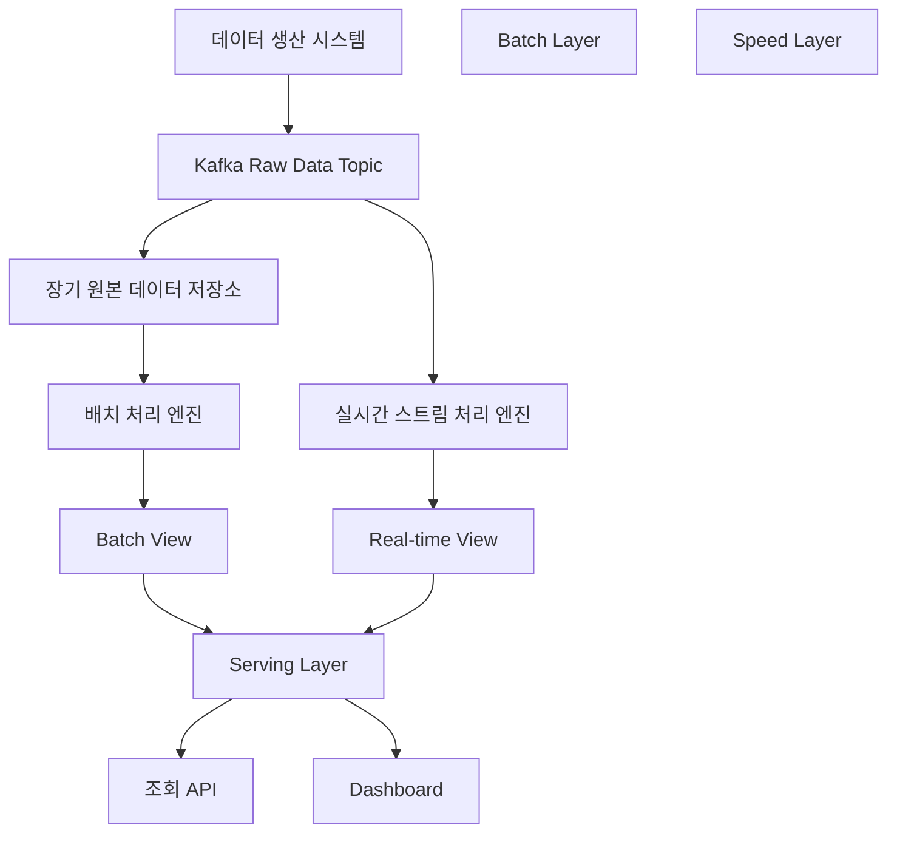

전체 데이터는 배치 처리와 실시간 처리에서 모두 사용될 수 있도록 수집된다.

Batch Layer는 장기 보관된 원본 데이터를 기반으로 결과를 계산한다.

Speed Layer는 새롭게 발생하는 이벤트를 빠르게 처리한다.

Serving Layer는 두 결과를 조합하여 사용자에게 제공한다.

---

### Lambda 아키텍처의 구성 요소

#### 1. Batch Layer

Batch Layer는 저장된 대규모 데이터를 기반으로 결과를 계산하는 계층이다.

주기적으로 전체 데이터 또는 특정 범위의 데이터를 읽어 집계한다.

예를 들어 하루 동안 발생한 주문 데이터를 기반으로 총매출을 계산할 수 있다.

```text
주문 원본 데이터
    ↓
장기 저장소
    ↓
배치 처리
    ↓
일별 매출 계산
    ↓
Batch View 저장
```

Batch Layer의 주요 목적은 재계산 가능한 결과를 제공하는 것이다.

원본 데이터가 보존되어 있다면 집계 로직을 변경한 후 동일한 데이터를 다시 계산할 수 있다.

예를 들어 기존 매출 집계에서 환불 금액을 잘못 계산했다면 새로운 집계 로직을 적용하여 결과를 다시 생성할 수 있다.

Batch Layer의 특징은 다음과 같다.

| 항목 | 설명 |
|---|---|
| 처리 방식 | 일정 범위의 데이터를 일괄 처리 |
| 주요 목적 | 대규모 데이터 재계산 및 검증 |
| 장점 | 전체 데이터에 대한 재처리 가능 |
| 단점 | 결과 생성에 시간이 걸릴 수 있음 |
| 활용 사례 | 정산, 일별 통계, 장기 분석 |

여기서 중요한 것은 Batch Layer를 사용한다고 결과의 정확성이 자동으로 보장되는 것은 아니라는 사실이다.

원본 데이터가 누락되었거나 집계 로직에 오류가 존재한다면 배치 처리에서도 잘못된 결과가 발생할 수 있다.

따라서 Batch Layer의 정확성은 원본 데이터의 완전성과 계산 로직, 데이터 검증 정책에 영향을 받는다.

#### 2. Speed Layer

Speed Layer는 새롭게 발생하는 이벤트를 가능한 한 빠르게 처리한다.

Batch Layer가 전체 데이터를 계산하는 동안에도 새로운 주문과 결제 이벤트는 계속 발생한다.

Speed Layer는 이러한 이벤트를 실시간으로 처리하여 최신 정보를 제공한다.

```text
OrderCreated Event
    ↓
Kafka
    ↓
Kafka Streams
    ↓
실시간 매출 집계
    ↓
Real-time View 저장
```

Speed Layer에서는 일반적으로 이벤트가 들어올 때마다 기존 결과를 갱신하는 증분 처리(Incremental Processing)를 사용한다.

예를 들어 현재 매출 합계가 100만 원이라고 가정해 보자.

새로운 주문이 5만 원 발생했다.

전체 주문 데이터를 다시 읽을 필요 없이 기존 합계에 새로운 주문 금액을 반영할 수 있다.

```text
기존 매출 합계: 1,000,000원

새로운 주문: 50,000원

갱신된 매출 합계: 1,050,000원
```

이러한 방식은 전체 데이터를 매번 다시 계산하는 것보다 효율적일 수 있다.

Speed Layer의 특징은 다음과 같다.

| 항목 | 설명 |
|---|---|
| 처리 방식 | 실시간 또는 준실시간 처리 |
| 주요 목적 | 최신 데이터의 빠른 반영 |
| 장점 | 낮은 지연 시간 |
| 고려사항 | 상태 관리, 지연 이벤트, 중복 처리 |
| 활용 사례 | 실시간 통계, 이상 탐지, 알림 |

실시간 처리에서는 이벤트가 순서대로 도착하지 않거나 지연될 수 있으므로 시간과 상태를 관리하는 방식이 중요하다.

#### 3. Serving Layer

Serving Layer는 Batch Layer와 Speed Layer에서 생성한 결과를 사용자에게 제공하는 계층이다.

예를 들어 다음 두 데이터가 존재한다고 가정해 보자.

```text
Batch View
    → 배치 기준 시점까지의 매출
```

```text
Real-time View
    → 배치 기준 시점 이후의 매출
```

Serving Layer는 두 결과를 결합하여 현재 매출을 제공한다.

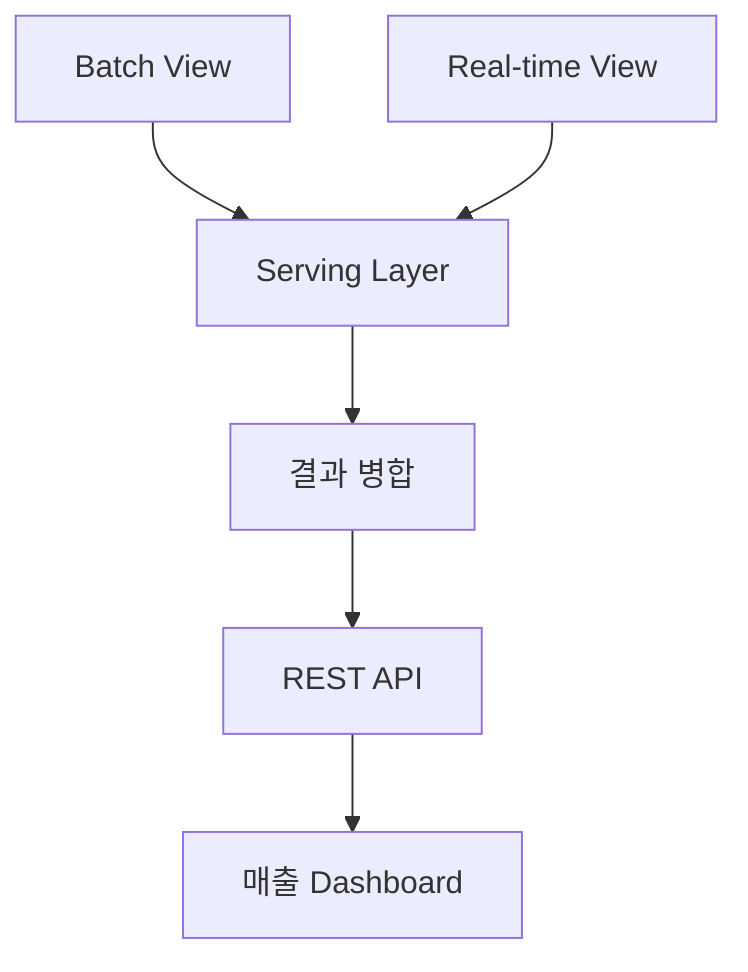

Serving Layer에서 중요한 것은 단순히 두 값을 더하는 것이 아니다.

**두 결과가 서로 어떤 데이터 범위를 포함하는지 정확하게 구분해야 한다.**

---

### Lambda 아키텍처에서 중복 집계가 발생하는 이유

#### Batch와 Speed의 데이터 범위가 겹치는 경우

다음과 같은 상황을 생각해 보자.

Batch Layer가 오전 10시까지 발생한 주문 1,000건을 집계했다.

Speed Layer는 최근 발생한 주문 100건을 집계했다.

이때 단순히 두 값을 합치면 다음과 같다.

```text
Batch Layer = 1,000건

Speed Layer = 100건

합계 = 1,100건
```

하지만 Speed Layer에서 처리한 100건 중 30건이 이미 Batch Layer에 포함되어 있다고 가정해 보자.

실제 주문 건수는 다음과 같다.

```text
1,000 + 100 - 30 = 1,070건
```

두 결과를 단순히 합산하면 30건이 중복 집계된다.

따라서 Serving Layer에는 Batch와 Speed의 데이터 범위를 구분하는 로직이 필요하다.

#### Offset을 활용한 경계 관리

Kafka를 사용하는 경우 Partition별 Offset을 통해 처리 범위를 구분하는 방식을 고려할 수 있다.

예를 들어 다음과 같다.

```text
Batch Layer

Partition 0: Offset 0 ~ 999
```

```text
Speed Layer

Partition 0: Offset 1000 이후
```

이처럼 두 처리 경로가 담당하는 범위를 명확하게 구분하면 중복 집계 가능성을 줄일 수 있다.

하지만 실제 환경에서는 Topic에 여러 Partition이 존재한다.

따라서 하나의 전역 Offset으로 전체 이벤트의 경계를 나타낼 수는 없다.

Partition별 Offset을 관리하거나 이벤트 ID, Event Time, 데이터 처리 기준 시점 등을 함께 고려해야 한다.

또한 이벤트가 늦게 도착하는 경우에는 처리 시점과 이벤트 발생 시점이 다를 수 있다.

따라서 시간만으로 데이터 범위를 나누는 방식도 주의해야 한다.

**Lambda 아키텍처의 중요한 설계 과제는 Batch와 Speed의 결과를 어떤 기준으로 병합하고 교체할 것인가에 있다.**

---

### Lambda 아키텍처의 장점

#### 정확성과 낮은 지연 시간의 결합

Batch Layer는 원본 데이터를 기반으로 다시 계산할 수 있다.

Speed Layer는 최신 이벤트를 빠르게 반영한다.

따라서 빠른 데이터 조회와 과거 데이터 검증이라는 서로 다른 요구사항에 대응할 수 있다.

#### 처리 기술의 유연성

각 계층의 목적에 맞게 서로 다른 기술을 사용할 수 있다.

예를 들어 다음과 같다.

| 계층 | 활용할 수 있는 기술 |
|---|---|
| 데이터 수집 | Kafka |
| 장기 저장 | S3, HDFS, Data Lake |
| Batch Processing | Spark, Spring Batch |
| Stream Processing | Kafka Streams, Flink |
| Serving | Redis, RDBMS, Elasticsearch |
| 시각화 | Grafana, Dashboard |

Batch와 Stream이 반드시 동일한 기술을 사용할 필요는 없다.

#### 재처리 용이성

원본 데이터를 보존하고 있다면 새로운 집계 로직으로 결과를 재생성할 수 있다.

특히 정산이나 감사처럼 과거 데이터를 다시 검증해야 하는 시스템에서 유용하다.

#### 장애 영향 분리

Batch와 Speed가 서로 다른 처리 경로로 구성되어 있다면 일부 장애를 격리하는 데 도움이 될 수 있다.

예를 들어 실시간 집계가 일시적으로 중단되더라도 장기 원본 데이터를 기반으로 배치 집계를 다시 수행할 수 있다.

다만 Kafka와 데이터 저장소 등의 공통 인프라를 공유한다면 장애 영향이 함께 발생할 수 있으므로 완전한 장애 격리를 보장하는 것은 아니다.

---

### Lambda 아키텍처의 단점

#### 같은 비즈니스 로직을 두 번 구현할 수 있다

Lambda 아키텍처의 대표적인 문제는 동일한 계산 로직을 Batch와 Speed에서 각각 구현해야 할 수 있다는 것이다.

예를 들어 매출 집계 규칙이 다음과 같다고 가정해 보자.

```text
총매출 = 결제 완료 금액 - 환불 완료 금액
```

Batch Layer에서는 Spring Batch로 구현했다.

Speed Layer에서는 Kafka Streams로 구현했다.

이후 새로운 요구사항에 따라 부분 환불 처리 방식이 변경되었다.

이때 두 처리 경로를 모두 수정해야 한다.

하나만 수정하면 결과가 달라질 수 있다.

#### 운영 복잡성이 증가한다

두 개의 처리 경로를 관리해야 하므로 다음 항목이 증가한다.

- 배포 대상
- 모니터링 대상
- 장애 대응 절차
- 데이터 정합성 검증
- 데이터 병합 로직
- 재처리 절차

특히 두 계층의 결과가 일시적으로 다르게 나타나는 상황을 어떻게 처리할지 정의해야 한다.

이러한 복잡성을 줄이기 위한 대안으로 Kappa 아키텍처가 등장했다.

---

### Kappa 아키텍처란?

#### Kappa 아키텍처의 개념

Kappa 아키텍처는 Lambda 아키텍처에서 발생할 수 있는 중복 구현 문제를 줄이기 위해 제안된 데이터 처리 방식이다.

Lambda 아키텍처는 Batch와 Speed라는 두 처리 경로를 사용한다.

반면 Kappa 아키텍처는 **실시간 처리와 과거 데이터 재처리를 동일한 스트림 처리 모델로 수행하는 것**을 핵심으로 한다.

여기서 중요한 전제는 데이터를 다시 읽을 수 있어야 한다는 것이다.

즉, 과거 이벤트를 재생 가능한 형태로 보존해야 한다.

Kafka는 Topic에 Record를 저장하고 Consumer가 Offset을 기준으로 읽을 위치를 선택할 수 있기 때문에 이러한 구조를 구현하는 데 활용할 수 있다.

#### Kappa 아키텍처의 기본 구조

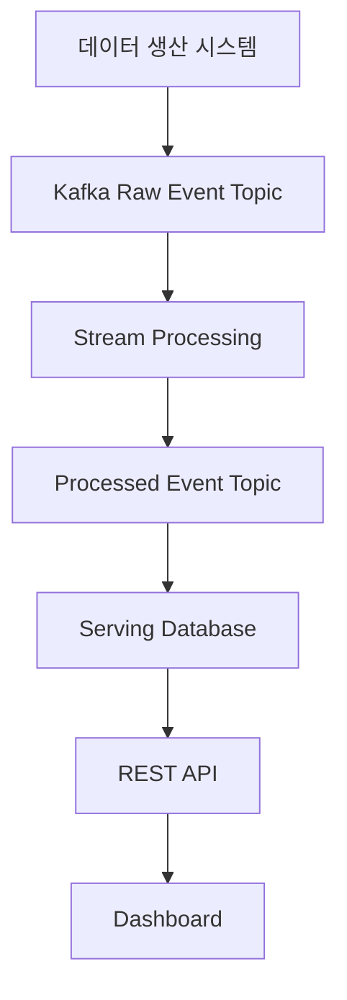

Kappa 아키텍처에서는 새롭게 발생한 이벤트를 스트림 처리 애플리케이션에서 처리한다.

과거 데이터를 다시 계산해야 할 때는 저장된 이벤트를 다시 읽어 동일한 처리 로직을 실행한다.

---

### Kappa 아키텍처의 재처리 방식

#### 실시간 처리와 과거 데이터 처리

다음과 같은 주문 이벤트가 있다고 가정해 보자.

```text
OrderCreated A

OrderCreated B

OrderCreated C

OrderCreated D
```

Kafka Topic에는 이러한 이벤트가 저장된다.

현재 실행 중인 Stream Processor는 새롭게 발생하는 이벤트를 처리한다.

```text
Kafka Topic
    ↓
현재 Offset 이후 이벤트 처리
    ↓
실시간 매출 집계
```

이후 매출 집계 로직을 변경해야 한다고 가정해 보자.

Kappa 아키텍처에서는 기존 데이터에 새로운 처리 로직을 적용하여 결과를 다시 생성할 수 있다.

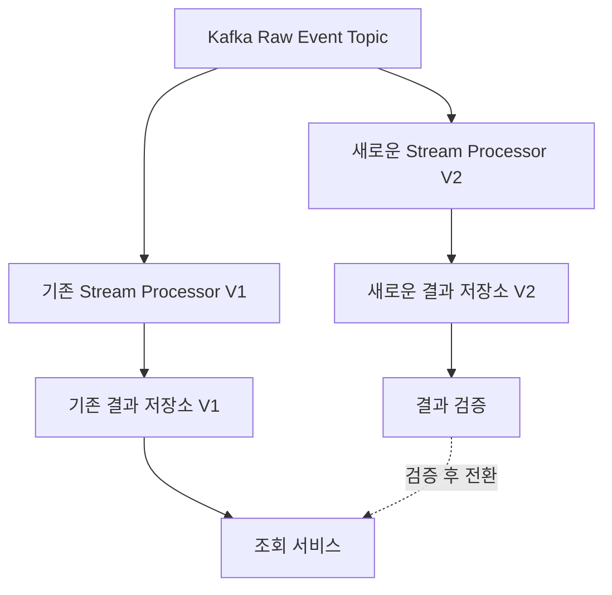

여기서 중요한 것은 기존 처리 결과에 재계산 결과를 무조건 추가하는 방식이 아니라는 것이다.

기존 집계 결과가 있는 상태에서 같은 이벤트를 처음부터 다시 처리하면 집계가 중복될 수 있다.

따라서 재처리 결과를 별도로 생성하고 검증한 뒤 조회 대상을 전환하는 방식이 안전하다.

#### 재처리 과정

대표적인 절차는 다음과 같다.

1. 기존 Stream Processor는 계속 데이터를 처리한다.
2. 새로운 처리 로직을 적용한 Processor를 실행한다.
3. 과거 이벤트를 처음부터 다시 읽는다.
4. 새로운 결과를 별도의 Topic이나 저장소에 기록한다.
5. 기존 결과와 새로운 결과를 비교한다.
6. 새로운 Processor가 최신 이벤트까지 따라왔는지 확인한다.
7. 조회 서비스를 새로운 결과로 전환한다.

이 방식은 기존 서비스를 유지하면서 데이터 처리 로직을 변경할 때 유용하다.

---

### Kafka에서 과거 데이터를 다시 읽을 수 있는 이유

Kafka는 Consumer가 메시지를 읽었다고 Record를 즉시 삭제하지 않는다.

Record는 보존 정책에 따라 유지된다.

Consumer는 Offset을 이용하여 읽기 위치를 관리한다.

예를 들어 다음과 같은 Topic이 있다고 가정해 보자.

```text
Offset 0 → Event A
Offset 1 → Event B
Offset 2 → Event C
Offset 3 → Event D
Offset 4 → Event E
```

기존 Consumer Group의 Committed Offset이 5라고 가정해 보자.

새로운 Consumer Group을 사용하면 유효한 Commit 위치가 없는 상태에서 가장 이른 보존 Offset부터 데이터를 다시 읽을 수 있다.

Kafka Streams에서도 애플리케이션 식별자인 `application.id`를 새롭게 지정하면 기존 애플리케이션과 독립적인 처리 위치를 사용할 수 있다.

하지만 여기에는 중요한 제약이 있다.

**Kafka가 과거 데이터를 무제한으로 보관하는 것은 아니다.**

#### Kafka Retention Policy

Kafka는 설정된 보존 기간이나 크기 등의 정책에 따라 데이터를 삭제할 수 있다.

예를 들어 보존 기간이 7일이라면 오래된 이벤트는 이미 삭제되었을 수 있다.

이 경우 Offset을 처음으로 이동시켜도 삭제된 데이터를 다시 읽을 수 없다.

#### Log Compaction

Kafka에서는 Key별 최신 상태를 유지하기 위한 Log Compaction을 사용할 수도 있다.

하지만 Compaction Topic은 모든 과거 이벤트를 그대로 보존하기 위한 구조가 아니다.

동일한 Key의 이전 Record가 정리될 수 있기 때문이다.

따라서 Kappa 아키텍처에서 전체 이벤트 재처리가 필요하다면 원본 데이터의 보존 전략이 중요하다.

장기 보관이 필요하다면 Kafka와 별도의 Object Storage나 Data Lake를 함께 사용하는 방법을 고려할 수 있다.

---

### Kappa 아키텍처의 장점

#### 처리 로직의 일관성

실시간 처리와 과거 데이터 재처리에 동일한 계산 로직을 활용할 수 있다.

따라서 두 처리 경로에 동일한 업무 규칙을 중복 구현하는 부담을 줄일 수 있다.

#### 운영 구조 단순화

Batch와 Speed를 서로 다른 구현으로 관리하는 대신 하나의 스트림 처리 모델을 중심으로 구성할 수 있다.

다만 재처리 중에는 기존 Processor와 새로운 Processor가 동시에 실행될 수 있으므로 프로세스가 항상 하나라는 의미는 아니다.

#### 재처리 가능성

원본 이벤트가 보존되어 있다면 새로운 계산 로직으로 데이터를 다시 처리할 수 있다.

#### 개발 방식의 일관성

Kafka Streams나 Flink 등 동일한 처리 엔진을 사용하여 새로운 이벤트와 과거 이벤트를 처리할 수 있다.

---

### Kappa 아키텍처의 단점

#### 원본 데이터 보존이 중요하다

전체 데이터를 다시 처리하려면 필요한 이벤트가 남아 있어야 한다.

보존 기간이 짧다면 전체 재처리가 불가능할 수 있다.

#### 대규모 재처리에 시간이 걸릴 수 있다

수개월 또는 수년간 누적된 이벤트를 처음부터 처리하려면 상당한 시간이 필요할 수 있다.

특히 상태 기반 집계나 Join이 포함되어 있다면 상태 저장소를 다시 구성해야 한다.

#### Stream Processing에 대한 의존성이 높아진다

실시간 처리와 재처리가 같은 처리 모델을 사용하므로 Stream Processor의 장애나 성능 문제가 중요해진다.

#### 일부 작업은 배치 처리가 더 효율적일 수 있다

전체 데이터를 대상으로 복잡한 Join이나 대규모 분석을 수행하는 경우에는 전통적인 배치 엔진이 더 유리할 수 있다.

따라서 Kappa 아키텍처를 사용한다고 모든 배치 작업을 제거해야 하는 것은 아니다.

---

### Lambda 아키텍처와 Kappa 아키텍처 비교

두 아키텍처를 비교하면 다음과 같다.

| 구분 | Lambda Architecture | Kappa Architecture |
|---|---|---|
| 핵심 목적 | 실시간성과 재계산 가능한 결과의 결합 | 처리 로직 중복 최소화 |
| 데이터 처리 구조 | Batch + Speed | Stream 중심 |
| 과거 데이터 재처리 | Batch Layer | 이벤트 재생 |
| 처리 로직 | 서로 다른 구현이 존재할 수 있음 | 동일한 처리 모델 활용 |
| 데이터 저장 | 장기 저장소와 실시간 데이터 | 재생 가능한 이벤트 로그 |
| 주요 장점 | 작업 특성에 맞는 엔진 선택 | 개발 및 운영 모델의 단순화 |
| 주요 단점 | 이중 구현과 병합 로직 | 재처리 비용과 상태 복구 |
| 적합한 상황 | 배치와 실시간 요구가 크게 다름 | 이벤트 재처리가 핵심인 시스템 |

#### 어떤 아키텍처가 더 좋을까?

정답은 시스템의 요구사항에 따라 달라진다.

예를 들어 실시간 주문 통계와 월말 정산을 함께 처리하는 시스템이라면 Lambda 형태의 구조를 고려할 수 있다.

반면 동일한 이벤트 집계 로직을 이용하여 현재 통계와 과거 통계를 다시 계산해야 하는 시스템이라면 Kappa 형태의 구조가 적합할 수 있다.

또한 두 아키텍처는 반드시 둘 중 하나만 선택해야 하는 관계가 아니다.

실제로는 이벤트 스트리밍을 중심으로 서비스를 구성하면서 장기 데이터 분석과 정산에는 별도 배치 시스템을 사용하는 혼합형 구조도 가능하다.

핵심은 다음 질문에 있다.

**실시간 처리와 과거 데이터 재처리를 서로 다른 로직으로 구현해야 하는가, 아니면 동일한 스트림 처리 모델로 해결할 수 있는가?**

---

### Kafka Streams란?

#### Kafka Streams의 개념

Kafka Streams는 Kafka Topic에 저장된 데이터를 처리하기 위한 Java 기반 스트림 처리 라이브러리다.

Producer와 Consumer API를 직접 사용하여 스트림 처리 애플리케이션을 만들 수도 있다.

하지만 이 경우 데이터 그룹화와 상태 관리, Window 처리, 장애 복구 등의 기능을 직접 구현해야 할 수 있다.

Kafka Streams는 이러한 작업을 위한 추상화와 실행 기능을 제공한다.

대표적인 연산은 다음과 같다.

| 연산 | 역할 |
|---|---|
| filter | 조건에 맞는 Record 선택 |
| map | Key 또는 Value 변환 |
| flatMapValues | 하나의 Value를 여러 Value로 변환 |
| groupBy | 특정 Key를 기준으로 그룹화 |
| count | 이벤트 수 집계 |
| aggregate | 사용자 정의 집계 |
| join | 다른 Stream 또는 Table과 결합 |
| windowedBy | 시간 구간별 처리 |

Kafka Streams는 별도의 독립적인 처리 서버를 반드시 설치해야 하는 구조가 아니다.

Java 애플리케이션에 Kafka Streams 라이브러리를 포함하여 실행할 수 있다.

#### Kafka Streams의 전체 구조

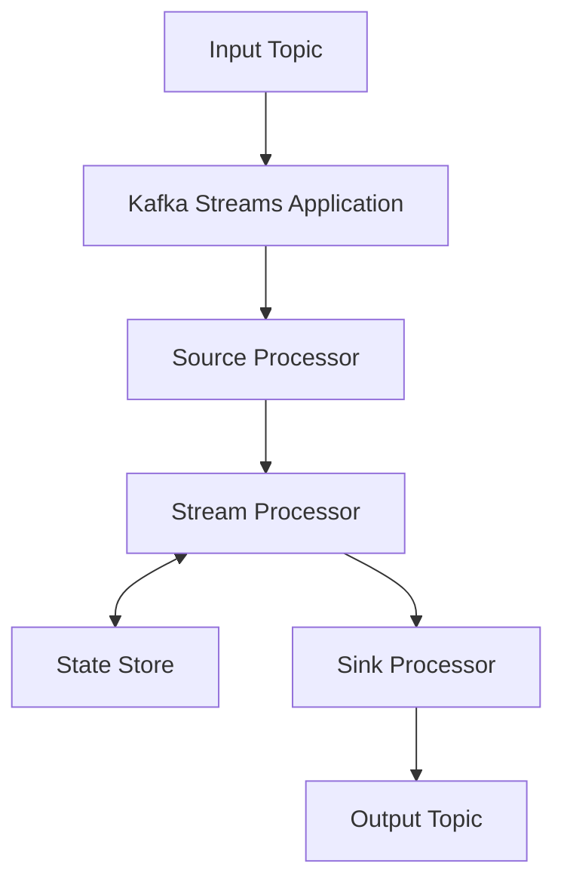

Kafka Streams 애플리케이션은 입력 Topic에서 Record를 읽는다.

처리 로직에 따라 데이터를 변환하거나 집계한다.

필요한 경우 상태를 저장한다.

마지막으로 처리 결과를 출력 Topic에 기록할 수 있다.

---

### Kafka Streams의 KStream과 KTable

Kafka Streams를 이해할 때 중요한 개념이 `KStream`과 `KTable`이다.

#### KStream

`KStream`은 이벤트의 연속을 나타낸다.

예를 들어 다음과 같은 메시지가 들어온다고 가정해 보자.

```text
hello world
```

```text
kafka streams example
```

각 메시지는 하나의 이벤트다.

`KStream`에서는 새로운 Record가 발생할 때마다 이를 독립적인 이벤트로 처리한다.

#### KTable

`KTable`은 Key별 최신 상태를 나타내는 데이터 모델이다.

예를 들어 다음과 같은 집계 결과를 생각해 보자.

```text
kafka → 1
```

이후 `kafka`라는 단어가 다시 등장했다.

집계 결과는 다음과 같이 변경된다.

```text
kafka → 2
```

`KTable`에서는 동일한 Key의 최신 상태가 2가 된다.

이러한 특성은 사용자별 현재 상태나 단어별 누적 개수, 실시간 집계 등을 구현할 때 유용하다.

#### KStream과 KTable 비교

| 구분 | KStream | KTable |
|---|---|---|
| 데이터 의미 | 이벤트의 연속 | Key별 최신 상태 |
| 동일 Key의 새 Record | 새로운 이벤트 | 기존 상태 갱신 |
| 주요 활용 | Filtering, Mapping | Aggregation, 상태 조회 |
| 대표 사례 | 주문 생성 이벤트 | 사용자별 누적 주문 수 |

여기서 중요한 점은 `KTable`이 만들어졌다고 과거 Kafka Record가 실제로 수정되는 것은 아니라는 사실이다.

Kafka는 Append 중심의 로그 구조를 사용한다.

`KTable`은 이벤트를 처리하여 Key별 최신 상태를 유지하는 데이터 모델이다.

---

### Kafka Streams의 Serde란?

Kafka는 데이터를 Byte 형태로 저장하고 전달한다.

따라서 Kafka Streams는 메시지를 읽고 쓰기 위해 직렬화와 역직렬화를 수행해야 한다.

#### Serializer

애플리케이션 객체를 Byte 데이터로 변환한다.

#### Deserializer

Byte 데이터를 애플리케이션 객체로 복원한다.

#### Serde

Serde는 Serializer와 Deserializer를 하나로 묶은 개념이다.

```text
Serializer
     +
Deserializer
     =
Serde
```

Kafka Streams에서는 다음과 같이 설정할 수 있다.

```java
Serdes.String()
```

문자열을 처리할 때 사용한다.

```java
Serdes.Long()
```

Long 타입을 처리할 때 사용한다.

이번 예제에서는 입력 메시지를 문자열로 읽는다.

하지만 단어 수를 집계한 결과는 Long 타입이다.

따라서 입력과 출력에서 사용하는 Serde가 서로 다르다는 점을 이해해야 한다.

---

### Kafka Streams 단어 수 집계 구현

#### 구현할 애플리케이션

이제 Kafka Streams를 이용하여 단어 수를 계산하는 애플리케이션을 구현해 보자.

다음과 같은 텍스트 메시지가 입력된다고 가정한다.

```text
hello world
```

```text
kafka streams example
```

```text
example kafka message
```

애플리케이션은 각 문장을 단어로 분리한다.

이후 단어별 등장 횟수를 계산한다.

최종 누적 결과는 다음과 같다.

| 단어 | 등장 횟수 |
|---|---:|
| hello | 1 |
| world | 1 |
| kafka | 2 |
| streams | 1 |
| example | 2 |
| message | 1 |

#### 전체 아키텍처

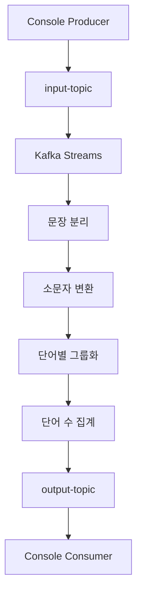

이번에는 같은 프로젝트에서 두 가지 방식을 구현한다.

첫 번째는 전체 누적 단어 수를 계산한다.

두 번째는 5초 단위로 단어 수를 계산한다.

| 모드 | 입력 Topic | 출력 Topic | 집계 방식 |
|---|---|---|---|
| 누적 집계 | input-topic | output-topic | 전체 누적 |
| Window 집계 | input-topic | windowed-output-topic | 5초 Tumbling Window |

---

### Kafka Streams 개발 환경 준비

#### 실행 환경

이번 예제는 다음 환경을 기준으로 한다.

| 항목 | 설정 |
|---|---|
| Java | JDK 17 이상 |
| Kafka | 4.0.2 |
| Kafka Streams | 4.0.2 |
| Build Tool | Maven |
| Broker | localhost:9092 |
| 개발 방식 | Java Application |

Kafka Broker는 이미 실행 중인 상태를 전제로 한다.

기존 Kafka 설치 환경을 유지하고 있다면 다음 명령어로 Broker를 실행할 수 있다.

```bash
bin/kafka-server-start.sh config/server.properties
```

기존 Kafka 저장소를 재사용하는 경우 다시 Cluster ID를 생성하거나 저장소를 Format할 필요는 없다.

#### 프로젝트 구조

다음과 같이 Java 프로젝트를 구성한다.

```text
wordcount-demo/
├── pom.xml
└── src/
    └── main/
        └── java/
            └── demo/
                └── WordCountApp.java
```

`pom.xml`은 Maven 의존성을 정의한다.

`WordCountApp.java`는 Kafka Streams 애플리케이션의 실행 코드다.

---

### Maven 설정

#### pom.xml 전체 코드

다음과 같이 작성한다.

```xml
<project xmlns="http://maven.apache.org/POM/4.0.0"
         xmlns:xsi="http://www.w3.org/2001/XMLSchema-instance"
         xsi:schemaLocation="http://maven.apache.org/POM/4.0.0 https://maven.apache.org/xsd/maven-4.0.0.xsd">

    <modelVersion>4.0.0</modelVersion>

    <groupId>demo</groupId>
    <artifactId>wordcount-demo</artifactId>
    <version>1.0.0</version>

    <properties>
        <maven.compiler.release>17</maven.compiler.release>
        <project.build.sourceEncoding>UTF-8</project.build.sourceEncoding>
    </properties>

    <dependencies>

        <dependency>
            <groupId>org.apache.kafka</groupId>
            <artifactId>kafka-streams</artifactId>
            <version>4.0.2</version>
        </dependency>

        <dependency>
            <groupId>org.slf4j</groupId>
            <artifactId>slf4j-simple</artifactId>
            <version>1.7.36</version>
            <scope>runtime</scope>
        </dependency>

    </dependencies>

    <build>
        <plugins>

            <plugin>
                <groupId>org.apache.maven.plugins</groupId>
                <artifactId>maven-compiler-plugin</artifactId>
                <version>3.13.0</version>
            </plugin>

            <plugin>
                <groupId>org.apache.maven.plugins</groupId>
                <artifactId>maven-dependency-plugin</artifactId>
                <version>3.8.1</version>
            </plugin>

        </plugins>
    </build>

</project>
```

#### kafka-streams

```xml
<dependency>
    <groupId>org.apache.kafka</groupId>
    <artifactId>kafka-streams</artifactId>
    <version>4.0.2</version>
</dependency>
```

Kafka Streams의 DSL과 처리 엔진을 제공한다.

이 의존성을 추가하면 Kafka Topic의 데이터를 읽고 변환하거나 집계하는 코드를 작성할 수 있다.

#### slf4j-simple

```xml
<dependency>
    <groupId>org.slf4j</groupId>
    <artifactId>slf4j-simple</artifactId>
    <version>1.7.36</version>
    <scope>runtime</scope>
</dependency>
```

애플리케이션의 로그를 출력하기 위한 SLF4J 구현체다.

Kafka Streams 4.0.2의 SLF4J API 의존성에 맞춘 예제 설정이다.

Spring Boot와 같이 이미 로깅 구현체가 존재하는 프로젝트에서는 별도로 `slf4j-simple`을 추가하면 로깅 구현체가 중복될 수 있으므로 주의해야 한다.

---

### Kafka Streams Java 전체 코드

#### WordCountApp.java

다음 코드는 누적 집계와 5초 Window 집계를 하나의 Java 애플리케이션에서 실행할 수 있도록 구성한 예제다.

기본 실행 시 누적 집계를 수행한다.

실행 인수로 `window`를 전달하면 5초 Window 집계를 수행한다.

```java
package demo;

import org.apache.kafka.clients.consumer.ConsumerConfig;
import org.apache.kafka.common.serialization.Serdes;

import org.apache.kafka.streams.KafkaStreams;
import org.apache.kafka.streams.KeyValue;
import org.apache.kafka.streams.StreamsBuilder;
import org.apache.kafka.streams.StreamsConfig;

import org.apache.kafka.streams.errors.StreamsUncaughtExceptionHandler;

import org.apache.kafka.streams.kstream.Grouped;
import org.apache.kafka.streams.kstream.KGroupedStream;
import org.apache.kafka.streams.kstream.KStream;
import org.apache.kafka.streams.kstream.KTable;
import org.apache.kafka.streams.kstream.Materialized;
import org.apache.kafka.streams.kstream.Produced;
import org.apache.kafka.streams.kstream.TimeWindows;
import org.apache.kafka.streams.kstream.Windowed;

import java.time.Duration;
import java.util.Arrays;
import java.util.Locale;
import java.util.Properties;

import java.util.concurrent.CountDownLatch;
import java.util.concurrent.atomic.AtomicReference;

public class WordCountApp {

    public static void main(String[] args)
            throws InterruptedException {

        boolean windowed =
                args.length > 0
                && "window".equals(args[0]);

        String applicationId = windowed
                ? "wordcount-window-application"
                : "wordcount-application";

        Properties props = new Properties();

        props.put(
                StreamsConfig.APPLICATION_ID_CONFIG,
                applicationId
        );

        props.put(
                StreamsConfig.BOOTSTRAP_SERVERS_CONFIG,
                "localhost:9092"
        );

        props.put(
                StreamsConfig.DEFAULT_KEY_SERDE_CLASS_CONFIG,
                Serdes.StringSerde.class
        );

        props.put(
                StreamsConfig.DEFAULT_VALUE_SERDE_CLASS_CONFIG,
                Serdes.StringSerde.class
        );

        props.put(
                ConsumerConfig.AUTO_OFFSET_RESET_CONFIG,
                "earliest"
        );

        props.put(
                StreamsConfig.STATE_DIR_CONFIG,
                "./state"
        );

        props.put(
                StreamsConfig.REPLICATION_FACTOR_CONFIG,
                1
        );

        props.put(
                StreamsConfig.STATESTORE_CACHE_MAX_BYTES_CONFIG,
                0L
        );

        props.put(
                StreamsConfig.COMMIT_INTERVAL_MS_CONFIG,
                100
        );

        StreamsBuilder builder = new StreamsBuilder();

        KStream<String, String> textLines =
                builder.stream("input-topic");

        KStream<String, String> words = textLines
                .filter(
                        (key, line) -> line != null
                )
                .flatMapValues(
                        line -> Arrays.asList(
                                line.toLowerCase(Locale.ROOT)
                                        .split("[^\\p{L}\\p{N}]+")
                        )
                )
                .filter(
                        (key, word) -> !word.isBlank()
                );

        KGroupedStream<String, String> groupedWords =
                words.groupBy(
                        (key, word) -> word,
                        Grouped.with(
                                Serdes.String(),
                                Serdes.String()
                        )
                );

        if (windowed) {

            KTable<Windowed<String>, Long> counts =
                    groupedWords
                            .windowedBy(
                                    TimeWindows.ofSizeAndGrace(
                                            Duration.ofSeconds(5),
                                            Duration.ofSeconds(2)
                                    )
                            )
                            .count(
                                    Materialized.as("window-counts")
                            );

            counts.toStream()
                    .map(
                            (windowedWord, count) ->
                                    KeyValue.pair(
                                            windowedWord.window().start()
                                                    + ":"
                                                    + windowedWord.key(),
                                            count
                                    )
                    )
                    .to(
                            "windowed-output-topic",
                            Produced.with(
                                    Serdes.String(),
                                    Serdes.Long()
                            )
                    );

        } else {

            KTable<String, Long> counts =
                    groupedWords.count(
                            Materialized.as("word-counts")
                    );

            counts.toStream()
                    .to(
                            "output-topic",
                            Produced.with(
                                    Serdes.String(),
                                    Serdes.Long()
                            )
                    );
        }

        CountDownLatch stopped =
                new CountDownLatch(1);

        AtomicReference<Throwable> failure =
                new AtomicReference<>();

        KafkaStreams streams =
                new KafkaStreams(
                        builder.build(),
                        props
                );

        streams.setUncaughtExceptionHandler(
                error -> {

                    failure.compareAndSet(null, error);

                    error.printStackTrace(System.err);

                    return StreamsUncaughtExceptionHandler
                            .StreamThreadExceptionResponse
                            .SHUTDOWN_CLIENT;
                }
        );

        streams.setStateListener(
                (newState, oldState) -> {

                    if (
                            newState == KafkaStreams.State.ERROR
                            || newState == KafkaStreams.State.NOT_RUNNING
                    ) {
                        stopped.countDown();
                    }
                }
        );

        Runtime.getRuntime().addShutdownHook(
                new Thread(
                        () -> {
                            try {
                                streams.close(
                                        Duration.ofSeconds(30)
                                );
                            } finally {
                                stopped.countDown();
                            }
                        },
                        "streams-shutdown"
                )
        );

        try {
            streams.start();
            stopped.await();

        } finally {
            streams.close(
                    Duration.ofSeconds(30)
            );
        }

        if (failure.get() != null) {
            throw new IllegalStateException(
                    "Stream processing failed",
                    failure.get()
            );
        }
    }
}
```

전체 코드는 다음 작업을 수행한다.

1. Kafka Streams 설정을 구성한다.
2. `input-topic`에서 문자열을 읽는다.
3. 문자열을 소문자로 변환한다.
4. 문장을 단어로 분리한다.
5. 단어를 Key로 그룹화한다.
6. 누적 집계 또는 Window 집계를 수행한다.
7. 결과를 출력 Topic에 기록한다.
8. 애플리케이션 종료 시 Kafka Streams 자원을 정리한다.

이제 주요 부분을 살펴보자.

---

### Kafka Streams 애플리케이션 설정

#### application.id

```java
props.put(
        StreamsConfig.APPLICATION_ID_CONFIG,
        applicationId
);
```

`application.id`는 Kafka Streams 애플리케이션을 식별하는 중요한 설정이다.

단순히 로그에 표시되는 이름이 아니다.

Kafka Streams는 `application.id`를 기반으로 다음 항목을 관리한다.

- Consumer Group
- 처리 위치
- 내부 Topic의 이름 공간
- State Store 관련 상태
- 애플리케이션 인스턴스의 논리적 그룹

예를 들어 다음 두 애플리케이션이 있다고 가정해 보자.

```text
wordcount-application
```

```text
wordcount-window-application
```

두 애플리케이션은 서로 다른 `application.id`를 사용한다.

따라서 동일한 입력 Topic을 읽더라도 독립적인 처리 위치와 상태를 사용할 수 있다.

이번 예제에서 누적 집계와 Window 집계의 ID를 분리한 이유도 여기에 있다.

#### bootstrap.servers

```java
props.put(
        StreamsConfig.BOOTSTRAP_SERVERS_CONFIG,
        "localhost:9092"
);
```

Kafka Broker의 초기 접속 주소를 지정한다.

여러 Broker로 구성된 Cluster라면 여러 주소를 지정할 수 있다.

#### 기본 Serde 설정

```java
props.put(
        StreamsConfig.DEFAULT_KEY_SERDE_CLASS_CONFIG,
        Serdes.StringSerde.class
);

props.put(
        StreamsConfig.DEFAULT_VALUE_SERDE_CLASS_CONFIG,
        Serdes.StringSerde.class
);
```

입력 Key와 Value를 문자열로 처리하도록 설정한다.

이번에는 콘솔 Producer가 문자열을 전송하므로 String Serde를 사용한다.

다만 집계 결과는 Long 타입이므로 출력 단계에서 별도의 Serde를 지정한다.

#### auto.offset.reset

```java
props.put(
        ConsumerConfig.AUTO_OFFSET_RESET_CONFIG,
        "earliest"
);
```

유효한 시작 Offset이 없는 경우 현재 보존된 가장 이른 메시지부터 읽도록 설정한다.

기존 `application.id`로 재실행할 때마다 처음부터 처리하는 것은 아니다.

#### state.dir

```java
props.put(
        StreamsConfig.STATE_DIR_CONFIG,
        "./state"
);
```

Kafka Streams가 사용하는 로컬 상태 저장 경로를 지정한다.

Kafka Streams는 상태 기반 집계를 수행할 때 로컬 State Store를 활용할 수 있다.

실제 운영에서는 상태 저장소에 사용할 디스크 용량과 성능을 고려해야 한다.

#### replication.factor

```java
props.put(
        StreamsConfig.REPLICATION_FACTOR_CONFIG,
        1
);
```

Kafka Streams가 생성하는 내부 Topic의 Replication Factor를 설정한다.

이번에는 단일 Broker 환경이므로 1을 사용한다.

실제 운영 환경에서는 내부 Topic의 Replication Factor도 고가용성 요구사항에 맞게 설정해야 한다.

#### State Store Cache

```java
props.put(
        StreamsConfig.STATESTORE_CACHE_MAX_BYTES_CONFIG,
        0L
);
```

이번 예제에서는 집계 결과의 변화를 쉽게 확인하기 위해 Cache를 비활성화한다.

Kafka Streams의 Cache는 중간 상태 갱신을 모아 출력 횟수를 줄이는 데 도움이 될 수 있다.

운영 환경에서는 Cache를 비활성화하는 것이 무조건 좋은 선택은 아니다.

처리량과 메모리 사용량, 결과 반영 지연을 함께 고려해야 한다.

#### commit.interval.ms

```java
props.put(
        StreamsConfig.COMMIT_INTERVAL_MS_CONFIG,
        100
);
```

처리 진행 상태를 Commit하는 주기를 조절한다.

이번에는 결과 변화를 빠르게 확인하기 위해 100ms로 설정했다.

운영 환경에서는 지나치게 짧은 Commit 주기가 추가적인 오버헤드를 발생시킬 수 있으므로 실제 처리량을 기준으로 조정해야 한다.

---

### StreamsBuilder와 Processor Topology

#### StreamsBuilder란?

다음 코드를 살펴보자.

```java
StreamsBuilder builder = new StreamsBuilder();
```

`StreamsBuilder`는 Kafka Streams의 처리 흐름을 정의하는 데 사용한다.

입력 Topic을 읽는 작업부터 필터링과 변환, 집계, 출력 작업까지 연결할 수 있다.

이렇게 정의된 처리 구조를 Processor Topology라고 한다.

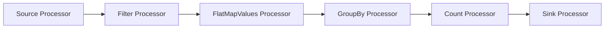

이 구조에서 각 Processor가 반드시 별도의 서버나 프로세스로 실행되는 것은 아니다.

여러 Processor는 하나의 Kafka Streams 애플리케이션 내부에서 처리될 수 있다.

다만 상태 관리나 데이터 재분배를 위해 내부 Kafka Topic이 생성될 수 있다.

---

### input-topic에서 데이터 읽기

다음 코드를 살펴보자.

```java
KStream<String, String> textLines =
        builder.stream("input-topic");
```

`input-topic`에 저장된 Record를 읽는다.

Key와 Value는 모두 String 타입으로 처리한다.

이번에는 Console Producer로 다음과 같은 문자열을 전송한다.

```text
hello world
```

```text
kafka streams example
```

```text
example kafka message
```

각 문자열은 하나의 Kafka Record Value다.

---

### flatMapValues를 이용한 단어 분리

문장을 단어로 분리하려면 하나의 입력 Record에서 여러 출력 Record를 생성해야 한다.

이때 `flatMapValues()`를 사용할 수 있다.

```java
KStream<String, String> words = textLines
        .filter(
                (key, line) -> line != null
        )
        .flatMapValues(
                line -> Arrays.asList(
                        line.toLowerCase(Locale.ROOT)
                                .split("[^\\p{L}\\p{N}]+")
                )
        )
        .filter(
                (key, word) -> !word.isBlank()
        );
```

#### 소문자 변환

```java
line.toLowerCase(Locale.ROOT)
```

입력 문자열을 소문자로 변환한다.

예를 들어 다음 문자열이 입력되었다고 가정해 보자.

```text
Kafka Streams Example
```

변환 결과는 다음과 같다.

```text
kafka streams example
```

대소문자가 다른 단어를 같은 단어로 집계하기 위한 처리다.

`Locale.ROOT`를 사용하면 실행 환경의 기본 Locale에 따라 소문자 변환 결과가 달라지는 문제를 줄일 수 있다.

#### 정규식 분리

```java
split("[^\\p{L}\\p{N}]+")
```

문자 또는 숫자가 아닌 연속된 구간을 기준으로 문자열을 분리한다.

`\p{L}`은 Unicode 문자를 나타낸다.

`\p{N}`은 Unicode 숫자를 나타낸다.

이를 통해 공백뿐 아니라 쉼표와 느낌표 등도 구분자로 사용할 수 있다.

예를 들어 다음 문장을 생각해 보자.

```text
Kafka, Streams! Example
```

단어는 다음과 같이 분리된다.

```text
kafka

streams

example
```

#### flatMapValues의 결과

입력 Record가 다음과 같다고 가정해 보자.

```text
Kafka Record Value

"hello world"
```

`flatMapValues()` 이후에는 다음 두 Record가 생성될 수 있다.

```text
hello
```

```text
world
```

이처럼 하나의 입력 Value가 여러 출력 Value로 변환된다.

#### mapValues와 flatMapValues의 차이

| 메서드 | 특징 |
|---|---|
| mapValues | 하나의 입력 Value를 하나의 출력 Value로 변환 |
| flatMapValues | 하나의 입력 Value에서 여러 출력 Value 생성 가능 |

단어 수 집계에서는 하나의 문장을 여러 단어로 분리해야 하므로 `flatMapValues()`가 적합하다.

---

### groupBy를 이용한 단어별 그룹화

단어를 분리한 후에는 같은 단어끼리 묶어야 한다.

다음 코드를 사용한다.

```java
KGroupedStream<String, String> groupedWords =
        words.groupBy(
                (key, word) -> word,
                Grouped.with(
                        Serdes.String(),
                        Serdes.String()
                )
        );
```

#### 그룹화 기준

```java
(key, word) -> word
```

기존 Record Key가 아니라 단어 자체를 새로운 Key로 사용한다.

예를 들어 다음 데이터가 있다고 가정해 보자.

```text
hello

world

kafka

kafka
```

그룹화 결과는 개념적으로 다음과 같다.

```text
Key = hello
    → hello
```

```text
Key = world
    → world
```

```text
Key = kafka
    → kafka
    → kafka
```

이렇게 그룹화된 데이터를 이용하면 단어별로 개수를 계산할 수 있다.

#### groupBy에서 주의할 점

`groupBy()`는 Record의 Key를 변경할 수 있다.

Kafka에서는 Partition을 Key 기준으로 분배하는 경우가 많다.

따라서 새로운 Key로 그룹화하려면 데이터를 다른 Partition으로 재분배하는 과정이 필요할 수 있다.

이를 Repartitioning이라고 한다.

---

### Kafka Streams의 Repartitioning

#### Repartitioning이란?

Repartitioning은 데이터를 새로운 Key를 기준으로 다시 Partition에 분배하는 과정이다.

예를 들어 입력 Record가 다음과 같다고 가정해 보자.

```text
Key = message-1
Value = kafka streams
```

단어별 집계를 위해 다음처럼 Key를 변경한다.

```text
Key = kafka
Value = kafka
```

```text
Key = streams
Value = streams
```

이제 같은 단어를 가진 Record들이 같은 Partition에서 집계될 수 있도록 데이터를 재분배해야 할 수 있다.

Kafka Streams는 필요한 경우 내부 Repartition Topic을 생성하여 이를 처리한다.

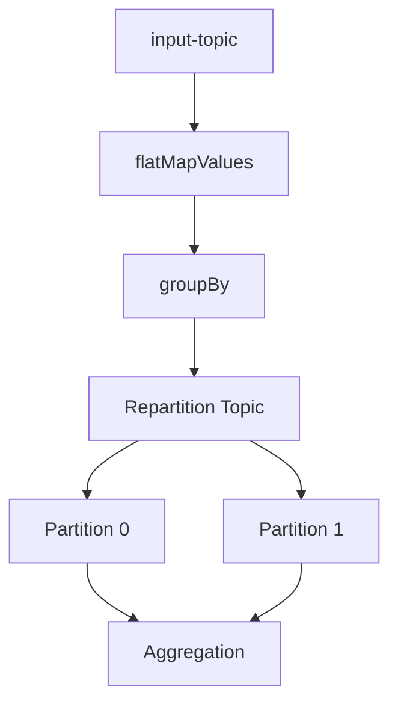

여기서 Repartitioning은 항상 비용이 없는 작업이 아니다.

데이터를 Kafka Topic에 다시 기록하고 읽는 과정이 필요할 수 있기 때문이다.

따라서 다음 비용을 고려해야 한다.

- 네트워크 사용량
- Kafka Broker의 디스크 I/O
- 메시지 직렬화 및 역직렬화
- 추가적인 처리 지연

실무에서 Kafka Streams의 처리량이 예상보다 낮다면 내부 Repartition Topic이 과도하게 생성되고 있지 않은지도 확인해야 한다.

---

### count를 이용한 누적 집계

단어를 그룹화했다면 각 단어의 개수를 계산할 수 있다.

다음 코드를 사용한다.

```java
KTable<String, Long> counts =
        groupedWords.count(
                Materialized.as("word-counts")
        );
```

#### count의 동작

다음 단어가 순서대로 입력되었다고 가정해 보자.

```text
kafka
```

```text
streams
```

```text
kafka
```

첫 번째 `kafka`가 들어오면 다음 상태가 생성된다.

```text
kafka → 1
```

`streams`가 들어오면 다음 상태가 생성된다.

```text
streams → 1
```

이후 `kafka`가 다시 들어오면 기존 값이 증가한다.

```text
kafka → 2
```

최종 상태는 다음과 같다.

```text
kafka → 2

streams → 1
```

#### count의 결과가 KTable인 이유

`count()`는 단순히 숫자를 출력하는 기능이 아니다.

Key별 집계 상태를 유지하면서 새로운 Record가 들어올 때 값을 갱신한다.

따라서 결과는 Key별 최신 상태를 나타내는 `KTable`이다.

---

### Materialized와 State Store

#### Materialized란?

다음 코드를 살펴보자.

```java
Materialized.as("word-counts")
```

이 설정은 집계 결과를 저장할 State Store의 이름을 지정한다.

State Store는 Kafka Streams가 상태 기반 처리를 수행할 때 사용하는 저장 공간이다.

이번에는 단어별 누적 개수를 저장한다.

```text
word-counts

hello   → 1
world   → 1
kafka   → 2
streams → 1
```

#### 왜 State Store가 필요할까?

새로운 `kafka` Record가 들어왔을 때 기존 개수를 알아야 하기 때문이다.

현재 개수가 2라면 새로운 이벤트를 반영하여 3으로 변경해야 한다.

```text
기존 상태: kafka → 2

새 이벤트: kafka

변경 상태: kafka → 3
```

기존 상태가 없다면 매번 전체 이벤트를 다시 읽어야 할 수 있다.

Kafka Streams는 State Store를 이용하여 이러한 증분 집계를 수행할 수 있다.

#### State Store와 Changelog Topic

Kafka Streams는 일반적인 상태 기반 처리에서 Changelog Topic을 활용하여 상태 변경을 기록하고 복구할 수 있다.

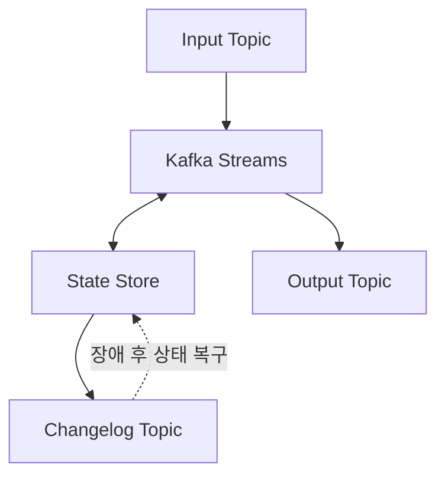

State Store는 로컬 디스크에 저장될 수 있다.

하지만 로컬 디스크가 손실되더라도 필요한 Changelog 데이터가 남아 있다면 상태를 복구할 수 있다.

다만 상태 데이터가 많을수록 복구에 시간이 걸릴 수 있다.

따라서 운영 환경에서는 State Store 크기와 복구 시간도 함께 고려해야 한다.

---

### 집계 결과를 Kafka Topic에 저장하기

집계 결과는 `KTable`이다.

이를 Kafka Topic에 기록하려면 Stream 형태로 변환할 수 있다.

```java
counts.toStream()
        .to(
                "output-topic",
                Produced.with(
                        Serdes.String(),
                        Serdes.Long()
                )
        );
```

#### toStream()

```java
counts.toStream()
```

`KTable`에서 발생하는 상태 변경을 `KStream` 형태로 변환한다.

여기서 중요한 점이 있다.

**출력 Topic에는 최종 집계 결과만 한 번 기록되는 것이 아니라 집계 상태의 변경 내역이 기록될 수 있다.**

예를 들어 다음과 같다.

```text
kafka → 1
```

이후 같은 단어가 다시 등장하면 다음 데이터가 기록될 수 있다.

```text
kafka → 2
```

따라서 출력 Topic을 처음부터 읽으면 두 Record가 모두 나타날 수 있다.

하지만 `KTable`의 최신 상태는 다음과 같다.

```text
kafka → 2
```

#### Produced.with()

```java
Produced.with(
        Serdes.String(),
        Serdes.Long()
)
```

출력 Record의 Key와 Value 직렬화 방식을 지정한다.

Key는 String이다.

Value는 Long이다.

따라서 다음과 같이 설정한다.

```text
Key → StringSerializer

Value → LongSerializer
```

이 차이는 Console Consumer에서 결과를 확인할 때도 중요하다.

---

### Kafka Streams 실행 준비

#### Topic 생성

Kafka 설치 디렉터리에서 다음 Topic을 생성한다.

```text
input-topic
```

```text
output-topic
```

```text
windowed-output-topic
```

첫 번째는 입력 Topic이다.

두 번째는 누적 집계 결과 Topic이다.

세 번째는 Window 집계 결과 Topic이다.

#### 입력 Topic 생성

```bash
bin/kafka-topics.sh \
  --bootstrap-server localhost:9092 \
  --create --if-not-exists \
  --topic input-topic \
  --partitions 1 \
  --replication-factor 1
```

#### 누적 집계 결과 Topic 생성

```bash
bin/kafka-topics.sh \
  --bootstrap-server localhost:9092 \
  --create --if-not-exists \
  --topic output-topic \
  --partitions 1 \
  --replication-factor 1
```

#### Window 집계 결과 Topic 생성

```bash
bin/kafka-topics.sh \
  --bootstrap-server localhost:9092 \
  --create --if-not-exists \
  --topic windowed-output-topic \
  --partitions 1 \
  --replication-factor 1
```

여기서 `--if-not-exists`는 Topic이 이미 존재한다면 새로 생성하지 않도록 하는 옵션이다.

기존 Topic의 데이터를 삭제하거나 Partition 수를 변경하는 옵션은 아니다.

---

### Maven 프로젝트 빌드

Java 프로젝트 디렉터리에서 다음 명령어를 실행한다.

```bash
mvn clean package dependency:copy-dependencies
```

이 명령어는 다음 작업을 수행한다.

**clean**

기존 빌드 결과를 정리한다.

**package**

Java 코드를 컴파일하고 패키징한다.

**dependency:copy-dependencies**

실행에 필요한 의존성 JAR 파일을 별도 디렉터리에 복사한다.

정상적으로 완료되면 다음과 같은 구조가 생성된다.

```text
target/
├── classes/
│   └── demo/
│       └── WordCountApp.class
└── dependency/
    ├── kafka-streams-4.0.2.jar
    ├── kafka-clients-4.0.2.jar
    └── ...
```

실제 의존성 목록에는 다른 JAR 파일도 포함된다.

이제 애플리케이션을 실행할 수 있다.

---

### Kafka Streams 누적 집계 실행

#### Java 애플리케이션 실행

다음 명령어를 실행한다.

```bash
java -cp "target/classes:target/dependency/*" demo.WordCountApp
```

`-cp`는 Java Classpath를 지정한다.

여기서는 컴파일한 Class 파일과 의존성 JAR 파일을 함께 지정한다.

이 명령어는 macOS와 Linux 계열 환경을 기준으로 한다.

애플리케이션이 실행되면 `input-topic`을 구독하여 메시지를 기다린다.

#### Console Producer 실행

Kafka 설치 디렉터리의 다른 터미널에서 다음 명령어를 실행한다.

```bash
bin/kafka-console-producer.sh \
  --bootstrap-server localhost:9092 \
  --topic input-topic
```

다음 문자열을 한 줄씩 입력한다.

```text
hello world
kafka streams example
example kafka message
```

각 줄은 하나의 Kafka Record로 전송된다.

#### Console Consumer 실행

이제 `output-topic`의 데이터를 읽는다.

```bash
bin/kafka-console-consumer.sh \
  --bootstrap-server localhost:9092 \
  --topic output-topic \
  --from-beginning \
  --property print.key=true \
  --property print.value=true \
  --property key.deserializer=org.apache.kafka.common.serialization.StringDeserializer \
  --property value.deserializer=org.apache.kafka.common.serialization.LongDeserializer
```

여기서 중요한 부분은 다음 설정이다.

```bash
--property value.deserializer=org.apache.kafka.common.serialization.LongDeserializer
```

집계 결과 Value는 Long 타입으로 저장했다.

따라서 LongDeserializer를 사용해야 숫자를 올바르게 읽을 수 있다.

#### 최종 집계 결과

처음 생성한 상태에서 세 문장을 처리하면 최종 집계 결과는 다음과 같다.

```text
hello    1
world    1
kafka    2
streams  1
example  2
message  1
```

다만 콘솔에서 반드시 위 여섯 줄만 출력되는 것은 아니다.

앞에서 설명한 것처럼 `KTable`의 상태 변경이 출력 Topic에 기록될 수 있기 때문이다.

예를 들어 다음과 같이 출력될 수 있다.

```text
kafka    1
```

```text
kafka    2
```

이 두 Record는 서로 다른 이벤트 개수의 합계가 아니다.

같은 Key에 대한 집계 상태가 1에서 2로 변경되었다는 의미다.

따라서 후속 Consumer가 이러한 결과를 처리한다면 값을 계속 더하는 것이 아니라 Key별 최신 상태로 반영해야 한다.

---

### Kafka Streams에서 Cache가 결과에 미치는 영향

Kafka Streams에서는 집계 결과가 변경될 때마다 무조건 즉시 출력 Topic에 기록되는 것은 아니다.

State Store Cache 등의 설정에 따라 중간 변경이 합쳐질 수 있다.

예를 들어 다음 Record가 연속적으로 들어왔다고 가정해 보자.

```text
kafka

kafka

kafka
```

논리적인 집계 상태는 다음과 같이 변경된다.

```text
kafka → 1

kafka → 2

kafka → 3
```

하지만 Cache가 활성화되어 있다면 중간 결과가 합쳐져 최종 값만 출력될 수 있다.

```text
kafka → 3
```

이번 예제에서는 상태 변경을 확인하기 쉽도록 다음 설정을 사용했다.

```java
props.put(
        StreamsConfig.STATESTORE_CACHE_MAX_BYTES_CONFIG,
        0L
);
```

따라서 중간 결과가 출력될 가능성이 높다.

반면 운영 환경에서는 Cache를 활용하여 불필요한 출력과 상태 저장 비용을 줄이는 것이 유리할 수 있다.

이처럼 **Kafka Streams의 논리적인 집계 결과와 실제 출력 Topic에 기록되는 Record 수는 항상 같지 않을 수 있다.**

---

### Window Processing이란?

#### Window Processing의 개념

지금까지는 단어별 전체 누적 개수를 계산했다.

예를 들어 다음과 같은 결과다.

```text
kafka → 100
```

하지만 실제 서비스에서는 일정 시간 동안 발생한 이벤트 수를 계산해야 하는 경우가 많다.

예를 들어 다음과 같다.

- 1분 동안 발생한 주문 수
- 5분 동안 발생한 결제 실패 수
- 10초 동안 발생한 API 요청 수
- 1시간 동안 발생한 사용자 로그인 수

이러한 처리를 위해 Window Processing을 사용할 수 있다.

Window Processing은 스트림 데이터를 일정한 시간 구간으로 나누어 처리하는 방식이다.

---

### Tumbling Window란?

#### Tumbling Window의 개념

Tumbling Window는 서로 겹치지 않는 고정된 시간 구간을 사용한다.

예를 들어 5초 Window를 설정했다고 가정해 보자.

시간 구간은 다음과 같다.

```text
00초 ~ 05초

05초 ~ 10초

10초 ~ 15초

15초 ~ 20초
```

각 이벤트는 해당하는 하나의 Window에 속한다.

정확히 표현하면 다음과 같다.

```text
[00초, 05초)

[05초, 10초)

[10초, 15초)
```

시작 시각은 포함한다.

종료 시각은 포함하지 않는다.

따라서 정확히 5초에 발생한 이벤트는 첫 번째가 아니라 두 번째 Window에 속한다.

#### Tumbling Window 구조

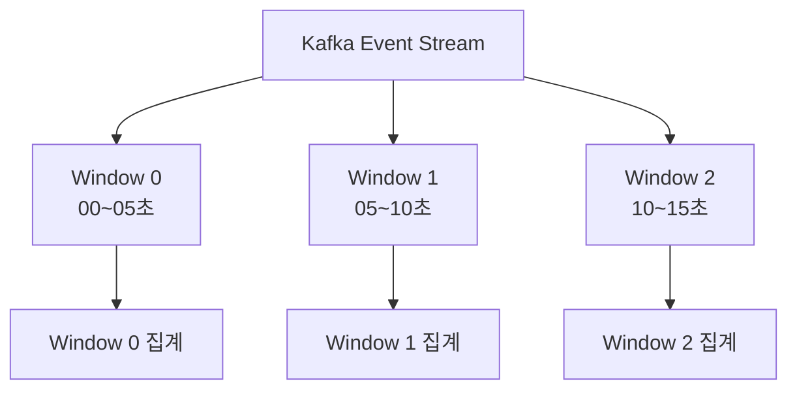

각 Window는 독립적인 집계 상태를 가진다.

따라서 같은 단어가 등장하더라도 서로 다른 Window에 속하면 별도로 계산된다.

---

### Kafka Streams에서 5초 Window 구현하기

앞에서 작성한 Java 코드에서는 `window` 실행 모드를 제공한다.

Window 처리에서 중요한 부분은 다음과 같다.

```java
KTable<Windowed<String>, Long> counts =
        groupedWords
                .windowedBy(
                        TimeWindows.ofSizeAndGrace(
                                Duration.ofSeconds(5),
                                Duration.ofSeconds(2)
                        )
                )
                .count(
                        Materialized.as("window-counts")
                );
```

#### windowedBy()

```java
.windowedBy(...)
```

시간 구간을 기준으로 데이터를 처리하도록 설정한다.

#### TimeWindows.ofSizeAndGrace()

```java
TimeWindows.ofSizeAndGrace(
        Duration.ofSeconds(5),
        Duration.ofSeconds(2)
)
```

첫 번째 인자는 Window의 크기다.

```java
Duration.ofSeconds(5)
```

5초 단위로 집계한다.

두 번째 인자는 Grace Period다.

```java
Duration.ofSeconds(2)
```

늦게 도착한 이벤트를 허용할 수 있는 추가 범위를 설정한다.

#### 왜 TimeWindows.of()를 사용하지 않을까?

과거 Kafka Streams 코드에서는 다음과 같은 형태를 볼 수 있다.

```java
TimeWindows.of(
        Duration.ofSeconds(5)
)
```

하지만 Kafka 4.0 계열에서는 Window 크기와 Grace Period를 명확하게 정의하는 API를 사용하는 것이 적절하다.

대표적으로 다음 두 가지가 있다.

```java
TimeWindows.ofSizeAndGrace(
        Duration.ofSeconds(5),
        Duration.ofSeconds(2)
)
```

```java
TimeWindows.ofSizeWithNoGrace(
        Duration.ofSeconds(5)
)
```

첫 번째는 Grace Period를 설정한다.

두 번째는 Grace Period를 사용하지 않는다.

실제 서비스에서는 이벤트 지연이 발생할 수 있으므로 어떤 정책이 적합한지 검토해야 한다.

---

### Grace Period란?

#### Grace Period가 필요한 이유

분산 시스템에서는 이벤트가 발생한 순서대로 도착하지 않을 수 있다.

예를 들어 다음 상황을 생각해 보자.

| 이벤트 | 실제 발생 시각 | 처리 시각 |
|---|---|---|
| A | 12:00:01 | 12:00:01 |
| B | 12:00:03 | 12:00:08 |
| C | 12:00:06 | 12:00:06 |

5초 Window를 사용한다면 A와 B는 다음 Window에 속한다.

```text
12:00:00 ~ 12:00:05
```

하지만 B는 실제 처리 시점이 늦다.

이때 이전 Window에 속하는 B를 어떻게 처리할 것인지 결정해야 한다.

Grace Period는 이러한 늦은 이벤트를 허용하는 범위를 정의한다.

#### Grace Period가 없을 경우

Window가 닫힌 것으로 판단된 이후에 이벤트가 들어오면 집계에서 제외될 수 있다.

#### Grace Period가 있는 경우

허용된 범위 안에서는 늦게 도착한 이벤트를 이전 Window에 반영할 수 있다.

#### 주의할 점

Grace Period를 단순히 운영체제 시계를 기준으로 2초 기다리는 타이머라고 이해해서는 안 된다.

Kafka Streams는 Record의 Timestamp와 Stream Time의 진행을 기준으로 Window 종료 여부를 판단한다.

따라서 처리 애플리케이션의 현재 시각이 Window 종료 시각을 지났다는 이유만으로 모든 Window가 즉시 확정되는 것은 아니다.

---

### Window 집계 결과의 Key 구성

Window 집계에서는 같은 단어라도 시간 구간을 구분해야 한다.

예를 들어 다음과 같은 결과가 있을 수 있다.

```text
12:00:00 ~ 12:00:05

kafka → 2
```

```text
12:00:05 ~ 12:00:10

kafka → 3
```

이를 하나의 출력 Topic에 기록할 때는 Window 정보를 Key에 포함할 수 있다.

이번 예제에서는 다음 코드를 사용한다.

```java
counts.toStream()
        .map(
                (windowedWord, count) ->
                        KeyValue.pair(
                                windowedWord.window().start()
                                        + ":"
                                        + windowedWord.key(),
                                count
                        )
        )
        .to(
                "windowed-output-topic",
                Produced.with(
                        Serdes.String(),
                        Serdes.Long()
                )
        );
```

#### Windowed Key

`Windowed<String>`에는 원래 Key와 Window 정보가 포함되어 있다.

```java
windowedWord.key()
```

원래 단어를 가져온다.

```java
windowedWord.window().start()
```

Window 시작 시각을 가져온다.

이를 문자열로 결합한다.

```java
windowedWord.window().start()
        + ":"
        + windowedWord.key()
```

예를 들어 다음과 같은 Key가 만들어질 수 있다.

```text
1743850635000:kafka
```

여기서 앞의 숫자는 Window 시작 시각을 나타내는 Unix Epoch Milliseconds다.

뒤의 문자열은 단어다.

이 방식을 사용하면 동일한 단어라도 Window별로 구분하여 집계 결과를 저장할 수 있다.

---

### 5초 Window 집계 실행하기

#### 누적 집계 애플리케이션 종료

먼저 누적 집계 애플리케이션을 종료한다.

실행 중인 터미널에서 `Ctrl+C`를 누른다.

이후 Window 모드로 실행한다.

#### Window 모드 실행

Java 프로젝트 디렉터리에서 다음 명령어를 실행한다.

```bash
java -cp "target/classes:target/dependency/*" demo.WordCountApp window
```

이번에는 다음 `application.id`가 사용된다.

```text
wordcount-window-application
```

누적 집계에서 사용한 ID와 다르다.

따라서 기존 누적 집계 애플리케이션과 독립적인 처리 위치를 관리한다.

#### Window 집계 결과 Consumer 실행

다른 터미널에서 다음 명령어를 실행한다.

```bash
bin/kafka-console-consumer.sh \
  --bootstrap-server localhost:9092 \
  --topic windowed-output-topic \
  --from-beginning \
  --property print.key=true \
  --property print.value=true \
  --property key.deserializer=org.apache.kafka.common.serialization.StringDeserializer \
  --property value.deserializer=org.apache.kafka.common.serialization.LongDeserializer
```

출력 Value가 Long 타입이므로 `LongDeserializer`를 사용한다.

#### 첫 번째 입력

다음 명령어를 실행한다.

```bash
printf 'windowdemo windowdemo\n' | \
  bin/kafka-console-producer.sh \
    --bootstrap-server localhost:9092 \
    --topic input-topic
```

하나의 Record에 같은 단어가 두 번 포함되어 있다.

따라서 같은 Window에 속하는 `windowdemo`의 개수가 2가 될 수 있다.

#### 6초 후 두 번째 입력

다음 명령어를 실행한다.

```bash
sleep 6
```

이후 새로운 메시지를 전송한다.

```bash
printf 'windowdemo\n' | \
  bin/kafka-console-producer.sh \
    --bootstrap-server localhost:9092 \
    --topic input-topic
```

5초 Window보다 긴 시간을 두고 메시지를 전송했다.

따라서 일반적인 현재 시각 기반 Record Timestamp 설정에서는 다른 Window에 속하게 된다.

#### 결과 확인

다음과 같은 형태의 출력이 발생할 수 있다.

```text
<첫 번째 Window 시작 시각>:windowdemo    1

<첫 번째 Window 시작 시각>:windowdemo    2

<두 번째 Window 시작 시각>:windowdemo    1
```

실제 출력에서는 Window 시작 시각이 Unix Epoch Milliseconds로 표시된다.

또한 기존 Topic에 데이터가 남아 있거나 집계 Cache와 Commit 설정이 달라지면 출력 Record의 개수와 순서는 달라질 수 있다.

핵심은 다음과 같다.

**같은 단어라도 서로 다른 Window에 속하면 별도의 집계 상태를 가진다.**

---

### 5초 Window는 5초마다 실행되는 배치일까?

5초 Window를 사용한다고 애플리케이션이 정확히 5초마다 한 번씩 실행되는 것은 아니다.

이 차이는 중요하다.

예를 들어 다음 설정을 사용했다고 가정해 보자.

```java
TimeWindows.ofSizeAndGrace(
        Duration.ofSeconds(5),
        Duration.ofSeconds(2)
)
```

이 설정은 데이터를 5초 간격으로 구분한다는 의미다.

다음과 같은 스케줄러와는 다르다.

```text
매 5초마다 실행
    ↓
데이터 조회
    ↓
집계
```

Kafka Streams는 이벤트가 들어오면 해당 이벤트의 Timestamp를 기준으로 Window를 결정한다.

이후 해당 Window의 집계 상태를 갱신한다.

따라서 Window 안에서 여러 이벤트가 발생하면 집계 결과도 여러 번 변경될 수 있다.

---

### Window 집계에서 최종 결과만 출력하려면?

앞선 예제에서는 Window 집계 값이 변경될 때마다 결과가 출력될 수 있다.

예를 들어 다음과 같다.

```text
kafka → 1

kafka → 2

kafka → 3
```

하지만 실제 서비스에서는 Window가 완료된 이후의 최종 결과만 필요할 수도 있다.

예를 들어 다음 요구사항이다.

```text
1분 동안의 결제 건수를 계산하고
해당 Window가 종료된 후 최종 결과만 발행
```

Kafka Streams에서는 이러한 요구사항을 처리하기 위해 Suppression 기능을 검토할 수 있다.

대표적으로 다음과 같은 형태다.

```java
import org.apache.kafka.streams.kstream.Suppressed;

KTable<Windowed<String>, Long> finalCounts =
        counts.suppress(
                Suppressed.untilWindowCloses(
                        Suppressed.BufferConfig.unbounded()
                )
        );
```

이 코드는 Window가 닫힌 이후 결과를 출력하도록 구성하는 방식이다.

하지만 `unbounded()`는 버퍼 크기에 명시적인 제한을 두지 않는다.

따라서 운영 환경에서는 메모리 사용량과 데이터 유입량을 고려해야 한다.

또한 Window의 종료는 단순한 시스템 시계가 아니라 Stream Time의 진행과 관련된다.

따라서 이벤트가 더 이상 들어오지 않는 상황에서는 기대한 시점에 결과가 출력되지 않을 수 있다.

**Window를 구분하는 것과 Window가 완료된 후 최종 결과만 출력하는 것은 서로 다른 기능이다.**

---

### Event Time과 Processing Time의 차이

Window Processing을 이해하려면 시간을 기준으로 데이터를 처리하는 방식도 알아야 한다.

#### Event Time

이벤트가 실제로 발생한 시각이다.

예를 들어 사용자가 상품을 조회한 시각을 의미한다.

#### Processing Time

Kafka Streams 애플리케이션이 이벤트를 처리한 시각이다.

두 시각은 항상 같지 않다.

#### 예제

다음 이벤트를 생각해 보자.

```json
{
  "eventId": "evt-1001",
  "eventTime": "2026-11-23T12:00:03Z",
  "productId": "product-1001"
}
```

실제 이벤트는 12시 00분 03초에 발생했다.

하지만 네트워크 장애로 인해 12시 00분 09초에 처리되었다.

```text
Event Time = 12:00:03

Processing Time = 12:00:09
```

5초 Window를 사용할 때 Event Time을 기준으로 한다면 다음 Window에 속한다.

```text
12:00:00 ~ 12:00:05
```

반면 Processing Time을 기준으로 한다면 다음 Window에 속할 수 있다.

```text
12:00:05 ~ 12:00:10
```

따라서 어떤 Timestamp를 사용하는지에 따라 집계 결과가 달라진다.

#### Kafka Streams에서 Timestamp 관리

Kafka Streams는 기본적으로 Kafka Record의 Timestamp를 이용하여 시간을 처리한다.

Kafka Record의 Timestamp는 Producer가 지정한 시각이나 Broker의 Timestamp 정책 등에 따라 결정될 수 있다.

애플리케이션의 Payload 내부에 별도의 업무 발생 시각이 존재한다면 이를 처리 시간 기준으로 활용하기 위해 Timestamp Extractor를 구현할 수 있다.

따라서 실제 시스템에서는 다음 요소를 명확하게 정의해야 한다.

- 이벤트 발생 시각
- Kafka Record Timestamp
- 처리 시각
- Window 크기
- Grace Period
- 늦게 도착한 이벤트의 처리 정책

---

### Kafka Streams의 상태 복구

#### 애플리케이션이 종료되면 집계 상태도 사라질까?

Kafka Streams가 State Store를 사용한다면 애플리케이션 재시작 후 기존 상태를 복구할 수 있다.

예를 들어 다음과 같은 상태가 있다고 가정해 보자.

```text
kafka → 10

streams → 5
```

애플리케이션이 종료되었다.

이후 같은 `application.id`로 다시 실행한다.

이 경우 Kafka Streams는 기존 처리 위치와 State Store의 상태를 복구하여 처리를 이어갈 수 있다.

#### 로컬 State Store가 삭제된 경우

로컬 State Store가 삭제되었다고 해서 반드시 모든 집계 상태를 잃는 것은 아니다.

필요한 Changelog Topic이 남아 있다면 Kafka Streams가 상태를 복원할 수 있다.

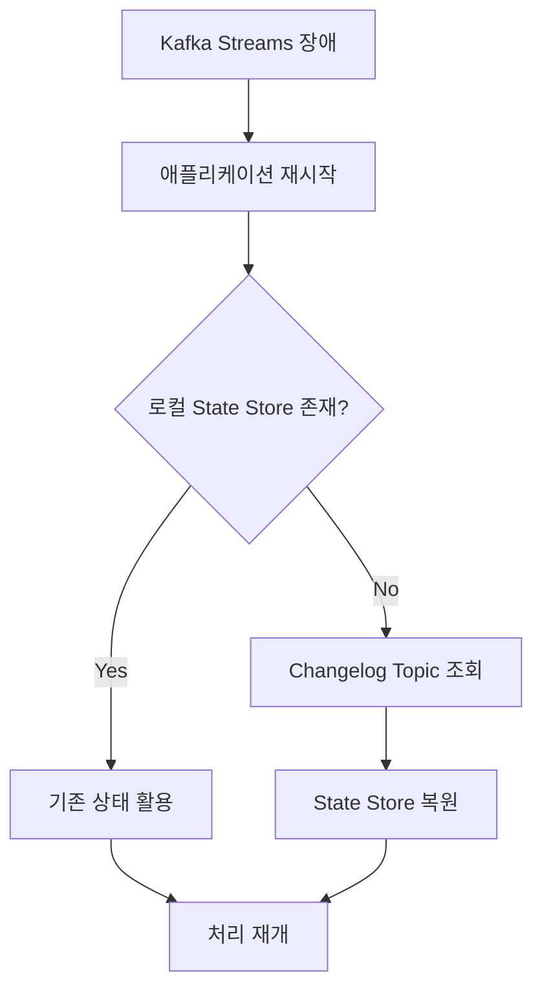

여기서 중요한 점은 State Store의 상태와 Consumer Offset이 서로 일관되게 관리되어야 한다는 것이다.

또한 Changelog Topic이 삭제되었거나 복구에 필요한 데이터가 존재하지 않는다면 상태 복원에 실패할 수 있다.

---

### application.id를 변경하면 어떤 일이 발생할까?

Kafka Streams에서 `application.id`는 Consumer Group과 내부 상태 관리에 중요한 역할을 한다.

따라서 ID를 변경하면 새로운 논리적 애플리케이션으로 동작한다.

예를 들어 다음 ID를 사용했다고 가정해 보자.

```text
wordcount-application
```

이후 다음 ID로 변경했다.

```text
wordcount-application-v2
```

두 애플리케이션은 독립적인 처리 위치를 사용한다.

새로운 애플리케이션에 유효한 Committed Offset이 없다면 `earliest` 설정에 따라 과거 데이터를 다시 처리할 수 있다.

하지만 다음 사항을 주의해야 한다.

**application.id만 변경하고 같은 출력 Topic을 사용하면 기존 집계 결과와 새로운 집계 결과가 섞일 수 있다.**

예를 들어 기존 출력 Topic에 다음 데이터가 존재한다.

```text
kafka → 10
```

새로운 애플리케이션이 과거 데이터를 다시 계산하여 같은 Topic에 기록한다.

```text
kafka → 1

kafka → 2

kafka → 3
```

이 경우 후속 Consumer는 기존 집계와 새로운 집계를 구분하기 어려울 수 있다.

따라서 Kappa 아키텍처에서 재처리 결과를 생성할 때는 새로운 `application.id`뿐 아니라 출력 Topic과 결과 저장소도 분리하는 것이 안전하다.

---

### Kafka Streams의 Exactly-once와 재처리

Kafka Streams에서는 `processing.guarantee` 설정을 통해 처리 보장 수준을 조정할 수 있다.

기본적인 처리 보장 방식은 At-least-once다.

예를 들어 다음 설정을 생각할 수 있다.

```java
props.put(
        StreamsConfig.PROCESSING_GUARANTEE_CONFIG,
        StreamsConfig.AT_LEAST_ONCE
);
```

이 방식에서는 장애 구간에서 일부 Record가 다시 처리될 수 있다.

Kafka Streams는 Exactly-once 처리도 지원한다.

대표적인 설정은 다음과 같다.

```java
props.put(
        StreamsConfig.PROCESSING_GUARANTEE_CONFIG,
        StreamsConfig.EXACTLY_ONCE_V2
);
```

Exactly-once 처리를 사용하면 Kafka의 트랜잭션 기능을 이용하여 입력 Offset과 상태 변경, 출력 Record의 정합성을 관리할 수 있다.

다만 Broker의 트랜잭션 관련 설정과 복제 구성이 요구사항을 충족해야 한다.

또한 Kafka 내부에서 Exactly-once 의미론을 사용한다고 외부 데이터베이스나 HTTP API 호출까지 자동으로 하나의 트랜잭션으로 묶이는 것은 아니다.

따라서 외부 시스템과 연동하는 경우에는 업무 멱등성을 별도로 설계해야 한다.

---

### Kafka Streams에서 자주 발생하는 문제

#### 1. 애플리케이션을 실행했는데 결과가 나오지 않는다

다음 항목을 확인해야 한다.

- Kafka Broker가 실행 중인가?
- 입력 Topic이 존재하는가?
- 출력 Topic이 존재하는가?
- 애플리케이션이 정상적으로 실행 중인가?
- 실제 입력 Record가 존재하는가?
- Consumer Group의 처리 위치가 올바른가?

특히 기존 `application.id`로 재실행했다면 이미 처리한 Record를 다시 읽지 않을 수 있다.

#### 2. 출력 숫자가 깨져 보인다

집계 결과는 Long 타입으로 저장된다.

Console Consumer에서 StringDeserializer를 사용하면 숫자가 올바르게 표시되지 않을 수 있다.

따라서 다음 설정을 확인해야 한다.

```bash
--property value.deserializer=org.apache.kafka.common.serialization.LongDeserializer
```

#### 3. 단어 수가 예상보다 많다

기존 State Store에 집계 결과가 남아 있거나 과거 입력 데이터가 다시 처리되었을 수 있다.

또한 Producer가 동일한 메시지를 여러 번 전송했다면 누적 개수가 증가한다.

따라서 입력 Topic과 애플리케이션 상태를 함께 확인해야 한다.

#### 4. 5초가 지났는데 결과가 한 번만 출력되지 않는다

Tumbling Window는 데이터를 시간 구간으로 나누는 기능이다.

5초마다 최종 결과를 한 번 출력하는 Scheduler가 아니다.

Window 내부에서 이벤트가 들어올 때마다 집계 상태가 변경될 수 있다.

최종 결과만 필요하다면 Suppression과 Window 종료 조건을 검토해야 한다.

#### 5. 내부 Topic 생성에 실패한다

Kafka Streams에서는 Repartitioning이나 Changelog 저장을 위해 내부 Topic을 생성할 수 있다.

단일 Broker 환경인데 내부 Topic의 Replication Factor가 Broker 수보다 크다면 생성에 실패할 수 있다.

따라서 개발 환경에서는 다음 설정이 필요할 수 있다.

```java
props.put(
        StreamsConfig.REPLICATION_FACTOR_CONFIG,
        1
);
```

운영 환경에서는 데이터 내구성 요구사항에 따라 설정해야 한다.

#### 6. State Store 관련 오류가 발생한다

State Store 경로가 올바른지 확인해야 한다.

또한 동일한 로컬 경로에서 여러 인스턴스를 실행할 때 상태 디렉터리 잠금 문제가 발생할 수 있다.

운영 환경에서는 인스턴스별 상태 저장 경로와 디스크 자원을 명확하게 관리해야 한다.

#### 7. SLF4J 관련 경고가 발생한다

다음과 같은 경고가 발생할 수 있다.

```text
SLF4J: Failed to load class "org.slf4j.impl.StaticLoggerBinder".
```

로깅 API에 대응하는 구현체를 찾지 못하는 경우 발생할 수 있다.

이때 사용하는 SLF4J API 버전과 호환되는 로깅 구현체를 확인해야 한다.

이번 Maven 예제에서는 `slf4j-simple`을 사용한다.

---

### 실무에서 활용할 수 있는 12가지 개선 전략

#### 1. 정산 데이터는 재계산 가능한 구조로 설계한다

실시간 결제 통계는 사용자에게 빠른 결과를 제공하는 데 유용하다.

하지만 정산 시스템에서는 과거 결제와 환불, 취소 데이터를 다시 검증해야 할 수 있다.

따라서 실시간 집계뿐 아니라 원본 데이터를 기반으로 결과를 재계산할 수 있는 구조가 필요하다.

Lambda 아키텍처처럼 실시간 처리와 배치 대사를 분리하는 방법을 고려할 수 있다.

#### 2. 재처리가 중요한 시스템에서는 원본 이벤트를 보존한다

Kappa 아키텍처의 핵심은 이벤트를 다시 읽을 수 있다는 것이다.

따라서 과거 데이터 전체를 다시 처리해야 한다면 보존 정책을 신중하게 설계해야 한다.

Kafka Retention 기간이 짧다면 필요한 데이터를 별도의 장기 저장소에 보관하는 것도 방법이다.

#### 3. 집계 결과와 원본 이벤트를 분리한다

원본 이벤트는 발생한 사실을 기록한다.

집계 결과는 원본 이벤트를 계산하여 만든 데이터다.

두 데이터를 분리하면 집계 로직이 변경되더라도 원본 이벤트를 다시 처리할 수 있다.

#### 4. 재처리할 때는 결과 저장소를 분리한다

기존 집계에 과거 이벤트를 다시 반영하면 중복 집계가 발생할 수 있다.

따라서 새로운 `application.id`와 출력 Topic, 결과 저장소를 활용하는 것이 안전하다.

새로운 결과를 검증한 이후 조회 서비스를 전환하는 방법을 고려할 수 있다.

#### 5. Kafka Key를 집계 기준에 맞게 설계한다

단어별 집계에서는 단어를 Key로 사용한다.

사용자별 집계라면 사용자 ID를 Key로 사용할 수 있다.

주문별 상태 처리라면 주문 ID를 Key로 사용하는 것이 적합할 수 있다.

Key 설계는 Partition 분배와 순서 보장, Repartitioning 비용에 영향을 준다.

#### 6. Repartitioning 비용을 모니터링한다

`groupBy()`처럼 Key를 변경하는 연산은 내부 Repartitioning을 발생시킬 수 있다.

데이터량이 많다면 추가적인 네트워크 및 디스크 I/O가 발생할 수 있다.

따라서 Kafka Streams의 처리량이 부족할 때는 내부 Topic과 데이터 재분배 비용을 확인해야 한다.

#### 7. 상태 기반 처리의 복구 시간을 고려한다

State Store를 사용하는 경우 애플리케이션 장애 이후 상태를 복원해야 할 수 있다.

상태 크기가 크면 복구 시간이 길어질 수 있다.

따라서 State Store 크기와 Changelog Topic, 복구 처리량을 함께 모니터링해야 한다.

#### 8. 실시간 집계에서는 Event Time을 명확하게 정의한다

실제 이벤트 발생 시각과 Kafka Streams의 처리 시각은 다를 수 있다.

따라서 매출이나 결제 건수를 시간별로 집계할 때 어떤 시각을 사용할지 명확하게 정해야 한다.

특히 지연 이벤트가 자주 발생하는 시스템에서는 Timestamp Extractor와 Grace Period를 함께 검토해야 한다.

#### 9. Window 크기를 업무 요구사항에 맞게 결정한다

5초 Window는 빠른 변화를 관찰하는 데 유용하다.

반면 1시간 또는 하루 단위 집계에는 다른 Window 크기가 필요하다.

Window가 작으면 세밀한 집계를 제공할 수 있지만 상태 관리와 결과 데이터량이 증가할 수 있다.

따라서 업무 목적과 데이터량을 기준으로 Window 크기를 결정해야 한다.

#### 10. 집계 결과의 의미를 명확하게 정의한다

Kafka Streams의 `KTable`은 Key별 최신 상태를 유지한다.

이를 `toStream()`으로 출력하면 상태 변경 이벤트가 발생할 수 있다.

후속 시스템이 이 결과를 누적 변경량으로 해석하면 잘못된 계산이 발생할 수 있다.

따라서 출력 Topic이 전체 누적값인지, 증감값인지, 최종 확정값인지 명확하게 정의해야 한다.

#### 11. Exactly-once의 보장 범위를 구분한다

Kafka Streams의 Exactly-once 설정은 Kafka 내부의 입력과 상태, 출력 처리에 대한 정합성을 제공할 수 있다.

하지만 외부 데이터베이스나 결제 API 호출까지 자동으로 보호하지는 않는다.

따라서 중요한 업무에서는 이벤트 ID와 Unique Constraint, 멱등성 처리를 함께 설계해야 한다.

#### 12. 처리량뿐 아니라 데이터 정합성을 모니터링한다

Kafka Streams의 처리량이 높더라도 실제 집계 결과가 잘못되었다면 정상적인 시스템이라고 보기 어렵다.

따라서 다음 항목을 함께 확인해야 한다.

- Consumer Lag
- 처리 지연
- State Store 크기
- Changelog 복원 시간
- Repartitioning 트래픽
- Window별 지연 이벤트
- 집계 결과와 원본 데이터의 차이
- 재처리 결과 검증 상태

실시간 데이터 처리에서는 성능과 정확성을 함께 고려하는 것이 중요하다.

---

### 정리

Lambda 아키텍처와 Kappa 아키텍처는 대규모 데이터를 실시간으로 처리하면서 과거 데이터를 다시 계산해야 하는 문제를 해결하기 위한 대표적인 데이터 처리 구조다.

Lambda 아키텍처는 Batch Layer와 Speed Layer, Serving Layer를 사용한다.

Batch Layer는 저장된 원본 데이터를 기반으로 대규모 계산을 수행한다.

Speed Layer는 새롭게 발생하는 이벤트를 실시간으로 처리한다.

Serving Layer는 두 계층의 결과를 결합하여 사용자에게 제공한다.

이러한 구조는 빠른 결과 제공과 과거 데이터 재계산을 결합하는 데 유용하다.

하지만 동일한 비즈니스 계산 로직을 Batch와 Speed에서 각각 구현해야 할 수 있다.

또한 두 계층의 결과를 병합할 때 데이터 중복과 처리 범위를 관리해야 한다.

Kappa 아키텍처는 이러한 중복 구현 문제를 줄이기 위한 접근이다.

실시간 데이터와 과거 데이터를 동일한 스트림 처리 모델로 계산한다.

과거 데이터를 다시 처리해야 할 경우 저장된 이벤트를 재생하여 새로운 결과를 생성할 수 있다.

하지만 이를 위해서는 재처리에 필요한 원본 데이터가 보존되어 있어야 한다.

또한 대규모 데이터를 처음부터 다시 처리하는 데 상당한 시간이 걸릴 수 있다.

따라서 Lambda와 Kappa 중 어떤 방식이 적합한지는 시스템의 재처리 요구사항과 데이터 보존 정책, 처리 비용 등을 기준으로 판단해야 한다.

Kafka Streams는 Kafka Topic에 저장된 이벤트를 처리하기 위한 Java 기반 스트림 처리 라이브러리다.

Kafka Streams에서는 `KStream`과 `KTable`을 구분해야 한다.

`KStream`은 이벤트의 연속을 나타낸다.

`KTable`은 Key별 최신 상태를 나타낸다.

이번 예제에서는 `input-topic`에서 문자열을 읽어 단어로 분리했다.

`flatMapValues()`를 이용하여 하나의 문장을 여러 단어로 변환했다.

이후 `groupBy()`를 이용하여 단어별로 그룹화했다.

`count()`를 이용하여 단어별 누적 개수를 계산했다.

집계 결과는 `KTable`로 관리했다.

이를 `toStream()`으로 변환하여 `output-topic`에 기록했다.

여기서 중요한 점은 출력 Topic에 최종 결과만 기록되는 것이 아니라 집계 상태의 변경 내역이 기록될 수 있다는 사실이다.

따라서 후속 시스템에서는 해당 결과가 누적값인지 증분값인지 명확하게 구분해야 한다.

Kafka Streams는 상태 기반 처리를 위해 State Store를 활용한다.

State Store는 집계 과정에서 필요한 이전 상태를 저장한다.

또한 Changelog Topic 등을 이용하여 장애 이후 상태를 복원할 수 있다.

다만 상태 저장소의 크기와 복구 시간도 운영에서 고려해야 한다.

시간 기반 집계에서는 Window Processing을 사용할 수 있다.

이번 예제에서는 5초 Tumbling Window를 구현했다.

Tumbling Window는 서로 겹치지 않는 고정된 시간 구간을 사용한다.

같은 단어라도 서로 다른 Window에 속하면 별도의 집계 결과를 가진다.

또한 `TimeWindows.ofSizeAndGrace()`를 이용하여 Window 크기와 Grace Period를 명확하게 지정했다.

Grace Period는 늦게 도착한 이벤트를 허용하기 위한 정책이다.

여기서 중요한 점은 Kafka Streams의 Window Processing이 단순한 주기 실행 Scheduler와 다르다는 사실이다.

Window는 이벤트의 Timestamp를 기준으로 데이터가 속할 시간 구간을 결정한다.

따라서 5초 Window를 설정했다고 애플리케이션이 정확히 5초마다 한 번 실행되는 것은 아니다.

또한 Event Time과 Processing Time을 구분해야 한다.

Event Time은 실제 이벤트가 발생한 시각이다.

Processing Time은 애플리케이션이 이벤트를 처리한 시각이다.

두 시각이 다르면 같은 이벤트라도 집계되는 Window가 달라질 수 있다.

따라서 실시간 집계의 정확성을 높이려면 이벤트 시간 정책을 명확하게 정의해야 한다.

Kafka Streams에서는 `application.id`도 중요한 설정이다.

같은 `application.id`로 실행하면 기존 처리 위치와 상태를 이어서 사용할 수 있다.

반면 새로운 `application.id`를 사용하면 독립적인 처리 위치를 사용할 수 있다.

이러한 특성은 Kappa 아키텍처에서 과거 데이터를 다시 처리할 때 유용하다.

하지만 새로운 애플리케이션이 기존 출력 Topic에 결과를 기록하면 과거 결과와 재계산 결과가 섞일 수 있다.

따라서 재처리 시에는 새로운 결과 저장소를 구성하고 검증한 후 조회 대상을 전환하는 것이 안전하다.

결국 Kafka를 실시간 데이터 처리 플랫폼으로 활용하기 위해서는 다음 원칙을 이해해야 한다.

**첫째, 실시간 처리와 과거 데이터 재처리의 요구사항을 구분하고 적합한 아키텍처를 선택해야 한다.**

**둘째, Kafka Streams의 KStream과 KTable, State Store, Repartitioning을 이해하여 상태 기반 처리를 올바르게 설계해야 한다.**

**셋째, Window Processing에서는 이벤트 시간과 지연 이벤트 처리 정책을 명확하게 정의해야 한다.**

**넷째, 장애 복구와 재처리 과정에서 기존 집계 결과와 새롭게 계산한 결과가 중복되지 않도록 관리해야 한다.**

이러한 개념을 바탕으로 Kafka Streams를 활용하면 단순한 메시지 전달을 넘어 실시간 집계와 이벤트 분석, 상태 기반 처리가 필요한 백엔드 시스템을 구축할 수 있다.

#### 한 줄 요약

**Lambda 아키텍처는 Batch와 Speed를 분리하여 실시간 처리와 과거 데이터 재계산을 결합하고, Kappa 아키텍처는 재생 가능한 이벤트 로그와 동일한 스트림 처리 모델을 활용하여 처리 로직의 중복을 줄인다. Kafka Streams는 KStream과 KTable, State Store를 기반으로 이벤트를 처리하며, Window Processing을 통해 시간 구간별 집계를 수행할 수 있다. 실제 운영에서는 Event Time, Grace Period, 상태 복구 및 재처리 결과의 정합성을 함께 고려하는 것이 핵심이다.**
