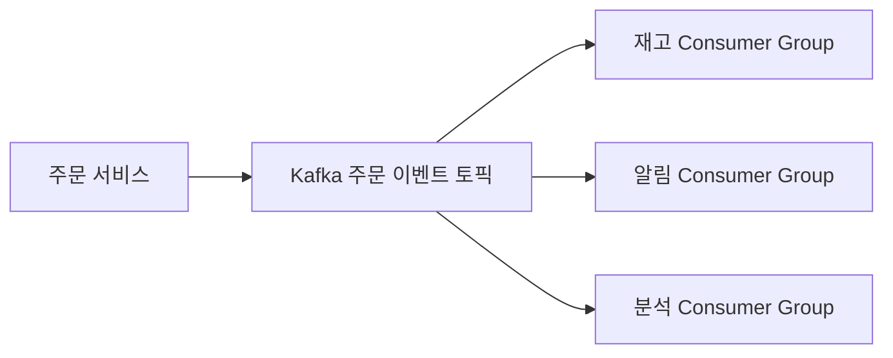
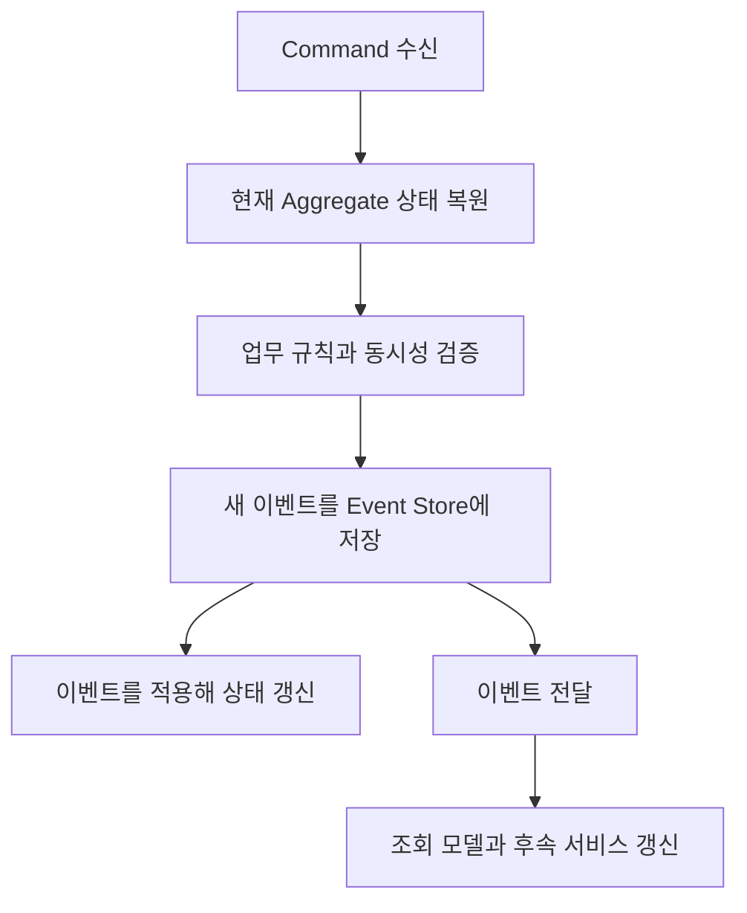
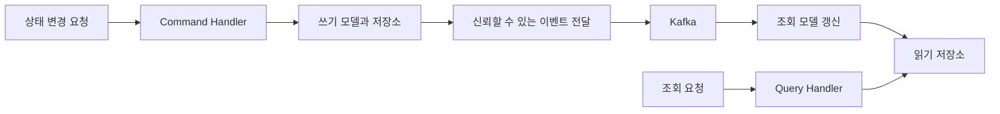
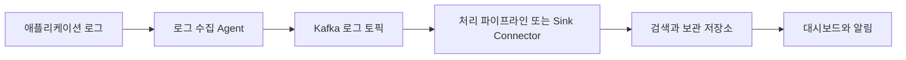
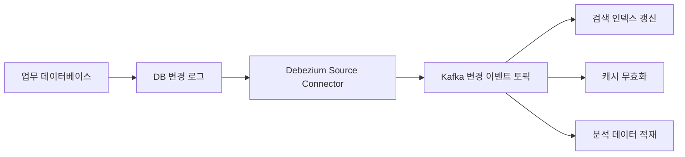
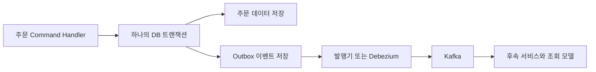

# 마이크로서비스 실전 사용 사례 알아보기

# 마이크로서비스 실전 사용 사례 알아보기

* toc
{:toc}

---

## 마이크로서비스에서 Kafka를 활용하는 방법

마이크로서비스로 시스템을 나누면 각 서비스를 독립적으로 개발하고 배포할 수 있다. 하지만 하나의 업무를 여러 서비스가 함께 처리하면서 새로운 문제가 생긴다. 주문은 저장되었는데 결제 요청이 전달되지 않거나, 결제는 끝났는데 조회 화면에는 이전 상태가 보이는 상황이 대표적이다.

Kafka는 이러한 서비스 사이에서 이벤트를 전달하고, 소비자가 처리할 때까지 데이터를 보관하며, 필요한 경우 다시 읽을 수 있게 한다. 다만 Kafka를 도입했다고 서비스 간 정합성과 장애 복구가 자동으로 해결되는 것은 아니다.

이벤트 소싱, CQRS, 스트림 처리, 로그 집계, CDC는 서로 다른 문제를 해결하는 패턴이다. 각각 무엇을 저장하고 어떤 시점에 성공으로 판단하는지 구분해야 Kafka의 역할도 명확해진다.

## 마이크로서비스의 동기 통신과 비동기 통신

### 동기 통신: 상대 서비스의 결과를 기다리는 방식

동기 통신에서는 서비스 A가 서비스 B에 요청을 보내고 그 결과를 기다린다. 주문 서비스가 결제 서비스에 승인 요청을 보내고, 승인 결과를 받은 뒤 응답하는 구조가 이에 해당한다.

구현과 업무 흐름을 이해하기 쉽고 호출 결과를 바로 사용할 수 있지만, 상대 서비스의 지연과 장애가 호출한 서비스에도 영향을 준다. 호출이 여러 단계로 이어지면 전체 응답 시간이 길어지고, 대기 중인 요청이 누적되어 연결과 실행 자원이 고갈될 수 있다.

이때 동기 통신을 반드시 스레드를 계속 점유하는 구현으로만 이해할 필요는 없다. 비차단 HTTP 클라이언트를 사용하더라도 **업무 결과를 만들기 위해 상대 응답이 필요하다면 서비스 간 의존성은 남는다.**

또한 원격 호출이 로컬 데이터베이스 트랜잭션에 자동으로 참여하는 것도 아니다. Spring의 `@Transactional` 안에서 다른 서비스의 HTTP API를 호출했다고 두 서비스의 데이터 변경이 함께 커밋되거나 롤백되지는 않는다.

동기 호출에는 타임아웃, 제한된 재시도, Circuit Breaker, 자원 격리 등을 함께 검토해야 한다. 특히 타임아웃은 상대 서비스의 작업 실패를 의미하지 않는다. 결제는 성공했지만 응답만 받지 못한 상황일 수 있으므로 재요청의 멱등성도 필요하다.

### 비동기 통신: 요청 접수와 업무 완료를 분리하는 방식

메시지 기반 비동기 통신에서는 Producer가 메시지를 발행하고, Consumer가 자신의 처리 속도에 맞추어 읽는다. 주문 서비스가 이벤트를 발행하면 재고, 알림, 분석 서비스가 각각 처리하는 구조를 만들 수 있다.



Kafka Consumer는 데이터를 가져오는 Pull 모델을 사용한다. 알림 서비스가 잠시 중단되어도 주문 서비스가 매번 알림 서비스의 응답을 기다릴 필요는 없다. 복구 후에는 보관 중인 이벤트를 이어서 읽을 수 있다.

하지만 **Broker가 메시지를 받았다는 사실과 Consumer의 업무 처리가 끝났다는 사실은 다르다.** Producer는 Kafka의 저장 응답을 기다릴 수 있으며, 이는 후속 서비스의 처리 결과를 기다리는 것과 별개의 단계다.

비동기 통신이 항상 더 빠른 업무 완료를 보장하는 것도 아니다. 사용자 요청에서 후속 작업을 분리해 응답 시간을 줄이거나 전체 처리량을 높일 수 있지만, 실제 완료까지는 Consumer Lag, 재시도, 스케줄링 등의 지연이 추가될 수 있다.

| 기준 | 동기 요청·응답 | 메시지 기반 비동기 통신 |
|---|---|---|
| 결과 확인 | 호출 응답으로 확인하기 쉬움 | 처리 상태 조회나 결과 이벤트 등이 필요 |
| 시간적 의존성 | 상대 서비스가 응답 가능한 상태여야 함 | 후속 서비스가 나중에 처리할 수 있음 |
| 장애 영향 | 호출 경로를 따라 전파될 수 있음 | 적체로 흡수할 수 있지만 한계가 있음 |
| 정합성 설계 | 타임아웃 이후 결과 불확실성 고려 | 중복·순서·지연·재처리 고려 |
| 적합한 예 | 즉시 필요한 정보 조회 | 알림, 검색 반영, 분석, 후속 업무 |

### 메시지 기반 통신이 주는 이점과 한계

메시지 기반 통신은 서비스의 구현과 실행 시점을 분리하고, Consumer를 독립적으로 확장할 수 있게 한다. Kafka에서는 파티션과 Consumer Group으로 병렬 처리를 구성한다. 단, 일반적인 Consumer Group에서 한 파티션은 같은 시점에 하나의 Consumer가 담당하므로 인스턴스를 늘리는 것만으로 처리량이 계속 증가하지는 않는다.

서비스 간 결합도 사라지는 것은 아니다. 직접 호출에 대한 결합은 줄어들지만 이벤트의 의미, 스키마, 키, 처리 시점에 대한 계약은 남는다. `OrderCreated`의 의미나 금액 단위를 바꾸면 이를 사용하는 Consumer도 영향을 받는다.

내구성과 장애 격리 역시 조건부다. 복제, 저장 응답, 보관 기간, Consumer 커밋 정책이 적절해야 복구 후 처리를 이어갈 수 있다. 장애가 보관 기간보다 오래 지속되거나 적체로 디스크가 가득 차면 데이터와 다른 서비스에 영향을 줄 수 있다. Kafka 자체도 공유 인프라이므로 서비스 사이에 놓았다는 이유만으로 모든 장애가 격리되지는 않는다. [Kafka의 전달 보장과 장애 처리](https://kafka.apache.org/40/design/design/)

## 이벤트 소싱: 현재 상태보다 변화의 이력을 저장하기

### 상태를 만드는 기준이 이벤트다

일반적인 CRUD 시스템은 주문의 현재 상태를 테이블에 저장한다. 주문이 생성되고 확정된 뒤 취소되었다면 현재 행에는 `CANCELLED` 상태가 남을 수 있다.

이벤트 소싱은 이러한 변화를 이벤트의 연속으로 저장하고, 이벤트를 적용해 상태를 만든다.

```text
OrderCreated
OrderItemAdded
OrderConfirmed
OrderCancelled
```

핵심은 이력을 보관한다는 사실만이 아니다. **이벤트의 기록이 상태를 재구성하는 권위 있는 원본이라는 점**이 중요하다.

현재 상태를 데이터베이스에 저장하고 변경 알림을 Kafka로 발행하는 시스템은 이벤트 기반 시스템일 수 있지만, 그것만으로 이벤트 소싱이 되는 것은 아니다. 단순 감사 로그나 CDC 변경 기록과도 구분해야 한다. [이벤트 소싱의 상태 재구성 모델](https://martinfowler.com/eaaDev/EventSourcing.html)

### 명령 처리와 이벤트 저장 흐름

이벤트 소싱에서 명령은 앞으로 수행하고 싶은 의도이고, 이벤트는 이미 일어난 사실이다. `ConfirmOrder`는 거절될 수 있는 요청이지만, `OrderConfirmed`는 검증을 거쳐 확정된 결과를 표현한다.



주문 확정 명령을 처리한다면 주문이 존재하는지, 이미 취소되지 않았는지, 확정 가능한 조건을 만족하는지 검사한다. 성공한 경우에만 이벤트를 저장한다.

이벤트를 외부로 전달하는 단계에도 실패할 수 있으므로, 이벤트 저장과 발행 사이의 누락을 어떻게 방지할지 별도 설계가 필요하다. 이벤트 소싱 저장소가 제공하는 구독 기능이나 신뢰할 수 있는 전달 경로 등을 검토해야 한다.

이벤트에는 다음과 같은 정보가 포함될 수 있다.

```json
{
  "event_id": "3c44b710-77e5-4e58-a6d1-5a3e5145fd8a",
  "event_type": "OrderConfirmed",
  "schema_version": 1,
  "aggregate_id": "order-1001",
  "aggregate_version": 3,
  "occurred_at": "2026-11-02T03:00:00Z",
  "payload": {
    "total_amount": 35000,
    "currency": "KRW"
  }
}
```

`event_id`는 이벤트 식별과 중복 처리에, `aggregate_id`는 어떤 도메인 객체의 변화인지 구분하는 데 활용한다. `aggregate_version`은 해당 객체의 변화 순서이며, 데이터 구조의 버전인 `schema_version`과는 다르다.

발생 시각만으로 정확한 순서를 판단해서는 안 된다. 서버 시계 차이와 지연 도착이 있기 때문이다. 같은 Aggregate에 대해 두 명령이 동시에 처리된다면 예상 버전을 기준으로 이벤트 추가를 검증하는 등의 동시성 제어도 필요하다.

### DDD와의 관계

DDD의 Aggregate는 함께 일관성을 유지해야 하는 도메인 객체의 경계다. 이벤트 소싱을 적용하면 그 경계 안에서 발생한 변화를 명시적인 도메인 이벤트로 표현할 수 있다.

이벤트 이름도 `RowUpdated`보다 `OrderConfirmed`, `DeliveryAddressChanged`처럼 업무에서 사용하는 언어로 표현하는 편이 의미를 전달하기 쉽다. 이는 도메인 전문가와 개발자가 공유하는 유비쿼터스 언어와 연결된다.

다만 DDD를 사용한다고 이벤트 소싱이 필수인 것은 아니다. 도메인 이벤트를 사용하면서 현재 상태를 관계형 데이터베이스에 저장하는 설계도 가능하다. 또한 여러 Aggregate와 서비스에 걸친 업무를 하나의 로컬 트랜잭션처럼 취급해서는 안 된다. 주문·결제·배송을 연결할 때는 Saga와 보상 작업 같은 별도 조정 방식이 필요할 수 있다.

### Kafka를 사용해도 별도로 해결해야 하는 것

Kafka Streams는 이벤트를 처리하고 상태를 계산하는 도구이지, 이벤트 소싱의 명령 검증과 저장 모델을 자동으로 만들어 주는 도구가 아니다. Kafka를 이벤트 이력의 저장 기반으로 사용하려면 다음 조건을 검토해야 한다.

- 같은 Aggregate의 이벤트 순서를 어떻게 유지할 것인가?
- 동시에 발생한 상태 변경을 어떻게 검증할 것인가?
- 상태 복원에 필요한 기간만큼 이벤트를 보존할 것인가?
- 과거 이벤트 스키마를 어떻게 계속 읽을 것인가?
- 재생 중 결제나 알림 같은 외부 작업이 다시 실행되지 않게 할 것인가?

같은 키를 같은 파티션으로 보내면 순서 관리에 도움이 되지만, 전체 토픽에 대한 전역 순서가 생기는 것은 아니다. 보관 기간 만료나 로그 압축으로 이력이 제거되는 정책도 전체 이벤트 재생 요구와 충돌할 수 있다.

매번 첫 이벤트부터 모두 읽을 필요는 없다. 특정 버전까지의 상태를 Snapshot으로 저장하고 이후 이벤트만 적용해 복원 비용을 줄일 수 있다. 다만 Snapshot은 원본 이벤트를 대체하는 업무 이력이 아니라 복원을 위한 최적화다. 이벤트 소싱은 이력 추적과 재구성의 가치가 충분한 영역에 선택적으로 적용하는 편이 좋다. [이벤트 소싱의 동시성·복원 고려 사항](https://learn.microsoft.com/en-us/azure/architecture/patterns/event-sourcing)

## CQRS: 쓰기 모델과 읽기 모델의 책임 분리

### 다른 요구를 하나의 모델에 몰아넣지 않기

CQRS는 Command Query Responsibility Segregation의 약자로, 상태를 변경하는 모델과 조회하는 모델을 분리하는 패턴이다.

주문 생성에는 상품 구매 가능 여부, 수량, 가격과 상태 전이 규칙이 중요하다. 반면 주문 목록 조회에는 상품명, 배송 상태, 결제 요약을 빠르게 보여 주는 구조가 필요하다. 같은 데이터라도 쓰기와 읽기에서 요구하는 형태가 다르다.

Command Handler는 명령을 받아 업무 규칙을 실행한다. Query Handler는 조회 목적에 맞는 데이터를 반환한다. 명령은 성공·실패뿐 아니라 생성한 ID나 버전 등을 반환할 수도 있다. 명령이 반드시 반환 값이 없어야 한다는 제약으로 이해할 필요는 없다.

### CQRS에 Kafka와 별도 데이터베이스가 필수는 아니다

처음에는 같은 데이터베이스를 사용하면서 명령 모델과 조회 DTO, 처리 경로만 분리할 수 있다. 읽기 요구가 커지면 비정규화한 테이블, 캐시, 검색 엔진처럼 별도 조회 저장소를 둘 수 있다.

따라서 CQRS 자체에 Kafka, 이벤트 소싱, 물리적인 데이터베이스 분리가 필수인 것은 아니다. 비동기 이벤트로 조회 모델을 갱신하는 방식은 가능한 구현 중 하나다. [CQRS의 모델 분리와 적용 범위](https://martinfowler.com/bliki/CQRS.html)



위 구조에서는 쓰기 저장소와 읽기 저장소가 비동기적으로 연결된다. 쓰기 성공 직후 조회하면 아직 이전 상태가 보일 수 있다. 이것이 최종 일관성을 사용자 경험과 함께 설계해야 하는 이유다.

### 최종 일관성은 사용자에게도 드러난다

주문 생성 성공 응답을 받았는데 주문 목록에 나타나지 않으면 사용자는 다시 요청할 수 있다. 다음과 같은 대응을 고려할 수 있다.

- 생성 응답에 주문 ID와 확정된 최소 상태를 포함한다.
- 조회 모델 반영 전에는 처리 중 상태를 표시한다.
- 조회 모델이 반영한 버전이나 시점을 확인할 수 있게 한다.
- 반드시 최신 상태가 필요한 조회는 별도 경로로 처리한다.

단순히 요청을 접수한 것과 주문·결제가 확정된 것도 구분해야 한다. 비동기 작업을 받았다는 응답을 결제 완료처럼 표시하면 안 된다.

또한 최종 일관성은 오류를 방치해도 언젠가 맞아진다는 의미가 아니다. 이벤트 누락, Consumer 실패와 스키마 오류를 발견하고 재처리할 수 있어야 실제로 수렴한다.

### 얻는 이점과 추가 비용

CQRS는 읽기와 쓰기를 독립적으로 최적화하고 확장하기 좋다. 보고서용 집계, 검색용 문서, 사용자 화면용 요약처럼 여러 조회 모델도 만들 수 있다. 읽기 API와 저장소 계정의 권한을 제한하는 설계에도 도움이 된다.

반면 모델 동기화, 배포 순서, 재구축, 모니터링과 추가 저장소를 관리해야 한다. 읽기 모델이라고 모든 데이터가 공개되어도 되는 것은 아니므로 조회 권한과 민감정보 보호도 유지해야 한다.

각 모델 내부의 책임은 단순해져도 전체 시스템의 운영 복잡성은 증가할 수 있다. 단순 CRUD로 충분한 기능에 일괄 적용하기보다는 읽기·쓰기 요구가 실제로 크게 다른 영역부터 검토하는 편이 합리적이다.

## 스트림 처리: 서비스에서 발생한 이벤트를 지속적으로 계산하기

### 데이터를 전달하는 것과 계산하는 것은 다르다

이벤트 전달이 다른 서비스에 사실을 알리는 역할이라면, 스트림 처리는 이벤트를 필터링·변환·조인·집계해 새로운 결과를 만드는 역할이다.

예를 들어 다음과 같은 처리가 가능하다.

| 입력 데이터 | 처리 예 |
|---|---|
| 사용자 활동 | 최근 관심사와 추천 후보 갱신 |
| 주문·결제 이벤트 | 시간대별 매출과 이상 거래 후보 집계 |
| 센서 데이터 | 임계치 초과와 이상 상태 감지 |
| 게시물·관계 변경 | 피드 갱신과 알림 생성 |
| 여러 서비스의 상태 이벤트 | 통합 운영 현황 구성 |

Kafka Streams와 ksqlDB를 사용하면 이런 처리 흐름을 구성할 수 있다. 다만 실시간은 지연이 0이라는 뜻이 아니다. 목표 지연 시간과 최대 적체 허용 범위를 정하고 실제 처리 완료까지 측정해야 한다.

### 상태·시간·순서를 함께 설계하기

필터링처럼 현재 이벤트만으로 처리할 수 있는 연산은 무상태 처리다. 최근 구매액 집계나 다른 이벤트와의 조인은 이전 정보를 기억하는 상태 기반 처리다. 상태 저장소를 사용하는 경우 장애 후 복원 시간과 디스크 사용량도 고려해야 한다.

이벤트 발생 시각과 처리 시각도 다르다. 오프라인 장치가 나중에 보낸 센서 데이터나 네트워크 지연으로 늦게 도착한 결제 이벤트를 어느 구간에 포함할지 결정해야 한다. Window와 Grace Period를 설정할 때는 늦은 이벤트를 허용하는 범위와 제외된 데이터를 보정하는 절차를 함께 정한다.

Kafka의 순서는 파티션 단위다. 여러 토픽의 이벤트가 업무상 원하는 순서로 도착한다고 가정해서는 안 된다. 관련 키를 맞추고, 조인에 필요한 상태가 준비되지 않았을 때의 처리도 설계해야 한다.

처리량을 높일 때는 파티션 분배, 핫 키, Consumer 병렬성과 외부 저장소의 병목을 함께 확인한다. State Store와 변경 로그를 활용한 복구가 가능하더라도 외부 API 호출까지 자동 복구되는 것은 아니다. [Kafka Streams의 Task와 상태 복구](https://kafka.apache.org/40/streams/architecture/)

스키마 변경 역시 자료형만의 문제가 아니다. 금액 단위나 상태 코드의 의미가 바뀌면 기존 집계가 틀릴 수 있다. 과거 이벤트를 다시 읽는 처리까지 고려해 구조와 업무 의미의 호환성을 관리해야 한다.

## 로그 집계: 여러 서비스의 실행 흔적 연결하기

### 중앙에서 검색할 수 있어야 하는 이유

마이크로서비스에서는 하나의 사용자 요청이 주문, 결제, 재고, 배송 등 여러 서비스를 거친다. 인스턴스도 수시로 늘어나거나 교체되므로 서버에 개별 접속해 로그를 찾는 방식은 운영 규모가 커질수록 어려워진다.

로그 집계는 분산된 로그를 모아 검색·분석하고, 오류와 보안 이벤트를 확인하는 기반이다. 운영 초기부터 수집·보관·검색 체계를 준비하는 편이 좋다. 다만 중앙 로그 시스템을 구축하는 것과 Kafka를 반드시 사용하는 것은 별개의 판단이다.



Kafka를 중간에 두면 검색 저장소가 느려지는 동안 데이터를 완충하고 여러 분석 경로로 나누어 처리할 수 있다. 대신 Kafka 자체의 비용과 운영 책임도 추가된다.

### 애플리케이션, 수집기, 저장소의 역할

애플리케이션은 Logback, Log4j, Winston 같은 라이브러리로 파일이나 표준 출력에 로그를 기록한다. Filebeat, Fluent Bit, Fluentd 같은 수집기는 이를 읽고 외부로 전송한다.

Kubernetes에서는 각 Node의 컨테이너 로그를 수집하는 Agent를 DaemonSet으로 실행할 수 있다. 특수한 파일 형식이나 별도 처리가 필요하면 Sidecar 방식도 사용할 수 있다. 모든 Pod에 수집기 Sidecar를 붙여야 하는 것은 아니다. [Kubernetes 로그 수집 구조](https://kubernetes.io/docs/concepts/cluster-administration/logging/)

Elasticsearch와 Kibana, OpenSearch와 OpenSearch Dashboards, Loki와 Grafana, Splunk와 자체 대시보드 등은 저장·조회 방식에 맞추어 선택한다. Kafka Connect는 지원되는 Sink Connector로 로그 데이터를 전달할 수 있지만, 컨테이너 로그를 발견하고 읽는 Agent의 역할까지 자동으로 대신하는 것은 아니다.

### 형식 통일과 추적 문맥 전파

문자열 로그만 모으면 같은 요청을 연결하기 어렵다. 서비스와 환경, 이벤트 시각, 로그 수준, 업무 식별자와 추적 정보를 구조화하는 편이 좋다.

```json
{
  "timestamp": "2026-11-02T03:00:00Z",
  "service": "order-service",
  "environment": "production",
  "level": "INFO",
  "trace_id": "d41999e70ad64b40a2e4c805ab029c21",
  "order_id": "order-1001",
  "message": "Order confirmation completed"
}
```

이는 애플리케이션 로그 형식의 예시이며 특정 수집 프로토콜의 전체 명세는 아니다. `trace_id`를 기록하려면 HTTP와 Kafka 메시지 경로에서 추적 문맥을 전파하거나 적절한 연결 관계를 설정해야 한다.

로그를 한곳에 모았다는 이유만으로 분산 추적이 완성되지는 않는다. 호출 시간과 서비스 간 인과관계를 확인하려면 Trace와 Span을 함께 활용하는 것이 좋다. [OpenTelemetry의 로그와 추적 식별자](https://opentelemetry.io/docs/concepts/signals/logs/)

### 로그 유실과 보안도 운영 대상이다

컨테이너 파일 시스템, Node 로그 회전, Agent 버퍼와 전송 실패 때문에 로그가 유실될 수 있다. 표준 출력으로 기록하거나 외부 볼륨에 저장했다고 무조건 보존되는 것은 아니다.

수집 지연, 버퍼 사용량, 전송 실패와 저장소 보관 정책을 감시해야 한다. 토큰·비밀번호·불필요한 개인정보가 로그에 포함되지 않도록 하고, 감사 목적의 기록에는 접근 통제와 별도 보존 요구도 반영해야 한다. 업무 이벤트와 대량 디버그 로그가 같은 자원을 사용한다면 로그 폭증이 핵심 처리에 영향을 주지 않게 제한하는 것도 중요하다.

## CDC: 데이터베이스 변경 사항을 이벤트로 전달하기

### CDC가 필요한 상황

CDC는 Change Data Capture의 약자로, 데이터베이스에서 발생한 삽입·수정·삭제 등의 변경을 감지하고 외부로 전달하는 기술이다.

검색 인덱스 갱신, 캐시 무효화, 데이터 웨어하우스 적재, 분석 데이터 제공과 시스템 간 동기화에 활용할 수 있다. 다른 서비스가 원본 데이터베이스에 직접 조회하는 횟수도 줄일 수 있다.

하지만 테이블 변경 내용을 그대로 공개하면 Consumer가 테이블과 컬럼 구조에 의존한다. 직접 접근을 없앴더라도 데이터 계약에 대한 결합은 남는다.

### 구현 방식 비교

| 방식 | 동작 | 주의할 점 |
|---|---|---|
| 폴링 | 변경 기준 컬럼 등으로 주기 조회 | 조회 부하, 지연, 경계값과 삭제 누락 |
| 트리거 기반 | 변경 시 이력 테이블 등에 기록 | 원본 트랜잭션 부하와 트리거 관리 |
| 트랜잭션 로그 기반 | DB 변경 로그를 해석 | 권한, 로그 보존, 복구 위치 관리 |
| 애플리케이션 기반 | 업무 코드에서 변경을 기록 | 모든 변경 경로의 누락 방지와 원자성 |

폴링은 시작하기 쉽지만 `updated_at`만 비교한다고 모든 변경을 정확히 찾는 것은 아니다. 같은 시각의 여러 변경, 트랜잭션 경계와 삭제를 고려해야 한다.

로그 기반 CDC는 MySQL의 Binlog, PostgreSQL의 WAL과 논리 디코딩 등을 활용한다. 반복적인 전체 테이블 조회를 줄일 수 있지만 데이터베이스 부하가 없다는 뜻은 아니다. 초기 Snapshot과 로그 전송·보관도 자원을 사용한다.

### Kafka Connect와 Debezium의 관계

일반적인 구성에서는 Kafka Connect Worker가 Debezium Source Connector를 실행한다. Debezium이 데이터베이스 변경을 읽고, Connect의 실행 환경을 통해 Kafka로 전달한다.



처음 연결할 때는 현재 데이터를 Snapshot으로 읽고 이후 변경 로그를 이어서 처리하는 구성을 사용할 수 있다. 따라서 CDC를 연결했다고 도입 이전의 모든 과거 변경 이력까지 얻는 것은 아니다. [Debezium MySQL Snapshot과 변경 스트리밍](https://debezium.io/documentation/reference/stable/connectors/mysql.html)

Connector가 오래 중단되면 MySQL에서는 필요한 Binlog가 삭제될 수 있고, PostgreSQL에서는 Replication Slot으로 인해 WAL이 누적될 수 있다. Kafka Lag만 볼 것이 아니라 원본 로그 위치, 보존 기간과 디스크도 확인해야 한다. 재전달과 초기화 가능성을 고려해 대상 저장소의 Upsert·삭제 처리도 설계한다. [PostgreSQL CDC와 WAL 관리](https://debezium.io/documentation/reference/stable/connectors/postgresql.html)

CDC는 동기화와 변경 이력 수집에 유용하지만, 이것만으로 완전한 감사 시스템이나 재해 복구 체계가 완성되지는 않는다. 변경한 사용자·사유와 같은 업무 문맥, 복구 절차와 목표 복구 시점은 별도로 마련해야 한다.

## Transactional Outbox로 데이터 저장과 이벤트 발행 연결하기

### 데이터베이스와 Kafka에 각각 쓰는 문제

주문 행을 저장한 뒤 Kafka에 이벤트를 보내는 코드는 두 단계 사이에서 실패할 수 있다. 데이터베이스 커밋은 성공했지만 메시지 발행 전에 종료되면 주문은 존재해도 후속 서비스는 이를 모른다.

순서를 바꾸어 먼저 메시지를 보내도 문제가 생긴다. 이벤트는 전달되었는데 데이터베이스 변경이 롤백될 수 있기 때문이다. 일반적인 로컬 데이터베이스 트랜잭션과 Kafka 전송을 나란히 호출하는 것만으로 이중 쓰기가 원자적으로 처리되지는 않는다.

### 업무 변경과 Outbox 기록을 같은 트랜잭션으로 저장하기

Transactional Outbox에서는 업무 데이터와 발행할 이벤트를 같은 데이터베이스 트랜잭션으로 저장한다. 이후 별도 발행기가 Outbox를 읽거나, Debezium이 Outbox 변경을 캡처해 Kafka로 전달한다.



데이터베이스 커밋 후 Kafka가 잠시 중단되어도 발행할 의도가 Outbox에 남는다. 다만 발행과 진행 위치 저장 사이에서 같은 이벤트가 다시 전달될 수 있으므로 Consumer의 멱등성은 여전히 필요하다. Debezium의 Outbox Event Router는 이벤트 ID, Aggregate ID 등을 활용한 메시지 변환과 라우팅을 지원한다. [Debezium Outbox Event Router](https://debezium.io/documentation/reference/stable/transformations/outbox-event-router.html)

Outbox도 이벤트 소싱과 같지는 않다. 현재 주문 상태는 주문 테이블이 원본이고 Outbox는 전달을 위한 기록일 수 있다. 반대로 이벤트 소싱에서는 이벤트 이력이 상태의 원본이다.

또한 `orders.status` 컬럼 변경과 `OrderConfirmed`라는 도메인 이벤트는 의미가 다르다. 하나의 업무 명령이 여러 테이블을 변경할 수 있고, 테이블 변경만으로는 왜 변경되었는지 알기 어렵다. 외부에 안정적인 업무 계약을 제공하려면 원시 CDC 이벤트와 도메인 이벤트를 구분하는 편이 좋다.

## 패턴별 역할과 도입 판단

| 패턴 | 해결하려는 문제 | Kafka의 역할 | 별도로 설계할 부분 |
|---|---|---|---|
| 이벤트 소싱 | 상태 변화 이력과 재구성 | 이벤트 전달·재생 기반 | 권위 있는 저장소, 동시성, 이력 보존 |
| CQRS | 읽기·쓰기 요구의 차이 | 조회 모델 갱신 이벤트 전달 | 모델 동기화와 최신성 표현 |
| 스트림 처리 | 연속 이벤트의 계산 | 입력·출력 로그와 처리 기반 | 상태, 시간, 순서, 복구 |
| 로그 집계 | 분산 실행 기록의 통합 | 완충과 여러 분석 경로 제공 | 수집, 검색, 추적 문맥, 보안 |
| CDC | DB 변경의 외부 반영 | 변경 이벤트 전달 | 원본 로그, Snapshot, 중복·삭제 |
| Transactional Outbox | DB 저장과 이벤트 발행 사이의 누락 | 저장된 이벤트의 전달 대상 | 발행 복구와 Consumer 멱등성 |

이 패턴들을 한꺼번에 도입할 필요는 없다. 주문 상태를 관계형 데이터베이스에 저장하면서 Outbox로 알림과 검색 반영을 연결할 수 있고, 복잡한 조회가 필요한 부분에만 CQRS를 적용할 수도 있다. 이력 재구성이 핵심인 일부 도메인에만 이벤트 소싱을 선택하는 것도 가능하다.

도입 후에는 정상 경로뿐 아니라 다음 상황을 확인해야 한다.

- 같은 이벤트를 두 번 전달해도 업무 결과가 올바른가?
- Consumer가 처리 후 커밋 전에 종료되면 어떻게 복구되는가?
- 조회 모델 반영이 늦어졌을 때 사용자에게 무엇이 보이는가?
- 과거 이벤트를 재생해도 결제와 알림이 다시 실행되지 않는가?
- 스키마 변경 중 구버전 Consumer가 안전하게 동작하는가?
- CDC와 로그 수집이 중단되었을 때 누락·적체를 발견할 수 있는가?

## 정리

Kafka는 마이크로서비스 사이의 시간적 의존성을 줄이고, 이벤트를 보관하며, 여러 소비자가 독립적으로 처리할 수 있는 기반을 제공한다. 하지만 이벤트 소싱의 상태 모델, CQRS의 조회 최신성, 로그의 추적 문맥, CDC의 원본 복구까지 대신 설계해 주지는 않는다.

실전에서 중요한 것은 **무엇을 원본으로 삼고, 언제 성공했다고 판단하며, 실패 후 어디서부터 다시 처리할지를 명확하게 정하는 것**이다. 패턴의 이름보다 이 세 가지 기준이 분명할 때 Kafka가 서비스의 독립성과 운영 안정성을 높이는 도구가 된다.
