# 마이크로서비스 실전 사용 사례 알아보기

# 마이크로서비스 실전 사용 사례 알아보기

* toc
{:toc}

---

### Apache Kafka와 마이크로서비스 아키텍처: 이벤트 소싱, CQRS, 스트림 처리, 로그 집계, CDC 완벽 이해

마이크로서비스 아키텍처(Microservices Architecture, MSA)는 하나의 애플리케이션을 여러 개의 독립적인 서비스로 분리하여 개발하고 운영하는 아키텍처다.

각 서비스는 자신의 비즈니스 책임을 가지고 독립적으로 개발, 배포, 확장할 수 있다.

예를 들어 전자상거래 시스템을 다음과 같이 구성할 수 있다.

- 주문 서비스(Order Service)
- 결제 서비스(Payment Service)
- 재고 서비스(Inventory Service)
- 배송 서비스(Delivery Service)
- 알림 서비스(Notification Service)

이러한 구조는 하나의 거대한 애플리케이션을 운영하는 것보다 서비스별 책임을 명확하게 구분할 수 있다는 장점이 있다.

하지만 서비스를 분리하면 새로운 문제가 발생한다.

**하나의 서비스 내부에서 처리하던 업무가 여러 서비스에 걸쳐 수행되기 때문이다.**

예를 들어 사용자가 상품을 구매한다고 가정해 보자.

주문 서비스는 주문을 생성한다.

결제 서비스는 결제를 승인한다.

재고 서비스는 상품의 재고를 차감한다.

배송 서비스는 배송 정보를 생성한다.

알림 서비스는 사용자에게 주문 완료 메시지를 전송한다.

이처럼 하나의 주문을 완료하기 위해 여러 서비스가 함께 동작해야 한다.

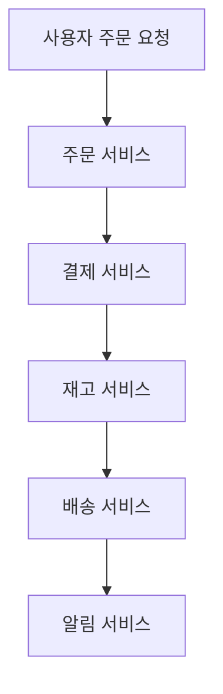

문제는 각 서비스가 독립적으로 운영된다는 점이다.

주문 서비스는 정상적으로 동작하지만 결제 서비스에는 장애가 발생할 수 있다.

결제는 성공했지만 배송 서비스가 응답하지 않을 수도 있다.

재고 차감에 성공한 이후 알림 전송에 실패할 수도 있다.

또한 서비스마다 별도의 데이터베이스를 사용한다면 하나의 로컬 트랜잭션으로 모든 상태 변경을 처리하기 어렵다.

따라서 마이크로서비스에서는 다음 문제를 해결해야 한다.

**서비스 간 통신, 데이터 정합성, 장애 격리, 상태 변경 추적, 데이터 동기화, 실시간 처리, 분산 로그 관리**

Apache Kafka는 이러한 문제 중 여러 영역에서 활용할 수 있는 이벤트 스트리밍 플랫폼이다.

Kafka를 이용하면 서비스가 서로 직접 통신하지 않고 이벤트를 통해 협력하는 구조를 만들 수 있다.

하지만 Kafka를 도입한다고 모든 문제가 자동으로 해결되는 것은 아니다.

이벤트를 어떤 기준으로 생성할지, 데이터가 언제 확정되는지, 장애 발생 시 어떻게 복구할지 등을 함께 설계해야 한다.

이번에는 이러한 관점에서 Kafka를 활용한 마이크로서비스 아키텍처를 살펴본다.

---

### 마이크로서비스에서는 왜 통신 방식이 중요할까?

#### 모놀리식 아키텍처와 마이크로서비스의 차이

모놀리식 아키텍처(Monolithic Architecture)에서는 여러 비즈니스 기능이 하나의 애플리케이션 안에 구현되는 경우가 많다.

예를 들어 주문 생성과 결제 처리 로직이 같은 애플리케이션에 있다면 메서드 호출을 통해 기능을 연결할 수 있다.

```java
public void placeOrder(OrderRequest request) {

    Order order = orderService.create(request);

    paymentService.pay(order);

    inventoryService.decreaseStock(order);

}
```

위 코드는 동작 흐름을 설명하기 위한 단순화된 예시다.

서비스들이 같은 애플리케이션에 있다면 메서드 호출을 통해 필요한 기능을 실행할 수 있다.

또한 동일한 데이터베이스를 사용하는 경우 하나의 트랜잭션으로 여러 변경을 묶을 수도 있다.

하지만 마이크로서비스에서는 상황이 다르다.

주문 서비스와 결제 서비스가 서로 다른 애플리케이션으로 배포될 수 있다.

각 서비스는 별도의 프로세스와 네트워크, 데이터베이스를 사용할 수 있다.

따라서 기존의 메서드 호출이 다음과 같은 원격 통신으로 변경된다.

```text
Order Service
    ↓ HTTP / gRPC
Payment Service
```

여기서 중요한 차이가 발생한다.

**로컬 메서드 호출의 실패와 네트워크를 통한 원격 서비스 호출의 실패는 다르게 처리해야 한다.**

원격 통신에서는 다음과 같은 상황이 발생할 수 있다.

- 요청이 상대 서비스에 도착하지 못한다.
- 상대 서비스가 요청을 처리하는 도중 장애가 발생한다.
- 상대 서비스가 정상적으로 처리했지만 응답이 유실된다.
- 네트워크 지연으로 타임아웃이 발생한다.
- 상대 서비스의 처리량이 부족해 요청이 적체된다.
- 재시도로 동일한 업무가 여러 번 실행된다.

이러한 문제를 해결하기 위해 마이크로서비스에서는 동기 통신과 비동기 통신을 목적에 맞게 선택해야 한다.

---

### 동기 통신(Synchronous Communication)

#### 동기 통신이란?

동기 통신은 서비스가 다른 서비스에 요청을 보내고 응답을 기다리는 방식이다.

대표적인 통신 기술로 HTTP REST API와 gRPC를 들 수 있다.

예를 들어 주문 서비스가 결제 서비스에 결제 승인을 요청한다고 가정해 보자.

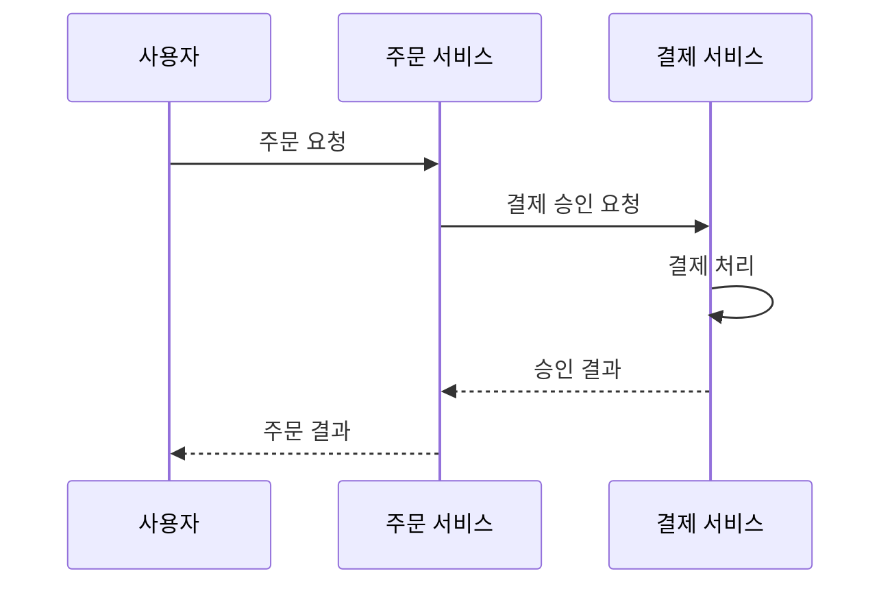

주문 서비스는 결제 서비스의 결과를 받은 후 다음 작업을 수행한다.

이 방식은 업무 흐름을 이해하기 쉽다.

결제 승인 결과를 즉시 확인해야 하는 경우에도 유용하다.

하지만 서비스 사이의 시간적 의존성이 증가한다.

#### 동기 통신에서 장애가 전파되는 과정

다음과 같은 상황을 생각해 보자.

평소 결제 서비스의 응답 시간이 100ms라고 가정한다.

그런데 일시적인 데이터베이스 장애로 응답 시간이 5초까지 증가했다.

주문 서비스는 결제 서비스의 응답을 기다려야 한다.

이로 인해 주문 서비스의 전체 응답 시간도 증가할 수 있다.

```text
정상 상황

주문 서비스
    ↓
결제 서비스 응답: 100ms
    ↓
주문 완료
```

```text
장애 상황

주문 서비스
    ↓
결제 서비스 응답 지연: 5초
    ↓
주문 요청 적체
    ↓
주문 서비스의 가용 자원 감소
```

요청이 계속 증가하면 연결과 실행 자원이 부족해질 수 있다.

이러한 현상은 여러 서비스를 거치면서 장애가 연쇄적으로 확산되는 원인이 될 수 있다.

#### 동기 통신에서 고려해야 할 사항

| 항목 | 설명 |
|---|---|
| Timeout | 응답을 무한정 기다리지 않도록 제한 |
| Retry | 일시적인 오류에 대해 제한적으로 재시도 |
| Circuit Breaker | 반복적으로 실패하는 서비스 호출 차단 |
| Bulkhead | 특정 서비스의 장애가 전체 자원을 소모하지 않도록 격리 |
| Idempotency | 같은 요청이 여러 번 실행되어도 잘못된 결과가 발생하지 않도록 설계 |

특히 타임아웃과 업무 실패를 구분해야 한다.

예를 들어 결제 서비스가 정상적으로 결제를 완료했지만 응답만 전달되지 않았다고 가정해 보자.

주문 서비스에서는 타임아웃이 발생했다.

이후 같은 결제 요청을 다시 전송하면 중복 결제가 발생할 수 있다.

따라서 결제와 같이 중요한 작업에서는 요청 식별자와 멱등성 처리가 필요하다.

또한 비차단 HTTP 클라이언트를 사용하면 요청 대기 중 스레드 점유를 줄일 수 있지만, 업무 결과를 위해 상대 서비스의 응답이 필요하다는 의존성까지 사라지는 것은 아니다.

---

### 비동기 통신(Asynchronous Communication)

#### 비동기 통신이란?

비동기 통신은 요청을 전달한 후 상대 서비스의 업무 완료를 반드시 기다리지 않고 다음 작업을 수행할 수 있는 방식이다.

Kafka와 같은 메시징 시스템을 사용하면 서비스 간 비동기 통신을 구성할 수 있다.

예를 들어 주문 서비스가 주문을 생성한 이후 주문 생성 이벤트를 Kafka에 발행한다고 가정해 보자.

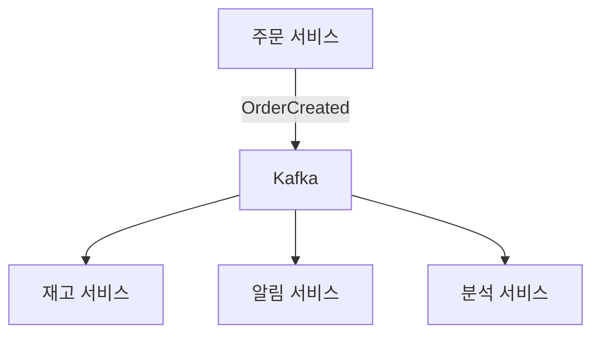

주문 서비스는 재고 서비스와 알림 서비스, 분석 서비스를 직접 호출하지 않는다.

대신 Kafka에 주문 생성 이벤트를 발행한다.

각 서비스는 자신의 Consumer Group을 이용하여 이벤트를 읽는다.

이렇게 하면 주문 서비스는 각 Consumer의 구체적인 구현이나 처리 속도를 몰라도 된다.

#### Kafka에서 비동기 통신이 가능한 이유

Kafka는 Producer와 Consumer를 분리한다.

Producer는 Kafka Topic에 이벤트를 기록한다.

Consumer는 Kafka에 저장된 이벤트를 가져와 처리한다.

Kafka Consumer는 기본적으로 Pull 방식으로 데이터를 읽는다.

```text
Producer
    ↓
Kafka Topic에 이벤트 저장
    ↓
Consumer가 Poll
    ↓
업무 처리
```

Consumer가 일시적으로 중단되더라도 Kafka에 이벤트가 남아 있다면 복구 후 다시 읽을 수 있다.

다만 Kafka는 Consumer가 처리할 때까지 메시지를 무조건 영구 보관하는 시스템은 아니다.

메시지는 Retention Policy에 따라 보관되므로 Consumer 장애가 보존 기간보다 오래 지속된다면 처리하지 못한 이벤트가 삭제될 수 있다.

#### 비동기 통신의 응답 시간과 업무 완료 시간

비동기 통신을 적용할 때 반드시 구분해야 하는 개념이 있다.

**API 응답 시간과 실제 업무 완료 시간은 서로 다르다.**

예를 들어 다음과 같은 흐름을 생각해 보자.

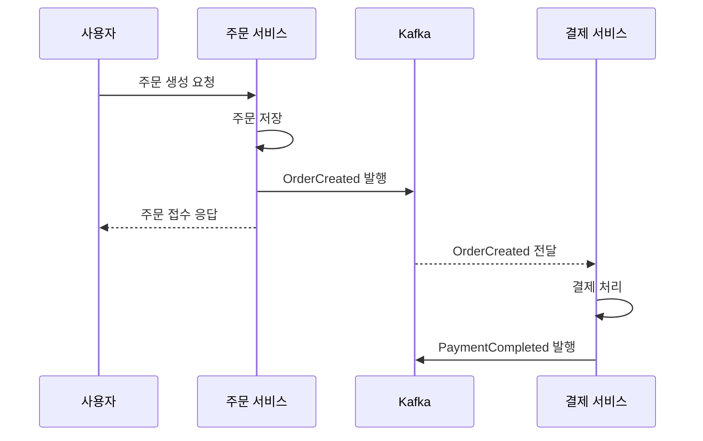

주문 서비스는 주문 접수 이후 사용자에게 응답할 수 있다.

하지만 이 시점에 결제가 완료된 것은 아니다.

따라서 다음 상태를 구분하는 것이 적절하다.

```text
PENDING_PAYMENT
    ↓
PAYMENT_PROCESSING
    ↓
PAID
```

또는 결제에 실패할 수 있다.

```text
PAYMENT_PROCESSING
    ↓
PAYMENT_FAILED
```

사용자에게 주문 접수를 완료했다고 응답하면서 실제로는 결제가 완료되지 않았는데 결제 성공으로 표시하면 상태의 의미가 잘못된다.

따라서 비동기 처리에서는 API 응답과 업무 상태 모델을 함께 설계해야 한다.

---

### 마이크로서비스에서 Kafka를 사용하는 이유

Kafka를 활용한 메시지 기반 통신은 여러 이점을 제공한다.

#### 1. 서비스 간 결합도 감소(Decoupling)

서비스가 서로 직접 통신하지 않고 Kafka를 통해 데이터를 공유할 수 있다.

예를 들어 새로운 분석 서비스를 추가한다고 가정해 보자.

기존의 직접 호출 방식이라면 주문 서비스에 분석 시스템 호출 코드를 추가해야 할 수 있다.

반면 Kafka에서는 분석 서비스가 기존 Topic을 구독하도록 구성할 수 있다.

주문 서비스에 새로운 HTTP API 호출을 추가하지 않아도 된다.

하지만 서비스 사이의 결합도가 완전히 사라지는 것은 아니다.

이벤트 이름과 데이터 구조, 업무적 의미에 대한 계약은 여전히 존재한다.

예를 들어 `OrderCreated` 이벤트의 금액 단위를 원에서 달러로 변경하면 이를 사용하는 Consumer도 영향을 받을 수 있다.

따라서 이벤트 스키마와 비즈니스 계약을 관리해야 한다.

#### 2. 비동기 통신 지원(Asynchronous)

Producer는 Kafka에 이벤트를 기록한 후 후속 Consumer의 업무 완료를 기다리지 않을 수 있다.

이렇게 하면 사용자 요청에서 필수적이지 않은 후속 처리를 분리할 수 있다.

예를 들어 주문 완료 이후 다음 작업을 비동기로 처리할 수 있다.

- 알림 전송
- 검색 인덱스 갱신
- 분석 이벤트 적재
- 추천 시스템 데이터 갱신

다만 후속 작업의 완료 시점은 Consumer의 처리량과 Lag에 영향을 받는다.

#### 3. 확장성 향상(Scalability)

Kafka는 Partition과 Consumer Group을 통해 병렬 처리를 지원한다.

예를 들어 다음과 같은 Topic이 있다고 가정해 보자.

```text
orders-topic

Partition 0
Partition 1
Partition 2
Partition 3
```

동일한 Consumer Group에 여러 Consumer를 배치하면 Partition을 분담할 수 있다.

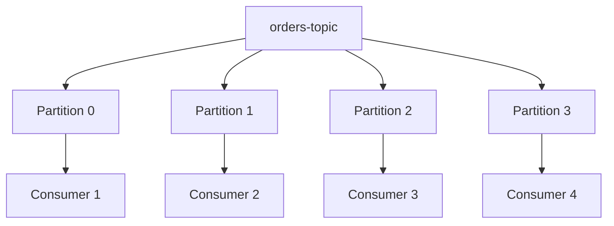

다만 같은 Consumer Group의 일반적인 Partition 할당 방식에서는 하나의 Partition을 동시에 하나의 Consumer가 담당한다.

따라서 Partition이 네 개인데 Consumer를 열 개 실행한다고 모든 Consumer가 동시에 작업하는 것은 아니다.

처리량을 높이려면 Partition 수와 Consumer 수, 처리 로직의 성능을 함께 고려해야 한다.

#### 4. 신뢰성과 내구성 확보(Reliability and Durability)

Kafka는 이벤트를 디스크에 저장하며 Partition 복제를 지원한다.

여러 Broker에 Replica를 유지하면 일부 Broker에 장애가 발생하더라도 데이터를 복구할 수 있는 기반을 마련할 수 있다.

하지만 내구성은 설정과 운영 조건에 따라 달라진다.

대표적으로 다음 항목을 고려해야 한다.

| 설정 | 역할 |
|---|---|
| replication.factor | Partition의 복제본 수 |
| acks | Producer가 기다릴 저장 확인 수준 |
| min.insync.replicas | 쓰기 성공에 필요한 최소 동기화 Replica 수 |
| retention.ms | 데이터 보존 기간 |
| retention.bytes | 데이터 보존 크기 제한 |

따라서 Kafka를 사용한다는 이유만으로 모든 장애에서 데이터 손실이 없다고 보장할 수는 없다.

#### 5. 장애 격리(Fault Tolerance)

Kafka는 Producer와 Consumer 사이에서 이벤트를 보관하고 처리 속도의 차이를 완충할 수 있다.

예를 들어 알림 서비스에 장애가 발생했다고 가정해 보자.

주문 서비스와 분석 서비스는 정상적으로 동작할 수 있다.

알림 서비스가 복구되면 Kafka에 남아 있는 이벤트를 다시 읽을 수 있다.

하지만 이벤트 적체가 계속 증가하면 Kafka 저장소 사용량이 증가한다.

또한 Broker 자체에 장애가 발생하면 여러 서비스가 영향을 받을 수 있다.

따라서 장애 격리와 함께 적체량과 보존 정책을 관리해야 한다.

---

### 동기 통신과 비동기 통신 비교

| 구분 | 동기 통신 | 비동기 통신 |
|---|---|---|
| 통신 방식 | 요청 후 응답 대기 | 메시지 발행 후 독립 처리 |
| 대표 기술 | REST API, gRPC | Kafka, RabbitMQ, Azure Service Bus |
| 서비스 의존성 | 실행 시점의 의존성 높음 | 실행 시점의 의존성 감소 |
| 업무 결과 확인 | 요청 응답으로 확인 가능 | 상태 조회 또는 결과 이벤트 필요 |
| 장애 영향 | 호출 경로를 통해 전파 가능 | 이벤트 적체로 일부 완충 가능 |
| 데이터 정합성 | 원격 호출 결과 불확실성 고려 | 중복·순서·재처리 고려 |
| 확장 방식 | 서비스 인스턴스 확장 | Consumer Group과 Partition 활용 |
| 적합한 사례 | 즉시 필요한 조회·승인 | 알림, 분석, 검색 갱신, 후속 처리 |

중요한 것은 모든 통신을 비동기로 변경하는 것이 아니다.

예를 들어 사용자 인증 결과나 특정 작업의 즉각적인 성공 여부가 반드시 필요하다면 동기 통신이 적합할 수 있다.

반면 사용자 요청과 직접적인 관련이 없는 후속 작업은 비동기로 분리할 수 있다.

실제 마이크로서비스에서는 두 방식을 함께 사용하는 경우가 많다.

---

### 이벤트 소싱(Event Sourcing)이란?

#### 이벤트 소싱의 개념

이벤트 소싱은 애플리케이션의 상태를 현재 값 하나로만 저장하는 대신 **상태를 변화시킨 사건들의 이력을 저장하고 이를 통해 현재 상태를 재구성하는 패턴**이다.

일반적인 CRUD 시스템을 생각해 보자.

주문 테이블에는 다음과 같은 데이터가 저장되어 있을 수 있다.

| order_id | status |
|---|---|
| order-1001 | CANCELLED |

이 데이터만 보면 해당 주문이 취소되었다는 사실은 알 수 있다.

하지만 주문이 어떤 과정을 거쳐 취소되었는지는 알기 어렵다.

이벤트 소싱에서는 상태 변화의 이력을 이벤트로 저장한다.

```text
OrderCreated
    ↓
OrderConfirmed
    ↓
PaymentCompleted
    ↓
OrderCancelled
```

이벤트를 순서대로 적용하면 현재 주문의 상태를 재구성할 수 있다.

#### 상태 중심 모델과 이벤트 중심 모델 비교

**상태 중심 모델**

```text
Order
    status = CANCELLED
```

현재 상태를 저장한다.

**이벤트 소싱 모델**

```text
Event 1: OrderCreated

Event 2: OrderConfirmed

Event 3: PaymentCompleted

Event 4: OrderCancelled
```

상태의 변화 과정을 저장한다.

여기서 가장 중요한 차이는 **무엇을 권위 있는 원본(Source of Truth)으로 사용할 것인가**다.

일반적인 CRUD 시스템에서는 현재 상태를 저장하는 테이블이 원본이다.

이벤트 소싱에서는 이벤트 이력이 현재 상태를 재구성하는 기준이 된다.

단순히 CRUD 데이터베이스를 사용하면서 변경 이벤트를 Kafka에 발행한다고 해서 이벤트 소싱이 되는 것은 아니다.

---

### 이벤트 소싱은 왜 사용하는가?

#### 상태 변경 이력 추적

이벤트 소싱에서는 객체의 상태가 어떤 과정을 거쳐 변경되었는지 확인할 수 있다.

예를 들어 주문이 취소된 경우 다음 사실을 추적할 수 있다.

- 주문이 언제 생성되었는가?
- 주문은 언제 확정되었는가?
- 결제는 정상적으로 완료되었는가?
- 취소 요청은 언제 발생했는가?
- 취소가 어떤 업무 조건에 의해 승인되었는가?

이러한 정보는 장애 분석과 감사, 복잡한 업무 흐름의 이해에 도움이 된다.

#### 과거 상태 재구성

이벤트를 순서대로 적용하면 특정 시점의 상태를 재구성할 수 있다.

예를 들어 다음과 같은 이벤트가 존재한다고 가정해 보자.

| 버전 | 이벤트 | 적용 후 상태 |
|---:|---|---|
| 1 | OrderCreated | CREATED |
| 2 | OrderConfirmed | CONFIRMED |
| 3 | PaymentCompleted | PAID |
| 4 | OrderCancelled | CANCELLED |

버전 3까지 이벤트를 적용하면 결제 완료 상태를 확인할 수 있다.

버전 4까지 적용하면 취소 완료 상태를 확인할 수 있다.

이는 단순히 현재 상태만 저장한 시스템과 차별화되는 특징이다.

#### 조회 모델 재구축

이벤트 이력을 기반으로 새로운 조회 모델을 만들 수도 있다.

예를 들어 주문 이력을 활용하여 다음 데이터를 생성할 수 있다.

- 주문별 상태 조회 모델
- 사용자별 구매 이력
- 상품별 매출 통계
- 취소 사유 분석 데이터

이러한 기능은 CQRS와 함께 사용될 때 유용할 수 있다.

---

### 이벤트 소싱의 동작 과정

이벤트 소싱은 일반적으로 다음 흐름으로 이해할 수 있다.

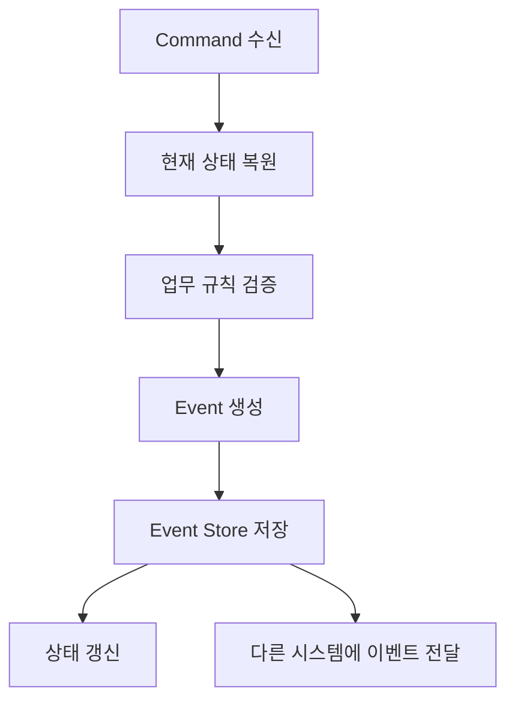

#### 1. Command 수신

사용자가 주문 확정을 요청한다.

```text
ConfirmOrder
```

Command는 시스템에서 수행하고 싶은 작업을 나타낸다.

#### 2. 현재 상태 복원

이벤트 이력을 이용하여 주문의 현재 상태를 확인한다.

```text
OrderCreated
```

현재 주문 상태가 `CREATED`라고 가정하자.

#### 3. 업무 규칙 검증

주문을 확정할 수 있는 상태인지 확인한다.

예를 들어 이미 취소된 주문이라면 확정을 거부해야 한다.

#### 4. Event 생성

업무 규칙을 만족하면 새로운 이벤트를 생성한다.

```text
OrderConfirmed
```

Command와 Event는 다르다.

`ConfirmOrder`는 요청이다.

`OrderConfirmed`는 실제로 주문이 확정되었다는 사실이다.

#### 5. Event Store 저장

새로운 이벤트를 Event Store에 저장한다.

#### 6. 상태 갱신

저장된 이벤트를 적용하여 현재 상태를 변경한다.

#### 7. 후속 이벤트 전달

필요한 경우 Kafka 등을 이용하여 다른 서비스에 이벤트를 전달한다.

---

### 이벤트 소싱에서 Event 객체 설계하기

실제 시스템에서는 이벤트 이름뿐 아니라 여러 메타데이터를 함께 관리하는 것이 좋다.

예를 들어 다음과 같은 이벤트를 생각해 보자.

```json
{
  "eventId": "evt-10001",
  "eventType": "OrderConfirmed",
  "aggregateId": "order-1001",
  "aggregateVersion": 3,
  "schemaVersion": 1,
  "occurredAt": "2026-11-23T10:00:00Z",
  "payload": {
    "orderId": "order-1001",
    "amount": 45000,
    "currency": "KRW"
  }
}
```

각 필드의 의미는 다음과 같다.

| 필드 | 설명 |
|---|---|
| eventId | 이벤트 고유 식별자 |
| eventType | 이벤트 종류 |
| aggregateId | 상태 변경 대상의 식별자 |
| aggregateVersion | Aggregate 상태 변경 순서 |
| schemaVersion | 이벤트 데이터 구조 버전 |
| occurredAt | 이벤트 발생 시각 |
| payload | 실제 비즈니스 데이터 |

여기서 `aggregateVersion`과 `schemaVersion`을 구분해야 한다.

`aggregateVersion`은 특정 도메인 객체의 상태가 몇 번째로 변경되었는지 나타낸다.

반면 `schemaVersion`은 이벤트 데이터 구조의 버전을 나타낸다.

이 두 개념을 혼동하면 이벤트 재생이나 데이터 호환성 관리에서 문제가 발생할 수 있다.

---

### 이벤트 소싱에서 동시성 문제가 발생하는 이유

동일한 주문에 대해 두 요청이 동시에 발생했다고 가정해 보자.

현재 주문의 Aggregate Version은 3이다.

두 요청이 동시에 Version 3의 상태를 읽었다.

```text
요청 A
    ↓
Version 3 조회
    ↓
Version 4 이벤트 생성
```

```text
요청 B
    ↓
Version 3 조회
    ↓
Version 4 이벤트 생성
```

두 요청이 모두 성공한다면 동일한 Aggregate에 대해 서로 충돌하는 변경이 저장될 수 있다.

따라서 이벤트 저장 과정에서 동시성 제어가 필요하다.

대표적인 방법은 예상 버전(Expected Version)을 검증하는 것이다.

```text
현재 Aggregate Version = 3

요청 A의 Expected Version = 3
    → 성공

요청 B의 Expected Version = 3
    → 충돌 감지
```

이처럼 이벤트를 추가할 때 현재 버전을 검사하면 충돌하는 변경을 감지할 수 있다.

단순히 같은 주문 ID를 Kafka Key로 사용한다고 업무 명령의 동시성 문제가 자동으로 해결되는 것은 아니다.

Kafka Key는 같은 Partition에 Record를 배치하는 데 도움이 된다.

하지만 Kafka에 기록하기 이전에 발생하는 업무 동시성 문제까지 해결하지는 않는다.

---

### 이벤트 소싱과 DDD의 관계

#### DDD란?

Domain-Driven Design(DDD)은 소프트웨어 설계의 중심을 기술적 구성보다 비즈니스 도메인에 두는 접근 방식이다.

도메인 전문가와 개발자가 공통된 언어를 사용하여 업무 모델을 설계하는 것이 중요하다.

대표적인 개념으로 다음을 들 수 있다.

- Entity
- Value Object
- Aggregate
- Domain Service
- Domain Event
- Ubiquitous Language

이벤트 소싱은 DDD에서 사용하는 Domain Event와 자연스럽게 연결될 수 있다.

#### Aggregate와 이벤트 소싱

Aggregate는 비즈니스 규칙과 일관성을 유지해야 하는 도메인 경계다.

예를 들어 주문 Aggregate가 있다고 가정해 보자.

```text
Order Aggregate
    ├── Order
    ├── OrderItem
    └── OrderStatus
```

주문 확정이라는 업무 명령이 들어오면 Aggregate에서 필요한 규칙을 검증한다.

이후 상태 변경이 성공하면 `OrderConfirmed` 이벤트를 생성할 수 있다.

이벤트 이름은 기술적인 변경보다 업무적인 의미를 표현하는 것이 좋다.

예를 들어 다음 이벤트는 의미가 모호하다.

```text
OrderRowUpdated
```

반면 다음 이벤트는 업무 의미가 명확하다.

```text
OrderConfirmed
```

이처럼 도메인 전문가와 개발자가 동일하게 이해할 수 있는 이름을 사용하면 시스템의 업무 흐름을 파악하기 쉬워진다.

다만 DDD를 사용한다고 이벤트 소싱을 반드시 도입해야 하는 것은 아니다.

DDD와 이벤트 소싱은 서로 관련이 있지만 동일한 개념은 아니다.

---

### 이벤트 소싱에서 주의해야 할 점

#### 이벤트 재생과 외부 업무 실행은 다르다

다음과 같은 이벤트가 있다고 가정해 보자.

```text
OrderCreated
PaymentCompleted
OrderCancelled
```

현재 주문 상태를 복원하기 위해 이벤트를 다시 읽을 수 있다.

하지만 `PaymentCompleted` 이벤트를 읽었다고 실제 결제 API를 다시 호출하면 안 된다.

이벤트 재생은 과거에 발생한 사실을 상태에 반영하는 작업이다.

이미 완료된 결제나 알림을 다시 수행하는 작업이 아니다.

따라서 상태 복원 로직과 외부 부작용을 발생시키는 처리 로직을 구분해야 한다.

#### 모든 이벤트를 매번 읽어야 할까?

반드시 그렇지는 않다.

이벤트가 수십만 건 누적된 Aggregate를 매번 처음부터 복원하면 성능 문제가 발생할 수 있다.

이때 Snapshot을 활용할 수 있다.

```text
Event 1
Event 2
Event 3
...
Event 1000
    ↓
Snapshot 생성
    ↓
Event 1001 이후만 적용
```

Snapshot은 특정 시점까지 계산된 상태를 저장한다.

이후 새로운 이벤트만 적용하여 현재 상태를 복원할 수 있다.

다만 Snapshot은 복원을 위한 최적화 수단이며 원본 이벤트 이력 자체를 대체하는 것은 아니다.

---

### CQRS란?

#### CQRS의 개념

CQRS는 Command Query Responsibility Segregation의 약자다.

한국어로는 명령과 조회의 책임 분리라고 할 수 있다.

CQRS는 시스템의 상태를 변경하는 작업과 상태를 조회하는 작업을 서로 다른 모델로 분리하는 아키텍처 패턴이다.

일반적인 CRUD 애플리케이션에서는 하나의 Entity 모델을 이용하여 읽기와 쓰기를 함께 처리하는 경우가 많다.

하지만 실제 서비스에서는 읽기와 쓰기의 요구사항이 다를 수 있다.

예를 들어 주문 생성에서는 다음 정보가 중요하다.

- 사용자 식별자
- 상품 식별자
- 주문 수량
- 상품 가격
- 구매 가능 여부
- 주문 상태 변경 규칙

반면 주문 목록 조회에서는 다음 정보가 중요할 수 있다.

- 주문 ID
- 상품명
- 대표 이미지
- 총 결제 금액
- 배송 상태
- 최근 주문 순서

쓰기 모델은 비즈니스 규칙과 정합성이 중요하다.

읽기 모델은 빠른 조회와 화면에 필요한 데이터 구조가 중요하다.

**하나의 데이터 모델이 읽기와 쓰기의 요구사항을 모두 최적으로 만족시키기 어려울 수 있다.**

CQRS는 이러한 문제를 해결하기 위해 등장했다.

---

### CQRS의 전체 구조

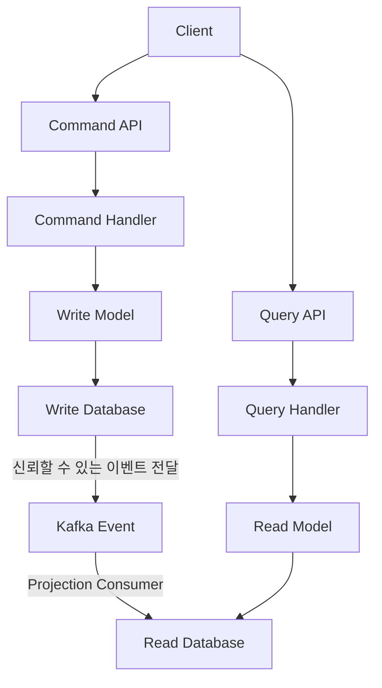

Command API는 데이터를 변경하는 요청을 처리한다.

Query API는 데이터를 조회하는 요청을 처리한다.

두 모델은 서로 다른 데이터 구조와 저장소를 사용할 수 있다.

다만 **CQRS를 적용한다고 Kafka나 물리적으로 분리된 데이터베이스가 반드시 필요한 것은 아니다.**

처음에는 같은 데이터베이스를 사용하면서 Command와 Query의 책임만 분리할 수도 있다.

읽기 요구사항이 복잡해지면 별도의 읽기 저장소를 도입할 수 있다.

---

### CQRS의 주요 구성 요소

| 구성 요소 | 역할 |
|---|---|
| Command | 시스템의 상태 변경 의도 |
| Command Handler | Command를 처리하고 업무 규칙 실행 |
| Command Model | 상태 변경을 위한 비즈니스 모델 |
| Query | 시스템의 현재 상태를 조회하는 요청 |
| Query Handler | 조회 요청 처리 |
| Query Model | 조회에 최적화된 데이터 구조 |
| Write Database | 상태 변경을 저장하는 데이터베이스 |
| Read Database | 조회에 최적화된 데이터베이스 |
| Event | 상태 변경을 다른 시스템에 알리는 데이터 |

여기서 Event는 CQRS의 필수 구성 요소가 아니다.

CQRS는 읽기와 쓰기의 책임을 분리하는 패턴이다.

이벤트 기반 통신은 이를 구현하기 위한 선택지 중 하나다.

---

### CQRS에서 Kafka를 활용하는 방법

예를 들어 주문 서비스에서 주문 생성 API가 호출되었다고 가정해 보자.

#### 1단계: Command 처리

클라이언트가 주문 생성을 요청한다.

```http
POST /orders
```

Command Handler는 업무 규칙을 검증하고 주문을 저장한다.

```text
OrderCommandHandler
    ↓
Order 생성
    ↓
Write Database 저장
```

#### 2단계: 이벤트 발행

주문 생성이 확정되면 다음 이벤트를 전달할 수 있다.

```json
{
  "eventId": "evt-10001",
  "eventType": "OrderCreated",
  "orderId": "order-1001",
  "amount": 45000
}
```

#### 3단계: Query Model 갱신

별도의 Consumer가 이벤트를 읽는다.

```text
Kafka Topic
    ↓
OrderProjectionConsumer
    ↓
Read Database 갱신
```

조회에 필요한 정보를 별도로 저장할 수 있다.

예를 들어 다음과 같은 테이블을 사용할 수 있다.

| order_id | amount | status |
|---|---:|---|
| order-1001 | 45000 | CREATED |

#### 4단계: Query 처리

클라이언트가 주문 목록을 조회한다.

```http
GET /orders
```

Query Handler는 Read Database에서 데이터를 읽는다.

이때 읽기 모델은 조회 성능을 위해 비정규화된 구조를 사용할 수도 있다.

---

### CQRS에서 최종 일관성(Eventual Consistency)이 발생하는 이유

#### Write Database와 Read Database의 반영 시점

CQRS에서 읽기와 쓰기 저장소를 비동기적으로 연결하면 데이터 반영 시점에 차이가 발생할 수 있다.

예를 들어 다음과 같은 상황을 생각해 보자.

```text
10:00:00.000
주문 생성 요청
```

```text
10:00:00.100
Write Database 저장 완료
```

```text
10:00:00.120
주문 생성 API 응답
```

```text
10:00:00.300
Kafka Consumer가 이벤트 처리
```

```text
10:00:00.350
Read Database 갱신 완료
```

이 상황에서 사용자가 10시 00분 00.200초에 주문 목록을 조회하면 어떻게 될까?

Write Database에는 주문이 존재한다.

하지만 Read Database에는 아직 반영되지 않았다.

따라서 주문 생성 API는 성공했지만 조회 결과에는 새 주문이 나타나지 않을 수 있다.

이러한 상황은 최종 일관성 모델에서 발생할 수 있다.

#### 최종 일관성이란?

최종 일관성은 분산된 데이터가 즉시 동일한 상태를 가지지는 않더라도, 변경 사항이 정상적으로 전달되고 처리된다면 궁극적으로 일관된 상태로 수렴하도록 하는 모델이다.

하지만 최종 일관성이란 단순히 시간이 지나면 모든 문제가 자동으로 해결된다는 의미가 아니다.

Consumer가 영구적으로 실패하거나 이벤트가 유실된다면 Read Database가 갱신되지 않을 수 있다.

따라서 실패한 이벤트를 발견하고 복구할 수 있어야 한다.

---

### CQRS에서 사용자 경험을 어떻게 설계할까?

주문 생성 이후 목록에 주문이 나타나지 않는다면 사용자는 주문이 실패했다고 판단할 수 있다.

이러한 문제를 줄이기 위해 여러 방법을 고려할 수 있다.

#### 방법 1. 주문 생성 응답에 상태 포함

주문 생성 API가 다음 데이터를 반환할 수 있다.

```json
{
  "orderId": "order-1001",
  "status": "CREATED"
}
```

클라이언트는 이 정보를 이용하여 주문 접수 상태를 먼저 표시한다.

#### 방법 2. 제한된 재조회

Read Database에 주문이 반영되었는지 제한된 횟수로 다시 조회한다.

다만 무제한 Polling은 서버에 불필요한 부하를 발생시킬 수 있다.

#### 방법 3. 버전 기반 확인

Write Database의 변경 버전과 Read Database가 반영한 버전을 비교할 수 있다.

예를 들어 주문의 최신 버전이 5인데 Read Database에는 버전 4가 반영되어 있다면 아직 조회 모델이 최신 상태가 아니라는 사실을 알 수 있다.

#### 방법 4. 최신 상태가 필요한 조회는 별도 처리

일부 중요한 조회는 Write Database를 이용하는 방식도 고려할 수 있다.

하지만 모든 조회를 Write Database에서 처리한다면 읽기와 쓰기를 분리한 이점이 줄어들 수 있다.

따라서 즉시 최신성이 필요한 조회와 일반적인 목록·검색 조회를 구분하는 것이 좋다.

---

### CQRS와 이벤트 소싱의 차이

CQRS와 이벤트 소싱은 함께 사용되는 경우가 많지만 동일한 패턴은 아니다.

| 구분 | 이벤트 소싱 | CQRS |
|---|---|---|
| 핵심 목적 | 상태 변화 이력 저장 및 재구성 | 읽기와 쓰기 모델 분리 |
| 원본 데이터 | 이벤트 이력 | 구현에 따라 다름 |
| 주요 관심사 | 이벤트 순서, 재생, 동시성 | 조회 최적화, 모델 동기화 |
| Kafka 필수 여부 | 필수 아님 | 필수 아님 |
| 함께 사용 가능 여부 | 가능 | 가능 |

예를 들어 다음 구조를 생각할 수 있다.

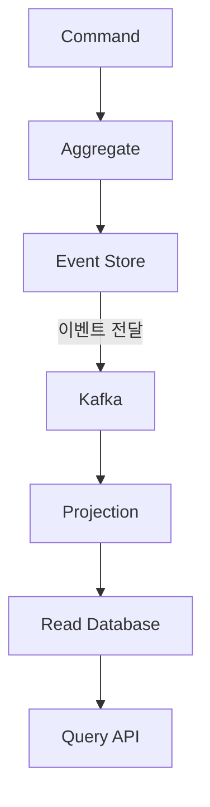

이 구조에서는 이벤트 소싱을 이용하여 상태 변경 이력을 저장한다.

CQRS를 이용하여 읽기 모델을 별도로 구성한다.

Kafka는 이벤트를 전달하는 역할을 수행한다.

하지만 이 모든 기술을 반드시 함께 사용해야 하는 것은 아니다.

실제 시스템에서는 문제의 복잡도와 요구사항을 기준으로 필요한 패턴만 선택하는 것이 좋다.

---

### 스트림 처리(Stream Processing)란?

#### 스트림 처리의 개념

스트림 처리는 지속적으로 발생하는 데이터를 실시간 또는 준실시간으로 분석하고 처리하는 방식이다.

일반적인 배치 처리는 일정 범위의 데이터를 모아 한 번에 처리한다.

반면 스트림 처리는 이벤트가 들어오는 흐름을 지속적으로 처리한다.

예를 들어 사용자 행동 이벤트가 발생한다고 가정해 보자.

```text
UserClicked
    ↓
UserViewedProduct
    ↓
UserAddedToCart
    ↓
UserPurchased
```

이러한 이벤트를 Kafka에 기록할 수 있다.

Kafka Streams와 같은 처리 기술을 사용하면 데이터를 필터링하거나 그룹화하고 집계할 수 있다.

#### Kafka Streams 활용 구조

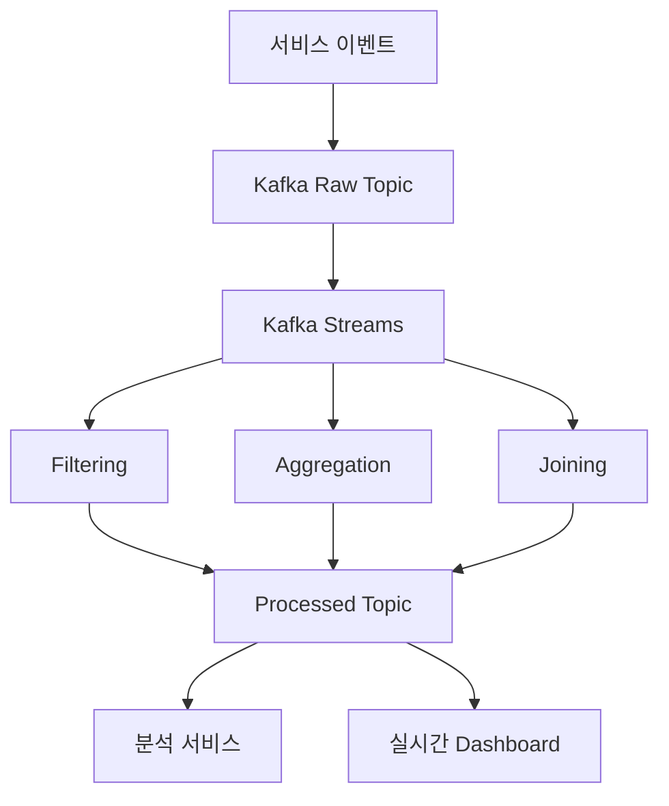

스트림 처리의 핵심은 단순한 이벤트 전달이 아니다.

**이벤트를 분석하고 새로운 의미를 가진 데이터로 변환하는 것이다.**

---

### 마이크로서비스에서 스트림 처리가 중요한 이유

#### 1. 실시간 데이터 통합

서로 다른 서비스에서 발생한 이벤트를 결합하여 전체 업무 상태를 분석할 수 있다.

예를 들어 주문 이벤트와 결제 이벤트를 결합하여 실제 결제가 완료된 주문을 계산할 수 있다.

#### 2. 즉각적인 의사 결정 지원

결제 이벤트를 실시간으로 분석하여 이상 거래 가능성을 감지할 수 있다.

예를 들어 특정 사용자가 짧은 시간 안에 비정상적으로 많은 결제 요청을 발생시키는지 확인할 수 있다.

#### 3. 사용자 경험 개선

사용자의 활동 데이터를 기반으로 실시간 추천이나 알림을 제공할 수 있다.

#### 4. 확장 가능한 데이터 파이프라인

Kafka의 Partition과 Consumer Group을 활용하여 데이터 처리량을 확장할 수 있다.

다만 전체 처리량은 Stream Processor의 상태 관리 비용과 외부 시스템의 성능에도 영향을 받는다.

#### 5. 이벤트 기반 아키텍처 지원

서비스에서 발생하는 이벤트를 기반으로 다른 기능을 실행하거나 새로운 이벤트를 생성할 수 있다.

이를 통해 서비스 간 직접적인 의존성을 줄일 수 있다.

---

### 스트림 처리에서 고려해야 할 핵심 개념

#### 상태 관리(State Management)

일부 스트림 처리 작업은 이전 이벤트의 처리 결과가 필요하다.

예를 들어 최근 5분 동안의 결제 횟수를 계산한다면 이전에 발생한 결제 정보를 참조해야 한다.

이러한 처리를 Stateful Processing이라고 한다.

Kafka Streams에서는 State Store를 이용하여 필요한 상태를 관리할 수 있다.

하지만 상태 저장소가 커지면 디스크 사용량과 장애 복구 시간이 증가할 수 있다.

#### 시간 처리(Time Processing)

실제 이벤트 발생 시각과 처리 시각은 다를 수 있다.

따라서 시간 기반 집계에서는 어떤 시간을 사용할지 결정해야 한다.

Kafka Streams에서는 Window와 Grace Period를 이용하여 시간 범위와 지연 이벤트 처리 정책을 정의할 수 있다.

#### 이벤트 순서(Ordering)

Kafka의 메시지 순서는 기본적으로 Partition 단위로 보장된다.

서로 다른 Partition의 이벤트에 대해 전역적인 순서를 보장하지는 않는다.

따라서 같은 주문에 대한 이벤트 순서가 중요하다면 주문 ID와 같은 Key를 사용하여 Partition 분배를 설계할 수 있다.

다만 같은 Key를 사용해도 Producer가 업무 순서를 뒤집어 발행하면 Kafka가 이를 자동으로 복구하지는 않는다.

#### 내결함성(Fault Tolerance)

스트림 처리 애플리케이션에 장애가 발생하면 상태를 복구해야 할 수 있다.

Kafka Streams는 Changelog Topic 등을 이용하여 상태 복구를 지원할 수 있다.

하지만 외부 데이터베이스 저장이나 HTTP API 호출까지 자동으로 원자적으로 처리하지는 않는다.

#### 스키마 진화(Schema Evolution)

이벤트 데이터의 구조는 시간이 지나면서 변경될 수 있다.

예를 들어 주문 이벤트에 새로운 필드가 추가될 수 있다.

이러한 변경을 처리하려면 Producer와 Consumer의 데이터 호환성을 관리해야 한다.

필요하다면 Schema Registry와 Avro, Protobuf 등의 직렬화 방식을 활용할 수 있다.

---

### 로그 집계(Log Aggregation)란?

#### 로그 집계의 개념

로그 집계는 여러 서비스에서 발생하는 로그를 중앙으로 수집하여 검색하고 분석할 수 있도록 만드는 시스템이다.

모놀리식 애플리케이션에서는 하나의 서버에 접근하여 로그를 확인하는 방식이 가능할 수 있다.

하지만 마이크로서비스에서는 상황이 다르다.

여러 서비스가 서로 다른 서버와 컨테이너에서 실행된다.

또한 서비스가 수평 확장되면서 인스턴스 수가 계속 변경될 수 있다.

예를 들어 다음과 같은 시스템을 생각해 보자.

```text
Order Service
    → 3 Instances

Payment Service
    → 4 Instances

Inventory Service
    → 2 Instances

Notification Service
    → 3 Instances
```

총 12개의 인스턴스에서 로그가 발생한다.

하나의 주문이 여러 서비스를 거쳤다면 관련 로그가 서로 다른 서버에 분산되어 있을 수 있다.

따라서 각 서버에 직접 접속하여 로그를 확인하는 방식은 비효율적이다.

중앙 집중식 로그 관리 시스템이 필요한 이유다.

---

### Kafka를 활용한 로그 집계 아키텍처

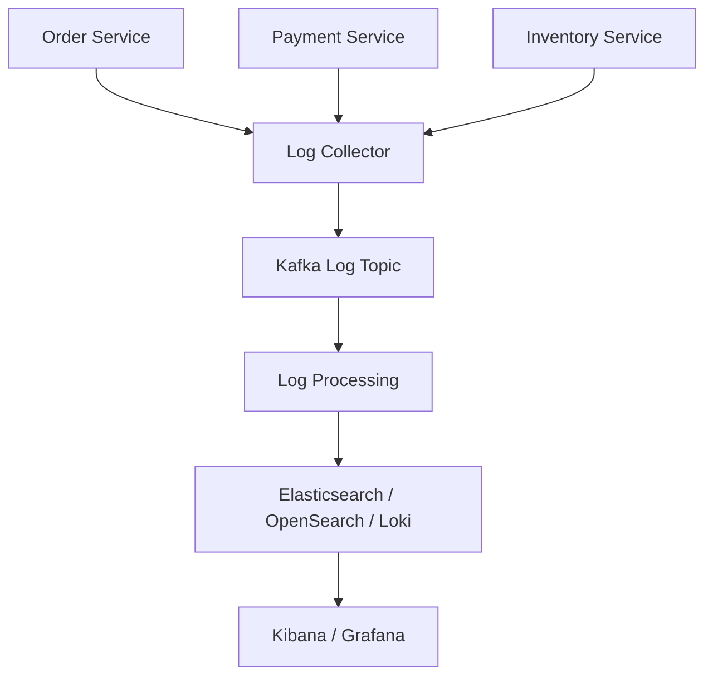

애플리케이션은 로그를 생성한다.

로그 수집기는 애플리케이션이 생성한 로그를 읽는다.

Kafka는 로그를 전달하고 여러 Consumer가 처리할 수 있도록 저장한다.

이후 검색 및 분석 시스템에 로그를 적재할 수 있다.

#### 로그 수집기

대표적인 로그 수집 도구는 다음과 같다.

| 도구 | 주요 역할 |
|---|---|
| Filebeat | 로그 파일 수집 및 전달 |
| Fluent Bit | 경량 로그 수집과 전달 |
| Fluentd | 로그 수집, 변환, 전달 |
| Kafka Connect | Kafka와 외부 저장소 사이의 데이터 이동 |

여기서 Kafka Connect와 Filebeat의 역할을 구분해야 한다.

Filebeat와 Fluent Bit 등의 수집기는 서버나 컨테이너에서 로그를 수집하는 역할을 수행할 수 있다.

Kafka Connect는 Kafka와 외부 저장소 사이의 데이터 이동을 담당할 수 있다.

Kafka Connect를 설치했다고 모든 애플리케이션 로그가 자동으로 수집되는 것은 아니다.

---

### Kubernetes 환경에서 로그 집계하기

Kubernetes에서는 Pod가 생성되고 삭제되는 과정이 빈번하게 발생한다.

따라서 특정 Pod 내부에만 로그를 저장하면 Pod가 종료되었을 때 로그를 확인하기 어려울 수 있다.

일반적인 방법은 애플리케이션이 표준 출력으로 로그를 기록하고 Node 단위 로그 수집기를 이용하여 중앙으로 전달하는 것이다.

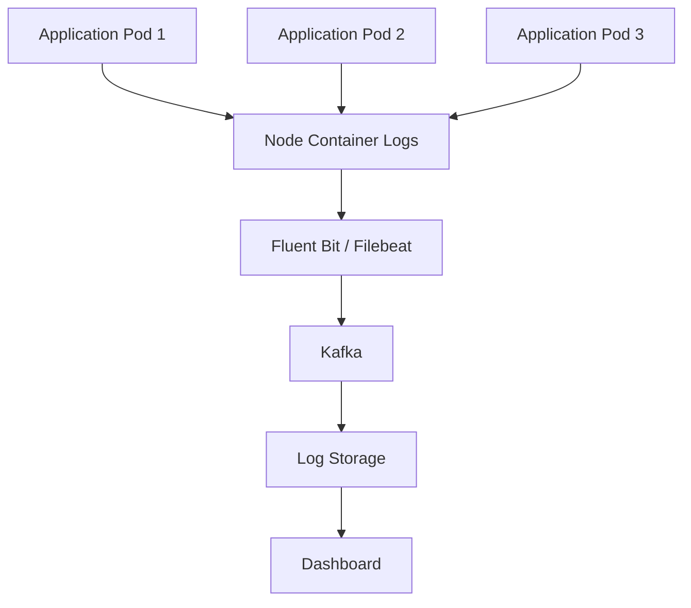

Kubernetes에서는 로그 수집기를 DaemonSet으로 실행하는 방식이 일반적으로 활용된다.

DaemonSet은 각 Node에서 필요한 Pod가 실행되도록 관리하는 Kubernetes 리소스다.

따라서 모든 애플리케이션 Pod마다 별도의 로그 수집 Sidecar를 배치하지 않아도 된다.

다만 특수한 로그 파일을 처리해야 하는 경우에는 Sidecar 방식도 검토할 수 있다.

---

### 분산 로그에서 Trace ID가 중요한 이유

중앙 로그 시스템을 구축했다고 해서 분산된 요청 흐름을 자동으로 추적할 수 있는 것은 아니다.

예를 들어 사용자 주문 요청 하나가 다음 서비스를 거쳤다고 가정해 보자.

```text
Order Service
    ↓
Payment Service
    ↓
Inventory Service
    ↓
Notification Service
```

각 서비스에서 로그를 생성한다.

하지만 공통 식별자가 없다면 어떤 로그가 동일한 사용자 요청에 속하는지 구분하기 어렵다.

이때 Trace ID를 활용할 수 있다.

#### 구조화된 로그 예제

```json
{
  "timestamp": "2026-11-23T10:00:00Z",
  "service": "order-service",
  "environment": "production",
  "level": "INFO",
  "traceId": "d41999e70ad64b40a2e4c805ab029c21",
  "orderId": "order-1001",
  "message": "Order created successfully"
}
```

각 필드의 의미는 다음과 같다.

| 필드 | 설명 |
|---|---|
| timestamp | 로그 발생 시각 |
| service | 서비스 이름 |
| environment | 실행 환경 |
| level | 로그 수준 |
| traceId | 요청 흐름을 연결하는 식별자 |
| orderId | 비즈니스 식별자 |
| message | 로그 메시지 |

여러 서비스가 동일한 Trace ID를 전달하고 기록한다면 관련 로그를 연결하기 쉬워진다.

다만 HTTP 요청에서 사용한 추적 정보를 Kafka Consumer까지 연결하려면 메시지 Header 등을 통해 Context를 전파하는 구성이 필요할 수 있다.

또한 로그에 Trace ID가 존재하는 것과 분산 추적 시스템이 완성되는 것은 다르다.

서비스별 호출 시간과 인과관계를 자세히 분석하려면 OpenTelemetry와 같은 기술을 이용하여 Trace와 Span을 함께 수집할 수 있다.

---

### 로그 집계에서 주의해야 할 사항

#### 로그 보존과 유실

컨테이너의 생명주기와 로그 회전 정책 등에 의해 로그가 삭제될 수 있다.

로그 수집기가 일시적으로 중단된 경우에도 버퍼가 가득 차면 일부 데이터가 유실될 수 있다.

따라서 다음 상태를 모니터링해야 한다.

- 로그 수집 지연
- 수집기 버퍼 사용량
- Kafka Log Topic의 적체
- 외부 저장소 적재 실패
- 로그 보존 기간

#### 민감정보 보호

로그에는 개인정보나 인증 토큰이 포함될 수 있다.

따라서 비밀번호와 Access Token, 불필요한 개인정보를 로그에 출력하지 않도록 해야 한다.

또한 로그 시스템에 대한 접근 권한을 제한해야 한다.

#### 로그 폭증

특정 서비스에서 오류가 반복되면 대량의 로그가 발생할 수 있다.

이로 인해 Kafka와 로그 저장소의 리소스 사용량이 급증할 수 있다.

따라서 로그 수집 시스템과 핵심 업무 이벤트 파이프라인의 자원 사용을 적절하게 분리할 필요가 있다.

---

### CDC(Change Data Capture)란?

#### CDC의 개념

CDC는 Change Data Capture의 약자다.

데이터베이스에서 발생하는 데이터 변경 사항을 감지하여 다른 시스템으로 전달하는 기술이다.

대표적인 변경 작업은 다음과 같다.

- INSERT
- UPDATE
- DELETE

예를 들어 주문 데이터베이스에서 다음 SQL이 실행되었다고 가정해 보자.

```sql
UPDATE orders
SET status = 'PAID'
WHERE order_id = 'order-1001';
```

CDC는 이러한 데이터 변경을 감지하여 다른 시스템에 전달할 수 있다.

이를 이용하면 다음과 같은 작업을 구현할 수 있다.

- 검색 인덱스 갱신
- 데이터 웨어하우스 적재
- 캐시 무효화
- 데이터 분석
- 시스템 간 데이터 동기화

---

### CDC가 필요한 이유

#### 주기적인 전체 데이터 조회의 문제

CDC를 사용하지 않는 환경에서는 주기적으로 데이터베이스를 조회하여 변경 사항을 확인하는 경우가 있다.

예를 들어 다음과 같은 SQL을 실행할 수 있다.

```sql
SELECT *
FROM orders
WHERE updated_at > :last_checked_at;
```

마지막 조회 시점 이후 변경된 데이터를 가져오는 방식이다.

구현은 비교적 단순하다.

하지만 여러 문제가 발생할 수 있다.

첫째, 데이터베이스를 반복해서 조회해야 한다.

둘째, 조회 주기에 따라 변경 사항을 늦게 감지할 수 있다.

셋째, Timestamp 경계에서 데이터가 누락될 수 있다.

넷째, 삭제된 데이터를 별도로 추적하기 어려울 수 있다.

다섯째, 동일한 데이터가 짧은 시간에 여러 번 변경되더라도 최종 상태만 조회할 수 있다.

CDC는 이러한 문제를 줄이기 위한 방법이다.

---

### CDC의 주요 구현 방식

CDC는 다양한 방식으로 구현할 수 있다.

#### 1. Polling 방식

일정한 주기로 데이터베이스를 조회한다.

```text
Scheduler
    ↓
Database Query
    ↓
변경 데이터 확인
    ↓
Kafka 발행
```

구성이 비교적 간단하다.

하지만 Polling 간격과 데이터 변경량에 따라 성능과 정확성이 영향을 받을 수 있다.

#### 2. Trigger 기반 방식

데이터베이스 Trigger를 이용하여 변경 이력을 기록한다.

예를 들어 주문 테이블이 변경될 때 별도 이력 테이블에 변경 사항을 저장할 수 있다.

변경을 비교적 빠르게 감지할 수 있지만 Trigger의 실행 비용이 원본 트랜잭션에 영향을 줄 수 있다.

#### 3. Transaction Log 기반 방식

데이터베이스의 트랜잭션 로그를 이용하여 변경 사항을 수집한다.

대표적인 예시는 다음과 같다.

| 데이터베이스 | 변경 로그 |
|---|---|
| MySQL | Binary Log(Binlog) |
| PostgreSQL | WAL |
| SQL Server | Transaction Log 기반 CDC |
| MongoDB | Change Streams / Oplog 기반 메커니즘 |

이 방식은 데이터베이스에서 이미 기록하는 변경 로그를 활용한다.

하지만 원본 로그의 보존과 읽기 위치 관리, 복구 정책을 고려해야 한다.

#### 4. Application 기반 방식

애플리케이션 코드에서 업무 변경과 이벤트를 함께 기록한다.

예를 들어 주문 생성 시 이벤트 테이블에도 데이터를 저장할 수 있다.

이 방식은 업무 의미를 명확하게 담을 수 있지만 모든 변경 경로에서 이벤트 기록이 누락되지 않도록 관리해야 한다.

---

### CDC 구현 방식 비교

| 구분 | Polling | Trigger | Transaction Log | Application |
|---|---|---|---|---|
| 변경 감지 | 주기적 조회 | DB Trigger | DB 변경 로그 | 업무 코드 |
| 실시간성 | 조회 주기에 영향 | 비교적 높음 | 비교적 높음 | 구현에 따라 다름 |
| DB 부하 | 반복 조회 비용 | Trigger 실행 비용 | 로그 처리 및 복제 비용 | 추가 쓰기 비용 |
| 삭제 감지 | 별도 설계 필요 | 구현 가능 | 지원 가능 | 구현 가능 |
| 복잡성 | 상대적으로 낮음 | Trigger 관리 필요 | Connector 운영 필요 | 업무 코드 관리 필요 |
| 주요 고려사항 | 경계값·누락 | 원본 성능 | 로그 보존·복구 | 기록 누락·원자성 |

실제 선택에서는 변경량과 실시간성, 데이터베이스 종류, 운영 복잡성 등을 함께 고려해야 한다.

---

### Kafka Connect와 Debezium을 이용한 CDC

#### Debezium이란?

Debezium은 데이터베이스의 변경 사항을 수집하기 위한 오픈소스 CDC 플랫폼이다.

Kafka Connect와 함께 사용할 수 있다.

일반적으로 Kafka Connect Worker가 Debezium Source Connector를 실행한다.

Debezium은 데이터베이스 변경 사항을 읽고 Kafka Topic에 기록한다.

#### 전체 구조

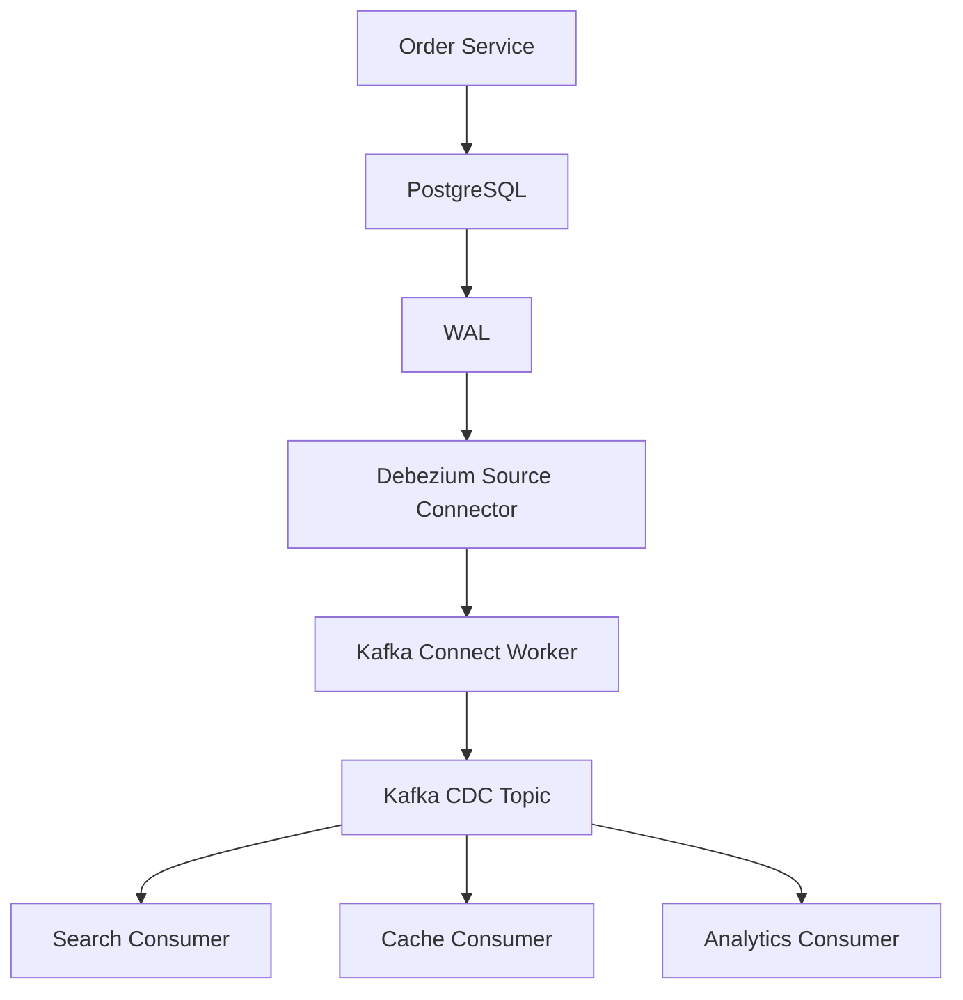

이 구조에서는 주문 서비스가 Kafka Producer를 직접 구현하지 않더라도 데이터베이스의 변경 사항을 Kafka로 전달할 수 있다.

하지만 데이터베이스 변경 이벤트와 비즈니스 이벤트를 구분해야 한다.

예를 들어 다음 두 이벤트는 서로 다른 의미를 가진다.

```text
orders.status 컬럼이 PAID로 변경됨
```

```text
PaymentCompleted
```

첫 번째는 데이터베이스의 변경 사실이다.

두 번째는 비즈니스에서 결제가 완료되었다는 의미를 가진 이벤트다.

데이터베이스의 테이블 구조와 업무 이벤트 계약을 동일하게 취급하면 Consumer가 원본 데이터베이스의 컬럼 구조에 강하게 결합될 수 있다.

따라서 외부 시스템에 안정적인 업무 계약을 제공하려면 원시 CDC 이벤트와 도메인 이벤트를 구분하는 것이 좋다.

---

### CDC의 초기 Snapshot과 변경 로그 처리

Debezium을 처음 실행할 때는 현재 데이터베이스의 상태를 Snapshot으로 수집할 수 있다.

이후 데이터베이스 변경 로그를 이용하여 새로운 변경 사항을 계속 전달한다.

```text
초기 연결
    ↓
기존 데이터 Snapshot
    ↓
변경 로그 위치 확인
    ↓
변경 이벤트 스트리밍
```

예를 들어 현재 주문 테이블에 100만 건의 데이터가 있다고 가정해 보자.

초기 Snapshot을 이용하여 기존 데이터를 Kafka로 전송할 수 있다.

이후 새롭게 생성되거나 변경된 주문을 지속적으로 전달할 수 있다.

다만 CDC를 도입했다고 데이터베이스가 생성된 이후의 모든 과거 변경 이력이 자동으로 복구되는 것은 아니다.

Snapshot은 기본적으로 특정 시점의 데이터 상태를 수집한다.

과거의 모든 변경 이력을 복원하려면 해당 이력이 별도로 보존되어 있어야 한다.

---

### CDC 운영에서 발생하는 문제

#### MySQL Binlog 보존

MySQL에서 CDC Connector가 오래 중단되면 필요한 Binlog 파일이 삭제될 수 있다.

이 경우 Connector가 마지막 처리 위치부터 데이터를 다시 읽지 못할 수 있다.

따라서 Binlog 보존 정책과 Connector의 처리 지연을 함께 관리해야 한다.

#### PostgreSQL WAL 증가

PostgreSQL에서는 Logical Replication Slot을 이용하여 CDC를 구성할 수 있다.

Connector가 변경 로그를 정상적으로 소비하지 못하면 WAL 파일이 누적될 수 있다.

WAL이 지나치게 증가하면 데이터베이스 디스크 사용량에 영향을 줄 수 있다.

따라서 Kafka Consumer Lag뿐 아니라 원본 데이터베이스의 WAL 사용량과 Replication Slot 상태도 확인해야 한다.

#### 중복 이벤트

Connector가 장애 이후 복구되는 과정에서 일부 변경 이벤트가 다시 전달될 수 있다.

따라서 Sink 시스템에서는 동일한 이벤트를 여러 번 처리해도 결과가 잘못되지 않도록 설계해야 한다.

---

### 데이터베이스 저장과 Kafka 발행 사이의 문제

지금까지 Kafka를 이용하여 데이터를 전달하는 방법을 살펴보았다.

하지만 실제 업무 시스템에서는 중요한 문제가 하나 더 존재한다.

**데이터베이스 저장과 Kafka 이벤트 발행을 어떻게 일관되게 처리할 것인가?**

예를 들어 주문 서비스가 다음 작업을 수행한다고 가정해 보자.

```java
orderRepository.save(order);

kafkaTemplate.send(
    "orders.events",
    orderEvent
);
```

이 코드는 동작 구조를 보여 주기 위한 단순화된 예시다.

첫 번째 작업은 데이터베이스 저장이다.

두 번째 작업은 Kafka 이벤트 발행이다.

그런데 두 작업 사이에서 애플리케이션이 종료되면 어떻게 될까?

---

### Dual Write 문제

#### 데이터베이스 저장 성공, Kafka 발행 실패

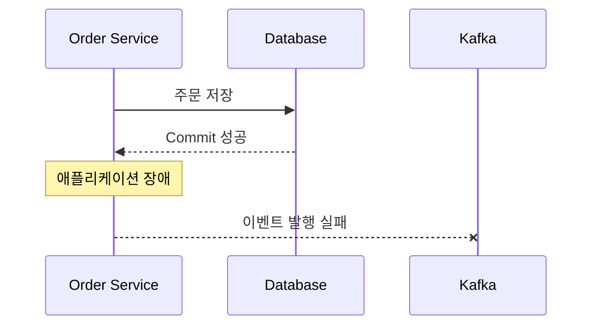

데이터베이스에는 주문이 존재한다.

하지만 Kafka에는 주문 생성 이벤트가 없다.

따라서 다른 서비스는 해당 주문이 생성되었다는 사실을 알지 못할 수 있다.

#### Kafka 발행 성공, 데이터베이스 저장 실패

반대로 Kafka 이벤트를 먼저 전송했다고 가정해 보자.

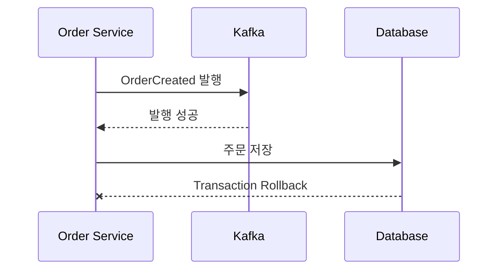

Kafka에는 주문 생성 이벤트가 기록되었다.

하지만 데이터베이스에는 주문이 존재하지 않는다.

이 경우 Consumer는 실제로 존재하지 않는 주문을 처리하려고 할 수 있다.

#### @Transactional을 사용하면 해결될까?

Spring의 `@Transactional`은 일반적으로 지정된 트랜잭션 매니저가 관리하는 자원에 적용된다.

예를 들어 데이터베이스 트랜잭션에 참여하는 Repository 작업은 함께 Commit하거나 Rollback할 수 있다.

하지만 Kafka 전송이 같은 메서드 안에 있다고 해서 데이터베이스와 Kafka가 자동으로 하나의 원자적 트랜잭션으로 묶이는 것은 아니다.

따라서 두 시스템을 함께 변경하는 문제를 별도로 해결해야 한다.

이러한 문제를 Dual Write 문제라고 부른다.

---

### Transactional Outbox 패턴이란?

#### Transactional Outbox의 개념

Transactional Outbox는 데이터베이스의 업무 변경과 발행할 이벤트를 **같은 로컬 데이터베이스 트랜잭션으로 저장하는 패턴**이다.

이후 별도의 프로세스가 Outbox에 저장된 이벤트를 Kafka로 전달한다.

핵심은 데이터베이스 저장과 Kafka 발행을 직접 하나의 트랜잭션으로 묶으려 하지 않는다는 점이다.

대신 데이터베이스에 발행해야 할 이벤트를 안전하게 기록한다.

#### 전체 구조

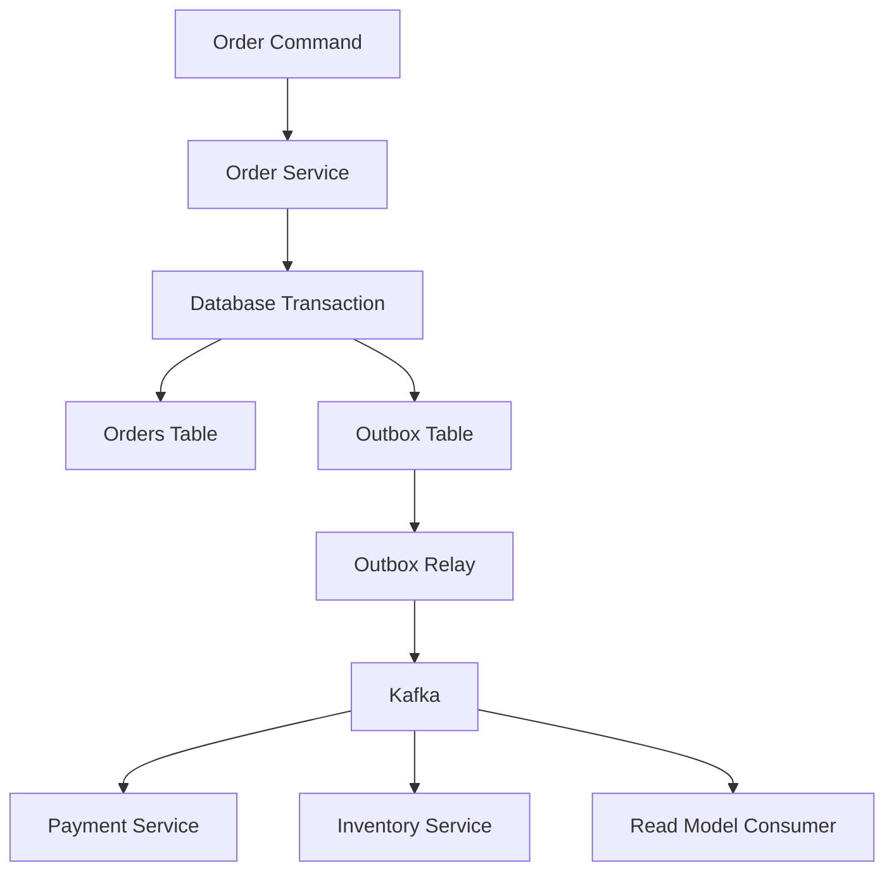

주문 서비스는 같은 트랜잭션 안에서 주문 데이터와 Outbox 이벤트를 저장한다.

이후 별도의 Outbox Relay가 이벤트를 Kafka로 전달한다.

Kafka가 일시적으로 중단되더라도 Outbox에 이벤트가 남아 있다면 복구 후 다시 발행할 수 있다.

이 방식은 이벤트 발행 실패에 대비할 수 있는 근거를 데이터베이스에 남긴다는 장점이 있다.

---

### Transactional Outbox의 동작 과정

#### 1단계: 주문 생성 요청

사용자가 주문을 생성한다.

```http
POST /orders
```

#### 2단계: 데이터베이스 트랜잭션 시작

주문 서비스는 데이터베이스 트랜잭션을 시작한다.

#### 3단계: 주문 데이터 저장

주문 테이블에 데이터를 저장한다.

#### 4단계: Outbox 이벤트 저장

같은 트랜잭션 안에서 이벤트를 Outbox 테이블에 저장한다.

#### 5단계: 트랜잭션 Commit

두 작업이 모두 성공하면 Commit한다.

하나라도 실패하면 Rollback한다.

#### 6단계: Outbox Relay 실행

별도의 Relay가 발행 대상 이벤트를 읽는다.

#### 7단계: Kafka 발행

Relay가 Kafka에 이벤트를 전송한다.

#### 8단계: Consumer 처리

Consumer가 이벤트를 읽어 필요한 업무를 수행한다.

---

### PostgreSQL을 이용한 Transactional Outbox 예제

다음은 별도로 확장한 구현 예제다.

PostgreSQL과 Spring Boot를 사용하는 주문 서비스를 가정한다.

실제 Kafka 발행은 Outbox Relay가 담당하며, 주문 저장 메서드에서는 Kafka를 직접 호출하지 않는다.

#### 주문 테이블 생성

```sql
CREATE TABLE orders (
    order_id VARCHAR(64) PRIMARY KEY,
    amount BIGINT NOT NULL CHECK (amount >= 0),
    status VARCHAR(32) NOT NULL,
    created_at TIMESTAMPTZ NOT NULL DEFAULT NOW()
);
```

#### Outbox 테이블 생성

```sql
CREATE TABLE outbox_events (
    event_id UUID PRIMARY KEY,
    aggregate_type VARCHAR(64) NOT NULL,
    aggregate_id VARCHAR(64) NOT NULL,
    event_type VARCHAR(100) NOT NULL,
    schema_version INTEGER NOT NULL,
    payload JSONB NOT NULL,
    created_at TIMESTAMPTZ NOT NULL DEFAULT NOW(),
    published_at TIMESTAMPTZ
);
```

여기서 `published_at`은 Polling 기반 Outbox Relay가 발행 완료 여부를 관리하는 경우를 위한 컬럼이다.

Debezium CDC 방식으로 Outbox를 읽는 경우에는 Connector의 로그 처리 위치를 중심으로 진행 상태를 관리할 수 있으므로 동일한 발행 완료 플래그가 반드시 필요한 것은 아니다.

#### 미발행 이벤트 조회용 인덱스

```sql
CREATE INDEX idx_outbox_unpublished
ON outbox_events (created_at)
WHERE published_at IS NULL;
```

이 인덱스는 아직 발행되지 않은 이벤트를 조회할 때 활용할 수 있다.

---

### Spring Boot에서 주문과 Outbox를 함께 저장하기

다음은 Spring JDBC와 Jackson을 이용한 예제다.

```java
package com.example.order;

import com.fasterxml.jackson.core.JsonProcessingException;
import com.fasterxml.jackson.databind.ObjectMapper;

import org.springframework.jdbc.core.JdbcTemplate;
import org.springframework.stereotype.Service;
import org.springframework.transaction.annotation.Transactional;

import java.util.Map;
import java.util.UUID;

@Service
public class OrderCommandService {

    private final JdbcTemplate jdbcTemplate;
    private final ObjectMapper objectMapper;

    public OrderCommandService(
            JdbcTemplate jdbcTemplate,
            ObjectMapper objectMapper
    ) {
        this.jdbcTemplate = jdbcTemplate;
        this.objectMapper = objectMapper;
    }

    @Transactional
    public void createOrder(
            String orderId,
            long amount
    ) {

        if (amount < 0) {
            throw new IllegalArgumentException(
                    "Order amount must be non-negative"
            );
        }

        UUID eventId = UUID.randomUUID();

        Map<String, Object> payload = Map.of(
                "eventId", eventId.toString(),
                "eventType", "OrderCreated",
                "orderId", orderId,
                "amount", amount,
                "status", "CREATED"
        );

        String payloadJson;

        try {
            payloadJson = objectMapper.writeValueAsString(
                    payload
            );
        } catch (JsonProcessingException exception) {
            throw new IllegalStateException(
                    "Failed to serialize order event",
                    exception
            );
        }

        jdbcTemplate.update(
                """
                INSERT INTO orders (
                    order_id,
                    amount,
                    status
                )
                VALUES (?, ?, ?)
                """,
                orderId,
                amount,
                "CREATED"
        );

        jdbcTemplate.update(
                """
                INSERT INTO outbox_events (
                    event_id,
                    aggregate_type,
                    aggregate_id,
                    event_type,
                    schema_version,
                    payload
                )
                VALUES (
                    ?,
                    ?,
                    ?,
                    ?,
                    ?,
                    CAST(? AS jsonb)
                )
                """,
                eventId,
                "Order",
                orderId,
                "OrderCreated",
                1,
                payloadJson
        );
    }
}
```

위 코드는 같은 PostgreSQL 데이터베이스와 트랜잭션 매니저를 사용하는 구성을 전제로 한다.

#### 코드의 핵심

```java
@Transactional
public void createOrder(
        String orderId,
        long amount
)
```

주문 저장과 Outbox 저장을 하나의 트랜잭션으로 묶는다.

```java
jdbcTemplate.update(
        "INSERT INTO orders ...",
        ...
);
```

주문 데이터를 저장한다.

```java
jdbcTemplate.update(
        "INSERT INTO outbox_events ...",
        ...
);
```

발행할 이벤트를 저장한다.

여기서 중요한 것은 **KafkaTemplate을 직접 호출하지 않는다는 사실**이다.

주문 서비스는 데이터베이스 트랜잭션 안에서 업무 변경과 이벤트 기록만 수행한다.

이후 별도의 Relay가 이벤트를 Kafka로 발행한다.

---

### Outbox Relay는 어떻게 구현할까?

Outbox Relay는 크게 두 가지 방법으로 구현할 수 있다.

#### 방법 1. Polling Publisher

별도의 Scheduler가 미발행 이벤트를 조회한다.

```text
Outbox Table
    ↓
미발행 이벤트 조회
    ↓
Kafka 발행
    ↓
발행 성공 확인
    ↓
발행 완료 상태 갱신
```

이 방식은 기존 Spring Boot 시스템에도 적용하기 비교적 쉽다.

하지만 다음 문제를 고려해야 한다.

- 동일한 이벤트를 여러 Relay가 동시에 처리하지 않도록 제어
- Kafka 발행 성공 후 상태 갱신 이전의 장애
- Relay 재시도
- 이벤트 발행 순서
- 오래된 미발행 이벤트의 적체

여러 Relay를 실행한다면 행 잠금이나 작업 할당 방식 등을 고려해야 한다.

#### 방법 2. CDC 기반 Relay

Debezium을 이용하여 Outbox 테이블의 변경 사항을 수집한다.

```text
Order Service
    ↓
Orders + Outbox 저장
    ↓
Database Transaction Commit
    ↓
Database Change Log
    ↓
Debezium
    ↓
Kafka
```

이 구조에서는 애플리케이션이 Outbox 테이블을 반복 조회하는 대신 변경 로그를 이용하여 이벤트를 전달할 수 있다.

Debezium의 Outbox Event Router를 이용하면 Outbox 이벤트를 Kafka Topic과 Key에 맞게 변환할 수도 있다.

예를 들어 Aggregate ID를 Kafka Key로 사용하여 같은 주문의 이벤트가 동일한 Partition에 기록되도록 구성할 수 있다.

다만 Connector 자체의 장애 복구와 로그 보존 정책을 함께 관리해야 한다.

---

### Transactional Outbox에서도 중복이 발생할 수 있을까?

발생할 수 있다.

Transactional Outbox는 데이터베이스 저장과 이벤트 기록 사이의 누락을 줄이는 패턴이다.

하지만 Kafka에 이벤트가 정확히 한 번만 전달되는 것을 자동으로 보장하는 것은 아니다.

다음 상황을 생각해 보자.

```text
1. Outbox Relay가 이벤트 조회

2. Kafka 발행 성공

3. Relay가 발행 완료 상태를 갱신하기 전에 종료

4. Relay 재시작

5. 같은 이벤트를 다시 발행
```

Kafka에는 동일한 이벤트가 두 번 기록될 수 있다.

따라서 Consumer는 중복 이벤트를 처리할 수 있어야 한다.

#### Consumer 멱등성 처리

예를 들어 다음 테이블을 사용할 수 있다.

```sql
CREATE TABLE processed_events (
    event_id UUID PRIMARY KEY,
    processed_at TIMESTAMPTZ NOT NULL DEFAULT NOW()
);
```

Consumer는 이벤트를 처리할 때 해당 이벤트 ID가 이미 처리되었는지 확인할 수 있다.

```sql
INSERT INTO processed_events (
    event_id
)
VALUES (
    '3c44b710-77e5-4e58-a6d1-5a3e5145fd8a'
)
ON CONFLICT (event_id) DO NOTHING;
```

하지만 이 SQL만 실행했다고 멱등성이 완성되는 것은 아니다.

**이벤트 처리 이력 저장과 실제 업무 데이터 변경을 같은 데이터베이스 트랜잭션으로 묶어야 한다.**

새로운 처리 이력 삽입에 성공한 경우에만 업무 변경을 수행하고, 두 작업을 함께 Commit하도록 구성하는 방식이다.

이렇게 하면 같은 이벤트를 다시 수신하더라도 중복 업무 처리를 줄일 수 있다.

---

### 장애 발생 시점별 복구 전략

| 장애 시점 | 발생할 수 있는 문제 | 복구 전략 |
|---|---|---|
| 주문 DB Commit 이전 | 주문이 저장되지 않음 | 요청 멱등성 기반 재시도 |
| DB Commit 이후, Outbox 발행 이전 | 주문은 존재하지만 이벤트 미발행 | Relay 재실행 |
| Kafka 발행 이후, Outbox 상태 변경 이전 | 이벤트 중복 발행 가능 | Consumer 멱등성 |
| Consumer 처리 중 장애 | 업무 처리 실패 | 재시도 및 오류 관리 |
| Consumer DB Commit 이후 Offset Commit 이전 | 같은 이벤트 재수신 가능 | 처리 이력 기반 중복 방지 |
| Read Database 갱신 지연 | 조회 결과 불일치 | 최종 일관성 및 Lag 관리 |

이처럼 이벤트 기반 아키텍처에서는 장애를 완전히 없애는 것보다 **장애 이후 어느 지점부터 안전하게 다시 처리할 수 있는지 정의하는 것**이 중요하다.

---

### Kafka를 활용한 마이크로서비스 전체 아키텍처

지금까지 살펴본 내용을 하나의 전자상거래 시스템에 적용해 보자.

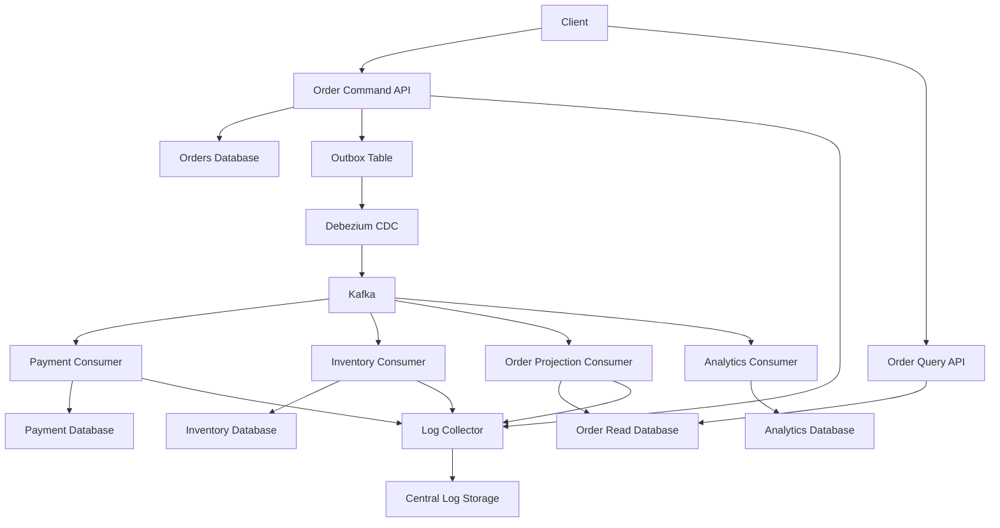

이 구조에서 각 기술의 역할을 구분할 수 있다.

**Transactional Outbox**

주문 저장과 이벤트 기록을 같은 데이터베이스 트랜잭션으로 처리한다.

**Debezium**

Outbox 변경 사항을 수집하여 Kafka로 전달한다.

**Kafka**

서비스 간 이벤트 전달과 보관을 담당한다.

**Consumer Group**

결제와 재고, 조회 모델, 분석 서비스를 독립적으로 처리한다.

**CQRS**

주문 변경과 조회 모델의 책임을 분리한다.

**Stream Processing**

분석 이벤트를 이용하여 실시간 집계를 수행한다.

**Log Aggregation**

여러 서비스의 실행 로그를 중앙에서 조회하고 분석할 수 있도록 한다.

다만 이 구조가 모든 마이크로서비스에 필요한 것은 아니다.

각 기술은 서로 다른 문제를 해결하므로 실제 요구사항에 따라 선택해야 한다.

---

### 실무에서 Kafka 기반 MSA를 설계하는 12가지 전략

#### 1. 동기와 비동기 통신의 경계를 업무 기준으로 결정한다

서비스 간 통신 방식을 결정할 때 단순히 Kafka가 빠르다는 이유로 모든 요청을 비동기로 변경해서는 안 된다.

사용자에게 즉시 필요한 결과인지, 나중에 처리해도 되는 후속 작업인지를 구분해야 한다.

예를 들어 주문 생성 과정에서 상품 가격 확인이 즉시 필요할 수 있다.

반면 주문 완료 알림은 주문 처리와 분리할 수 있다.

핵심 업무의 확정 시점과 후속 작업의 완료 시점을 분리하면 시스템 상태를 더 명확하게 표현할 수 있다.

#### 2. 이벤트 이름을 비즈니스 사실 중심으로 설계한다

이벤트는 이미 발생한 사실을 표현하는 것이 좋다.

예를 들어 다음 이름은 기술적인 데이터 변경만 설명한다.

```text
OrderUpdated
```

반면 다음 이름은 업무 의미가 분명하다.

```text
OrderConfirmed
```

```text
OrderCancelled
```

이처럼 이벤트를 비즈니스 언어로 정의하면 Producer와 Consumer 사이의 계약을 이해하기 쉬워진다.

또한 테이블 구조가 변경되더라도 업무 이벤트의 의미를 비교적 안정적으로 유지할 수 있다.

#### 3. 이벤트 ID와 업무 ID를 구분한다

하나의 주문에서는 여러 이벤트가 발생할 수 있다.

```text
OrderCreated

OrderConfirmed

OrderCancelled
```

모두 같은 주문 ID를 가질 수 있다.

하지만 각 이벤트는 서로 다른 Event ID를 가져야 한다.

주문 ID는 어떤 업무 대상에 관한 이벤트인지 식별한다.

Event ID는 어떤 이벤트가 발생했는지 식별한다.

두 식별자를 구분하면 이벤트 순서 관리와 중복 처리, 장애 분석에 도움이 된다.

#### 4. 데이터베이스와 Kafka의 Dual Write를 방지한다

업무 데이터를 저장한 후 Kafka에 이벤트를 발행하는 구조에서는 두 작업 사이에 장애가 발생할 수 있다.

이 문제는 `@Transactional`을 사용하는 것만으로 자동으로 해결되지 않는다.

따라서 중요한 업무에서는 Transactional Outbox 또는 그에 준하는 신뢰할 수 있는 이벤트 전달 방식을 고려해야 한다.

특히 결제 완료와 정산처럼 이벤트 누락이 치명적인 업무에서는 데이터베이스 Commit과 이벤트 전달의 관계를 명확하게 정의해야 한다.

#### 5. Consumer는 중복 이벤트를 전제로 설계한다

Kafka Consumer는 장애 이후 동일한 이벤트를 다시 처리할 수 있다.

예를 들어 데이터베이스 저장에 성공했지만 Kafka Offset Commit 이전에 종료되었다면 같은 이벤트를 다시 읽을 수 있다.

따라서 Consumer에서 중복 처리 방지 전략을 설계해야 한다.

이벤트 ID를 기준으로 처리 이력을 저장하거나 업무 테이블에 Unique Constraint를 적용할 수 있다.

또한 처리 이력과 업무 변경을 같은 데이터베이스 트랜잭션으로 관리하는 것이 중요하다.

#### 6. 이벤트 순서가 중요한 업무에는 버전을 사용한다

Kafka는 Partition 단위로 메시지 순서를 보장한다.

하지만 여러 Producer나 Relay가 같은 업무 대상의 이벤트를 발행할 때 업무적으로 의도한 순서가 자동으로 보장되는 것은 아니다.

따라서 Aggregate Version 등을 이용하여 이벤트 순서를 검증할 수 있다.

예를 들어 현재 주문 버전이 5인데 버전 4 이벤트가 늦게 도착했다면 기존 상태를 덮어쓰지 않도록 처리해야 한다.

이러한 정책은 CQRS의 Read Model을 갱신할 때도 중요하다.

#### 7. CQRS에서는 조회 모델의 갱신 지연을 사용자에게 설명할 수 있어야 한다

Write Database 저장과 Read Database 반영 사이에는 지연이 발생할 수 있다.

따라서 주문 생성 직후 목록에 주문이 나타나지 않는 상황을 고려해야 한다.

주문 생성 응답에 ID와 현재 상태를 포함할 수 있다.

필요한 경우 조회 모델의 반영 버전을 확인하는 방식도 사용할 수 있다.

중요한 것은 사용자에게 현재 상태를 정확하게 전달하는 것이다.

#### 8. 이벤트 소싱과 일반적인 이벤트 발행을 구분한다

상태 변경 이벤트를 Kafka에 발행한다고 모든 시스템이 이벤트 소싱을 사용하는 것은 아니다.

이벤트 소싱에서는 이벤트 이력이 상태를 재구성하는 원본이다.

반면 일반적인 CRUD 시스템에서는 현재 상태를 저장하는 데이터베이스가 원본일 수 있다.

이벤트 소싱은 상태 변화 이력을 완전하게 추적해야 하는 영역에서 유용하지만 모든 도메인에 적용하면 불필요한 복잡성이 증가할 수 있다.

따라서 이력 재구성의 필요성과 운영 비용을 비교해야 한다.

#### 9. CDC의 처리 지연과 원본 로그 상태를 함께 모니터링한다

CDC를 사용하는 경우 Kafka에 이벤트가 정상적으로 도착하는지만 확인해서는 안 된다.

MySQL에서는 Binlog 보존 기간을 고려해야 한다.

PostgreSQL에서는 WAL 누적과 Replication Slot의 상태를 확인해야 한다.

Connector가 오랫동안 중단되면 복구에 필요한 변경 로그가 삭제되거나 디스크 사용량이 증가할 수 있다.

따라서 원본 데이터베이스와 Connector, Kafka를 함께 모니터링해야 한다.

#### 10. 로그와 Trace를 연결하여 분산 장애를 추적한다

마이크로서비스에서는 하나의 요청이 여러 서비스에 걸쳐 처리된다.

따라서 각 서비스의 로그를 중앙에 수집하는 것만으로는 문제 분석이 어려울 수 있다.

Trace ID와 업무 식별자를 함께 기록하면 동일한 요청과 관련된 로그를 연결할 수 있다.

또한 HTTP와 Kafka 메시지 경로에서 추적 Context를 전파하면 서비스 간 처리 흐름을 분석하는 데 도움이 된다.

이때 개인정보와 인증 정보가 로그에 포함되지 않도록 관리해야 한다.

#### 11. 재처리와 외부 부작용을 분리한다

이벤트 소싱이나 CQRS에서 과거 이벤트를 다시 읽어 조회 모델을 재구축할 수 있다.

하지만 재처리 과정에서 결제 API를 다시 호출하거나 알림을 다시 전송해서는 안 된다.

따라서 상태 재구축과 외부 부작용을 발생시키는 처리를 분리해야 한다.

예를 들어 조회 모델 재구축 전용 Consumer Group을 사용하고 별도의 결과 저장소를 구성할 수 있다.

새로운 결과를 검증한 뒤 조회 대상을 전환하는 방식도 고려할 수 있다.

#### 12. 기술 선택보다 장애 후 복구 가능성을 먼저 검증한다

Kafka 기반 마이크로서비스를 설계할 때 가장 중요한 것은 정상적인 처리 흐름만 구현하는 것이 아니다.

다음과 같은 상황에서도 데이터와 업무 상태를 복구할 수 있어야 한다.

```text
Producer 발행 실패

Broker 장애

Consumer 처리 실패

Consumer 중복 실행

Read Database 반영 지연

CDC Connector 중단

Outbox Relay 재시작

이벤트 스키마 변경
```

각 상황에서 어떤 데이터가 원본이고 어떤 상태가 저장되어 있으며 어디서부터 다시 처리해야 하는지 정의해야 한다.

또한 복구 절차가 실제로 동작하는지 테스트하는 것이 중요하다.

이러한 기준을 갖추면 Kafka를 단순 이벤트 전달 도구가 아니라 안정적인 서비스 협력과 데이터 처리의 기반으로 활용할 수 있다.

---

### Kafka 기반 마이크로서비스 패턴 비교

지금까지 살펴본 패턴을 비교해 보자.

| 패턴 | 해결하려는 문제 | Kafka의 역할 | 주요 고려사항 |
|---|---|---|---|
| 비동기 통신 | 서비스 간 실행 시점 의존성 | 이벤트 전달 및 보관 | 처리 상태, 중복, 적체 |
| 이벤트 소싱 | 상태 변화 이력과 상태 재구성 | 이벤트 전달·재생 기반 | 원본 저장소, 동시성, 보존 |
| CQRS | 읽기·쓰기 요구사항 차이 | 조회 모델 갱신 이벤트 전달 | 최종 일관성, 조회 지연 |
| 스트림 처리 | 지속적인 이벤트 분석 | 입력·출력 스트림 | 상태, 시간, 순서 |
| 로그 집계 | 분산 로그의 수집과 분석 | 로그 전달과 완충 | 로그 유실, 보안, 추적 |
| CDC | 데이터베이스 변경 감지 | 변경 이벤트 전달 | Snapshot, 로그 보존, 복구 |
| Transactional Outbox | DB 저장과 이벤트 발행 사이의 누락 | Outbox 이벤트 전달 | Relay 복구, 중복 처리 |

각 패턴은 서로 다른 문제를 해결한다.

따라서 모든 마이크로서비스에 동일하게 적용할 필요는 없다.

예를 들어 단순한 내부 관리 시스템이라면 REST API와 관계형 데이터베이스만으로도 충분할 수 있다.

반면 여러 서비스가 독립적으로 확장되고 대량의 비동기 이벤트를 처리해야 한다면 Kafka 도입의 가치가 커질 수 있다.

또한 조회 요구사항이 복잡한 일부 도메인에만 CQRS를 적용할 수 있다.

상태 변경 이력을 완전하게 보존해야 하는 영역에서는 이벤트 소싱을 검토할 수 있다.

데이터베이스 변경 사항을 검색 시스템이나 분석 시스템에 전달해야 한다면 CDC를 고려할 수 있다.

업무 데이터 저장과 이벤트 발행 사이의 누락을 줄여야 한다면 Transactional Outbox가 적합할 수 있다.

중요한 것은 특정 아키텍처 패턴을 사용하는 것 자체가 아니라 실제 문제에 맞는 해결 방식을 선택하는 것이다.

---

### 정리

마이크로서비스 아키텍처는 애플리케이션을 여러 독립적인 서비스로 분리하여 개발하고 운영하는 구조다.

서비스별 책임을 명확하게 구분하고 독립적인 배포와 확장을 지원한다는 장점이 있다.

하지만 하나의 업무가 여러 서비스에 걸쳐 처리되면서 통신과 데이터 정합성, 장애 복구 등의 문제가 발생한다.

이러한 문제를 해결하기 위해 서비스 간 통신 방식을 적절하게 선택해야 한다.

동기 통신은 요청을 보내고 상대 서비스의 응답을 기다리는 방식이다.

구현과 업무 흐름을 이해하기 쉽고 즉각적인 결과 확인에 유리하다.

하지만 상대 서비스의 장애나 지연이 호출한 서비스에 영향을 줄 수 있다.

비동기 통신은 메시지를 통해 서비스를 연결하는 방식이다.

Kafka를 이용하면 Producer와 Consumer를 분리하고 서로 다른 서비스가 이벤트를 독립적으로 처리하도록 구성할 수 있다.

이를 통해 서비스 사이의 직접적인 의존성과 실행 시점의 결합도를 줄일 수 있다.

Kafka는 Topic과 Partition을 기반으로 이벤트를 저장한다.

Consumer는 Consumer Group과 Offset을 이용하여 이벤트를 읽는다.

서로 다른 Consumer Group은 동일한 이벤트를 독립적으로 처리할 수 있다.

또한 Kafka의 복제 기능과 보존 정책을 이용하여 장애 복구를 위한 기반을 마련할 수 있다.

하지만 Kafka를 도입한다고 모든 서비스의 장애가 자동으로 격리되거나 데이터 손실이 완전히 방지되는 것은 아니다.

Replication Factor와 ACK 설정, Retention Policy, Consumer Offset Commit 등을 함께 설계해야 한다.

이벤트 소싱은 애플리케이션의 상태 변화 이력을 이벤트로 저장하는 패턴이다.

일반적인 CRUD 시스템이 현재 상태를 저장하는 데 초점을 맞춘다면 이벤트 소싱은 상태를 변화시킨 사건들을 저장한다.

이벤트 이력을 순서대로 적용하면 현재 상태를 재구성할 수 있다.

이러한 구조는 상태 변경 이력 추적과 감사, 과거 상태 복원에 유용하다.

하지만 이벤트 저장소의 동시성 제어와 장기 보존, 스키마 진화, 재처리 과정의 외부 부작용을 고려해야 한다.

또한 이벤트 소싱은 DDD와 자연스럽게 연결될 수 있지만 DDD를 사용한다고 이벤트 소싱이 필수인 것은 아니다.

CQRS는 읽기와 쓰기의 책임을 분리하는 패턴이다.

Command Model은 비즈니스 규칙과 상태 변경을 처리한다.

Query Model은 조회 성능과 데이터 제공에 최적화된다.

필요한 경우 Kafka를 이용하여 Write Database의 변경 이벤트를 Read Database에 반영할 수 있다.

이러한 구조에서는 데이터 반영 시점의 차이로 인해 최종 일관성 문제가 발생할 수 있다.

따라서 조회 모델 반영 지연과 사용자에게 표시할 상태를 함께 설계해야 한다.

CQRS 자체에 Kafka나 별도의 데이터베이스가 반드시 필요한 것은 아니다.

스트림 처리는 지속적으로 발생하는 데이터를 분석하고 변환하는 방식이다.

Kafka Streams와 같은 기술을 이용하면 이벤트를 필터링하거나 그룹화하고 집계할 수 있다.

특히 상태 기반 처리에서는 이전 이벤트의 처리 결과를 저장해야 한다.

시간 기반 처리에서는 Event Time과 Processing Time, Window, Grace Period 등을 고려해야 한다.

또한 Kafka의 메시지 순서는 Partition 단위로 보장되므로 이벤트 Key와 Partition 분배 전략을 적절하게 설계해야 한다.

로그 집계는 여러 서비스에서 발생하는 로그를 중앙으로 수집하고 분석하는 구조다.

마이크로서비스에서는 여러 서버와 컨테이너에서 로그가 발생하므로 중앙 집중식 로그 관리가 중요하다.

Filebeat와 Fluent Bit 등의 로그 수집기를 이용하여 로그를 수집하고 Kafka를 통해 전달할 수 있다.

이후 Elasticsearch나 OpenSearch 등의 저장소에 적재하여 검색하고 분석할 수 있다.

여기서 단순한 로그 수집과 분산 추적은 서로 다른 개념이다.

서비스 간 요청 흐름을 확인하려면 Trace ID와 Span 등의 정보를 함께 활용해야 한다.

CDC는 데이터베이스의 변경 사항을 감지하여 외부 시스템으로 전달하는 기술이다.

Polling과 Trigger, Transaction Log, Application 기반 방식 등으로 구현할 수 있다.

특히 Kafka Connect와 Debezium을 이용하면 데이터베이스 변경 로그를 읽어 Kafka에 전달할 수 있다.

이를 통해 검색 인덱스 갱신과 캐시 무효화, 분석 시스템 적재 등의 기능을 구현할 수 있다.

하지만 CDC에서는 초기 Snapshot과 변경 로그 보존, Connector 장애 복구를 함께 고려해야 한다.

또한 원시 데이터베이스 변경 이벤트와 비즈니스 도메인 이벤트의 의미를 구분하는 것이 중요하다.

Transactional Outbox는 데이터베이스 저장과 Kafka 이벤트 발행 사이의 누락 문제를 줄이기 위한 패턴이다.

업무 데이터와 발행할 이벤트를 같은 로컬 데이터베이스 트랜잭션으로 저장한다.

이후 별도의 Relay가 Outbox 이벤트를 Kafka로 전달한다.

이 구조를 이용하면 데이터베이스 Commit 이후 Kafka 발행에 실패하더라도 복구 가능한 이벤트 기록을 유지할 수 있다.

하지만 Relay 장애 이후 동일한 이벤트가 다시 발행될 수 있으므로 Consumer 멱등성은 여전히 필요하다.

결국 Kafka 기반 마이크로서비스 아키텍처에서 가장 중요한 것은 정상적인 메시지 전달 과정만 이해하는 것이 아니다.

**데이터의 원본이 무엇인지, 업무가 언제 완료되는지, 장애가 발생했을 때 어떤 지점부터 안전하게 다시 처리할 수 있는지 명확하게 정의하는 것이다.**

이러한 기준을 바탕으로 비동기 통신과 이벤트 소싱, CQRS, 스트림 처리, 로그 집계, CDC, Transactional Outbox를 적절하게 조합하면 독립적으로 확장하면서도 장애와 데이터 정합성을 관리할 수 있는 마이크로서비스 아키텍처를 구축할 수 있다.

#### 한 줄 요약

**Apache Kafka는 마이크로서비스 사이에서 이벤트를 안정적으로 전달하고 각 서비스를 독립적으로 처리할 수 있게 지원한다. 이벤트 소싱은 상태 변화 이력을 관리하고, CQRS는 읽기와 쓰기의 책임을 분리하며, 스트림 처리는 실시간 이벤트를 분석한다. 로그 집계는 분산 시스템의 실행 정보를 통합하고, CDC는 데이터베이스 변경 사항을 전달하며, Transactional Outbox는 데이터베이스 저장과 이벤트 발행 사이의 누락을 줄인다. 실제 운영에서는 이벤트 중복, 순서, 최종 일관성, 스키마 변경 및 장애 복구를 함께 설계하는 것이 중요하다.**
