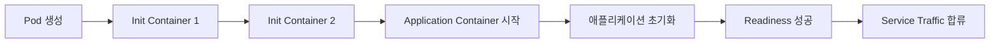
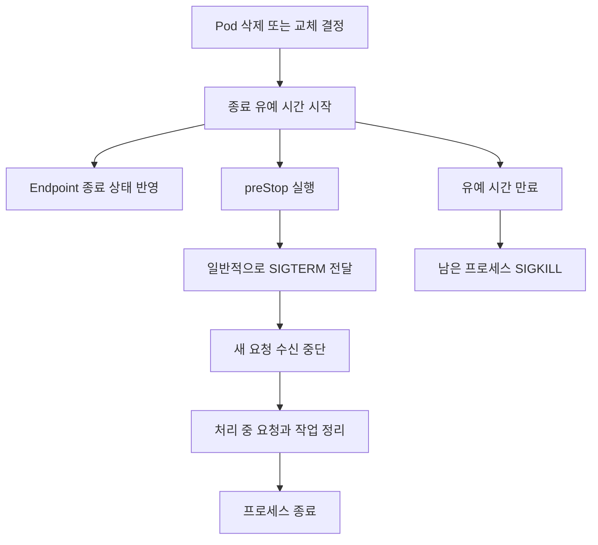
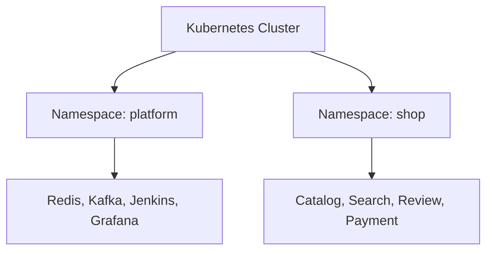
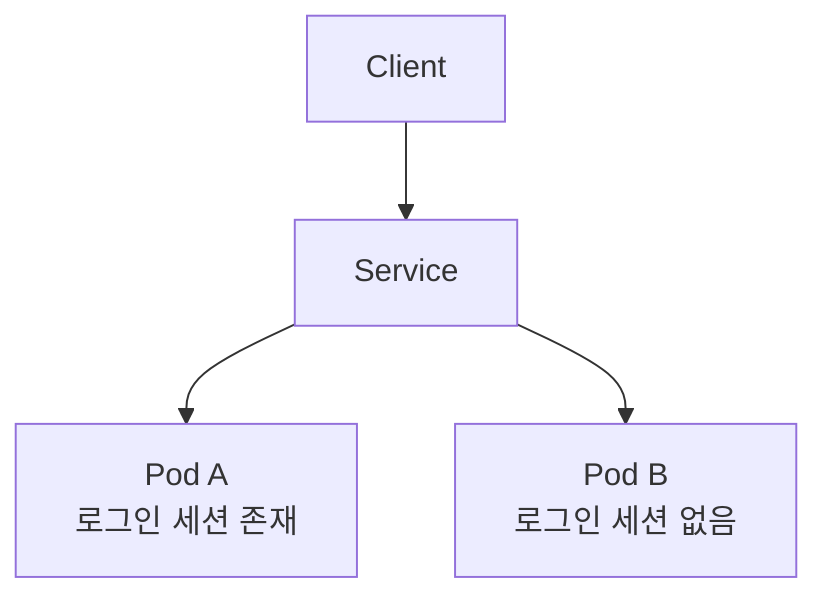
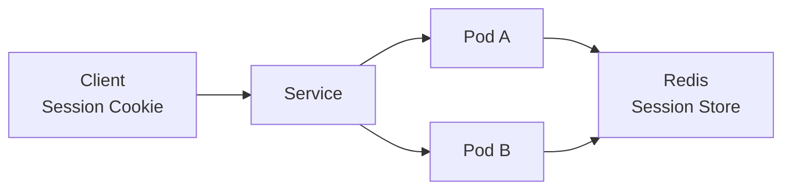
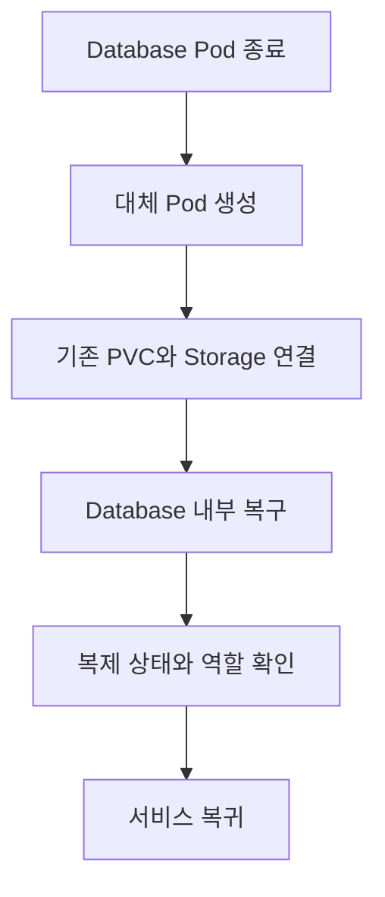

# Kubernetes를 활용한 애플리케이션 개발 모범 사례

# Kubernetes를 활용한 애플리케이션 개발 모범 사례

* toc
{:toc}

---

## Kubernetes를 활용한 애플리케이션 개발 모범사례

Kubernetes에 애플리케이션을 배포할 때는 정상적으로 실행되는지만 확인해서는 부족하다. Pod는 배포, 스케일 조정, Node 유지보수, 장애 복구 과정에서 계속 생성되고 종료된다. 애플리케이션도 이러한 변화 속에서 요청과 데이터를 안전하게 처리할 수 있어야 한다.

특히 다음 네 가지가 운영 안정성에 직접적인 영향을 준다.

- 시작할 때 준비가 끝난 뒤 요청을 받는가
- 종료할 때 처리 중인 요청과 작업을 정리하는가
- 환경과 권한을 적절한 범위로 분리했는가
- Pod가 교체되어도 세션과 저장 데이터가 유지되는가

Kubernetes가 Pod를 관리한다면, 애플리케이션은 자신의 시작과 종료, 상태 보관 방식을 책임져야 한다. 이 두 동작이 맞물려야 배포와 스케일 조정이 사용자에게 장애로 나타나는 일을 줄일 수 있다.

## 애플리케이션의 시작과 종료

### Pod는 언제든 교체될 수 있다

서버를 한 번 실행한 뒤 오랫동안 유지하는 환경에서는 시작과 종료가 드문 작업이다. Kubernetes에서는 다음 상황마다 Pod가 교체될 수 있다.

- 새로운 버전으로 Rolling Update하는 경우
- HPA가 Pod 수를 늘리거나 줄이는 경우
- Node를 정비하기 위해 Pod를 다른 Node로 이동시키는 경우
- Node 장애나 자원 부족으로 Pod가 교체되는 경우
- 운영자가 Deployment를 다시 시작하는 경우

따라서 Pod가 오래 살아 있다는 가정에 의존하는 애플리케이션은 운영 중 문제가 발생하기 쉽다. 시작은 반복 가능해야 하고, 종료는 처리 중인 작업을 고려해야 한다.

Container가 하나인 Pod라도 Container와 Pod의 생명주기가 항상 같은 것은 아니다. `restartPolicy: Always`라면 Container 프로세스가 종료되어도 같은 Pod 안에서 다시 시작될 수 있다. 반면 Deployment가 Pod를 교체하면 새로운 UID를 가진 Pod가 생성된다.

### Init Container로 초기화 작업 분리하기

일반적인 Init Container는 애플리케이션 Container보다 먼저 실행되고, 작업을 마친 뒤 종료된다. 여러 Init Container가 있다면 순서대로 실행하며, 모두 성공해야 메인 Container가 시작된다.



Init Container는 다음과 같은 작업에 사용할 수 있다.

- 애플리케이션에 필요한 파일 준비
- 설정 파일 변환
- 공유 Volume의 초기 디렉터리 구성
- 필수 의존 서비스의 준비 상태 확인

의존 서비스가 준비될 때까지 기다리는 작업에는 종료 조건과 제한 시간이 필요하다. 주소를 잘못 입력했는데 무한 대기하도록 만들면 Pod가 계속 초기화 상태에 머물 수 있다.

모든 Pod의 Init Container에서 데이터베이스 Migration을 실행하는 구성도 주의해야 한다. Replica가 늘어날 때 같은 작업이 동시에 수행될 수 있으므로 Migration 전용 Job이나 배포 Pipeline에서 한 번 실행하는 방식이 더 적합한 경우가 많다.

### 준비가 끝나기 전에 요청을 받으면 생기는 문제

프로세스가 실행 중이라고 해서 요청을 처리할 준비가 끝난 것은 아니다.

Spring Boot 애플리케이션은 실행 과정에서 Bean 생성, Connection Pool 초기화, 설정 로딩, Cache 준비 등을 수행한다. HTTP Port가 열려 있어도 업무 처리에 필요한 초기화가 아직 끝나지 않았을 수 있다.

이때 요청을 받으면 다음과 같은 현상이 나타날 수 있다.

- Connection이 준비되지 않아 요청이 실패한다.
- 초기화 중인 Cache를 읽어 잘못된 결과를 반환한다.
- 처리할 수 없는 요청이 쌓여 Timeout이 발생한다.
- 새 Pod로 전달된 요청만 실패해 배포 중 오류율이 높아진다.

Pod의 `Running` 상태와 요청을 처리할 수 있는 `Ready` 상태를 구분해야 하는 이유다.

### Startup, Readiness, Liveness를 나누어 설정하기

세 Probe는 확인 목적과 실패 시 동작이 다르다.

| Probe | 확인할 내용 | 실패 시 동작 |
|---|---|---|
| Startup Probe | 시작 과정이 허용 시간 안에 진행되는가 | 실패 한도에 도달하면 Container 재시작 |
| Readiness Probe | 현재 요청을 처리할 준비가 되었는가 | Service의 일반 Traffic 대상에서 제외 |
| Liveness Probe | 재시작이 필요한 비정상 상태인가 | 실패 한도에 도달하면 Container 재시작 |

Startup Probe를 설정하면 성공하기 전까지 Liveness와 Readiness Probe가 실행되지 않는다. 초기화가 오래 걸리는 애플리케이션이 Liveness 실패로 반복 재시작되는 일을 막는 데 유용하다. [Kubernetes Probe 설정](https://kubernetes.io/docs/tasks/configure-pod-container/configure-liveness-readiness-probes/)

Readiness는 요청 수신 여부를 결정한다. 실패하더라도 Container를 재시작하지 않으며, Pod의 모든 네트워크 연결을 차단하는 것도 아니다. Service를 통한 일반적인 요청 분배에서 제외하는 동작이다.

### Probe 시간을 정하는 기준

`initialDelaySeconds`는 첫 검사 전 대기 시간이다. 애플리케이션의 실제 상태를 측정하는 값은 아니므로, 정상 부팅에 10초가 걸리는데 60초로 설정하면 준비가 끝나도 Traffic 합류가 늦어진다.

시작 보호와 준비 상태 판단을 분리하면 이러한 고정 대기 시간을 줄일 수 있다.

| 설정 | 판단 기준 |
|---|---|
| `initialDelaySeconds` | 검사를 시작하기 전 반드시 필요한 대기 시간 |
| `periodSeconds` | 상태 변경을 얼마나 빨리 발견할 것인가 |
| `timeoutSeconds` | 정상 Health Check에 허용할 응답 시간 |
| `failureThreshold` | 일시적인 실패를 몇 번까지 허용할 것인가 |
| `successThreshold` | 정상 복귀를 몇 번 확인한 뒤 인정할 것인가 |

`periodSeconds`의 최소값은 1초지만 짧게 설정할수록 좋은 것은 아니다. Health Check에서 복잡한 Query나 외부 API 호출을 수행하면 검사 자체가 부하를 만들 수 있다.

Readiness의 `failureThreshold`가 너무 크면 요청을 처리하지 못하는 Pod가 Traffic 대상에 오래 남는다. 너무 작으면 순간적인 지연에도 자주 제외될 수 있다. Liveness와 Startup의 `successThreshold`는 반드시 `1`이어야 한다.

### Spring Boot의 Health Endpoint 사용하기

Spring Boot Actuator를 사용하면 애플리케이션의 Liveness와 Readiness 상태를 별도 Endpoint로 제공할 수 있다.

Gradle 프로젝트에 Actuator 의존성을 추가한다. 버전은 프로젝트에서 사용하는 Spring Boot의 의존성 관리에 맡긴다.

```groovy
dependencies {
    implementation 'org.springframework.boot:spring-boot-starter-actuator'
}
```

`application.yaml`에 다음 설정을 작성한다.

```yaml
server:
  port: 8080
  shutdown: graceful

spring:
  lifecycle:
    timeout-per-shutdown-phase: 20s

management:
  endpoints:
    web:
      exposure:
        include: health
  endpoint:
    health:
      probes:
        enabled: true
      show-details: never
```

이 설정에서는 다음 Endpoint를 사용한다.

```text
/actuator/health/liveness
/actuator/health/readiness
```

별도의 Management Port를 지정하지 않았으므로 애플리케이션과 Health Endpoint가 같은 Port를 사용한다. Spring Security를 사용한다면 kubelet의 검사 요청이 인증 화면이나 `401` 응답으로 처리되지 않도록 해당 경로의 접근 규칙도 맞춰야 한다.

Liveness 검사에 데이터베이스나 Redis 장애를 그대로 연결하는 것은 피하는 편이 좋다. 공통 데이터베이스 장애를 이유로 모든 Pod가 재시작되면 장애가 더 커질 수 있다. Readiness에 외부 의존성을 포함할지도 그 서비스가 실제로 모든 요청 처리에 필수인지 판단해야 한다. [Spring Boot의 Kubernetes Probe 지원](https://docs.spring.io/spring-boot/reference/actuator/endpoints.html)

### 종료 중 요청을 처리하는 Graceful Shutdown

Pod가 종료되는 순간 HTTP 요청 처리가 끊기면 사용자는 응답을 받지 못한다. 데이터베이스 변경은 완료되었는데 응답만 전달되지 않았다면 Client의 재요청으로 중복 작업이 발생할 수도 있다.

Graceful Shutdown은 새 요청의 수신을 멈추고, 이미 처리 중인 요청을 정리한 뒤 프로세스를 종료하는 방식이다.

일반적인 Linux Container에서는 종료 과정에서 메인 프로세스에 `SIGTERM`이 전달된다. 애플리케이션은 이를 받아 종료 절차를 수행한다. 정해진 유예 시간이 지나도 종료되지 않으면 강제 종료될 수 있다.



Endpoint 변경과 Container 종료는 완전히 순차적인 하나의 작업이 아니다. 여러 Component에 변경 사항이 전파되는 동안 종료 중인 Pod로 요청이 도착할 여지가 있다.

따라서 Kubernetes가 정상적인 종료 절차를 제공한다고 해서 요청 유실이 자동으로 방지되지는 않는다. 애플리케이션의 종료 처리와 Load Balancer의 Connection Draining까지 맞아야 한다. [Pod 종료 과정](https://kubernetes.io/docs/concepts/workloads/pods/pod-lifecycle/)

### 종료 유예 시간과 preStop

Pod의 `terminationGracePeriodSeconds`는 종료에 허용할 시간이다. 기본값은 30초다.

`preStop` Hook이 있다면 종료 신호보다 먼저 실행된다. Hook 실행 시간도 전체 종료 유예 시간에 포함된다.

예를 들어 다음 구성을 생각할 수 있다.

```text
Pod 종료 유예 시간: 45초
preStop 대기: 5초
HTTP 요청 종료 대기: 최대 20초
기타 자원 정리: 남은 시간 안에 완료
```

Spring Boot의 `timeout-per-shutdown-phase`는 종료 단계별 제한이다. 애플리케이션 전체 종료 시간이 항상 그 값 이하라는 뜻은 아니므로 다른 Lifecycle Bean과 Executor 정리 시간도 측정해야 한다. HTTP 요청을 완료할 시간을 설정하는 방법은 [Spring Boot Graceful Shutdown](https://docs.spring.io/spring-boot/reference/web/graceful-shutdown.html)에서 제공한다.

짧은 `preStop` 대기는 Endpoint 변경이 전파될 시간을 확보하는 데 사용할 수 있다. 다만 고정된 `sleep`이 모든 환경에서 요청 유실을 해결하는 것은 아니다. 실제 Ingress, Load Balancer, Service Mesh의 종료 동작에 맞춰 검증해야 한다.

### 시작과 종료를 고려한 Deployment 예제

다음 예제는 앞의 Actuator 설정을 포함한 Spring Boot 애플리케이션을 가정한다. `image`는 실제로 빌드하고 Registry에 올린 이미지 주소로 바꿔야 한다. `preStop` 명령을 사용하려면 이미지에 `sh`와 `sleep`이 있어야 한다.

```yaml
apiVersion: apps/v1
kind: Deployment
metadata:
  name: shop-api
  namespace: shop
spec:
  replicas: 2
  minReadySeconds: 5
  strategy:
    type: RollingUpdate
    rollingUpdate:
      maxUnavailable: 0
      maxSurge: 1
  selector:
    matchLabels:
      app: shop-api
  template:
    metadata:
      labels:
        app: shop-api
    spec:
      terminationGracePeriodSeconds: 45
      containers:
        - name: app
          image: registry.example.com/shop-api:1.0.0
          ports:
            - name: http
              containerPort: 8080
          resources:
            requests:
              cpu: 250m
              memory: 512Mi
            limits:
              memory: 1Gi
          startupProbe:
            httpGet:
              path: /actuator/health/liveness
              port: http
            periodSeconds: 5
            timeoutSeconds: 2
            failureThreshold: 30
          readinessProbe:
            httpGet:
              path: /actuator/health/readiness
              port: http
            periodSeconds: 5
            timeoutSeconds: 2
            failureThreshold: 2
            successThreshold: 1
          livenessProbe:
            httpGet:
              path: /actuator/health/liveness
              port: http
            periodSeconds: 10
            timeoutSeconds: 2
            failureThreshold: 3
            successThreshold: 1
          lifecycle:
            preStop:
              exec:
                command:
                  - sh
                  - -c
                  - sleep 5
```

Startup Probe는 약 150초의 시작 허용 구간을 의도한 설정이다. 이 시간은 부팅 속도와 실패 기준을 설명하는 예시이며 실제 검사 시각에 따른 차이가 있을 수 있다.

`maxUnavailable: 0`은 배포 중 Available Pod 수가 줄어들지 않도록 하는 설정이다. 대신 새 Pod를 먼저 실행할 자원이 필요하다. `minReadySeconds`는 새 Pod가 Ready 상태를 일정 시간 유지해야 Available로 인정하도록 한다.

이 값들은 출발점이다. 실제 부하, 초기화 시간, 요청 처리 시간과 클러스터 여유 자원을 측정해 조정해야 한다.

### 장시간 작업은 별도 종료 절차가 필요하다

Graceful Shutdown의 HTTP 요청 처리만으로 모든 작업이 정리되지는 않는다.

| 작업 | 종료 시 고려할 처리 |
|---|---|
| HTTP 요청 | 새 요청 수신 중단, 진행 중 요청 완료 |
| Queue Consumer | 새 메시지 수신 중단, 처리 결과 반영 후 Ack |
| 배치 작업 | Checkpoint 저장, 재시작 가능한 처리 단위 확보 |
| 파일 변환 | 미완성 파일과 완료 파일 구분 |
| WebSocket | 연결 종료 안내와 재접속 처리 |

이미 처리한 메시지를 Ack하지 못했다면 재전달될 수 있다. 따라서 종료 시간을 충분히 주는 것과 별개로 멱등성도 필요하다.

Node 전원 장애, OOMKill과 같은 상황에서는 정상적인 종료 신호나 정리 시간이 보장되지 않을 수 있다. 중요한 작업의 완료 여부를 Pod 메모리에만 기록하지 않아야 하는 이유다.

## Namespace의 활용

### 팀과 환경별로 객체를 구분하기

Namespace는 하나의 클러스터에서 객체를 논리적으로 나누는 범위다. 환경, 프로젝트, 팀 또는 플랫폼 공통 구성요소를 기준으로 구분할 수 있다.



같은 종류의 객체는 Namespace가 다르면 같은 이름을 사용할 수 있다. 예를 들어 `shop-dev`와 `shop-production`에 각각 `shop-api` Deployment와 `shop-config` ConfigMap을 만들 수 있다.

Namespace에는 계층 구조가 없으므로 조직, 프로젝트, 환경을 함께 표현하려면 이름 규칙을 정해야 한다.

```text
shop-dev
shop-stage
shop-production
platform
```

### Namespace 범위와 Cluster 범위

모든 Kubernetes 객체가 Namespace에 속하는 것은 아니다.

| Namespace 범위 | Cluster 범위 |
|---|---|
| Pod | Node |
| Deployment | Namespace |
| StatefulSet | PersistentVolume |
| Service | StorageClass |
| ConfigMap, Secret | ClusterRole |
| PersistentVolumeClaim | ClusterRoleBinding |

PV와 StorageClass처럼 Cluster 범위인 객체에는 `metadata.namespace`를 작성하지 않는다.

어떤 객체가 Namespace에 속하는지는 다음 명령으로 확인할 수 있다.

```bash
kubectl api-resources --namespaced=true
kubectl api-resources --namespaced=false
```

Pod는 다른 Namespace의 ConfigMap이나 Secret을 일반적인 Volume 또는 환경 변수 참조로 직접 가져올 수 없다. 반면 Service 호출은 Namespace를 넘어 가능하다. 객체 참조 범위와 네트워크 접근 범위가 서로 다른 것이다. [Namespace의 범위와 Service DNS](https://kubernetes.io/docs/concepts/overview/working-with-objects/namespaces/)

### Namespace 생성과 명시적 사용

```yaml
apiVersion: v1
kind: Namespace
metadata:
  name: shop
  labels:
    environment: development
    project: shop
```

적용하고 조회한다.

```bash
kubectl apply -f namespace-shop.yaml
kubectl get namespaces
kubectl get pods -n shop
```

앞의 Deployment 예제는 `metadata.namespace: shop`이므로 해당 Namespace를 먼저 생성해야 한다.

Namespace를 지정하지 않은 `kubectl` 명령은 현재 Context에 설정된 Namespace를 사용한다. 별도 설정이 없다면 `default`를 사용한다.

현재 Context를 확인하고 기본 Namespace를 변경할 수 있다.

```bash
kubectl config current-context
kubectl config view --minify
kubectl config set-context --current --namespace=shop
```

운영 명령에서는 Context 설정에만 의존하기보다 `-n`을 명시하면 대상 환경을 더 분명하게 확인할 수 있다.

### Namespace를 넘어 Service 호출하기

`platform` Namespace에 `redis-service`가 있다면 `shop` Namespace의 Pod는 다음 주소를 사용할 수 있다.

```text
redis-service.platform.svc.cluster.local:6379
```

Namespace가 다르다는 이유만으로 통신이 차단되지는 않는다. 개발 환경에서 운영 서비스에 접근하지 못하게 하려면 NetworkPolicy와 네트워크 구성을 별도로 적용해야 한다.

권한도 자동으로 나뉘지 않는다. Role과 RoleBinding 등 RBAC 설정으로 사용자가 조회하거나 변경할 수 있는 범위를 지정해야 한다.

공유 클러스터에서는 ResourceQuota와 LimitRange도 함께 검토할 수 있다. 특정 Namespace가 너무 많은 Pod나 자원을 요청하면 다른 Namespace의 Pod가 실행되지 못할 수 있기 때문이다.

### Namespace 삭제의 영향

Namespace 삭제는 그 안의 Deployment, Service, ConfigMap, Secret, PVC 등 여러 객체를 함께 삭제하는 작업이다.

삭제 요청이 접수되면 Namespace는 `Terminating`으로 전환되고 정리가 진행된다. Finalizer나 외부 자원 정리 때문에 완료가 지연될 수 있다.

특히 PVC가 함께 삭제되면 PV의 Reclaim Policy에 따라 외부 디스크까지 삭제될 수 있다. 운영 환경의 Namespace 삭제 권한을 일반적인 애플리케이션 배포 권한과 구분해서 관리할 필요가 있다.

## 세션 구성

### Pod 메모리에 저장한 세션의 문제

기존 웹 애플리케이션은 로그인 정보를 WAS 메모리에 저장하는 경우가 많다. 서버 한 대에서는 자연스럽게 동작하지만 여러 Pod를 실행하면 문제가 생긴다.



로그인 요청은 Pod A에서 처리했는데 다음 요청이 Pod B로 전달되면 사용자는 로그인되어 있지 않은 것으로 판단될 수 있다. Pod A가 교체되면 메모리의 세션도 사라진다.

Session Affinity로 같은 Client를 같은 Pod에 연결할 수는 있지만 Pod 종료 시 세션이 사라지는 문제까지 해결하지는 못한다.

### 기존 WAS의 Session Clustering을 확인해야 한다

일부 WAS는 세션을 서버끼리 복제한다. Multicast로 구성원을 발견하는 방식도 있고, 고정 목록이나 다른 Discovery 방식을 사용하는 구현도 있다.

Kubernetes 네트워크에서는 Multicast 지원 여부가 CNI와 구성에 따라 다르다. 기존 WAS의 세션 복제를 그대로 옮겼는데 Pod끼리 발견하지 못할 수 있다.

마이그레이션에서는 다음을 확인해야 한다.

- WAS가 사용하는 Discovery 방식
- Multicast 또는 Broadcast 요구 여부
- Pod 추가와 삭제를 감지하는 방식
- 세션 복제량과 네트워크 부하
- 버전이 다른 애플리케이션 사이의 직렬화 호환성

클러스터 네트워크를 변경해 기존 방식을 유지할 수도 있지만, Pod의 동적인 교체를 고려하면 세션 저장소를 분리하는 구성이 관리하기 쉬운 경우가 많다.

### Redis에 세션 저장하기

세션을 외부 Redis에 저장하면 여러 Pod가 같은 세션을 조회할 수 있다.



Client는 Session ID를 Cookie로 보내고, 어느 Pod가 요청을 받아도 Redis에서 해당 ID의 세션을 읽는다. 애플리케이션 Pod가 교체되어도 Redis에 세션이 남아 있다면 인증 상태를 이어갈 수 있다.

Spring에서는 Spring Session을 사용해 기존 `HttpSession`을 Redis 기반 저장소로 연결할 수 있다. [Spring Session Redis 연동](https://docs.spring.io/spring-session/reference/guides/boot-redis.html)

Spring Boot 프로젝트에서 사용할 수 있는 의존성 구성은 다음과 같다. 버전은 프로젝트의 Boot 의존성 관리와 맞춘다.

```groovy
dependencies {
    implementation 'org.springframework.boot:spring-boot-starter-data-redis'
    implementation 'org.springframework.session:spring-session-data-redis'
}
```

설정 예제는 다음과 같다.

```yaml
server:
  servlet:
    session:
      timeout: 30m
      cookie:
        http-only: true
        secure: true
        same-site: lax

spring:
  data:
    redis:
      host: ${REDIS_HOST}
      port: ${REDIS_PORT:6379}
      password: ${REDIS_PASSWORD}
  session:
    redis:
      namespace: shop:session
```

`REDIS_HOST`에는 `redis-service.platform.svc.cluster.local` 같은 Service DNS나 외부 Redis Endpoint를 주입한다. 비밀번호는 Secret으로 전달한다.

`secure: true`는 HTTPS 운영 환경을 전제로 한다. HTTP 로컬 실습에서 같은 설정을 사용하면 Cookie가 전송되지 않을 수 있으므로 환경별 설정을 분리해야 한다. 서비스의 인증 흐름에 따라 `same-site` 정책도 검토해야 한다.

### Redis 세션의 운영 조건

외부 저장소를 사용하면 세션 문제가 모두 없어지는 것은 아니다.

- Redis 장애 시 로그인 상태 조회가 실패할 수 있다.
- Memory Eviction으로 세션이 삭제될 수 있다.
- TTL이 지나면 세션이 만료된다.
- 세션에 큰 객체를 저장하면 메모리와 네트워크 비용이 증가한다.
- Rolling Update 중 세션 데이터의 직렬화 형식이 호환되어야 한다.

기본 Java Serialization을 사용한다면 서로 다른 버전의 클래스가 같은 세션을 읽을 수 있는지도 확인해야 한다. [Spring Session의 직렬화 설정](https://docs.spring.io/spring-session/reference/configuration/redis.html)

여러 서비스가 같은 Redis를 사용한다고 해서 서로의 세션을 바로 공유할 수 있는 것도 아니다. Cookie 범위, Key Namespace, 인증 객체 구조와 만료 정책이 맞아야 한다. 업무 서비스마다 공용 세션 구조를 직접 공유하기보다 인증 책임을 분리하는 편이 변경 영향을 줄일 수 있다.

### Token 인증과 외부 저장소

JWT처럼 서명 검증만으로 인증할 수 있는 Token은 요청마다 Redis를 조회하지 않아도 된다. 반면 다음 정보는 외부 저장소에서 관리할 수 있다.

- Refresh Token
- 로그아웃 또는 폐기된 Token 정보
- 사용자별 활성 세션
- 강제 로그아웃 상태
- 인증 시도 횟수

따라서 Token 인증에도 반드시 Redis가 필요하다고 일반화하기보다 즉시 폐기와 로그인 상태 관리 요구사항을 기준으로 판단해야 한다.

## 데이터베이스와 저장소의 구성

### 데이터베이스는 Pod가 교체된 뒤에도 데이터가 필요하다

애플리케이션 Pod는 서로 교환 가능한 인스턴스로 운영하기 쉽다. 데이터베이스는 그렇지 않다. 같은 Image로 새 Pod를 실행해도 이전 데이터를 연결하지 않으면 동일한 데이터베이스가 아니다.



Pod는 임의로 아무 Node에 배치되는 것이 아니라 Scheduler가 자원, Affinity, Taint와 Storage Topology를 고려해 배치한다. 기존 Node에서 다시 실행된다는 보장은 없으므로 저장소가 다른 Node에서도 연결 가능한지 확인해야 한다.

### Local Storage와 Network Storage

| 저장소 | Pod가 다른 Node로 이동할 때 고려할 점 |
|---|---|
| `emptyDir` | 이전 데이터 유지 불가 |
| `hostPath` | 이전 Node의 경로와 다른 Node의 경로는 별개 |
| Local PV | Node Affinity로 특정 Node에 종속 |
| Cloud Block Storage | Zone과 Attach 조건 안에서 재연결 가능 |
| NFS, EFS | 네트워크 접근과 지원 모드에 따라 공유 가능 |

Local PV를 사용하는 Pod를 특정 Node에 고정하면 데이터 위치는 맞출 수 있다. 하지만 해당 Node가 장애 상태라면 다른 Node에 Pod를 만드는 것만으로 복구되지 않는다.

이 경우에도 복구 방법이 전혀 없는 것은 아니다. 데이터베이스 Replica로 전환하거나 Backup에서 복원할 수 있다. 다만 이러한 복구 기능은 별도로 준비해야 한다.

### StatefulSet의 역할

StatefulSet은 Pod별로 안정적인 이름과 Storage 연결을 유지하는 데 적합하다.

```text
mysql-0
mysql-1
mysql-2
```

Headless Service와 함께 사용하면 다음과 같은 Pod별 DNS를 구성할 수 있다.

```text
mysql-0.mysql-headless.database.svc.cluster.local
mysql-1.mysql-headless.database.svc.cluster.local
```

Pod IP가 바뀌어도 안정적인 이름으로 특정 인스턴스를 찾을 수 있다. Pod마다 PVC를 연결해 Storage Identity도 유지할 수 있다. [StatefulSet의 네트워크와 Storage Identity](https://kubernetes.io/docs/concepts/workloads/controllers/statefulset/)

그러나 StatefulSet은 다음 기능을 자동으로 구현하지 않는다.

- Primary와 Replica 역할 결정
- 데이터 복제
- 장애 시 승격
- Split-Brain 방지
- Backup과 복원
- 손상된 데이터 복구

Pod를 세 개 만들었다는 이유만으로 MySQL 복제 클러스터가 만들어지는 것은 아니다. 데이터베이스의 지원 방식과 Operator 기능을 함께 확인해야 한다.

### IP에 의존하는 클러스터링

고정 IP 목록을 요구하는 소프트웨어는 Kubernetes에서 운영하기 까다로울 수 있다. 하지만 IP 기반 연결이 있다는 이유만으로 설치가 불가능하다고 단정할 수는 없다.

확인할 항목은 다음과 같다.

- Hostname을 연결 주소로 사용할 수 있는가
- 연결할 주소를 별도로 광고할 수 있는가
- DNS 변경을 다시 조회하는가
- 구성원 추가와 제거를 지원하는가
- Kubernetes용 Operator나 설치 절차가 있는가

안정적인 DNS를 지원하지 않고 구성원 IP를 정적으로 고정해야 한다면 Pod 교체와 스케일 조정이 더 복잡해진다. 이런 제약은 배포 전에 확인해야 한다.

### Redis, Kafka, NoSQL도 데이터 운영이 필요하다

Redis가 메모리 중심으로 동작한다고 해서 데이터 보존 요구가 없는 것은 아니다. Cache라면 재생성이 가능할 수 있지만 세션, Queue, 업무 데이터를 저장한다면 Persistence, 복제와 복구 정책이 중요하다.

Kafka는 메시지를 디스크에 저장한다. Broker를 Pod로 실행할 때도 Storage 성능, 복제 수, Replica 배치, 종료 시간과 복구 중 재균형 비용을 고려해야 한다.

NoSQL 역시 제품마다 다르다. 분산 구성을 지원하더라도 Quorum, 데이터 배치와 Backup 정책을 운영자가 이해해야 한다.

| 구성요소 | 우선 확인할 운영 항목 |
|---|---|
| 관계형 데이터베이스 | Transaction 복구, 복제, 승격, Backup |
| Redis | 데이터 유실 허용 범위, Persistence, Failover, Eviction |
| Kafka | 메시지 복제, 디스크 성능, Broker 교체와 재균형 |
| NoSQL | Quorum, Partition, 복제와 복구 방식 |

### 클러스터 내부와 외부 중 어디에 둘 것인가

데이터베이스를 Kubernetes 내부에 둘 수도 있고 외부 Managed Service로 사용할 수도 있다. 선택 기준은 배포 가능한지보다 운영팀이 장애와 복구를 얼마나 책임질 수 있는지에 가깝다.

| 판단 기준 | Kubernetes 내부 | 외부 Managed Service |
|---|---|---|
| 운영 자동화 | Operator와 운영 절차 준비 필요 | 제공 기능 활용 |
| Storage 관리 | CSI, Topology, Snapshot 직접 구성 | 서비스 정책에 따라 관리 |
| 장애 복구 | Pod 복구와 DB 복구 모두 설계 | 지원되는 Failover 기능 활용 |
| 배포 유연성 | 버전과 설정 제어 폭이 큼 | 서비스의 지원 범위 안에서 제어 |
| 장애 영향 | 애플리케이션과 클러스터 장애 공유 가능 | 클러스터 밖에 운영 경계 구성 |
| 비용 | 인프라와 운영 인력 함께 고려 | 사용 요금과 제공 기능 함께 고려 |

Kubernetes 내부 운영을 선택한다면 지원되는 Operator, Backup 복구 검증, Storage 성능과 Node 장애 시나리오가 준비되어 있어야 한다.

애플리케이션 개발에 집중해야 하고 데이터베이스 운영 인력이 제한적이라면 외부 Managed Database를 사용하는 구성이 현실적인 선택이 될 수 있다. 외부에 둔다고 모든 장애가 해결되는 것은 아니므로 애플리케이션의 Timeout, 재연결과 Retry 정책도 필요하다.

### 외부 데이터베이스 연결

외부 데이터베이스 주소는 ConfigMap으로 전달할 수 있다. 내부 이름으로 추상화하고 싶다면 ExternalName Service를 사용할 수도 있다.

```yaml
apiVersion: v1
kind: Service
metadata:
  name: mysql-external
  namespace: shop
spec:
  type: ExternalName
  externalName: mysql.production.example.com
```

이 주소는 실제 데이터베이스 DNS로 바꿔야 한다. 애플리케이션은 `mysql-external.shop.svc.cluster.local`을 조회할 수 있다.

ExternalName은 DNS Alias이므로 데이터베이스 연결을 Proxy하거나 자동 복구하지 않는다. TLS 인증서의 Host 검증이 활성화되어 있다면 Alias와 인증서 이름의 차이 때문에 연결이 실패할 수 있다. 연결 라이브러리의 동작을 확인하고, 필요한 경우 실제 Endpoint를 설정값으로 전달하는 편이 낫다. [ExternalName의 Host와 TLS 주의사항](https://v1-32.docs.kubernetes.io/docs/concepts/services-networking/service/)

## 정리

Kubernetes에 맞는 애플리케이션은 시작과 종료를 정상 운영 과정으로 다룬다. Startup Probe로 초기화를 보호하고, Readiness Probe로 요청 수신 시점을 판단하며, Liveness Probe는 재시작으로 회복할 수 있는 장애를 확인하는 데 사용한다.

종료 시에는 진행 중인 요청과 작업을 정리할 시간이 필요하다. 종료 유예 시간, `preStop`, 애플리케이션의 Graceful Shutdown과 Load Balancer 동작을 함께 검증해야 한다.

Namespace는 객체 이름과 관리 범위를 나누지만 네트워크와 권한을 자동으로 격리하지는 않는다. 환경 분리에는 RBAC, NetworkPolicy와 자원 사용 정책이 함께 필요하다.

세션과 중요한 데이터를 Pod 밖에 보관하면 Pod 교체의 영향을 줄일 수 있다. 데이터베이스를 내부에서 운영한다면 안정적인 이름과 Storage뿐 아니라 복제, Backup, Failover까지 준비해야 한다. Kubernetes의 Pod 복구와 데이터베이스의 데이터 복구를 각각 설계하는 것이 운영 안정성의 출발점이다.
