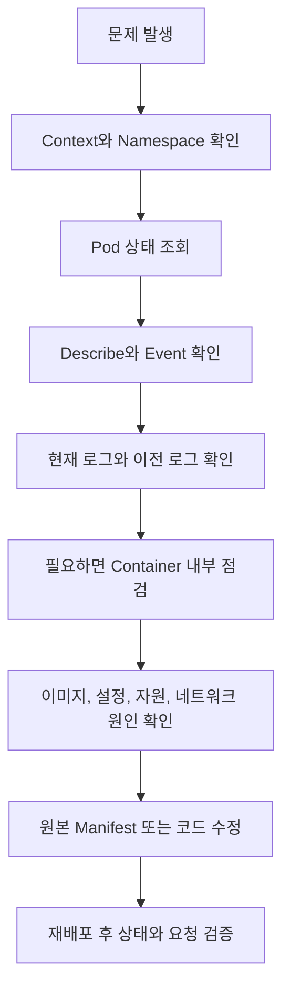
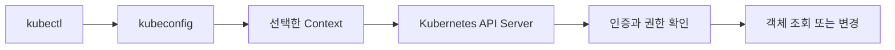
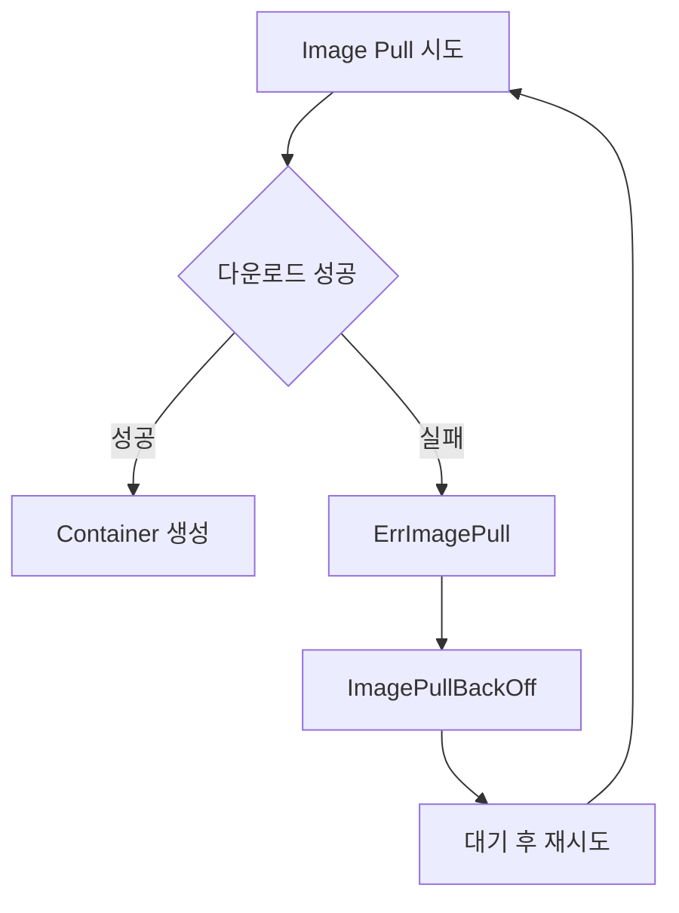
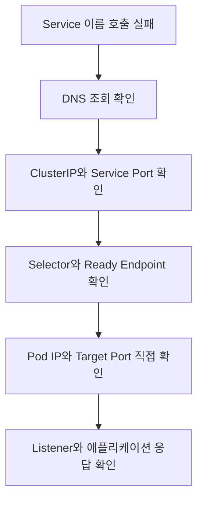

# kubectl 사용 및 트러블 슈팅

# kubectl 사용 및 트러블 슈팅

* toc
{:toc}

---

## kubectl 사용과 트러블슈팅

Kubernetes에서 애플리케이션이 정상적으로 동작하지 않을 때는 문제가 발생한 단계를 먼저 찾아야 한다. 이미지를 내려받지 못한 상태와 애플리케이션이 실행된 뒤 오류를 발생시키는 상태는 확인해야 할 정보가 다르다.

Pod가 실행 중인데 요청이 실패한다면 Service, DNS, Port 설정을 살펴봐야 한다. Pod가 재시작되고 있다면 종료 사유와 이전 Container의 로그가 중요하다. Pod가 Node에 배치되지 않았다면 애플리케이션 로그보다 스케줄링 Event를 먼저 확인해야 한다.

`kubectl`은 이러한 상태를 조회하고 Kubernetes 객체를 관리하는 기본 도구다. 명령어를 많이 외우는 것보다 **현재 상태를 확인하고, 원인을 좁히고, 수정 결과를 검증하는 순서**를 익히는 편이 실제 장애 대응에 도움이 된다.



## kubectl과 클러스터 연결

### kubectl은 API Server에 요청한다

`kubectl`은 로컬 컴퓨터에서 실행하는 명령줄 도구다. 사용자가 입력한 명령을 Kubernetes API Server에 전달하고 결과를 출력한다.



예를 들어 `kubectl get pods`는 API Server에 Pod 목록을 요청한다. `kubectl apply`는 객체의 원하는 설정을 전달한다. 애플리케이션이 실제로 실행되도록 만드는 과정은 이후 Controller, Scheduler, kubelet 등이 수행한다.

따라서 `apply`가 성공했다는 사실과 애플리케이션이 정상적으로 실행되었다는 사실은 다르다.

### kubeconfig와 Context

`kubectl`은 kubeconfig에 저장된 정보를 사용해 클러스터에 연결한다. 기본 설정 파일은 사용자 홈 디렉터리의 `.kube/config`이며, `--kubeconfig` 옵션으로 다른 파일을 지정할 수도 있다.

Context는 다음 세 정보를 묶은 연결 설정이다.

| 구성 | 의미 |
|---|---|
| Cluster | 요청을 보낼 API Server와 연결 정보 |
| User | 인증에 사용할 자격 증명 또는 인증 방식 |
| Namespace | 명령에서 생략했을 때 사용할 기본 Namespace |

같은 Cluster라도 User나 Namespace가 다르면 별도의 Context로 관리할 수 있다. Context를 선택한다고 새로운 권한이 부여되는 것은 아니다. 실제 접근 권한은 클러스터의 RBAC 등 서버 측 정책이 결정한다. [kubeconfig의 Context 구성](https://kubernetes.io/docs/concepts/configuration/organize-cluster-access-kubeconfig/)

### Context 조회와 변경

전체 Context를 조회한다.

```bash
kubectl config get-contexts
```

다음은 출력 예다.

```text
CURRENT   NAME            CLUSTER          AUTHINFO        NAMESPACE
          local-context   docker-desktop   docker-desktop   default
*         prod-dev        prod-cluster     developer        shop
```

`CURRENT` 열의 `*`가 현재 선택한 Context다. 위 상태에서 Namespace를 따로 지정하지 않으면 `prod-cluster`의 `shop` Namespace를 대상으로 요청한다.

현재 Context만 확인할 수도 있다.

```bash
kubectl config current-context
```

```text
prod-dev
```

로컬 Context로 변경한다.

```bash
kubectl config use-context local-context
```

```text
Switched to context "local-context".
```

기본 Context를 바꾸지 않고 특정 명령만 다른 Context에서 실행하려면 `--context`를 사용한다.

```bash
kubectl --context=local-context get pods -n default
```

운영 환경에서 객체를 수정하거나 삭제할 때는 Context와 Namespace를 명시하면 대상을 확인하기 쉽다.

### Docker Desktop과 EKS 연결

Docker Desktop에서 Kubernetes 기능을 활성화하면 일반적으로 로컬 kubeconfig에 연결 정보가 추가된다. Context 이름은 다음 명령으로 실제 값을 확인한다.

```bash
kubectl config get-contexts
```

Amazon EKS에서는 AWS CLI로 연결 정보를 생성하거나 갱신할 수 있다.

```bash
aws eks update-kubeconfig --region ap-northeast-2 --name my-cluster
```

Region과 Cluster 이름은 실제 환경에 맞춰 바꾼다. 이 명령은 kubeconfig를 갱신하면서 현재 Context도 변경할 수 있으므로 실행 후 대상을 다시 확인한다.

```bash
kubectl config current-context
kubectl get services -n default
```

kubeconfig 생성에 성공하더라도 Kubernetes 객체를 조회할 권한이 자동으로 생기지는 않는다. AWS 인증 정보, EKS 접근 설정, Kubernetes 권한을 함께 확인해야 한다. [EKS kubeconfig 구성](https://docs.aws.amazon.com/eks/latest/userguide/create-kubeconfig.html)

### 연결 오류와 권한 오류 구분하기

| 오류 | 먼저 확인할 내용 |
|---|---|
| `connection refused` | API Server 주소, 클러스터 실행 상태 |
| `i/o timeout` | VPN, 방화벽, Private Endpoint 접근 경로 |
| `Unauthorized` | 인증 정보 만료, 인증 Plugin 동작 |
| `Forbidden` | 해당 사용자에게 필요한 권한이 있는지 |
| 인증서 관련 오류 | CA 설정, Endpoint, 인증서 유효성 |

`Forbidden`은 보통 서버와 통신하고 인증까지 진행했지만 요청한 작업이 허용되지 않았다는 의미다. 이 경우 Pod를 재시작해도 해결되지 않는다.

현재 사용자의 권한은 다음과 같이 확인할 수 있다.

```bash
kubectl auth can-i get pods -n shop
kubectl auth can-i get pods --subresource=log -n shop
kubectl auth can-i create pods --subresource=exec -n shop
```

## Pod 상태에서 문제 찾기

### Pod 목록 조회

가장 먼저 대상 Namespace의 Pod 목록을 확인한다.

```bash
kubectl get pods -n default
```

```text
NAME         READY   STATUS             RESTARTS   AGE
nginx        0/1     ImagePullBackOff   0          4m20s
sample-app   1/1     Running            2          4m17s
```

Node와 Pod IP까지 확인하려면 `-o wide`를 사용한다.

```bash
kubectl get pods -n default -o wide
```

상태 변화를 계속 관찰하려면 `--watch`를 사용한다.

```bash
kubectl get pods -n default --watch
```

### READY, STATUS, RESTARTS의 의미

`READY`는 일반적인 애플리케이션 Container 중 Ready로 판단된 수를 보여준다. `1/1`이라고 해서 모든 업무 기능이 정상이라는 의미는 아니다. Readiness Probe가 없다면 실제 요청 처리 준비 상태를 충분히 검사하지 못할 수 있다.

`STATUS`는 `kubectl`이 Pod와 Container 정보를 종합해 보여주는 표시다. Pod의 공식 Phase와 항상 같지는 않다.

| 표시 | 의미 |
|---|---|
| `Pending` | 스케줄링 또는 Container 실행 준비 중 |
| `Running` | Pod가 실행 단계에 있음 |
| `Completed` | 작업이 정상 종료됨 |
| `ErrImagePull` | Image Pull 시도 실패 |
| `ImagePullBackOff` | Image Pull 실패 후 재시도 대기 |
| `CrashLoopBackOff` | Container 종료와 재시작이 반복되며 대기 |
| `CreateContainerConfigError` | ConfigMap, Secret 등 실행 설정 오류 |
| `Terminating` | Pod 삭제 또는 종료 진행 중 |

`ImagePullBackOff`와 `CrashLoopBackOff`는 Pod의 공식 Phase가 아니다. 예를 들어 `kubectl get pods`에서는 `ImagePullBackOff`, `kubectl describe pod`에서는 Pod 상태가 `Pending`으로 표시될 수 있다.

`RESTARTS`는 Container 재시작 횟수다. 현재 `Running`이고 `READY`가 정상이어도 재시작 횟수가 증가했다면 이전 종료 원인을 확인해야 한다. Pod가 삭제되고 새로 만들어진 경우에는 새 Pod의 정보만 표시되므로 이 값만으로 전체 장애 이력을 알 수는 없다.

### describe로 상태와 Event 확인하기

```bash
kubectl describe pod nginx -n default
```

우선 다음 항목을 살펴본다.

| 항목 | 확인 목적 |
|---|---|
| `Node` | 어디에 배치되었는지 |
| `Image` | 실제 요청한 이미지 주소와 Tag |
| `State` | 현재 Container 상태 |
| `Last State` | 이전 Container의 종료 상태 |
| `Reason` | 대기 또는 종료 사유 |
| `Exit Code` | 프로세스 종료 코드 |
| `Ready` | 요청을 받을 준비 여부 |
| `Restart Count` | Container 재시작 횟수 |
| `Requests`, `Limits` | 자원 설정 |
| `Events` | 스케줄링, Image Pull, Mount, Probe 관련 문제 |

Event는 애플리케이션 로그와 다르다. Image Pull과 Volume Mount처럼 프로세스가 시작되기 전에 발생한 문제도 확인할 수 있다.

다만 Event는 영구적인 감사 기록이 아니다. 반복 Event가 합쳐지거나 보존 기간이 지나 사라질 수 있으므로 장애 시점에 필요한 정보를 확보해야 한다.

## ImagePullBackOff 해결하기

### ErrImagePull과 ImagePullBackOff

Container를 시작하려면 Node가 Registry에서 이미지를 내려받아야 한다. 이 과정이 실패하면 `ErrImagePull`이 나타나고, 재시도 사이의 대기 구간에는 `ImagePullBackOff`가 표시된다.



이때 Pod를 삭제하는 것보다 실패 메시지를 읽는 일이 먼저다. 잘못된 이미지 주소는 다시 생성해도 그대로 실패한다.

### 이미지 이름 오타 확인

다음 메시지가 있다고 가정한다.

```text
Failed to pull image "nginxs:1.14.2"
pull access denied for nginxs
repository does not exist or may require authorization
```

`nginxs`는 Nginx 이미지 이름을 잘못 입력한 값이다. 하지만 `pull access denied`만 보고 언제나 이름 오타라고 판단해서는 안 된다. Private Registry의 인증 문제에서도 비슷한 메시지가 나올 수 있다.

| 원인 | 확인할 사항 |
|---|---|
| 이미지 이름 오타 | Registry와 Repository 경로 |
| 존재하지 않는 Tag | Registry에 해당 Tag가 있는지 |
| 인증 실패 | `imagePullSecrets`, 접근 권한 |
| Registry 접근 실패 | DNS, 방화벽, Proxy, 인증서 |
| 다운로드 제한 | Registry Rate Limit |
| Architecture 불일치 | Node Architecture와 이미지 지원 범위 |

### 잘못된 이미지로 확인하는 로컬 실습

다음 YAML은 Image Pull 오류를 확인하기 위해 이미지 이름을 의도적으로 잘못 작성한 예다. 로컬 실습 클러스터에서 사용한다.

```yaml
apiVersion: v1
kind: Pod
metadata:
  name: nginx
  namespace: default
  labels:
    app: nginx-debug
spec:
  containers:
    - name: nginx
      image: nginxs:stable-alpine
      imagePullPolicy: IfNotPresent
      resources: {}
```

`image-pull-test.yaml`로 저장하고 적용한다.

```bash
kubectl apply -f image-pull-test.yaml
kubectl get pod nginx -n default
kubectl describe pod nginx -n default
```

Registry 응답과 재시도 시점에 따라 `ErrImagePull` 또는 `ImagePullBackOff`가 표시될 수 있다. `Events`에서 실제 요청한 이미지 이름을 확인한다.

### kubectl edit으로 이미지 수정

실행 중인 객체를 Editor에서 수정할 수 있다.

```bash
kubectl edit pod nginx -n default
```

Container의 `image`를 다음과 같이 변경한다.

```yaml
image: nginx:stable-alpine
```

저장한 뒤 상태를 확인한다.

```bash
kubectl get pod nginx -n default --watch
```

정상이라면 이미지가 내려받아지고 Pod가 `Running`으로 전환된다.

Pod Spec은 대부분의 필드를 자유롭게 변경할 수 없지만, Container 이미지처럼 변경이 허용되는 필드가 있다. 환경 변수나 Volume 설정도 같은 방식으로 수정할 수 있다고 일반화해서는 안 된다.

Editor에 보이는 `uid`, `resourceVersion`, `creationTimestamp`는 Kubernetes가 관리하는 정보다. `kubectl.kubernetes.io/last-applied-configuration`에는 과거 적용 내용이 남아 있을 수 있다. 실제 Container 이미지 설정은 `spec.containers[].image`에서 확인한다.

### 원본 Manifest에도 수정 반영하기

`kubectl edit`은 클러스터 객체를 빠르게 수정하지만 로컬 YAML이나 Git 저장소까지 바꾸지는 않는다. 원본 파일에 잘못된 이미지가 남아 있으면 다음 배포에서 문제가 다시 생길 수 있다.

원본 YAML도 수정한다.

```yaml
apiVersion: v1
kind: Pod
metadata:
  name: nginx
  namespace: default
  labels:
    app: nginx-debug
spec:
  containers:
    - name: nginx
      image: nginx:stable-alpine
      imagePullPolicy: IfNotPresent
      resources: {}
```

다시 적용하고 Ready 상태를 확인한다.

```bash
kubectl apply -f image-pull-test.yaml
kubectl wait --for=condition=Ready pod/nginx -n default --timeout=120s
```

`stable-alpine`은 실습용 예제 Tag다. 운영에서는 변경되지 않는 버전 Tag나 Digest를 사용해 어떤 이미지를 배포했는지 명확하게 관리하는 편이 좋다.

Deployment가 관리하는 Pod라면 Pod 하나의 이미지를 직접 고치는 대신 Deployment의 Pod Template과 원본 Manifest를 수정해야 한다.

## 로그로 애플리케이션 문제 확인하기

### 현재 Container 로그 조회

```bash
kubectl logs sample-app -n default
```

Container가 여러 개라면 이름을 지정한다.

```bash
kubectl logs sample-app -n default -c app
```

`kubectl logs`는 Container의 표준 출력과 표준 오류에 기록된 로그를 조회한다. 애플리케이션이 임의의 파일에만 로그를 작성하면 해당 내용이 자동으로 표시되지는 않는다.

Container 환경에서 로그를 `stdout`과 `stderr`로 출력하는 구성이 편리한 이유다.

### 로그 범위 조절과 실시간 조회

새 로그를 계속 확인하려면 `-f`를 사용한다.

```bash
kubectl logs -f sample-app -n default -c app
```

최근 200줄과 Timestamp를 함께 확인한다.

```bash
kubectl logs sample-app -n default -c app --tail=200 --timestamps=true
```

최근 10분 로그를 확인한다.

```bash
kubectl logs sample-app -n default -c app --since=10m
```

`kubectl logs`가 애플리케이션 실행 이후의 모든 로그를 항상 제공하는 것은 아니다. Node의 로그 보존과 Rotation 설정에 영향을 받는다. 장기 이력 조회에는 중앙 로그 시스템이 필요하다.

### 재시작 이전 로그 조회

Container가 종료된 뒤 재시작되었다면 현재 로그에는 새로운 시작 과정만 보일 수 있다. 이때 `--previous`를 사용한다.

```bash
kubectl logs sample-app -n default -c app --previous
```

다음 정보를 함께 보면 원인을 좁히기 쉽다.

```bash
kubectl describe pod sample-app -n default
kubectl logs sample-app -n default -c app --previous --timestamps=true
```

| 상태 또는 종료 사유 | 확인할 내용 |
|---|---|
| `OOMKilled` | Memory Limit, Heap과 Native Memory 사용량 |
| `Error` | 예외, 종료 코드, 설정 누락 |
| Liveness 실패 Event | 검사 경로, 응답 지연, 초기화 시간 |
| `Completed` 반복 | 서버 프로세스가 왜 정상 종료되는지 |
| `CrashLoopBackOff` | 위 정보를 통해 반복 종료 원인 확인 |

`--previous`는 같은 Pod 안에서 이전에 종료된 Container 인스턴스의 로그를 조회한다. 이미 삭제된 다른 Pod의 로그를 가져오는 명령은 아니다. [Kubernetes 로그 조회와 보존](https://kubernetes.io/docs/concepts/cluster-administration/logging/)

### 로그 수준만으로 장애를 판단하지 않기

Spring 애플리케이션에서 다음과 같은 메시지를 볼 수 있다.

```text
H2Dialect does not need to be specified explicitly
No JTA platform available
Started ServerConnector on port 8080
```

명시적인 Dialect 설정이 불필요하다는 경고는 설정 정리 대상일 수 있지만 서버 기동 실패를 뜻하지는 않는다. JTA를 사용하지 않는 애플리케이션에서 JTA Platform이 없다는 메시지도 곧바로 장애로 볼 수 없다.

로그 수준과 함께 실제 예외, 종료 여부, 요청 실패 시각, Probe 결과를 연결해서 확인해야 한다.

## Container 내부 점검

### kubectl exec

`kubectl exec`는 실행 중인 Container 안에서 명령을 실행한다.

```bash
kubectl exec -it sample-app -n default -c app -- bash
```

Bash가 없다면 `sh`를 사용할 수 있다.

```bash
kubectl exec -it sample-app -n default -c app -- sh
```

| 옵션 | 의미 |
|---|---|
| `-i` | 표준 입력 유지 |
| `-t` | 터미널 할당 |
| `-c` | 대상 Container 지정 |
| `--` | 이후 값을 Container에서 실행할 명령으로 구분 |

SSH 접속과 비슷하게 Shell을 사용할 수 있지만 SSH Server나 Port를 사용하는 방식은 아니다. Kubernetes의 exec 기능으로 Container 내부에 새 프로세스를 실행한다.

### 프로세스와 파일 확인

Container에 필요한 도구가 있다면 다음 명령을 사용할 수 있다.

```bash
ps aux
ls -al
df -h
```

`ps aux`에서는 프로세스, CPU 사용량, 메모리와 실행 명령을 확인한다. 다만 Container 내부에서 보이는 프로세스 범위는 PID Namespace 설정에 따라 달라진다.

Java 프로세스의 RSS는 JVM Heap만을 의미하지 않는다. Thread Stack, Metaspace, Direct Buffer 등 다른 메모리도 포함하므로 Heap 크기와 Container 전체 메모리를 구분해야 한다.

Shell은 대화형으로 실행하지 않고 필요한 명령만 호출할 수도 있다.

```bash
kubectl exec sample-app -n default -c app -- ls -al /app
kubectl exec sample-app -n default -c app -- printenv SPRING_PROFILES_ACTIVE
```

`printenv`로 모든 환경 변수를 출력하면 Secret에서 주입한 값도 노출될 수 있다. 설정 확인은 필요한 변수만 선택해서 수행하는 편이 좋다.

### Container 안에서 네트워크 확인

Curl이 있다면 외부 API에 요청할 수 있다.

```bash
curl --connect-timeout 3 --max-time 10 https://httpbin.org/get
```

이 요청이 성공했다면 해당 시점에 그 Container에서 외부 Host를 조회하고 HTTPS 요청을 완료했다는 의미다. 모든 외부 목적지나 클러스터 내부 Service가 정상이라는 증거로 확대해서는 안 된다.

존재하지 않는 Service를 호출하면 다음과 같은 오류가 발생할 수 있다.

```bash
curl http://nginx-service/test
```

```text
curl: (6) Could not resolve host: nginx-service
```

이 오류는 HTTP 요청 처리 이전의 이름 해석 단계에서 실패했다는 뜻이다. 먼저 Service 존재 여부와 Namespace를 확인해야 한다.

```bash
kubectl get services -n default
```

### Shell이나 진단 도구가 없는 경우

운영 이미지는 크기와 공격 표면을 줄이기 위해 Bash, Curl, 패키지 관리자를 제외할 수 있다. Distroless Image에는 Shell 자체가 없기도 하다.

실행 중인 Container에 도구를 설치하면 원래 Image와 실제 환경이 달라진다. 권한이나 인터넷 접근 제한으로 설치가 불가능할 수도 있다. 이러한 경우 별도의 Debug Container나 임시 Pod를 사용한다.

## Debug Container와 임시 Pod

### 기존 Pod에 Debug Container 추가하기

`kubectl debug`는 기존 Pod에 Ephemeral Container를 추가해 진단할 수 있다.

```bash
kubectl debug -it sample-app -n default \
  --image=busybox:1.36.1 \
  --target=app \
  -- sh
```

이 명령에서 `sample-app`은 Pod 이름이고 `--target=app`은 대상 **Container 이름**이다.

Debug Container는 같은 Pod의 네트워크 Namespace를 사용하므로 네트워크 상태를 점검하는 데 유용하다. `--target`은 대상 Container의 프로세스 Namespace에 접근하도록 요청하며, 지원 여부는 Container Runtime에 따라 달라진다.

Debug Container가 추가되었다고 대상 Container의 Root 파일 시스템이나 환경 변수가 자동으로 복제되는 것은 아니다. 파일 접근에는 공유 Volume, 프로세스 정보와 권한 등 별도 조건이 필요하다. [실행 중인 Pod 디버깅](https://kubernetes.io/docs/tasks/debug/debug-application/debug-running-pod/)

Ephemeral Container는 실행이 끝나도 기록이 Pod에 남으며 일반 Container처럼 재시작하거나 개별적으로 제거할 수 없다. 기존 Pod에 변경을 가하는 작업이라는 점도 고려해야 한다.

### 별도의 임시 Pod 실행하기

클러스터 내부 DNS나 Service 접근을 확인할 때는 별도의 임시 Pod로 충분한 경우가 많다.

```bash
kubectl run network-check -n default \
  --rm -it \
  --restart=Never \
  --image=busybox:1.36.1 \
  -- sh
```

Pod 안에서 DNS와 HTTP 접근을 확인한다.

```sh
nslookup kubernetes.default.svc.cluster.local
nslookup nginx-service
wget -S -O- http://nginx-service/
exit
```

`--rm`은 명령 종료 후 임시 Pod를 정리하기 위한 옵션이다. 연결이 중단되었다면 잔여 Pod가 있는지 확인할 수 있다.

```bash
kubectl get pod network-check -n default
```

임시 Pod에서 통신이 성공해도 기존 애플리케이션 Pod의 통신까지 확인된 것은 아니다. Namespace, Label, ServiceAccount, NetworkPolicy와 Service Mesh 설정이 다를 수 있기 때문이다.

### Redis Client로 접속 확인

Redis Client가 필요하면 해당 도구가 포함된 이미지로 일회성 명령을 실행할 수 있다.

```bash
kubectl run redis-cli -n default \
  --rm -it \
  --restart=Never \
  --image=redis:7-alpine \
  -- redis-cli -h redis-service.platform.svc.cluster.local -p 6379 PING
```

인증이 필요 없는 실습 Redis라면 정상 응답은 다음과 같다.

```text
PONG
```

인증이 필요한 서버는 별도 인증 절차가 필요하다. `PING` 성공은 연결과 명령 실행을 확인하는 결과이며 실제 세션이나 Cache 업무 로직까지 검증한 것은 아니다.

## 자원 사용량과 Pending 진단

### kubectl top

Pod와 Node의 CPU, Memory 사용량을 조회한다.

```bash
kubectl top pods -n default
kubectl top pods -n default --containers
kubectl top nodes
```

메모리 사용량 기준으로 정렬할 수도 있다.

```bash
kubectl top pods -n default --sort-by=memory
```

이 명령은 Metrics Server 등 Resource Metrics API를 제공하는 구성이 필요하다. 설치되지 않았거나 수집이 지연되면 결과가 나오지 않을 수 있다. [kubectl top 사용 조건](https://kubernetes.io/docs/reference/generated/kubectl/kubectl-commands)

`top`은 최근 사용량을 빠르게 확인하는 도구다. 장시간 추세나 순간적인 Peak 분석에는 Prometheus 등의 모니터링이 필요하다.

### 사용량이 낮아도 Pending일 수 있다

Scheduler는 Pod의 순간 CPU 사용량보다 `requests`와 Node의 배치 가능한 자원량을 기준으로 판단한다.

따라서 `kubectl top nodes`에서 CPU 사용률이 낮게 보여도 기존 Pod의 Request 합계가 크면 새로운 Pod가 배치되지 않을 수 있다.

```bash
kubectl describe pod <POD_NAME> -n default
kubectl describe node <NODE_NAME>
```

Node의 `Allocatable`과 `Allocated resources`, Pod의 Event를 함께 확인한다.

| Event 또는 조건 | 확인할 원인 |
|---|---|
| `Insufficient cpu` | CPU Request를 만족하는 Node가 없음 |
| `Insufficient memory` | Memory Request를 만족하는 Node가 없음 |
| Untolerated Taint | Pod의 Toleration이 부족함 |
| Node Affinity 불일치 | 배치 조건을 만족하는 Node가 없음 |
| Unbound PVC | Volume 연결 또는 Provisioning 대기 |
| Volume Topology 불일치 | Node와 Storage 위치 조건이 맞지 않음 |

Pending을 해결하려고 무조건 Request를 낮추기보다 실제 필요 자원과 Node 용량, Storage 조건을 먼저 확인해야 한다.

## Service와 DNS 트러블슈팅

### 오류가 발생한 계층부터 확인하기

| 현상 | 우선 확인할 범위 |
|---|---|
| `Could not resolve host` | 이름, Namespace, DNS |
| `Connection refused` | 대상 Port, Listener, 준비된 Endpoint |
| Connection Timeout | Routing, NetworkPolicy, 방화벽, 응답 지연 |
| HTTP `404` | Host와 Path, 애플리케이션 Routing |
| HTTP `500` | 애플리케이션 예외와 내부 의존성 |

HTTP 응답을 받았다면 적어도 어떤 서버까지는 요청이 도달한 것이다. `404`를 곧바로 DNS 장애라고 판단하거나, 이름 해석 실패를 애플리케이션 Controller 오류로 판단하지 않아야 한다.

### Service 존재와 Namespace 확인

```bash
kubectl get service nginx-service -n default
kubectl get services -A
```

다른 Namespace의 Service라면 Namespace를 포함한 이름으로 호출한다.

```text
nginx-service.web.svc.cluster.local
```

`cluster.local`은 일반적인 Cluster Domain이며 실제 클러스터에서는 다른 값으로 구성할 수도 있다.

### Selector와 EndpointSlice 확인

Service가 있어도 대상 Pod가 없거나 Selector가 잘못되어 있을 수 있다.

```bash
kubectl describe service nginx-service -n default
kubectl get pods -n default --show-labels
kubectl get endpointslices -n default \
  -l kubernetes.io/service-name=nginx-service \
  -o yaml
```

Endpoint의 주소뿐 아니라 `conditions.ready`도 확인한다. Readiness가 실패한 Endpoint가 있으면 목록에 보이더라도 일반적인 요청 분배 대상에서 제외될 수 있다.

### DNS, ClusterIP, Pod IP 순서로 비교

진단 Pod에서 다음을 비교하면 문제 범위를 좁힐 수 있다.

```sh
nslookup nginx-service
wget -S -O- http://nginx-service/
wget -S -O- http://<SERVICE_CLUSTER_IP>:<SERVICE_PORT>/
wget -S -O- http://<POD_IP>:<TARGET_PORT>/
```

Pod IP 호출은 진단용이다. 애플리케이션 설정에 고정해서 사용하지 않는다.



DNS 이름과 ClusterIP 호출 결과가 다르면 이름 해석을, Service 호출과 Pod 직접 호출 결과가 다르면 Endpoint와 Service 경로를 더 살펴볼 수 있다. NetworkPolicy는 함께 확인해야 한다. [Kubernetes Service 디버깅](https://kubernetes.io/docs/tasks/debug/debug-application/debug-service/)

## Deployment 재시작과 검증

### rollout restart

설정을 반영하거나 새 Pod로 교체해야 할 때 다음 명령을 사용할 수 있다.

```bash
kubectl rollout restart deployment/sample-deploy -n default
kubectl rollout status deployment/sample-deploy -n default --timeout=180s
```

`rollout restart`는 기존 Deployment의 Pod Template을 변경해 새 Rollout을 유도한다. Deployment 객체를 삭제하거나 새로 만드는 명령은 아니다. Pod 교체는 해당 Deployment의 업데이트 전략을 따른다. [kubectl rollout](https://kubernetes.io/docs/reference/kubectl/generated/kubectl_rollout/)

이 명령 자체가 이미지 주소를 변경하지는 않는다. 하지만 변경 가능한 Tag를 사용하거나 ConfigMap과 Secret의 값이 바뀌었다면 새 Pod가 기존 Pod와 다른 코드나 설정으로 실행될 수 있다.

### 재시작 전에 원인 확보

재시작으로 일시적으로 복구되더라도 원인을 알지 못하면 같은 문제가 반복될 수 있다. 필요한 경우 다음 정보를 먼저 확보한다.

```bash
kubectl describe pod <POD_NAME> -n default
kubectl logs <POD_NAME> -n default -c <CONTAINER_NAME> --tail=200 --timestamps=true
kubectl logs <POD_NAME> -n default -c <CONTAINER_NAME> --previous
```

재시작 후에는 배포 상태와 실제 요청을 각각 확인한다.

```bash
kubectl get deployment sample-deploy -n default
kubectl get pods -n default
kubectl rollout status deployment/sample-deploy -n default
```

Rollout 완료는 새 Pod가 Deployment의 준비 조건을 만족했다는 뜻이다. 로그인, 데이터 조회, 외부 연동 등 실제 업무 기능의 정상 여부는 별도 요청으로 검증해야 한다.

## 자주 사용하는 명령어

| 목적 | 명령 |
|---|---|
| 현재 연결 대상 확인 | `kubectl config current-context` |
| Context 목록 | `kubectl config get-contexts` |
| Pod 목록 | `kubectl get pods -n <NAMESPACE>` |
| Pod와 Node 위치 | `kubectl get pods -n <NAMESPACE> -o wide` |
| 상세 상태와 Event | `kubectl describe pod <POD> -n <NAMESPACE>` |
| 현재 로그 | `kubectl logs <POD> -n <NAMESPACE> -c <CONTAINER>` |
| 실시간 로그 | `kubectl logs -f <POD> -n <NAMESPACE> -c <CONTAINER>` |
| 이전 Container 로그 | `kubectl logs <POD> -n <NAMESPACE> -c <CONTAINER> --previous` |
| Container 명령 실행 | `kubectl exec -it <POD> -n <NAMESPACE> -c <CONTAINER> -- sh` |
| Pod 자원 사용량 | `kubectl top pods -n <NAMESPACE>` |
| Node 자원 사용량 | `kubectl top nodes` |
| Service 확인 | `kubectl describe service <SERVICE> -n <NAMESPACE>` |
| Deployment 재시작 | `kubectl rollout restart deployment/<NAME> -n <NAMESPACE>` |
| 배포 진행 확인 | `kubectl rollout status deployment/<NAME> -n <NAMESPACE>` |

`<POD>`, `<NAMESPACE>`, `<CONTAINER>` 같은 값은 실제 대상 이름으로 바꿔 사용한다.

## 정리

트러블슈팅은 Context와 Namespace 확인에서 시작한다. 이후 Pod 상태, 상세 Event, 현재 로그와 이전 로그를 확인하면 문제가 스케줄링, 이미지 다운로드, 애플리케이션 실행 중 어느 단계에서 발생했는지 구분할 수 있다.

`Running`과 `READY`만으로 정상 여부를 판단하지 않고 재시작 횟수와 실제 요청 결과를 함께 확인해야 한다. Container에 Shell이나 도구가 없다면 Debug Container와 임시 Pod를 사용할 수 있지만, 각각의 네트워크와 파일 접근 범위는 다르다.

빠른 복구에 `edit`이나 `rollout restart`가 도움이 될 수 있다. 수정 사항은 원본 Manifest에도 반영하고, 재배포 후에는 객체 상태와 업무 요청을 모두 검증해야 같은 문제가 반복되는 일을 줄일 수 있다.
