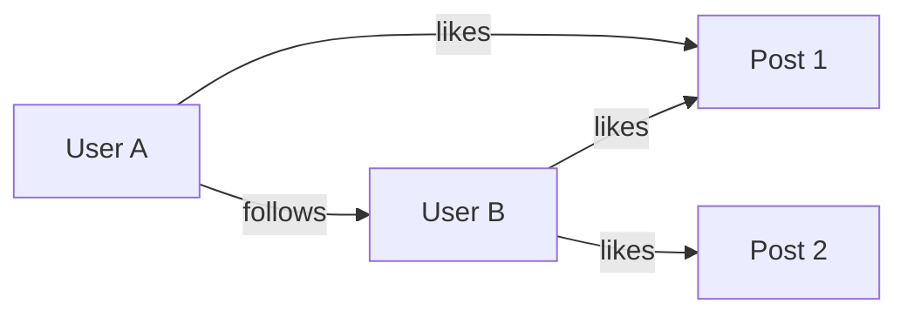
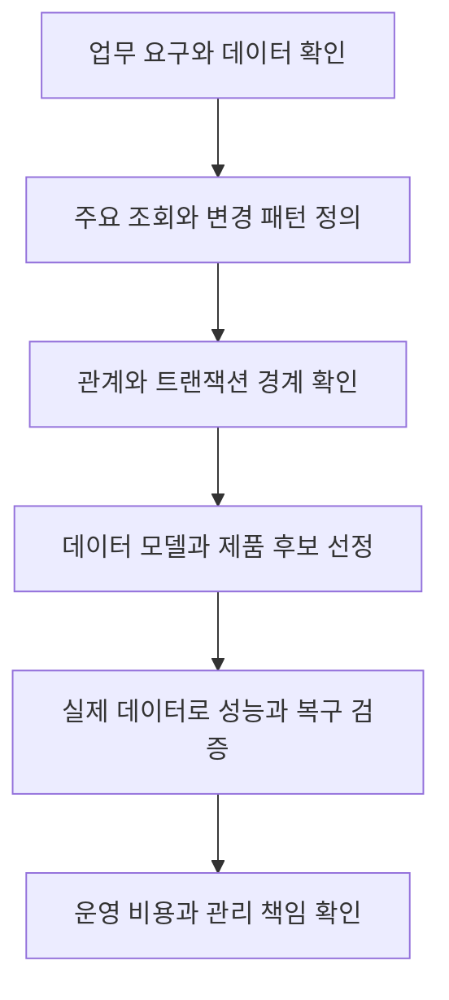

# NoSQL 이해

# NoSQL 이해

* toc
{:toc}

---

## NoSQL 이해: 데이터 구조와 조회 방식에 맞는 데이터베이스 선택하기

데이터베이스를 선택할 때는 저장할 데이터의 양만큼이나 **어떤 구조의 데이터를 어떤 방식으로 읽고 변경하는지**가 중요하다. 주문과 결제를 처리하는 데이터, 사용자 프로필, 센서 측정값, 검색용 로그는 서로 다른 요구를 가진다.

관계형 데이터베이스는 테이블과 관계, 제약 조건을 중심으로 데이터를 관리한다. NoSQL은 문서, 키-값, 그래프, Wide-column 등 다른 데이터 모델을 활용한다. 어느 한쪽이 항상 우수한 것이 아니라, 데이터 모델과 접근 패턴이 잘 맞을 때 장점을 얻을 수 있다.

## NoSQL이란?

### SQL을 사용하지 못하는 데이터베이스라는 뜻은 아니다

NoSQL은 일반적으로 비관계형 데이터베이스를 가리키며, 오늘날에는 `Not Only SQL`이라는 표현으로 설명하는 경우가 많다.

여기서 SQL은 질의 언어이고, 관계형 모델은 데이터를 표현하는 방식이다. 엄밀히 말하면 SQL과 NoSQL이 완전히 대칭적인 분류는 아니다. NoSQL 제품 중에도 SQL과 비슷한 언어나 SQL 인터페이스를 제공하는 경우가 있다.

따라서 NoSQL은 SQL을 금지하는 기술이라기보다, **관계형 테이블 외의 데이터 모델을 중심으로 저장과 조회를 설계하는 데이터베이스의 범주**로 이해하는 편이 정확하다. [NoSQL의 개념과 주요 모델](https://www.mongodb.com/resources/basics/databases/nosql-explained)

### 정형 데이터도 저장할 수 있다

NoSQL을 비정형 데이터 전용 저장소로 생각하기 쉽지만, 정형 데이터도 저장할 수 있다.

| 구분 | 특징 | 예 |
|---|---|---|
| 정형 데이터 | 비교적 일정한 필드와 자료형을 가짐 | 회원 기본 정보, 주문 항목 |
| 반정형 데이터 | 구조는 있지만 항목별 필드나 중첩 형태가 달라질 수 있음 | JSON 이벤트, 제품 속성 |
| 비정형 데이터 | 고정된 필드 구조로 표현하기 어려움 | 자유로운 본문, 이미지, 음성 |

JSON은 필드와 중첩 구조가 있으므로 보통 반정형 데이터의 예로 설명한다. JSON으로 저장했다는 이유만으로 모든 내용이 비정형 데이터가 되는 것은 아니다.

SNS, IoT, 로그 분석, 콘텐츠 관리, 추천, 사기 탐지, 제품 카탈로그처럼 다양한 데이터가 계속 생성되는 영역에서 NoSQL을 검토할 수 있다. 다만 이미지와 동영상 같은 대용량 원본을 반드시 데이터베이스 안에 넣어야 하는 것은 아니다. 객체 스토리지에 파일을 저장하고 데이터베이스에는 위치와 메타데이터를 관리하는 방식도 가능하다.

## 유연한 스키마가 필요한 이유

### 같은 종류의 데이터도 필드가 다를 수 있다

인물과 그룹의 프로필을 생각해 보자. 개인 프로필에는 생년월일이 필요하지만 그룹 프로필에는 구성원 목록이 더 중요할 수 있다.

```json
[
  {
    "type": "person",
    "name": "Artist A",
    "birth_date": "1993-05-16",
    "agency": "Agency A",
    "debut_year": 2008
  },
  {
    "type": "group",
    "name": "Group B",
    "agency": "Agency B",
    "debut_year": 2016,
    "members": ["Member 1", "Member 2"]
  }
]
```

문서 모델에서는 각 문서에 필요한 필드를 포함할 수 있다. 모든 항목에 같은 컬럼을 채우기 위해 불필요한 빈 값을 만들 필요가 줄어든다.

그렇다고 관계형 데이터베이스로 이러한 데이터를 표현할 수 없는 것은 아니다. 공통 테이블과 유형별 상세 테이블을 나누거나, 선택적인 컬럼과 JSON 자료형을 사용할 수 있다. MySQL도 JSON 자료형을 제공한다. 화면마다 표시되는 필드가 다르다는 사실만으로 실제 저장소가 NoSQL이라고 판단할 수도 없다. [MySQL의 JSON 자료형](https://dev.mysql.com/doc/refman/8.4/en/json.html)

### 스키마가 유연하다는 것과 설계가 필요 없다는 것은 다르다

MongoDB에서는 같은 Collection의 문서가 반드시 동일한 필드와 자료형을 가질 필요는 없다. 하지만 `price`에 어떤 문서는 숫자, 어떤 문서는 문자열을 저장하면 정렬과 집계가 복잡해진다.

실무에서는 다음과 같은 규칙이 여전히 필요하다.

- 필수 필드와 선택 필드
- 자료형과 기본값
- 금액·시간·측정값의 단위
- 문서 유형과 버전
- 필드가 없을 때와 `null`일 때의 의미
- 중복과 잘못된 값을 막는 검증·인덱스

MongoDB는 Schema Validation으로 자료형, 필수 필드와 값의 범위 등을 검사할 수 있다. **유연한 스키마는 규칙을 포기한다는 뜻이 아니라, 필요한 규칙을 선택적으로 적용한다는 의미**에 가깝다. [MongoDB Schema Validation](https://www.mongodb.com/docs/manual/core/schema-validation/)

## NoSQL의 주요 특징

### 유연성과 반복적인 개발

새로운 제품 속성이나 이벤트 필드를 추가할 때 기존 데이터 전체를 즉시 같은 형태로 변경하지 않고도 개발을 진행할 수 있다. 요구사항이 자주 바뀌는 초기 서비스와 다양한 유형의 콘텐츠에 유리할 수 있다.

다만 과거 문서와 새로운 문서가 함께 존재하는 기간을 고려해야 한다. 필드 추가가 쉬워졌을 뿐, 애플리케이션의 호환성과 데이터 변환 문제가 사라진 것은 아니다.

### 수평 확장

많은 NoSQL 제품은 데이터를 여러 서버에 분산해 처리하도록 설계되어 있다. MongoDB에서는 Sharding으로 데이터와 부하를 여러 장비에 나눌 수 있다.

그러나 서버를 추가하면 모든 질의가 자동으로 빨라지는 것은 아니다. 데이터 분할 기준이 잘못되면 특정 서버에 요청이 몰리거나, 하나의 조회가 모든 서버를 확인해야 할 수 있다. 복제와 백업, 네트워크, 재분배 비용도 함께 증가한다. [MongoDB Sharding](https://www.mongodb.com/docs/manual/sharding/)

클라우드의 완전 관리형 서비스를 활용하면 설치와 일부 운영 부담을 줄일 수 있지만, 데이터 모델·인덱스·접근 권한·복구 전략까지 서비스가 대신 결정해 주지는 않는다.

### 특정 접근 패턴에 맞춘 성능과 기능

키 하나로 세션을 찾는 작업, 연결된 관계를 반복 탐색하는 작업, 시간 구간별 센서 값을 읽는 작업은 필요한 구조가 다르다.

NoSQL 제품은 이러한 특정 모델에 맞는 API와 자료형을 제공한다. 모델이 잘 맞으면 복잡한 변환이나 조인을 줄일 수 있지만, “NoSQL이므로 더 빠르다”는 식으로 일반화해서는 안 된다. 인덱스, 데이터 분포, 요청 크기와 일관성 설정에 따라 결과가 달라진다.

## NoSQL의 네 가지 주요 데이터 모델

### Graph: 관계와 연결을 중심으로 저장하기

Graph 데이터베이스는 Node, Edge, Property로 데이터를 표현한다.

- Node: 사용자, 게시물, 상품 같은 대상
- Edge: 팔로우, 좋아요, 구매 같은 관계
- Property: 이름, 작성 시각, 관계 생성 시각 같은 속성



사용자가 누구를 팔로우하고, 그 사람들이 어떤 게시물을 좋아했는지 탐색하는 문제에 자연스럽게 적용할 수 있다. 소셜 네트워크, 추천, 지식 그래프와 연결 관계 분석이 대표적인 활용 분야다.

관계형 데이터베이스도 관계를 표현할 수 있지만, 여러 단계를 탐색하는 질의에서는 Graph 모델이 더 직접적일 수 있다. 다만 모든 연결 탐색이 자동으로 저렴해지는 것은 아니며, 탐색 범위와 연결 수를 제한하는 설계가 필요하다.

### Key-Value: 키로 값을 직접 찾기

Key-Value 모델은 고유한 키를 이용해 값을 저장하고 조회한다.

```text
Key: user:12345
Value: {"name":"foo bar","email":"foo@bar.com","designation":"software developer"}
```

위 표현은 개념적인 예시다. 실제 저장 형식과 질의 기능은 제품마다 다르다.

Redis는 세션, 캐시, 카운터 등에 널리 활용되며 문자열뿐 아니라 Hash, List, Set, Sorted Set 같은 자료구조도 제공한다. Redis를 단순히 문자열만 저장하는 서버로 볼 필요는 없다. [Redis의 데이터 자료형](https://redis.io/docs/latest/develop/data-types/)

Amazon DynamoDB는 Key-Value와 Document 모델을 지원하는 관리형 데이터베이스다. 실제 테이블에서는 Partition Key와 필요한 경우 Sort Key를 중심으로 접근 패턴을 설계한다. Key-Value 모델이라고 모두 임시 데이터나 캐시 전용인 것은 아니다. [DynamoDB의 데이터 모델](https://docs.aws.amazon.com/amazondynamodb/latest/developerguide/Introduction.html)

이 모델은 명확한 키로 조회하는 데 적합하지만, 임의의 여러 조건으로 검색하려면 추가 인덱스나 별도 조회 구조가 필요할 수 있다.

### Wide-column: 분산된 행과 컬럼 구조 활용하기

Wide-column 계열의 대표적인 제품은 Apache Cassandra와 HBase다. 넓고 희소한 데이터, 대규모 분산 저장과 정해진 키·범위 조회에 활용할 수 있다.

다만 제품별 스키마 방식은 다르다. HBase는 Column Family를 미리 정의하고 그 안의 Column Qualifier를 동적으로 사용할 수 있다. 개념적으로 다음과 같이 일부 셀만 존재하는 데이터를 표현할 수 있다.

| Row Key | profile:name | profile:email | profile:dob | profile:city |
|---|---|---|---|---|
| 12345 | Foo bar | foo@bar.com | 없음 | Some city |
| 34521 | Carn Yale | bar@foo.com | 12-05-1972 | 없음 |

이 표의 빈 항목은 값이 없는 셀을 설명하기 위한 것이다. 날짜는 실제 설계에서 해석이 모호하지 않은 형식으로 통일해야 한다.

반면 Cassandra의 CQL 테이블은 컬럼과 자료형을 정의한다. 모든 Wide-column 제품에서 행마다 임의의 컬럼을 자유롭게 추가할 수 있다고 이해하면 안 된다.

또한 **Wide-column과 분석용 Columnar Database는 같은 분류가 아니다.** 컬럼 단위 스캔·압축을 활용하는 데이터 웨어하우스의 특성을 그대로 Cassandra나 HBase의 특징으로 적용해서는 안 된다. Cassandra에서는 특히 어떤 Partition Key와 범위로 읽을지를 먼저 정하는 질의 중심 모델링이 중요하다. [Cassandra 데이터 모델링](https://cassandra.apache.org/doc/latest/cassandra/developing/data-modeling/intro.html)

### Document: 관련 데이터를 문서로 표현하기

Document 데이터베이스는 필드와 값으로 구성한 문서를 저장한다. 중첩 객체와 배열을 사용해 관련 정보를 한 문서 안에 표현할 수 있다.

MongoDB는 데이터를 BSON 문서로 저장한다. BSON은 JSON과 유사한 구조를 표현하지만, 날짜와 `ObjectId` 등 JSON보다 다양한 자료형을 지원하는 바이너리 형식이다. MongoDB가 JSON·XML·BSON을 모두 같은 방식의 기본 문서로 저장한다고 이해해서는 안 된다. [MongoDB 문서와 BSON](https://www.mongodb.com/docs/manual/core/document/)

다음은 `mongosh`에서 표현할 수 있는 문서 예시다.

```javascript
{
  _id: ObjectId("64b8b94f5f92a9a8b1c12345"),
  name: "홍길동",
  email: "hong.gd@example.com",
  address: {
    city: "서울",
    district: "강남구",
    street: "역삼로 10길 5"
  }
}
```

`address`는 문자열로 이어 붙인 주소가 아니라 별도의 필드를 가진 중첩 문서다. 애플리케이션에서 함께 사용하는 정보를 자연스럽게 묶을 수 있다.

콘텐츠 관리, 제품 카탈로그, 다양한 프로필처럼 항목별 구조가 달라질 수 있는 데이터에 적합하다. 다만 한 제품이 여러 모델의 기능을 지원할 수 있으므로 네 가지 분류를 완전히 배타적인 구분으로 볼 필요는 없다.

## 로그 데이터로 살펴보는 NoSQL 활용

로그라고 모두 같은 구조를 가지는 것은 아니다. 무엇을 검색하고 집계할 것인지에 따라 필요한 필드와 저장소가 달라진다. 다음 JSON은 데이터 구조를 설명하기 위한 예시이며, 실제 설계에서는 시간 자료형과 측정 단위를 명확하게 정해야 한다.

### 서버 액세스 로그

웹 요청의 접속 정보와 응답 결과를 기록한다.

```json
{
  "ip": "192.168.1.10",
  "timestamp": "2025-05-21T14:35:22Z",
  "method": "GET",
  "url": "/index.html",
  "status_code": 200,
  "response_time": 123,
  "user_agent": "Mozilla/5.0 (Windows NT 10.0; Win64; x64)"
}
```

특정 URL의 오류 비율, 응답 시간과 접속 패턴을 분석할 수 있다. `response_time`이 밀리초인지 마이크로초인지처럼 단위를 통일해야 서비스 간 비교가 가능하다.

### 애플리케이션 이벤트 로그

사용자가 어떤 행동을 했는지 기록하며, 이벤트별 상세 정보가 달라질 수 있다.

```json
{
  "event_id": "evt_12345",
  "timestamp": "2025-05-21T14:40:10Z",
  "user_id": "user_6789",
  "event_type": "button_click",
  "details": {
    "button_id": "submit_order",
    "page": "checkout"
  }
}
```

공통 식별 필드는 유지하면서 `details`에 이벤트별 속성을 넣는 구조다. 다만 `button_click`과 같은 이벤트의 필드 의미가 계속 바뀌면 분석이 어려워지므로 이벤트 계약과 버전도 관리해야 한다.

### 시스템 성능과 모니터링 데이터

```json
{
  "timestamp": "2025-05-21T14:50:00Z",
  "cpu_usage": 75,
  "memory_usage": 65,
  "disk_io": {
    "read": 120,
    "write": 85
  },
  "hostname": "server_1"
}
```

시간 구간별 평균, 최댓값과 변화율을 주로 조회한다. 사용률의 기준과 단위, 디스크 값이 누적량인지 초당 처리량인지도 정해야 한다. 이런 데이터는 일반적인 텍스트 로그 검색과 다른 접근 패턴을 가진다.

### 네트워크 트래픽 로그

```json
{
  "timestamp": "2025-05-21T15:00:00Z",
  "source_ip": "10.0.0.5",
  "destination_ip": "8.8.8.8",
  "protocol": "TCP",
  "bytes_sent": 1500,
  "bytes_received": 3000,
  "port": 443
}
```

출발지·목적지·포트별 통신량과 이상 패턴을 분석할 수 있다. IP와 시간 범위를 자주 결합해 조회한다면 그 조건을 기준으로 인덱스와 데이터 분할을 검토한다.

### 애플리케이션 에러 로그

```json
{
  "error_id": "err_98765",
  "timestamp": "2025-05-21T15:10:30Z",
  "error_type": "NullReferenceException",
  "message": "Object reference not set to an instance of an object.",
  "stack_trace": "at Namespace.Class.Method() in File.cs:line 45",
  "user_id": "user_1234",
  "severity": "error"
}
```

에러 유형과 심각도 같은 정형 필드에 자유로운 메시지와 Stack Trace가 함께 들어 있다. 구조화된 필터와 본문 검색이 모두 필요한 사례다. 사용자 정보와 요청 값이 포함될 수 있으므로 수집 전에 민감정보를 제거하는 정책도 필요하다.

### 데이터베이스 쿼리 로그

```json
{
  "query_id": "qry_123456",
  "timestamp": "2025-05-21T15:15:00Z",
  "sql": "SELECT * FROM users WHERE user_id = 'user_1234'",
  "execution_time_ms": 45,
  "result_count": 1,
  "status": "success"
}
```

느린 질의와 반복되는 질의 패턴을 분석할 수 있다. SQL 원문에는 개인정보와 민감한 조건값이 들어갈 수 있으므로 실제 값을 그대로 보관할지, 정규화하거나 마스킹할지 결정해야 한다.

### IoT 센서 데이터

```json
{
  "sensor_id": "sensor_001",
  "timestamp": "2025-05-21T15:20:00Z",
  "temperature": 22.5,
  "humidity": 55,
  "vibration": 0.02
}
```

센서 ID와 시간 범위를 기준으로 조회하는 경우가 많다. 측정 단위와 수집 주기, 데이터 보관 기간, 오래된 값을 요약하는 정책이 중요하다.

### 사용자 행동 분석 데이터

```json
{
  "session_id": "sess_7890",
  "user_id": "user_5678",
  "page_views": [
    {"page": "/home", "duration": 15},
    {"page": "/product/123", "duration": 30},
    {"page": "/cart", "duration": 10}
  ],
  "actions": ["click_button", "add_to_cart", "purchase"]
}
```

배열과 중첩 문서로 세션의 행동을 표현할 수 있다. 그러나 활동이 계속 쌓이는 사용자의 전체 이력을 하나의 문서에 무한히 추가하는 방식은 피해야 한다. 이벤트를 별도로 저장하고 필요한 범위를 조회하는 구조가 더 적절할 수 있다.

### 로그 유형만으로 제품을 결정하지 않기

| 제품 | 검토할 수 있는 요구 |
|---|---|
| MongoDB | 다양한 구조의 문서 저장과 필드 기반 조회 |
| Cassandra | 정해진 키·시간 범위 중심의 대규모 분산 데이터 처리 |
| Elasticsearch | 로그 본문 검색, 필터와 집계 |
| InfluxDB | 시간에 따른 측정값 저장과 집계 |

Elasticsearch는 검색 중심의 로그 분석에, InfluxDB는 측정값과 시계열 분석에 초점을 맞춘다. 같은 로그 데이터라도 원본 보관, 검색, 장기 집계에 서로 다른 저장소를 사용할 수 있다. 형식이 JSON이라는 이유만으로 MongoDB를 선택하는 것은 충분한 기준이 아니다. [Elastic 로그 분석](https://www.elastic.co/docs/solutions/observability/logs), [InfluxDB 시계열 활용](https://docs.influxdata.com/influxdb3/core/)

## 관계형 모델과 MongoDB 문서 모델 비교

### 사용자와 취미를 저장하는 방법

관계형 모델에서는 사용자를 한 테이블에, 여러 취미를 다른 테이블에 저장할 수 있다.

**사용자 테이블**

| id | first_name | last_name | cell | city |
|---:|---|---|---|---|
| 1 | Leslie | Yepp | 8125552344 | Pawnee |

**취미 테이블**

| id | user_id | hobby |
|---:|---:|---|
| 10 | 1 | scrapbooking |
| 11 | 1 | eating waffles |
| 12 | 1 | working |

사용자와 취미를 함께 보여 주려면 조인이나 별도 조회로 결과를 구성한다. 외래 키를 선언하면 두 테이블 사이의 참조 무결성도 관리할 수 있다.

MongoDB에서는 함께 사용하는 취미를 배열로 포함할 수 있다.

```json
{
  "_id": 1,
  "first_name": "Leslie",
  "last_name": "Yepp",
  "cell": "8125552344",
  "city": "Pawnee",
  "hobbies": ["scrapbooking", "eating waffles", "working"]
}
```

이 구조에서는 사용자와 취미를 하나의 문서로 읽을 수 있다. 전화번호도 계산할 수치가 아니므로 문자열로 표현하는 편이 적절하다.

### 조인과 정규화가 필요 없다는 말의 범위

위 예제는 문서 안에 포함했기 때문에 취미를 읽기 위한 별도 조인이 필요하지 않다. 이것을 MongoDB에서는 관계나 정규화를 전혀 고려하지 않아도 된다는 뜻으로 확대하면 안 된다.

함께 읽고 크기가 제한적인 데이터는 Embedded Document로 묶기 좋다. 반면 독립적으로 변경되거나 여러 문서가 공유하는 데이터, 계속 증가하는 목록은 별도 Collection과 참조로 나누는 편이 나을 수 있다. MongoDB도 `$lookup`으로 다른 Collection의 데이터를 결합할 수 있다.

내장 모델은 읽기 경로를 단순화하지만, 중복한 값이 변경될 때 여러 문서를 갱신해야 할 수 있다. 참조 모델은 중복을 줄이는 대신 조회 단계가 늘어날 수 있다. **같이 접근하는 데이터와 함께 변경되어야 하는 데이터의 경계를 먼저 판단해야 한다.** [MongoDB 데이터 모델링](https://www.mongodb.com/docs/manual/data-modeling/), [MongoDB의 `$lookup`](https://www.mongodb.com/docs/manual/reference/operator/aggregation/lookup/)

또한 MongoDB의 일반 BSON 문서는 최대 16MiB라는 크기 제한이 있다. 큰 파일은 GridFS나 별도 객체 스토리지를 검토하고, 무제한 배열로 문서가 계속 커지는 구조도 피해야 한다. [BSON 문서 크기 제한](https://www.mongodb.com/docs/manual/reference/limits/)

## RDBMS와 NoSQL을 비교할 때 바로잡아야 할 점

| 기준 | 관계형 데이터베이스 | NoSQL |
|---|---|---|
| 주요 모델 | 테이블과 관계 | 문서, 키-값, 그래프, Wide-column 등 |
| 스키마 | 선언한 스키마와 제약 조건 중심 | 제품에 따라 유연한 구조와 명시적 검증 제공 |
| 관계 표현 | 외래 키, 조인 등을 활용 | 내장·참조·관계 탐색 등 모델별 방식 |
| 트랜잭션 | 엔진과 설정에 따른 트랜잭션 지원 | 제품·배포 구성별 지원 범위가 다름 |
| 성능 | 질의·인덱스·정규화·하드웨어에 영향받음 | 접근 패턴·키 설계·분산 구조에 영향받음 |
| 확장 | 단일 서버, 복제, 분산 구성 등 | 단일 서버와 분산 구성 모두 가능 |
| 질의 방식 | SQL 중심 | 제품별 API, 질의 언어, 일부 SQL 인터페이스 |

### NoSQL도 ACID 트랜잭션을 지원할 수 있다

NoSQL을 사용하면 정합성을 보장할 수 없다는 주장은 맞지 않는다. MongoDB는 단일 문서 변경의 원자성을 제공하며, Replica Set과 Sharded Cluster에서 여러 문서에 대한 ACID 트랜잭션도 지원한다.

다만 여러 문서나 Shard에 걸친 트랜잭션은 비용이 크다. 트랜잭션이 있다는 이유로 데이터 모델을 무시해서도 안 된다. [MongoDB 트랜잭션과 원자성](https://www.mongodb.com/docs/manual/core/transactions/)

ACID는 원자성, 일관성, 격리성, 지속성을 설명하는 속성이다. BASE는 가용성과 최종 일관성을 중심으로 설명할 때 사용하는 개념이지만, 모든 NoSQL이 하나의 동일한 BASE 동작을 가진다는 의미는 아니다.

특히 트랜잭션의 일관성과 복제본 사이의 최신 데이터 가시성은 구분해서 이해해야 한다. 제품 이름보다 실제 읽기·쓰기 설정과 실패 시 보장 범위를 확인하는 것이 중요하다.

### 읽기와 쓰기의 우열을 일괄적으로 나눌 수 없다

RDBMS는 읽기에 강하고 NoSQL은 쓰기에 강하다는 비교도 지나친 일반화다. 키 조회와 복잡한 조인, 전체 스캔과 시간 범위 집계는 서로 다른 작업이다.

같은 제품에서도 인덱스를 많이 추가하면 읽기는 빨라질 수 있지만 쓰기와 저장 공간 비용이 늘어난다. 데이터가 어느 서버에 분산되는지, 한 요청에서 얼마나 많은 데이터를 읽는지에 따라서도 성능이 달라진다.

은행은 RDBMS, SNS는 NoSQL처럼 업종만으로 저장소를 결정할 수도 없다. 하나의 서비스가 거래 데이터에는 RDBMS, 캐시에는 Redis, 검색에는 Elasticsearch를 함께 사용할 수 있다.

## MySQL과 MongoDB의 기본 CRUD 비교

### 서버와 클라이언트 구분

| 역할 | MySQL | MongoDB |
|---|---|---|
| 서버 프로세스 | `mysqld` | `mongod` |
| 대화형 클라이언트 | `mysql` | `mongosh` |
| 기본 저장 단위 | 행 | 문서 |
| 데이터 묶음 | 테이블 | Collection |

아래 명령어는 서버가 설치되어 실행 중인 로컬 학습 환경을 전제로 한다. 서버를 실행하는 것과 클라이언트로 접속하는 것은 다른 단계다.

```bash
mysql -u root -p
```

```bash
mongosh "mongodb://127.0.0.1:27017"
```

MySQL의 `root` 접속은 로컬 학습용 예시다. 애플리케이션 운영에는 필요한 권한만 가진 별도 계정을 사용해야 한다. MongoDB도 운영에서는 인증과 접근 통제를 적용한다.

### MySQL 예제

이 예제는 앞의 사용자·취미 모델과 별개로, 이름과 도시만 가진 간단한 실습 테이블을 사용한다.

```sql
CREATE DATABASE IF NOT EXISTS nosql_demo;
USE nosql_demo;

CREATE TABLE IF NOT EXISTS users (
    id BIGINT AUTO_INCREMENT PRIMARY KEY,
    name VARCHAR(100) NOT NULL,
    city VARCHAR(100) NOT NULL
);

INSERT INTO users (name, city)
VALUES ('lee', 'seoul');

SELECT *
FROM users
WHERE name = 'lee';

UPDATE users
SET city = 'busan'
WHERE name = 'lee';

DELETE FROM users
WHERE name = 'lee';
```

문자열은 작은따옴표로 표현한다. `UPDATE`와 `DELETE`는 조건에 일치하는 모든 행에 적용된다. `name`에 유일성 제약이 없으므로 같은 이름이 여러 개라면 모두 대상이 된다.

### MongoDB 예제

`mongosh`에서 실습 데이터베이스로 전환한다.

```javascript
use nosql_demo

db.users.insertOne({
  name: "lee",
  city: "seoul"
});

db.users.find({ name: "lee" });

db.users.updateMany(
  { name: "lee" },
  { $set: { city: "busan" } }
);

db.users.deleteMany({ name: "lee" });
```

- `insertOne()`은 문서 한 개를 추가한다. `_id`를 생략하면 자동 생성된다.
- `find()`는 조건에 맞는 문서를 조회한다.
- `$set`은 지정한 필드의 값을 변경한다.
- `updateMany()`와 `deleteMany()`는 조건에 일치하는 여러 문서를 처리한다.

한 문서만 변경하거나 삭제하려면 `updateOne()`과 `deleteOne()`을 사용한다. 특히 특정 사용자를 정확히 선택하려면 이름보다 `_id` 같은 식별자를 조건으로 사용하는 편이 안전하다.

예전 예제에 등장하는 `insert()`, `update()`, `remove()`보다 처리 범위가 명확한 메서드로 작성하면 의도를 이해하기 쉽다. 또한 `updateMany()`가 각 문서를 변경한다고 전체 작업이 자동으로 하나의 트랜잭션이 되는 것은 아니다. [MongoDB `updateMany()`](https://www.mongodb.com/docs/manual/reference/method/db.collection.updatemany/)

삭제 후 같은 조건으로 조회하면, 다른 데이터가 없다는 전제에서 결과가 없어야 한다. 필터 없는 삭제는 전체 데이터를 대상으로 할 수 있으므로 실제 운영 데이터에 비교용 명령을 그대로 실행해서는 안 된다.

## NoSQL을 선택하기 전에 확인할 것

유연한 스키마, 빠른 개발, 수평 확장, 방대한 데이터는 NoSQL을 검토하는 계기가 될 수 있다. 하지만 그 자체로 선택이 끝나는 것은 아니다.



실무에서는 다음 질문부터 답하는 편이 좋다.

1. 어떤 키와 조건으로 데이터를 가장 자주 읽는가?
2. 여러 데이터를 동시에 변경해야 하는가?
3. 데이터 크기와 목록이 계속 증가하는가?
4. 같은 정보를 중복 저장하면 갱신을 어떻게 맞출 것인가?
5. 최신 데이터가 어느 시점까지 보여야 하는가?
6. 장애 시 무엇을 잃을 수 있고 어떻게 복구하는가?
7. 예상 분포와 크기의 데이터로 실제 성능을 확인했는가?

마이크로서비스나 실시간 스트리밍을 사용한다는 이유만으로 NoSQL이 필수인 것은 아니다. 서비스 경계와 처리 방식에 맞추어 RDBMS를 유지할 수도 있다. 여러 저장소를 함께 사용하면 각자의 장점을 얻는 대신 동기화와 운영 복잡성이 늘어난다는 점도 고려해야 한다.

## 정리

NoSQL은 문서, 키-값, 그래프, Wide-column 등 다양한 모델로 데이터를 다루는 데이터베이스의 범주다. MongoDB는 그중 문서 모델을 사용하며, 중첩 구조와 배열을 활용해 함께 사용하는 정보를 표현하기 좋다.

그러나 유연한 스키마가 데이터 설계의 생략을 뜻하지는 않는다. 정합성, 트랜잭션, 인덱스, 데이터 증가와 복구 조건은 여전히 중요하다. **어떤 데이터를 저장할 수 있는가보다, 필요한 데이터를 어떤 비용과 보장 수준으로 읽고 변경할 수 있는가를 기준으로 선택해야 한다.**
