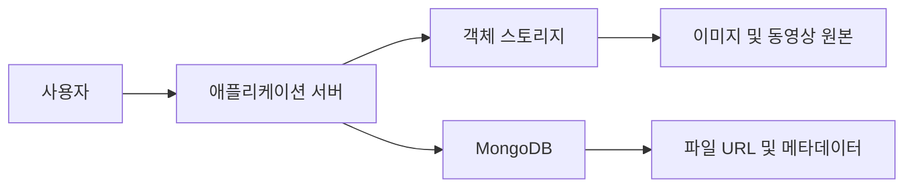
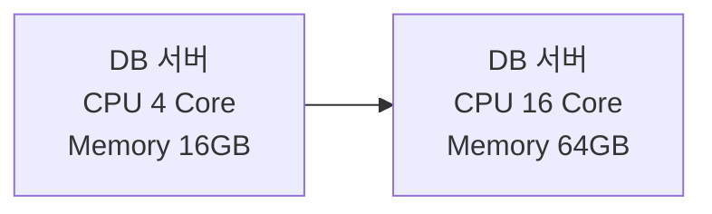
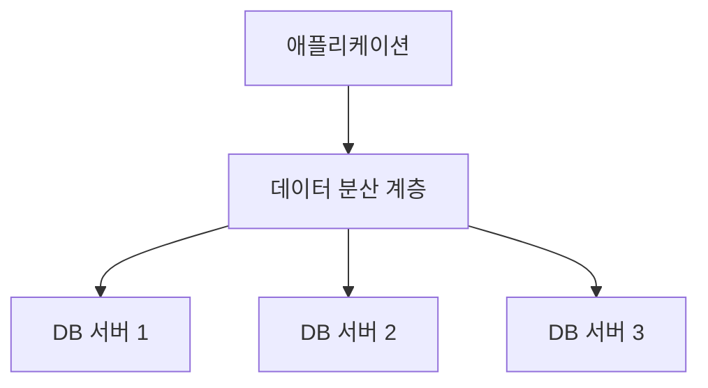
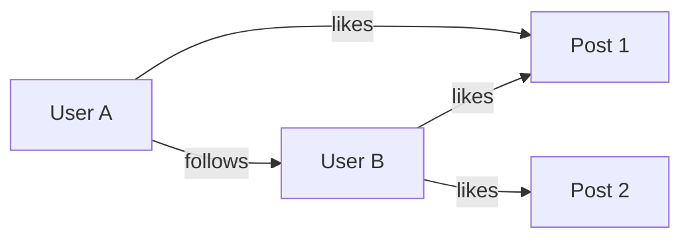
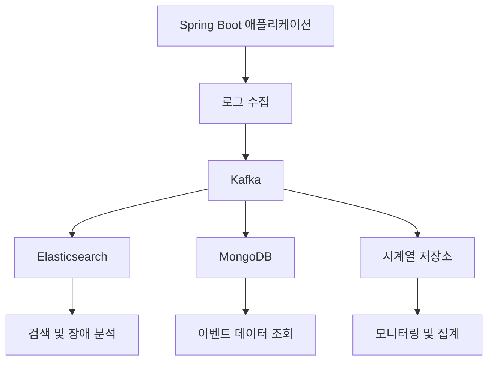
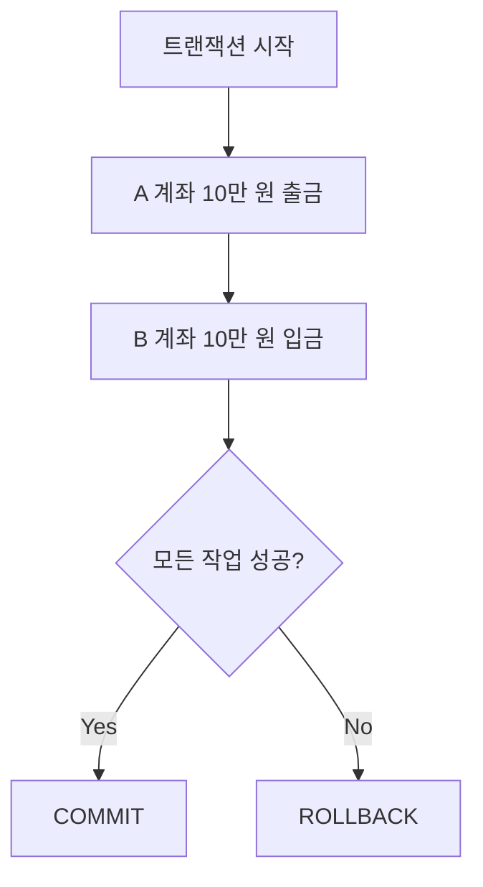
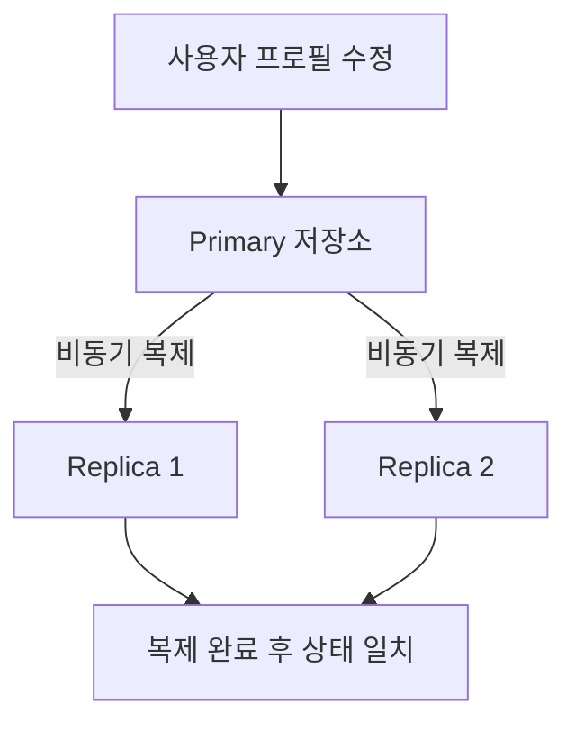
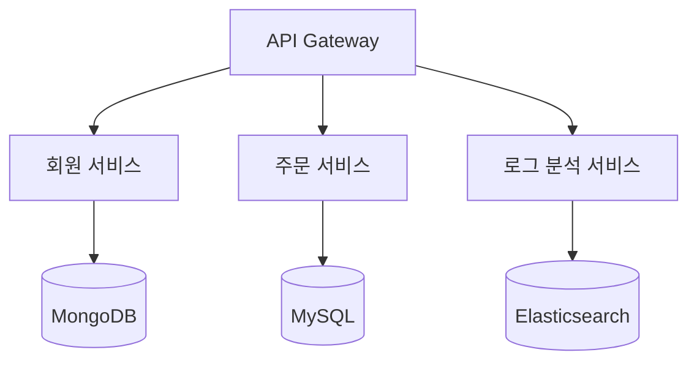
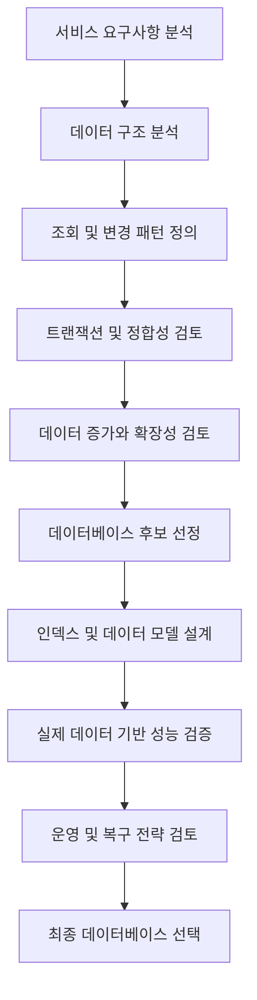

# NoSQL 이해

# NoSQL 이해

* toc
{:toc}

---

## NoSQL 이해: 개념부터 데이터베이스 유형, MongoDB와 RDBMS의 차이까지

데이터베이스를 설계할 때 가장 먼저 고민해야 하는 것은 어떤 데이터베이스 제품을 사용할 것인가가 아니다.

**어떤 데이터를 저장하고, 어떻게 조회하며, 어떤 방식으로 변경할 것인지**를 먼저 이해해야 한다.

예를 들어 사용자 정보와 결제 내역을 관리하는 시스템에서는 데이터의 정합성과 트랜잭션이 중요하다. 반면 수많은 사용자가 생성하는 이벤트 로그나 IoT 센서 데이터를 수집하는 시스템에서는 대량의 쓰기 처리, 데이터 구조의 유연성, 수평 확장성이 더욱 중요할 수 있다.

관계형 데이터베이스인 MySQL, PostgreSQL, Oracle은 테이블과 관계를 중심으로 데이터를 관리한다. 반면 NoSQL은 Key-Value, Document, Graph, Wide-column 등 다양한 데이터 모델을 제공한다.

그렇다고 RDBMS보다 NoSQL이 항상 빠르거나, 대규모 시스템에서는 반드시 NoSQL을 사용해야 하는 것은 아니다.

데이터베이스마다 적합한 데이터 구조와 접근 방식이 다르기 때문에 **서비스의 요구사항과 데이터 특성에 따라 적절한 데이터베이스를 선택하는 것**이 중요하다.

이번 글에서는 다음 내용을 중심으로 NoSQL을 살펴본다.

- NoSQL의 개념과 등장 배경
- NoSQL의 주요 특징과 유연한 스키마
- Graph, Key-Value, Wide-column, Document 데이터베이스
- 로그 데이터 유형에 따른 NoSQL 활용
- MongoDB의 문서 구조와 중첩 데이터
- RDBMS와 NoSQL의 데이터 모델 및 트랜잭션 비교
- MySQL과 MongoDB의 CRUD 명령어
- 실제 서비스에서 NoSQL을 선택하는 기준

---

## NoSQL이란?

### NoSQL의 개념

NoSQL은 일반적으로 **Not Only SQL**의 약자로 설명하며, 관계형 데이터베이스와 다른 데이터 모델을 중심으로 데이터를 저장하고 관리하는 데이터베이스 시스템을 의미한다.

여기서 중요한 부분은 `Not Only SQL`이라는 표현이다.

NoSQL은 SQL을 사용할 수 없다는 의미가 아니라, 관계형 테이블 이외의 다양한 데이터 모델을 활용한다는 의미에 가깝다.

기존 관계형 데이터베이스는 데이터를 테이블로 관리한다.

예를 들어 사용자 정보는 다음과 같이 표현할 수 있다.

| id | name | email | age |
|---|---|---|---|
| 1 | 홍길동 | hong@example.com | 30 |
| 2 | 김철수 | kim@example.com | 28 |
| 3 | 이영희 | lee@example.com | 35 |

테이블을 구성하는 컬럼과 자료형을 정의하고, 각 행에 데이터를 저장한다.

반면 MongoDB와 같은 Document 데이터베이스는 데이터를 문서 단위로 저장한다.

```json
{
  "id": 1,
  "name": "홍길동",
  "email": "hong@example.com",
  "age": 30
}
```

여기에 새로운 사용자 정보가 추가되었다고 가정해 보자.

```json
{
  "id": 2,
  "name": "김철수",
  "email": "kim@example.com",
  "age": 28,
  "address": {
    "city": "서울",
    "district": "강남구"
  },
  "interests": [
    "개발",
    "독서",
    "여행"
  ]
}
```

두 문서는 서로 다른 필드를 가지고 있다.

첫 번째 사용자에게는 `address`와 `interests`가 없지만, 두 번째 사용자에게는 해당 정보가 존재한다.

MongoDB에서는 이러한 문서들을 같은 Collection에 저장할 수 있다.

즉, NoSQL의 중요한 특징 중 하나는 **데이터의 구조가 반드시 동일하지 않아도 된다는 것**이다.

다만 이것이 모든 NoSQL이 스키마를 사용하지 않는다는 뜻은 아니다. Cassandra처럼 테이블의 컬럼과 자료형을 정의하는 제품도 있다.

### SQL과 NoSQL은 완전히 반대되는 개념일까?

엄밀하게 구분하면 SQL은 데이터를 조회하고 조작하는 질의 언어이고, 관계형 모델은 데이터를 표현하는 방식이다.

따라서 SQL과 NoSQL을 완전히 대칭적인 개념으로 이해하는 것은 정확하지 않다.

일부 NoSQL 데이터베이스는 SQL과 비슷한 질의 언어를 지원하기도 한다.

핵심은 어떤 질의 언어를 사용하는가보다 **데이터를 어떤 모델로 표현하고, 어떤 접근 패턴에 최적화했는가**이다.

---

## NoSQL이 등장한 배경

### 기존 관계형 데이터베이스의 한계

관계형 데이터베이스는 정형 데이터와 복잡한 관계를 관리하는 데 강점을 가진다.

하지만 서비스 규모가 커지고 다양한 형태의 데이터가 생성되면서 새로운 요구사항이 등장했다.

대표적으로 다음과 같은 상황을 생각할 수 있다.

1. 사용자마다 서로 다른 속성을 가진 데이터를 저장해야 한다.
2. 초당 수십만 건 이상의 이벤트 데이터를 수집해야 한다.
3. 여러 서버에 데이터를 분산하여 저장해야 한다.
4. 데이터 구조가 자주 변경된다.
5. 글로벌 서비스에서 낮은 지연 시간과 높은 가용성이 필요하다.

물론 RDBMS도 이러한 요구사항을 처리할 수 있다.

JSON 자료형, 테이블 파티셔닝, 읽기 복제본, 샤딩 등의 방법을 활용할 수 있기 때문이다.

그러나 특정 데이터 구조나 접근 패턴에서는 관계형 모델보다 다른 데이터 모델을 사용하는 것이 더 자연스럽고 효율적일 수 있다.

이러한 요구를 해결하기 위해 다양한 NoSQL 데이터베이스가 발전했다.

### 정형 데이터와 비정형 데이터

데이터는 구조에 따라 크게 세 가지로 구분할 수 있다.

| 구분 | 특징 | 대표적인 예시 |
|---|---|---|
| 정형 데이터 | 구조와 자료형이 비교적 일정함 | 회원 정보, 주문 정보, 결제 내역 |
| 반정형 데이터 | 구조는 존재하지만 필드와 중첩 형태가 달라질 수 있음 | JSON, XML, 이벤트 로그 |
| 비정형 데이터 | 고정된 필드 구조로 표현하기 어려움 | 이미지, 영상, 음성, 자유 형식 문서 |

NoSQL은 비정형 데이터만 저장하는 기술이 아니다.

정형 데이터와 반정형 데이터도 저장할 수 있으며, 제품에 따라 다양한 데이터 구조를 지원한다.

예를 들어 다음과 같은 서비스에서 NoSQL을 검토할 수 있다.

| 서비스 | 데이터 특성 |
|---|---|
| SNS | 사용자 관계, 게시물, 댓글, 좋아요 |
| IoT | 지속적으로 수집되는 센서 측정값 |
| 로그 분석 | 다양한 구조의 이벤트와 오류 정보 |
| 콘텐츠 관리 | 콘텐츠별로 서로 다른 메타데이터 |
| 추천 시스템 | 사용자와 상품 사이의 복잡한 관계 |
| 제품 카탈로그 | 상품 종류마다 다른 속성 |
| 실시간 분석 | 높은 빈도로 발생하는 이벤트 |

여기서 주의할 점이 있다.

이미지와 동영상을 관리한다고 해서 반드시 이미지 원본을 NoSQL 데이터베이스에 저장해야 하는 것은 아니다.

실무에서는 이미지와 동영상 원본을 S3 같은 객체 스토리지에 저장하고, MongoDB에는 파일의 URL과 메타데이터를 저장하는 방식을 사용할 수 있다.



이처럼 데이터 저장 위치도 데이터 특성에 맞게 분리할 수 있다.

---

## NoSQL을 사용하는 이유

### 1. 유연한 스키마

NoSQL의 대표적인 특징은 유연한 스키마다.

사용자 프로필을 관리한다고 가정해 보자.

개인 가수의 프로필에는 다음 정보가 필요할 수 있다.

```json
{
  "type": "person",
  "name": "Artist A",
  "birth_date": "1993-05-16",
  "agency": "Agency A",
  "debut_year": 2008
}
```

반면 그룹의 프로필은 구조가 달라질 수 있다.

```json
{
  "type": "group",
  "name": "Group B",
  "agency": "Agency B",
  "debut_year": 2016,
  "members": [
    "Member 1",
    "Member 2"
  ]
}
```

두 데이터는 모두 아티스트 프로필이지만 필요한 필드가 다르다.

RDBMS에서는 다음과 같은 방식으로 설계할 수 있다.

- 공통 정보를 저장하는 테이블
- 개인 아티스트의 상세 정보 테이블
- 그룹 아티스트의 상세 정보 테이블
- 그룹 구성원을 저장하는 테이블

이렇게 분리하면 참조 무결성과 중복 관리 측면에서 장점을 얻을 수 있다.

반면 MongoDB에서는 공통 정보와 유형별 정보를 하나의 문서로 표현할 수 있다.

새로운 아티스트 유형이 추가되더라도 기존 테이블 구조를 변경하지 않고 필드를 추가할 수 있다.

하지만 스키마가 유연하다는 것은 데이터 검증이 필요 없다는 의미는 아니다.

예를 들어 상품 가격을 다음과 같이 저장했다고 생각해 보자.

```json
{
  "product_id": 1,
  "price": 10000
}
```

다른 문서에서는 가격을 문자열로 저장했다.

```json
{
  "product_id": 2,
  "price": "10000"
}
```

두 값은 겉으로 보기에는 비슷하지만 자료형이 다르다.

이 상태에서는 가격 비교, 정렬, 합계 계산 과정에서 문제가 발생할 수 있다.

따라서 실무에서는 다음과 같은 규칙을 정의해야 한다.

| 검증 항목 | 예시 |
|---|---|
| 필수 필드 | `product_id`, `price` |
| 자료형 | `price`는 숫자 |
| 기본값 | `stock`이 없으면 0 |
| 값의 범위 | 가격은 0 이상 |
| 날짜 형식 | UTC 기준으로 관리 |
| 데이터 버전 | `schema_version` 필드 사용 |

MongoDB는 `Schema Validation`을 지원하므로 필요한 필드와 자료형에 대한 검증 규칙을 적용할 수 있다.

**유연한 스키마는 설계가 필요 없다는 의미가 아니라, 데이터 구조를 변경하는 방식에 선택권이 있다는 의미**로 이해하는 것이 적절하다. [MongoDB](https://www.mongodb.com/docs/manual/core/schema-validation/?msockid=26be4b20ec6b61bf200a5daced0d6035\&utm_source=chatgpt.com)

### 2. 수평 확장성

데이터베이스의 처리 능력을 확장하는 방법은 크게 수직 확장과 수평 확장으로 구분할 수 있다.

**수직 확장(Scale-Up)**

기존 서버의 CPU, 메모리, 디스크 성능을 높이는 방식이다.



구성이 비교적 단순하지만 서버 한 대가 제공할 수 있는 자원에는 한계가 있다.

**수평 확장(Scale-Out)**

서버를 추가하여 데이터를 분산 처리하는 방식이다.



많은 NoSQL 데이터베이스는 이러한 분산 환경을 고려하여 설계되었다.

MongoDB에서는 Sharding을 이용해 데이터를 여러 Shard에 분산할 수 있다.

예를 들어 회원 데이터를 분산할 때 다음과 같은 구조를 생각할 수 있다.

```text
Shard 1
 ├── User 1
 ├── User 4
 └── User 7

Shard 2
 ├── User 2
 ├── User 5
 └── User 8

Shard 3
 ├── User 3
 ├── User 6
 └── User 9
```

그러나 서버를 추가하는 것만으로 성능이 자동으로 향상되지는 않는다.

어떤 데이터를 어느 서버에 저장할 것인지 결정하는 **Shard Key**가 중요하기 때문이다.

Shard Key가 적절하지 않으면 특정 서버에 부하가 집중될 수 있다.

또한 조회 조건에 Shard Key가 포함되지 않으면 여러 Shard를 조회하는 `Scatter-Gather` 작업이 발생할 수 있다.

따라서 수평 확장은 단순히 서버의 개수를 늘리는 문제가 아니라 데이터 분산 방식과 조회 패턴을 함께 설계해야 하는 문제다. [MongoDB](https://www.mongodb.com/docs/manual/core/sharding-choose-a-shard-key/?utm_source=chatgpt.com)

### 3. 특정 데이터 모델에 최적화된 성능

NoSQL 데이터베이스는 특정 데이터 구조와 접근 방식에 맞는 기능을 제공한다.

예를 들어 다음과 같은 요구사항이 있다고 가정해 보자.

- 사용자 ID를 이용하여 세션 정보를 빠르게 조회한다.
- 특정 사용자가 팔로우하는 사람들을 탐색한다.
- 센서 ID와 시간 범위를 이용하여 측정값을 조회한다.
- 다양한 유형의 이벤트 로그를 저장한다.

이러한 요구사항에는 각각 다른 데이터 모델이 적합할 수 있다.

| 요구사항 | 검토할 수 있는 데이터 모델 |
|---|---|
| 세션 조회 | Key-Value |
| 사용자 관계 탐색 | Graph |
| 대규모 센서 데이터 | Wide-column, Time-series |
| 다양한 이벤트 데이터 | Document |
| 로그 검색 | 검색 엔진 기반 저장소 |

성능은 데이터베이스의 종류보다 실제 데이터 분포, 인덱스, 조회 조건, 네트워크 환경 등에 크게 영향을 받는다.

따라서 **NoSQL은 RDBMS보다 빠르다**는 식으로 단순하게 비교해서는 안 된다.

### 4. 다양한 기능과 API

NoSQL 데이터베이스는 각각의 데이터 모델에 맞는 API와 기능을 제공한다.

대표적인 예시는 다음과 같다.

| 데이터베이스 | 주요 기능 |
|---|---|
| Redis | Key-Value, Hash, List, Set, Sorted Set |
| MongoDB | 문서 조회, 중첩 데이터, Aggregation |
| Neo4j | 그래프 관계 탐색 |
| Cassandra | 분산 데이터 저장, Partition Key 기반 조회 |
| Elasticsearch | 전문 검색, 필터링, 집계 |
| InfluxDB | 시계열 데이터 저장과 분석 |

제품마다 제공하는 기능이 다르기 때문에 요구사항에 맞는 기술을 선택해야 한다.

---

## NoSQL의 네 가지 주요 유형

NoSQL은 데이터 모델에 따라 크게 네 가지 유형으로 구분할 수 있다.

1. Graph
2. Key-Value
3. Wide-column
4. Document

각 데이터 모델은 데이터를 저장하는 방식과 효율적으로 처리할 수 있는 조회 패턴이 다르다.

### 1. Graph Database

Graph 데이터베이스는 데이터를 **Node, Edge, Property**를 이용하여 표현한다.

| 구성 요소 | 의미 | 예시 |
|---|---|---|
| Node | 데이터의 개체 | 사용자, 게시물, 상품 |
| Edge | 개체 사이의 관계 | 팔로우, 좋아요, 구매 |
| Property | 개체 또는 관계의 속성 | 이름, 이메일, 생성 시간 |

SNS 서비스를 예시로 살펴보자.

사용자 A가 사용자 B를 팔로우하고, 사용자 A와 B가 게시물에 좋아요를 누르는 구조다.



각 사용자는 Node이고, 게시물도 Node다.

사용자 사이의 `follows` 관계와 사용자와 게시물 사이의 `likes` 관계는 Edge로 표현한다.

사용자 Node에는 다음과 같은 속성을 저장할 수 있다.

```json
{
  "user_name": "hong",
  "email": "hong@example.com",
  "date_of_birth": "1994-01-01"
}
```

게시물 Node에는 다음과 같은 속성을 저장할 수 있다.

```json
{
  "timestamp": "2025-05-21T10:00:00Z",
  "content": "Graph Database Example",
  "number_of_nodes": 10
}
```

Graph 데이터베이스는 관계를 따라 탐색하는 작업에 적합하다.

예를 들어 다음 질문을 처리한다고 가정해 보자.

> 내가 팔로우하는 사람들이 좋아요를 누른 게시물은 무엇인가?

관계형 데이터베이스에서도 JOIN을 이용하여 구현할 수 있지만, 관계가 여러 단계로 연결되어 있다면 쿼리가 복잡해질 수 있다.

Graph 데이터베이스에서는 관계 자체를 데이터 모델의 중심으로 다루기 때문에 연결 관계를 탐색하는 방식이 자연스럽다.

대표적인 활용 분야는 다음과 같다.

- SNS 팔로우 관계
- 친구 추천
- 상품 추천
- 사기 거래 탐지
- 지식 그래프
- 조직 관계 분석

대표적인 제품으로는 Neo4j 등이 있다.

다만 Graph 데이터베이스 역시 무제한으로 관계를 탐색하면 처리량이 커질 수 있으므로 탐색 깊이와 범위를 제한해야 한다.

---

### 2. Key-Value Database

Key-Value 데이터베이스는 데이터를 **고유한 Key와 Value의 쌍**으로 저장한다.

가장 단순한 형태의 데이터 모델이다.

```text
Key             Value
------------------------------------
user:1          {"name":"hong"}
user:2          {"name":"kim"}
user:3          {"name":"lee"}
```

Key를 알고 있다면 해당 Key와 연결된 Value를 조회할 수 있다.

예를 들어 사용자 정보를 다음과 같이 저장할 수 있다.

```text
Key:
user:12345

Value:
{
  "name": "foo bar",
  "email": "foo@bar.com",
  "designation": "software developer"
}
```

대표적인 Key-Value 데이터베이스는 다음과 같다.

- Redis
- Amazon DynamoDB

다만 DynamoDB는 Key-Value뿐만 아니라 Document 모델도 지원하며, Partition Key와 Sort Key를 중심으로 데이터를 설계한다.

#### Redis 예시

Redis에서는 다음과 같이 문자열 데이터를 저장할 수 있다.

```bash
SET user:1:name "hong"
SET user:1:email "hong@example.com"
```

저장한 데이터를 조회한다.

```bash
GET user:1:name
```

실행 결과는 다음과 같다.

```text
"hong"
```

Redis에서는 문자열뿐만 아니라 Hash, List, Set, Sorted Set 같은 다양한 자료구조도 사용할 수 있다.

예를 들어 Hash를 이용하면 하나의 Key 아래에 여러 필드를 저장할 수 있다.

```bash
HSET user:1 name "hong" email "hong@example.com" age "30"
```

전체 필드를 조회한다.

```bash
HGETALL user:1
```

실행 결과는 다음과 같은 형태다.

```text
1) "name"
2) "hong"
3) "email"
4) "hong@example.com"
5) "age"
6) "30"
```

Redis의 Key-Value 모델은 다음과 같은 기능에 유용하다.

| 활용 분야 | 설명 |
|---|---|
| 캐싱 | DB 조회 결과를 임시 저장 |
| 세션 관리 | 로그인 세션 정보 저장 |
| 인증 | 인증번호 및 토큰 관련 상태 저장 |
| 카운터 | 조회수, 요청 횟수 증가 |
| Rate Limiting | 일정 시간 동안의 요청 수 제한 |

Key-Value 모델은 명확한 Key를 이용한 조회에 강점을 가진다.

반면 여러 필드에 대한 복잡한 검색이 필요하다면 별도의 인덱스 구조나 다른 저장소가 필요할 수 있다.

---

### 3. Wide-column Database

Wide-column 데이터베이스는 분산된 행과 컬럼 구조를 활용하여 데이터를 저장하는 모델이다.

대표적인 제품은 다음과 같다.

- Apache Cassandra
- Apache HBase

Wide-column 계열은 넓고 희소한 데이터, 대규모 분산 저장, 정해진 키와 범위에 따른 조회 등에 활용할 수 있다.

예를 들어 사용자 정보가 다음과 같다고 가정해 보자.

| name | id | email | dob | city |
|---|---|---|---|---|
| Foo bar | 12345 | foo@bar.com | 없음 | Some city |
| Carn Yale | 34521 | bar@foo.com | 12-05-1972 | 없음 |

사용자별로 존재하는 데이터가 다르다.

HBase와 같은 Column Family 기반 저장소에서는 다음과 같이 표현할 수 있다.

```text
Row Key: 12345
 └── profile
      ├── name  : Foo bar
      ├── email : foo@bar.com
      └── city  : Some city

Row Key: 34521
 └── profile
      ├── name  : Carn Yale
      ├── email : bar@foo.com
      └── dob   : 12-05-1972
```

HBase에서는 Column Family를 정의하고, 해당 Family에 속하는 Column Qualifier를 유연하게 관리할 수 있다.

다만 Wide-column 데이터베이스의 제품별 구현 방식은 다르다.

Cassandra는 CQL 테이블을 사용하며 컬럼과 자료형을 정의한다. 따라서 모든 Wide-column 제품이 행마다 임의의 컬럼을 자유롭게 추가하는 것은 아니다.

#### Cassandra의 데이터 모델링

Cassandra에서는 데이터를 저장하는 구조보다 **어떤 조건으로 조회할 것인지**가 특히 중요하다.

예를 들어 다음과 같은 요구사항이 있다고 가정해 보자.

> 특정 센서가 하루 동안 수집한 측정값을 시간순으로 조회한다.

이 경우 다음과 같은 테이블을 설계할 수 있다.

```sql
CREATE TABLE sensor_metrics (
    sensor_id text,
    measurement_date date,
    measured_at timestamp,
    temperature double,
    humidity double,
    PRIMARY KEY (
        (sensor_id, measurement_date),
        measured_at
    )
) WITH CLUSTERING ORDER BY (
    measured_at DESC
);
```

여기서 중요한 부분은 Primary Key 구성이다.

```sql
PRIMARY KEY (
    (sensor_id, measurement_date),
    measured_at
)
```

- `sensor_id`, `measurement_date`: 복합 Partition Key
- `measured_at`: Clustering Column

같은 센서의 같은 날짜 데이터를 하나의 Partition 기준으로 묶고, 측정 시간에 따라 정렬하는 구조다.

다음과 같이 조회할 수 있다.

```sql
SELECT *
FROM sensor_metrics
WHERE sensor_id = 'sensor_001'
  AND measurement_date = '2025-05-21';
```

이런 구조는 센서 ID와 날짜를 알고 데이터를 조회하는 경우에 적합하다.

반면 모든 센서의 전체 데이터를 자유롭게 검색하는 작업에는 적합하지 않을 수 있다.

따라서 Cassandra에서는 자주 사용하는 조회 조건을 먼저 분석하고, 해당 조건에 맞게 Partition Key를 설계하는 것이 중요하다.

Wide-column 데이터베이스는 일반적인 분석용 Columnar Database와도 구분해야 한다.

컬럼 기반 압축과 전체 컬럼 스캔을 중심으로 하는 데이터 웨어하우스의 특성을 그대로 Cassandra나 HBase에 적용해서는 안 된다.

---

### 4. Document Database

Document 데이터베이스는 데이터를 문서 단위로 저장하는 모델이다.

대표적인 제품으로는 MongoDB가 있다.

문서는 필드와 값으로 이루어지며, 중첩 객체와 배열을 포함할 수 있다.

MongoDB는 데이터를 BSON(Binary JSON) 형식으로 저장한다.

BSON은 JSON과 유사한 구조를 표현하지만, `ObjectId`, 날짜 등의 추가 자료형을 지원하는 바이너리 형식이다.

#### MongoDB 문서 구조

다음은 사용자 정보를 저장한 문서다.

```javascript
{
  _id: ObjectId("64b8b94f5f92a9a8b1c12345"),
  name: "홍길동",
  email: "hong.gd@example.com",
  address: {
    city: "서울",
    district: "강남구",
    street: "역삼로 10길 5"
  }
}
```

이 문서에서 `address`는 중첩 객체다.

```text
User Document
 ├── _id
 ├── name
 ├── email
 └── address
      ├── city
      ├── district
      └── street
```

관계형 데이터베이스에서는 사용자와 주소를 별도의 테이블로 나누어 관리할 수 있다.

반면 MongoDB에서는 관련된 데이터를 하나의 문서 안에 저장할 수 있다.

이러한 구조를 **Embedded Document**라고 한다.

#### Document 데이터베이스의 장점

사용자 정보를 조회할 때 주소 정보가 항상 필요하다면 하나의 문서로 가져오는 것이 편리할 수 있다.

```javascript
db.users.findOne({
  name: "홍길동"
});
```

조회 결과에 사용자 기본 정보와 주소가 함께 포함된다.

따라서 애플리케이션에서 별도의 주소 조회나 JOIN을 수행하지 않아도 된다.

그러나 모든 데이터를 하나의 문서에 넣는 것이 좋은 설계는 아니다.

MongoDB는 일반 BSON 문서의 크기를 최대 16MiB로 제한한다.

계속 증가하는 이벤트 목록이나 전체 주문 내역을 한 문서에 무제한으로 추가하면 문서 크기와 갱신 비용 문제가 발생할 수 있다. [MongoDB](https://www.mongodb.com/docs/manual/core/document/?utm_source=chatgpt.com)

따라서 다음과 같이 구분해서 생각해야 한다.

| 데이터 특성 | 고려할 수 있는 모델 |
|---|---|
| 항상 함께 조회하는 정보 | Embedded Document |
| 크기가 제한된 목록 | 배열 또는 Embedded Document |
| 독립적으로 관리되는 정보 | 별도 Collection |
| 여러 문서에서 공유하는 정보 | Reference |
| 계속 증가하는 이벤트 | 개별 문서 또는 분리된 Collection |

이 차이는 이후 MongoDB 데이터 모델링에서 중요한 기준이 된다.

---

## 로그 데이터로 이해하는 NoSQL 활용

로그 데이터는 NoSQL의 특성을 이해하기 좋은 사례다.

모든 로그가 동일한 구조를 가지는 것은 아니기 때문이다.

서버 접속 로그, 사용자 행동 로그, 센서 데이터, 시스템 모니터링 로그는 서로 다른 필드를 가진다.

따라서 데이터를 저장하는 것뿐만 아니라 **어떤 정보를 기준으로 검색하고 분석할 것인지**를 고려해야 한다.

### 1. 서버 액세스 로그

서버 액세스 로그는 웹 서버에 접근한 요청 정보를 기록한다.

```json
{
  "ip": "192.168.1.10",
  "timestamp": "2025-05-21T14:35:22Z",
  "method": "GET",
  "url": "/index.html",
  "status_code": 200,
  "response_time": 123,
  "user_agent": "Mozilla/5.0 (Windows NT 10.0; Win64; x64)"
}
```

각 필드의 의미는 다음과 같다.

| 필드 | 설명 |
|---|---|
| ip | 요청자의 IP 주소 |
| timestamp | 요청 발생 시간 |
| method | HTTP Method |
| url | 요청 URL |
| status_code | HTTP 응답 코드 |
| response_time | 응답에 소요된 시간 |
| user_agent | 클라이언트 정보 |

이 데이터를 활용하면 다음과 같은 분석을 수행할 수 있다.

- 특정 URL의 요청 수
- HTTP 4xx, 5xx 오류 비율
- 평균 응답 시간
- 특정 IP의 요청 패턴
- 시간대별 트래픽 변화

실무에서는 `response_time`의 단위를 밀리초인지 마이크로초인지 명확하게 정의해야 한다.

서로 다른 서비스에서 수집한 로그를 통합하려면 시간과 측정값의 단위가 일관되어야 한다.

### 2. 애플리케이션 이벤트 로그

애플리케이션 이벤트 로그는 사용자의 행동이나 서비스 내부에서 발생한 이벤트를 기록한다.

```json
{
  "event_id": "evt_12345",
  "timestamp": "2025-05-21T14:40:10Z",
  "user_id": "user_6789",
  "event_type": "button_click",
  "details": {
    "button_id": "submit_order",
    "page": "checkout"
  }
}
```

여기서 중요한 부분은 `details`다.

```json
{
  "button_id": "submit_order",
  "page": "checkout"
}
```

버튼 클릭 이벤트라면 버튼 ID와 페이지 정보가 필요하다.

하지만 상품 구매 이벤트라면 다른 정보가 필요할 수 있다.

```json
{
  "event_id": "evt_12346",
  "timestamp": "2025-05-21T14:41:00Z",
  "user_id": "user_6789",
  "event_type": "purchase",
  "details": {
    "order_id": "order_10001",
    "product_id": "product_20001",
    "amount": 29000
  }
}
```

두 이벤트는 같은 공통 필드를 사용하지만 `details`의 구조가 다르다.

Document 데이터베이스에서는 이러한 이벤트를 유연하게 저장할 수 있다.

다만 이벤트마다 필드가 달라진다고 하더라도 공통 규칙은 필요하다.

예를 들어 다음 정보는 일관되게 관리하는 것이 좋다.

- `event_id`
- `event_type`
- `timestamp`
- `user_id`
- `schema_version`

이벤트를 생산하는 서비스와 소비하는 서비스가 다르다면 필드 이름과 자료형이 변경될 때 호환성 문제도 고려해야 한다.

### 3. 시스템 성능 및 모니터링 로그

서버의 CPU, 메모리, 디스크 사용량 등을 수집하는 데이터다.

```json
{
  "timestamp": "2025-05-21T14:50:00Z",
  "cpu_usage": 75,
  "memory_usage": 65,
  "disk_io": {
    "read": 120,
    "write": 85
  },
  "hostname": "server_1"
}
```

이러한 데이터는 시간의 흐름에 따른 변화를 분석하는 경우가 많다.

예를 들어 다음과 같은 정보를 확인할 수 있다.

- 최근 5분간 평균 CPU 사용률
- 특정 시간대의 최대 메모리 사용률
- 디스크 읽기 및 쓰기 변화
- 장애 발생 직전의 서버 상태

따라서 `hostname`과 `timestamp`를 중심으로 데이터를 조회하는 패턴이 중요하다.

이런 데이터는 시간 기반 집계가 많기 때문에 InfluxDB와 같은 시계열 데이터베이스를 검토할 수 있다.

### 4. 네트워크 트래픽 로그

네트워크 트래픽 로그는 네트워크 통신과 관련된 데이터를 기록한다.

```json
{
  "timestamp": "2025-05-21T15:00:00Z",
  "source_ip": "10.0.0.5",
  "destination_ip": "8.8.8.8",
  "protocol": "TCP",
  "bytes_sent": 1500,
  "bytes_received": 3000,
  "port": 443
}
```

주로 다음과 같은 분석에 활용할 수 있다.

- IP별 전송량 분석
- 특정 포트의 접근 빈도
- 비정상적인 트래픽 탐지
- 네트워크 병목 분석
- 보안 이벤트 탐지

네트워크 로그는 시간 범위와 IP 조건을 함께 조회하는 경우가 많다.

따라서 저장소를 선택할 때 해당 조건의 검색 성능을 고려해야 한다.

### 5. 애플리케이션 에러 로그

애플리케이션에서 예외가 발생했을 때 기록하는 로그다.

```json
{
  "error_id": "err_98765",
  "timestamp": "2025-05-21T15:10:30Z",
  "error_type": "NullReferenceException",
  "message": "Object reference not set to an instance of an object.",
  "stack_trace": "at Namespace.Class.Method() in File.cs:line 45",
  "user_id": "user_1234",
  "severity": "error"
}
```

이 데이터는 구조화된 필드와 긴 문자열이 함께 존재한다.

예를 들어 다음과 같은 조회가 필요할 수 있다.

- 특정 에러 유형 검색
- 심각도별 에러 집계
- 특정 사용자의 오류 발생 이력
- 오류 메시지 검색
- Stack Trace 기반 장애 원인 분석

이 경우 Elasticsearch처럼 검색과 집계에 특화된 저장소를 활용할 수 있다.

또한 운영 로그에 사용자 정보와 요청 데이터가 포함될 수 있으므로 민감정보 마스킹도 중요하다.

### 6. 데이터베이스 쿼리 로그

데이터베이스에서 실행된 SQL과 처리 결과를 기록하는 로그다.

```json
{
  "query_id": "qry_123456",
  "timestamp": "2025-05-21T15:15:00Z",
  "sql": "SELECT * FROM users WHERE user_id = 'user_1234'",
  "execution_time_ms": 45,
  "result_count": 1,
  "status": "success"
}
```

이 데이터에서는 다음과 같은 분석이 가능하다.

- 실행 시간이 긴 쿼리 검색
- 반복적으로 실행되는 쿼리 분석
- 오류가 발생한 쿼리 확인
- 시간대별 데이터베이스 부하 분석

실무에서는 SQL 원문에 민감한 값이 포함될 수 있으므로 쿼리를 정규화하거나 개인정보를 제거하는 정책도 필요하다.

### 7. IoT 센서 데이터

IoT 환경에서는 센서가 일정한 주기로 측정값을 전달한다.

```json
{
  "sensor_id": "sensor_001",
  "timestamp": "2025-05-21T15:20:00Z",
  "temperature": 22.5,
  "humidity": 55,
  "vibration": 0.02
}
```

대표적인 조회 패턴은 다음과 같다.

```text
sensor_001의 최근 1시간 온도 데이터 조회

sensor_001의 하루 평균 습도 조회

전체 센서의 최근 진동 이상값 조회
```

이러한 데이터는 시간 순서로 계속 증가하는 특징이 있다.

따라서 다음 요소를 함께 고려해야 한다.

- 센서 ID
- 시간 범위
- 수집 주기
- 데이터 보관 기간
- 오래된 데이터의 집계 및 삭제
- 초당 데이터 입력량

특히 장기간 데이터를 수집한다면 모든 원본 데이터를 영구적으로 보관하기보다 일정 시간이 지난 데이터를 요약하거나 다른 저장소로 이동하는 정책이 필요할 수 있다.

### 8. 사용자 행동 분석 로그

사용자가 어떤 페이지를 방문하고 어떤 행동을 했는지 기록하는 데이터다.

```json
{
  "session_id": "sess_7890",
  "user_id": "user_5678",
  "page_views": [
    {
      "page": "/home",
      "duration": 15
    },
    {
      "page": "/product/123",
      "duration": 30
    },
    {
      "page": "/cart",
      "duration": 10
    }
  ],
  "actions": [
    "click_button",
    "add_to_cart",
    "purchase"
  ]
}
```

`page_views`는 배열이며, 배열 내부에 여러 객체가 포함되어 있다.

사용자가 방문한 페이지와 체류 시간을 하나의 문서로 표현할 수 있다.

다만 모든 행동을 하나의 문서에 계속 누적하는 구조는 주의해야 한다.

사용자가 장기간 서비스를 이용할수록 문서 크기가 커질 수 있기 때문이다.

이 경우 세션 단위로 데이터를 분리하거나 개별 이벤트를 별도로 저장하는 방식을 검토할 수 있다.

---

## 로그 데이터에 적합한 NoSQL 데이터베이스

지금까지 다양한 로그 구조를 살펴보았다.

중요한 점은 로그가 JSON 형태라고 해서 무조건 MongoDB에 저장해야 하는 것은 아니라는 것이다.

로그의 데이터 구조뿐만 아니라 조회와 분석 목적에 따라 적합한 데이터베이스가 달라진다.

| 데이터베이스 | 주요 특징 | 적합한 활용 사례 |
|---|---|---|
| MongoDB | 유연한 문서 구조 | 다양한 이벤트 및 애플리케이션 로그 |
| Cassandra | 높은 분산 확장성, 대량 쓰기 처리 | 대규모 이벤트 및 시간 기반 데이터 |
| Elasticsearch | 검색과 필터링, 집계 | 로그 검색 및 장애 분석 |
| InfluxDB | 시계열 데이터 처리 | 시스템 모니터링 및 IoT 데이터 |

### MongoDB

MongoDB는 문서 구조가 유연하다는 장점이 있다.

이벤트 유형마다 다른 필드를 사용하더라도 하나의 Collection에 저장할 수 있다.

또한 중첩 객체와 배열을 활용하여 복잡한 구조의 데이터를 표현할 수 있다.

### Cassandra

Cassandra는 여러 서버에 데이터를 분산하여 저장하는 환경에 적합하다.

높은 쓰기 처리량과 분산 저장이 중요한 시스템에서 검토할 수 있다.

다만 효율적인 조회를 위해 Partition Key와 Clustering Column을 신중하게 설계해야 한다.

### Elasticsearch

Elasticsearch는 검색 중심의 데이터 처리에 적합하다.

특정 오류 메시지를 검색하거나 여러 조건으로 로그를 필터링하고 집계하는 작업에 활용할 수 있다.

예를 들어 다음과 같은 분석이 가능하다.

```text
최근 10분 동안 발생한 HTTP 500 오류

특정 서비스에서 발생한 NullPointerException

특정 사용자 요청의 오류 로그

오류 발생 빈도의 시간대별 변화
```

### InfluxDB

InfluxDB는 시계열 데이터를 저장하고 분석하는 용도로 활용할 수 있다.

CPU 사용률, 메모리 사용량, 센서 측정값처럼 시간에 따라 변화하는 데이터를 처리할 때 검토할 수 있다.

### 로그를 저장하는 시스템의 구성

대규모 환경에서는 여러 저장소를 조합할 수도 있다.



이 구조는 여러 저장소를 조합하는 방법을 설명하기 위한 예시다.

실제 서비스에서는 같은 데이터를 모두 저장할 필요가 없다.

저장소를 늘리면 다음과 같은 운영 비용도 증가한다.

- 데이터 동기화
- 중복 저장
- 장애 복구
- 접근 권한 관리
- 보관 기간 관리
- 인프라 비용

따라서 서비스에 필요한 조회 패턴을 기준으로 저장소를 선택하는 것이 중요하다.

---

## RDBMS와 MongoDB의 데이터 모델 비교

### 관계형 데이터베이스의 데이터 저장 구조

사용자와 취미 정보를 저장한다고 가정해 보자.

한 사용자는 여러 개의 취미를 가질 수 있다.

RDBMS에서는 다음과 같이 데이터를 분리할 수 있다.

**User 테이블**

| ID | first_name | last_name | cell | city |
|---|---|---|---|---|
| 1 | Leslie | Yepp | 8125552344 | Pawnee |

**Hobbies 테이블**

| ID | user_id | hobby |
|---|---|---|
| 10 | 1 | scrapbooking |
| 11 | 1 | eating waffles |
| 12 | 1 | working |

User 테이블과 Hobbies 테이블은 `user_id`를 통해 연결된다.

이 구조에서 사용자와 취미를 함께 조회하려면 JOIN을 사용할 수 있다.

```sql
SELECT
    u.id,
    u.first_name,
    u.last_name,
    u.cell,
    u.city,
    h.hobby
FROM users u
LEFT JOIN hobbies h
    ON u.id = h.user_id
WHERE u.id = 1;
```

이 쿼리는 사용자 정보와 취미 정보를 결합하여 반환한다.

결과는 다음과 같은 형태다.

| id | first_name | last_name | city | hobby |
|---|---|---|---|---|
| 1 | Leslie | Yepp | Pawnee | scrapbooking |
| 1 | Leslie | Yepp | Pawnee | eating waffles |
| 1 | Leslie | Yepp | Pawnee | working |

사용자가 세 가지 취미를 가지고 있기 때문에 사용자 정보가 세 행에 반복되어 나타난다.

애플리케이션에서는 이를 다시 하나의 사용자 객체와 취미 목록으로 구성할 수 있다.

### MongoDB의 데이터 저장 구조

MongoDB에서는 사용자와 취미를 하나의 문서에 저장할 수 있다.

```json
{
  "_id": 1,
  "first_name": "Leslie",
  "last_name": "Yepp",
  "cell": "8125552344",
  "city": "Pawnee",
  "hobbies": [
    "scrapbooking",
    "eating waffles",
    "working"
  ]
}
```

관계형 모델에서는 사용자와 취미를 서로 다른 테이블에 저장했지만 MongoDB에서는 하나의 문서에 저장한다.

이 경우 사용자 정보를 조회하면 취미 정보도 함께 가져올 수 있다.

```javascript
db.users.findOne({
  _id: 1
});
```

별도의 JOIN 없이 필요한 정보를 조회할 수 있다는 장점이 있다.

하지만 이 특징을 **MongoDB에서는 정규화나 JOIN이 전혀 필요 없다**는 의미로 이해해서는 안 된다.

MongoDB에서도 Collection을 분리하고 참조를 사용할 수 있으며, `$lookup`을 이용하여 데이터를 결합할 수 있다.

### 정규화와 비정규화의 차이

관계형 데이터베이스에서는 데이터 중복과 변경 이상을 줄이기 위해 정규화를 활용한다.

반면 Document 데이터베이스에서는 함께 조회하는 데이터를 하나의 문서에 포함하는 비정규화 구조를 적극적으로 검토할 수 있다.

예를 들어 주문 정보를 생각해 보자.

```json
{
  "order_id": "order_10001",
  "user_id": "user_100",
  "order_status": "PAID",
  "items": [
    {
      "product_id": "product_1",
      "product_name": "Keyboard",
      "quantity": 1,
      "price": 50000
    },
    {
      "product_id": "product_2",
      "product_name": "Mouse",
      "quantity": 2,
      "price": 20000
    }
  ],
  "total_amount": 90000
}
```

주문과 주문 상품을 하나의 문서로 표현했다.

주문 상세 화면에서 주문 정보와 상품 목록을 항상 함께 조회한다면 이러한 구조가 유용할 수 있다.

또한 주문 당시 상품명과 가격을 보존해야 한다면 주문 문서에 해당 값을 저장하는 방식이 자연스러울 수 있다.

하지만 여기서 중요한 점은 데이터 중복에 대한 정책이다.

상품 이름이 변경되었다고 해서 과거 주문 상품명도 모두 변경해야 하는 것은 아니다.

주문 당시의 거래 정보를 보존하는 것이 요구사항이라면 중복된 데이터가 오히려 필요한 경우도 있다.

따라서 정규화와 비정규화를 단순히 좋은 설계와 나쁜 설계로 구분해서는 안 된다.

**데이터가 함께 조회되는지, 함께 변경되어야 하는지, 변경 이력을 보존해야 하는지**에 따라 적절한 구조가 달라진다.

---

## RDBMS와 NoSQL의 차이점

RDBMS와 NoSQL은 데이터 모델, 스키마, 트랜잭션, 확장 방식 등에서 차이를 가진다.

| 구분 | RDBMS | NoSQL |
|---|---|---|
| 데이터 모델 | 테이블과 관계 | Document, Key-Value, Graph, Wide-column |
| 스키마 | 명시적인 스키마와 제약 조건 중심 | 제품에 따라 유연한 구조 지원 |
| 관계 표현 | 외래 키, JOIN | Embedded Document, Reference, Graph 관계 |
| 트랜잭션 | ACID 트랜잭션 지원 | 제품과 구성에 따라 ACID 지원 범위가 다름 |
| 확장 방식 | 수직 확장, 복제, 분산 구성 | 수평 확장을 고려한 제품이 많음 |
| 조회 방식 | SQL | 제품별 API 및 질의 언어 |
| 데이터 구조 변경 | 스키마 변경을 고려해야 함 | 일부 모델에서 구조 변경이 비교적 유연함 |
| 성능 | 쿼리, 인덱스, 데이터 모델에 영향받음 | 접근 패턴, 키 설계, 분산 구조에 영향받음 |

여기서 특히 중요한 개념은 ACID와 BASE다.

---

## ACID와 BASE 이해

### ACID란?

ACID는 데이터베이스 트랜잭션의 주요 특성을 나타낸다.

| 속성 | 설명 |
|---|---|
| Atomicity | 트랜잭션의 모든 작업이 성공하거나 모두 실패해야 함 |
| Consistency | 트랜잭션 전후에 정의된 데이터 무결성 규칙이 유지되어야 함 |
| Isolation | 동시에 수행되는 트랜잭션 사이의 간섭을 제어함 |
| Durability | 커밋된 결과가 정해진 내구성 보장에 따라 유지되어야 함 |

예를 들어 계좌 이체를 생각해 보자.

A 계좌에서 10만 원을 출금하고 B 계좌에 10만 원을 입금한다.

```text
A 계좌 : 500,000원
B 계좌 : 300,000원
```

10만 원을 이체하면 다음과 같이 변경되어야 한다.

```text
A 계좌 : 400,000원
B 계좌 : 400,000원
```

그런데 A 계좌에서 출금한 이후 B 계좌 입금에 실패했다고 가정해 보자.

출금만 반영된다면 데이터의 정합성이 깨진다.

따라서 두 작업은 하나의 트랜잭션으로 처리해야 한다.



이처럼 ACID는 트랜잭션의 정합성과 안정성을 이해하는 중요한 개념이다.

### BASE란?

BASE는 분산 시스템에서 가용성과 최종 일관성을 설명할 때 사용되는 개념이다.

| 속성 | 의미 |
|---|---|
| Basically Available | 장애가 발생하더라도 가능한 범위에서 서비스의 응답을 유지하는 방향 |
| Soft State | 복제나 비동기 처리에 따라 상태가 일시적으로 달라질 수 있음 |
| Eventual Consistency | 새로운 변경이 없고 동기화가 완료되면 복제본의 상태가 일치하도록 하는 모델 |

예를 들어 사용자의 프로필 변경 사항이 여러 서버에 비동기로 복제된다고 생각해 보자.



비동기 복제가 완료되기 전에는 복제본에서 이전 값을 읽을 수 있다.

이후 복제가 완료되면 변경된 값이 반영된다.

다만 모든 NoSQL이 최종 일관성만 제공하는 것은 아니다.

MongoDB는 단일 문서에 대한 원자적 변경을 지원하며, 여러 문서에 걸친 ACID 트랜잭션도 지원한다.

따라서 **RDBMS는 ACID, NoSQL은 BASE**라고 완전히 나누는 것은 부정확하다.

실제로 어떤 데이터 일관성이 보장되는지는 데이터베이스 제품, 읽기·쓰기 설정, 배포 구조에 따라 달라진다. [MongoDB](https://www.mongodb.com/docs/manual/core/transactions/?tck=docs\&utm_source=chatgpt.com)

### MongoDB의 트랜잭션

MongoDB에서는 하나의 문서에 대한 변경이 원자적으로 처리된다.

예를 들어 다음과 같은 상품 정보가 있다고 가정해 보자.

```json
{
  "_id": 1,
  "name": "Keyboard",
  "stock": 10,
  "sales_count": 0
}
```

상품 구매 시 재고를 감소시키고 판매 수량을 증가시켜야 한다.

```javascript
db.products.updateOne(
  {
    _id: 1,
    stock: {
      $gt: 0
    }
  },
  {
    $inc: {
      stock: -1,
      sales_count: 1
    }
  }
);
```

이 작업에서는 다음 변경이 하나의 문서에 적용된다.

```text
stock       : 10 → 9
sales_count : 0  → 1
```

두 필드는 하나의 문서 안에서 원자적으로 변경된다.

또한 `stock > 0` 조건을 사용하므로 재고가 없는 상품의 수량을 무조건 감소시키는 문제를 방지할 수 있다.

하지만 여러 문서에 걸쳐 작업해야 한다면 별도의 트랜잭션이 필요할 수 있다.

특히 `updateMany()`는 각 문서에 대한 변경이 원자적이더라도 전체 작업이 자동으로 하나의 원자적 트랜잭션이 되는 것은 아니다.

따라서 단일 문서의 원자성과 다중 문서 트랜잭션은 구분해서 이해해야 한다.

---

## MySQL과 MongoDB의 프로세스 및 접속 방식

### 서버 프로세스와 클라이언트

MySQL과 MongoDB는 서버 프로세스와 클라이언트 도구가 다르다.

| 구분 | MySQL | MongoDB |
|---|---|---|
| 서버 프로세스 | `mysqld` | `mongod` |
| 클라이언트 | `mysql` | `mongosh` |
| 데이터베이스 | Database | Database |
| 데이터 묶음 | Table | Collection |
| 기본 데이터 단위 | Row | Document |

### MySQL 접속

MySQL 서버가 실행 중이라면 다음 명령어로 접속할 수 있다.

```bash
mysql -u root -p
```

각 옵션의 의미는 다음과 같다.

| 옵션 | 의미 |
|---|---|
| `-u root` | root 사용자로 접속 |
| `-p` | 비밀번호 입력 요청 |

접속에 성공하면 다음과 같은 프롬프트가 표시된다.

```text
mysql>
```

운영 환경에서는 일반적으로 root 계정 대신 필요한 권한만 가진 별도 계정을 사용한다.

### MongoDB 접속

MongoDB는 `mongosh`를 이용해 접속할 수 있다.

```bash
mongosh
```

로컬 MongoDB에 명시적으로 접속하려면 다음과 같이 작성할 수 있다.

```bash
mongosh "mongodb://127.0.0.1:27017"
```

접속에 성공하면 현재 데이터베이스 이름이 포함된 프롬프트가 나타날 수 있다.

```text
test>
```

여기서 `mongod`는 MongoDB 서버이고, `mongosh`는 MongoDB 서버에 명령어를 전달하는 클라이언트다.

두 프로세스를 구분해야 한다.

---

## MySQL과 MongoDB의 CRUD 비교

CRUD는 데이터베이스에서 가장 기본적인 네 가지 작업을 의미한다.

| CRUD | 의미 |
|---|---|
| Create | 데이터 생성 |
| Read | 데이터 조회 |
| Update | 데이터 수정 |
| Delete | 데이터 삭제 |

MySQL은 SQL을 사용하고 MongoDB는 Collection 메서드와 질의 객체를 사용한다.

### 1. 데이터 생성: INSERT

#### MySQL

먼저 데이터베이스를 생성한다.

```sql
CREATE DATABASE IF NOT EXISTS nosql_demo;
```

데이터베이스를 선택한다.

```sql
USE nosql_demo;
```

사용자 테이블을 생성한다.

```sql
CREATE TABLE IF NOT EXISTS users (
    id BIGINT AUTO_INCREMENT PRIMARY KEY,
    name VARCHAR(100) NOT NULL,
    city VARCHAR(100) NOT NULL
);
```

데이터를 추가한다.

```sql
INSERT INTO users (name, city)
VALUES ('lee', 'seoul');
```

#### MongoDB

MongoDB에서는 다음과 같이 데이터베이스를 선택한다.

```javascript
use nosql_demo
```

문서를 추가한다.

```javascript
db.users.insertOne({
  name: "lee",
  city: "seoul"
});
```

`insertOne()`은 하나의 문서를 추가한다.

문서에 `_id`가 없다면 MongoDB가 `_id` 값을 생성한다.

예를 들어 다음과 같은 결과가 반환될 수 있다.

```javascript
{
  acknowledged: true,
  insertedId: ObjectId("...")
}
```

여러 문서를 한 번에 추가하려면 `insertMany()`를 사용할 수 있다.

```javascript
db.users.insertMany([
  {
    name: "kim",
    city: "seoul"
  },
  {
    name: "park",
    city: "busan"
  }
]);
```

### 2. 데이터 조회: SELECT

#### MySQL

```sql
SELECT *
FROM users
WHERE name = 'lee';
```

`name`이 `lee`인 데이터를 조회한다.

#### MongoDB

```javascript
db.users.find({
  name: "lee"
});
```

`find()`는 조건에 일치하는 문서를 조회한다.

하나의 문서만 조회하려면 `findOne()`을 사용할 수 있다.

```javascript
db.users.findOne({
  name: "lee"
});
```

MongoDB에서는 중첩 필드를 조회할 수도 있다.

예를 들어 다음 문서가 있다고 가정해 보자.

```javascript
{
  name: "hong",
  address: {
    city: "seoul",
    district: "gangnam"
  }
}
```

`address.city`가 `seoul`인 문서를 검색하려면 다음과 같이 작성한다.

```javascript
db.users.find({
  "address.city": "seoul"
});
```

이처럼 점 표기법을 이용하여 중첩 문서의 필드에 접근할 수 있다.

### 3. 데이터 수정: UPDATE

#### MySQL

```sql
UPDATE users
SET city = 'busan'
WHERE name = 'lee';
```

`name`이 `lee`인 사용자의 `city`를 `busan`으로 변경한다.

#### MongoDB

한 개의 문서를 수정하려면 `updateOne()`을 사용할 수 있다.

```javascript
db.users.updateOne(
  {
    name: "lee"
  },
  {
    $set: {
      city: "busan"
    }
  }
);
```

여기서 `$set`은 특정 필드의 값을 변경하는 연산자다.

여러 문서를 수정하려면 `updateMany()`를 사용한다.

```javascript
db.users.updateMany(
  {
    name: "lee"
  },
  {
    $set: {
      city: "busan"
    }
  }
);
```

두 메서드의 차이는 다음과 같다.

| 메서드 | 설명 |
|---|---|
| `updateOne()` | 조건에 맞는 문서 한 개 수정 |
| `updateMany()` | 조건에 맞는 여러 문서 수정 |

실무에서는 수정할 대상을 정확하게 지정하는 것이 중요하다.

특히 이름은 중복될 수 있으므로 고유한 `_id`를 사용하는 편이 안전하다.

```javascript
db.users.updateOne(
  {
    _id: ObjectId("64b8b94f5f92a9a8b1c12345")
  },
  {
    $set: {
      city: "busan"
    }
  }
);
```

### 4. 데이터 삭제: DELETE

#### MySQL

```sql
DELETE FROM users
WHERE name = 'lee';
```

조건에 일치하는 사용자 데이터를 삭제한다.

#### MongoDB

한 개의 문서를 삭제하려면 `deleteOne()`을 사용한다.

```javascript
db.users.deleteOne({
  name: "lee"
});
```

여러 문서를 삭제하려면 `deleteMany()`를 사용한다.

```javascript
db.users.deleteMany({
  name: "lee"
});
```

두 메서드의 차이는 다음과 같다.

| 메서드 | 설명 |
|---|---|
| `deleteOne()` | 조건에 맞는 문서 한 개 삭제 |
| `deleteMany()` | 조건에 맞는 여러 문서 삭제 |

삭제 작업에서는 특히 조건을 정확하게 지정해야 한다.

다음과 같은 명령어는 주의가 필요하다.

```javascript
db.users.deleteMany({});
```

빈 조건 `{}`은 모든 문서와 일치한다.

따라서 이 명령어는 Collection의 전체 문서를 삭제하는 작업으로 이어질 수 있다.

---

## MongoDB CRUD 명령어의 버전별 차이

MongoDB의 오래된 예제에서는 다음과 같은 메서드를 볼 수 있다.

```javascript
db.users.insert({
  name: "lee",
  city: "seoul"
});
```

```javascript
db.users.find({
  name: "lee"
});
```

```javascript
db.users.update(
  {
    name: "lee"
  },
  {
    $set: {
      city: "busan"
    }
  }
);
```

```javascript
db.users.remove({
  name: "lee"
});
```

하지만 `mongosh`에서는 `insert()`, `update()`, `remove()` 같은 레거시 메서드가 더 이상 권장되지 않는다.

공식 문서에서도 해당 메서드들을 Deprecated로 표시하고 있다. [MongoDB](https://www.mongodb.com/docs/manual/reference/method/?utm_source=chatgpt.com)

현재는 처리 대상이 한 개인지 여러 개인지를 명확하게 드러내는 메서드를 사용하는 편이 좋다.

| 작업 | 레거시 메서드 | 권장 메서드 |
|---|---|---|
| 문서 추가 | `insert()` | `insertOne()`, `insertMany()` |
| 문서 조회 | `find()` | `find()`, `findOne()` |
| 문서 수정 | `update()` | `updateOne()`, `updateMany()` |
| 문서 삭제 | `remove()` | `deleteOne()`, `deleteMany()` |

특히 `update()`는 기본적으로 하나의 문서를 수정하는 동작이었기 때문에 `updateMany()`와 동일하다고 생각해서는 안 된다.

메서드 이름만 변경된 것이 아니라 작업 범위를 명확하게 구분하는 것이 중요하다.

---

## MySQL과 MongoDB CRUD 전체 예제

앞에서 살펴본 CRUD를 하나의 흐름으로 정리해 보자.

### MySQL 전체 예제

```sql
-- 데이터베이스 생성
CREATE DATABASE IF NOT EXISTS nosql_demo;

-- 데이터베이스 선택
USE nosql_demo;

-- 사용자 테이블 생성
CREATE TABLE IF NOT EXISTS users (
    id BIGINT AUTO_INCREMENT PRIMARY KEY,
    name VARCHAR(100) NOT NULL,
    city VARCHAR(100) NOT NULL
);

-- 데이터 추가
INSERT INTO users (name, city)
VALUES ('lee', 'seoul');

-- 데이터 조회
SELECT *
FROM users
WHERE name = 'lee';

-- 데이터 수정
UPDATE users
SET city = 'busan'
WHERE name = 'lee';

-- 수정 결과 확인
SELECT *
FROM users
WHERE name = 'lee';

-- 데이터 삭제
DELETE FROM users
WHERE name = 'lee';

-- 삭제 결과 확인
SELECT *
FROM users
WHERE name = 'lee';
```

### MongoDB 전체 예제

```javascript
// 데이터베이스 선택
use nosql_demo

// 데이터 추가
db.users.insertOne({
  name: "lee",
  city: "seoul"
});

// 데이터 조회
db.users.find({
  name: "lee"
});

// 데이터 수정
db.users.updateMany(
  {
    name: "lee"
  },
  {
    $set: {
      city: "busan"
    }
  }
);

// 수정 결과 확인
db.users.find({
  name: "lee"
});

// 데이터 삭제
db.users.deleteMany({
  name: "lee"
});

// 삭제 결과 확인
db.users.find({
  name: "lee"
});
```

이 예제에서 핵심적으로 확인할 부분은 다음과 같다.

MySQL은 테이블의 행을 대상으로 SQL을 실행한다.

MongoDB는 Collection의 문서를 대상으로 메서드를 실행한다.

또한 MongoDB는 필드와 값을 객체 형태로 표현하기 때문에 중첩 문서나 배열을 다루는 방식이 자연스럽다.

하지만 이러한 문법 차이보다 중요한 것은 두 데이터베이스가 데이터를 표현하는 방식과 적합한 접근 패턴이 다르다는 것이다.

---

## NoSQL 데이터베이스를 사용하기 좋은 시기

NoSQL을 검토할 수 있는 대표적인 상황은 다음과 같다.

### 1. 빠른 개발과 반복적인 요구사항 변경

서비스 초기에는 요구사항이 자주 변경될 수 있다.

예를 들어 제품 카탈로그를 개발한다고 가정해 보자.

전자제품에는 다음과 같은 속성이 필요하다.

```json
{
  "product_type": "electronics",
  "name": "Laptop",
  "specifications": {
    "cpu": "M4",
    "memory": "16GB",
    "storage": "512GB"
  }
}
```

반면 의류에는 다음과 같은 속성이 필요할 수 있다.

```json
{
  "product_type": "clothing",
  "name": "T-Shirt",
  "specifications": {
    "size": "L",
    "color": "Black",
    "material": "Cotton"
  }
}
```

상품 종류에 따라 필요한 속성이 다르다.

MongoDB에서는 이러한 데이터를 문서 형태로 표현하기 쉽다.

다만 실제 운영에서는 상품 유형에 따른 검증 규칙도 함께 관리해야 한다.

### 2. 수평 확장이 필요한 경우

데이터 증가와 요청량 증가에 따라 여러 서버로 부하를 분산해야 한다면 수평 확장을 고려할 수 있다.

그러나 분산 환경에서는 다음과 같은 문제도 함께 발생한다.

- 데이터가 여러 서버에 분산된다.
- 서버 간 네트워크 통신이 필요하다.
- 복제 지연이 발생할 수 있다.
- 분산 트랜잭션 비용이 증가할 수 있다.
- 특정 서버에 부하가 집중될 수 있다.

따라서 수평 확장이 가능하다는 이유만으로 NoSQL을 선택하는 것은 적절하지 않다.

실제 데이터 분포와 조회 조건을 기준으로 검증해야 한다.

### 3. 다양한 형태의 데이터 저장

이벤트 로그처럼 데이터 유형마다 다른 필드가 필요한 경우 Document 데이터베이스가 유용할 수 있다.

특히 공통 필드와 유형별 상세 데이터를 함께 저장할 수 있다는 장점이 있다.

### 4. 방대한 양의 데이터

데이터의 양이 많고 지속적으로 증가한다면 분산 저장 구조가 필요할 수 있다.

예를 들어 수많은 IoT 센서에서 지속적으로 측정값을 수집하는 시스템이 해당한다.

다만 데이터의 양만으로 저장소를 결정하기보다는 다음을 확인해야 한다.

- 초당 데이터 생성량
- 데이터 보관 기간
- 조회 조건
- 조회 빈도
- 데이터 삭제 및 압축 정책
- 복제와 백업 비용

### 5. 마이크로서비스 및 실시간 스트리밍

마이크로서비스 아키텍처에서는 각 서비스가 서로 다른 데이터 특성을 가질 수 있다.

예를 들어 다음과 같이 구성할 수 있다.



회원 서비스에는 유연한 프로필 데이터가 필요할 수 있다.

주문 서비스에서는 트랜잭션과 정합성이 중요할 수 있다.

로그 분석 서비스에서는 빠른 검색과 집계가 중요할 수 있다.

이처럼 서비스별 요구사항에 따라 서로 다른 데이터베이스를 사용할 수 있다.

이러한 접근을 **Polyglot Persistence**라고 한다.

다만 마이크로서비스라는 이유만으로 각 서비스가 반드시 서로 다른 데이터베이스를 사용해야 하는 것은 아니다.

필요한 경우 동일한 RDBMS 제품을 사용하면서 서비스별 데이터 소유권을 분리할 수도 있다.

---

## 실무에서 NoSQL을 선택할 때 고려해야 할 10가지

NoSQL을 도입할 때는 데이터베이스 제품의 특징만 확인하기보다 실제 시스템의 구조와 요구사항을 함께 검토해야 한다.

### 1. 데이터 구조보다 조회 패턴을 먼저 정의한다

데이터가 JSON 형태라고 해서 MongoDB가 항상 적합한 것은 아니다.

예를 들어 다음과 같은 데이터가 있다고 가정해 보자.

```json
{
  "user_id": "user_1",
  "timestamp": "2025-05-21T10:00:00Z",
  "event_type": "login"
}
```

이 데이터에 대해 주로 수행하는 작업이 다음과 같다면 어떨까?

```text
특정 사용자의 로그인 이력 조회

최근 24시간 동안 로그인한 사용자 수 집계

특정 시간대 로그인 이벤트 조회
```

시간 범위와 사용자 ID가 중요한 조회 조건이 된다.

따라서 어떤 데이터베이스를 사용할지 결정하기 전에 자주 실행되는 쿼리와 데이터 분포부터 정의해야 한다.

### 2. 문서의 경계를 명확하게 결정한다

MongoDB에서는 여러 정보를 하나의 문서에 포함할 수 있다.

하지만 문서가 너무 커지면 조회와 수정 비용이 증가할 수 있다.

따라서 다음을 기준으로 판단한다.

- 항상 함께 조회하는가?
- 함께 변경되어야 하는가?
- 독립적으로 조회되는가?
- 데이터의 개수가 계속 증가하는가?

예를 들어 사용자 기본 정보와 주소는 함께 저장할 수 있지만, 사용자의 전체 이벤트 이력을 하나의 문서에 넣는 것은 적절하지 않을 수 있다.

### 3. 트랜잭션 범위를 먼저 확인한다

여러 문서에 대한 변경이 항상 하나의 트랜잭션으로 처리되어야 한다면 해당 요구사항을 먼저 검토해야 한다.

MongoDB도 다중 문서 ACID 트랜잭션을 지원하지만, 단일 문서 변경보다 비용이 증가할 수 있다.

따라서 관련된 데이터를 하나의 문서에 포함할지, 여러 문서로 분리할지 판단할 때 트랜잭션 경계를 고려해야 한다.

### 4. 샤딩 전략을 데이터 증가 전에 검토한다

샤딩은 데이터 분산을 위한 방법이지만 모든 문제를 해결하지는 못한다.

Shard Key를 잘못 선택하면 일부 서버에 요청이 집중될 수 있다.

예를 들어 순차적으로 증가하는 값만을 기준으로 분산하면 특정 데이터 범위에 쓰기가 집중될 가능성이 있다.

반대로 Hash 기반 분산은 부하 분산에 유리할 수 있지만 범위 조회에는 불리할 수 있다.

따라서 조회 조건과 데이터 증가 패턴을 함께 고려해야 한다.

### 5. 스키마 버전을 관리한다

MongoDB는 유연한 스키마를 지원하지만 기존 문서와 새로운 문서가 함께 존재할 수 있다.

예를 들어 기존 문서는 다음과 같다.

```json
{
  "schema_version": 1,
  "name": "hong",
  "phone": "01012345678"
}
```

새로운 문서는 다음과 같을 수 있다.

```json
{
  "schema_version": 2,
  "name": "hong",
  "contact": {
    "phone": "01012345678"
  }
}
```

이 경우 애플리케이션에서 두 구조를 모두 처리해야 할 수 있다.

또는 데이터 마이그레이션 작업을 수행해야 한다.

따라서 데이터 구조를 변경할 때는 버전 관리와 하위 호환성을 고려해야 한다.

### 6. 인덱스 설계를 별도로 수행한다

MongoDB에서 문서 구조가 유연하다는 사실과 조회 성능은 별개의 문제다.

예를 들어 다음과 같은 조회가 빈번하다고 가정해 보자.

```javascript
db.events.find({
  user_id: "user_100",
  event_type: "purchase"
});
```

이러한 조건이 자주 사용된다면 복합 인덱스를 검토할 수 있다.

```javascript
db.events.createIndex({
  user_id: 1,
  event_type: 1
});
```

하지만 인덱스를 많이 생성하면 쓰기 비용과 저장 공간이 증가할 수 있다.

따라서 인덱스는 실제 조회 패턴과 실행 계획을 확인하면서 설계해야 한다.

### 7. 데이터 보관 기간을 설계한다

로그와 이벤트 데이터는 시간이 지날수록 계속 증가할 수 있다.

따라서 모든 데이터를 영구적으로 저장해야 하는지 검토해야 한다.

예를 들어 다음과 같은 정책을 사용할 수 있다.

```text
최근 7일:
빠른 검색이 가능한 저장소에 보관

최근 90일:
집계 및 분석용 저장소에 보관

90일 이후:
장기 보관용 스토리지로 이동하거나 삭제
```

실제 보관 기간은 서비스 요구사항과 법적 보존 의무에 따라 결정해야 한다.

### 8. 데이터 정합성 보장 수준을 정의한다

모든 데이터가 항상 최신 상태여야 하는 것은 아니다.

예를 들어 상품 조회수는 짧은 시간 동안 값이 조금 늦게 반영되어도 허용할 수 있다.

반면 결제 금액이나 주문 상태는 훨씬 엄격한 정합성이 필요할 수 있다.

따라서 데이터별로 허용 가능한 지연과 일관성 수준을 정의해야 한다.

이 과정에서는 데이터베이스 제품뿐만 아니라 복제 방식과 읽기·쓰기 설정도 검토해야 한다.

### 9. 운영과 장애 복구 전략을 함께 고려한다

분산 저장소를 도입하면 운영 복잡성이 증가할 수 있다.

다음과 같은 요소를 검토해야 한다.

- 백업 및 복구 절차
- 복제본 장애 대응
- 데이터 복구 시점
- 모니터링
- 접근 권한 및 인증
- 네트워크 장애
- 데이터 재분산
- 버전 업그레이드

데이터베이스가 높은 가용성을 지원한다고 해서 백업이나 복구 전략이 필요 없는 것은 아니다.

### 10. 하나의 데이터베이스로 모든 요구사항을 해결하려고 하지 않는다

서비스에는 서로 다른 성격의 데이터가 존재한다.

예를 들어 전자상거래 시스템을 생각해 보자.

| 데이터 | 요구사항 | 검토할 수 있는 저장소 |
|---|---|---|
| 주문 및 결제 | 트랜잭션, 정합성 | MySQL, PostgreSQL |
| 사용자 프로필 | 유연한 속성 | MongoDB |
| 세션 | 빠른 Key 조회 | Redis |
| 상품 검색 | 검색 및 필터링 | Elasticsearch |
| 시스템 지표 | 시간 기반 집계 | InfluxDB |

이러한 구성이 항상 최선이라는 의미는 아니다.

오히려 작은 서비스에서는 데이터베이스를 여러 개 도입하는 것이 과도한 복잡성을 만들 수 있다.

따라서 처음부터 많은 제품을 도입하기보다 실제 요구사항을 기준으로 필요한 저장소를 선택하는 것이 좋다.

---

## NoSQL 데이터베이스 선택 과정

실무에서는 다음과 같은 순서로 접근할 수 있다.



이 과정에서 핵심은 데이터베이스의 장점만 확인하는 것이 아니라 **우리 서비스에서 그 장점을 실제로 활용할 수 있는지 검증하는 것**이다.

예를 들어 MongoDB를 검토하고 있다면 다음 질문에 답할 수 있어야 한다.

- 문서 단위로 저장하는 것이 비즈니스 모델에 적합한가?
- 데이터가 함께 조회되는가?
- 문서 크기가 지속적으로 증가하지 않는가?
- 중복 데이터의 변경을 어떻게 관리할 것인가?
- 어떤 필드를 기준으로 인덱스를 생성할 것인가?
- 수평 확장이 필요한 시점은 언제인가?
- 여러 문서에 대한 트랜잭션이 얼마나 자주 발생하는가?
- 장애 발생 시 어느 시점까지 데이터를 복구해야 하는가?

이러한 질문에 대한 답을 바탕으로 데이터 모델과 저장소를 설계해야 한다.

---

## 정리

NoSQL은 관계형 데이터베이스와 다른 형태의 데이터 모델을 활용하여 데이터를 저장하고 관리하는 데이터베이스 시스템의 범주다.

NoSQL의 대표적인 특징은 유연한 스키마, 수평 확장성, 특정 접근 패턴에 최적화된 성능과 기능이다.

하지만 NoSQL이라고 해서 모든 데이터베이스가 동일한 특징을 가지는 것은 아니다.

Graph 데이터베이스는 관계 탐색에, Key-Value 데이터베이스는 Key 기반 조회에, Wide-column 데이터베이스는 분산 저장과 정해진 조회 패턴에, Document 데이터베이스는 유연한 문서 구조에 강점을 가진다.

MongoDB는 Document 데이터베이스로, JSON과 유사한 문서 구조를 사용하여 데이터를 저장한다.

중첩 객체와 배열을 활용하면 관련 데이터를 하나의 문서로 표현할 수 있으며, 함께 조회하는 정보에 대해 JOIN을 줄일 수 있다.

하지만 유연한 스키마가 데이터 설계의 생략을 의미하지는 않는다.

문서 크기, 데이터 중복, 인덱스, 트랜잭션, 데이터 증가와 정합성 등은 여전히 중요한 설계 요소다.

또한 RDBMS와 NoSQL을 다음과 같이 단순하게 구분해서는 안 된다.

- RDBMS는 읽기에 강하고 NoSQL은 쓰기에 강하다.
- RDBMS는 ACID를 지원하지만 NoSQL은 지원하지 않는다.
- RDBMS는 확장하기 어렵고 NoSQL은 확장이 쉽다.
- 데이터가 많아지면 반드시 NoSQL을 사용해야 한다.

실제 성능과 안정성은 데이터 모델, 접근 패턴, 분산 구성, 인덱스 및 일관성 설정에 따라 달라진다.

**데이터베이스 설계에서 중요한 것은 어떤 제품이 더 뛰어난가가 아니라, 서비스에서 필요한 데이터를 어떤 구조로 저장하고 어떤 비용과 보장 수준으로 처리할 것인가이다.**

### 한 줄 요약

**NoSQL은 RDBMS의 대체재가 아니라, 데이터 구조와 접근 패턴에 따라 선택할 수 있는 또 다른 데이터 모델이며, MongoDB는 그중 유연한 문서 구조를 중심으로 데이터를 관리하는 Document 데이터베이스다.**

---

### 참고 문서

- [MongoDB 공식 문서 — NoSQL의 개념](https://www.mongodb.com/ko-kr/resources/basics/databases/nosql-explained?utm_source=chatgpt.com)
- [MongoDB 공식 문서 — 데이터 모델링](https://www.mongodb.com/docs/manual/data-modeling/?utm_source=chatgpt.com)
- [MongoDB 공식 문서 — Schema Validation](https://www.mongodb.com/docs/manual/core/schema-validation/?utm_source=chatgpt.com)
- [MongoDB 공식 문서 — Sharding](https://www.mongodb.com/docs/manual/sharding/?utm_source=chatgpt.com)
- [MongoDB 공식 문서 — Transactions](https://www.mongodb.com/docs/manual/core/transactions/?utm_source=chatgpt.com)
- [MongoDB 공식 문서 — CRUD 메서드](https://www.mongodb.com/docs/manual/reference/method/?utm_source=chatgpt.com)
- [DB-Engines — DBMS별 분류와 순위](https://db-engines.com/en/ranking?utm_source=chatgpt.com)
