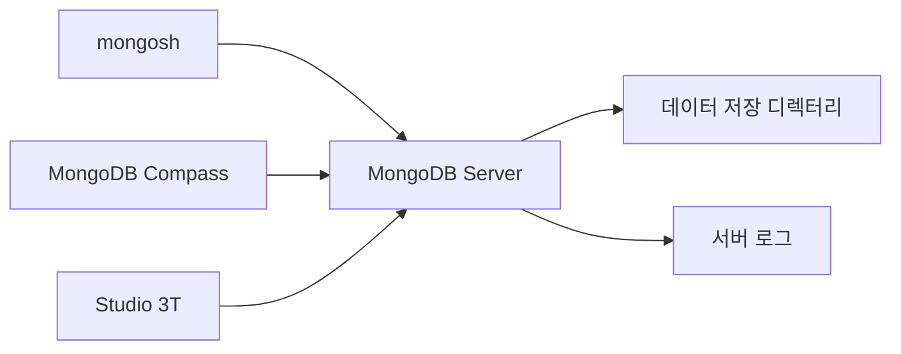

# MongoDB 구성

# MongoDB 구성

* toc
{:toc}

---

## MongoDB 구성: BSON 이해부터 Windows 설치와 접속 확인까지

MongoDB를 처음 구성할 때는 서버와 접속 도구의 역할부터 구분하는 것이 좋다. MongoDB 서버를 설치하는 것, Windows 서비스로 실행하는 것, `mongosh`나 Compass로 접속하는 것은 각각 다른 단계다.

이번에는 MongoDB의 문서 구조와 BSON 자료형을 살펴본 뒤, Windows에 서버와 도구를 설치하고 실제 문서를 저장하는 과정까지 진행한다. 설치가 끝났다는 화면만 확인하는 것이 아니라, 서비스 실행·접속·데이터 저장·GUI 조회까지 이어서 확인하는 것이 목표다.

## MongoDB란?

### 문서 지향 데이터베이스

MongoDB의 이름은 거대하다는 의미의 *Humongous*에서 유래했다. 데이터를 행과 고정된 컬럼으로만 표현하는 대신, 필드와 값으로 구성된 문서를 기본 단위로 사용하는 데이터베이스다.

문서 안에는 문자열과 숫자뿐 아니라 배열과 중첩 문서를 포함할 수 있다.

```javascript
{
  name: "Alice",
  tags: ["admin", "user"],
  address: {
    city: "Seoul",
    district: "Gangnam"
  }
}
```

함께 읽는 정보를 한 문서 안에 표현할 수 있어 애플리케이션의 객체 구조와 연결하기 편하다. 다만 모든 데이터를 하나의 큰 문서로 합치는 것이 좋은 설계는 아니다. 데이터가 함께 조회되는지, 독립적으로 변경되는지, 크기가 계속 증가하는지를 기준으로 내장과 참조를 선택해야 한다.

### 유연한 문서와 운영 기능은 별개의 문제다

MongoDB에서는 같은 Collection의 문서가 반드시 같은 필드를 가질 필요는 없다. 하지만 유연한 구조가 데이터 규칙을 생략해도 된다는 의미는 아니다. 필수 필드, 자료형, 값의 범위와 인덱스는 여전히 설계해야 한다.

성능과 가용성도 역할을 나누어 이해해야 한다.

| 구성 요소 | 주요 역할 |
|---|---|
| 문서 모델 | 관련 데이터의 표현과 접근 구조 |
| 인덱스 | 조건 검색과 정렬 등의 접근 비용 개선 |
| Replica Set | 데이터 복제와 장애 대응 |
| Sharding | 데이터와 처리 부하의 분산 |

Replica Set을 구성했다고 모든 조회가 자동으로 빨라지는 것은 아니며, 인덱스가 있다고 고가용성이 확보되는 것도 아니다. 이번 실습은 단일 로컬 서버를 대상으로 하므로 Replica Set과 Sharding까지 구성하지는 않는다.

웹·모바일 애플리케이션, CMS, 이커머스 카탈로그, 분석 대시보드, IoT, 게임 데이터 등에 활용할 수 있지만, 사용 분야의 이름보다 실제 조회와 변경 패턴이 잘 맞는지를 확인해야 한다.

## JSON과 BSON의 차이

### JSON: 데이터를 표현하는 텍스트 형식

JSON은 사람이 읽기 쉬운 텍스트 기반 데이터 교환 형식이다. HTTP API의 요청과 응답에서 자주 사용한다.

```json
{
  "name": "Alice",
  "age": 30,
  "is_active": true,
  "score": 95.5,
  "created_at": "2025-05-21T14:35:22Z",
  "tags": ["admin", "user"]
}
```

JSON에는 문자열, 숫자, Boolean, 배열, 객체, `null`이 있다. 날짜 전용 자료형은 없으므로 위의 `created_at`은 날짜처럼 보이는 **문자열**이다. 이를 날짜로 해석하려면 애플리케이션 사이에 형식에 대한 약속이 필요하다.

### BSON: 자료형을 포함하는 바이너리 표현

MongoDB는 문서를 BSON으로 저장한다. BSON은 JSON과 유사한 문서 구조를 바이너리로 표현하면서 `ObjectId`, 날짜, 정수형, Decimal128, 바이너리 데이터 등의 자료형을 추가로 지원한다.

다음은 실제 바이너리 바이트를 출력한 것이 아니라, `mongosh`에서 BSON 자료형을 표현하는 예시다.

```javascript
{
  _id: ObjectId("507f1f77bcf86cd799439011"),
  name: "Alice",
  age: Int32(30),
  is_active: true,
  score: Double(95.5),
  created_at: ISODate("2025-05-21T14:35:22Z"),
  tags: ["admin", "user"]
}
```

`ObjectId()`와 `ISODate()` 같은 표현은 일반 JSON 문법이 아니다. 따라서 위 내용을 그대로 JSON 파일이나 HTTP API 본문에 넣으면 표준 JSON으로 처리할 수 없다. BSON 자료형을 JSON으로 전달해야 할 때는 Extended JSON 같은 표현을 검토한다.

| 항목 | JSON | BSON |
|---|---|---|
| 표현 형식 | 텍스트 | 바이너리 |
| 사람이 직접 읽기 | 쉬움 | 도구를 통한 해석이 필요 |
| 숫자 자료형 | 하나의 Number 범주 | Int32, Int64, Double, Decimal128 등 |
| 날짜 | 일반적으로 문자열로 표현 | Date 자료형 |
| 추가 자료형 | 표준 형식에 제한됨 | ObjectId, Binary 등 지원 |
| 주요 용도 | API와 데이터 교환 | MongoDB 문서 저장과 통신 |

`ISODate()`는 BSON Date를 다루기 위한 셸 표현이며, 날짜 문자열을 그대로 저장하는 것과 다르다. BSON Date와 MongoDB 내부 처리에 사용하는 BSON Timestamp도 구분해야 한다. 일반적인 애플리케이션의 발생 시각에는 Date를 사용한다. [MongoDB BSON 자료형](https://www.mongodb.com/docs/manual/reference/bson-types/)

### BSON이 항상 JSON보다 작은 것은 아니다

바이너리 형식이라는 이유만으로 BSON이 항상 JSON보다 작아지는 것은 아니다. BSON에는 자료형과 길이 정보 등이 포함되므로 데이터에 따라 JSON보다 커질 수도 있다.

이 부가 정보는 문서 탐색과 인코딩·디코딩을 효율적으로 수행하기 위한 설계의 일부다. 따라서 BSON의 장점은 단순히 압축률로 설명하기보다 **자료형을 유지하며 문서를 처리할 수 있다는 점**에서 이해하는 편이 좋다. [BSON의 크기와 설계 목적](https://bsonspec.org/faq.html)

또한 BSON을 사용한다는 사실만으로 모든 검색이 빨라지는 것은 아니다. 실제 질의 성능은 인덱스, 문서 구조, 조회 범위와 메모리 사용량 등에 영향을 받는다.

## BSON으로 표현하는 로그 데이터

### 서버 액세스 로그

```javascript
{
  _id: ObjectId("507f1f77bcf86cd799439011"),
  ip: "192.168.1.10",
  timestamp: ISODate("2025-05-21T14:35:22Z"),
  method: "GET",
  url: "/index.html",
  status_code: Int32(200),
  response_time: Int32(123),
  user_agent: "Mozilla/5.0 (Windows NT 10.0; Win64; x64)"
}
```

`timestamp`를 Date로 저장하면 시간 범위 조회와 집계에서 날짜 연산을 사용할 수 있다. `response_time`은 숫자형으로 표현하되, 밀리초 등 측정 단위를 별도로 통일해야 한다.

### 애플리케이션 이벤트 로그

```javascript
{
  _id: ObjectId("507f1f77bcf86cd799439012"),
  event_id: "evt_12345",
  timestamp: ISODate("2025-05-21T14:40:10Z"),
  user_id: "user_6789",
  event_type: "button_click",
  details: {
    button_id: "submit_order",
    page: "checkout"
  }
}
```

공통 식별 정보는 바깥 필드에 두고 이벤트별 정보는 `details`에 묶을 수 있다. 중첩 필드를 검색할 수도 있지만, 자주 조회하는 조건에 맞는 인덱스가 없다면 많은 문서를 확인해야 할 수 있다.

`_id`는 문서의 식별자이고 `event_id`는 애플리케이션이 정의한 이벤트 식별자다. 두 필드가 자동으로 같은 중복 방지 역할을 하는 것은 아니다. `event_id`의 중복을 금지하려면 해당 업무 요구에 맞는 제약을 별도로 구성해야 한다.

## Windows 설치 구성 이해하기

### 서버와 도구 구분

| 구성 요소 | 역할 | 대표 실행 파일 |
|---|---|---|
| MongoDB Community Server | 데이터를 저장하고 요청을 처리 | `mongod.exe` |
| MongoDB Shell | 명령어로 서버에 접속 | `mongosh.exe` |
| MongoDB Compass | 공식 GUI 클라이언트 | Compass 애플리케이션 |
| Studio 3T | 추가적인 개발·관리 기능을 제공하는 GUI 도구 | Studio 3T 애플리케이션 |

Compass나 `mongosh`를 실행한다고 MongoDB 서버가 함께 시작되는 것은 아니다. 클라이언트가 접속할 서버가 먼저 실행되어 있어야 한다.



### 실습 기준

이번 실습은 MongoDB Community Server 8.0 계열을 Windows 서비스로 실행하는 구성을 기준으로 한다. 설치 시에는 해당 계열의 수정 릴리스와 지원 운영체제를 확인한다.

MongoDB 8.0의 공식 Windows 지원 대상에는 64비트 Windows 11과 Windows Server 2022가 포함된다. 오래된 설치 파일 이름에 `2008R2Plus` 같은 문구가 있다고 해서 현재 버전이 오래된 Windows를 지원한다고 판단해서는 안 된다. [MongoDB 8.0 Windows 설치와 지원 환경](https://www.mongodb.com/docs/v8.0/tutorial/install-mongodb-on-windows/)

이후 명령어는 별도 표시가 없다면 **PowerShell**에서 실행한다. 실제 설치 경로가 다르면 예제 경로도 함께 변경한다.

## MongoDB Community Server 설치

### 설치 파일 다운로드

[MongoDB Community Server 다운로드](https://www.mongodb.com/try/download/community)에서 다음 항목을 선택한다.

- Version: 설치할 지원 버전
- Platform: Windows
- Package: MSI

이번 설명의 기본 실행 파일 경로는 다음과 같다.

```text
C:\Program Files\MongoDB\Server\8.0\bin
```

다른 계열을 설치했다면 `8.0` 부분이 달라질 수 있다.

### 설치 유형과 서비스 설정

MSI를 실행하고 라이선스와 이용 조건을 확인한 뒤 설치 유형을 선택한다.

`Complete`는 기본 구성으로 설치하는 방식이고, `Custom`은 설치할 항목과 위치를 조정할 때 사용한다. 처음에는 기본 구성을 사용하되, 데이터와 로그 저장 위치는 확인해 두는 것이 좋다.

서비스 설정에서는 다음 항목을 확인한다.

| 항목 | 의미 |
|---|---|
| Install MongoD as a Service | Windows 서비스로 서버 등록 |
| Service Name | 서비스 식별 이름 |
| Service Account | 서버 프로세스를 실행할 Windows 계정 |
| Data Directory | 실제 데이터 저장 위치 |
| Log Directory | 서버 실행 로그 저장 위치 |

기본 서비스 이름은 `MongoDB`다. 기본 계정인 Network Service를 선택할 수 있으며, 별도 계정을 사용한다면 데이터·로그 디렉터리에 필요한 권한이 있어야 한다.

실행 파일, 데이터 파일, 서버 로그는 역할이 다르다. 설치 폴더가 어디인지와 별개로 실제 데이터가 어느 경로에 저장되는지 확인해야 한다. 데이터 디렉터리를 임의로 삭제하거나 이동하면 기존 데이터를 사용할 수 없게 될 수 있다.

Compass 설치 항목은 선택 사항이다. 설치 마법사에서 함께 설치하거나 별도로 설치할 수 있다. **Windows용 MongoDB Server 설치에 `mongosh`가 포함된다고 가정해서는 안 된다.** Shell은 별도로 설치해야 한다.

## Windows 서비스와 설정 파일 확인

### 서비스 실행 상태 확인

`Windows 키 + R`을 누르고 다음 명령을 입력한다.

```text
services.msc
```

서비스 목록에서 `MongoDB Server (MongoDB)`를 찾아 실행 상태와 시작 유형을 확인한다. 설치 과정에서 서비스를 등록했다면 일반적으로 설치 완료 후 시작된다.

PowerShell에서도 상태를 확인할 수 있다.

```powershell
Get-Service -Name MongoDB
```

정상 실행 중이라면 `Status`에 `Running`이 표시된다. 서비스가 중지되어 있고 시작이 필요한 경우에는 관리자 권한 PowerShell에서 실행한다.

```powershell
Start-Service -Name MongoDB
```

서비스 이름을 다르게 지정했다면 명령어의 이름도 바꾸어야 한다.

### 서비스가 사용하는 경로 확인

서비스는 설정 파일에 지정된 값으로 실행된다. 다음 명령으로 실제 실행 경로와 계정을 확인할 수 있다.

```powershell
Get-CimInstance Win32_Service -Filter "Name='MongoDB'" |
    Select-Object Name, State, StartMode, StartName, PathName
```

`PathName`에 표시된 실행 명령에서 설정 파일 경로를 확인한다. MSI 기본 설치에서는 보통 다음 위치를 사용한다.

```text
C:\Program Files\MongoDB\Server\8.0\bin\mongod.cfg
```

설정 파일은 YAML 형식이다. 다음은 주요 항목의 구조를 보여 주는 로컬 실습용 예시다.

```yaml
storage:
  dbPath: 'C:\MongoDB\data'

systemLog:
  destination: file
  path: 'C:\MongoDB\log\mongod.log'
  logAppend: true

net:
  bindIp: 127.0.0.1
  port: 27017
```

- `storage.dbPath`: 데이터 파일을 저장할 디렉터리다.
- `systemLog.destination`: 서버 로그를 파일로 기록하도록 지정한다.
- `systemLog.path`: 로그 파일 위치다.
- `systemLog.logAppend`: 시작 시 기존 로그에 이어서 기록한다.
- `net.bindIp`: 접속을 받을 네트워크 주소다.
- `net.port`: 접속 포트다.

위 경로는 예시이므로 기존 설치 설정을 그대로 덮어쓰지 않는다. 실제 서비스가 사용하는 경로와 디렉터리 권한을 기준으로 확인해야 한다. 설정을 변경해야 한다면 기존 설정을 보존하고 서비스 중지·수정·시작 절차를 따른다. YAML 들여쓰기는 탭 대신 공백을 사용한다. [MongoDB 설정 파일 항목](https://www.mongodb.com/docs/v8.0/reference/configuration-options/)

### 서비스 실행과 수동 실행을 중복하지 않기

서비스가 이미 27017 포트에서 실행 중인데 터미널에서 `mongod`를 다시 실행하면 포트 충돌이나 데이터 디렉터리 잠금 문제가 발생할 수 있다.

이번 실습에서는 Windows 서비스가 서버를 실행한다. 터미널에서 수행할 작업은 서버를 하나 더 시작하는 것이 아니라 `mongosh`로 **기존 서버에 접속하는 것**이다.

## mongosh 설치와 PATH 설정

### Shell 별도 설치

[MongoDB Shell 다운로드](https://www.mongodb.com/try/download/shell)에서 Windows용 배포본을 설치한다.

ZIP 형태를 사용한다면 압축을 해제한 구성 전체를 유지하고 실행 파일이 있는 `bin` 경로를 확인한다. 예를 들어 다음과 같이 별도 디렉터리에서 관리할 수 있다.

```text
C:\Tools\mongosh\bin
```

Shell 파일을 서버의 `bin` 디렉터리에 함께 둘 수도 있지만 필수는 아니다. 서버와 Shell은 별도로 업데이트할 수 있으므로 설치 위치를 분리하면 관리가 명확해진다. 실행 파일만 임의로 옮기지 말고 배포본에 포함된 지원 파일도 유지해야 한다.

### 환경변수에 실행 파일 경로 추가

Windows에서 `시스템 환경 변수 편집 → 환경 변수`로 이동한다. 사용자 또는 시스템의 `Path`에 필요한 디렉터리를 추가한다.

```text
C:\Program Files\MongoDB\Server\8.0\bin
C:\Tools\mongosh\bin
```

실제로 `mongosh.exe`가 다른 위치에 있다면 그 경로를 사용한다. 기존 `Path` 값을 통째로 지우지 말고 항목을 추가한다.

설정 후에는 **새 PowerShell 창을 열어야** 변경된 환경변수가 반영된다.

```powershell
Get-Command mongod
Get-Command mongosh

mongod --version
mongosh --version
```

버전 조회는 실행 파일을 찾을 수 있는지 확인하는 단계다. `mongod --version`이 출력되었다고 데이터베이스 서버가 실행 중이라는 의미는 아니다. 반대로 Compass는 자체 클라이언트이므로 서버 실행 파일의 PATH가 없어도 접속할 수 있다.

## mongosh로 서버 접속 확인

### 로컬 서버 연결

```powershell
mongosh "mongodb://127.0.0.1:27017"
```

기본 포트에 정상 접속하면 서버와 Shell의 버전 정보, 현재 데이터베이스 프롬프트가 표시된다. 두 프로그램은 별도 제품이므로 버전 번호가 같을 필요는 없다.

PowerShell 프롬프트에서 사용하는 명령과 `mongosh` 내부 명령도 구분해야 한다. 접속 후에는 다음 명령으로 확인한다.

```javascript
db.runCommand({ ping: 1 })
```

정상 응답에서는 `ok: 1`을 확인할 수 있다. 이는 서버가 요청에 응답한다는 뜻이며, 특정 Collection의 읽기·쓰기 권한까지 모두 확인한 것은 아니다.

### 데이터베이스 목록과 현재 위치

```javascript
db
show dbs
```

`db`는 현재 선택한 데이터베이스를 보여 준다. `show dbs`와 `show databases`는 접근 가능한 데이터베이스 목록을 확인할 때 사용한다.

초기에는 다음과 같은 내부 데이터베이스를 볼 수 있다.

| 이름 | 주요 용도 |
|---|---|
| `admin` | 관리와 인증 등에 사용하는 데이터 |
| `config` | 내부 구성과 메타데이터 |
| `local` | 해당 인스턴스에 필요한 내부 데이터 |

`test>` 프롬프트가 보이더라도 `test`가 목록에 반드시 나타나는 것은 아니다. 현재 선택한 이름과 실제로 생성된 데이터베이스는 구분해야 한다. 목록은 저장된 데이터와 접속 권한에 따라서도 달라질 수 있다.

### 인증 비활성화 경고의 의미

로컬 설치에서 다음 경고가 표시될 수 있다.

```text
Access control is not enabled for the database.
```

접근 제어가 활성화되지 않았다는 의미다. 접속 가능한 클라이언트에 대해 사용자 인증과 권한 검사가 적용되지 않는 상태이므로 가볍게 넘기면 안 된다.

이번 실습은 로컬 개인 학습 환경으로 범위를 제한한다. 접속 문제를 해결하려고 `bindIp`를 무조건 `0.0.0.0`으로 바꾸거나 방화벽을 넓게 개방하지 않는다. 외부 접속이 필요하다면 인증, 최소 권한, 네트워크 제한과 암호화 등을 먼저 설계해야 한다.

## 첫 번째 데이터베이스와 문서 만들기

### 데이터베이스 선택만으로 저장 공간이 생성되지는 않는다

`mongosh`에서 다음과 같이 전환한다.

```javascript
use ecommerce
db
```

현재 위치는 `ecommerce`로 바뀐다. 하지만 데이터가 아직 없다면 `show dbs` 목록에 나타나지 않을 수 있다.

```javascript
show dbs
```

이것은 전환 실패가 아니다. 일반적으로 실제 데이터를 저장하는 등의 작업이 이루어져야 데이터베이스와 Collection이 생성된다. [MongoDB 데이터베이스와 Collection 생성](https://www.mongodb.com/docs/manual/core/databases-and-collections/)

### 고객 문서 저장

```javascript
db.customers.insertOne({
  cust_name: "kevin.lee"
})
```

정상적으로 처리되면 다음 형태의 결과가 나온다.

```text
{
  acknowledged: true,
  insertedId: ObjectId('67fe5ff242826f034cba5a4a')
}
```

`insertedId`의 실제 값은 실행마다 달라진다. `_id`를 생략했으므로 기본 식별자가 자동 생성된 것이다.

이제 조회한다.

```javascript
db.customers.find({ cust_name: "kevin.lee" })
show collections
show dbs
```

정상적인 새 실습 환경이라면 다음을 확인할 수 있다.

- `ecommerce` 데이터베이스가 존재한다.
- `customers` Collection이 존재한다.
- `_id`와 `cust_name`을 가진 문서가 조회된다.

같은 삽입 명령을 반복하면 이름이 같은 문서가 여러 개 생길 수 있다. 이름 필드에 유일성 제약을 설정하지 않았기 때문이다.

또한 `commerce`와 `ecommerce`는 다른 데이터베이스다. 셸과 GUI에서 이름을 혼용하면 데이터를 저장했는데 보이지 않는 것처럼 느낄 수 있다. 현재 위치를 `db`로 확인하는 습관이 도움이 된다.

Shell을 종료할 때는 다음과 같이 입력한다.

```javascript
exit
```

Shell을 종료해도 Windows 서비스로 실행 중인 MongoDB 서버는 계속 동작한다.

## MongoDB Compass로 같은 데이터 확인하기

### 연결 생성

Compass를 실행하고 `Add New Connection`에서 URI를 입력한다.

```text
mongodb://127.0.0.1:27017/
```

연결 이름은 `mycommerce`처럼 알아보기 쉬운 별칭으로 지정할 수 있다. **연결 이름은 데이터베이스 이름이 아니다.** `mycommerce`라는 이름으로 저장해도 그 안에서 `ecommerce`, `admin` 등 여러 데이터베이스를 확인할 수 있다.

`Connect` 또는 `Save & Connect`로 접속한다. Compass는 MongoDB 서버에 연결하는 GUI이며 서버를 대신 실행하지 않는다. [Compass 연결 설정](https://www.mongodb.com/docs/compass/connect/)

### 문서 조회

접속 후 목록을 새로 고치고 다음 경로로 이동한다.

```text
ecommerce → customers → Documents
```

Filter에 조건을 입력한다.

```javascript
{ cust_name: "kevin.lee" }
```

셸에서 저장한 문서와 같은 `_id`와 필드를 확인하면 된다. 문서가 보이지 않으면 먼저 다음 항목을 비교한다.

1. Shell과 Compass의 서버 주소·포트가 같은가?
2. 선택한 데이터베이스와 Collection 이름이 같은가?
3. 이전 Filter가 남아 있지 않은가?
4. 목록을 새로 고쳤는가?

### 주요 화면의 역할

| 항목 | 역할 |
|---|---|
| Documents | 문서 조회와 편집 |
| Aggregations | 집계 파이프라인 작성·확인 |
| Schema | 저장된 문서의 구조와 자료형 분석 |
| Indexes | 인덱스 확인과 관리 |
| Validation | 문서 검증 규칙 확인과 관리 |

Schema 분석 화면은 저장된 문서의 구조를 파악하는 기능이다. 분석 화면이 있다고 입력 규칙이 자동으로 강제되는 것은 아니다. 데이터 저장 시 규칙을 적용하려면 Validation을 별도로 구성한다.

GUI에서 문서를 수정하거나 삭제하는 작업도 실제 데이터 변경이다. 조회 도구라고 생각하고 운영 연결에서 무심코 변경하지 않도록 연결 이름과 환경을 구분해 두는 것이 좋다.

## Studio 3T 활용

### 선택적으로 사용하는 개발·관리 도구

Studio 3T는 MongoDB 데이터를 탐색하고 질의를 작성하는 GUI 도구다. Compass와 마찬가지로 별도 서버를 만드는 것이 아니라 기존 MongoDB에 연결한다.

주요 기능에는 다음과 같은 항목이 있다.

- IntelliShell을 통한 명령 실행
- Visual Query Builder로 조건·Projection·정렬 구성
- Aggregation 파이프라인 작성
- SQL 형태의 질의 작성 지원
- 데이터 가져오기와 내보내기
- Schema 탐색과 데이터 비교
- 여러 연결·Collection·질의 관리
- 실행 계획과 질의 성능 분석
- 배포 구성과 권한에 따른 Replica Set·Sharding 관련 관리 기능

제공되는 기능은 Edition과 라이선스에 따라 다르다. 무료 다운로드나 체험판 사용이 모든 기능의 영구 무료 이용을 뜻하지는 않는다. 설치 전 현재 제공 범위와 이용 조건을 확인한다. [Studio 3T 기능과 다운로드](https://studio3t.com/download/)

SQL 지원도 MongoDB 서버가 MySQL과 같은 SQL 엔진으로 바뀐다는 의미는 아니다. 도구가 제공하는 질의 작성 기능과 MongoDB 서버의 실행 모델을 구분해야 한다.

### 설치와 로컬 연결

설치 파일을 실행하고 안내에 따라 설치한다. 기존 버전을 갱신한다면 연결 정보와 설정을 보존하고 해당 버전의 업그레이드 절차를 확인한다.

새 연결에는 동일한 로컬 주소를 사용한다.

```text
Host: 127.0.0.1
Port: 27017
```

다른 도구에서 연결을 가져올 수도 있지만, 가져온 연결의 대상과 인증 정보를 먼저 확인한다. 특히 개발·운영 연결이 섞여 있다면 자동 접속을 켜기 전에 구분해야 한다.

### Visual Query Builder와 셸 질의 비교

다음은 별도의 실습 데이터베이스에서 이름과 나이를 저장하는 예시다.

```javascript
use mydb

db.mycollection.insertOne({
  name: "kevin.lee",
  age: Int32(49)
})

db.mycollection.find(
  { age: { $gte: 40 } },
  { _id: 0, name: 1, age: 1 }
).sort({ age: -1 })
```

질의의 의미는 다음과 같다.

| 항목 | 설정 | 의미 |
|---|---|---|
| Query | `{ age: { $gte: 40 } }` | 40세 이상 |
| Projection | `{ _id: 0, name: 1, age: 1 }` | 이름과 나이 표시 |
| Sort | `{ age: -1 }` | 나이 내림차순 |

Visual Query Builder에서도 같은 조건을 구성할 수 있다. 화면 조작에 익숙해지는 것과 함께 생성된 질의 코드를 확인하면 MongoDB 문법을 익히는 데 도움이 된다.

`show collections`는 현재 데이터베이스의 Collection을 보여 준다. `testcollection`, `mycollection`, `customers`처럼 이름이 다른 Collection을 조회할 때는 현재 데이터베이스와 대상을 함께 확인해야 한다.

## 설치와 접속에서 자주 발생하는 문제

| 현상 | 가능한 원인 | 확인할 부분 |
|---|---|---|
| `mongosh` 명령을 찾지 못함 | Shell 미설치 또는 PATH 누락 | 실행 파일 위치와 새 터미널 |
| `mongod --version`은 되지만 접속 실패 | 서버는 실행되지 않음 | Windows 서비스 상태 |
| 서비스가 시작되지 않음 | 설정 오류, 경로·권한 문제 | 서비스 실행 경로와 서버 로그 |
| 포트 사용 오류 | 같은 포트의 서버 중복 실행 | 서비스와 수동 실행 여부 |
| Shell은 되지만 Compass는 실패 | URI·인증·TLS 설정 차이 | 두 클라이언트의 연결 설정 |
| 데이터베이스가 목록에 없음 | 이름만 선택하고 아직 저장하지 않음 | 첫 문서 저장 여부 |
| 저장한 문서가 보이지 않음 | 다른 DB·Collection 또는 Filter | 현재 위치와 검색 조건 |
| 인증 비활성화 경고 | 접근 제어 미설정 | 로컬 범위와 보안 구성 |

연결 자체가 되지 않으면 PowerShell에서 포트 접근을 확인할 수 있다.

```powershell
Test-NetConnection -ComputerName 127.0.0.1 -Port 27017
```

포트가 열렸다는 사실만으로 MongoDB의 데이터 읽기·쓰기가 정상이라는 뜻은 아니다. 서비스 상태, MongoDB `ping`, 실제 문서 저장과 조회를 단계적으로 확인해야 한다.

또한 프로그램을 재설치하기 전에 로그를 먼저 확인하는 편이 좋다. 데이터 디렉터리 권한이나 잘못된 설정은 실행 파일을 다시 설치해도 그대로 남을 수 있다.

## 다른 운영체제에 설치할 때

MongoDB는 Windows 외에도 지원되는 Linux 배포판과 macOS에서 설치할 수 있다. 다만 운영체제별 패키지, 설정 파일 위치와 서비스 관리 방식이 다르다.

Windows의 서비스 관리 절차를 Linux에 그대로 적용하거나, 오래된 배포판 설치 명령을 현재 환경에 그대로 사용하지 않는다. MongoDB 버전과 운영체제 지원 조합을 먼저 확인하고 해당 설치 방법을 선택해야 한다.

## 정리

MongoDB 구성에서는 BSON 문서의 자료형과 서버·클라이언트의 역할을 함께 이해하는 것이 중요하다. BSON은 단순히 JSON을 더 작게 압축한 형식이 아니며, Compass와 `mongosh`도 서버를 대신 실행하는 프로그램이 아니다.

Windows에서는 **서비스 실행 → 설정과 경로 확인 → Shell 접속 → 문서 저장 → GUI 조회** 순서로 검증하면 문제 범위를 좁히기 쉽다. 여기에 실제 데이터 위치와 인증 상태까지 확인해야, 단순히 설치된 환경을 넘어 다음 실습을 안정적으로 이어갈 수 있다.
