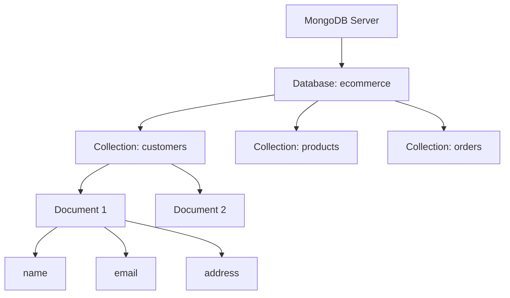
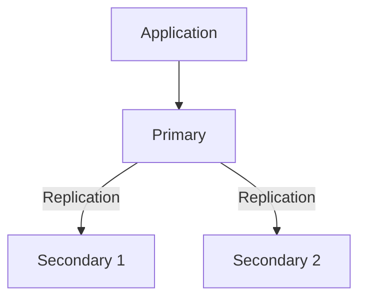
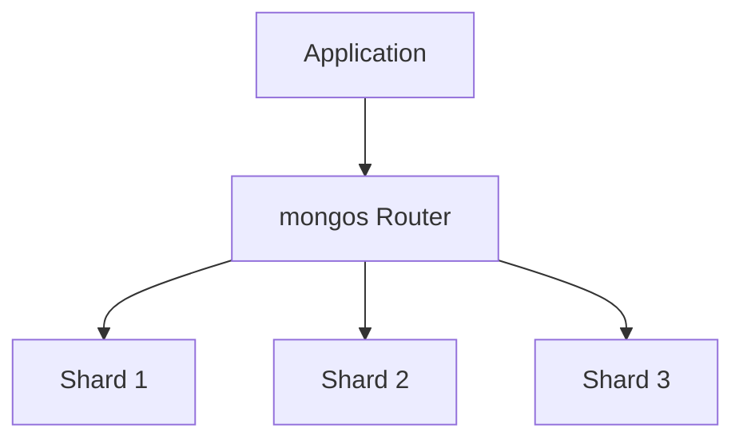
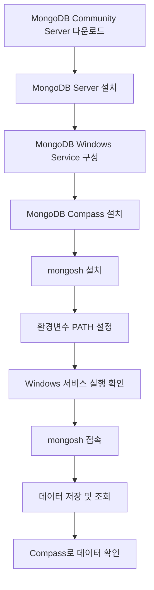
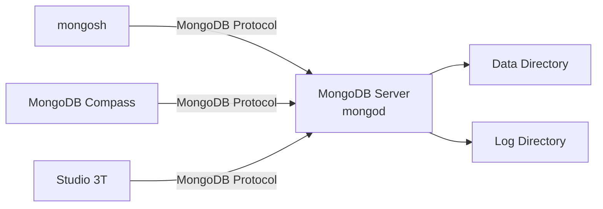
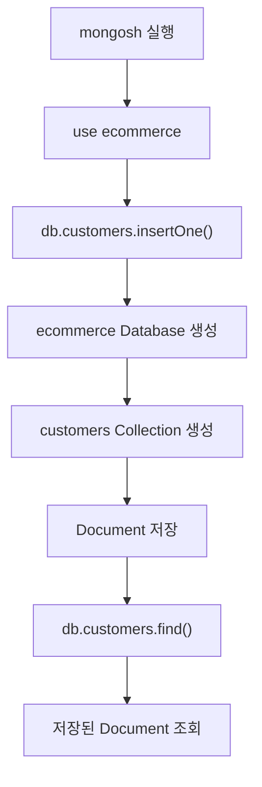

# MongoDB 구성

# MongoDB 구성

* toc
{:toc}

---

## MongoDB 구성: BSON의 개념부터 Windows 설치, Shell 및 GUI 연결까지

MongoDB를 사용하기 위해서는 단순히 데이터베이스를 설치하는 것뿐만 아니라, 데이터를 어떤 형식으로 저장하는지, 서버와 클라이언트는 어떻게 구분되는지, 실제 데이터는 어디에 저장되는지를 이해해야 한다.

MySQL과 같은 관계형 데이터베이스는 테이블과 행을 중심으로 데이터를 관리한다. 반면 MongoDB는 **Document(문서)** 를 중심으로 데이터를 저장하는 NoSQL 데이터베이스다.

MongoDB는 JSON과 유사한 구조를 사용하기 때문에 JavaScript 객체나 Java DTO와 같은 애플리케이션의 데이터 구조를 비교적 자연스럽게 표현할 수 있다.

하지만 실제 MongoDB 내부에서는 JSON이 아니라 **BSON(Binary JSON)** 이라는 바이너리 형식을 사용한다.

또한 MongoDB를 사용하려면 서버와 클라이언트의 역할을 구분해야 한다.

- `mongod`: MongoDB 서버 프로세스
- `mongosh`: MongoDB 서버에 명령어로 접속하는 Shell
- `MongoDB Compass`: MongoDB를 시각적으로 관리하는 공식 GUI 도구
- `Studio 3T`: MongoDB 조회, 편집 및 관리 기능을 제공하는 별도의 GUI 도구

이번 글에서는 MongoDB의 기본 구조를 이해하고, Windows 환경에서 MongoDB를 설치한 뒤 실제 데이터를 저장하고 조회하는 과정까지 살펴본다.

---

## MongoDB란?

### MongoDB의 개념

MongoDB는 **Document 지향 NoSQL 데이터베이스**다.

MongoDB라는 이름은 '매우 거대한'이라는 의미를 가진 `Humongous`에서 유래했다.

MongoDB는 다양한 형태의 데이터를 문서 단위로 저장하며, 인덱스, 복제, 샤딩 등의 기능을 통해 검색 성능, 고가용성, 확장성을 지원한다.

일반적인 관계형 데이터베이스에서는 다음과 같이 데이터를 관리한다.

**Users 테이블**

| id | name | age | city |
|---|---|---|---|
| 1 | Alice | 30 | Seoul |
| 2 | Bob | 28 | Busan |

반면 MongoDB에서는 각각의 데이터를 하나의 문서로 표현한다.

```javascript
{
  name: "Alice",
  age: 30,
  city: "Seoul"
}
```

여기에 추가적인 데이터가 필요하다면 배열이나 중첩 문서를 사용할 수 있다.

```javascript
{
  name: "Alice",
  age: 30,
  city: "Seoul",
  tags: [
    "admin",
    "user"
  ],
  address: {
    city: "Seoul",
    district: "Gangnam"
  }
}
```

이 문서에는 다음과 같은 자료형이 포함되어 있다.

| 필드 | 자료형 | 설명 |
|---|---|---|
| name | String | 사용자 이름 |
| age | Number | 나이 |
| city | String | 도시 |
| tags | Array | 사용자 태그 목록 |
| address | Document | 중첩 주소 정보 |

특히 `tags`와 `address`가 중요하다.

MongoDB에서는 하나의 문서 내부에 배열이나 다른 문서를 포함할 수 있기 때문이다.

### MongoDB의 데이터 구조

MongoDB는 데이터를 다음과 같은 계층으로 관리한다.



구성 요소별 의미는 다음과 같다.

| MongoDB | RDBMS와 비교 | 설명 |
|---|---|---|
| Database | Database | 여러 Collection을 관리하는 논리적 공간 |
| Collection | Table | 관련 문서들을 저장하는 공간 |
| Document | Row | 실제 데이터를 저장하는 단위 |
| Field | Column | 문서의 속성 |
| `_id` | Primary Key | 문서를 고유하게 식별하는 값 |

다만 Collection과 Table이 완전히 동일한 것은 아니다.

RDBMS의 테이블은 일반적으로 컬럼과 자료형을 명시적으로 정의한다.

반면 MongoDB의 Collection은 서로 다른 필드 구조를 가진 문서를 저장할 수 있다.

예를 들어 동일한 `customers` Collection에 다음 두 문서를 함께 저장할 수 있다.

```javascript
{
  name: "Alice",
  age: 30
}
```

```javascript
{
  name: "Bob",
  email: "bob@example.com",
  address: {
    city: "Busan",
    district: "Haeundae"
  }
}
```

첫 번째 문서에는 `email`과 `address`가 없고, 두 번째 문서에는 `age`가 없다.

이것이 MongoDB에서 말하는 유연한 문서 구조의 특징이다.

그러나 실제 서비스에서는 필수 필드와 자료형을 검증해야 할 수 있으므로, 유연한 구조가 데이터 설계 자체를 생략해도 된다는 의미는 아니다.

---

## MongoDB의 주요 특징

### 1. 유연한 스키마

MongoDB는 일반적으로 Collection을 생성할 때 모든 필드의 구조를 미리 정의할 필요가 없다.

예를 들어 상품 정보를 저장한다고 가정해 보자.

전자제품에는 CPU와 메모리 정보가 필요할 수 있다.

```javascript
{
  product_id: 1001,
  category: "electronics",
  name: "Laptop",
  specifications: {
    cpu: "M4",
    memory: "16GB",
    storage: "512GB"
  }
}
```

반면 의류에는 색상과 사이즈 정보가 중요하다.

```javascript
{
  product_id: 1002,
  category: "clothing",
  name: "T-Shirt",
  specifications: {
    size: "L",
    color: "Black",
    material: "Cotton"
  }
}
```

두 상품은 서로 다른 필드를 가지고 있지만 하나의 Collection에 저장할 수 있다.

이러한 구조는 다음과 같은 상황에서 유용하다.

- 상품 종류마다 필요한 속성이 다른 경우
- 사용자 유형에 따라 프로필 정보가 다른 경우
- 이벤트 유형마다 상세 정보가 다른 경우
- 요구사항이 자주 변경되는 경우

하지만 필드 추가가 쉽다는 것과 데이터 규칙이 필요 없다는 것은 별개의 문제다.

예를 들어 `price`를 어떤 문서에서는 숫자로, 다른 문서에서는 문자열로 저장하면 정렬과 집계가 어려워질 수 있다.

MongoDB는 이런 문제를 줄이기 위해 **Schema Validation**을 지원한다.

이를 이용하면 필수 필드, 자료형, 값의 범위 등을 검증할 수 있다.

### 2. 다양한 데이터 구조 지원

MongoDB는 단순한 문자열과 숫자뿐만 아니라 배열과 중첩 문서를 저장할 수 있다.

다음은 사용자와 배송지 정보를 하나의 문서로 표현한 예시다.

```javascript
{
  user_id: 1001,
  name: "Alice",
  email: "alice@example.com",
  shipping_addresses: [
    {
      type: "home",
      city: "Seoul",
      district: "Gangnam"
    },
    {
      type: "office",
      city: "Seoul",
      district: "Seocho"
    }
  ]
}
```

여기서는 `shipping_addresses` 배열 안에 여러 문서가 존재한다.

관계형 데이터베이스에서는 사용자 테이블과 배송지 테이블을 분리할 수 있지만, MongoDB에서는 관련 데이터를 하나의 문서에 포함할 수 있다.

이러한 구조는 함께 조회하는 데이터를 표현할 때 유용하다.

다만 배송지 목록이 무제한으로 증가하거나 독립적으로 관리되어야 한다면 별도 Collection으로 분리하는 편이 더 적절할 수 있다.

### 3. 고가용성 지원

MongoDB는 **Replica Set**을 이용하여 데이터를 여러 서버에 복제할 수 있다.

Replica Set은 일반적으로 하나의 Primary와 여러 Secondary로 구성된다.



Primary는 일반적인 쓰기 요청을 처리한다.

Secondary는 Primary의 변경 사항을 복제한다.

Primary에 장애가 발생하면 조건을 만족하는 Secondary 중 하나가 선출 과정을 거쳐 새로운 Primary가 될 수 있다.

다만 Replica Set을 구성했다고 모든 조회가 자동으로 빨라지는 것은 아니다.

Replica Set의 핵심 목적은 데이터 복제와 장애 대응이다.

### 4. 수평 확장 지원

MongoDB는 **Sharding**을 이용하여 데이터를 여러 서버에 분산할 수 있다.



데이터의 양이 많아지면 하나의 서버에서 모든 데이터를 처리하기 어려울 수 있다.

이때 Sharding을 이용하여 데이터를 여러 Shard에 분산할 수 있다.

하지만 Shard Key를 잘못 선택하면 특정 서버에 요청이 집중되거나 여러 Shard를 동시에 조회해야 할 수 있다.

따라서 MongoDB의 고가용성과 확장성은 다음과 같이 구분해야 한다.

| 기능 | 주요 목적 |
|---|---|
| Index | 데이터 검색 성능 개선 |
| Replica Set | 데이터 복제와 장애 대응 |
| Sharding | 데이터 및 처리 부하 분산 |
| Schema Validation | 데이터 구조와 자료형 검증 |

이번에는 단일 MongoDB 서버를 구성하므로 Replica Set이나 Sharding을 직접 설정하지는 않는다.

---

## JSON과 BSON 이해하기

MongoDB를 이해할 때 중요한 개념 중 하나가 BSON이다.

MongoDB는 JSON과 유사한 문서 구조를 사용하지만 실제 데이터 저장에는 BSON을 사용한다.

### JSON이란?

JSON은 **JavaScript Object Notation**의 약자다.

사람이 읽기 쉬운 텍스트 기반 데이터 형식이며, 애플리케이션 사이에서 데이터를 주고받을 때 널리 사용한다.

Spring Boot에서 REST API를 개발할 때도 JSON을 자주 사용한다.

예를 들어 다음과 같은 응답을 생각할 수 있다.

```json
{
  "name": "Alice",
  "age": 30,
  "is_active": true,
  "score": 95.5,
  "created_at": "2025-05-21T14:35:22Z",
  "tags": [
    "admin",
    "user"
  ]
}
```

JSON에서는 다음과 같은 자료형을 표현할 수 있다.

| 자료형 | 예시 |
|---|---|
| String | `"Alice"` |
| Number | `30`, `95.5` |
| Boolean | `true`, `false` |
| Array | `["admin", "user"]` |
| Object | `{"city": "Seoul"}` |
| Null | `null` |

여기서 중요한 부분은 날짜다.

```json
{
  "created_at": "2025-05-21T14:35:22Z"
}
```

`created_at`은 날짜처럼 보이지만 JSON 자체에는 날짜 전용 자료형이 없다.

따라서 JSON에서는 문자열로 표현된다.

애플리케이션이 이 문자열을 날짜로 해석하려면 ISO 8601 등의 형식에 대한 약속이 필요하다.

### BSON이란?

BSON은 **Binary JSON**의 약자다.

JSON과 유사한 문서 구조를 바이너리 형식으로 표현하면서 다양한 자료형을 지원한다.

MongoDB는 내부적으로 BSON을 사용하여 문서를 저장하고 처리한다.

대표적으로 다음과 같은 자료형을 지원한다.

- String
- Int32
- Int64
- Double
- Decimal128
- Boolean
- Date
- ObjectId
- Array
- Document
- Binary
- Null

JSON과 BSON의 가장 중요한 차이 중 하나는 **자료형을 명확하게 구분할 수 있다는 것**이다.

### JSON과 BSON 비교

먼저 JSON으로 표현한 데이터를 살펴보자.

```json
{
  "name": "Alice",
  "age": 30,
  "is_active": true,
  "score": 95.5,
  "created_at": "2025-05-21T14:35:22Z",
  "tags": [
    "admin",
    "user"
  ]
}
```

이번에는 BSON 자료형을 활용하여 표현해 보자.

```javascript
{
  _id: ObjectId("507f1f77bcf86cd799439011"),
  name: "Alice",
  age: NumberInt(30),
  is_active: true,
  score: Double(95.5),
  created_at: ISODate("2025-05-21T14:35:22Z"),
  tags: [
    "admin",
    "user"
  ]
}
```

여기서 `ObjectId()`, `NumberInt()`, `Double()`, `ISODate()`는 BSON 자료형을 다루기 위한 `mongosh` 표현이다.

**위 코드는 표준 JSON이 아니라 `mongosh`에서 사용할 수 있는 JavaScript 객체 표현이다.**

따라서 그대로 HTTP API의 JSON 요청 본문에 넣으면 표준 JSON으로 해석되지 않는다.

BSON 자료형을 JSON으로 표현해야 하는 경우에는 MongoDB의 Extended JSON 형식을 사용할 수 있다.

두 형식의 차이를 정리하면 다음과 같다.

| 비교 항목 | JSON | BSON |
|---|---|---|
| 데이터 표현 | 텍스트 | 바이너리 |
| 사람이 읽기 | 쉬움 | 변환 도구가 필요함 |
| 정수 | Number | Int32, Int64 등 |
| 실수 | Number | Double, Decimal128 등 |
| 날짜 | 문자열로 표현 | Date 타입 지원 |
| 고유 식별자 | 별도 전용 타입 없음 | ObjectId 지원 |
| 바이너리 데이터 | 직접 표현이 제한적 | Binary 지원 |
| 주요 활용 | API 요청·응답, 데이터 교환 | MongoDB 문서 저장과 통신 |

### BSON은 JSON보다 항상 작을까?

BSON은 바이너리 형식이므로 JSON보다 무조건 크기가 작다고 생각하기 쉽다.

하지만 항상 그런 것은 아니다.

BSON에는 자료형 정보와 문자열 길이, 중첩 객체의 길이 등 추가 정보가 포함된다.

따라서 데이터에 따라 JSON보다 BSON이 더 큰 경우도 있다.

예를 들어 아주 작은 정수는 JSON에서 `"1"`처럼 짧은 텍스트로 표현할 수 있지만, BSON은 숫자를 특정 크기의 정수 자료형으로 저장한다.

BSON의 목적은 단순한 압축이 아니다.

**자료형을 유지하면서 문서를 효율적으로 탐색하고 인코딩·디코딩할 수 있도록 하는 것**이 중요한 설계 목적이다.

또한 BSON이라는 이유만으로 MongoDB의 모든 검색이 빨라지는 것은 아니다.

실제 검색 성능은 인덱스, 데이터 분포, 문서 구조, 조회 조건 등에 영향을 받는다. [bsonspec.org](https://bsonspec.org/faq.html?utm_source=chatgpt.com)

---

## BSON의 주요 자료형

### 1. ObjectId

MongoDB는 기본적으로 각 문서를 식별하기 위해 `_id` 필드를 사용한다.

`_id`가 없는 문서를 삽입하면 MongoDB 드라이버나 서버가 고유한 식별자를 생성할 수 있다.

일반적으로 사용하는 식별자 자료형은 `ObjectId`다.

```javascript
{
  _id: ObjectId("507f1f77bcf86cd799439011"),
  name: "Alice"
}
```

ObjectId는 12바이트로 구성된다.

구조는 다음과 같다.

```text
ObjectId: 12 Bytes

┌───────────────┬───────────────────────┬─────────────┐
│ Timestamp     │ Random Value          │ Counter     │
│ 4 Bytes       │ 5 Bytes               │ 3 Bytes     │
└───────────────┴───────────────────────┴─────────────┘
```

각 요소의 역할은 다음과 같다.

| 구성 요소 | 크기 | 설명 |
|---|---:|---|
| Timestamp | 4바이트 | 생성 시각을 초 단위로 표현 |
| Random Value | 5바이트 | 프로세스 단위의 난수 값 |
| Counter | 3바이트 | 증가하는 카운터 값 |

ObjectId는 생성 시각에 대한 정보를 포함한다.

다음과 같이 생성 시각을 확인할 수도 있다.

```javascript
const id = ObjectId("507f1f77bcf86cd799439011");

id.getTimestamp();
```

다만 ObjectId를 정확한 업무 이벤트 발생 시각으로 사용하는 것은 권장하지 않는다.

업무에서 발생 시각이 중요하다면 별도의 `created_at` 필드를 저장하는 것이 좋다.

또한 ObjectId는 생성 시각을 포함하지만, 전역적으로 모든 문서의 생성 순서를 엄격하게 보장하는 식별자는 아니다.

### 2. NumberInt와 NumberLong

BSON은 정수 자료형을 구분할 수 있다.

예를 들어 다음과 같이 표현할 수 있다.

```javascript
{
  age: NumberInt(30),
  view_count: NumberLong("10000000000")
}
```

`NumberInt()`는 32비트 정수, `NumberLong()`은 64비트 정수를 표현한다.

`mongosh`에서는 `Int32()`, `Long()` 같은 표현도 사용할 수 있다.

Java와 비교하면 다음과 같이 이해할 수 있다.

| BSON | Java에서 대응되는 대표 자료형 |
|---|---|
| Int32 | int, Integer |
| Int64 | long, Long |
| Double | double, Double |
| Decimal128 | BigDecimal |

다만 Java 객체를 BSON으로 변환하는 방식은 사용하는 드라이버와 매핑 설정에 따라 달라질 수 있다.

### 3. Double과 Decimal128

실수도 BSON 자료형으로 표현할 수 있다.

```javascript
{
  score: Double(95.5)
}
```

금액처럼 소수점의 정확한 표현이 중요한 데이터에서는 Decimal128을 검토할 수 있다.

```javascript
{
  price: Decimal128("1234.50")
}
```

Java에서는 금액 계산에 `BigDecimal`을 사용하는 경우가 많다.

MongoDB에서도 금액을 저장할 때 Double을 무조건 사용하는 것보다 Decimal128이나 최소 화폐 단위의 정수 표현 등 요구사항에 맞는 방식을 선택하는 것이 좋다.

### 4. Date

JSON에서는 날짜를 문자열로 표현하지만 BSON은 Date 자료형을 제공한다.

```javascript
{
  created_at: ISODate("2025-05-21T14:35:22Z")
}
```

`ISODate()`는 `mongosh`에서 날짜 객체를 만드는 데 사용할 수 있는 표현이다.

MongoDB의 BSON Date는 UTC 기준의 시각을 나타내는 64비트 정수 형태로 저장된다.

실제 저장된 날짜는 문자열과 다르다.

예를 들어 다음과 같은 문자열을 저장하면

```javascript
{
  created_at: "2025-05-21T14:35:22Z"
}
```

`created_at`은 문자열이다.

반면 다음과 같이 저장하면

```javascript
{
  created_at: ISODate("2025-05-21T14:35:22Z")
}
```

BSON Date 자료형이 된다.

날짜 범위 조회와 집계가 중요하다면 Date 자료형을 사용하는 것이 적절하다.

참고로 BSON에는 일반적인 Date와 별도로 Timestamp 자료형도 존재한다.

BSON Timestamp는 MongoDB 내부 복제와 같은 용도에서 사용되므로 일반적인 애플리케이션의 이벤트 발생 시각에는 Date를 사용하는 것이 좋다. [MongoDB](https://www.mongodb.com/docs/v8.0/reference/bson-types/?utm_source=chatgpt.com)

---

## BSON 문서를 활용한 데이터 저장 예시

### 서버 액세스 로그

다음은 서버 요청 정보를 BSON 자료형으로 표현한 예시다.

```javascript
{
  _id: ObjectId("507f1f77bcf86cd799439011"),
  ip: "192.168.1.10",
  timestamp: ISODate("2025-05-21T14:35:22Z"),
  method: "GET",
  url: "/index.html",
  status_code: 200,
  response_time: NumberInt(123),
  user_agent: "Mozilla/5.0 (Windows NT 10.0; Win64; x64)"
}
```

일반적인 JSON과 비교했을 때 중요한 차이는 다음과 같다.

```javascript
_id: ObjectId("507f1f77bcf86cd799439011")
```

문서를 식별하기 위한 ObjectId다.

```javascript
timestamp: ISODate("2025-05-21T14:35:22Z")
```

요청 발생 시간을 Date 자료형으로 저장한다.

```javascript
response_time: NumberInt(123)
```

응답 시간을 32비트 정수로 저장한다.

실무에서는 `response_time`의 단위를 밀리초인지 마이크로초인지 명확하게 정의해야 한다.

이러한 데이터는 다음과 같은 분석에 활용할 수 있다.

- 특정 URL의 요청 수
- HTTP 응답 코드별 발생 비율
- 시간대별 트래픽
- 평균 응답 시간
- 특정 IP의 접근 이력

### 애플리케이션 이벤트 로그

사용자 행동과 관련된 이벤트는 다음과 같이 표현할 수 있다.

```javascript
{
  _id: ObjectId("507f1f77bcf86cd799439012"),
  event_id: "evt_12345",
  timestamp: ISODate("2025-05-21T14:40:10Z"),
  user_id: "user_6789",
  event_type: "button_click",
  details: {
    button_id: "submit_order",
    page: "checkout"
  }
}
```

여기서는 `details`가 중첩 문서다.

이벤트 유형에 따라 `details` 내부의 필드가 달라질 수 있다.

예를 들어 구매 이벤트라면 다음과 같은 구조를 사용할 수 있다.

```javascript
{
  event_id: "evt_12346",
  timestamp: ISODate("2025-05-21T14:45:00Z"),
  user_id: "user_6789",
  event_type: "purchase",
  details: {
    order_id: "order_10001",
    amount: 29000,
    currency: "KRW"
  }
}
```

공통적인 이벤트 식별 정보는 유지하면서 이벤트별 상세 정보는 다른 구조로 저장할 수 있다.

이러한 특성은 사용자 행동 로그나 다양한 비즈니스 이벤트를 수집할 때 유용하다.

다만 `_id`와 `event_id`는 서로 다른 역할을 가진다.

`_id`는 MongoDB 문서의 고유 식별자다.

`event_id`는 애플리케이션이 정의한 이벤트 식별자다.

`event_id`의 중복 저장을 방지하려면 별도의 Unique Index 등을 검토해야 한다.

---

## Windows 환경에서 MongoDB 설치하기

MongoDB의 데이터 구조를 이해했다면 실제 서버를 설치해 보자.

이번 구성은 **MongoDB Community Server 8.0 계열을 Windows 서비스로 실행하는 환경**을 기준으로 한다.

MongoDB 서버와 Shell은 별도 구성 요소이므로 설치 과정에서도 구분해야 한다.

### MongoDB 설치 구성

전체 구성은 다음과 같다.



설치할 프로그램은 다음과 같다.

| 프로그램 | 역할 | 필수 여부 |
|---|---|---|
| MongoDB Community Server | MongoDB 데이터베이스 서버 | 필수 |
| MongoDB Shell | CLI 기반 접속 및 명령 실행 | CLI 사용 시 필요 |
| MongoDB Compass | 공식 GUI 관리 도구 | 선택 |
| Studio 3T | 추가적인 GUI 관리 도구 | 선택 |

여기서 주의할 부분은 **MongoDB Server를 설치한다고 mongosh가 함께 설치되는 것은 아니라는 점**이다.

MongoDB 공식 Windows 설치 안내에서도 Shell을 별도로 설치하도록 설명한다. [MongoDB](https://www.mongodb.com/ko-kr/docs/v8.0/tutorial/install-mongodb-on-windows/?utm_source=chatgpt.com)

### 1. MongoDB Community Server 다운로드

MongoDB Community Server는 다음 페이지에서 다운로드할 수 있다.

[MongoDB Community Server 다운로드](https://www.mongodb.com/try/download/community)

다운로드 페이지에서는 다음 항목을 선택한다.

| 항목 | 선택 |
|---|---|
| Version | MongoDB 8.0 계열 |
| Platform | Windows |
| Package | MSI |

설치 버전은 지원 중인 수정 릴리스와 운영체제 호환성을 확인하여 선택한다.

MongoDB 8.0 Community Edition의 공식 Windows 지원 대상에는 x86-64 기반 Windows 11과 Windows Server 2022가 포함된다.

Windows 10처럼 다른 운영체제에서는 동일한 MongoDB 버전의 지원 여부를 별도로 확인해야 한다.

이번 예제의 설치 경로는 다음과 같이 가정한다.

```text
C:\Program Files\MongoDB\Server\8.0
```

설치 버전이나 설치 위치를 변경했다면 이후 경로도 함께 변경해야 한다.

---

## MongoDB 설치 마법사 설정

### 1. 설치 유형 선택

MSI 파일을 실행하면 MongoDB 설치 마법사가 시작된다.

라이선스 및 이용 조건을 확인한 후 설치 유형을 선택한다.

대표적인 선택지는 두 가지다.

| 설치 유형 | 설명 |
|---|---|
| Complete | 기본 구성과 경로를 이용한 설치 |
| Custom | 설치 항목과 위치를 직접 조정 |

일반적인 로컬 개발 환경에서는 `Complete`를 사용할 수 있다.

다만 데이터와 로그 저장 위치를 별도로 관리해야 한다면 `Custom`을 검토할 수 있다.

### 2. MongoDB 서비스 설정

MongoDB 설치 과정에서 중요한 단계가 Windows 서비스 설정이다.

`Service Configuration`에서 다음 항목을 확인한다.

```text
Install MongoD as a Service
```

이 항목을 선택하면 MongoDB 서버를 Windows 서비스로 등록할 수 있다.

주요 설정은 다음과 같다.

| 설정 | 설명 |
|---|---|
| Install MongoD as a Service | MongoDB 서버를 Windows 서비스로 등록 |
| Run service as Network Service user | Windows Network Service 계정으로 실행 |
| Run service as a local or domain user | 지정한 Windows 계정으로 실행 |
| Service Name | 서비스 이름 |
| Data Directory | 실제 데이터 저장 경로 |
| Log Directory | 서버 로그 저장 경로 |

일반적인 서비스 이름은 다음과 같다.

```text
MongoDB
```

예를 들어 설치 과정에서 다음과 같은 경로를 사용할 수 있다.

**데이터 디렉터리**

```text
C:\Program Files\MongoDB\Server\8.0\data\
```

**로그 디렉터리**

```text
C:\Program Files\MongoDB\Server\8.0\log\
```

경로는 설치 옵션에 따라 달라질 수 있다.

실무에서는 MongoDB 실행 파일의 위치와 데이터 저장 위치를 구분해야 한다.

MongoDB의 데이터는 단순히 실행 파일 내부에 저장되는 것이 아니라 설정된 데이터 디렉터리에 저장되기 때문이다.

**데이터 디렉터리를 임의로 삭제하거나 이동하면 기존 데이터를 사용할 수 없게 될 수 있으므로 주의해야 한다.**

### 3. MongoDB Compass 설치

설치 마법사에서는 MongoDB Compass를 함께 설치할 수 있다.

```text
Install MongoDB Compass
```

Compass는 MongoDB 공식 GUI 도구다.

MongoDB Shell에 익숙하지 않은 경우에도 데이터베이스와 Collection을 시각적으로 탐색할 수 있다.

단, Compass는 MongoDB 서버가 아니다.

Compass를 실행한다고 MongoDB 서버가 자동으로 실행되는 것은 아니다.

---

## MongoDB 서버와 클라이언트 구조

설치한 프로그램들의 관계를 살펴보자.



MongoDB 서버는 실제 데이터를 저장하고 요청을 처리한다.

`mongosh`, Compass, Studio 3T는 MongoDB 서버에 접속하는 클라이언트다.

따라서 접속에 실패했을 때는 다음 두 상황을 구분해야 한다.

**첫 번째: MongoDB 서버가 실행되지 않은 경우**

클라이언트가 접속할 서버 자체가 없는 상황이다.

**두 번째: MongoDB 서버는 실행 중이지만 접속에 실패한 경우**

주소, 포트, 인증, 네트워크 설정 등을 확인해야 한다.

이 차이를 이해하면 설치 및 연결 문제를 더 쉽게 해결할 수 있다.

---

## Windows 서비스에서 MongoDB 실행 확인하기

MongoDB를 Windows 서비스로 설치했다면 서비스 관리 도구에서 실행 상태를 확인할 수 있다.

### 1. 서비스 관리 도구 실행

Windows에서 다음 단축키를 누른다.

```text
Windows + R
```

실행 창에 다음 명령어를 입력한다.

```text
services.msc
```

서비스 목록에서 MongoDB 서비스를 찾는다.

일반적인 표시 이름은 다음과 같다.

```text
MongoDB Server (MongoDB)
```

확인할 항목은 다음과 같다.

| 항목 | 정상 상태 예시 |
|---|---|
| 서비스 이름 | MongoDB |
| 상태 | 실행 중 |
| 시작 유형 | 자동 |
| 실행 계정 | Network Service |

서비스가 실행 중이라면 MongoDB 서버 프로세스가 동작하고 있다는 의미다.

### 2. PowerShell에서 서비스 확인

GUI 대신 PowerShell에서도 확인할 수 있다.

```powershell
Get-Service -Name MongoDB
```

정상적으로 실행 중이라면 다음과 유사한 결과가 나타난다.

```text
Status   Name       DisplayName
------   ----       -----------
Running  MongoDB    MongoDB Server
```

`Status`가 `Running`이면 서비스가 실행 중이라는 의미다.

서비스가 중지되어 있다면 관리자 권한 PowerShell에서 다음 명령어를 실행할 수 있다.

```powershell
Start-Service -Name MongoDB
```

서비스를 중지해야 한다면 다음 명령어를 사용한다.

```powershell
Stop-Service -Name MongoDB
```

이 명령어들은 Windows 서비스에 등록된 MongoDB 인스턴스를 대상으로 한다.

### 3. 서비스 설정 확인

MongoDB 서비스가 어떤 실행 파일과 설정 파일을 사용하는지도 확인할 수 있다.

```powershell
Get-CimInstance Win32_Service -Filter "Name='MongoDB'" |
    Select-Object Name, State, StartMode, StartName, PathName
```

각 항목의 의미는 다음과 같다.

| 항목 | 의미 |
|---|---|
| Name | 서비스 이름 |
| State | 실행 상태 |
| StartMode | 시작 유형 |
| StartName | 실행 계정 |
| PathName | 서버 실행 명령 및 설정 경로 |

`PathName`에 표시된 실행 명령을 확인하면 실제 MongoDB 서버가 사용하는 설정 파일 경로를 파악할 수 있다.

---

## MongoDB 설정 파일 이해하기

MongoDB 서버의 주요 설정은 설정 파일로 관리할 수 있다.

Windows MSI 기본 설치에서는 일반적으로 다음 위치에 설정 파일이 존재한다.

```text
C:\Program Files\MongoDB\Server\8.0\bin\mongod.cfg
```

설정 파일은 YAML 형식이다.

### mongod.cfg 예시

다음은 로컬 개발 환경에서 사용할 수 있는 설정 예시다.

```yaml
storage:
  dbPath: 'C:\MongoDB\data'

systemLog:
  destination: file
  path: 'C:\MongoDB\log\mongod.log'
  logAppend: true

net:
  bindIp: 127.0.0.1
  port: 27017
```

위 경로는 설정 구조를 이해하기 위한 예시이며, 기존 설치 파일을 그대로 덮어쓰는 용도가 아니다.

실제 적용할 때는 데이터 디렉터리와 로그 디렉터리가 존재하고, MongoDB 서비스 계정에 필요한 접근 권한이 있어야 한다.

### 주요 설정 설명

#### storage.dbPath

```yaml
storage:
  dbPath: 'C:\MongoDB\data'
```

MongoDB가 실제 데이터 파일을 저장할 경로다.

MongoDB 서버가 재시작되더라도 데이터는 해당 디렉터리에 유지된다.

#### systemLog.destination

```yaml
systemLog:
  destination: file
```

MongoDB 서버 로그를 파일에 기록하도록 설정한다.

#### systemLog.path

```yaml
systemLog:
  path: 'C:\MongoDB\log\mongod.log'
```

로그 파일의 위치를 지정한다.

#### systemLog.logAppend

```yaml
systemLog:
  logAppend: true
```

MongoDB 서버를 재시작할 때 기존 로그 파일에 새로운 로그를 이어서 기록하도록 설정한다.

#### net.bindIp

```yaml
net:
  bindIp: 127.0.0.1
```

MongoDB 서버가 접속을 허용할 네트워크 인터페이스를 지정한다.

`127.0.0.1`은 로컬호스트 주소다.

이 경우 같은 컴퓨터에서 실행되는 클라이언트의 접속을 허용하는 로컬 개발 환경에 적합하다.

외부에서 접속할 수 있도록 설정을 변경하려면 인증, 방화벽, 네트워크 접근 제한 등의 보안 구성을 함께 검토해야 한다.

#### net.port

```yaml
net:
  port: 27017
```

MongoDB 서버가 사용할 포트를 지정한다.

MongoDB의 기본 포트는 `27017`이다.

### Windows 서비스와 수동 실행의 차이

여기서 중요한 점이 있다.

MongoDB가 이미 Windows 서비스로 실행 중이라면 다음 명령어로 서버를 다시 실행할 필요가 없다.

```powershell
mongod
```

같은 포트를 사용하는 서버를 중복 실행하면 포트 충돌이나 데이터 디렉터리 잠금 문제가 발생할 수 있다.

따라서 Windows 서비스로 MongoDB를 실행하는 환경에서는 다음과 같이 구분한다.

```text
MongoDB 서버 실행:
Windows Service

MongoDB 접속:
mongosh 또는 Compass
```

서버를 실행하는 작업과 서버에 접속하는 작업은 서로 다르다.

---

## Windows 환경변수 PATH 설정

MongoDB를 설치한 후 PowerShell에서 다음 명령어를 실행한다고 가정해 보자.

```powershell
mongod --version
```

그런데 Windows에서 `mongod` 명령어를 찾지 못한다면 실행 파일의 경로가 PATH 환경변수에 등록되어 있지 않을 수 있다.

### PATH란?

PATH는 운영체제가 실행 파일을 검색할 디렉터리 목록이다.

예를 들어 MongoDB의 실행 파일이 다음 위치에 있다고 가정해 보자.

```text
C:\Program Files\MongoDB\Server\8.0\bin\mongod.exe
```

PATH가 설정되어 있지 않다면 전체 경로를 지정하여 실행할 수 있다.

```powershell
& "C:\Program Files\MongoDB\Server\8.0\bin\mongod.exe" --version
```

하지만 MongoDB의 `bin` 경로를 PATH에 등록하면 다음과 같이 실행할 수 있다.

```powershell
mongod --version
```

### PATH 설정 방법

Windows 검색에서 다음 메뉴를 실행한다.

```text
시스템 환경 변수 편집
```

이후 다음 순서로 이동한다.

```text
시스템 속성
    ↓
고급
    ↓
환경 변수
    ↓
Path
    ↓
편집
```

새로운 항목으로 다음 경로를 추가한다.

```text
C:\Program Files\MongoDB\Server\8.0\bin
```

기존 PATH 값을 삭제하거나 덮어쓰지 말고 새로운 항목으로 추가해야 한다.

환경변수를 수정한 뒤에는 **새로운 PowerShell 창을 열어야 변경된 값이 반영된다.**

### PATH 적용 확인

PowerShell에서 다음 명령어를 실행한다.

```powershell
Get-Command mongod
```

MongoDB 실행 파일의 경로가 출력된다면 PATH가 정상적으로 적용된 것이다.

버전도 확인할 수 있다.

```powershell
mongod --version
```

다만 `mongod --version`이 정상적으로 실행된다고 해서 MongoDB 서버가 실제로 실행 중이라는 의미는 아니다.

이 명령어는 MongoDB 실행 파일을 찾고 버전 정보를 출력하는 작업이다.

서버 실행 상태는 Windows 서비스나 실제 접속을 통해 별도로 확인해야 한다.

---

## MongoDB Shell(mongosh) 설치

### mongosh란?

`mongosh`는 MongoDB Shell이다.

MongoDB 서버에 접속하여 명령어를 실행할 수 있는 클라이언트 도구다.

예를 들어 다음과 같은 작업을 수행할 수 있다.

- 데이터베이스 목록 확인
- Collection 생성 및 조회
- 문서 저장
- 문서 수정 및 삭제
- 인덱스 생성
- Aggregation 실행
- 데이터베이스 관리 명령 실행

MongoDB 서버인 `mongod`와 이름이 비슷하지만 역할은 완전히 다르다.

| 구분 | mongod | mongosh |
|---|---|---|
| 역할 | 데이터베이스 서버 | 명령어 기반 클라이언트 |
| 데이터 저장 | 수행 | 직접 수행하지 않음 |
| 요청 처리 | 수행 | 서버에 요청 전달 |
| 실행 방식 | 서비스 또는 서버 프로세스 | 터미널에서 실행 |
| 주요 사용 목적 | 데이터 저장 및 관리 | 데이터 조회와 명령 실행 |

### mongosh 다운로드

MongoDB Shell은 다음 페이지에서 다운로드할 수 있다.

[MongoDB Shell 다운로드](https://www.mongodb.com/try/download/shell)

Windows 환경에서는 MSI 설치 파일을 사용하거나 제공되는 압축 배포본을 사용할 수 있다.

예를 들어 압축 배포본을 사용하는 경우 다음 디렉터리에 설치할 수 있다.

```text
C:\Tools\mongosh\
```

실행 파일이 포함된 경로는 다음과 같을 수 있다.

```text
C:\Tools\mongosh\bin
```

압축 파일에 포함된 지원 파일을 임의로 누락하지 않도록 전체 배포본의 디렉터리 구조를 유지하는 것이 좋다.

### mongosh PATH 설정

Windows PATH 환경변수에 다음 경로를 추가한다.

```text
C:\Tools\mongosh\bin
```

MongoDB 서버와 Shell을 각각 설치했다면 PATH에는 다음 두 경로가 포함될 수 있다.

```text
C:\Program Files\MongoDB\Server\8.0\bin

C:\Tools\mongosh\bin
```

설정한 후 새로운 PowerShell 창을 열고 다음 명령어를 실행한다.

```powershell
Get-Command mongosh
```

실행 파일을 찾을 수 있다면 버전을 확인한다.

```powershell
mongosh --version
```

정상적으로 설치되었다면 설치된 MongoDB Shell의 버전이 출력된다.

MongoDB 서버와 Shell은 서로 다른 제품이므로 버전 번호가 반드시 같을 필요는 없다.

---

## mongosh로 MongoDB 서버에 접속하기

### MongoDB 접속

MongoDB 서버가 실행 중이라면 PowerShell에서 다음 명령어를 실행한다.

```powershell
mongosh
```

기본 로컬 연결을 명시적으로 표현하려면 다음과 같이 실행할 수 있다.

```powershell
mongosh "mongodb://127.0.0.1:27017"
```

여기서 연결 문자열의 의미는 다음과 같다.

```text
mongodb://127.0.0.1:27017
```

| 구성 요소 | 의미 |
|---|---|
| mongodb:// | MongoDB 연결 프로토콜 |
| 127.0.0.1 | 접속할 서버 주소 |
| 27017 | MongoDB 서버 포트 |

정상적으로 연결되면 다음과 유사한 정보가 표시된다.

```text
Current Mongosh Log ID: ...

Connecting to: mongodb://127.0.0.1:27017/

Using MongoDB: 8.0.x
Using Mongosh: 2.x.x

test>
```

실제 버전과 출력 형식은 설치 환경에 따라 달라질 수 있다.

여기서 중요한 부분은 마지막의 프롬프트다.

```text
test>
```

이는 현재 MongoDB Shell이 `test` 데이터베이스를 선택한 상태라는 의미다.

### 서버 연결 상태 확인

MongoDB Shell에 접속했다면 다음 명령어를 실행한다.

```javascript
db.runCommand({
  ping: 1
})
```

정상적으로 응답하면 다음과 같은 결과를 확인할 수 있다.

```javascript
{
  ok: 1
}
```

`ok: 1`은 MongoDB 서버가 명령에 응답했다는 의미다.

다만 이 결과만으로 특정 Collection의 읽기 및 쓰기 권한까지 모두 확인한 것은 아니다.

실제 데이터 저장과 조회를 수행해야 전체 동작을 확인할 수 있다.

---

## MongoDB 접속 시 인증 경고 이해하기

MongoDB를 로컬에 설치한 뒤 처음 실행하면 다음과 같은 경고가 나타날 수 있다.

```text
Access control is not enabled for the database.
Read and write access to data and configuration is unrestricted.
```

이 메시지는 MongoDB의 접근 제어가 활성화되어 있지 않다는 의미다.

즉, 서버에 접속할 수 있는 클라이언트에 사용자 인증과 권한 검사가 적용되지 않는 상태다.

로컬 개발 환경에서는 이런 구성을 접할 수 있지만, 외부에서 접근 가능한 운영 환경이라면 보안 문제가 될 수 있다.

특히 다음 설정을 주의해야 한다.

```yaml
net:
  bindIp: 0.0.0.0
```

`0.0.0.0`은 모든 IPv4 인터페이스에서 연결을 받을 수 있도록 설정하는 값이다.

인증이 비활성화된 상태에서 무분별하게 외부 연결을 허용하면 데이터가 노출될 수 있다.

따라서 로컬 실습에서는 다음과 같이 제한하는 것이 좋다.

```yaml
net:
  bindIp: 127.0.0.1
  port: 27017
```

운영 환경에서는 인증, 최소 권한, 네트워크 접근 제한, TLS 등의 보안 구성을 함께 고려해야 한다.

---

## MongoDB 데이터베이스 목록 확인하기

MongoDB Shell에 접속했다면 데이터베이스 목록을 확인해 보자.

### 현재 데이터베이스 확인

```javascript
db
```

실행 결과는 다음과 같을 수 있다.

```text
test
```

이는 현재 선택된 데이터베이스가 `test`라는 의미다.

### 전체 데이터베이스 목록 확인

```javascript
show dbs
```

또는 다음 명령어를 사용할 수 있다.

```javascript
show databases
```

실행 결과는 다음과 유사할 수 있다.

```text
admin    40.00 KiB
config  108.00 KiB
local    72.00 KiB
```

데이터베이스별 사용량은 환경에 따라 달라진다.

처음 MongoDB를 설치했다면 다음과 같은 내부 데이터베이스를 확인할 수 있다.

| 데이터베이스 | 주요 용도 |
|---|---|
| admin | 사용자 인증과 관리 작업 |
| config | 내부 구성 및 메타데이터 |
| local | 해당 인스턴스의 내부 데이터 |

여기서 `test` 데이터베이스가 목록에 보이지 않을 수도 있다.

이것은 이상한 현상이 아니다.

MongoDB에서는 데이터베이스를 선택했다고 해서 반드시 실제 저장 공간이 생성되는 것은 아니기 때문이다.

---

## MongoDB 데이터베이스 생성하기

### 1. 데이터베이스 선택

MongoDB에서는 `use` 명령어로 데이터베이스를 전환할 수 있다.

다음 명령어를 실행한다.

```javascript
use ecommerce
```

실행 결과는 다음과 같다.

```text
switched to db ecommerce
```

현재 선택한 데이터베이스를 다시 확인한다.

```javascript
db
```

실행 결과는 다음과 같다.

```text
ecommerce
```

이제 MongoDB Shell에서 실행하는 명령어는 기본적으로 `ecommerce` 데이터베이스를 대상으로 한다.

### 2. 데이터베이스 목록 확인

다음 명령어를 실행한다.

```javascript
show dbs
```

그런데 `ecommerce` 데이터베이스가 목록에 나타나지 않을 수 있다.

왜 그럴까?

MongoDB에서는 `use ecommerce`가 데이터베이스를 선택하는 동작이지, 실제 데이터를 저장하는 동작이 아니기 때문이다.

MongoDB는 일반적으로 해당 데이터베이스에 처음 데이터를 저장할 때 데이터베이스와 Collection을 생성한다. [MongoDB](https://www.mongodb.com/docs/manual/core/databases-and-collections/?utm_source=chatgpt.com)

### 3. 문서 저장

`ecommerce` 데이터베이스에 고객 정보를 저장해 보자.

```javascript
db.customers.insertOne({
  cust_name: "kevin.lee"
})
```

여기서 각 부분의 의미는 다음과 같다.

| 표현 | 의미 |
|---|---|
| db | 현재 선택된 데이터베이스 |
| customers | Collection 이름 |
| insertOne() | 하나의 문서를 추가하는 메서드 |
| cust_name | 문서의 필드 |
| kevin.lee | 필드의 값 |

정상적으로 저장되면 다음과 같은 결과가 반환된다.

```javascript
{
  acknowledged: true,
  insertedId: ObjectId("67fe5ff242826f034cba5a4a")
}
```

각 항목의 의미는 다음과 같다.

**acknowledged**

```javascript
acknowledged: true
```

MongoDB가 쓰기 작업을 확인했다는 의미다.

정확한 내구성 보장 수준은 Write Concern 설정에 따라 달라질 수 있다.

**insertedId**

```javascript
insertedId: ObjectId("67fe5ff242826f034cba5a4a")
```

추가된 문서의 `_id` 값이다.

`_id`를 직접 지정하지 않았으므로 자동으로 생성된 값이 반환된다.

실제 ObjectId 값은 실행할 때마다 달라질 수 있다.

### 4. 저장된 데이터 조회

다음 명령어를 실행한다.

```javascript
db.customers.find()
```

결과는 다음과 유사하다.

```javascript
{
  _id: ObjectId("67fe5ff242826f034cba5a4a"),
  cust_name: "kevin.lee"
}
```

MongoDB에 실제로 저장된 문서에는 `_id` 필드가 존재한다.

특정 고객만 조회하고 싶다면 조건을 지정할 수 있다.

```javascript
db.customers.find({
  cust_name: "kevin.lee"
})
```

이제 데이터베이스 목록을 다시 조회한다.

```javascript
show dbs
```

정상적으로 데이터가 저장되었다면 `ecommerce` 데이터베이스가 목록에 나타나는 것을 확인할 수 있다.

### 5. Collection 목록 확인

현재 데이터베이스의 Collection 목록을 조회한다.

```javascript
show collections
```

실행 결과는 다음과 같다.

```text
customers
```

MongoDB에서 Collection은 RDBMS의 테이블과 비슷한 역할을 한다.

단, Collection에 저장되는 문서들은 동일한 필드 구조를 가질 필요가 없다.

---

## MongoDB 데이터 생성 과정 이해하기

앞서 수행한 작업을 구조로 표현하면 다음과 같다.



핵심은 다음과 같다.

```javascript
use ecommerce
```

이 명령어는 데이터베이스를 선택한다.

```javascript
db.customers.insertOne({
  cust_name: "kevin.lee"
})
```

이 명령어는 실제 문서를 저장한다.

처음 데이터를 저장할 때 필요한 데이터베이스와 Collection이 생성될 수 있다.

### 데이터베이스 이름에 주의하기

다음 두 이름은 서로 다른 데이터베이스다.

```text
commerce
ecommerce
```

예를 들어 Shell에서는 `ecommerce`를 선택했지만 Compass에서는 `commerce`를 조회하고 있다면 문서가 보이지 않을 수 있다.

이 경우 저장이 실패한 것이 아니라 다른 데이터베이스를 보고 있을 가능성이 있다.

따라서 항상 현재 데이터베이스를 확인하는 습관이 중요하다.

```javascript
db
```

---

## MongoDB Compass 사용하기

MongoDB Shell은 명령어를 통해 데이터베이스를 관리하는 도구다.

반면 MongoDB Compass는 GUI를 통해 MongoDB 데이터를 조회하고 관리할 수 있는 도구다.

### Compass의 주요 기능

MongoDB Compass에서는 다음과 같은 작업을 수행할 수 있다.

- 데이터베이스 목록 확인
- Collection 탐색
- Document 조회 및 편집
- 조건 기반 검색
- 인덱스 확인 및 관리
- Aggregation Pipeline 작성
- Schema 분석
- Validation 규칙 확인 및 관리

### 1. MongoDB Compass 실행

Compass를 실행한 후 새로운 연결을 생성한다.

일반적으로 다음 메뉴를 이용한다.

```text
Add New Connection
```

연결 URI에 다음 값을 입력한다.

```text
mongodb://127.0.0.1:27017/
```

또는 다음과 같이 입력할 수 있다.

```text
mongodb://localhost:27017/
```

로컬 MongoDB 서버가 기본 설정으로 실행 중이라면 해당 주소로 연결할 수 있다.

### 2. 연결 이름 설정

연결 이름은 다음과 같이 지정할 수 있다.

```text
mycommerce
```

이때 연결 이름과 데이터베이스 이름을 혼동하지 않아야 한다.

예를 들어 다음과 같이 구분할 수 있다.

```text
Connection Name:
mycommerce

Server:
127.0.0.1:27017

Database:
ecommerce

Collection:
customers
```

`mycommerce`는 Compass에서 연결을 구분하기 위한 이름이다.

실제 데이터베이스 이름은 `ecommerce`다.

연결 이름을 `mycommerce`로 지정해도 해당 MongoDB 서버에 존재하는 다른 데이터베이스를 함께 조회할 수 있다.

### 3. MongoDB 서버 연결

연결 URI를 입력한 후 다음 버튼으로 연결한다.

```text
Connect
```

또는 연결 정보를 저장하면서 접속할 수 있다.

```text
Save & Connect
```

연결에 성공하면 MongoDB 서버에 존재하는 데이터베이스 목록을 확인할 수 있다.

Compass는 MongoDB 서버에 접속하는 클라이언트이므로, 서버가 실행되어 있어야 정상적으로 연결할 수 있다. [MongoDB](https://www.mongodb.com/docs/compass/connect/?utm_source=chatgpt.com)

---

## Compass에서 데이터베이스와 문서 조회하기

앞서 `mongosh`에서 저장한 데이터를 Compass에서도 확인해 보자.

### 1. 데이터베이스 선택

Compass에서 다음 데이터베이스를 찾는다.

```text
ecommerce
```

### 2. Collection 선택

`ecommerce` 데이터베이스를 펼친 뒤 다음 Collection을 선택한다.

```text
customers
```

전체 경로는 다음과 같다.

```text
ecommerce
  └── customers
       └── Documents
```

### 3. 문서 조회

`Documents` 화면에서 저장된 문서를 확인할 수 있다.

```javascript
{
  _id: ObjectId("67fe5ff242826f034cba5a4a"),
  cust_name: "kevin.lee"
}
```

이전에 `mongosh`에서 저장한 문서와 동일한 문서가 표시되는지 확인한다.

### 4. Filter 사용

Compass에서는 Filter를 이용하여 특정 조건에 일치하는 문서를 검색할 수 있다.

예를 들어 다음 조건을 입력한다.

```javascript
{
  cust_name: "kevin.lee"
}
```

이는 `cust_name`이 `"kevin.lee"`인 문서를 검색한다는 의미다.

`mongosh`에서 다음 명령어를 실행한 것과 같은 조회 조건이다.

```javascript
db.customers.find({
  cust_name: "kevin.lee"
})
```

Compass에서는 코드 실행뿐만 아니라 GUI에서도 검색 조건을 입력하고 결과를 확인할 수 있다.

### 5. MongoDB Compass의 주요 화면

| 화면 | 주요 역할 |
|---|---|
| Documents | 문서 조회 및 편집 |
| Aggregations | 집계 파이프라인 작성 |
| Schema | 문서 구조 및 자료형 분석 |
| Indexes | 인덱스 확인 및 관리 |
| Validation | 문서 검증 규칙 관리 |

#### Documents

Collection에 저장된 데이터를 확인한다.

필요한 경우 문서를 추가하거나 수정하고 삭제할 수도 있다.

#### Aggregations

MongoDB의 Aggregation Pipeline을 작성하고 실행하는 기능이다.

예를 들어 특정 필드로 그룹화하거나 합계와 평균을 계산할 수 있다.

#### Schema

저장된 문서들의 필드 구조와 자료형을 분석할 수 있다.

단, Schema 화면이 있다고 데이터 입력 규칙이 자동으로 강제되는 것은 아니다.

데이터 검증을 적용하려면 Validation 규칙을 별도로 정의해야 한다.

#### Indexes

Collection의 인덱스를 확인하고 관리할 수 있다.

인덱스는 검색 성능에 중요한 영향을 주므로 실제 조회 조건에 맞게 설계해야 한다.

#### Validation

문서에 저장할 수 있는 필드와 자료형 등의 검증 규칙을 설정할 수 있다.

---

## MongoDB Compass와 Shell의 차이

두 도구는 같은 MongoDB 서버에 접속하지만 사용 방식이 다르다.

| 구분 | MongoDB Shell | MongoDB Compass |
|---|---|---|
| 사용 방식 | CLI | GUI |
| 데이터 조회 | 명령어 실행 | 화면 및 Filter |
| 데이터 수정 | 명령어 실행 | GUI 또는 질의 |
| Collection 관리 | 명령어 중심 | 화면 중심 |
| Aggregation | 명령어 작성 | 시각적 구성 지원 |
| 활용 목적 | 개발, 자동화, 관리 | 데이터 탐색, 분석, 관리 |

예를 들어 다음 명령어를 실행했다고 가정해 보자.

```javascript
db.customers.insertOne({
  cust_name: "kevin.lee"
})
```

이 작업은 MongoDB 서버에 실제 데이터를 저장한다.

따라서 Compass에서 같은 서버, 같은 데이터베이스, 같은 Collection을 조회하면 해당 문서를 확인할 수 있다.

반대로 Compass에서 문서를 수정하면 Shell에서 조회한 결과도 변경된다.

**Shell과 Compass가 서로 다른 데이터를 관리하는 것이 아니라, 동일한 MongoDB 서버를 서로 다른 방식으로 사용하는 것**이다.

---

## Studio 3T란?

Studio 3T는 MongoDB 데이터베이스를 탐색하고 관리할 수 있는 GUI 도구다.

MongoDB Compass와 마찬가지로 기존 MongoDB 서버에 접속하여 데이터를 조회하고 관리한다.

다만 MongoDB의 공식 GUI인 Compass와 달리 별도 업체에서 제공하는 도구다.

### Studio 3T의 주요 기능

Studio 3T는 제품 에디션과 라이선스에 따라 다음과 같은 기능을 제공한다.

| 기능 | 설명 |
|---|---|
| IntelliShell | MongoDB 명령어 실행 |
| Visual Query Builder | GUI 기반 검색 조건 구성 |
| SQL Query | SQL 형태의 질의 작성 지원 |
| Aggregation Editor | 집계 파이프라인 작성 |
| Import / Export | 데이터 가져오기 및 내보내기 |
| Schema Explorer | Collection 구조 탐색 |
| Query Profiler | 쿼리 실행 정보 분석 |
| Data Compare | 데이터 비교 및 동기화 |
| Connection Manager | 여러 MongoDB 연결 관리 |

모든 기능이 무료 에디션에서 제공되는 것은 아니다.

특히 SQL Query나 고급 비교·관리 기능은 유료 에디션에 포함될 수 있으므로 실제 사용 가능한 범위를 확인해야 한다. [Studio 3T](https://studio3t.com/knowledge-base/3t-build/3t-desktop-ide/studio-3t-licenses-and-troubleshooting/?utm_source=chatgpt.com)

### Studio 3T 다운로드

설치 파일은 다음 페이지에서 받을 수 있다.

[Studio 3T 다운로드](https://studio3t.com/download/)

Windows 환경에서는 설치 파일을 실행한 후 설치 마법사에 따라 진행한다.

기존 버전이 설치되어 있다면 현재 버전의 업그레이드 지원 범위를 확인하고 필요한 연결 정보를 보존하는 것이 좋다.

### Studio 3T 연결 설정

Studio 3T를 실행한 뒤 MongoDB 연결을 생성한다.

로컬 MongoDB 서버를 사용한다면 다음 정보를 입력할 수 있다.

```text
Host: 127.0.0.1
Port: 27017
```

연결 URI로 표현하면 다음과 같다.

```text
mongodb://127.0.0.1:27017
```

정상적으로 연결되면 MongoDB 서버의 데이터베이스와 Collection을 탐색할 수 있다.

MongoDB Compass나 다른 도구의 연결 정보를 가져오는 기능을 사용할 수도 있다.

다만 연결 정보를 가져올 때 개발 환경과 운영 환경의 접속 정보를 혼동하지 않도록 주의해야 한다.

---

## Studio 3T의 IntelliShell 사용하기

Studio 3T는 IntelliShell을 통해 MongoDB 명령어를 실행할 수 있다.

### 데이터베이스 선택

```javascript
use mydb
```

### 문서 추가

다음과 같이 Collection에 데이터를 추가한다.

```javascript
db.mycollection.insertOne({
  name: "kevin.lee",
  age: NumberInt(49)
})
```

정상적으로 저장되면 `mycollection` Collection에 문서가 생성된다.

### Collection 목록 확인

```javascript
show collections
```

실행 결과는 다음과 같다.

```text
mycollection
```

### 문서 조회

```javascript
db.mycollection.find({})
```

빈 조건 `{}`은 필터 없이 문서를 조회한다는 의미다.

방금 추가한 문서를 다음과 같이 확인할 수 있다.

```javascript
{
  _id: ObjectId("..."),
  name: "kevin.lee",
  age: 49
}
```

### 특정 조건으로 조회

나이가 40 이상인 사용자를 검색한다고 가정해 보자.

```javascript
db.mycollection.find({
  age: {
    $gte: 40
  }
})
```

`$gte`는 Greater Than or Equal의 의미로, 크거나 같다는 조건을 표현한다.

즉, `age >= 40`과 같은 의미다.

---

## Studio 3T의 Visual Query Builder

Visual Query Builder는 MongoDB 질의를 GUI에서 구성할 수 있도록 도와주는 기능이다.

일반적으로 다음과 같은 항목을 설정할 수 있다.

- Query
- Projection
- Sort
- Skip
- Limit

각 항목의 의미를 살펴보자.

### Query

조회 조건을 지정한다.

```javascript
{
  age: {
    $gte: 40
  }
}
```

나이가 40 이상인 문서를 검색한다.

### Projection

조회할 필드를 지정한다.

```javascript
{
  _id: 0,
  name: 1,
  age: 1
}
```

각 값의 의미는 다음과 같다.

| 값 | 의미 |
|---|---|
| 1 | 해당 필드를 결과에 포함 |
| 0 | 해당 필드를 결과에서 제외 |

위 예제에서는 `_id`를 제외하고 `name`, `age`만 조회한다.

### Sort

정렬 조건을 지정한다.

```javascript
{
  age: -1
}
```

정렬 값의 의미는 다음과 같다.

| 값 | 의미 |
|---|---|
| 1 | 오름차순 |
| -1 | 내림차순 |

위 예제에서는 나이가 많은 순서로 정렬한다.

### 전체 조회 명령어

Query, Projection, Sort를 조합하면 다음과 같은 MongoDB 질의를 작성할 수 있다.

```javascript
db.mycollection.find(
  {
    age: {
      $gte: 40
    }
  },
  {
    _id: 0,
    name: 1,
    age: 1
  }
).sort({
  age: -1
})
```

이 명령어는 다음 조건을 수행한다.

1. 나이가 40 이상인 문서를 검색한다.
2. `_id`는 제외한다.
3. `name`, `age` 필드만 조회한다.
4. 나이가 많은 순서로 정렬한다.

MySQL로 표현하면 다음과 같은 의미다.

```sql
SELECT
    name,
    age
FROM mycollection
WHERE age >= 40
ORDER BY age DESC;
```

다만 위 SQL은 두 질의의 의미를 비교하기 위한 예시다.

MongoDB 서버가 MySQL의 SQL 엔진으로 동작한다는 뜻은 아니다.

Studio 3T의 Visual Query Builder는 MongoDB 질의를 작성하는 방식 중 하나이며, GUI에서 설정한 조건이 실제로 어떤 MongoDB 명령어로 변환되는지 확인하면서 사용하는 것이 좋다.

---

## MongoDB Compass와 Studio 3T 비교

| 구분 | MongoDB Compass | Studio 3T |
|---|---|---|
| 제공 | MongoDB 공식 GUI | 별도 업체의 GUI |
| 데이터 조회 | 지원 | 지원 |
| 데이터 수정 | 지원 | 지원 |
| Aggregation | 지원 | 지원 |
| Schema 분석 | 지원 | 에디션에 따라 지원 |
| 인덱스 관리 | 지원 | 지원 |
| Visual Query Builder | GUI 기반 질의 구성 기능 제공 | 전용 Query Builder 제공 |
| SQL 형태 질의 | 기본 사용 방식은 MongoDB 질의 | 일부 에디션에서 지원 |
| 추가 관리 도구 | MongoDB 중심 기능 | 에디션에 따라 고급 기능 제공 |
| 라이선스 | 공식 무료 도구 | 무료 및 유료 에디션 |

처음 MongoDB를 사용하는 환경에서는 Compass만으로도 데이터 탐색과 기본 관리 작업을 수행할 수 있다.

반면 여러 MongoDB 연결을 관리하거나 별도의 고급 데이터 비교·질의 작성 기능이 필요하다면 Studio 3T를 검토할 수 있다.

---

## MongoDB 설치 및 연결 과정에서 발생하는 문제

MongoDB를 설치하다 보면 실행 파일은 존재하지만 접속되지 않거나, 데이터가 저장되었는데 GUI에서 보이지 않는 문제가 발생할 수 있다.

이러한 문제는 원인을 구분하여 확인하는 것이 중요하다.

### 1. mongosh 명령어를 찾지 못하는 경우

PowerShell에서 다음 명령어를 실행한다.

```powershell
mongosh
```

그런데 명령어를 찾을 수 없다는 메시지가 나타난다면 다음을 확인한다.

- mongosh가 실제로 설치되어 있는가?
- mongosh.exe 파일이 존재하는가?
- PATH에 실행 파일의 디렉터리가 등록되어 있는가?
- PATH 수정 후 새로운 터미널을 실행했는가?

다음 명령어로 실행 파일을 검색할 수 있다.

```powershell
Get-Command mongosh
```

명령어가 정상적으로 인식되면 버전을 확인한다.

```powershell
mongosh --version
```

### 2. MongoDB 서버에 연결되지 않는 경우

다음 명령어를 실행했다고 가정해 보자.

```powershell
mongosh "mongodb://127.0.0.1:27017"
```

접속에 실패한다면 우선 MongoDB 서비스가 실행 중인지 확인한다.

```powershell
Get-Service -Name MongoDB
```

서비스가 중지되어 있다면 관리자 권한으로 다음 명령어를 실행한다.

```powershell
Start-Service -Name MongoDB
```

이후 다시 접속을 시도한다.

### 3. MongoDB 포트 확인

MongoDB는 기본적으로 27017 포트를 사용한다.

PowerShell에서는 다음 명령어로 로컬 포트 접근 여부를 확인할 수 있다.

```powershell
Test-NetConnection -ComputerName 127.0.0.1 -Port 27017
```

연결이 가능하다면 다음과 같은 항목을 확인할 수 있다.

```text
TcpTestSucceeded : True
```

다만 이 결과는 해당 TCP 포트에 연결할 수 있다는 의미다.

MongoDB의 인증이나 데이터 조회가 정상적으로 수행된다는 의미는 아니다.

따라서 포트 확인 이후에는 실제 `mongosh` 접속과 `ping` 명령어를 실행하여 확인하는 것이 좋다.

### 4. 포트 충돌이 발생하는 경우

MongoDB가 이미 Windows 서비스로 실행 중인데 수동으로 `mongod`를 다시 실행하면 포트 충돌이 발생할 수 있다.

이 경우 MongoDB 서버를 중복 실행하고 있는지 확인해야 한다.

Windows 서비스로 실행하는 환경에서는 서비스를 통해 서버 상태를 관리하고, Shell은 해당 서버에 접속하는 용도로 사용하는 것이 좋다.

### 5. 데이터베이스가 보이지 않는 경우

다음 명령어를 실행했다고 가정해 보자.

```javascript
use ecommerce
```

이후 데이터베이스 목록을 확인한다.

```javascript
show dbs
```

`ecommerce`가 보이지 않을 수 있다.

이 경우 실제 문서가 저장되어 있는지 확인한다.

```javascript
db.customers.insertOne({
  cust_name: "kevin.lee"
})
```

이후 다시 데이터베이스 목록을 확인한다.

```javascript
show dbs
```

### 6. Shell에서는 데이터가 보이지만 Compass에서는 보이지 않는 경우

가장 먼저 확인할 부분은 서버와 데이터베이스가 동일한지 여부다.

다음 항목을 비교한다.

| 확인 항목 | 예시 |
|---|---|
| 서버 주소 | 127.0.0.1 |
| 포트 | 27017 |
| 데이터베이스 | ecommerce |
| Collection | customers |
| Filter | 빈 조건 또는 정확한 조회 조건 |

특히 다음 두 데이터베이스 이름을 혼동하지 않아야 한다.

```text
commerce
ecommerce
```

또한 Compass에서 이전에 입력한 Filter가 남아 있다면 일부 문서가 보이지 않을 수 있다.

필요한 경우 Filter를 초기화하고 목록을 새로 고친다.

### 7. MongoDB 서비스가 시작되지 않는 경우

MongoDB 서비스가 시작되지 않는다면 다음을 확인한다.

- `mongod.cfg` 설정이 올바른가?
- 데이터 저장 경로가 존재하는가?
- 로그 저장 경로가 존재하는가?
- 서비스 실행 계정에 디렉터리 접근 권한이 있는가?
- 27017 포트를 다른 프로세스가 사용 중인가?

설정 파일을 수정하기 전에 실제 MongoDB 서비스가 참조하는 설정 파일의 위치를 확인해야 한다.

또한 프로그램을 재설치하기 전에 서버 로그를 확인하면 원인을 더 빠르게 파악할 수 있다.

---

## MongoDB 환경 구성 전체 확인

지금까지 수행한 작업을 하나의 흐름으로 정리해 보자.

### 1. MongoDB 서비스 확인

PowerShell에서 다음 명령어를 실행한다.

```powershell
Get-Service -Name MongoDB
```

실행 상태가 `Running`인지 확인한다.

### 2. MongoDB Shell 버전 확인

```powershell
mongosh --version
```

설치된 Shell 버전이 출력되는지 확인한다.

### 3. MongoDB 서버 접속

```powershell
mongosh "mongodb://127.0.0.1:27017"
```

접속에 성공하면 `mongosh` 프롬프트가 나타난다.

### 4. 서버 상태 확인

```javascript
db.runCommand({
  ping: 1
})
```

정상 응답에서 다음 값을 확인한다.

```javascript
{
  ok: 1
}
```

### 5. 데이터베이스 선택

```javascript
use ecommerce
```

### 6. 문서 추가

```javascript
db.customers.insertOne({
  cust_name: "kevin.lee"
})
```

### 7. 문서 조회

```javascript
db.customers.find({
  cust_name: "kevin.lee"
})
```

### 8. Collection 확인

```javascript
show collections
```

### 9. 데이터베이스 확인

```javascript
show dbs
```

### 10. Compass에서 데이터 확인

Compass에서 다음 경로를 선택한다.

```text
ecommerce
    ↓
customers
    ↓
Documents
```

앞서 저장한 문서가 조회되는지 확인한다.

이 과정까지 정상적으로 수행된다면 MongoDB 서버 설치, 서비스 실행, Shell 연결, 데이터 저장 및 GUI 조회가 모두 정상적으로 동작하는 것이다.

---

## 다른 운영체제에서 MongoDB 설치하기

MongoDB는 Windows 외에도 여러 운영체제에서 사용할 수 있다.

대표적으로 다음과 같은 환경을 지원한다.

- Ubuntu
- Debian
- Red Hat Enterprise Linux
- Amazon Linux
- SUSE Linux Enterprise Server
- macOS

다만 운영체제와 MongoDB 버전에 따라 설치 패키지와 지원 범위가 다르다.

또한 서비스 관리 명령어와 설정 파일 위치도 달라진다.

예를 들어 Windows에서는 다음과 같이 서비스를 관리한다.

```powershell
Get-Service -Name MongoDB
```

Linux에서는 일반적으로 `systemd` 환경에서 다음과 같은 명령어를 사용한다.

```bash
sudo systemctl status mongod
```

이 명령어는 MongoDB가 `mongod` 서비스로 설치된 환경을 전제로 한다.

따라서 Windows 설치 절차를 Linux에 그대로 적용해서는 안 된다.

운영체제별 설치 방법은 MongoDB 공식 문서에서 확인할 수 있다.

[MongoDB 공식 설치 문서](https://www.mongodb.com/docs/manual/installation/)

---

## 실무에서 MongoDB 환경을 구성할 때 고려할 사항

로컬 개발 환경에서는 MongoDB 서버를 설치하고 접속하는 것만으로 기본적인 작업을 수행할 수 있다.

그러나 운영 환경에서는 추가적인 설계가 필요하다.

### 1. 데이터 디렉터리와 실행 파일을 분리한다

MongoDB의 실행 파일과 실제 데이터는 역할이 다르다.

예를 들어 다음과 같이 구성할 수 있다.

```text
C:\
 ├── Program Files
 │    └── MongoDB
 │         └── Server
 │              └── 8.0
 │                   └── bin
 │
 └── MongoDB
      ├── data
      └── log
```

이렇게 구분하면 실행 파일과 데이터 파일의 관리 목적이 명확해진다.

실제 설치 경로는 서버 운영 환경과 스토리지 구성에 맞게 결정해야 한다.

### 2. MongoDB 로그를 확인할 수 있어야 한다

MongoDB 서버에 장애가 발생하면 서버 로그를 통해 원인을 분석해야 한다.

예를 들어 다음과 같은 문제가 발생할 수 있다.

- 데이터 디렉터리 접근 권한 문제
- 디스크 공간 부족
- 네트워크 연결 문제
- 서버 설정 오류
- 데이터베이스 프로세스 시작 실패

따라서 로그 파일의 위치와 로그 보관 정책을 명확하게 관리하는 것이 좋다.

### 3. 인증 및 권한을 설정한다

로컬 실습 환경에서는 인증 없이 MongoDB를 사용할 수 있지만 운영 환경에서는 적절하지 않다.

애플리케이션별로 필요한 권한만 부여하고, 관리 계정과 일반 애플리케이션 계정을 분리해야 한다.

또한 데이터베이스 포트를 외부에 무분별하게 노출하지 않아야 한다.

### 4. 인덱스는 별도로 설계한다

MongoDB가 Document 데이터베이스라는 이유만으로 모든 조회가 빠른 것은 아니다.

예를 들어 고객 이름으로 자주 조회한다면 다음과 같은 인덱스를 검토할 수 있다.

```javascript
db.customers.createIndex({
  cust_name: 1
})
```

이 인덱스는 `cust_name`을 오름차순으로 구성한다.

하지만 인덱스가 많아지면 데이터 저장 공간과 쓰기 비용도 증가할 수 있다.

따라서 실제 조회 패턴과 실행 계획을 확인하면서 필요한 인덱스를 설계해야 한다.

### 5. 데이터 복제와 장애 복구를 고려한다

운영 환경에서 MongoDB 서버를 단일 인스턴스로 실행한다면 서버 장애 시 서비스가 중단될 수 있다.

따라서 높은 가용성이 필요하다면 Replica Set을 검토할 수 있다.

그러나 Replica Set은 백업을 완전히 대체하는 기능이 아니다.

잘못된 데이터 삭제나 논리적 데이터 손상은 복제본에도 반영될 수 있으므로 별도의 백업 및 복구 정책이 필요하다.

### 6. 서버와 GUI 연결 환경을 구분한다

Compass나 Studio 3T에서는 여러 MongoDB 서버에 연결할 수 있다.

개발 환경과 운영 환경을 동시에 관리할 경우 다음과 같이 연결 이름을 구분하는 것이 좋다.

```text
mongodb-local

mongodb-development

mongodb-staging

mongodb-production
```

GUI에서 수행하는 문서 수정과 삭제는 실제 데이터에 반영된다.

따라서 운영 환경에서는 읽기 전용 계정을 사용하거나, 변경 작업에 대한 별도 권한을 부여하는 방식을 고려할 수 있다.

### 7. 도구의 역할을 명확하게 구분한다

MongoDB와 관련된 프로그램이 여러 개 존재하므로 각각의 역할을 정확하게 이해해야 한다.

| 구성 요소 | 목적 |
|---|---|
| mongod | MongoDB 데이터베이스 서버 |
| mongosh | 명령어 실행 클라이언트 |
| Compass | 공식 GUI 데이터 관리 |
| Studio 3T | 추가적인 개발 및 관리 기능 |
| Replica Set | 복제와 장애 대응 |
| Sharding | 데이터 분산 |
| BSON | 문서 저장 형식 |

이처럼 각 구성 요소의 역할을 구분하면 문제 발생 시 어느 부분을 확인해야 하는지 명확해진다.

---

## 정리

MongoDB는 Document를 기본 데이터 단위로 사용하는 NoSQL 데이터베이스다.

문서 안에 배열이나 중첩 문서를 포함할 수 있으며, 데이터 구조가 유연하다는 특징을 가진다.

MongoDB에서는 데이터를 JSON과 유사한 형태로 표현하지만 실제 내부 저장에는 BSON을 사용한다.

BSON은 단순히 JSON을 압축한 형식이 아니다.

ObjectId, Date, Int32, Int64, Decimal128 등 다양한 자료형을 지원하며, 자료형 정보를 유지하면서 문서를 저장하고 처리할 수 있도록 설계된 바이너리 형식이다.

Windows 환경에서 MongoDB를 구성할 때는 서버와 클라이언트를 구분해야 한다.

`mongod`는 실제 데이터를 저장하고 처리하는 MongoDB 서버다.

`mongosh`는 MongoDB 서버에 명령어로 접속하기 위한 Shell이며, MongoDB Compass와 Studio 3T는 GUI 기반의 클라이언트 도구다.

설치 후에는 단순히 프로그램이 설치되었다는 사실만 확인하는 것보다 다음 과정을 실제로 수행하는 것이 중요하다.

1. MongoDB Windows 서비스 실행 확인
2. MongoDB Shell 설치 및 PATH 설정
3. MongoDB 서버 접속
4. 데이터베이스 선택
5. Collection에 문서 저장
6. 저장된 문서 조회
7. Compass에서 동일한 데이터 확인

특히 `use ecommerce`처럼 데이터베이스를 선택하는 명령어와 `insertOne()`처럼 실제 데이터를 저장하는 명령어의 차이를 이해해야 한다.

또한 운영 환경에서는 데이터 저장 경로, 인증 및 권한, 인덱스, 로그 관리, 백업과 장애 복구 전략까지 함께 고려해야 한다.

**MongoDB 환경 구성의 핵심은 서버를 설치하는 것에서 끝나는 것이 아니라, BSON 데이터 구조를 이해하고 서버·Shell·GUI의 역할을 구분하여 실제 데이터가 정상적으로 저장되고 조회되는지 검증하는 것이다.**

### 한 줄 요약

**MongoDB는 BSON 기반의 Document 데이터베이스이며, Windows에서는 `mongod` 서버 실행 → `mongosh` 접속 → 문서 저장 및 조회 → Compass·Studio 3T를 통한 데이터 확인 순서로 구성하고 검증할 수 있다.**
