# MongoDB 구조와 기본 개념

# MongoDB 구조와 기본 개념

* toc
{:toc}

---

## MongoDB 구조와 기본 개념: 아키텍처부터 Storage Engine, Index, Replication, Sharding까지

MongoDB는 데이터를 Document 단위로 저장하는 NoSQL 데이터베이스다.

관계형 데이터베이스가 테이블과 행을 중심으로 데이터를 관리한다면, MongoDB는 BSON 기반의 문서를 사용하여 다양한 형태의 데이터를 저장한다.

하지만 MongoDB를 제대로 활용하려면 단순히 Document를 저장하고 조회하는 방법만 알아서는 부족하다.

실제 서비스를 운영하다 보면 다음과 같은 문제를 만나게 된다.

- 데이터가 많아졌을 때 MongoDB는 어떤 방식으로 데이터를 검색할까?
- MongoDB는 데이터를 메모리에 저장할까, 디스크에 저장할까?
- Primary 서버에 장애가 발생하면 어떻게 처리할까?
- 여러 서버에 데이터를 분산하면 조회 요청은 어떤 서버로 전달될까?
- 인덱스가 존재하면 항상 빠르게 조회할 수 있을까?
- Replica Set과 Sharding은 어떤 차이가 있을까?

이러한 질문에 답하려면 MongoDB의 논리적 데이터 구조와 물리적 서버 아키텍처를 함께 이해해야 한다.

MongoDB는 **Document 모델, Storage Engine, Index, Replication, Sharding** 등 여러 기능을 조합하여 데이터를 관리한다.

각 구성 요소는 서로 다른 문제를 해결한다.

| 구성 요소 | 주요 역할 |
|---|---|
| Document | 실제 데이터의 저장 단위 |
| Collection | 관련된 Document의 집합 |
| Database | 여러 Collection을 관리하는 논리적 공간 |
| Driver | 애플리케이션과 MongoDB 사이의 통신 |
| Storage Engine | 메모리와 디스크에 데이터를 저장하고 관리 |
| Index | 필요한 Document를 효율적으로 검색 |
| Replication | 데이터를 복제하여 가용성과 장애 대응 능력 확보 |
| Sharding | 데이터를 여러 서버에 분산하여 확장성 확보 |
| Aggregation Framework | 데이터를 필터링하고 그룹화하여 분석 |

이번 글에서는 MongoDB의 기본 아키텍처부터 실제 데이터가 저장되고 조회되는 과정까지 살펴본다.

---

## MongoDB의 주요 특징

MongoDB는 Document 지향 데이터베이스로, 다양한 구조의 데이터를 저장하고 분산 환경에서 운영할 수 있도록 여러 기능을 제공한다.

대표적인 특징은 다음과 같다.

### 1. Document-Oriented Storage

MongoDB는 데이터를 BSON Document 형태로 저장한다.

Document는 Field와 Value의 쌍으로 구성되며, 배열이나 중첩 Document를 포함할 수 있다.

예를 들어 고객 정보를 다음과 같이 표현할 수 있다.

```javascript
{
  user_id: 12345,
  name: "kevin.lee",
  age: 28,
  email: "kevin.lee@example.com",
  address: {
    city: "Seoul",
    district: "Gangnam"
  }
}
```

이 Document에는 다음과 같은 데이터가 존재한다.

| Field | Value | 설명 |
|---|---|---|
| user_id | 12345 | 고객 식별자 |
| name | kevin.lee | 고객 이름 |
| age | 28 | 나이 |
| email | kevin.lee@example.com | 이메일 |
| address | Document | 중첩 주소 정보 |

`address`는 문자열이 아니라 또 다른 Document다.

이러한 구조는 Java의 객체 구조와도 유사하다.

예를 들어 Java에서는 다음과 같이 표현할 수 있다.

```java
public class Customer {

    private Long userId;

    private String name;

    private Integer age;

    private String email;

    private Address address;
}
```

```java
public class Address {

    private String city;

    private String district;
}
```

MongoDB는 이러한 객체 구조를 Document 형태로 표현하기에 적합하다.

다만 Java 객체와 BSON Document 사이의 변환 방식은 사용하는 드라이버와 매핑 설정에 따라 달라질 수 있다.

### 2. Schema-Less Database

MongoDB는 같은 Collection에 서로 다른 구조를 가진 Document를 저장할 수 있다.

예를 들어 다음 두 고객 정보를 생각해 보자.

```javascript
{
  name: "Alice",
  age: 30
}
```

```javascript
{
  name: "Bob",
  email: "bob@example.com",
  address: {
    city: "Busan"
  }
}
```

두 Document는 서로 다른 Field를 가지고 있지만 같은 Collection에 저장할 수 있다.

이러한 특성을 흔히 `Schema-Less`라고 표현한다.

그러나 실제로 스키마라는 개념이 완전히 없다는 뜻은 아니다.

애플리케이션에서 사용하는 Field 이름과 자료형은 일관되게 관리해야 하며, 필요한 경우 MongoDB의 Schema Validation을 이용하여 데이터 구조를 제한할 수 있다.

**MongoDB의 유연한 스키마는 데이터 구조를 변경하기 쉽다는 의미이지, 데이터 모델링이 필요 없다는 의미는 아니다.**

### 3. Horizontal Scalability

MongoDB는 Sharding을 통해 데이터를 여러 서버에 분산할 수 있다.

예를 들어 하나의 서버에서 모든 사용자 데이터를 관리한다고 가정해 보자.

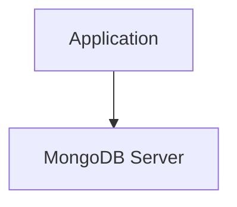

사용자와 데이터가 증가하면 하나의 서버에 부하가 집중될 수 있다.

Sharding을 적용하면 데이터를 여러 서버에 분산할 수 있다.

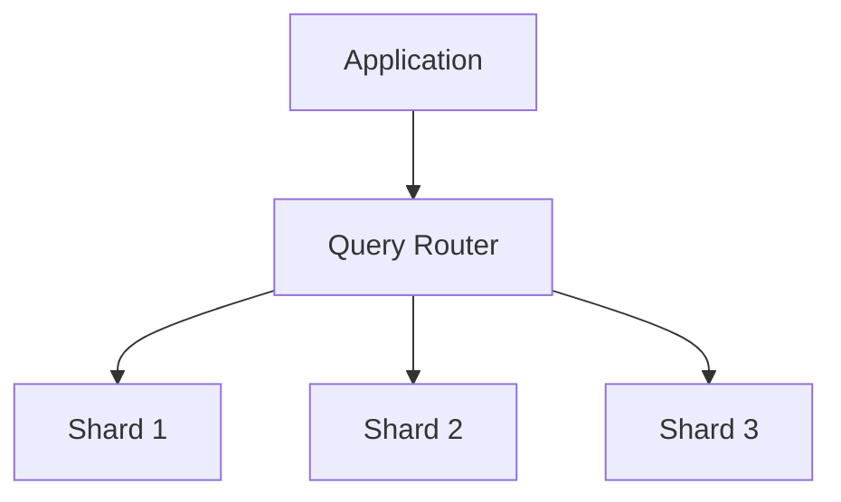

여러 Shard가 서로 다른 데이터 범위를 담당하게 된다.

이를 통해 저장 용량과 처리 부하를 분산할 수 있다.

하지만 Sharding을 구성했다고 모든 쿼리가 자동으로 빨라지는 것은 아니다.

데이터 분산에 사용하는 Shard Key와 실제 조회 조건에 따라 성능이 달라진다.

### 4. High Availability

MongoDB는 Replication을 통해 데이터를 여러 서버에 복제할 수 있다.

Primary 서버에 장애가 발생하더라도 적절한 Replica Set 구성에서는 Secondary가 새로운 Primary로 선출될 수 있다.

이를 통해 서버 장애에 대응할 수 있다.

다만 새로운 Primary가 선출되는 동안 일시적인 쓰기 중단이 발생할 수 있다.

따라서 Replication은 장애 대응 능력을 높여 주지만, 모든 상황에서 완전한 무중단 처리를 보장하는 것은 아니다.

### 5. Aggregation Framework

MongoDB는 Aggregation Framework를 제공한다.

이를 이용하면 여러 단계에 걸쳐 데이터를 처리할 수 있다.

대표적인 연산은 다음과 같다.

| 연산자 | 설명 |
|---|---|
| `$match` | 조건에 맞는 Document 필터링 |
| `$group` | 특정 기준으로 그룹화 |
| `$sort` | 결과 정렬 |
| `$project` | 반환할 필드 구성 |
| `$limit` | 결과 개수 제한 |
| `$lookup` | 다른 Collection과 데이터 결합 |

예를 들어 서울에 거주하는 고객을 나이별로 집계할 수 있다.

```javascript
db.customers.aggregate([
  {
    $match: {
      "address.city": "Seoul"
    }
  },
  {
    $group: {
      _id: "$age",
      customerCount: {
        $sum: 1
      }
    }
  },
  {
    $sort: {
      _id: 1
    }
  }
]);
```

이처럼 MongoDB는 데이터를 저장하고 조회하는 것뿐만 아니라 다양한 집계 작업도 지원한다.

---

## MongoDB의 기본 아키텍처

MongoDB의 아키텍처를 이해할 때는 먼저 세 가지 배포 구성을 구분해야 한다.

1. Standalone
2. Replica Set
3. Sharded Cluster

세 구성은 서로 다른 목적을 가지고 있다.

### 1. Standalone

Standalone은 하나의 MongoDB 서버를 실행하는 가장 단순한 구성이다.

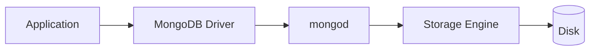

각 구성 요소의 역할은 다음과 같다.

| 구성 요소 | 역할 |
|---|---|
| Application | MongoDB를 사용하는 애플리케이션 |
| Driver | MongoDB 서버와 통신 |
| mongod | 실제 데이터베이스 서버 |
| Storage Engine | 데이터 저장 및 접근 관리 |
| Disk | 데이터 파일 저장 |

로컬 개발 환경에서 `mongosh`로 MongoDB에 접속하는 경우가 대표적이다.

Standalone의 장점은 구성이 단순하다는 것이다.

하지만 하나의 서버만 사용하기 때문에 서버 장애에 대한 자동 승계 기능이 없다.

따라서 운영 환경에서 높은 가용성이 필요하다면 Replica Set을 검토해야 한다.

### 2. Replica Set

Replica Set은 여러 MongoDB 서버가 동일한 데이터의 복사본을 유지하는 구성이다.

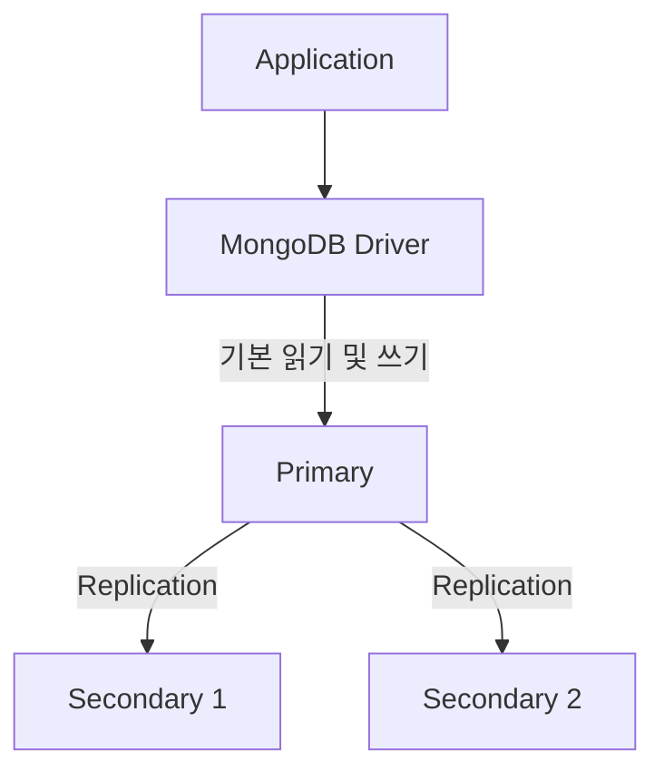

일반적인 Replica Set에서는 Primary가 쓰기 작업을 처리한다.

Secondary는 Primary의 변경 사항을 복제한다.

Primary에 장애가 발생하면 조건을 충족하는 Secondary가 새로운 Primary로 선출될 수 있다.

Replica Set의 핵심 목적은 **데이터 복제와 가용성 확보**다.

### 3. Sharded Cluster

Sharded Cluster는 데이터를 여러 Shard에 나누어 저장하는 구성이다.

일반적인 Sharded Cluster는 다음 요소로 구성된다.

- Application
- MongoDB Driver
- Query Router(`mongos`)
- Config Server Replica Set
- Shard
- Primary
- Secondary

전체 구조를 살펴보자.

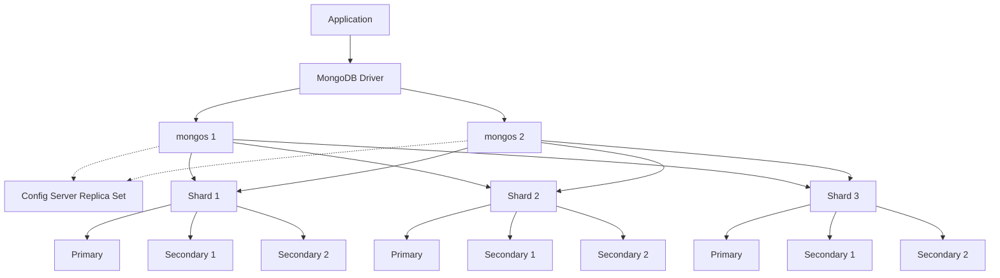

여기서 중요한 점은 **각 Shard가 Replica Set으로 구성될 수 있다는 것**이다.

Sharding과 Replication은 서로 배타적인 기능이 아니다.

오히려 운영용 Sharded Cluster에서는 데이터를 분산하는 Sharding과 장애에 대비하는 Replication을 함께 사용한다.

MongoDB 공식 문서에서는 Sharded Cluster를 Shard, `mongos`, Config Server로 구분하며, 각 Shard를 Replica Set으로 배포하도록 설명한다. [MongoDB](https://www.mongodb.com/docs/manual/sharding/?utm_source=chatgpt.com)

### 세 가지 아키텍처 비교

| 구분 | Standalone | Replica Set | Sharded Cluster |
|---|---|---|---|
| 주요 목적 | 단순한 서버 구성 | 고가용성 | 수평 확장 |
| 데이터 저장 | 단일 서버 | 여러 서버에 복제 | 여러 Shard에 분산 |
| 서버 장애 대응 | 별도 복구 필요 | Primary 선출 가능 | 각 Shard의 Replica Set에서 장애 대응 |
| 데이터 분산 | 없음 | 동일 데이터 복제 | 서로 다른 데이터 범위 분산 |
| Query Router | 없음 | 없음 | `mongos` |
| 운영 복잡도 | 낮음 | 중간 | 높음 |

**서버를 여러 대 사용한다는 사실만으로 Replication과 Sharding을 구분할 수는 없다.**

동일한 데이터를 복제하는지, 서로 다른 데이터를 분산 저장하는지가 핵심이다.

---

## MongoDB 아키텍처의 주요 구성 요소

### Application

Application은 MongoDB를 사용하는 프로그램이다.

대표적으로 다음과 같은 환경이 있다.

- Java
- Spring Boot
- Python
- Node.js
- .NET
- JavaScript

애플리케이션은 MongoDB에 데이터를 저장하거나 조회하는 작업을 수행한다.

예를 들어 Spring Boot에서 고객 정보를 조회한다고 가정해 보자.

애플리케이션은 MongoDB Driver를 통해 데이터베이스에 요청을 전달한다.

### Driver

Driver는 애플리케이션과 MongoDB 사이에서 통신을 담당하는 클라이언트 라이브러리다.

주요 역할은 다음과 같다.

1. MongoDB 서버와 연결한다.
2. 애플리케이션 데이터를 BSON으로 변환한다.
3. MongoDB 서버에 읽기·쓰기 명령을 전달한다.
4. 서버 응답을 애플리케이션에서 사용하는 데이터로 변환한다.
5. 연결 풀과 서버 선택을 관리한다.

예를 들어 Java에서는 MongoDB Java Driver를 사용할 수 있다.

Spring Boot에서는 Spring Data MongoDB를 통해 MongoDB를 사용할 수도 있다.

전체 흐름은 다음과 같다.

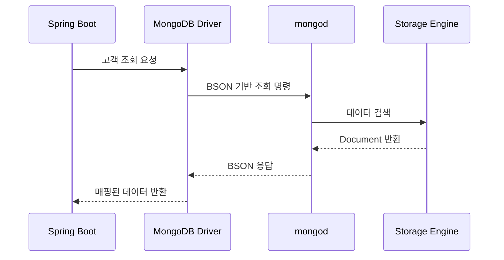

여기서 한 가지 구분해야 할 점이 있다.

Driver는 MongoDB에 요청을 전달하고 서버를 선택하는 역할을 하지만, MongoDB 서버 내부의 Query Optimizer를 대신하는 것은 아니다.

실제로 어떤 인덱스를 사용할지, 어떤 실행 계획으로 문서를 읽을지는 MongoDB 서버의 쿼리 처리 영역이다.

### Query Router: mongos

`mongos`는 Sharded Cluster에서 요청을 적절한 Shard로 전달하는 Query Router다.

일반적인 Sharded Cluster에서 애플리케이션은 `mongos`를 통해 데이터에 접근한다.

예를 들어 다음과 같은 조회 요청이 들어왔다고 가정해 보자.

```javascript
db.customers.find({
  user_id: 12345
});
```

`mongos`는 Shard Key와 클러스터 메타데이터를 바탕으로 요청을 전달할 Shard를 결정한다.

만약 해당 고객이 Shard 2에 존재한다면 Shard 2로 요청을 전달할 수 있다.

반면 조회 조건만으로 대상 Shard를 특정하기 어렵다면 여러 Shard에 요청을 전달할 수 있다.

이 부분은 이후 Sharding에서 자세히 살펴본다.

### Config Server

Config Server는 Sharded Cluster의 구성과 데이터 분산에 필요한 메타데이터를 관리한다.

대표적으로 다음과 같은 정보가 포함된다.

- 클러스터에 존재하는 Shard 정보
- Shard Key 범위
- 데이터 범위의 Shard 배치 정보
- 분산된 데이터의 구성 정보

`mongos`는 이러한 메타데이터를 이용하여 요청을 라우팅한다.

다만 매번 Config Server에 직접 요청하는 것은 아니다.

`mongos`는 메타데이터를 캐시하여 사용하고, 필요할 때 갱신한다.

또한 MongoDB 8.0부터는 Config Server가 애플리케이션 데이터도 저장할 수 있는 **Config Shard** 구성이 지원된다.

일반적인 Config Server 역할과 Config Shard 구성은 구분해서 이해해야 한다. [MongoDB](https://www.mongodb.com/docs/manual/core/sharded-cluster-config-servers/?utm_source=chatgpt.com)

### Shard

Shard는 전체 데이터 중 일부를 저장하는 단위다.

예를 들어 전체 고객 데이터가 300만 건이라고 가정해 보자.

이를 다음과 같이 분산할 수 있다.

| Shard | 저장 데이터 |
|---|---|
| Shard 1 | 고객 데이터 일부 |
| Shard 2 | 고객 데이터 일부 |
| Shard 3 | 고객 데이터 일부 |

실제 데이터가 어느 Shard에 저장되는지는 Shard Key와 데이터 분산 상태에 따라 달라진다.

중요한 점은 각 Shard가 전체 데이터를 모두 저장하지 않는다는 것이다.

Sharding은 전체 데이터를 여러 서버에 나누어 저장하는 구조다.

반면 각 Shard 내부의 Replica Set은 해당 Shard가 담당하는 데이터를 복제한다.

---

## MongoDB Storage Engine

### Storage Engine이란?

Storage Engine은 MongoDB가 데이터를 메모리와 디스크에 저장하고 접근하는 방식을 관리하는 구성 요소다.

애플리케이션이 Document를 저장한다고 해서 데이터가 곧바로 단순한 JSON 파일 형태로 저장되는 것은 아니다.

MongoDB는 Storage Engine을 이용하여 실제 저장 작업을 처리한다.

전체 구조를 살펴보자.

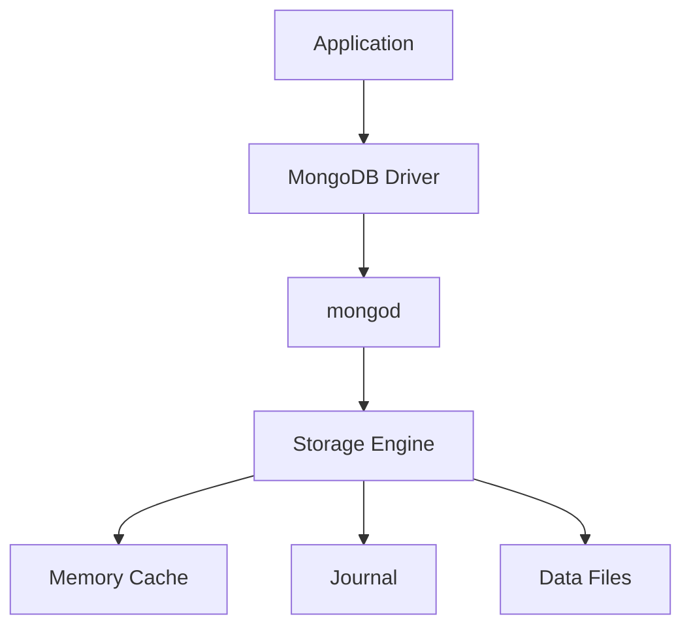

Storage Engine은 다음과 같은 역할을 담당한다.

- 데이터 읽기 및 쓰기
- 인덱스 저장 및 관리
- 메모리 캐시 활용
- 동시성 제어
- 데이터 압축
- Checkpoint
- 장애 복구를 위한 저장 작업

MongoDB의 대표적인 Storage Engine은 WiredTiger다.

### MongoDB의 Storage Engine 종류

| Storage Engine | 특징 | 사용 환경 |
|---|---|---|
| WiredTiger | 기본 Storage Engine, 문서 수준 동시성 제어, 압축, Checkpoint 지원 | MongoDB Community 및 Enterprise |
| In-Memory | 데이터를 주로 메모리에 유지하여 예측 가능한 지연 시간 제공 | MongoDB Enterprise |

여기서 중요한 점은 **In-Memory Storage Engine이 MongoDB Community Edition의 기본 기능은 아니라는 것**이다.

일반적으로 설치하는 MongoDB Community Edition에서는 WiredTiger를 사용한다. [MongoDB](https://www.mongodb.com/docs/manual/core/storage-engines/?utm_source=chatgpt.com)

---

## WiredTiger Storage Engine

WiredTiger는 MongoDB의 기본 Storage Engine이다.

주요 특징은 다음과 같다.

1. Document 수준의 동시성 제어
2. 데이터 압축
3. 메모리 캐싱
4. Checkpoint
5. Journal 기반 장애 복구 지원
6. 영속적인 데이터 저장

### Document 수준의 동시성 제어

여러 사용자가 동시에 MongoDB의 데이터를 읽거나 수정한다고 가정해 보자.

사용자 A는 고객 1의 정보를 변경하고, 사용자 B는 고객 2의 정보를 변경한다.

```text
Transaction A
    ↓
Customer 1 수정

Transaction B
    ↓
Customer 2 수정
```

WiredTiger는 문서 수준의 동시성 제어를 지원한다.

서로 다른 문서를 수정하는 작업이 불필요하게 모두 직렬화되지 않도록 처리할 수 있다.

이는 여러 요청이 동시에 발생하는 애플리케이션에서 중요한 특성이다.

다만 Document 수준의 동시성 제어를 지원한다고 해서 모든 충돌이 사라지는 것은 아니다.

동일한 문서를 여러 트랜잭션에서 변경하려는 경우에는 쓰기 충돌이 발생할 수 있다.

이러한 상황에서는 트랜잭션 재시도나 동시성 제어 전략을 검토해야 한다.

### WiredTiger의 메모리 캐시

MongoDB는 데이터를 디스크에 저장하지만, 모든 조회에서 디스크를 직접 읽는 것은 아니다.

WiredTiger는 내부 캐시를 사용하여 반복적인 디스크 접근을 줄인다.

예를 들어 특정 고객 정보를 반복해서 조회한다고 가정해 보자.

```javascript
db.customers.find({
  user_id: 12345
});
```

처음 요청에서는 필요한 데이터가 메모리에 없을 수 있다.

이때 디스크에서 데이터를 읽어 메모리 캐시에 적재할 수 있다.

이후 같은 데이터에 다시 접근한다면 메모리에 존재하는 데이터를 활용할 수 있다.

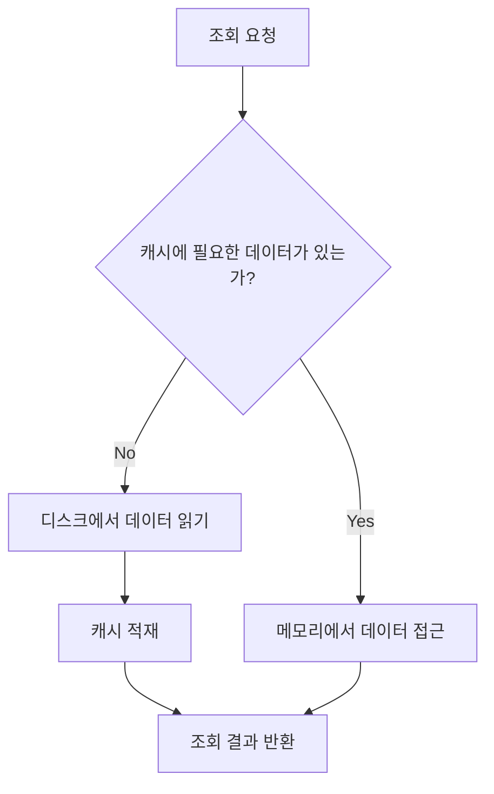

이는 동작을 이해하기 위한 단순화된 구조다.

실제로는 WiredTiger 내부 캐시와 운영체제의 파일 캐시 등 여러 계층이 관여할 수 있다.

중요한 것은 **MongoDB가 디스크 기반 데이터베이스이면서 동시에 메모리 캐시를 활용한다는 사실**이다.

### Working Set이란?

Working Set은 애플리케이션이 일정 시간 동안 자주 접근하는 데이터와 인덱스의 범위다.

예를 들어 전체 데이터가 500GB라고 가정해 보자.

하지만 실제 서비스에서 자주 조회하는 데이터와 인덱스가 10GB 정도라면 전체 500GB를 모두 메모리에 적재할 필요는 없다.

자주 사용하는 데이터가 캐시에 충분히 유지된다면 반복적인 디스크 접근을 줄일 수 있다.

반대로 Working Set이 캐시보다 커지면 디스크 접근이 증가하여 응답 시간이 느려질 수 있다.

따라서 MongoDB의 성능을 분석할 때는 전체 데이터 크기뿐만 아니라 다음을 함께 확인해야 한다.

- 자주 조회하는 데이터의 양
- 인덱스 크기
- 캐시 사용량
- 캐시에서 제거되는 데이터
- 디스크 읽기 및 쓰기
- 메모리 사용량

### Journal과 Checkpoint

MongoDB는 데이터를 메모리에서 처리하더라도 장애 이후 데이터를 복구할 수 있어야 한다.

이를 위해 WiredTiger는 Journal과 Checkpoint 등의 기능을 사용한다.

#### Journal

Journal은 장애 복구에 필요한 변경 기록을 제공한다.

서버에 장애가 발생했을 때 마지막 Checkpoint 이후의 변경 사항을 복구하는 데 활용할 수 있다.

#### Checkpoint

Checkpoint는 Storage Engine의 일관된 저장 상태를 디스크에 기록하는 과정이다.

이를 통해 장애 발생 시 복구 기준점을 제공한다.

전체 개념은 다음과 같이 이해할 수 있다.

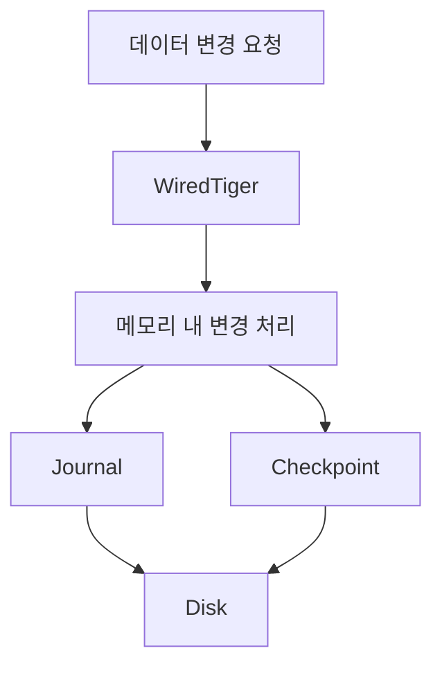

다만 위 그림은 개념적인 구조다.

실제 쓰기의 지속성 보장은 Journal뿐만 아니라 Write Concern, 서버 구성, 장애 상황 등에 영향을 받는다.

**메모리에 반영되었다는 것과 장애 후에도 데이터가 보존된다는 것은 서로 다른 개념**이다.

---

## 현재 MongoDB Storage Engine 확인하기

MongoDB에서는 `db.serverStatus()`를 이용하여 서버 상태를 확인할 수 있다.

### Storage Engine 조회

`mongosh`에서 다음 명령어를 실행한다.

```javascript
db.serverStatus().storageEngine
```

WiredTiger를 사용한다면 다음과 유사한 결과를 확인할 수 있다.

```javascript
{
  name: "wiredTiger",
  supportsCommittedReads: true,
  oldestRequiredTimestampForCrashRecovery: Timestamp({ t: 0, i: 0 }),
  supportsPendingDrops: true,
  dropPendingIdents: Long("0"),
  supportsSnapshotReadConcern: true,
  readOnly: false,
  persistent: true,
  backupCursorOpen: false
}
```

출력되는 속성과 값은 MongoDB 버전과 서버 상태에 따라 달라질 수 있다.

주요 항목은 다음과 같다.

| 항목 | 의미 |
|---|---|
| name | 현재 사용 중인 Storage Engine |
| supportsCommittedReads | 커밋된 데이터 읽기 관련 기능 지원 여부 |
| supportsSnapshotReadConcern | Snapshot Read Concern 지원 여부 |
| readOnly | 읽기 전용 상태 여부 |
| persistent | 영속적인 저장 엔진 여부 |

여기서 다음 결과를 살펴보자.

```javascript
name: "wiredTiger"
```

WiredTiger를 사용하고 있다는 의미다.

```javascript
persistent: true
```

영속적인 데이터를 저장하는 Storage Engine이라는 의미다.

하지만 `persistent: true`라고 해서 모든 쓰기 작업이 어떤 장애 상황에서도 반드시 보존된다는 의미는 아니다.

개별 쓰기의 보장 범위는 Write Concern 등의 설정을 함께 확인해야 한다.

### WiredTiger 상세 정보 조회

다음 명령어로 WiredTiger의 상세 통계를 확인할 수 있다.

```javascript
db.serverStatus().wiredTiger
```

이 명령어는 캐시, 트랜잭션, 체크포인트 등 다양한 내부 통계를 반환한다.

출력 내용은 상당히 많으므로 특정 정보를 확인할 때는 필요한 항목을 선택해서 조회할 수 있다.

예를 들어 다음과 같이 캐시 관련 정보를 확인할 수 있다.

```javascript
db.serverStatus().wiredTiger.cache
```

버전 정보를 확인할 수도 있다.

```javascript
db.serverStatus().wiredTiger.version
```

서버 상태 통계를 조회하려면 적절한 권한이 필요할 수 있다.

---

## MongoDB Storage Engine 설정하기

MongoDB는 설정 파일 또는 서버 실행 옵션을 통해 Storage Engine을 지정할 수 있다.

### mongod.cfg 설정

Windows 환경에서 다음과 같은 설정을 사용할 수 있다.

```yaml
storage:
  dbPath: 'C:\MongoDB\data'
  engine: wiredTiger
```

각 설정의 의미는 다음과 같다.

| 설정 | 의미 |
|---|---|
| storage.dbPath | 실제 데이터 파일을 저장할 경로 |
| storage.engine | 사용할 Storage Engine |

기본적으로 MongoDB는 WiredTiger를 사용하므로 일반적인 신규 설치에서는 명시적으로 지정하지 않아도 된다.

또한 위 코드는 설정 파일의 일부다.

기존 `mongod.cfg`를 이 내용만으로 덮어쓰면 다른 필수 설정이 사라질 수 있으므로 주의해야 한다.

### 명령어로 Storage Engine 지정하기

Linux 환경에서는 다음과 같이 실행 옵션을 지정할 수 있다.

```bash
mongod --dbpath /new/data/directory --storageEngine wiredTiger
```

명령어의 의미는 다음과 같다.

| 옵션 | 설명 |
|---|---|
| mongod | MongoDB 서버 실행 |
| --dbpath | 데이터 저장 디렉터리 지정 |
| --storageEngine | Storage Engine 지정 |

이 명령어는 새로운 MongoDB 서버를 직접 실행하는 방식이다.

이미 동일한 데이터 디렉터리를 사용하는 서버가 실행 중이라면 중복 실행하지 않아야 한다.

또한 Storage Engine 이름만 변경한다고 기존 데이터 파일이 자동으로 새로운 Storage Engine 형식으로 변환되는 것은 아니다.

기존 데이터의 Storage Engine을 변경하려면 백업과 복원, 데이터 마이그레이션 등 별도의 절차를 검토해야 한다.

---

## MongoDB Index

### Index란?

Index는 Collection에서 필요한 Document를 효율적으로 찾기 위한 데이터 구조다.

관계형 데이터베이스의 인덱스와 비슷한 개념이다.

예를 들어 `customers` Collection에 100만 개의 Document가 있다고 가정해 보자.

```javascript
db.customers.find({
  name: "kevin.lee"
});
```

인덱스가 없다면 MongoDB는 조건에 맞는 문서를 찾기 위해 Collection의 많은 문서를 확인해야 할 수 있다.

이를 Collection Scan이라고 한다.

반면 적절한 인덱스가 존재하면 인덱스를 이용하여 검색 범위를 줄일 수 있다.

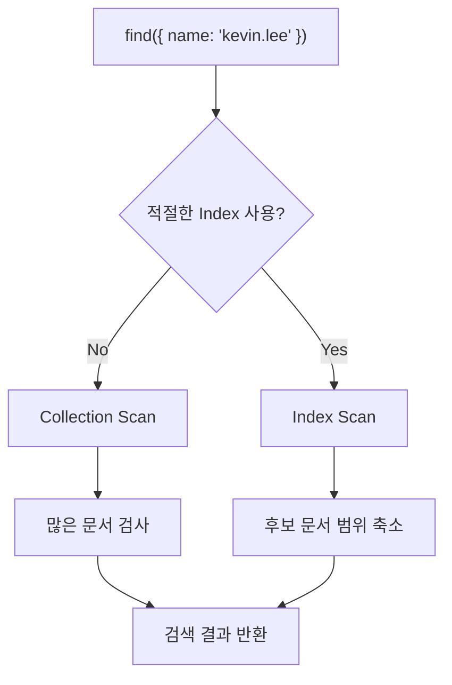

인덱스가 존재한다고 해서 MongoDB가 반드시 해당 인덱스를 선택하는 것은 아니다.

쿼리 실행 계획과 데이터 분포에 따라 Collection Scan이 더 효율적이라고 판단할 수도 있다.

### 1. 단일 필드 인덱스

특정 필드를 기준으로 인덱스를 생성한다.

```javascript
db.customers.createIndex({
  name: 1
});
```

여기서 `1`은 오름차순을 의미한다.

반대로 `-1`은 내림차순을 의미한다.

```javascript
db.customers.createIndex({
  name: -1
});
```

단일 필드 인덱스는 특정 필드의 검색이나 정렬에 활용할 수 있다.

### 2. 복합 인덱스

여러 필드를 조합하여 인덱스를 생성할 수 있다.

```javascript
db.customers.createIndex({
  name: 1,
  age: -1
});
```

이 인덱스는 다음과 같은 구조를 가진다.

1. `name`을 오름차순으로 정렬한다.
2. 같은 `name` 안에서 `age`를 내림차순으로 정렬한다.

예를 들어 다음 조회에 활용할 수 있다.

```javascript
db.customers.find({
  name: "kevin.lee"
}).sort({
  age: -1
});
```

이 쿼리는 특정 이름을 가진 고객을 검색하고 나이를 기준으로 내림차순 정렬한다.

여기서 중요한 점은 **복합 인덱스의 필드 순서**다.

다음 두 인덱스는 서로 다른 인덱스다.

```javascript
db.customers.createIndex({
  name: 1,
  age: -1
});
```

```javascript
db.customers.createIndex({
  age: -1,
  name: 1
});
```

첫 번째 인덱스는 `name`이 앞에 있다.

두 번째 인덱스는 `age`가 앞에 있다.

MongoDB의 복합 인덱스는 일반적으로 선행 필드인 Prefix를 활용하는 조회에 유리하다.

따라서 `{ name: 1, age: -1 }` 인덱스를 만들었다고 해서 `age`만 조건으로 사용하는 조회에도 똑같이 효율적인 것은 아니다. [MongoDB](https://www.mongodb.com/docs/manual/core/indexes/index-types/index-compound/?utm_source=chatgpt.com)

### 3. Unique Index

중복된 값을 허용하지 않도록 인덱스를 생성할 수 있다.

```javascript
db.customers.createIndex(
  {
    email: 1
  },
  {
    unique: true
  }
);
```

이 인덱스는 동일한 이메일 값의 중복 저장을 방지한다.

예를 들어 다음 문서가 저장되어 있다고 가정해 보자.

```javascript
{
  name: "Alice",
  email: "alice@example.com"
}
```

이후 같은 이메일로 다른 문서를 추가하면 Unique Index 위반으로 실패할 수 있다.

하지만 기존 데이터에 이미 중복된 이메일이 있다면 Unique Index 생성 자체가 실패할 수 있다.

또한 일반적인 단일 필드 Unique Index에서는 필드가 누락되거나 `null`인 문서도 주의해야 한다.

이메일이 선택 사항이라면 Partial Index 등을 검토할 수 있다.

### Index의 장점과 단점

| 장점 | 단점 |
|---|---|
| 검색 범위를 줄일 수 있음 | 추가 저장 공간 사용 |
| 정렬 비용을 줄일 수 있음 | 쓰기 작업 시 인덱스 갱신 필요 |
| 특정 조건 조회 성능 개선 | 인덱스가 많으면 유지 비용 증가 |
| 일부 조회에서 문서 접근 감소 | 잘못된 인덱스는 효과가 낮을 수 있음 |

따라서 인덱스는 많이 생성할수록 좋은 것이 아니다.

**실제로 자주 사용하는 조회 조건과 정렬 조건을 기준으로 설계해야 한다.**

---

## MongoDB Index 성능 확인하기

인덱스를 생성하기 전과 후의 실행 계획을 비교해 보자.

여기서는 앞서 사용한 `customers` Collection과 구분하기 위해 별도의 Collection을 사용한다.

### 1. 데이터베이스 선택

`mongosh`에서 다음 명령어를 실행한다.

```javascript
use mongodb_structure_demo
```

### 2. 데이터 생성

1,000개의 고객 데이터를 저장한다.

```javascript
db.index_customers.insertMany(
  Array.from({ length: 1000 }, (_, i) => ({
    _id: i + 1,
    user_id: i + 1,
    name: `customer-${i + 1}`,
    age: 20 + (i % 40),
    email: `customer-${i + 1}@example.com`
  }))
);
```

이 명령어는 JavaScript의 `Array.from()`을 이용하여 1,000개의 Document를 생성한다.

각 필드의 의미는 다음과 같다.

| 필드 | 값 |
|---|---|
| _id | 1~1000 |
| user_id | 1~1000 |
| name | customer-1~customer-1000 |
| age | 20~59 반복 |
| email | 고객별 이메일 |

`_id`를 직접 지정했으므로 같은 Collection에 명령어를 다시 실행하면 중복 키 오류가 발생할 수 있다.

### 3. 인덱스 적용 전 조회

다음 명령어를 실행한다.

```javascript
db.index_customers.find({
  user_id: 500
}).explain("executionStats");
```

`explain("executionStats")`는 MongoDB가 쿼리를 어떻게 실행했는지 확인할 수 있는 기능이다.

대표적으로 다음 항목을 확인한다.

| 항목 | 의미 |
|---|---|
| nReturned | 반환된 Document 수 |
| totalDocsExamined | 검사한 Document 수 |
| totalKeysExamined | 검사한 Index Key 수 |
| COLLSCAN | Collection Scan |
| IXSCAN | Index Scan |

이 예제에서는 `_id`와 `user_id`의 값이 동일하지만 서로 다른 필드다.

MongoDB에 기본적으로 생성되는 `_id` 인덱스가 `user_id` 조건의 조회를 자동으로 최적화하는 것은 아니다.

따라서 `user_id` 인덱스가 없다면 Collection Scan이 선택될 수 있다.

### 4. 인덱스 생성

`user_id`에 인덱스를 생성한다.

```javascript
db.index_customers.createIndex({
  user_id: 1
});
```

이제 같은 조회를 다시 실행한다.

```javascript
db.index_customers.find({
  user_id: 500
}).explain("executionStats");
```

적절한 인덱스가 선택되었다면 실행 계획에서 `IXSCAN`을 확인할 수 있다.

### 5. 실행 계획 비교

일반적으로 다음과 같은 차이를 기대할 수 있다.

| 항목 | 인덱스 적용 전 | 인덱스 적용 후 |
|---|---|---|
| 접근 방식 | COLLSCAN 가능 | IXSCAN 가능 |
| 검사 Document 수 | 많은 문서 검사 | 적은 문서 검사 |
| Index Key 검사 | 없을 수 있음 | 인덱스 탐색 |
| 반환 Document 수 | 1 | 1 |

단, 실제 실행 계획과 검사 수는 MongoDB 버전 및 데이터 분포에 따라 달라질 수 있다.

1,000건 정도의 작은 데이터에서는 실행 시간이 거의 동일하게 표시될 수도 있다.

이 경우 단순히 실행 시간만 비교하지 말고 `totalDocsExamined`와 `totalKeysExamined`를 확인하는 것이 좋다.

### 6. 인덱스 목록 확인

현재 Collection에 생성된 인덱스 목록을 조회한다.

```javascript
db.index_customers.getIndexes();
```

`_id` 인덱스와 새로 생성한 `user_id` 인덱스를 확인할 수 있다.

### 7. 복합 인덱스 추가

다음과 같이 복합 인덱스를 생성한다.

```javascript
db.index_customers.createIndex({
  name: 1,
  age: -1
});
```

특정 이름으로 검색하고 나이순으로 정렬한다.

```javascript
db.index_customers.find({
  name: "customer-500"
}).sort({
  age: -1
});
```

반면 나이만 조건으로 조회한다면 다음과 같다.

```javascript
db.index_customers.find({
  age: 39
});
```

`name`을 앞에 둔 복합 인덱스가 있다고 해서 두 번째 쿼리도 같은 효율로 실행된다고 보장할 수 없다.

이처럼 복합 인덱스의 필드 순서는 실제 조회 조건을 기준으로 결정해야 한다.

---

## MongoDB Replication

### Replication이란?

Replication은 동일한 데이터를 여러 MongoDB 서버에 복제하는 기능이다.

주요 목적은 다음과 같다.

- 데이터 중복 보관
- 서버 장애 대응
- 서비스 가용성 향상
- 일부 읽기 작업 분산

MongoDB에서는 Replica Set을 이용하여 Replication을 구성한다.

### Replica Set 구조

일반적인 3개 멤버의 Replica Set을 생각해 보자.

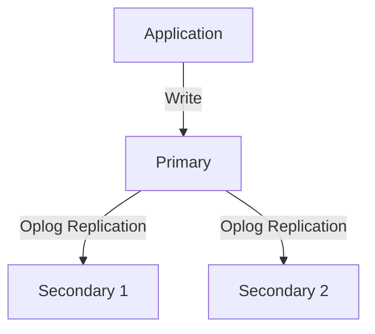

Primary와 Secondary의 역할을 구분해야 한다.

### Primary

Primary는 일반적인 쓰기 작업을 처리하는 서버다.

예를 들어 다음 명령어를 실행한다고 가정해 보자.

```javascript
db.customers.insertOne({
  name: "kevin.lee",
  age: 28,
  email: "kevin.lee@example.com"
});
```

Replica Set에서는 일반적으로 Primary가 쓰기 요청을 처리한다.

Primary는 변경 사항을 기록하고, Secondary는 해당 변경 기록을 복제하여 자신의 데이터에 적용한다.

### Secondary

Secondary는 Primary의 데이터를 복제하는 서버다.

MongoDB는 `oplog`라는 변경 기록을 이용하여 복제를 수행한다.

복제는 일반적으로 비동기적으로 진행된다.

따라서 Primary에 변경이 반영되었더라도 Secondary에는 아직 반영되지 않았을 수 있다.

Secondary는 일반적인 클라이언트 쓰기를 직접 처리하지 않지만, 복제 과정에서는 내부 데이터를 계속 변경한다.

따라서 Secondary가 읽기 전용이라는 표현은 클라이언트의 일반적인 쓰기를 받지 않는다는 의미로 이해하는 것이 적절하다. [MongoDB](https://www.mongodb.com/docs/manual/core/replica-set-secondary/?utm_source=chatgpt.com)

---

## MongoDB는 기본적으로 Primary에서 읽을까, Secondary에서 읽을까?

이 부분은 MongoDB를 사용할 때 자주 혼동하는 개념이다.

Replica Set에서 Secondary가 존재한다고 해서 모든 읽기 요청이 자동으로 Secondary에 분산되는 것은 아니다.

**MongoDB의 기본 Read Preference는 `primary`다.**

즉, 별도로 설정하지 않으면 일반적인 읽기 요청도 Primary를 대상으로 한다.

### Read Preference 종류

MongoDB는 다음과 같은 Read Preference를 지원한다.

| Read Preference | 설명 |
|---|---|
| primary | Primary에서 읽기 |
| primaryPreferred | Primary 우선, 불가능하면 적합한 Secondary |
| secondary | Secondary에서만 읽기 |
| secondaryPreferred | Secondary 우선, 적합한 Secondary가 없으면 Primary |
| nearest | 지연 시간 조건에 맞는 멤버에서 읽기 |

기본값은 `primary`다.

Secondary에서 읽으려면 적절한 Read Preference를 설정해야 한다. [MongoDB](https://www.mongodb.com/docs/manual/core/read-preference/?utm_source=chatgpt.com)

### Secondary에서 읽을 때 주의할 점

사용자의 이메일을 변경했다고 가정해 보자.

기존 이메일은 다음과 같다.

```text
kevin.old@example.com
```

변경한 이메일은 다음과 같다.

```text
kevin.new@example.com
```

Primary에는 변경된 이메일이 반영되었다.

하지만 Secondary에서는 복제가 아직 완료되지 않았을 수 있다.

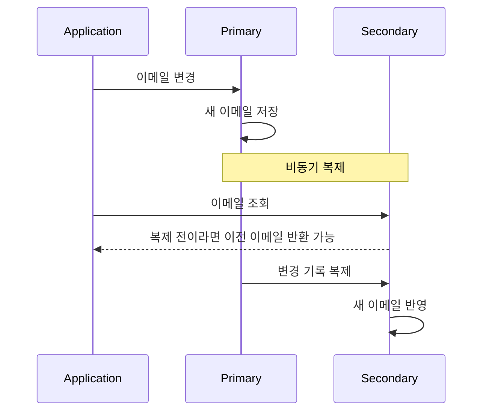

이는 복제 지연 가능성을 설명한 예시다.

실제 쓰기 성공 응답 시점은 Write Concern에 따라 달라질 수 있으므로 모든 상황에서 쓰기 응답이 Secondary 반영보다 먼저 도착하는 것은 아니다.

### Read Preference 선택 기준

| 요구사항 | 고려할 방향 |
|---|---|
| 변경 직후 최신 데이터 조회 | Primary 읽기와 적절한 일관성 설정 |
| 일부 지연을 허용하는 통계 조회 | Secondary 읽기 검토 |
| 지역별 응답 지연 최소화 | Read Preference와 서버 배치 검토 |
| 엄격한 읽기 정합성 | Read Concern, Write Concern, 세션 설정 함께 검토 |

Read Preference는 어떤 서버에서 읽을 것인지를 결정하는 설정이다.

반면 Read Concern은 읽는 데이터에 대해 어떤 일관성 수준을 요구할 것인지와 관련된다.

이 둘은 구분해야 한다.

---

## Replica Set에서 장애가 발생하면?

### Primary 장애

Primary 서버에 장애가 발생했다고 가정해 보자.

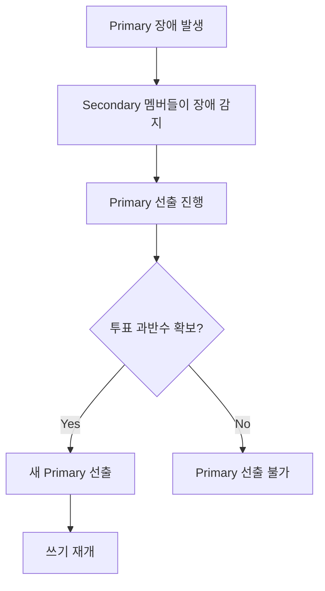

Replica Set에서는 조건을 충족하는 Secondary가 새로운 Primary로 선출될 수 있다.

그러나 여기에는 중요한 조건이 있다.

**Replica Set의 투표 과반수를 확보해야 한다.**

예를 들어 3개의 투표 멤버가 있다고 가정하면 일반적으로 2개 이상의 투표가 필요하다.

Primary에 장애가 발생하더라도 남은 2개 멤버가 통신할 수 있다면 새 Primary 선출이 가능할 수 있다.

반대로 과반수를 확보하지 못하면 새로운 Primary를 선출할 수 없다.

### 장애 발생 시 주의할 점

Replica Set을 구성했다고 장애가 완전히 사라지는 것은 아니다.

Primary 선출 과정에서 다음과 같은 상황이 발생할 수 있다.

- 일시적인 쓰기 실패
- 요청 타임아웃
- Driver의 서버 재선택
- 재시도
- 복제 지연
- 일부 쓰기의 Rollback 가능성

특히 애플리케이션에서 재시도할 때는 동일한 요청이 중복 처리되지 않도록 주의해야 한다.

예를 들어 주문 생성 요청이 타임아웃되었다고 무조건 다시 생성하면 동일한 주문이 두 번 생성될 수 있다.

따라서 분산 환경에서는 멱등성 보장도 함께 고려해야 한다.

### Replication은 백업을 대체할 수 있을까?

Replication은 데이터를 복제하는 기능이다.

하지만 백업과는 목적이 다르다.

예를 들어 Primary에서 실수로 중요한 데이터를 삭제했다고 가정해 보자.

해당 삭제 작업도 Secondary로 복제될 수 있다.

따라서 Replica Set을 구성했다고 해서 백업이 필요 없다는 의미는 아니다.

운영 환경에서는 별도의 백업 및 복구 정책이 필요하다.

---

## MongoDB Sharding

### Sharding이란?

Sharding은 데이터를 여러 서버에 나누어 저장하는 수평 확장 방식이다.

Replication이 같은 데이터를 여러 서버에 복제하는 방식이라면, Sharding은 서로 다른 데이터를 여러 서버에 분산한다.

차이를 살펴보자.

### Replication

```text
Primary
 ├── Customer A
 ├── Customer B
 └── Customer C

Secondary 1
 ├── Customer A
 ├── Customer B
 └── Customer C

Secondary 2
 ├── Customer A
 ├── Customer B
 └── Customer C
```

동일한 데이터를 여러 서버에 복제한다.

### Sharding

```text
Shard 1
 ├── Customer A
 └── Customer B

Shard 2
 ├── Customer C
 └── Customer D

Shard 3
 ├── Customer E
 └── Customer F
```

전체 데이터를 나누어 저장한다.

### Replication과 Sharding 비교

| 구분 | Replication | Sharding |
|---|---|---|
| 목적 | 고가용성 및 데이터 복제 | 수평 확장 |
| 데이터 저장 | 동일 데이터 복제 | 서로 다른 데이터 분산 |
| 주요 구성 | Primary, Secondary | mongos, Config Server, Shard |
| 장애 대응 | Primary 선출 | 각 Shard의 Replica Set에서 대응 |
| 핵심 설계 요소 | 복제, 선출, Read/Write Concern | Shard Key, 데이터 분포, 라우팅 |

---

## MongoDB Sharding의 종류

MongoDB의 대표적인 데이터 분산 방식은 Range Sharding과 Hashed Sharding이다.

특정 데이터 범위의 배치 위치를 관리하는 Zone Sharding도 활용할 수 있다.

### 1. Range-Based Sharding

Range Sharding은 Shard Key의 값 범위를 기준으로 데이터를 분산한다.

예를 들어 `user_id`를 기준으로 데이터를 저장한다고 가정해 보자.

| Shard | 담당 데이터 범위 |
|---|---|
| Shard 1 | user_id 1~1000 |
| Shard 2 | user_id 1001~2000 |
| Shard 3 | user_id 2001 이상 |

이것은 개념적인 예시이며 실제 MongoDB의 데이터 범위는 Chunk 분할과 재분배에 따라 달라질 수 있다.

### Range Sharding의 장점

특정 범위의 데이터를 조회할 때 대상 Shard를 좁힐 수 있다.

예를 들어 다음과 같은 조회가 있다고 가정해 보자.

```javascript
db.customers.find({
  user_id: {
    $gte: 1200,
    $lte: 1300
  }
});
```

해당 범위가 특정 Shard에 존재한다면 그 Shard를 중심으로 조회할 수 있다.

### Range Sharding의 단점

Shard Key가 계속 증가하는 값이라면 특정 Shard에 쓰기가 집중될 수 있다.

예를 들어 신규 고객의 ID가 계속 증가한다고 가정해 보자.

```text
user_id = 2001
user_id = 2002
user_id = 2003
user_id = 2004
...
```

이러한 쓰기 요청이 특정 데이터 범위에 계속 집중되면 해당 범위를 담당하는 Shard가 병목이 될 수 있다.

따라서 Range Sharding을 사용할 때는 데이터 증가 패턴과 조회 패턴을 함께 고려해야 한다.

---

### 2. Hashed Sharding

Hashed Sharding은 Shard Key의 해시 값을 기준으로 데이터를 분산한다.

예를 들어 사용자 ID가 연속적으로 증가하더라도 해시 값을 이용하면 서로 다른 데이터 범위로 분산될 수 있다.

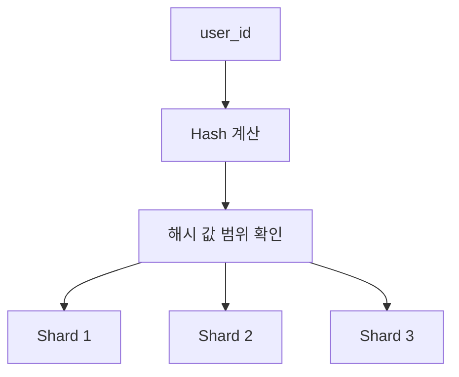

### Hashed Sharding의 장점

연속적으로 증가하는 값이 특정 Shard에 집중되는 문제를 완화하는 데 도움이 될 수 있다.

예를 들어 다음과 같은 ID가 존재한다고 가정해 보자.

```text
1001
1002
1003
1004
1005
```

원래 값이 가까워도 해시 값이 서로 다른 범위에 분포할 수 있다.

따라서 쓰기 부하를 분산하는 데 유리할 수 있다.

### Hashed Sharding의 단점

원래 값의 범위 조회에는 불리할 수 있다.

예를 들어 다음 조건을 생각해 보자.

```javascript
db.customers.find({
  user_id: {
    $gte: 1000,
    $lte: 2000
  }
});
```

Range Sharding에서는 해당 범위를 담당하는 Shard를 좁힐 수 있다.

하지만 Hashed Sharding에서는 원래 값이 연속적이라고 해서 해시 값도 연속적인 것은 아니다.

따라서 여러 Shard를 조회해야 할 수 있다.

### MongoDB의 해시 분산 방식 이해하기

Hashed Sharding을 다음과 같은 공식으로 설명하는 경우가 있다.

```text
hash(user_id) % Shard_Count
```

이 공식은 일반적인 해시 기반 분산을 이해하기 위한 단순한 예시다.

**MongoDB의 실제 Hashed Sharding 구현을 이 공식으로 이해하면 안 된다.**

MongoDB는 Shard Key의 해시 값을 구하고, 해시 값의 범위와 Chunk 메타데이터를 이용하여 데이터를 배치한다.

즉, 단순히 Shard 개수로 나눈 나머지를 이용하는 구조가 아니다. [MongoDB](https://www.mongodb.com/docs/manual/core/hashed-sharding/?utm_source=chatgpt.com)

### Range와 Hashed Sharding 비교

| 항목 | Range Sharding | Hashed Sharding |
|---|---|---|
| 데이터 분산 | 값의 범위 | 해시 값의 범위 |
| 연속 ID의 쓰기 분산 | 특정 범위 집중 가능 | 분산에 유리할 수 있음 |
| 범위 조회 | 유리할 수 있음 | 여러 Shard 조회 가능 |
| 정확한 Key 조회 | 대상 Shard 축소 가능 | 대상 Shard 축소 가능 |
| 주요 고려사항 | Hotspot | 범위 조회 성능 |

따라서 조회 조건이 범위 중심인지, 특정 Key 중심인지에 따라 적절한 방식을 선택해야 한다.

---

### 3. Zone Sharding

Zone Sharding은 특정 Shard Key 범위를 지정된 Zone의 Shard에 배치하는 방식이다.

예를 들어 글로벌 서비스를 운영한다고 가정해 보자.

한국 사용자의 데이터와 미국 사용자의 데이터를 지역별로 관리해야 할 수 있다.

개념적으로 다음과 같은 구조를 생각할 수 있다.

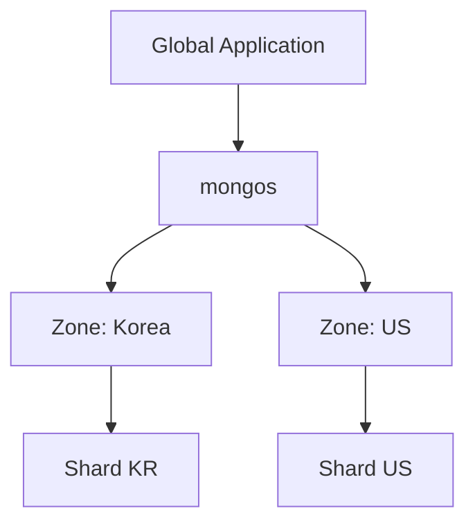

다만 `country` 필드가 존재한다고 해서 MongoDB가 자동으로 해당 국가의 서버에 데이터를 저장하는 것은 아니다.

Zone Sharding을 적용하려면 다음 요소를 고려해야 한다.

- Shard Key 설계
- Zone 범위 설정
- Shard와 Zone 연결
- 실제 서버 배치 위치
- Replica Set 구성
- 백업 데이터의 저장 위치

특히 데이터 주권이나 지역별 규제 요구사항을 충족해야 한다면 Primary 데이터뿐만 아니라 복제본과 백업 데이터의 위치까지 확인해야 한다.

---

## MongoDB에 Document가 저장되는 과정

이제 Sharded Cluster에서 Document가 저장되는 전체 흐름을 살펴보자.

예를 들어 애플리케이션이 다음 고객 정보를 저장한다고 가정해 보자.

```javascript
{
  name: "kevin.lee",
  age: 28,
  email: "kevin.lee@example.com"
}
```

### 데이터 저장 흐름

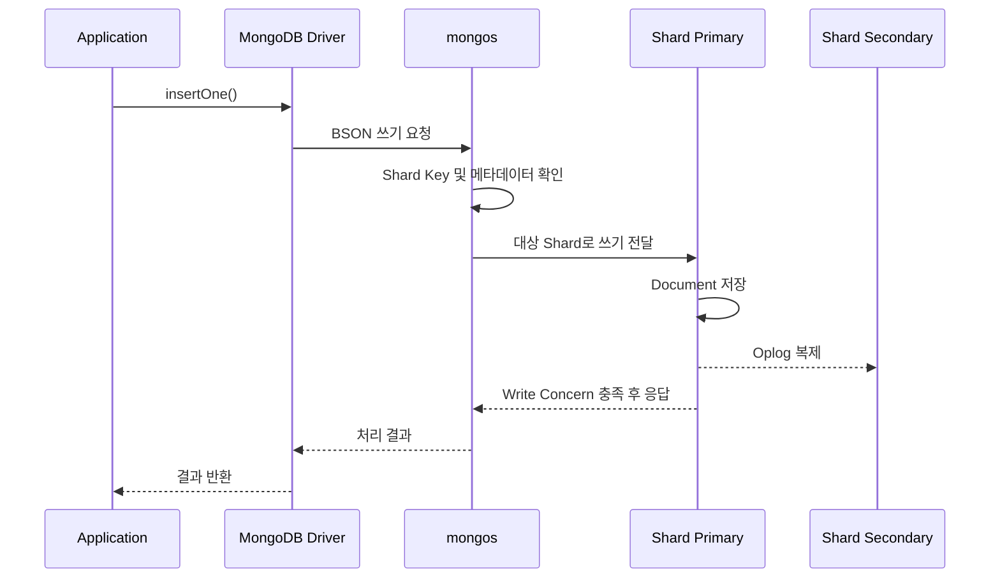

이 그림은 데이터 저장 경로를 단순화한 것이다.

실제로 복제와 응답의 순서는 Write Concern과 서버 상태에 영향을 받는다.

### 1. 애플리케이션 요청

애플리케이션에서 데이터 저장 요청이 발생한다.

Java나 Spring Boot 애플리케이션이라면 MongoDB Driver를 통해 요청을 전달한다.

### 2. Query Router 처리

`mongos`는 Shard Key와 클러스터 메타데이터를 확인하여 데이터를 저장할 Shard를 결정한다.

### 3. Shard 선택

대상 Shard가 결정되면 해당 Shard의 Primary로 쓰기 요청을 전달한다.

### 4. Primary 저장

Primary는 Document를 저장한다.

### 5. Secondary 복제

Secondary는 Primary의 변경 기록을 복제하여 자신의 데이터에 적용한다.

### 6. 응답 반환

쓰기 요청이 설정된 Write Concern을 충족하면 결과가 애플리케이션에 반환된다.

따라서 성공 응답을 받았다는 사실만으로 모든 Secondary가 즉시 같은 상태라고 판단해서는 안 된다.

---

## MongoDB에서 Document를 조회하는 과정

이번에는 저장된 Document를 읽는 과정을 살펴보자.

다음 조회 요청이 발생했다고 가정해 보자.

```javascript
db.customers.find({
  user_id: 12345
});
```

### 전체 조회 흐름

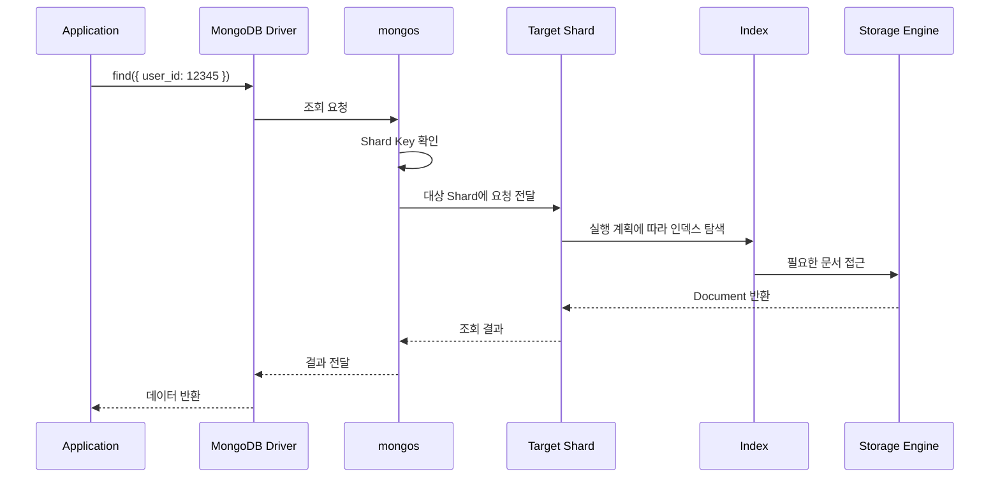

이 흐름은 인덱스가 선택된 경우를 보여 준다.

인덱스가 적절하지 않거나 Query Optimizer가 다른 접근 방식을 선택하면 Collection Scan으로 조회할 수도 있다.

### 1. 조회 요청

애플리케이션이 특정 조건으로 데이터를 조회한다.

```javascript
db.customers.find({
  user_id: 12345
});
```

### 2. mongos에서 대상 Shard 확인

`mongos`는 Shard Key와 클러스터 메타데이터를 기반으로 대상 Shard를 판단한다.

만약 `user_id`가 Shard Key이고 조건으로 해당 값을 지정했다면 관련 Shard로 요청을 전달할 수 있다.

### 3. Shard 내부에서 데이터 검색

선택된 Shard의 MongoDB 서버는 쿼리 실행 계획에 따라 데이터를 검색한다.

적절한 인덱스가 있다면 인덱스를 활용하여 필요한 Document를 찾을 수 있다.

### 4. Document 반환

검색된 Document가 `mongos`로 전달된다.

### 5. 결과 병합 및 응답

`mongos`는 필요한 경우 여러 Shard에서 전달된 결과를 병합하여 애플리케이션에 반환한다.

---

## Shard Key와 Index의 차이

MongoDB에서 Sharding을 사용할 때 반드시 구분해야 하는 개념이 있다.

바로 **Shard Key와 Index**다.

두 개념 모두 데이터 검색에 영향을 주지만 역할은 다르다.

| 구분 | Shard Key | Index |
|---|---|---|
| 주요 역할 | 데이터 분산 및 라우팅 | 문서 검색 최적화 |
| 판단 대상 | 어느 Shard에 접근할 것인가 | 선택된 서버에서 어떤 문서를 읽을 것인가 |
| 영향 범위 | Sharded Cluster | Collection의 쿼리 실행 |
| 설계 기준 | 데이터 분포와 주요 조회 조건 | 필터·정렬·조회 패턴 |

### 예시: user_id가 Shard Key인 경우

다음과 같은 구성을 가정해 보자.

```text
Shard Key: user_id
```

고객 ID를 조건으로 조회한다.

```javascript
db.customers.find({
  user_id: 12345
});
```

이 경우 `mongos`는 Shard Key 정보를 활용하여 대상 Shard를 좁힐 수 있다.

### 예시: email이 일반 Index인 경우

이번에는 이메일에 인덱스가 있다고 가정해 보자.

```javascript
db.customers.createIndex({
  email: 1
});
```

이메일로 조회한다.

```javascript
db.customers.find({
  email: "kevin.lee@example.com"
});
```

`email`에 인덱스가 존재하지만 Shard Key는 여전히 `user_id`다.

따라서 `mongos`가 이메일만으로 어떤 Shard에 데이터가 존재하는지 판단하기 어려울 수 있다.

이 경우 여러 Shard에 조회 요청을 전달해야 할 수 있다.

다만 각 Shard 내부에서는 이메일 인덱스를 이용하여 검색할 수 있다.

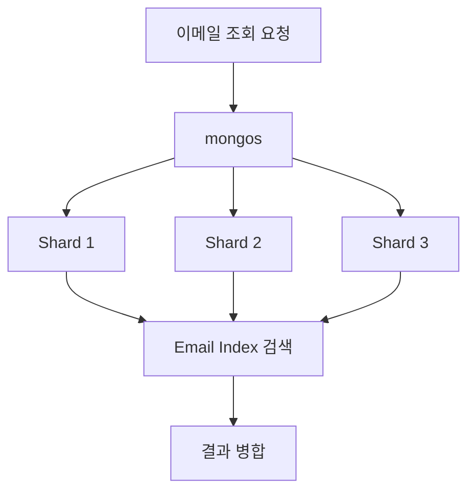

이처럼 여러 Shard에 요청을 전달하는 방식을 Scatter-Gather라고 한다.

### Scatter-Gather란?

Scatter-Gather는 여러 Shard에 요청을 분산하고, 각 Shard에서 반환한 결과를 모으는 방식이다.

Shard Key 조건으로 조회 대상을 좁히지 못하면 여러 Shard를 조회해야 할 수 있다.

이 경우 다음 비용이 발생할 수 있다.

- 여러 Shard에 대한 네트워크 요청
- 각 Shard의 검색 작업
- 결과 병합
- 전체 응답 시간 증가
- 클러스터 리소스 사용 증가

물론 모든 Scatter-Gather가 비효율적인 것은 아니다.

대규모 집계처럼 여러 Shard가 병렬 처리하는 것이 유리한 작업도 있다.

하지만 단일 고객을 조회하는 API에서 매번 모든 Shard를 검색해야 한다면 Shard Key 설계를 다시 검토할 필요가 있다.

따라서 Sharding 환경에서 느린 쿼리를 분석할 때는 다음 두 가지를 함께 확인해야 한다.

1. 몇 개의 Shard를 조회하는가?
2. 각 Shard 안에서 어떤 실행 계획으로 데이터를 검색하는가?

**인덱스는 Shard 내부의 검색을 최적화할 수 있지만, 일반 인덱스를 생성했다고 자동으로 Shard 라우팅이 최적화되는 것은 아니다.** [MongoDB](https://www.mongodb.com/docs/manual/core/sharding-choose-a-shard-key/?utm_source=chatgpt.com)

---

## MongoDB 데이터 저장 구조

MongoDB의 서버 아키텍처를 이해했다면 이제 논리적인 데이터 구조를 살펴보자.

MongoDB는 다음과 같은 계층으로 데이터를 관리한다.

```text
MongoDB Server
    ↓
Database
    ↓
Collection
    ↓
Document
    ↓
Field : Value
```

이를 구조로 표현하면 다음과 같다.

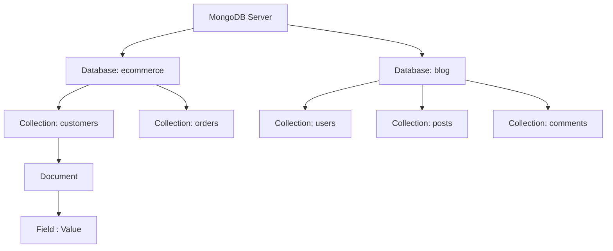

### MongoDB와 RDBMS 비교

| RDBMS | MongoDB |
|---|---|
| Database | Database |
| Table | Collection |
| Row | Document |
| Column | Field |
| Primary Key | `_id` |

MongoDB는 RDBMS와 비슷한 논리적 계층을 사용하지만 데이터를 저장하는 단위가 다르다.

RDBMS의 Row는 정의된 컬럼 구조를 중심으로 관리된다.

반면 MongoDB의 Document는 배열과 중첩 Document를 포함할 수 있다.

### 다른 데이터베이스와의 구조 비교

| 데이터베이스 | 논리적 데이터 구조 |
|---|---|
| MongoDB | Database → Collection → Document → Field |
| Cassandra | Keyspace → Table → Row → Column |
| Elasticsearch | Index → Document → Field |
| RDBMS | Database → Table → Row → Column |

여기서 Elasticsearch의 데이터 모델도 주의해야 한다.

과거에는 Index 아래에 Mapping Type이라는 개념이 존재했지만, Elasticsearch 8.0부터는 Mapping Type이 지원되지 않는다.

따라서 현재 Elasticsearch를 설명할 때는 일반적으로 `Index → Document → Field` 구조로 이해하는 것이 적절하다.

---

## MongoDB Document

### Document란?

Document는 MongoDB에서 데이터를 저장하는 기본 단위다.

각 Document는 Field와 Value의 쌍으로 구성된다.

예를 들어 다음과 같은 고객 정보가 있다고 가정해 보자.

```javascript
{
  name: "john",
  age: 30,
  gender: "M"
}
```

이 데이터에는 세 개의 Field가 존재한다.

| Field | Value |
|---|---|
| name | john |
| age | 30 |
| gender | M |

MongoDB는 이러한 데이터를 BSON 형태로 저장한다.

Document는 단순한 문자열과 숫자뿐 아니라 배열과 중첩 Document도 저장할 수 있다.

---

## 중첩 Document와 배열 이해하기

다음은 다양한 자료형을 포함하는 고객 Document다.

```javascript
const customer = {
  _id: ObjectId("5ad88534e3632e1a35a58d00"),

  name: {
    first: "John",
    last: "Doe"
  },

  address: [
    {
      location: "work",

      address: {
        street: "16 Hatfields",
        city: "London",
        postal_code: "SE1 8DJ"
      },

      geo: {
        type: "Point",
        coordinates: [-0.109081, 51.5065752]
      }
    }
  ],

  phone: [
    {
      location: "work",
      number: "+44-1234567890"
    }
  ],

  dob: ISODate("1977-04-01T05:00:00Z"),

  retirement_fund: Decimal128("1292815.75")
};
```

이 Document는 여러 자료형을 포함한다.

| Field | 자료형 |
|---|---|
| _id | ObjectId |
| name | Document |
| address | Array |
| address.address | Document |
| address.geo | Document |
| phone | Array |
| dob | Date |
| retirement_fund | Decimal128 |

### name

```javascript
name: {
  first: "John",
  last: "Doe"
}
```

`name`은 중첩 Document다.

이름을 하나의 문자열로 저장하는 대신 이름과 성을 구분하여 저장했다.

### address

```javascript
address: [
  {
    location: "work",
    address: {
      street: "16 Hatfields",
      city: "London",
      postal_code: "SE1 8DJ"
    },
    geo: {
      type: "Point",
      coordinates: [-0.109081, 51.5065752]
    }
  }
]
```

`address`는 배열이다.

배열 안에는 중첩 Document가 존재한다.

이 구조를 이용하면 하나의 고객이 여러 주소를 가질 수 있다.

예를 들어 집과 회사 주소를 함께 저장할 수 있다.

### geo

```javascript
geo: {
  type: "Point",
  coordinates: [-0.109081, 51.5065752]
}
```

이 데이터는 GeoJSON의 Point 구조다.

GeoJSON에서는 좌표를 **경도(Longitude), 위도(Latitude)** 순서로 표현한다.

따라서 위 값은 다음과 같다.

```text
Longitude: -0.109081
Latitude : 51.5065752
```

위치 기반 검색이 필요하다면 MongoDB의 `2dsphere` 인덱스를 활용할 수 있다.

```javascript
db.customers.createIndex({
  "address.geo": "2dsphere"
});
```

이 인덱스는 위치 데이터의 지리 공간 검색에 활용할 수 있다. [MongoDB](https://www.mongodb.com/docs/manual/core/indexes/index-types/geospatial/2dsphere/?utm_source=chatgpt.com)

### retirement_fund

```javascript
retirement_fund: Decimal128("1292815.75")
```

`Decimal128`은 정확한 십진수 표현이 필요한 값에 사용할 수 있다.

금액처럼 소수점 정확성이 중요한 데이터를 저장할 때 검토할 수 있다.

Java의 `BigDecimal`과 연결해서 이해할 수 있다.

다만 실제 Java 객체와 BSON 자료형 사이의 변환 방식은 사용하는 드라이버와 매핑 설정에 따라 달라진다.

---

## MongoDB Collection

### Collection이란?

Collection은 Document의 집합이다.

관계형 데이터베이스의 Table과 비슷한 개념이다.

예를 들어 다음과 같은 Collection을 만들 수 있다.

```text
Database: ecommerce

Collections:
    customers
    products
    orders
```

각 Collection에는 관련된 Document를 저장한다.

```text
customers
    ├── Customer 1
    ├── Customer 2
    └── Customer 3

products
    ├── Product 1
    ├── Product 2
    └── Product 3

orders
    ├── Order 1
    ├── Order 2
    └── Order 3
```

MongoDB에서는 같은 Collection에 서로 다른 구조의 Document를 저장할 수 있다.

하지만 모든 데이터를 하나의 Collection에 저장하는 것이 좋은 설계는 아니다.

비즈니스 도메인과 데이터 접근 패턴을 기준으로 적절하게 분리해야 한다.

---

## MongoDB Collection 설계 예시

블로그 서비스를 개발한다고 가정해 보자.

대표적인 데이터는 다음과 같다.

- 사용자
- 게시물
- 댓글

이 데이터를 다음 세 개의 Collection으로 분리할 수 있다.

```text
Database: blog

Collections:
    users
    posts
    comments
```

### users Collection

사용자 정보를 저장한다.

```javascript
{
  _id: "user-1",
  name: "kevin.lee"
}
```

### posts Collection

게시물 정보를 저장한다.

```javascript
{
  _id: "post-1",
  authorId: "user-1",
  title: "MongoDB 저장 구조",
  body: "Database와 Collection을 구분한다."
}
```

### comments Collection

댓글 정보를 저장한다.

```javascript
{
  _id: "comment-1",
  postId: "post-1",
  authorId: "user-1",
  content: "댓글은 별도로 조회한다."
}
```

이 구조에서는 사용자, 게시물, 댓글이 각각 독립된 Collection에 저장된다.

### 관계 구조

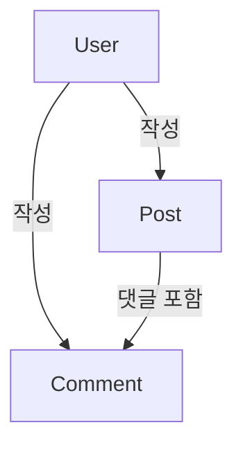

MongoDB는 관계형 데이터베이스처럼 외래 키 제약을 자동으로 강제하지 않는다.

예를 들어 `authorId` 필드에 사용자 ID를 저장했다고 해서 해당 사용자가 실제로 존재한다는 사실이 자동으로 보장되는 것은 아니다.

따라서 필요한 참조 무결성은 애플리케이션 로직이나 별도의 검증 방식으로 관리해야 한다.

### 게시물과 댓글을 하나의 Document에 저장하면 안 될까?

MongoDB에서는 댓글을 게시물 내부의 배열로 저장할 수도 있다.

```javascript
{
  _id: "post-1",
  title: "MongoDB 저장 구조",
  comments: [
    {
      authorId: "user-1",
      content: "첫 번째 댓글"
    },
    {
      authorId: "user-2",
      content: "두 번째 댓글"
    }
  ]
}
```

이 구조에서는 게시물과 댓글을 함께 조회할 수 있다.

하지만 댓글이 계속 증가한다면 문제가 발생할 수 있다.

- Document 크기가 계속 증가한다.
- 댓글을 독립적으로 수정하거나 삭제하기 어려워질 수 있다.
- 댓글 페이징에 불리할 수 있다.
- 게시물과 댓글의 변경 주기가 달라질 수 있다.

MongoDB의 일반적인 BSON Document에는 최대 16MiB 크기 제한이 있다.

따라서 계속 증가하는 데이터를 무제한 배열로 저장하는 설계는 주의해야 한다. [MongoDB](https://www.mongodb.com/ko-kr/docs/manual/reference/limits/?utm_source=chatgpt.com)

### Embedded Document와 Reference 비교

| 구분 | Embedded Document | Reference |
|---|---|---|
| 저장 방식 | 하나의 Document 내부에 포함 | 다른 Collection의 식별자 참조 |
| 장점 | 함께 조회하기 편리함 | 독립적인 변경과 조회에 유리 |
| 단점 | Document가 커질 수 있음 | 별도 조회나 데이터 결합 필요 |
| 적합한 예시 | 작은 프로필, 제한된 주소 목록 | 게시물, 댓글, 독립적인 엔티티 |

이처럼 MongoDB의 데이터 모델링은 단순히 JOIN을 없애는 작업이 아니다.

**함께 조회하는 데이터, 함께 변경하는 데이터, 지속적으로 증가하는 데이터를 구분하는 과정**이다.

---

## MongoDB Database

### Database란?

Database는 여러 Collection을 관리하는 논리적 공간이다.

하나의 MongoDB 인스턴스는 여러 Database를 관리할 수 있다.

예를 들어 다음과 같이 구성할 수 있다.

```text
MongoDB Server

 ├── ecommerce
 │    ├── customers
 │    ├── products
 │    └── orders
 │
 └── blog
      ├── users
      ├── posts
      └── comments
```

`ecommerce`와 `blog`는 서로 다른 Database다.

각 Database는 독립적인 이름 공간을 가진다.

따라서 다음 두 Collection은 이름이 같더라도 서로 다른 Collection이다.

```text
ecommerce.users

blog.users
```

하지만 Database를 나눈다고 해서 CPU, 메모리, 디스크 자원이 자동으로 분리되는 것은 아니다.

같은 MongoDB 인스턴스에서 실행되는 Database는 서버 자원을 공유한다.

또한 Database별로 반드시 하나의 물리적 디렉터리가 생성된다고 이해해서도 안 된다.

실제 파일 저장 방식은 Storage Engine에 따라 달라진다.

---

## mongosh에서 MongoDB 데이터 저장 구조 확인하기

MongoDB의 논리적 구조를 실제 명령어로 확인해 보자.

여기서는 로컬 MongoDB 서버가 실행 중이라고 가정한다.

### 1. MongoDB 접속

PowerShell에서 다음 명령어를 실행한다.

```powershell
mongosh "mongodb://127.0.0.1:27017"
```

정상적으로 연결되면 MongoDB Shell 프롬프트가 나타난다.

### 2. 현재 Database 확인

```javascript
db
```

현재 선택된 Database가 출력된다.

예를 들어 다음과 같다.

```text
test
```

### 3. Database 목록 조회

```javascript
show dbs
```

또는 다음 명령어를 사용할 수 있다.

```javascript
show databases
```

현재 MongoDB 서버에서 접근 가능한 Database 목록이 출력된다.

### 4. Database 선택

앞서 인덱스 예제에서 사용한 Database로 이동한다.

```javascript
use mongodb_structure_demo
```

현재 Database를 확인한다.

```javascript
db
```

실행 결과는 다음과 같다.

```text
mongodb_structure_demo
```

`use` 명령어는 Database를 선택하는 작업이다.

해당 Database에 데이터가 아직 존재하지 않는다면 `show dbs`에 나타나지 않을 수 있다.

### 5. Collection 목록 확인

```javascript
show collections
```

다음 명령어도 사용할 수 있다.

```javascript
show tables
```

두 명령어는 현재 Database에 존재하는 Collection 목록을 확인하는 데 사용한다.

앞에서 인덱스 예제를 실행했다면 `index_customers`가 나타날 수 있다.

---

## MongoDB에 Document 저장하기

이제 새로운 고객 정보를 저장해 보자.

### 1. 고객 Document 추가

```javascript
db.customers.insertOne({
  user_id: 12345,
  name: "kevin.lee",
  age: 28,
  email: "kevin.lee@example.com",
  address: {
    city: "Seoul",
    district: "Gangnam"
  }
});
```

`insertOne()`은 하나의 Document를 저장한다.

여기서는 `_id`를 직접 지정하지 않았다.

따라서 MongoDB가 자동으로 생성한 식별자를 사용할 수 있다.

### 2. 저장 결과 확인

정상적으로 저장되었다면 다음과 유사한 결과가 반환된다.

```javascript
{
  acknowledged: true,
  insertedId: ObjectId("5ad88534e3632e1a35a58d01")
}
```

각 항목의 의미는 다음과 같다.

| 항목 | 설명 |
|---|---|
| acknowledged | 쓰기 작업이 확인되었는지 여부 |
| insertedId | 저장된 Document의 식별자 |

실제 ObjectId 값은 실행마다 달라질 수 있다.

또한 `acknowledged: true`의 정확한 지속성 보장 수준은 Write Concern 설정에 따라 달라질 수 있다.

### 3. Collection 목록 확인

```javascript
show collections
```

`customers` Collection이 존재하는지 확인한다.

### 4. 전체 Document 조회

```javascript
db.customers.find();
```

현재 Collection에 저장된 Document를 조회한다.

### 5. 특정 고객 조회

```javascript
db.customers.find({
  user_id: 12345
});
```

`user_id`가 숫자 12345인 Document를 조회한다.

여기서 주의할 점은 숫자와 문자열을 구분해야 한다는 것이다.

다음 두 조건은 서로 다르다.

```javascript
db.customers.find({
  user_id: 12345
});
```

```javascript
db.customers.find({
  user_id: "12345"
});
```

첫 번째는 숫자를 조건으로 사용한다.

두 번째는 문자열을 조건으로 사용한다.

MongoDB는 BSON 자료형을 구분하므로 조회 조건의 자료형도 중요하다.

---

## MongoDB Projection

### Projection이란?

Projection은 조회 결과에서 반환할 Field를 지정하는 기능이다.

예를 들어 고객 문서에 다음 정보가 있다고 가정해 보자.

```javascript
{
  user_id: 12345,
  name: "kevin.lee",
  age: 28,
  email: "kevin.lee@example.com",
  address: {
    city: "Seoul",
    district: "Gangnam"
  }
}
```

그런데 API에서는 이름과 이메일만 필요할 수 있다.

이때 모든 필드를 반환하지 않고 필요한 필드만 선택할 수 있다.

```javascript
db.customers.find(
  {
    user_id: 12345
  },
  {
    _id: 0,
    name: 1,
    email: 1
  }
);
```

Projection에서 사용되는 값의 의미는 다음과 같다.

| 값 | 의미 |
|---|---|
| 1 | 결과에 포함 |
| 0 | 결과에서 제외 |

위 조회에서는 `_id`를 제외하고 `name`, `email`만 반환한다.

### 중첩 필드 조회

중첩 Document의 특정 필드도 선택할 수 있다.

```javascript
db.customers.find(
  {
    user_id: 12345
  },
  {
    _id: 0,
    name: 1,
    email: 1,
    "address.city": 1
  }
);
```

이 쿼리는 고객 이름과 이메일, 도시 정보만 반환한다.

Projection을 활용하면 불필요한 데이터 전송을 줄일 수 있다.

다만 Projection만 적용했다고 해서 항상 디스크 I/O가 줄어드는 것은 아니다.

쿼리가 인덱스만으로 처리되는 Covered Query인지, 실제 Document를 읽어야 하는지에 따라 성능 효과가 달라진다.

---

## MongoDB Aggregation Framework

MongoDB는 Aggregation Framework를 통해 여러 단계의 데이터 처리를 수행할 수 있다.

예를 들어 서울에 거주하는 고객을 나이별로 집계한다고 가정해 보자.

```javascript
db.customers.aggregate([
  {
    $match: {
      "address.city": "Seoul"
    }
  },
  {
    $group: {
      _id: "$age",
      customerCount: {
        $sum: 1
      }
    }
  },
  {
    $sort: {
      _id: 1
    }
  }
]);
```

이 쿼리는 세 단계로 구성된다.

### 1. $match

```javascript
{
  $match: {
    "address.city": "Seoul"
  }
}
```

서울에 거주하는 고객만 선택한다.

### 2. $group

```javascript
{
  $group: {
    _id: "$age",
    customerCount: {
      $sum: 1
    }
  }
}
```

나이를 기준으로 그룹화하고 각 그룹의 Document 개수를 계산한다.

### 3. $sort

```javascript
{
  $sort: {
    _id: 1
  }
}
```

나이를 오름차순으로 정렬한다.

### 예상 결과

앞서 저장한 고객이 한 명뿐이라면 다음과 같은 결과를 확인할 수 있다.

```javascript
{
  _id: 28,
  customerCount: 1
}
```

동일한 고객 정보를 여러 번 저장했다면 집계 결과도 증가할 수 있다.

`$sum: 1`은 Document 수를 계산하는 방식이므로 고유 고객 수를 자동으로 계산하는 것은 아니다.

---

## Database와 Collection 이름 구분하기

MongoDB를 처음 사용할 때 자주 혼동하는 부분이 Database와 Collection 이름이다.

다음 명령어를 살펴보자.

```javascript
db.commerce.insertOne({
  name: "john",
  age: 30,
  gender: "M"
});
```

여기서 `commerce`는 Database일까, Collection일까?

정답은 **Collection**이다.

`db.commerce`는 현재 선택된 Database 안의 `commerce` Collection을 의미한다.

반면 다음 명령어는 Database를 전환한다.

```javascript
use commerce
```

두 명령어의 차이를 정리하면 다음과 같다.

| 명령어 | 의미 |
|---|---|
| `use commerce` | commerce Database 선택 |
| `db.commerce.insertOne()` | 현재 Database의 commerce Collection에 문서 저장 |
| `db.commerce.find()` | 현재 Database의 commerce Collection 조회 |

예를 들어 현재 Database가 `test`라면 다음 명령어는

```javascript
db.commerce.insertOne({
  name: "john",
  age: 30,
  gender: "M"
});
```

`test.commerce` Collection에 문서를 저장한다.

따라서 어떤 Database에서 명령어를 실행하고 있는지 확인하는 습관이 중요하다.

```javascript
db
```

---

## 실무에서 MongoDB 아키텍처를 설계할 때 고려할 사항

MongoDB의 구조를 이해했다면 실제 서비스에서 어떤 부분을 고려해야 하는지 살펴볼 필요가 있다.

### 1. 데이터 구조를 먼저 설계한다

MongoDB는 유연한 스키마를 지원하지만 문서 구조가 잘못되면 조회 성능과 데이터 관리가 어려워질 수 있다.

따라서 다음을 먼저 정의해야 한다.

- 어떤 데이터를 함께 조회하는가?
- 어떤 데이터가 함께 변경되는가?
- 어떤 데이터가 계속 증가하는가?
- 어떤 필드로 검색하는가?
- 어떤 필드가 고유해야 하는가?

예를 들어 사용자 프로필과 주소는 함께 조회할 수 있지만 모든 로그인 이력을 하나의 Document에 누적하는 것은 적절하지 않을 수 있다.

### 2. 인덱스와 Shard Key를 구분한다

Index는 선택된 서버에서 문서를 검색하는 비용을 줄인다.

Shard Key는 어떤 Shard에 데이터를 저장하고 조회할지 결정하는 데 사용된다.

따라서 Sharded Cluster에서는 둘 다 중요하다.

인덱스가 존재하더라도 Shard Key를 활용하지 못하면 여러 Shard에 요청해야 할 수 있다.

### 3. Replica Set의 읽기 경로를 확인한다

Replica Set을 구성했다고 모든 읽기 요청이 Secondary에 자동으로 분산되는 것은 아니다.

기본 Read Preference는 `primary`다.

Secondary 읽기를 적용할 경우 복제 지연과 데이터 정합성 요구사항을 함께 검토해야 한다.

### 4. Primary 장애 시 재시도 전략을 설계한다

Replica Set은 자동 Primary 선출을 지원하지만 선출 과정에서 일시적인 오류가 발생할 수 있다.

따라서 애플리케이션에서는 다음을 고려해야 한다.

- 재시도 가능한 오류 구분
- 타임아웃 설정
- 멱등성 보장
- 트랜잭션 재시도
- 중복 데이터 저장 방지

특히 주문과 결제처럼 중복 처리가 중요한 업무에서는 재시도에 의한 부작용을 반드시 고려해야 한다.

### 5. Working Set과 인덱스 크기를 함께 관리한다

전체 데이터가 많더라도 자주 사용하는 데이터와 인덱스가 메모리에 유지된다면 반복적인 디스크 접근을 줄일 수 있다.

반대로 Working Set이 캐시보다 크면 디스크 접근이 증가할 수 있다.

따라서 메모리 사용량뿐만 아니라 실제 조회 패턴과 인덱스 크기도 함께 확인해야 한다.

### 6. Shard Key의 데이터 분포를 분석한다

Shard Key를 선택할 때는 다음을 검토해야 한다.

- 값의 종류가 충분히 다양한가?
- 특정 값에 요청이 집중되는가?
- 시간이 지나면서 값이 계속 증가하는가?
- 주요 조회 조건에 Shard Key가 포함되는가?
- 범위 조회가 많은가?
- 특정 지역에 데이터를 배치해야 하는가?

Shard Key가 잘못되면 Shard 수를 늘려도 특정 서버에 부하가 집중될 수 있다.

### 7. 복제본의 수와 장애 도메인을 함께 설계한다

Replica Set을 구성할 때는 단순히 서버 개수만 늘리는 것이 아니라 서버가 위치한 장애 도메인도 고려해야 한다.

예를 들어 모든 MongoDB 서버가 하나의 물리적 장비나 동일한 장애 영역에 존재한다면 공통 장애에 취약할 수 있다.

따라서 장애 대응 요구사항에 따라 서버 배치와 투표 구성을 설계해야 한다.

### 8. Replica Set과 백업을 구분한다

Replication은 서버 장애에 대응하기 위한 기능이다.

백업은 데이터 삭제, 논리적 손상, 운영 실수 등으로부터 복구하기 위한 수단이다.

따라서 Replica Set을 구성했더라도 백업과 복구 테스트가 필요하다.

### 9. Aggregation의 입력 데이터 크기를 고려한다

MongoDB는 Aggregation Framework를 제공하지만 모든 집계가 저렴한 것은 아니다.

특히 많은 데이터를 대상으로 그룹화하거나 정렬하면 메모리와 CPU 사용량이 증가할 수 있다.

따라서 다음을 고려해야 한다.

- 필요한 데이터를 먼저 필터링하는가?
- 적절한 인덱스를 활용할 수 있는가?
- 집계 대상 데이터가 얼마나 많은가?
- 실시간 계산이 필요한가?
- 사전 집계를 활용할 수 있는가?

데이터의 양이 많고 동일한 집계를 반복한다면 집계 결과를 별도로 저장하는 방식도 검토할 수 있다.

### 10. Document 크기와 배열 증가를 제한한다

MongoDB는 중첩 Document와 배열을 지원하지만 하나의 Document를 무제한으로 확장할 수는 없다.

일반 BSON Document의 크기 제한은 16MiB다.

따라서 다음과 같은 데이터는 주의해야 한다.

- 계속 증가하는 사용자 활동 이력
- 모든 주문을 포함하는 사용자 문서
- 무제한 댓글 배열
- 장기간 누적되는 센서 측정값

이러한 데이터는 별도 Collection으로 분리하거나 시간 단위로 데이터를 나누는 방식을 검토할 수 있다.

### 11. 저장소를 여러 개 사용하는 비용도 고려한다

MongoDB가 모든 데이터에 적합한 것은 아니다.

서비스에 따라 다음과 같은 구성을 사용할 수 있다.

| 데이터 | 검토할 수 있는 저장소 |
|---|---|
| 주문 및 결제 | MySQL, PostgreSQL |
| 사용자 프로필 | MongoDB |
| 캐시와 세션 | Redis |
| 검색 데이터 | Elasticsearch |
| 시계열 데이터 | InfluxDB |

하지만 저장소를 여러 개 사용하면 데이터 동기화와 운영 복잡성이 증가한다.

따라서 실제 요구사항이 없다면 하나의 저장소로 시작하고 필요한 시점에 분리하는 것도 합리적인 접근이다.

### 12. 분산 환경에서는 실제 장애 상황을 검증한다

로컬 MongoDB에서 데이터 저장과 조회가 성공했다고 해서 운영 환경의 안정성이 검증된 것은 아니다.

Replica Set이나 Sharded Cluster에서는 다음과 같은 상황을 고려해야 한다.

- Primary 장애
- Secondary 복제 지연
- 네트워크 단절
- 일부 Shard 장애
- 서버 재시작
- 디스크 공간 부족
- 데이터 복구
- 클라이언트 타임아웃

이러한 상황을 실제로 검증하고 애플리케이션의 동작을 확인해야 한다.

---

## MongoDB 아키텍처 핵심 비교

지금까지 살펴본 주요 구성 요소를 다시 정리해 보자.

| 구성 요소 | 해결하는 문제 | 핵심 개념 |
|---|---|---|
| Document | 다양한 데이터 구조 표현 | BSON, Field, Value |
| Collection | 관련 데이터 관리 | Document 집합 |
| Database | 데이터 논리적 구분 | Namespace |
| Driver | 애플리케이션 통신 | BSON 변환, 연결 관리 |
| mongos | Sharded Cluster 라우팅 | Query Router |
| Config Server | 데이터 분산 정보 관리 | 클러스터 메타데이터 |
| Storage Engine | 데이터 저장 및 접근 | WiredTiger |
| Cache | 반복적인 데이터 접근 비용 감소 | Working Set |
| Index | 검색 비용 감소 | COLLSCAN, IXSCAN |
| Replication | 데이터 복제 및 장애 대응 | Primary, Secondary, Oplog |
| Sharding | 데이터 분산 및 수평 확장 | Shard Key |
| Aggregation | 데이터 가공 및 집계 | Pipeline |

각 기능은 서로 다른 문제를 해결한다.

따라서 MongoDB를 운영할 때는 문제가 발생한 위치를 먼저 구분해야 한다.

예를 들어 조회가 느리다면 다음과 같이 분석할 수 있다.

```mermaid
flowchart TD
    A["MongoDB 조회 성능 저하"]
    B{"Sharded Cluster인가?"}

    C["Shard Key와 라우팅 확인"]
    D["실행 계획 확인"]

    E{"적절한 Index 사용?"}
    F["Index 설계 검토"]
    G["Working Set 및 I/O 확인"]

    H["쿼리와 데이터 모델 검토"]

    A --> B

    B -->|Yes| C
    B -->|No| D

    C --> D

    D --> E

    E -->|No| F
    E -->|Yes| G

    F --> H
    G --> H
```

이처럼 MongoDB 성능 문제는 인덱스 하나로만 해결되는 것이 아니다.

데이터 모델, Shard Key, Storage Engine, 캐시, 쿼리 실행 계획 등을 함께 확인해야 한다.

---

## 정리

MongoDB는 Document 지향 NoSQL 데이터베이스이며, 데이터를 BSON 형식으로 저장한다.

MongoDB의 데이터 구조는 `Database → Collection → Document → Field`로 이해할 수 있다.

Document는 배열과 중첩 Document를 포함할 수 있으므로 다양한 데이터 구조를 표현하는 데 유리하다.

하지만 문서 구조가 유연하다고 해서 데이터 모델링이 불필요한 것은 아니다.

함께 조회하는 데이터와 독립적으로 관리할 데이터를 구분하고, 계속 증가하는 데이터는 적절하게 분리해야 한다.

MongoDB의 주요 아키텍처는 Standalone, Replica Set, Sharded Cluster로 구분할 수 있다.

Standalone은 단일 서버 구성이다.

Replica Set은 데이터를 여러 서버에 복제하여 가용성과 장애 대응 능력을 확보한다.

Sharded Cluster는 데이터를 여러 Shard에 분산하여 저장 용량과 처리 부하를 확장한다.

또한 MongoDB에서는 Storage Engine과 Index가 중요한 역할을 한다.

WiredTiger는 메모리 캐시, 압축, Checkpoint, Journal 등을 활용하여 데이터를 관리하는 기본 Storage Engine이다.

Index는 검색 범위를 줄이는 데 사용되며, 실제 효율성은 조회 조건과 인덱스 구성에 따라 달라진다.

특히 Sharding 환경에서는 Index와 Shard Key를 구분해야 한다.

Shard Key는 어떤 Shard에 접근할지를 결정하는 데 사용되고, Index는 선택된 Shard 내부에서 문서를 검색하는 비용을 줄인다.

Replication 환경에서는 Primary와 Secondary의 역할도 정확하게 이해해야 한다.

Secondary가 존재한다고 해서 읽기 요청이 자동으로 Secondary에 분산되는 것은 아니며, 기본 Read Preference는 Primary다.

또한 Replica Set은 장애 대응 능력을 제공하지만 백업을 대체하지 않으며, Primary 선출 과정에서 일시적인 오류가 발생할 수 있다.

결국 MongoDB를 효과적으로 활용하기 위해서는 단순한 CRUD 사용법을 넘어 **데이터 구조, 저장 엔진, 인덱스, 복제, 분산 저장, 장애 대응 방식**을 함께 이해해야 한다.

### 한 줄 요약

**MongoDB는 Document를 BSON으로 저장하며, WiredTiger로 데이터를 관리하고, Index로 검색을 최적화하며, Replication으로 가용성을 확보하고, Sharding으로 데이터를 분산하여 확장성을 제공하는 NoSQL 데이터베이스다.**
