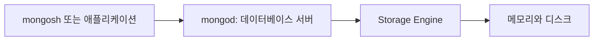
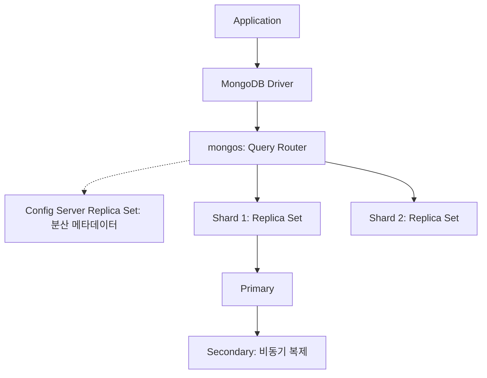
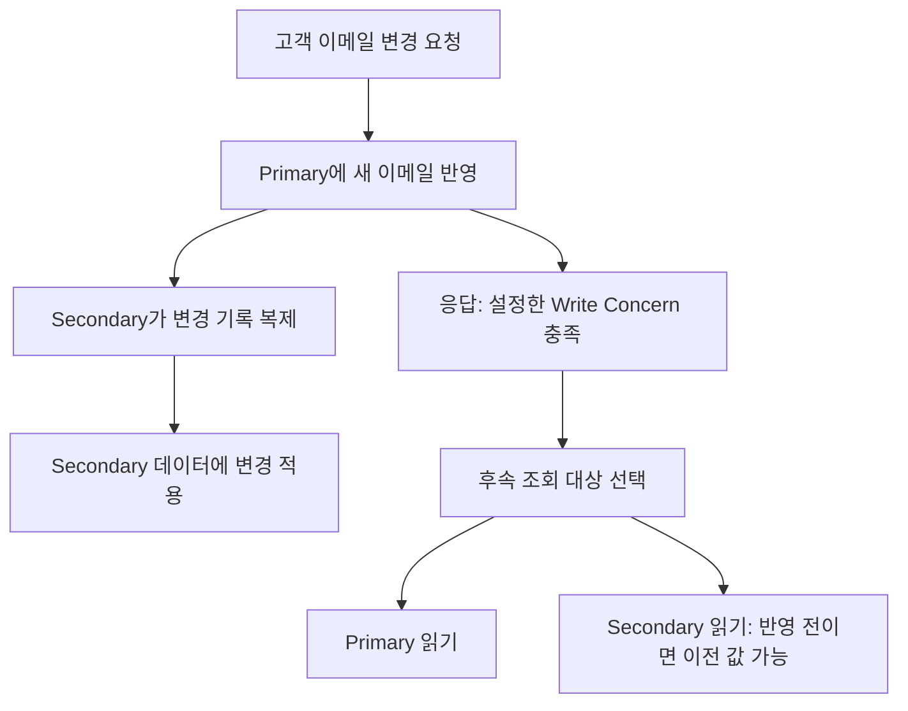
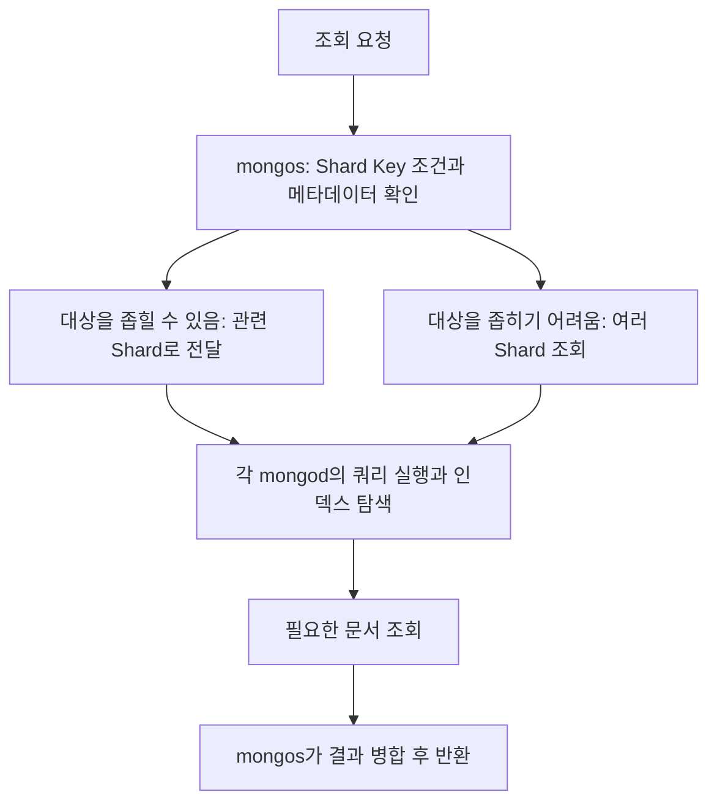

# MongoDB 구조와 기본 개념

# MongoDB 구조와 기본 개념

* toc
{:toc}

---

## MongoDB 구조와 기본 개념

고객 정보를 저장하는 애플리케이션을 만든다고 가정해 보자. 처음에는 이름과 이메일만 저장하면 되지만, 기능이 늘어나면 여러 주소와 연락처, 생년월일 같은 정보도 필요해진다.

관계형 데이터베이스라면 고객 테이블과 주소 테이블을 나누는 방법을 생각할 수 있다. MongoDB에서는 고객과 함께 사용하는 일부 정보를 하나의 문서에 표현할 수도 있다.

```javascript
{
  user_id: 12345,
  name: "kevin.lee",
  age: 28,
  email: "kevin.lee@example.com",
  address: {
    city: "Seoul",
    district: "Gangnam"
  }
}
```

이 문서를 저장하고 다시 읽는 코드는 짧다. 하지만 코드가 간단하다고 내부 동작까지 단순한 것은 아니다.

문서는 어디에 저장될까? 데이터가 많아지면 어떻게 찾을까? 서버가 종료되면 다른 서버에서 이어서 사용할 수 있을까? 서버 여러 대에 데이터를 나누면 조회 요청은 어디로 가야 할까?

이 질문에 답하려면 두 가지 구조를 구분해야 한다.

| 구분 | 이해할 내용 | 설계할 때의 질문 |
|---|---|---|
| 논리적 데이터 구조 | Database, Collection, Document, Field | 어떤 데이터를 함께 저장하고 조회할 것인가? |
| 서버와 저장 구조 | Driver, Storage Engine, Replica Set, Shard, `mongos` | 데이터를 어떤 장비에 저장하고 장애와 부하에 대응할 것인가? |

두 구조는 연결되어 있지만 같은 문제는 아니다. 문서 구조가 잘못되면 서버를 추가해도 비효율적인 조회가 남는다. 반대로 문서가 잘 설계되어 있어도 단일 서버만 사용한다면 서버 장애에 대한 복구 경로는 별도로 필요하다.

### MongoDB의 주요 기능

MongoDB는 BSON 형식의 문서를 저장하는 Document 지향 데이터베이스다. 같은 Collection에도 구조가 다른 문서를 저장할 수 있지만, 이를 “데이터 구조를 설계하지 않아도 된다”는 의미로 받아들이면 곤란하다. 애플리케이션에서 사용하는 필드 이름과 타입을 일관되게 관리하고, 필요한 경우 스키마 검증으로 필수 필드와 허용 타입을 제한해야 한다.
확장성과 가용성은 서로 다른 기능으로 확보한다. **Sharding은 데이터를 여러 서버에 나누어 저장하고, Replication은 같은 데이터를 여러 서버에 복제한다.** 여기에 인덱스로 검색 범위를 줄이고, 메모리 캐시로 반복적인 디스크 접근을 줄이며, Aggregation Framework로 필터링·그룹화·집계 등의 작업을 수행한다. 다만 이러한 기능이 있다고 해서 모든 조회와 쓰기가 자동으로 빨라지는 것은 아니다. 실제 성능은 문서 구조, 인덱스, 조회 조건, 작업 데이터의 크기와 장비 사양에 따라 달라진다.

### 단일 서버에서 분산 구성으로 확장하기

#### Standalone: 한 서버에서 시작하기

개발 PC에 MongoDB를 설치하고 `mongosh`로 접속하는 구성부터 생각해 보자.



`mongosh`는 명령을 보내는 클라이언트이고, `mongod`는 요청을 받아 데이터를 관리하는 서버 프로세스다. Java나 Python 애플리케이션에서는 `mongosh`를 내부적으로 실행하는 대신 해당 언어의 Driver를 사용한다.

Standalone은 구조가 단순하지만 복제본의 자동 승계를 제공하지 않는다. 서버가 중단되면 해당 서버를 복구하기 전까지 데이터 접근이 어려워질 수 있다. 따라서 로컬에서 삽입과 조회가 성공했다는 사실과 운영 가용성을 확보했다는 사실을 구분해야 한다.

#### Replica Set과 Sharded Cluster의 차이

가용성이 필요하면 같은 데이터를 복제하는 Replica Set을 구성한다. 저장 용량이나 요청 부하를 여러 서버에 나눠야 한다면 Sharded Cluster를 검토한다.

| 구성 | 데이터 배치 | 주된 목적 | 함께 고려할 비용 |
|---|---|---|---|
| Standalone | 한 서버가 데이터 보관 | 단순한 개발·테스트 | 서버 장애 시 복구 |
| Replica Set | 여러 멤버가 같은 데이터 복제 | 장애 대응과 데이터 중복 보관 | 복제 지연, 선출, 복제 저장 공간 |
| Sharded Cluster | 데이터를 여러 Shard에 분산하고 각 Shard를 복제 | 저장 용량과 처리 부하 분산 | Shard Key, 라우팅, 재분배, 분산 운영 |

즉 “서버를 세 대 사용한다”는 정보만으로 구성을 이해할 수는 없다. 세 대가 같은 데이터를 복제하는지, 서로 다른 데이터를 나누어 보관하는지가 중요하다.

### MongoDB의 기본 아키텍처

이제 데이터를 분산하는 Sharded Cluster 내부를 살펴보자. 아래 그림은 Shard 두 개를 가진 구성을 단순화한 것이다. 각 Shard가 Replica Set이고, Config Server도 별도의 Replica Set으로 구성된다는 점이 핵심이다. **모든 MongoDB 환경에 Query Router와 여러 Shard가 존재하는 것은 아니다.**


위 그림은 Sharded Cluster의 기본 구성이다. **Application**은 데이터를 사용하는 서비스이고, **Driver**는 Java·Python·Node.js 등의 코드에서 MongoDB에 접속하도록 돕는 클라이언트 라이브러리다. Driver는 BSON 직렬화와 역직렬화, 연결 풀, 서버 선택 등을 담당한다. 애플리케이션의 쿼리를 대신 최적화하는 서버 측 쿼리 엔진과는 역할이 다르다.
**`mongos`**는 요청을 적절한 Shard로 전달하고 결과를 모으는 라우터다. **Shard**는 분산된 데이터의 일부를 보관하며 Replica Set으로 구성한다. **Config Server Replica Set**에는 데이터 범위가 어느 Shard에 있는지 등의 메타데이터가 저장된다. `mongos`는 이 정보를 캐시해 라우팅에 사용하므로 모든 요청마다 Config Server를 조회하는 것은 아니다. MongoDB 8.0부터는 Config Server가 애플리케이션 데이터도 저장하는 Config Shard 구성도 지원한다. [MongoDB 클러스터 구성](https://www.mongodb.com/docs/manual/sharding/), [Config Server](https://www.mongodb.com/docs/manual/core/sharded-cluster-config-servers/)

### Storage Engine과 WiredTiger
Storage Engine은 메모리와 디스크에 데이터를 저장하고 접근하는 방식을 관리한다. 기본 엔진인 **WiredTiger**는 문서 수준 동시성 제어, 압축, 체크포인트 등의 기능을 제공한다. 메모리 캐시를 사용하더라도 데이터를 메모리에만 보관하는 엔진은 아니다. 디스크에 데이터를 저장하고, 저널과 체크포인트를 통해 장애 복구를 지원한다.
**In-Memory Storage Engine**은 문서 데이터를 메모리에 유지하는 MongoDB Enterprise 기능이다. Community Edition에서 설정만 바꾸어 사용할 수 있는 기능이 아니며, 프로세스 종료 후 데이터 보존 방식도 WiredTiger와 다르다. 단순히 “더 빠른 엔진”으로 선택하기보다 데이터 지속성과 복구 요구 사항부터 따져야 한다. [Storage Engine 종류](https://www.mongodb.com/docs/manual/core/storage-engines/)
`mongosh`에서 `db.serverStatus().storageEngine`을 실행하면 현재 엔진 정보를 확인할 수 있다. `name: 'wiredTiger'`는 WiredTiger를 사용한다는 뜻이고, `persistent: true`는 영속 저장 엔진임을 나타낸다. `db.serverStatus().wiredTiger`에서는 상세 통계를 조회한다. 출력 필드는 버전에 따라 달라지며, 인증을 사용하는 환경에서는 조회 권한도 필요하다.
```yaml
storage:
  dbPath: 'C:\MongoDB\data'
  engine: wiredTiger
```
`dbPath`는 데이터 파일 저장 경로이고, `engine`은 저장 엔진이다. 위 내용은 설정의 일부이므로 기존 `mongod.cfg` 전체를 덮어쓰면 안 된다. Linux에서는 `mongod --dbpath /new/data/directory --storageEngine wiredTiger`처럼 실행 옵션으로 지정할 수도 있다. 다만 **엔진 이름을 바꾸는 것만으로 기존 데이터 파일이 다른 형식으로 변환되지는 않는다.** 변경 시에는 버전과 엔진에 맞는 백업·복원 또는 마이그레이션 절차가 필요하며, 실행 중인 서버와 동일한 데이터 디렉터리를 다른 프로세스에서 열어서는 안 된다.

#### 캐시와 영속 저장은 왜 함께 필요한가?

같은 고객을 반복 조회할 때마다 디스크에서 모든 데이터를 다시 읽으면 비용이 크다. WiredTiger의 내부 캐시와 운영체제의 파일 캐시는 반복 접근의 비용을 줄이는 데 도움을 준다. 그렇다고 전체 데이터를 모두 메모리에 올려야만 MongoDB가 동작하는 것은 아니다.

자주 사용하는 데이터와 인덱스의 범위를 Working Set이라고 생각해 볼 수 있다. 이 범위가 사용 가능한 캐시보다 커지면 디스크 접근이 늘어나고 조회 지연이 커질 수 있다. 따라서 전체 데이터가 몇 GB인지뿐 아니라 **실제 요청이 반복해서 접근하는 데이터와 인덱스가 어느 정도인지**가 중요하다.

쓰기에서도 메모리에 반영하는 것과 장애 후 복구 가능한 상태로 만드는 것은 다르다. 체크포인트는 저장 상태를 확정하는 기반이고, 저널은 복구에 필요한 변경 기록을 제공한다. 실제 지속성 보장은 저널링과 Write Concern 등의 설정을 함께 살펴봐야 한다. 캐시 사용 여부만으로 데이터 유실 가능성을 판단해서는 안 된다.

Storage Engine 조회 결과의 `persistent: true`도 “어떤 쓰기든 모든 장애에서 반드시 보존된다”는 의미는 아니다. 저장 엔진의 성격을 보여 주는 값과 개별 쓰기 요청의 보장 수준은 서로 다른 정보다. [WiredTiger의 캐시와 저장 구조](https://www.mongodb.com/docs/manual/core/wiredtiger/)

### Index: 필요한 문서를 찾는 방법

인덱스는 검색에 사용할 필드 값을 정렬된 구조로 관리해 문서를 찾는 비용을 줄인다. 인덱스가 없으면 Collection의 많은 문서를 검사해야 할 수 있지만, 적절한 인덱스가 있으면 후보를 좁힌 뒤 필요한 문서를 읽을 수 있다. 반대로 인덱스는 저장 공간과 메모리를 사용하고, 문서를 추가하거나 수정할 때 함께 갱신해야 하므로 쓰기 비용이 증가한다.
다음은 인덱스 정의 방식을 보여 주는 예시다. 아래의 실행 계획 비교 실습에서는 기존 `customers`와 섞이지 않도록 별도 Collection을 사용한다.

```javascript
db.customers.createIndex({ name: 1 });
db.customers.createIndex({ name: 1, age: -1 });
db.customers.createIndex({ email: 1 }, { unique: true });
db.customers.find({ name: "kevin.lee" }).sort({ age: -1 }).explain("executionStats");
```
첫 번째는 이름의 오름차순 단일 필드 인덱스다. 두 번째는 이름을 먼저 정렬하고 같은 이름 안에서 나이를 내림차순으로 정렬하는 복합 인덱스다. `{ name: 1, age: -1 }`와 `{ age: -1, name: 1 }`는 다른 인덱스이며, 앞쪽 필드인 `name`을 사용하는 조회에 유리하다고 해서 `age`만 사용하는 조회에도 똑같이 유리한 것은 아니다. [복합 인덱스의 필드 순서](https://www.mongodb.com/docs/manual/core/indexes/index-types/index-compound/)
세 번째의 `unique: true`는 이메일 중복을 제한한다. 이미 중복된 값이 있으면 생성에 실패하며, 일반적인 단일 필드 Unique Index에서는 필드 누락과 `null`도 주의해야 한다. 이메일이 선택 사항이라면 적용 대상을 제한하는 Partial Index 등을 검토한다. 샤딩된 Collection에는 Unique Index와 Shard Key의 조합에도 제약이 있다. [Unique Index](https://www.mongodb.com/docs/manual/core/index-unique/)
`explain("executionStats")`에서는 반환 문서 수인 `nReturned`, 검사한 문서 수인 `totalDocsExamined`, 검사한 인덱스 키 수인 `totalKeysExamined`를 함께 살펴본다. 실행 계획에서 `COLLSCAN`과 `IXSCAN`도 확인할 수 있지만, 작은 데이터에서는 전체 스캔이 선택될 수 있고 인덱스를 사용했다고 반드시 효율적인 것도 아니다. **인덱스 생성 여부보다 실제 조회가 얼마나 적은 데이터를 검사하는지가 중요하다.**

#### 고객 조회를 인덱스 적용 전후로 비교하기

설명만으로는 인덱스가 줄이는 비용을 체감하기 어렵다. 별도 실습 Database에서 일정한 데이터 분포를 만들고 실행 계획을 비교해 보자. 다음 명령은 로컬 `mongosh`에서 실행하며, 기존 고객 데이터를 사용하지 않는다.

```javascript
use mongodb_structure_demo

db.index_customers.insertMany(
  Array.from({ length: 1000 }, (_, i) => ({
    _id: i + 1,
    user_id: i + 1,
    name: `customer-${i + 1}`,
    age: 20 + (i % 40),
    email: `customer-${i + 1}@example.com`
  }))
```

이 예제는 1부터 1000까지 `_id`와 `user_id`를 가진 문서를 저장한다. 같은 Database에서 다시 실행하면 `_id` 중복 오류가 발생할 수 있다. 반복 실습에는 새로운 Database 이름을 사용하고, 기존 데이터를 지워 초기화하는 명령은 무심코 실행하지 않는다.

이제 한 명의 고객을 찾는다.

```javascript
db.index_customers.find({ user_id: 500 }).explain("executionStats")
```

일반적인 새 Collection에는 `_id` 인덱스가 있지만, 이 조회는 `user_id`를 조건으로 사용한다. 두 필드의 값이 같더라도 MongoDB가 동일한 필드로 취급하지는 않는다.

인덱스를 만들고 같은 조회를 비교한다.

```javascript
db.index_customers.createIndex({ user_id: 1 })
db.index_customers.find({ user_id: 500 }).explain("executionStats")
db.index_customers.getIndexes()
```

| 확인 항목 | 의미 | 이 예제에서 살펴볼 점 |
|---|---|---|
| `nReturned` | 반환한 문서 수 | 정상적으로 한 고객을 찾는지 |
| `totalDocsExamined` | 검사한 문서 수 | 인덱스 적용 후 줄어드는지 |
| `totalKeysExamined` | 검사한 인덱스 키 수 | 인덱스에서 어느 정도 탐색했는지 |
| 실행 계획 | 선택한 접근 방식 | `COLLSCAN`, `IXSCAN` 등의 단계 |

일반적인 비클러스터형 Collection에서 전체 스캔을 선택하면 이 데이터는 약 1000개 문서를 검사해 한 개를 반환할 수 있다. 적절한 인덱스 스캔을 선택하면 한정된 키와 문서만 확인할 수 있다. 실제 출력과 계획 구조는 버전과 실행 환경에 따라 다르므로 특정 숫자를 반드시 출력하는 테스트로 받아들이지는 않는다.

1,000건 정도의 작은 데이터에서는 두 실행 시간이 모두 0ms처럼 표시될 수도 있다. 이때 “인덱스가 효과 없다”고 판단하는 대신 검사한 문서 수와 접근 경로를 비교한다. 시간 측정값 하나보다 어떤 작업을 줄였는지가 먼저다.

#### 복합 인덱스는 필드별 인덱스의 단순한 묶음이 아니다

`{ name: 1, age: -1 }` 인덱스는 이름순으로 묶고, 같은 이름 안에서 나이를 내림차순으로 정렬한다. 전화번호부가 성을 먼저 정렬하고 같은 성 안에서 이름을 정렬하는 것처럼, 앞쪽 필드가 탐색 경로를 결정한다.

```javascript
db.index_customers.createIndex({ name: 1, age: -1 })

db.index_customers.find({ name: "customer-500" }).sort({ age: -1 })
db.index_customers.find({ age: 39 })
```

첫 번째 조회와 두 번째 조회는 조건이 다르다. 앞쪽 `name`을 지정하는 조회에 유리한 인덱스가 있다고 해서 `age`만으로 찾을 때도 같은 효율이 보장되지는 않는다. 조회 조건, 정렬, 범위 조건을 함께 놓고 인덱스 순서를 결정해야 한다.

인덱스를 추가할 때는 읽기 개선뿐 아니라 삽입·수정 지연과 인덱스 크기도 확인한다. 거의 사용하지 않는 인덱스 여러 개를 유지하는 것은 무료가 아니다. 실행 계획을 확인한 뒤 실제 요청에서 도움이 되는 인덱스를 남기는 방향으로 관리한다.

### Replication: 같은 데이터를 복제하는 구조
Replica Set의 **Primary**는 일반적인 애플리케이션 쓰기를 처리하고 변경 내용을 `oplog`에 기록한다. **Secondary**는 oplog를 비동기적으로 복제하고 자신의 데이터에 반영한다. Secondary는 클라이언트의 일반적인 쓰기를 직접 받지 않는다는 의미에서 읽기 전용이지, 내부 데이터가 변경되지 않는 서버라는 뜻은 아니다.
Primary에 장애가 발생하면 선출 조건을 충족하는 멤버가 새로운 Primary가 될 수 있다. 다만 선출 중에는 쓰기가 일시적으로 불가능할 수 있고, 투표 과반수를 확보하지 못하면 새로운 Primary를 선출할 수 없다. 또한 복제는 백업을 대체하지 않는다. 잘못된 삭제나 수정도 복제되기 때문이다.
**기본 읽기 대상도 Primary다.** Secondary 읽기는 Read Preference를 설정해야 하며, 복제 지연 때문에 방금 저장한 결과가 보이지 않을 수 있다. `secondary`는 적합한 Secondary에서 읽고, `secondaryPreferred`는 적합한 Secondary가 없으면 Primary를 사용한다. 읽기 분산이 필요한 조회와 최신 상태가 중요한 조회를 구분해야 한다. 쓰기 완료를 어느 수준까지 확인할지는 Write Concern, 읽을 데이터의 일관성 수준은 Read Concern과 함께 검토한다. [읽기 설정](https://www.mongodb.com/docs/manual/core/read-preference/), [복제와 요청 처리](https://www.mongodb.com/docs/manual/core/distributed-queries/)

#### Primary에 저장한 직후 Secondary에서 읽는다면?

고객의 이메일을 변경했다고 가정하자. 변경 직후 Primary에는 새 이메일이 있지만, Secondary는 아직 변경을 적용하지 않았을 수 있다.



이 그림은 복제 지연의 가능성을 설명한 것이다. 응답과 Secondary 반영의 실제 순서는 Write Concern과 실행 상황에 따라 달라진다. 복제가 비동기라는 사실만으로 응답이 항상 모든 복제보다 먼저 돌아온다고 단정하면 안 된다.

| 조회 요구 | 고려할 방향 | 확인할 사항 |
|---|---|---|
| 변경 직후 본인의 최신 정보 확인 | Primary 읽기와 필요한 일관성 설정 | 장애 시 읽기 결과의 보장 범위 |
| 일부 지연을 허용하는 통계 조회 | Secondary 읽기 검토 | 복제 지연, Primary 승계 시 부하 |
| 지역별 낮은 지연 | Read Preference와 멤버 배치 검토 | 가까운 서버가 최신 서버인지는 별개 |

`primary`를 선택하는 것만으로 모든 종류의 강한 일관성이 자동 완성되는 것은 아니다. 세션, Read Concern, Write Concern과 업무 요구를 함께 검토해야 한다. 기본 읽기 대상을 이해하는 단계와 읽기·쓰기의 인과 관계까지 보장하는 단계는 구분한다.

#### Primary 장애가 곧 무중단을 뜻하지는 않는다

일반적인 세 개의 데이터 보유 투표 멤버가 있는 Replica Set을 생각해 보자. Primary가 중단되면 남은 멤버들이 과반수를 확보하고 적격 멤버를 선출해야 새로운 Primary로 쓰기를 이어갈 수 있다.

선출에는 시간이 필요하다. Driver가 토폴로지 변화를 감지하고 새 서버를 선택하는 시간도 있으므로, 애플리케이션에서는 일시적인 실패나 타임아웃을 만날 수 있다. 재시도 가능한 작업을 구분하고 같은 요청의 반복이 업무 중복을 만들지 않도록 해야 한다.

반대로 과반수를 잃은 상황에서는 서버 일부가 살아 있어도 Primary를 선출하지 못할 수 있다. Replica Set은 서버 개수만 늘리는 방식이 아니라, 장애 도메인과 투표 구성을 함께 설계하는 방식이다.

### Sharding: 데이터를 나누어 저장하는 구조
Sharding은 Collection의 문서를 **Shard Key**에 따라 여러 Shard에 분산한다. Replica Set이 같은 데이터를 복제한다면, Sharding은 서로 다른 데이터 범위를 나누어 담당하게 한다. 따라서 Replica Set의 멤버를 추가하는 것과 Shard를 추가하는 것은 목적이 다르다.
**범위 기반 샤딩**은 `user_id` 값의 범위를 기준으로 분산한다. 예를 들어 한 Shard가 1~1000, 다른 Shard가 1001~2000을 담당하는 식으로 이해할 수 있다. 범위 조회에 유리할 수 있지만, 계속 증가하는 키에 쓰기가 몰리면 특정 범위가 병목이 된다. 실제 범위 배치는 데이터 분포와 Balancer 동작에 따라 달라진다.
**해시 기반 샤딩**은 필드의 해시 값을 기준으로 분산한다. 다만 MongoDB의 구현을 `hash(user_id) % Shard 수`로 이해하면 안 된다. 해시 값의 범위와 해당 범위를 담당하는 Shard의 메타데이터를 사용한다. 순차적으로 증가하는 값의 쓰기를 분산하는 데 도움이 되지만, 원래 값의 범위 조회는 여러 Shard를 조회해야 할 수 있다. **Zone Sharding**은 특정 Shard Key 범위를 지정한 Zone의 Shard에 배치하는 방식이다. 지역별 데이터 배치 등에 활용하며, 지역 요구 사항은 복제본의 위치까지 포함해 설계해야 한다. [샤딩 구조와 분산 방식](https://www.mongodb.com/docs/manual/sharding/)

#### 범위 기반과 해시 기반의 차이를 데이터로 살펴보기

고객 ID가 1부터 계속 증가한다고 가정하자. 범위 기반에서는 다음처럼 배치할 수 있다. 실제 MongoDB의 범위와 이동 정책을 단순화한 설명용 표다.

| 논리적 데이터 범위 | 담당 Shard | 새 고객의 쓰기 패턴 |
|---|---|---|
| 1~1000 | Shard A | 이미 존재하는 고객 중심 |
| 1001~2000 | Shard B | 이미 존재하는 고객 중심 |
| 2001 이상 | Shard C | 증가하는 새 ID의 쓰기가 집중될 수 있음 |

고객 1200부터 1300까지 조회한다면 해당 범위를 담당하는 Shard를 좁히기 쉽다. 하지만 신규 고객을 계속 추가하는 부하가 가장 큰 값의 범위로 몰리면 Shard C만 바빠질 수 있다.

해시 기반은 연속된 ID를 해시 값 공간에 흩어 놓아 이런 쓰기 집중을 완화하는 방향이다. 대신 원래 ID가 가까운 고객들이 서로 다른 해시 범위에 있을 수 있으므로 원래 값의 범위 조회는 여러 Shard에 걸칠 수 있다.

**균등한 쓰기 분산과 효율적인 범위 조회를 동시에 공짜로 얻는 것은 아니다.** 고객 번호로 한 명을 찾는 요청이 많은지, 가입 순서대로 넓은 범위를 읽는 요청이 많은지에 따라 판단이 달라진다.

#### Zone은 별도의 해시 공식이 아니라 배치 정책이다

Zone Sharding은 특정 Shard Key 범위를 지정된 Zone에 속한 Shard에 배치하는 방식이다. 예를 들어 지역 식별자가 포함된 키를 설계하고 특정 지역의 데이터를 해당 Zone의 Shard에 두는 구성을 검토할 수 있다.

다만 `country: "KR"` 필드가 있다는 이유만으로 데이터가 자동으로 한국에 배치되는 것은 아니다. Shard Key, Zone 범위, Shard의 Zone 지정과 실제 장비 위치를 함께 맞춰야 한다. 데이터 주권 요구가 있다면 복제본과 백업의 위치도 확인해야 한다.

Shard Key를 정할 때는 값의 종류가 충분한지, 특정 값에 쓰기가 몰리는지, 주요 조회가 키를 포함하는지를 살펴본다. 데이터 크기만 보고 샤딩하면 저장 공간은 늘어도 조회 비용과 운영 부담이 더 커질 수 있다.

### 문서가 저장되고 조회되는 과정
Sharded Cluster에서 문서를 삽입하면 Application → Driver → `mongos` → 대상 Shard의 Primary 순서로 요청이 전달된다. Primary에 반영된 변경은 Secondary로 복제된다. 클라이언트가 성공 응답을 받는 시점은 Write Concern에 영향을 받으므로, 성공 응답을 받았다는 사실만으로 모든 Secondary가 즉시 같은 상태라고 판단하면 안 된다.
`find({ user_id: 12345 })`를 실행했을 때 `user_id`가 Shard Key라면 `mongos`는 메타데이터를 이용해 대상 Shard를 좁힐 수 있다. 반면 Shard Key로 대상을 특정하기 어려운 조회는 여러 Shard에 요청하고 결과를 모으는 Scatter-Gather 방식이 될 수 있다. **Shard 선택은 라우팅의 문제이고, 선택된 Shard 안에서 문서를 찾는 것은 쿼리 실행과 인덱스의 문제다.** 일반 필드에 인덱스를 만들었다고 그 필드가 자동으로 Shard Key가 되지는 않는다. [분산 조회 흐름](https://www.mongodb.com/docs/manual/core/distributed-queries/)

#### 인덱스가 있어도 모든 Shard를 조회할 수 있는 이유

`user_id`를 Shard Key로 쓰는 고객 Collection에 `email` 인덱스가 있다고 가정하자.

```javascript
db.customers.find({ user_id: 12345 })
db.customers.find({ email: "kevin.lee@example.com" })
```

첫 번째는 Shard Key로 대상 범위를 좁힐 수 있다. 두 번째는 이메일 인덱스로 각 Shard 내부의 검색은 빨라질 수 있지만, 그 이메일이 어느 Shard에 있는지 라우터가 해당 인덱스만으로 전역 조회하는 것은 아니다. 일반적인 구성에서는 여러 Shard에 요청해야 할 수 있다.



따라서 느린 조회를 분석할 때는 “인덱스가 있는가?”와 함께 “몇 개의 Shard를 조회하는가?”도 확인해야 한다. 샤딩은 비효율적인 질의를 자동으로 최적화하는 장치가 아니다.

### Database, Collection, Document
MongoDB의 논리적 계층은 **Database → Collection → Document → Field**다. 관계형 데이터베이스의 Database → Table → Row → Column과 대응시켜 이해할 수 있지만 완전히 같은 구조는 아니다. Document에는 단일 값뿐 아니라 중첩 문서와 배열도 들어갈 수 있다. 아래 예시는 `mongosh`에서 사용하는 문서 표현이며, `ObjectId`나 `ISODate`가 포함되어 있으므로 일반 JSON 문자열과는 구분한다.
```javascript
const customer = {
  _id: ObjectId("5ad88534e3632e1a35a58d00"),
  name: { first: "John", last: "Doe" },
  address: [
    {
      location: "work",
      address: {
        street: "16 Hatfields",
        city: "London",
        postal_code: "SE1 8DJ"
      },
      geo: {
        type: "Point",
        coordinates: [-0.109081, 51.5065752]
      }
    }
  ],
  phone: [
    {
      location: "work",
      number: "+44-1234567890"
    }
  ],
  dob: ISODate("1977-04-01T05:00:00Z"),
  retirement_fund: Decimal128("1292815.75")
};
```
`_id`는 문서 식별자이고, `name`은 중첩 문서, `address`와 `phone`은 배열이다. 날짜는 BSON Date, 정확한 십진 표현이 필요한 금액은 Decimal128로 표현했다. GeoJSON 좌표 순서는 **경도, 위도**다. 위치 검색에는 `2dsphere` 인덱스 등을 사용한다. 관련 데이터를 함께 읽을 때 중첩 구조가 유용하지만, 계속 증가하는 이력을 무제한 배열로 담으면 문서 크기와 갱신 비용이 문제가 된다. [GeoJSON 좌표와 인덱스](https://www.mongodb.com/docs/manual/core/indexes/index-types/geospatial/2dsphere/)
블로그라면 `users`에는 사용자, `posts`에는 게시물, `comments`에는 댓글을 저장하고 `authorId`와 `postId` 등으로 연결할 수 있다. 함께 조회하는 작은 데이터는 내장하고, 독립적으로 조회하거나 계속 늘어나는 데이터는 분리하는 방향을 검토한다. 참조 필드를 만들었다고 관계형 데이터베이스의 외래 키 제약처럼 무결성이 자동 보장되지는 않는다.
Database는 Collection을 구분하는 논리적 공간이다. `blog.users`와 `ecommerce.users`는 이름이 같은 Collection이어도 서로 다르다. 다만 Database를 나눴다고 CPU·메모리·디스크 부하까지 격리되지는 않으며, 디스크 디렉터리도 반드시 Database별로 하나씩 만들어지는 것은 아니다. 비교하면 Cassandra는 Keyspace → Table → Row → Column 구조이고, Elasticsearch는 Index → Document → Field 구조다. Elasticsearch의 과거 Mapping Type 계층은 8.0부터 지원하지 않는다. [Mapping Type 제거](https://www.elastic.co/guide/en/elasticsearch/reference/8.19/removal-of-types.html)

#### 블로그 데이터는 어디까지 한 문서에 넣어야 할까?

블로그를 만든다면 작성자, 게시물, 댓글을 모두 한 문서에 넣을 수도 있을 것이다. 하지만 사용자가 작성한 게시물과 댓글이 계속 늘어나면 문서도 끝없이 커진다. 편리하게 묶을 수 있다는 이유만으로 모든 관계를 내장하면 안 된다.

| 데이터 | 함께 읽는 방식 | 검토할 저장 구조 |
|---|---|---|
| 사용자 이름과 작은 프로필 | 사용자 조회 시 함께 사용 | 사용자 문서에 포함 |
| 게시물 제목·본문 | 게시물 상세에서 함께 사용 | 게시물 문서에 포함 |
| 게시물의 작성자 | 여러 게시물이 같은 사용자를 참조 | `authorId` 등으로 참조 |
| 계속 늘어나는 댓글 | 페이징·독립 수정·삭제 필요 | 별도 Collection과 `postId` 참조 |

다음은 구조를 보여 주는 예시다. 문서의 `_id`를 문자열로 직접 지정했으며, 실제 삽입 명령은 아니다.

```javascript
// users Collection
{ _id: "user-1", name: "kevin.lee" }

// posts Collection
{
  _id: "post-1",
  authorId: "user-1",
  title: "MongoDB 저장 구조",
  body: "Database와 Collection을 구분한다."
}

// comments Collection
{
  _id: "comment-1",
  postId: "post-1",
  authorId: "user-1",
  content: "댓글은 별도로 조회한다."
}
```

게시물 상세에서 작성자 이름까지 자주 보여 준다면 작성자를 별도로 조회하거나 `$lookup`을 사용할 수 있다. 조회 비용을 줄이기 위해 작성자 표시 이름을 게시물에 중복 저장하는 방법도 있지만, 사용자 이름 변경 시 기존 게시물에 무엇을 보여 줄지 결정해야 한다. 현재 이름과 작성 당시 이름은 서로 다른 업무 의미다.

이처럼 데이터 모델링은 “조인 없이 한 번에 읽는다”에서 끝나지 않는다. 함께 조회하는 범위, 독립적인 변경 주기, 배열의 증가량, 중복 값의 갱신 정책까지 포함한다. MongoDB의 일반 BSON 문서에는 16MiB 크기 제한도 있으므로, 무제한 이력을 한 문서에 넣는 설계는 피한다.

### mongosh에서 저장 구조 확인하기

#### 1. 서버 접속과 현재 Database 확인

로컬 MongoDB 서버가 실행 중이라는 전제에서 PowerShell로 접속한다. 이 과정은 단일 서버에서도 확인할 수 있으며 Replica Set이나 샤딩을 새로 구성하는 실습은 아니다.

```powershell
mongosh "mongodb://127.0.0.1:27017"
```

접속 후 아래 명령은 `mongosh` 내부에서 실행한다.

```javascript
db
show dbs
```

`db`는 현재 선택한 Database를 보여 준다. `show dbs`와 `show databases`는 접근 가능한 Database 목록을 확인한다. 초기 환경의 `admin`, `config`, `local` 같은 내부 Database와 용량은 설치 상태와 권한에 따라 다를 수 있다.

#### 2. 이름 선택과 실제 생성 구분

이 실습은 `mongodb_structure_demo` 안의 `customers`를 사용한다. 앞의 인덱스 비교용 `index_customers`와는 별도 Collection이다.

```javascript
use mongodb_structure_demo
db
show collections
```

`use`는 작업 대상만 선택한다. 처음 선택한 Database라면 문서를 저장하기 전에는 `show dbs`에 나타나지 않을 수 있다. 앞에서 인덱스 실습을 했다면 Database와 `index_customers`가 이미 존재하는 것이 정상이다.

Database를 `ecommerce`로 선택했다면 아래 명령도 `ecommerce.customers`에 적용된다. 명령을 복사하기 전에 `db`로 현재 위치를 확인한다.

#### 3. 고객 문서 저장

```javascript
db.customers.insertOne({
  user_id: 12345,
  name: "kevin.lee",
  age: 28,
  email: "kevin.lee@example.com",
  address: { city: "Seoul", district: "Gangnam" }
})
```

정상 저장 시 기본적인 확인 응답은 다음 형태다. ObjectId 값은 예시이며 실제 실행마다 달라진다.

```text
{
  acknowledged: true,
  insertedId: ObjectId('5ad88534e3632e1a35a58d01')
}
```

`_id`를 생략했으므로 식별자가 생성되었다. 이름과 이메일이 같아도 Unique Index가 없다면 같은 삽입을 반복해 여러 문서를 만들 수 있다. 자동 생성되는 `_id`와 업무상 고객 식별 규칙은 별개의 개념이다.

#### 4. 저장 위치와 필드 조회

```javascript
show dbs
show collections
show tables

db.customers.find({ user_id: 12345 })
db.customers.find(
  { user_id: 12345 },
  { _id: 0, name: 1, email: 1, "address.city": 1 }
)
```

`show collections`와 `show tables`로 Collection 목록을 확인할 수 있다. 마지막 조회의 두 번째 인자는 Projection이다. 필요한 필드만 포함하고 `_id`를 제외하므로, 전체 문서를 항상 반환하는 조회와 결과 크기를 비교할 수 있다. `address.city`처럼 점 표기법으로 중첩 필드에 접근한다.

일반적인 단일 서버에서 방금 삽입한 문서가 조회되지 않는다면 먼저 현재 Database, Collection 이름, 필터의 자료형을 확인한다. 숫자 `12345`와 문자열 `"12345"`는 같은 조건이 아니다. Replica Set에서 Secondary를 읽는 구성이면 복제 지연도 별도로 살펴본다.

#### 5. 집계 파이프라인으로 결과 가공

Aggregation Framework는 여러 처리 단계를 연결해 결과를 만든다. 다음은 서울 고객을 나이별로 묶어 문서 수를 구하는 예제다.

```javascript
db.customers.aggregate([
  { $match: { "address.city": "Seoul" } },
  { $group: { _id: "$age", customerCount: { $sum: 1 } } },
  { $sort: { _id: 1 } }
])
```

`$match`로 대상 문서를 거르고, `$group`으로 나이별 집계 상태를 만들고, `$sort`로 결과를 정렬한다. 새 Collection에 위 고객 한 명만 저장했다면 나이 28의 `customerCount`는 1이다. 같은 문서를 여러 번 삽입했다면 집계도 증가한다. 문서 수를 세는 연산이 고유 고객 수를 자동으로 계산하는 것은 아니다.

집계도 저장된 데이터를 읽고 계산하는 작업이므로 전체 데이터를 대상으로 복잡한 연산을 하면 비용이 커진다. 필터, 인덱스, 입력량과 결과 크기를 함께 검토해야 한다.

#### Collection 이름과 Database 이름 혼동하지 않기

```javascript
db.commerce.insertOne({ name: "john", age: 30, gender: "M" })
```

여기서 `commerce`는 현재 Database 안의 Collection이다. Database를 선택하려면 `use commerce`처럼 별도로 전환한다. `ecommerce`와 `commerce`도 서로 다른 Database 이름이다.

단일 문서 추가에는 `insertOne()`, 여러 문서 추가에는 `insertMany()`를 사용한다. 앞에서 선언한 `customer` 객체를 저장하려면 `db.customerProfiles.insertOne(customer)`처럼 실행할 수 있다. 그 객체의 `_id`는 고정값이므로 같은 Collection에 반복 삽입하면 중복 키 오류가 발생한다.

실습을 끝낼 때 Shell을 종료하는 것과 Database를 삭제하는 것도 다르다. 이 예제에서는 조회와 저장 결과를 남겨 두며, 운영 연결에서 실습 데이터를 지우는 명령을 실행하지 않는다.

## 정리
MongoDB의 데이터 모델은 Database·Collection·Document로 이해하고, 서버 구성은 Standalone·Replica Set·Sharded Cluster로 나누어 이해하면 된다. Driver는 애플리케이션의 접속을, `mongos`는 요청 라우팅을, Storage Engine은 실제 저장을 담당한다. **인덱스는 검색 비용을 줄이고, 복제는 장애 대응을 돕고, 샤딩은 데이터와 부하를 분산한다.** 기능을 많이 도입하기보다 먼저 조회 패턴과 문서 구조를 정리한 뒤, 필요한 성능과 가용성에 맞춰 구성을 확장하는 것이 중요하다.
