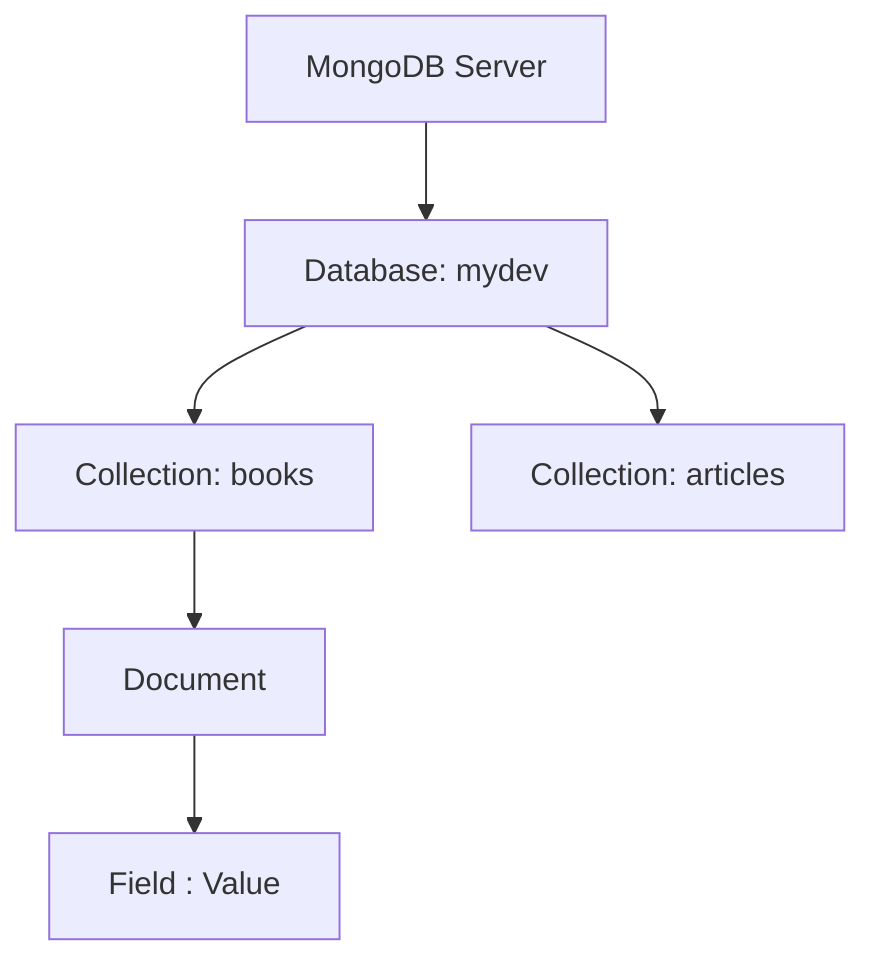
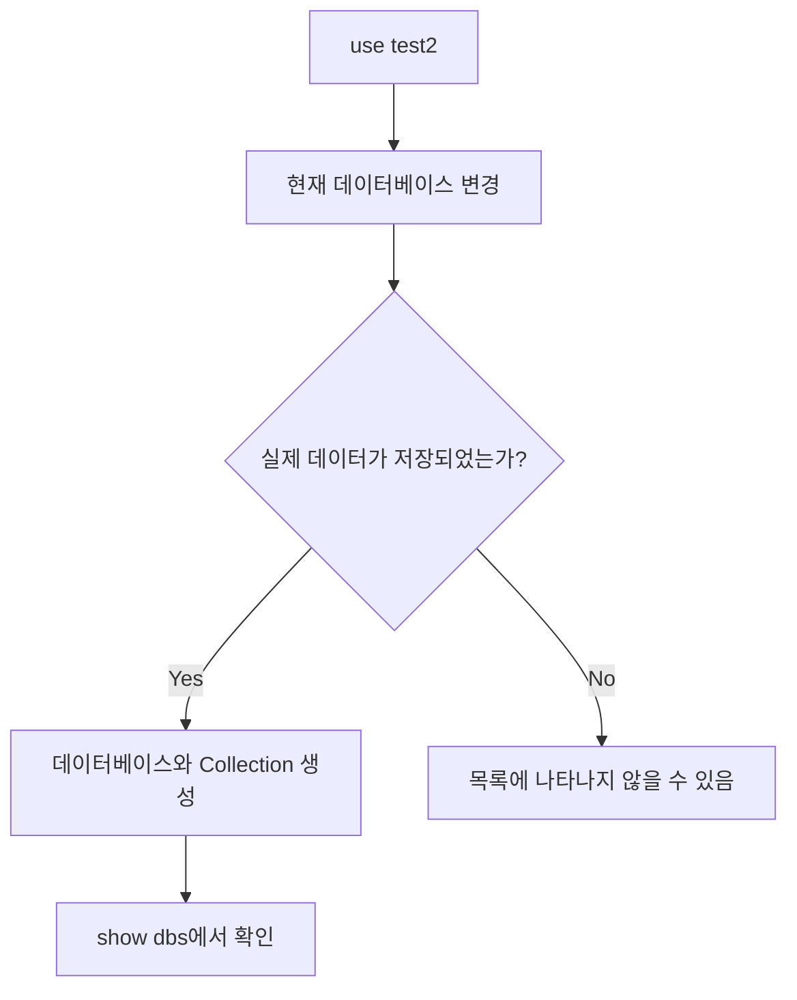
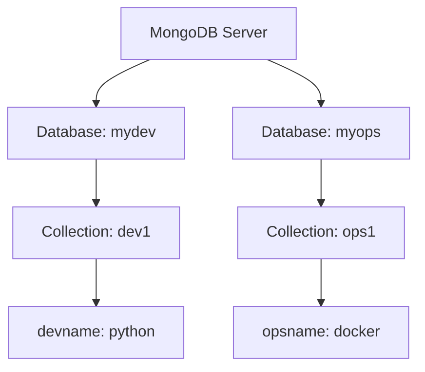
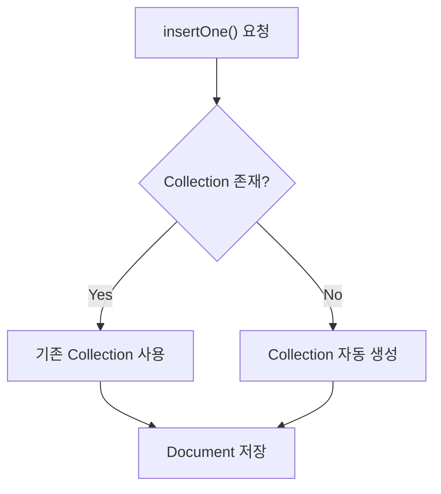
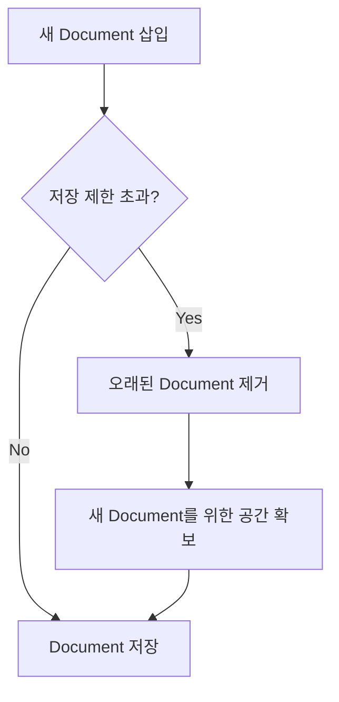
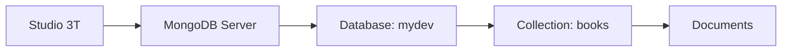
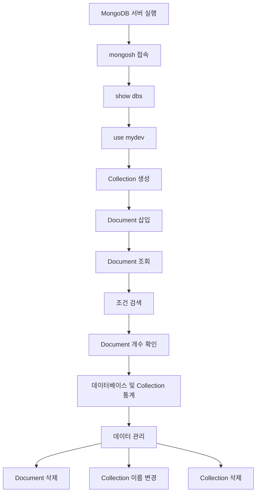

# MongoDB 기본 명령어

# MongoDB 기본 명령어

* toc
{:toc}

---

## MongoDB 기본 명령어: 데이터베이스 생성부터 Collection 관리, Document 조회와 삭제까지

MongoDB를 사용하려면 데이터베이스와 Collection을 생성하고, Document를 저장하거나 조회하는 기본 명령어를 이해해야 한다.

MySQL과 같은 관계형 데이터베이스에서는 `CREATE DATABASE`, `CREATE TABLE`, `INSERT`, `SELECT`, `DELETE` 등의 SQL을 사용한다.

반면 MongoDB는 `mongosh`에서 JavaScript와 유사한 문법으로 데이터베이스를 조작한다.

예를 들어 사용자 정보를 저장할 때 다음과 같은 명령어를 사용할 수 있다.

```javascript
db.users.insertOne({
  name: "kevin.lee",
  age: 28,
  email: "kevin.lee@example.com"
});
```

저장된 데이터를 조회할 때는 다음과 같이 작성한다.

```javascript
db.users.find({
  name: "kevin.lee"
});
```

문법 자체는 간단하다. 하지만 실제 MongoDB를 사용하다 보면 단순한 CRUD 외에도 여러 개념을 이해해야 한다.

- `use` 명령어를 실행했는데 데이터베이스가 목록에 나타나지 않는 이유
- `db.stats`와 `db.stats()`의 차이
- 현재 데이터베이스를 변경하지 않고 다른 데이터베이스에 접근하는 방법
- `insertOne()`과 `insertMany()`의 차이
- 일반 Collection과 Capped Collection의 차이
- `deleteMany({})`와 `drop()`의 차이
- 같은 Collection에서 서로 다른 필드를 가진 Document를 저장하는 방법
- 날짜를 문자열이 아닌 BSON Date로 저장하는 방법

이번 글에서는 MongoDB의 기본 명령어를 실제 실행 흐름에 맞춰 살펴보고, 각 명령어가 어떤 동작을 수행하는지와 운영 환경에서 주의할 점까지 정리한다.

---

## MongoDB 기본 명령어의 구조

### MongoDB의 데이터 저장 계층

MongoDB는 데이터를 다음과 같은 구조로 관리한다.



각 구성 요소는 다음과 같은 역할을 한다.

| MongoDB 구성 요소 | 설명 | RDBMS와 비교 |
|---|---|---|
| Database | Collection을 관리하는 논리적 공간 | Database |
| Collection | Document들의 집합 | Table |
| Document | 실제 데이터 저장 단위 | Row |
| Field | Document의 속성 | Column |
| Value | Field에 저장된 값 | Column Value |

예를 들어 다음 명령어를 생각해 보자.

```javascript
db.books.insertOne({
  name: "MongoDB1",
  author: "hylee1"
});
```

각 부분의 의미는 다음과 같다.

```text
db
 └── books
      └── insertOne()
           └── Document
                ├── name   : MongoDB1
                └── author : hylee1
```

`db`는 현재 선택한 데이터베이스를 의미한다.

`books`는 현재 데이터베이스에 속한 Collection이다.

`insertOne()`은 해당 Collection에 하나의 Document를 저장하는 메서드다.

여기서 중요한 점은 **`db.books`의 `books`가 데이터베이스 이름이 아니라 Collection 이름이라는 것**이다.

---

## MongoDB 서버 버전 확인하기

MongoDB를 사용하기 전에 서버와 클라이언트의 버전을 확인하는 것이 좋다.

MongoDB는 버전에 따라 제공하는 명령어와 옵션이 달라질 수 있기 때문이다.

### mongod 버전 확인

Windows PowerShell 또는 명령 프롬프트에서 다음 명령어를 실행한다.

```bash
mongod --version
```

MongoDB 8.0.8 환경에서는 다음과 유사한 결과가 출력된다.

```text
db version v8.0.8
Build Info: {
    "version": "8.0.8",
    "modules": [],
    "allocator": "tcmalloc-gperf",
    "environment": {
        "distmod": "windows",
        "distarch": "x86_64",
        "target_arch": "x86_64"
    }
}
```

주요 항목은 다음과 같다.

| 항목 | 설명 |
|---|---|
| version | MongoDB 서버 버전 |
| modules | 빌드에 포함된 추가 모듈 |
| allocator | 메모리 할당 방식 |
| distmod | 배포 대상 운영체제 |
| distarch | 운영체제 아키텍처 |
| target_arch | 컴파일 대상 아키텍처 |

여기서 `mongod`는 MongoDB 서버 실행 파일이다.

반면 `mongosh`는 MongoDB 서버에 명령어를 전달하는 클라이언트다.

두 프로그램은 역할이 다르며 버전도 별도로 관리된다.

### mongosh 버전 확인

```bash
mongosh --version
```

정상적으로 설치되었다면 다음과 같이 버전이 출력된다.

```text
2.5.1
```

위 버전은 예시이며 실제 설치 환경에 따라 달라질 수 있다.

### 서버와 클라이언트의 차이

| 구분 | mongod | mongosh |
|---|---|---|
| 역할 | 데이터베이스 서버 | 명령어 기반 클라이언트 |
| 주요 기능 | 데이터 저장 및 요청 처리 | MongoDB 명령어 실행 |
| 버전 확인 | `mongod --version` | `mongosh --version` |
| 실행 환경 | 서버 프로세스 또는 서비스 | 터미널 |
| 데이터 저장 | 직접 수행 | 서버에 저장 요청 |

`mongod --version`이 정상적으로 출력되었다고 해서 MongoDB 서버가 실행 중이라는 의미는 아니다.

버전 확인은 실행 파일의 존재와 버전을 확인하는 작업이다.

서버가 실행 중인지 확인하려면 실제 MongoDB에 접속해야 한다.

---

## MongoDB Shell 접속하기

### mongosh 실행

MongoDB 서버가 실행 중이라면 다음 명령어로 접속한다.

```bash
mongosh
```

로컬 MongoDB 서버를 명시적으로 지정하려면 다음과 같이 실행할 수도 있다.

```bash
mongosh "mongodb://127.0.0.1:27017"
```

정상적으로 접속하면 다음과 유사한 정보가 출력된다.

```text
Current Mongosh Log ID: ...

Connecting to:
mongodb://127.0.0.1:27017/

Using MongoDB: 8.0.8
Using Mongosh: 2.5.1

test>
```

여기서 다음 부분을 살펴보자.

```text
Using MongoDB: 8.0.8
```

현재 연결된 MongoDB 서버의 버전을 의미한다.

```text
Using Mongosh: 2.5.1
```

사용 중인 MongoDB Shell의 버전이다.

```text
test>
```

현재 선택한 데이터베이스가 `test`라는 의미다.

### MongoDB Shell 도움말

`mongosh`에 접속한 후 다음 명령어를 실행한다.

```javascript
help
```

사용할 수 있는 Shell 명령어와 기능을 확인할 수 있다.

대표적인 명령어는 다음과 같다.

| 명령어 | 설명 |
|---|---|
| `help` | Shell 도움말 |
| `show dbs` | 데이터베이스 목록 조회 |
| `show databases` | 데이터베이스 목록 조회 |
| `db` | 현재 데이터베이스 확인 |
| `use <database>` | 데이터베이스 선택 |
| `show collections` | Collection 목록 조회 |
| `show tables` | Collection 목록 조회 |
| `db.stats()` | 데이터베이스 통계 조회 |
| `exit` | Shell 종료 |

MongoDB에서는 `help`를 이용하여 주요 명령어를 확인할 수 있으며, 특정 메서드의 동작을 이해할 때는 해당 메서드의 인수와 반환값도 함께 살펴보는 것이 좋다.

---

## MongoDB 데이터베이스 조회하기

### 현재 데이터베이스 확인

현재 선택된 데이터베이스를 확인하려면 다음 명령어를 실행한다.

```javascript
db
```

실행 결과는 다음과 같다.

```text
test
```

현재 데이터베이스가 `test`라는 의미다.

MongoDB에서 `db`는 현재 선택한 데이터베이스를 참조하는 객체다.

이후 실행하는 Collection 관련 명령어는 기본적으로 현재 `db`가 가리키는 데이터베이스를 대상으로 한다.

### 전체 데이터베이스 목록 확인

다음 명령어를 실행한다.

```javascript
show dbs
```

또는 다음 명령어를 사용할 수 있다.

```javascript
show databases
```

두 명령어 모두 접근 가능한 데이터베이스 목록을 확인할 때 사용한다.

예를 들어 다음과 같은 결과가 출력될 수 있다.

```text
admin    40.00 KiB
config   72.00 KiB
local    72.00 KiB
test     40.00 KiB
```

각 데이터베이스의 용량은 실제 환경과 데이터 상태에 따라 달라진다.

여기서 `admin`, `config`, `local`은 MongoDB 내부 관리와 관련된 데이터베이스다.

| 데이터베이스 | 주요 용도 |
|---|---|
| admin | 관리 및 인증 관련 기능 |
| config | 클러스터 구성과 메타데이터 |
| local | 인스턴스 내부 데이터 |
| test | 기본적으로 선택할 수 있는 일반 데이터베이스 |

`test`는 일반 데이터베이스다.

현재 선택되어 있다고 해서 반드시 실제 데이터가 저장되어 있는 것은 아니다.

---

## MongoDB 데이터베이스 선택하기

### use 명령어

MongoDB에서는 `use` 명령어로 작업할 데이터베이스를 변경한다.

```javascript
use mydb
```

실행 결과는 다음과 같다.

```text
switched to db mydb
```

현재 데이터베이스를 확인한다.

```javascript
db
```

실행 결과는 다음과 같다.

```text
mydb
```

이제 `db` 객체는 `mydb` 데이터베이스를 가리킨다.

### 새로운 데이터베이스 선택

이번에는 기존에 존재하지 않는 `test2` 데이터베이스를 선택해 보자.

```javascript
use test2
```

실행 결과는 다음과 같다.

```text
switched to db test2
```

현재 데이터베이스를 확인한다.

```javascript
db
```

실행 결과는 다음과 같다.

```text
test2
```

이제 데이터베이스 목록을 조회한다.

```javascript
show dbs
```

그런데 `test2`가 나타나지 않을 수 있다.

이유는 무엇일까?

### use를 실행하면 데이터베이스가 바로 생성될까?

MongoDB에서 `use`는 데이터베이스를 선택하는 명령어다.

데이터베이스를 선택하는 것과 실제 데이터를 저장하는 것은 다른 작업이다.



일반적으로 MongoDB에서는 처음 데이터를 저장할 때 필요한 데이터베이스와 Collection을 자동으로 생성할 수 있다.

따라서 `use test2`를 실행한 직후에는 데이터베이스 목록에 `test2`가 나타나지 않을 수 있다.

이것은 명령어 실행이 실패했다는 의미가 아니다.

**데이터베이스 선택과 실제 데이터 저장은 구분해야 한다.**

---

## MongoDB 데이터베이스 생성하기

### 1. 데이터베이스 선택

새로운 데이터베이스를 선택한다.

```javascript
use dev-db
```

실행 결과는 다음과 같다.

```text
switched to db dev-db
```

현재 선택한 데이터베이스를 확인한다.

```javascript
db
```

```text
dev-db
```

### 2. 데이터베이스 목록 확인

```javascript
show dbs
```

아직 데이터가 없다면 `dev-db`가 나타나지 않을 수 있다.

### 3. Document 저장

다음 명령어를 실행한다.

```javascript
db.dev_db.insertOne({
  devname: "python"
});
```

여기서 `dev-db`와 `dev_db`를 구분해야 한다.

```text
Database:
dev-db

Collection:
dev_db
```

`use dev-db`는 데이터베이스를 선택한다.

`db.dev_db.insertOne()`은 현재 선택된 데이터베이스의 `dev_db` Collection에 Document를 저장한다.

정상적으로 저장되면 다음과 유사한 결과가 출력된다.

```javascript
{
  acknowledged: true,
  insertedId: ObjectId("683fb4caf33d453bbb6c4bd1")
}
```

`acknowledged`는 쓰기 작업이 확인되었는지를 나타낸다.

`insertedId`는 새롭게 생성된 Document의 식별자다.

실제 ObjectId 값은 실행할 때마다 달라질 수 있다.

### 4. 데이터 조회

```javascript
db.dev_db.find()
```

실행 결과는 다음과 같은 형태다.

```javascript
[
  {
    _id: ObjectId("683fb4caf33d453bbb6c4bd1"),
    devname: "python"
  }
]
```

이제 다시 데이터베이스 목록을 조회한다.

```javascript
show dbs
```

데이터가 정상적으로 저장되었다면 `dev-db` 데이터베이스를 확인할 수 있다.

이 과정에서 MongoDB는 필요한 데이터베이스와 Collection을 생성하고 Document를 저장한다.

---

## MongoDB 데이터베이스 삭제하기

MongoDB에서는 `dropDatabase()`를 사용하여 데이터베이스를 삭제할 수 있다.

### 데이터베이스 삭제 명령어

```javascript
db.dropDatabase()
```

이 명령어는 **현재 선택한 데이터베이스 전체를 삭제**한다.

예를 들어 다음과 같이 실행하면

```javascript
use test2
```

```javascript
db.dropDatabase()
```

`test2` 데이터베이스가 삭제 대상이 된다.

삭제 범위에는 해당 데이터베이스의 Collection과 Document도 포함된다.

### 데이터베이스 삭제 시 주의할 점

`dropDatabase()`는 일반적인 문서 삭제와 다르다.

| 명령어 | 삭제 대상 |
|---|---|
| `deleteOne()` | 조건에 일치하는 Document 한 개 |
| `deleteMany()` | 조건에 일치하는 Document 여러 개 |
| `drop()` | Collection 전체 |
| `dropDatabase()` | Database 전체 |

데이터베이스 삭제는 영향 범위가 매우 크다.

따라서 실제 운영 환경에서는 현재 데이터베이스를 정확하게 확인한 뒤 실행해야 한다.

```javascript
db
```

데이터베이스와 Collection을 삭제하는 명령어는 데이터 조회 명령어와 달리 복구가 어려울 수 있으므로, 백업과 복구 정책도 함께 고려해야 한다.

---

## MongoDB 데이터베이스 통계 확인하기

MongoDB에서는 `db.stats()`를 이용하여 데이터베이스의 사용 현황을 확인할 수 있다.

### db.stats와 db.stats()의 차이

다음 두 표현을 비교해 보자.

```javascript
db.stats
```

```javascript
db.stats()
```

겉으로 보기에는 괄호의 유무만 다르다.

그러나 JavaScript에서는 중요한 차이가 있다.

`db.stats`는 `stats` 메서드 자체를 참조한다.

반면 `db.stats()`는 해당 메서드를 실제로 실행한다.

```text
db.stats
    ↓
함수 참조

db.stats()
    ↓
함수 실행
    ↓
데이터베이스 통계 반환
```

Java에서도 비슷한 차이를 생각할 수 있다.

메서드를 참조하는 것과 실제 메서드를 호출하는 것은 다른 동작이다.

따라서 MongoDB의 데이터베이스 통계를 확인하려면 다음과 같이 괄호를 포함해야 한다.

```javascript
db.stats()
```

### 데이터베이스 통계 조회

현재 데이터베이스를 `test`로 변경한다.

```javascript
use test
```

이후 통계를 조회한다.

```javascript
db.stats()
```

다음과 유사한 결과가 출력될 수 있다.

```javascript
{
  db: "test",
  collections: Long("1"),
  views: Long("0"),
  objects: Long("1"),
  avgObjSize: 38,
  dataSize: 38,
  storageSize: 20480,
  indexes: Long("1"),
  indexSize: 20480,
  totalSize: 40960,
  scaleFactor: Long("1"),
  fsUsedSize: 167884398592,
  fsTotalSize: 1001900732416,
  ok: 1
}
```

출력되는 값은 데이터베이스 상태와 MongoDB 버전에 따라 달라진다.

### 주요 통계 항목

| 항목 | 설명 |
|---|---|
| db | 현재 데이터베이스 이름 |
| collections | Collection 개수 |
| views | View 개수 |
| objects | Document 개수 |
| avgObjSize | 평균 Document 크기 |
| dataSize | 논리적인 데이터 크기 |
| storageSize | 데이터 저장에 할당된 공간 |
| indexes | 인덱스 개수 |
| indexSize | 인덱스 저장 공간 |
| totalSize | 데이터와 인덱스 저장 공간의 합계 |
| scaleFactor | 크기 정보의 단위 변환 계수 |
| fsUsedSize | 파일 시스템에서 사용 중인 공간 |
| fsTotalSize | 파일 시스템 전체 공간 |
| ok | 명령 실행 상태 |

### dataSize와 storageSize의 차이

두 항목은 비슷하게 보이지만 서로 다른 정보를 나타낸다.

**dataSize**

Collection에 저장된 Document의 논리적인 데이터 크기를 나타낸다.

**storageSize**

Storage Engine이 데이터 저장을 위해 할당한 공간을 나타낸다.

MongoDB의 WiredTiger는 압축과 내부 저장 구조를 사용하기 때문에 두 값이 일치하지 않을 수 있다.

따라서 `storageSize`가 `dataSize`보다 작거나 크다고 해서 무조건 문제가 발생한 것은 아니다.

### 데이터베이스 크기를 KB 단위로 확인하기

`db.stats()`에는 크기 관련 값에 적용할 배율을 지정할 수 있다.

```javascript
db.stats(1024)
```

크기 관련 값이 1024를 기준으로 조정되어 출력된다.

다만 모든 통계 필드가 동일한 방식으로 변환되는 것은 아니므로 결과를 해석할 때 해당 필드의 의미를 확인해야 한다.

특정 통계만 확인할 수도 있다.

```javascript
db.stats().dataSize
```

```javascript
db.stats().indexSize
```

데이터베이스의 전체 상태를 파악할 때 `db.stats()`를 활용할 수 있다. [MongoDB](https://www.mongodb.com/ko-kr/docs/v8.0/reference/method/db.stats/?utm_source=chatgpt.com)

---

## MongoDB Collection 목록 확인하기

### Collection이란?

Collection은 Document들의 집합이다.

RDBMS의 Table과 비슷한 역할을 한다.

예를 들어 `mydb` 데이터베이스에 다음 Collection이 있다고 가정해 보자.

```text
mydb
 ├── users
 ├── products
 └── orders
```

Collection 목록을 확인하려면 다음 명령어를 사용한다.

```javascript
show collections
```

또는 다음 명령어도 사용할 수 있다.

```javascript
show tables
```

MongoDB에서는 두 명령어 모두 Collection 목록을 확인하는 데 사용할 수 있다.

### Collection 조회

다음과 같이 Collection 객체를 참조할 수 있다.

```javascript
db.mycollection
```

이는 Collection 객체를 가리키는 표현이다.

실제 Document를 조회하려면 `find()`를 실행한다.

```javascript
db.mycollection.find({})
```

예를 들어 다음과 같은 결과를 확인할 수 있다.

```javascript
[
  {
    _id: ObjectId("6826e01812b859f85d6c4bd0"),
    name: "kevin.lee",
    age: 49
  }
]
```

`find({})`에서 빈 객체 `{}`는 모든 Document와 일치하는 조회 조건이다.

따라서 Collection에 존재하는 Document를 전체 조회한다.

다만 데이터가 많은 Collection에서 필터와 제한 없이 전체 Document를 조회하는 것은 주의해야 한다.

실무에서는 필요한 조건과 결과 개수를 지정하는 것이 좋다.

```javascript
db.mycollection.find({}).limit(10)
```

이 명령어는 최대 10개의 Document를 반환한다.

---

## 다른 데이터베이스에 접근하기: getSiblingDB()

MongoDB에서는 현재 데이터베이스를 변경하지 않고 다른 데이터베이스를 참조할 수 있다.

이를 위해 사용하는 메서드가 `getSiblingDB()`다.

### getSiblingDB()란?

`db.getSiblingDB()`는 다른 데이터베이스를 참조하는 객체를 반환한다.

예를 들어 다음과 같이 사용할 수 있다.

```javascript
db.getSiblingDB("mydev")
```

`mydev` 데이터베이스를 참조하는 객체가 반환된다.

중요한 특징은 **현재 `db` 객체가 가리키는 데이터베이스를 변경하지 않아도 된다는 것**이다.

### 서로 다른 데이터베이스 생성

먼저 `mydev` 데이터베이스에 Document를 저장한다.

```javascript
use mydev
```

```javascript
db.dev1.insertOne({
  devname: "python"
});
```

저장된 데이터를 조회한다.

```javascript
db.dev1.find({})
```

예상 결과는 다음과 같다.

```javascript
[
  {
    _id: ObjectId("..."),
    devname: "python"
  }
]
```

이번에는 `myops` 데이터베이스를 선택한다.

```javascript
use myops
```

다음 Document를 저장한다.

```javascript
db.ops1.insertOne({
  opsname: "docker"
});
```

저장된 데이터를 조회한다.

```javascript
db.ops1.find({})
```

예상 결과는 다음과 같다.

```javascript
[
  {
    _id: ObjectId("..."),
    opsname: "docker"
  }
]
```

이제 데이터 구조는 다음과 같다.



### 현재 데이터베이스를 변경하지 않고 조회하기

이번에는 `test2` 데이터베이스로 이동한다.

```javascript
use test2
```

현재 데이터베이스를 확인한다.

```javascript
db
```

```text
test2
```

이 상태에서 다른 두 데이터베이스를 참조한다.

```javascript
var mydev = db.getSiblingDB("mydev");
var myops = db.getSiblingDB("myops");
```

각 변수는 서로 다른 데이터베이스 객체를 참조한다.

```text
현재 Database:
test2

mydev 변수
    ↓
mydev Database

myops 변수
    ↓
myops Database
```

이제 `mydev` 데이터베이스의 Collection을 조회한다.

```javascript
mydev.dev1.find({})
```

`myops` 데이터베이스의 Collection도 조회한다.

```javascript
myops.ops1.find({})
```

현재 데이터베이스를 확인해 보자.

```javascript
db
```

결과는 여전히 다음과 같다.

```text
test2
```

`getSiblingDB()`로 다른 데이터베이스 객체를 가져왔지만 현재 `db`는 변경되지 않았기 때문이다.

### 데이터베이스별 Document 개수 확인

다음 명령어를 실행한다.

```javascript
mydev.dev1.countDocuments({})
```

예상 결과는 다음과 같다.

```text
1
```

다른 데이터베이스도 확인한다.

```javascript
myops.ops1.countDocuments({})
```

예상 결과는 다음과 같다.

```text
1
```

`countDocuments()`는 조건에 일치하는 Document 개수를 계산한다.

모든 Document를 대상으로 하려면 빈 조건 `{}`를 지정할 수 있다.

### getSiblingDB()를 사용하는 이유

이 기능은 여러 데이터베이스를 함께 사용하는 관리 작업이나 스크립트에서 유용하다.

예를 들어 여러 데이터베이스의 Collection 상태를 확인해야 한다면 매번 `use`로 전환할 필요가 없다.

```javascript
var development = db.getSiblingDB("mydev");
var operations = db.getSiblingDB("myops");

development.dev1.find({});
operations.ops1.find({});
```

다만 서로 다른 데이터베이스 객체에 접근할 수 있다는 사실이 데이터베이스 사이의 트랜잭션이나 데이터 정합성을 자동으로 보장한다는 의미는 아니다.

`getSiblingDB()`는 데이터베이스 객체를 참조하는 기능이다. [MongoDB](https://www.mongodb.com/docs/manual/reference/method/db.getsiblingdb/?utm_source=chatgpt.com)

---

## MongoDB Collection 생성하기

### Collection의 특징

MongoDB는 Document를 Collection에 저장한다.

Collection은 다음과 같은 특징을 가진다.

1. 여러 Document를 저장한다.
2. 같은 Collection의 Document가 서로 다른 필드를 가질 수 있다.
3. Document는 BSON 형식으로 저장된다.
4. 일반 Collection은 첫 Document 저장 시 자동으로 생성될 수 있다.
5. 필요한 경우 명시적으로 Collection을 생성할 수 있다.
6. 인덱스를 생성하여 검색 성능을 개선할 수 있다.

### Collection 생성 방법

MongoDB에서는 `createCollection()`을 사용하여 Collection을 생성할 수 있다.

기본 문법은 다음과 같다.

```javascript
db.createCollection(name, options)
```

여기서 각 매개변수의 의미는 다음과 같다.

| 매개변수 | 설명 |
|---|---|
| name | 생성할 Collection 이름 |
| options | Collection 생성 옵션 |

`options`는 선택 인수다.

따라서 별도의 옵션 없이 Collection을 생성할 수 있다.

### 일반 Collection 생성

먼저 데이터베이스를 선택한다.

```javascript
use mydev
```

다음 명령어를 실행한다.

```javascript
db.createCollection("books")
```

정상적으로 생성되면 다음과 같은 결과를 확인할 수 있다.

```javascript
{
  ok: 1
}
```

이제 Collection 목록을 조회한다.

```javascript
show collections
```

결과에 다음 Collection이 포함된다.

```text
books
dev1
```

실제 목록은 기존에 생성된 Collection에 따라 달라질 수 있다.

### Collection 자동 생성

MongoDB에서는 일반 Collection을 반드시 `createCollection()`으로 먼저 생성할 필요는 없다.

예를 들어 다음 명령어를 실행한다고 가정해 보자.

```javascript
db.products.insertOne({
  name: "Keyboard",
  price: 50000
});
```

`products` Collection이 존재하지 않는다면 MongoDB는 일반적으로 해당 Collection을 자동 생성하고 Document를 저장할 수 있다.



그렇다면 `createCollection()`은 언제 사용할까?

일반 Collection을 만드는 것뿐이라면 첫 삽입을 통해 자동 생성할 수 있다.

하지만 Collection 생성 시 특별한 설정이 필요한 경우에는 `createCollection()`을 사용할 수 있다.

대표적인 예시는 다음과 같다.

- Capped Collection 생성
- Schema Validation 설정
- Time Series Collection 생성
- Collection별 옵션 지정

MongoDB의 공식 문서에서도 이러한 옵션이 필요한 경우 `createCollection()`을 사용하는 방식을 설명한다. [MongoDB](https://www.mongodb.com/docs/v8.0/reference/method/db.createcollection/?utm_source=chatgpt.com)

---

## Capped Collection 이해하기

### Capped Collection이란?

Capped Collection은 저장 공간에 최대 크기를 지정하는 Collection이다.

일반 Collection은 데이터가 추가되면서 저장 공간이 증가할 수 있다.

반면 Capped Collection은 미리 지정한 크기를 기준으로 데이터를 관리한다.

저장 공간이 제한에 도달하면 오래된 Document를 제거하여 새로운 Document를 저장할 공간을 확보한다.

이러한 동작은 순환 버퍼(Circular Buffer)와 비슷하다.

### Capped Collection 동작 원리

예를 들어 최대 세 개의 Document를 저장할 수 있는 구조를 단순화하여 생각해 보자.

처음에는 다음 데이터가 저장되어 있다.

```text
Document 1
Document 2
Document 3
```

새로운 Document 4가 추가된다.

저장 한도에 도달한 상태라면 오래된 Document가 제거될 수 있다.

```text
Document 2
Document 3
Document 4
```

전체 동작을 표현하면 다음과 같다.



실제로는 Document의 개수뿐만 아니라 저장 크기 제한도 함께 적용된다.

따라서 Capped Collection은 단순히 일정 개수의 Document만 저장하는 Collection이라고 이해해서는 안 된다.

### Capped Collection 생성

10MiB의 저장 공간과 최대 10,000개의 Document를 지정하는 예제를 살펴보자.

```javascript
db.createCollection("articles", {
  capped: true,
  size: 10485760,
  max: 10000
});
```

각 옵션의 의미는 다음과 같다.

| 옵션 | 자료형 | 설명 |
|---|---|---|
| capped | Boolean | Capped Collection 여부 |
| size | Number | Collection의 최대 크기(Byte) |
| max | Number | 최대 Document 개수 |

#### capped

```javascript
capped: true
```

Capped Collection을 활성화한다.

일반 Collection에서는 명시적으로 `capped: true`를 지정하지 않는다.

#### size

```javascript
size: 10485760
```

Collection의 최대 크기를 바이트 단위로 지정한다.

10MiB에 해당하는 값이다.

Capped Collection 생성 시 `size`는 필수 설정이다.

#### max

```javascript
max: 10000
```

Collection에 저장할 수 있는 Document의 최대 개수를 지정한다.

여기서 중요한 점은 `max`와 `size`의 관계다.

### size와 max 중 어떤 제한이 우선할까?

Capped Collection에서는 크기 제한이 중요하다.

예를 들어 다음과 같이 설정했다고 가정해 보자.

```javascript
db.createCollection("articles", {
  capped: true,
  size: 10485760,
  max: 10000
});
```

최대 Document 개수는 10,000개다.

하지만 10,000개에 도달하기 전에 저장 공간이 10MiB에 도달할 수도 있다.

이 경우 크기 제한을 만족하도록 오래된 Document가 제거된다.

즉, **`max`가 10,000이라고 해서 반드시 10,000개의 Document를 저장할 수 있다는 의미는 아니다.**

`size`와 `max`를 함께 지정했다면 두 제한을 모두 고려해야 한다.

### autoIndexId 옵션과 MongoDB 버전 차이

오래된 MongoDB 예제에서는 다음과 같은 설정을 볼 수 있다.

```javascript
db.createCollection("articles", {
  capped: true,
  autoIndexId: true,
  size: 10485760,
  max: 10000
});
```

여기서 `autoIndexId`는 `_id` 인덱스의 자동 생성과 관련된 과거 옵션이다.

하지만 이 옵션은 MongoDB 3.2부터 Deprecated로 표시되었으며, 현재 일반적인 Collection 생성에서는 별도로 지정할 필요가 없다.

MongoDB 8.0의 일반적인 Collection은 `_id` 인덱스를 자동으로 생성한다.

따라서 최신 환경에서 사용할 코드를 작성한다면 다음과 같이 불필요한 옵션을 제거하는 것이 좋다.

```javascript
db.createCollection("articles", {
  capped: true,
  size: 10485760,
  max: 10000
});
```

특히 `autoIndexId: false`를 이용하여 `_id` 인덱스 생성을 비활성화하는 오래된 구성 방식을 새로운 애플리케이션에 적용해서는 안 된다. [MongoDB](https://www.mongodb.com/docs/v8.0/reference/command/create/?utm_source=chatgpt.com)

### Capped Collection 생성 확인

Collection 목록을 확인한다.

```javascript
show collections
```

다음과 같은 Collection이 존재할 수 있다.

```text
articles
books
dev1
```

Capped Collection인지 확인하려면 다음 명령어를 사용할 수 있다.

```javascript
db.articles.isCapped()
```

정상적으로 Capped Collection이 생성되었다면 다음 결과를 확인할 수 있다.

```text
true
```

### Capped Collection은 어디에 사용할까?

대표적인 활용 분야는 다음과 같다.

- 제한된 크기의 로그 저장
- 최근 이벤트 보관
- 일부 스트리밍 데이터
- 오래된 데이터를 자동으로 제거해야 하는 저장 구조

하지만 Capped Collection이 모든 로그 저장에 적합한 것은 아니다.

Capped Collection은 쓰기 작업을 직렬화하는 특성이 있어 일반 Collection보다 동시 쓰기 성능이 불리할 수 있으며, Sharding 등의 제약도 존재한다.

또한 일정 시간이 지난 Document를 삭제해야 하는 요구사항이라면 TTL Index가 더 적합할 수 있다.

| 구분 | Capped Collection | TTL Index |
|---|---|---|
| 제한 기준 | Collection의 크기와 선택적인 Document 개수 | Date 필드와 만료 시간 |
| 오래된 데이터 삭제 | 저장 공간 확보 시 오래된 Document 제거 | 만료 조건에 따라 백그라운드 삭제 |
| 적합한 상황 | 제한된 크기의 순환 데이터 | 일정 기간이 지난 데이터 삭제 |
| 주요 고려사항 | 크기 제한과 동시 쓰기 제약 | 만료 삭제 지연 및 삭제 부하 |

특히 TTL은 만료 시간이 되었다고 정확히 그 순간 Document가 삭제되는 것은 아니다.

백그라운드에서 만료된 데이터를 확인하고 삭제하기 때문에 지연이 발생할 수 있다. [MongoDB](https://www.mongodb.com/docs/v8.0/core/capped-collections/?utm_source=chatgpt.com)

---

## MongoDB Document 삽입하기

MongoDB에서는 Collection에 Document를 저장하기 위해 여러 메서드를 사용할 수 있다.

대표적인 메서드는 다음과 같다.

| 메서드 | 설명 |
|---|---|
| `insertOne()` | 하나의 Document 삽입 |
| `insertMany()` | 여러 Document 삽입 |
| `insert()` | 과거에 사용하던 삽입 메서드 |

현재 `mongosh`에서는 `insertOne()`과 `insertMany()`를 사용하는 것이 좋다.

### 1. insertOne()

하나의 Document를 저장하는 메서드다.

먼저 `mydev` 데이터베이스를 선택한다.

```javascript
use mydev
```

`books` Collection에 Document를 저장한다.

```javascript
db.books.insertOne({
  name: "MongoDB1",
  author: "hylee1"
});
```

정상적으로 저장되면 다음과 유사한 결과가 반환된다.

```javascript
{
  acknowledged: true,
  insertedId: ObjectId("...")
}
```

여기서 `insertedId`는 새롭게 생성된 Document의 식별자다.

`_id`를 직접 지정하지 않았으므로 MongoDB가 자동으로 생성한 ObjectId를 사용한다.

### 2. insertMany()

여러 Document를 한 번에 저장하려면 `insertMany()`를 사용한다.

```javascript
db.books.insertMany([
  {
    name: "MongoDB2",
    author: "hylee2"
  },
  {
    name: "MongoDB3",
    author: "hylee3"
  },
  {
    name: "MongoDB4",
    author: "hylee4"
  },
  {
    name: "MongoDB5",
    author: "hylee5"
  }
]);
```

실행 결과는 다음과 유사하다.

```javascript
{
  acknowledged: true,
  insertedIds: {
    "0": ObjectId("..."),
    "1": ObjectId("..."),
    "2": ObjectId("..."),
    "3": ObjectId("...")
  }
}
```

`insertOne()`은 `insertedId`를 반환한다.

반면 `insertMany()`는 삽입된 여러 Document의 식별자를 `insertedIds`로 반환한다.

### insertOne과 insertMany 비교

| 구분 | insertOne() | insertMany() |
|---|---|---|
| 삽입 대상 | Document 한 개 | Document 여러 개 |
| 인수 | Document 객체 | Document 배열 |
| 반환되는 식별자 | insertedId | insertedIds |
| 활용 사례 | 단일 사용자 생성 | 여러 데이터 일괄 저장 |

실무에서는 대량 데이터를 저장할 때 여러 Document를 묶어 처리하면 네트워크 왕복 비용을 줄일 수 있다.

하지만 한 번의 `insertMany()` 호출이 항상 하나의 원자적 트랜잭션으로 처리되는 것은 아니다.

중간에 오류가 발생했을 때의 동작은 옵션과 실행 환경에 따라 달라질 수 있으므로, 모든 Document의 저장 성공이 반드시 함께 보장되어야 한다면 트랜잭션 요구사항을 별도로 검토해야 한다.

---

## MongoDB Document 조회하기

### find()

Document를 조회하는 가장 기본적인 메서드는 `find()`다.

다음 명령어를 실행한다.

```javascript
db.books.find({})
```

`{}`는 모든 Document를 대상으로 하는 조건이다.

앞에서 다섯 개의 Document를 저장했다면 다음과 유사한 결과를 확인할 수 있다.

```javascript
[
  {
    _id: ObjectId("..."),
    name: "MongoDB1",
    author: "hylee1"
  },
  {
    _id: ObjectId("..."),
    name: "MongoDB2",
    author: "hylee2"
  },
  {
    _id: ObjectId("..."),
    name: "MongoDB3",
    author: "hylee3"
  },
  {
    _id: ObjectId("..."),
    name: "MongoDB4",
    author: "hylee4"
  },
  {
    _id: ObjectId("..."),
    name: "MongoDB5",
    author: "hylee5"
  }
]
```

이때 실제 ObjectId는 각 Document마다 서로 다르다.

### find()와 find({})의 차이

다음 두 명령어를 비교해 보자.

```javascript
db.books.find()
```

```javascript
db.books.find({})
```

두 명령어는 모두 조건을 지정하지 않은 전체 조회에 사용할 수 있다.

실무에서는 필터가 무엇인지 명확하게 보이도록 `{}`를 작성하는 경우도 많다.

### 특정 조건으로 조회하기

`name`이 `MongoDB1`인 Document만 조회하려면 다음과 같이 작성한다.

```javascript
db.books.find({
  name: "MongoDB1"
});
```

복수의 필드를 조건으로 사용할 수도 있다.

```javascript
db.books.find({
  name: "MongoDB1",
  author: "hylee1"
});
```

여러 필드를 같은 객체에 지정하면 기본적으로 모든 조건을 만족하는 Document를 검색한다.

### 필요한 필드만 조회하기

Document에서 일부 필드만 조회하려면 Projection을 사용할 수 있다.

```javascript
db.books.find(
  {
    name: "MongoDB1"
  },
  {
    _id: 0,
    name: 1,
    author: 1
  }
);
```

Projection에서 `1`은 포함, `0`은 제외를 의미한다.

위 예제에서는 `_id`를 제외하고 `name`과 `author`를 반환한다.

### 조회 결과 개수 제한

```javascript
db.books.find({}).limit(3)
```

최대 세 개의 Document를 반환한다.

### 정렬하기

```javascript
db.books.find({}).sort({
  name: 1
});
```

`name`을 오름차순으로 정렬한다.

내림차순으로 정렬하려면 다음과 같이 작성한다.

```javascript
db.books.find({}).sort({
  name: -1
});
```

---

## Studio 3T에서 Document 조회하기

MongoDB Shell 외에도 GUI를 이용하여 데이터를 조회할 수 있다.

Studio 3T는 MongoDB 서버에 연결하여 Collection의 Document를 탐색하고 질의를 실행할 수 있는 도구다.

### Studio 3T 연결 구조



Studio 3T는 별도의 MongoDB 서버가 아니다.

기존에 실행 중인 MongoDB 서버에 접속하는 클라이언트다.

### IntelliShell 사용

Studio 3T에서 MongoDB 서버에 연결한 뒤 `mydev` 데이터베이스를 선택한다.

`books` Collection을 대상으로 IntelliShell에서 다음 명령어를 실행한다.

```javascript
db.books.find({})
```

앞에서 저장한 Document가 결과에 표시된다.

Studio 3T에서는 결과를 테이블 형태로 확인할 수도 있다.

| _id | name | author |
|---|---|---|
| ObjectId(...) | MongoDB1 | hylee1 |
| ObjectId(...) | MongoDB2 | hylee2 |
| ObjectId(...) | MongoDB3 | hylee3 |
| ObjectId(...) | MongoDB4 | hylee4 |
| ObjectId(...) | MongoDB5 | hylee5 |

GUI에서 데이터를 조회하더라도 실제로는 MongoDB 서버에 질의가 전달된다.

따라서 Shell과 Studio 3T에서 같은 서버, 데이터베이스, Collection을 조회하면 동일한 데이터를 확인할 수 있다.

---

## MongoDB Document 삭제하기

MongoDB에서는 Document 삭제와 Collection 삭제를 명확하게 구분해야 한다.

Document 삭제에는 다음 메서드를 사용할 수 있다.

- `deleteOne()`
- `deleteMany()`

과거에는 `remove()`도 사용했지만, 현재 `mongosh`에서는 Deprecated 메서드다.

### 1. deleteOne()

조건에 일치하는 Document 한 개를 삭제한다.

```javascript
db.books.deleteOne({
  name: "MongoDB1"
});
```

이 명령어는 `name`이 `MongoDB1`인 Document 한 개를 삭제한다.

정상적으로 삭제되면 다음과 유사한 결과를 확인할 수 있다.

```javascript
{
  acknowledged: true,
  deletedCount: 1
}
```

`deletedCount`는 삭제된 Document 개수다.

여기서 중요한 점은 동일한 `name`을 가진 Document가 여러 개 존재할 수 있다는 것이다.

`deleteOne()`은 조건에 맞는 Document 중 한 개를 삭제한다.

어떤 Document가 선택되어야 하는지 중요하다면 `_id` 같은 고유 식별자를 조건으로 사용하는 것이 좋다.

### 2. deleteMany()

조건에 일치하는 여러 Document를 삭제한다.

```javascript
db.books.deleteMany({
  name: "MongoDB1"
});
```

이 명령어는 `name`이 `MongoDB1`인 모든 Document를 삭제한다.

`deleteOne()`과의 차이는 다음과 같다.

| 메서드 | 삭제 범위 |
|---|---|
| deleteOne() | 조건에 맞는 한 개의 Document |
| deleteMany() | 조건에 맞는 모든 Document |

### 3. Collection의 모든 Document 삭제

다음 명령어를 살펴보자.

```javascript
db.books.deleteMany({})
```

빈 조건 `{}`는 모든 Document와 일치한다.

따라서 `books` Collection의 모든 Document가 삭제 대상이 된다.

하지만 여기서 주의할 점이 있다.

**`deleteMany({})`는 Collection 자체를 삭제하는 명령어가 아니다.**

Collection에 저장된 Document를 삭제하는 명령어다.

즉, Collection은 남아 있을 수 있다.

### 4. remove()와 deleteMany()의 차이

오래된 MongoDB 예제에서는 다음과 같은 명령어를 볼 수 있다.

```javascript
db.books.remove({
  name: "MongoDB1"
});
```

또는 다음과 같이 사용했다.

```javascript
db.books.remove({})
```

`remove()`는 Collection에서 Document를 삭제하는 메서드다.

기본적으로 삭제 조건에 일치하는 Document를 제거한다.

하지만 현재 `mongosh`에서는 `remove()`가 Deprecated 상태다.

따라서 새롭게 작성하는 코드에서는 `deleteOne()`과 `deleteMany()`를 사용하여 삭제 범위를 명확하게 표현하는 것이 좋다. [MongoDB](https://www.mongodb.com/docs/v8.0/reference/method/db.collection.remove/?utm_source=chatgpt.com)

### 문자열 공백에 주의하기

MongoDB는 필드 이름과 문자열 값을 정확하게 비교한다.

예를 들어 다음 명령어를 보자.

```javascript
db.books.remove({
  " name ": " MongoDB1 "
});
```

이 명령어에서 필드 이름은 `"name"`이 아니다.

```text
" name "
```

필드 이름 앞뒤에 공백이 포함되어 있다.

값 역시 다음과 같다.

```text
" MongoDB1 "
```

문자열 앞뒤에 공백이 존재한다.

따라서 실제 Document가 다음과 같이 저장되어 있다면

```javascript
{
  name: "MongoDB1"
}
```

공백이 포함된 조건은 일치하지 않는다.

올바른 조건은 다음과 같다.

```javascript
{
  name: "MongoDB1"
}
```

MongoDB에서는 필드 이름의 철자와 문자열 값의 공백까지 주의해야 한다.

---

## Document 삭제와 Collection 삭제의 차이

Document 삭제와 Collection 삭제는 영향 범위가 다르다.

### deleteMany({})

```javascript
db.books.deleteMany({})
```

Collection에 포함된 Document를 모두 삭제한다.

하지만 Collection 자체는 남아 있다.

### drop()

```javascript
db.books.drop()
```

Collection 자체를 삭제한다.

Collection에 저장된 Document와 관련 인덱스도 삭제된다.

### 차이 비교

| 명령어 | Document 삭제 | Collection 삭제 | 인덱스 |
|---|---|---|---|
| deleteOne() | 조건에 맞는 한 개 | 아니요 | 유지 |
| deleteMany({조건}) | 조건에 맞는 여러 개 | 아니요 | 유지 |
| deleteMany({}) | 모든 Document | 아니요 | 유지 |
| drop() | 모든 Document | 예 | 함께 삭제 |

다음 구조를 생각해 보자.

```text
Database: mydev
 └── Collection: books
      ├── Document 1
      ├── Document 2
      └── Document 3
```

`deleteMany({})`를 실행하면 다음과 같은 상태가 된다.

```text
Database: mydev
 └── Collection: books
      └── Document 없음
```

반면 `drop()`을 실행하면 다음과 같이 Collection 자체가 제거된다.

```text
Database: mydev
 └── books Collection 없음
```

따라서 두 명령어를 혼동해서는 안 된다.

MongoDB 공식 문서에서도 `drop()`은 Collection 또는 View를 제거하는 메서드로 설명하며, Collection과 관련된 인덱스도 함께 제거된다고 명시한다. [MongoDB](https://www.mongodb.com/ko-kr/docs/v8.0/reference/method/db.collection.drop/?utm_source=chatgpt.com)

### 삭제 명령어 실행 순서에 주의하기

다음 명령어들은 서로 다른 삭제 방법을 설명하기 위한 예시다.

```javascript
db.books.deleteOne({
  name: "MongoDB1"
});
```

```javascript
db.books.deleteMany({
  name: "MongoDB1"
});
```

```javascript
db.books.deleteMany({})
```

```javascript
db.books.drop()
```

이 명령어들을 순서대로 모두 실행하는 것은 일반적인 CRUD 테스트에 적절하지 않다.

특히 `deleteMany({})`나 `drop()`을 실행한 뒤에는 기존 Document가 사라지므로 이후 조회 결과가 달라진다.

실무에서는 삭제 명령어의 범위와 실행 대상부터 확인해야 한다.

---

## MongoDB의 유연한 Document 구조

MongoDB의 대표적인 특징은 같은 Collection 안에 서로 다른 구조의 Document를 저장할 수 있다는 것이다.

### 서로 다른 필드 이름 저장

앞에서 `books` Collection에 다음과 같은 Document를 저장했다.

```javascript
{
  name: "MongoDB1",
  author: "hylee1"
}
```

이번에는 다른 필드 이름을 사용하는 Document를 저장해 보자.

과거 문법에서는 다음과 같이 작성할 수 있었다.

```javascript
db.books.insert({
  book_name: "MongoDB6",
  author_name: "hylee6"
});
```

하지만 현재 `mongosh`에서는 `insert()`가 Deprecated 상태이므로 `insertOne()` 사용을 권장한다.

```javascript
db.books.insertOne({
  book_name: "MongoDB6",
  author_name: "hylee6"
});
```

기존 Document와 새 Document의 구조를 비교해 보자.

**기존 Document**

```javascript
{
  name: "MongoDB1",
  author: "hylee1"
}
```

**새 Document**

```javascript
{
  book_name: "MongoDB6",
  author_name: "hylee6"
}
```

두 Document는 서로 다른 필드 이름을 사용한다.

하지만 MongoDB에서는 같은 Collection에 저장할 수 있다.

### 서로 다른 필드 개수 저장

이번에는 추가 필드를 가진 Document를 저장해 보자.

```javascript
db.books.insertOne({
  book_name: "MongoDB7",
  author_name: "hylee7",
  create_date: "2025-05-22"
});
```

다른 Document도 추가한다.

```javascript
db.books.insertOne({
  book_name: "MongoDB8",
  author_name: "hylee8",
  create_date: "2025-05-22"
});
```

이제 전체 Document를 조회한다.

```javascript
db.books.find({})
```

Collection에는 다음과 같은 서로 다른 구조의 Document가 존재할 수 있다.

```javascript
[
  {
    name: "MongoDB1",
    author: "hylee1"
  },
  {
    book_name: "MongoDB6",
    author_name: "hylee6"
  },
  {
    book_name: "MongoDB7",
    author_name: "hylee7",
    create_date: "2025-05-22"
  },
  {
    book_name: "MongoDB8",
    author_name: "hylee8",
    create_date: "2025-05-22"
  }
]
```

실제로는 각 Document에 `_id`도 포함된다.

이처럼 MongoDB는 Collection의 Document들이 동일한 필드 개수나 구조를 가져야 한다고 강제하지 않는다.

이를 흔히 Schema-Less라고 표현한다.

하지만 실무에서는 이 유연성이 새로운 문제를 만들 수도 있다.

---

## 필드가 없는 경우와 null인 경우의 차이

MongoDB에서 Document 구조가 다를 수 있다는 것은 특정 필드가 존재하지 않을 수도 있다는 의미다.

그런데 필드가 없는 상태와 `null`로 저장된 상태는 구분해야 한다.

### 필드가 없는 Document

```javascript
{
  book_name: "MongoDB6",
  author_name: "hylee6"
}
```

이 Document에는 `create_date` 필드가 없다.

### null로 저장된 Document

```javascript
{
  book_name: "MongoDB7",
  author_name: "hylee7",
  create_date: null
}
```

이 Document에는 `create_date` 필드가 존재하지만 값이 `null`이다.

두 Document는 서로 다른 상태다.

### 필드가 존재하지 않는 Document 조회

다음 조건을 사용할 수 있다.

```javascript
db.books.find({
  create_date: {
    $exists: false
  }
});
```

`$exists: false`는 해당 필드가 존재하지 않는 Document를 조회한다.

### null 값을 가진 Document 조회

다음 조건을 생각해 보자.

```javascript
db.books.find({
  create_date: null
});
```

이 조건은 명시적으로 `null`인 Document뿐만 아니라 해당 필드가 없는 Document에도 일치한다.

따라서 `null` 값만 저장된 Document를 정확하게 구분하려면 다음과 같은 조건을 사용할 수 있다.

```javascript
db.books.find({
  create_date: {
    $type: "null"
  }
});
```

이 조건은 BSON Null 자료형을 가진 Document를 조회한다.

### 비교

| 상태 | 예시 | 의미 |
|---|---|---|
| 필드 없음 | `create_date` 자체가 없음 | 값이 제공되지 않음 |
| 명시적 null | `create_date: null` | 필드가 존재하지만 값이 null |
| 문자열 날짜 | `create_date: "2025-05-22"` | String |
| BSON Date | `create_date: ISODate(...)` | Date |

이 구분은 API 응답, 데이터 마이그레이션, 집계, 스키마 검증에서 중요하다.

예를 들어 기존 Document에는 필드가 없고, 새 Document에는 날짜 값이 존재한다면 애플리케이션에서 두 구조를 모두 처리해야 할 수 있다.

따라서 MongoDB를 사용할 때는 필드가 유연하다는 이유로 데이터 규칙을 생략해서는 안 된다. [MongoDB](https://www.mongodb.com/ko-kr/docs/v8.0/tutorial/query-for-null-fields/?utm_source=chatgpt.com)

---

## MongoDB에서 날짜 저장하기

MongoDB에서는 날짜를 문자열로 저장할 수도 있고 BSON Date 자료형으로 저장할 수도 있다.

하지만 두 방식은 서로 다른 의미를 가진다.

### 1. 문자열로 날짜 저장

다음 Document를 살펴보자.

```javascript
db.books.insertOne({
  book_name: "MongoDB8",
  author_name: "hylee8",
  create_date: "2025-05-22"
});
```

여기서 `create_date`는 날짜처럼 보이지만 실제로는 문자열이다.

```javascript
create_date: "2025-05-22"
```

따라서 MongoDB에서는 BSON String으로 저장된다.

### 2. new Date() 사용

이번에는 현재 시각을 저장해 보자.

```javascript
db.books.insertOne({
  book_name: "MongoDB9",
  author_name: "hylee9",
  create_date: new Date()
});
```

`new Date()`는 JavaScript에서 현재 날짜와 시각을 나타내는 Date 객체를 생성한다.

MongoDB에 저장할 때는 BSON Date 자료형으로 변환된다.

조회 결과는 다음과 유사하게 표시될 수 있다.

```javascript
{
  _id: ObjectId("..."),
  book_name: "MongoDB9",
  author_name: "hylee9",
  create_date: ISODate("2026-11-06T08:00:00.000Z")
}
```

위 시각은 출력 형태를 설명하기 위한 예시다.

실제 값은 명령어를 실행한 시각에 따라 달라진다.

### 3. ISODate() 사용

특정 날짜를 명시적으로 저장하려면 `ISODate()`를 사용할 수 있다.

```javascript
db.books.insertOne({
  book_name: "MongoDB10",
  author_name: "hylee10",
  create_date: ISODate("2025-05-22T00:00:00Z")
});
```

여기서 `ISODate()`는 `mongosh`에서 Date를 표현할 때 사용하는 도우미 함수다.

### 문자열 날짜와 BSON Date 비교

| 구분 | 문자열 날짜 | BSON Date |
|---|---|---|
| 예시 | `"2025-05-22"` | `ISODate("2025-05-22")` |
| 실제 자료형 | String | Date |
| 시간 연산 | 별도 변환이 필요할 수 있음 | 날짜 연산 가능 |
| 날짜 범위 조회 | 문자열 비교 특성에 영향받음 | Date 기준 비교 |
| 활용 | 단순 표시용 값 | 생성 시각, 수정 시각, 이벤트 시각 |

### 날짜 자료형 확인

다음과 같이 날짜 필드의 BSON 자료형을 확인할 수 있다.

```javascript
db.books.aggregate([
  {
    $project: {
      book_name: 1,
      create_date: 1,
      create_date_type: {
        $type: "$create_date"
      }
    }
  }
]);
```

이 명령어는 `create_date`의 자료형을 함께 반환한다.

문자열 날짜라면 `string`, BSON Date라면 `date`로 표시된다.

### Date 자료형을 가진 Document만 조회

```javascript
db.books.find({
  create_date: {
    $type: "date"
  }
});
```

이 조건은 `create_date`가 BSON Date인 Document를 조회한다.

실무에서는 날짜를 기준으로 조회하거나 집계해야 한다면 날짜 자료형을 일관되게 사용하는 것이 좋다.

특히 서버와 애플리케이션 사이에서는 UTC 기준으로 저장하고, 사용자에게 보여줄 때 필요한 시간대로 변환하는 방식이 유용하다.

---

## MongoDB Collection 통계 확인하기

앞에서는 데이터베이스 통계를 확인하는 `db.stats()`를 살펴보았다.

이번에는 Collection의 통계를 확인해 보자.

### Collection 통계 조회

```javascript
db.books.stats()
```

이 명령어는 `books` Collection의 사용 현황을 반환한다.

대표적인 통계 항목은 다음과 같다.

| 항목 | 설명 |
|---|---|
| ns | Collection의 전체 이름 |
| count | Document 개수 |
| size | 논리적인 데이터 크기 |
| avgObjSize | 평균 Document 크기 |
| storageSize | 저장에 할당된 공간 |
| totalIndexSize | 인덱스 크기 |
| nindexes | 인덱스 개수 |

실제 출력에는 Storage Engine과 관련된 추가 통계도 포함될 수 있다.

### db.stats()와 db.books.stats() 비교

| 명령어 | 조회 범위 |
|---|---|
| `db.stats()` | 현재 데이터베이스 |
| `db.books.stats()` | books Collection |

예를 들어 데이터베이스 전체의 저장 크기를 확인할 때는 `db.stats()`를 사용할 수 있다.

반면 특정 Collection의 Document 수나 저장 공간을 확인할 때는 `db.books.stats()`를 사용할 수 있다.

### Document 개수 확인

Document 개수만 확인하고 싶다면 다음 명령어를 사용할 수 있다.

```javascript
db.books.countDocuments({})
```

Collection의 전체 Document 개수를 계산한다.

특정 조건에 일치하는 Document 개수도 계산할 수 있다.

```javascript
db.books.countDocuments({
  author: "hylee1"
});
```

### countDocuments와 estimatedDocumentCount 비교

| 메서드 | 특징 |
|---|---|
| countDocuments() | 조건에 일치하는 Document 개수를 계산 |
| estimatedDocumentCount() | Collection 메타데이터를 기반으로 개수를 추정 |

예를 들어 다음 명령어를 사용할 수 있다.

```javascript
db.books.estimatedDocumentCount()
```

대규모 Collection에서 전체 문서 개수를 확인해야 한다면 요구하는 정확도와 처리 비용을 기준으로 메서드를 선택해야 한다.

정확한 조건별 개수가 필요하다면 `countDocuments()`를 사용할 수 있다.

반면 메타데이터 기반의 개수 추정으로 충분한 상황에서는 `estimatedDocumentCount()`를 검토할 수 있다. [MongoDB](https://www.mongodb.com/docs/v8.0/reference/method/db.collection.countdocuments/?utm_source=chatgpt.com)

---

## MongoDB Collection 이름 변경하기

MongoDB에서는 `renameCollection()`을 사용하여 Collection의 이름을 변경할 수 있다.

### 기본 문법

```javascript
db.collection.renameCollection("newName")
```

예를 들어 `books` Collection의 이름을 `mybooks`로 변경한다고 가정해 보자.

```javascript
db.books.renameCollection("mybooks")
```

정상적으로 실행되면 Collection 이름이 변경된다.

이후 Collection 목록을 조회한다.

```javascript
show collections
```

다음과 같이 이름이 변경된 Collection을 확인할 수 있다.

```text
articles
dev1
mybooks
```

이제 Document를 조회할 때는 새 이름을 사용한다.

```javascript
db.mybooks.find({})
```

기존 이름을 그대로 사용하면 이전 Collection을 조회할 수 없을 수 있다.

### renameCollection과 drop의 실행 순서

다음 두 명령어를 살펴보자.

```javascript
db.books.drop()
```

```javascript
db.books.renameCollection("mybooks")
```

이 명령어를 순서대로 실행하면 문제가 발생할 수 있다.

첫 번째 명령어에서 `books` Collection을 삭제했기 때문이다.

따라서 Collection 이름을 변경하려면 `drop()`을 먼저 실행해서는 안 된다.

Collection 관리 명령어는 서로 독립된 작업으로 이해해야 한다.

### 운영 환경에서 Collection 이름 변경 시 주의할 점

Collection 이름을 변경하면 기존 Collection 이름을 사용하는 애플리케이션 코드가 영향을 받을 수 있다.

예를 들어 Spring Boot 애플리케이션에서 다음 Collection을 사용한다고 가정해 보자.

```text
books
```

MongoDB에서는 이름을 `mybooks`로 변경했지만 애플리케이션 코드에서는 여전히 `books`를 조회한다면 정상적인 데이터 접근이 어려워질 수 있다.

따라서 이름 변경 시에는 다음 요소를 함께 확인해야 한다.

- 애플리케이션의 Collection 이름 설정
- 데이터 접근 코드
- 인덱스 및 관리 작업
- 진행 중인 쿼리
- Change Stream
- 배포 순서

특히 `renameCollection()`은 열린 Cursor나 Change Stream에도 영향을 줄 수 있다.

운영 환경에서는 단순한 이름 변경 명령어라고 가볍게 생각해서는 안 된다. [MongoDB](https://www.mongodb.com/docs/manual/reference/method/db.collection.renamecollection/?utm_source=chatgpt.com)

---

## MongoDB 기본 명령어 전체 정리

지금까지 살펴본 주요 명령어를 정리하면 다음과 같다.

| 작업 | MongoDB 명령어 |
|---|---|
| 서버 버전 확인 | `mongod --version` |
| Shell 접속 | `mongosh` |
| 도움말 | `help` |
| 현재 Database 확인 | `db` |
| Database 선택 | `use mydb` |
| Database 목록 | `show dbs` |
| Database 통계 | `db.stats()` |
| Database 삭제 | `db.dropDatabase()` |
| Collection 목록 | `show collections` |
| Collection 생성 | `db.createCollection("books")` |
| Collection 참조 | `db.books` |
| Document 한 개 저장 | `db.books.insertOne({...})` |
| Document 여러 개 저장 | `db.books.insertMany([...])` |
| Document 조회 | `db.books.find({})` |
| Document 개수 | `db.books.countDocuments({})` |
| Document 한 개 삭제 | `db.books.deleteOne({...})` |
| Document 여러 개 삭제 | `db.books.deleteMany({...})` |
| Collection 전체 Document 삭제 | `db.books.deleteMany({})` |
| Collection 삭제 | `db.books.drop()` |
| Collection 통계 | `db.books.stats()` |
| Collection 이름 변경 | `db.books.renameCollection("mybooks")` |
| 다른 Database 참조 | `db.getSiblingDB("mydev")` |

---

## MongoDB 직원 관리 샘플 데이터 구성

이제 여러 명의 직원 정보를 저장하는 예제를 살펴보자.

직원 데이터에는 다음과 같은 정보가 포함된다.

- 직원 ID
- 이름
- 이메일
- 부서
- 입사일
- 급여

실제 데이터를 저장한 뒤 조회 조건에 따라 원하는 직원 정보를 검색할 수 있다.

### Database 선택

먼저 `bizcom_db` 데이터베이스를 선택한다.

```javascript
use bizcom_db
```

### 직원 데이터 전체 저장

다음은 직원 10명의 데이터를 `employees` Collection에 저장하는 코드다.

```javascript
db.employees.insertMany([
  {
    employee_id: 1001,
    name: "Alice Kim",
    email: "alice.kim@example.com",
    department: "HR",
    join_date: ISODate("2018-03-15"),
    salary: 50000
  },
  {
    employee_id: 1002,
    name: "Bob Lee",
    email: "bob.lee@example.com",
    department: "Finance",
    join_date: ISODate("2017-07-22"),
    salary: 55000
  },
  {
    employee_id: 1003,
    name: "Charlie Park",
    email: "charlie.park@example.com",
    department: "IT",
    join_date: ISODate("2019-01-10"),
    salary: 52000
  },
  {
    employee_id: 1004,
    name: "David Choi",
    email: "david.choi@example.com",
    department: "Marketing",
    join_date: ISODate("2016-11-01"),
    salary: 48000
  },
  {
    employee_id: 1005,
    name: "Eva Jung",
    email: "eva.jung@example.com",
    department: "Sales",
    join_date: ISODate("2018-06-20"),
    salary: 51000
  },
  {
    employee_id: 1006,
    name: "Frank Lim",
    email: "frank.lim@example.com",
    department: "Admin",
    join_date: ISODate("2015-09-30"),
    salary: 47000
  },
  {
    employee_id: 1007,
    name: "Grace Kim",
    email: "grace.kim@example.com",
    department: "IT",
    join_date: ISODate("2017-02-14"),
    salary: 53000
  },
  {
    employee_id: 1008,
    name: "Helen Lee",
    email: "helen.lee@example.com",
    department: "Finance",
    join_date: ISODate("2019-05-05"),
    salary: 55000
  },
  {
    employee_id: 1009,
    name: "Ian Park",
    email: "ian.park@example.com",
    department: "HR",
    join_date: ISODate("2014-08-18"),
    salary: 49000
  },
  {
    employee_id: 1010,
    name: "Jane Choi",
    email: "jane.choi@example.com",
    department: "Marketing",
    join_date: ISODate("2020-01-03"),
    salary: 52000
  }
]);
```

이 코드에서는 `insertMany()`를 사용하여 10개의 Document를 한 번에 삽입한다.

각 직원의 `join_date`는 문자열이 아닌 BSON Date로 저장된다.

급여를 나타내는 `salary`는 숫자로 저장한다.

실제 금액을 관리할 때는 화폐 단위와 소수점 처리 정책도 함께 정의해야 한다.

### 저장 결과 확인

```javascript
db.employees.find()
```

정상적으로 저장되었다면 직원 10명의 Document가 조회된다.

실제 결과에는 각 Document의 `_id`가 포함된다.

### 직원 Document 개수 확인

```javascript
db.employees.countDocuments({})
```

새로운 Collection에 위 데이터를 한 번만 저장했다면 다음 결과를 확인할 수 있다.

```text
10
```

---

## 직원 데이터 조회 예제

저장된 직원 데이터를 다양한 조건으로 조회해 보자.

### 1. 전체 직원 조회

```javascript
db.employees.find({})
```

모든 직원 Document를 조회한다.

### 2. 특정 부서 직원 조회

IT 부서 직원만 조회한다.

```javascript
db.employees.find({
  department: "IT"
});
```

위 샘플 데이터에서는 다음 직원이 조회된다.

| employee_id | name | department |
|---|---|---|
| 1003 | Charlie Park | IT |
| 1007 | Grace Kim | IT |

### 3. 특정 직원 조회

직원 ID가 1001인 직원을 조회한다.

```javascript
db.employees.findOne({
  employee_id: 1001
});
```

`findOne()`은 조건에 일치하는 Document 한 개를 반환한다.

### 4. 급여가 50,000 이상인 직원 조회

```javascript
db.employees.find({
  salary: {
    $gte: 50000
  }
});
```

`$gte`는 Greater Than or Equal을 의미한다.

즉, `salary >= 50000`인 Document를 조회한다.

### 5. 급여 범위 조회

급여가 50,000 이상이고 55,000 이하인 직원을 조회한다.

```javascript
db.employees.find({
  salary: {
    $gte: 50000,
    $lte: 55000
  }
});
```

`$lte`는 Less Than or Equal을 의미한다.

따라서 다음 범위에 해당하는 데이터를 조회한다.

```text
50000 <= salary <= 55000
```

### 6. 특정 부서에 속한 직원 조회

HR 또는 Finance 부서에 속한 직원을 조회한다.

```javascript
db.employees.find({
  department: {
    $in: ["HR", "Finance"]
  }
});
```

`$in`은 지정한 목록에 포함된 값과 일치하는 Document를 조회한다.

### 7. 입사일 기준 조회

2018년 1월 1일 이후 입사한 직원을 조회한다.

```javascript
db.employees.find({
  join_date: {
    $gte: ISODate("2018-01-01")
  }
});
```

`join_date`가 BSON Date이기 때문에 날짜 기준 비교를 수행할 수 있다.

### 8. 필요한 필드만 조회

직원 이름과 부서만 조회한다.

```javascript
db.employees.find(
  {},
  {
    _id: 0,
    name: 1,
    department: 1
  }
);
```

이렇게 Projection을 사용하면 API에서 필요한 정보만 반환하도록 구성할 수 있다.

### 9. 급여순으로 정렬

급여가 높은 직원부터 조회한다.

```javascript
db.employees.find({}).sort({
  salary: -1
});
```

`-1`은 내림차순을 의미한다.

반대로 `1`은 오름차순이다.

### 10. 부서별 직원 수 집계

Aggregation Framework를 이용하여 부서별 직원 수를 계산해 보자.

```javascript
db.employees.aggregate([
  {
    $group: {
      _id: "$department",
      employeeCount: {
        $sum: 1
      }
    }
  },
  {
    $sort: {
      _id: 1
    }
  }
]);
```

이 쿼리는 다음 작업을 수행한다.

1. `department`를 기준으로 그룹화한다.
2. 각 그룹의 Document 개수를 계산한다.
3. 부서 이름을 기준으로 정렬한다.

샘플 데이터에서는 다음과 같은 결과를 확인할 수 있다.

| department | employeeCount |
|---|---:|
| Admin | 1 |
| Finance | 2 |
| HR | 2 |
| IT | 2 |
| Marketing | 2 |
| Sales | 1 |

### 11. 부서별 평균 급여 계산

부서별 평균 급여를 계산할 수도 있다.

```javascript
db.employees.aggregate([
  {
    $group: {
      _id: "$department",
      averageSalary: {
        $avg: "$salary"
      },
      employeeCount: {
        $sum: 1
      }
    }
  },
  {
    $sort: {
      averageSalary: -1
    }
  }
]);
```

`$avg`는 평균을 계산하는 연산자다.

이 쿼리를 이용하면 부서별 직원 수와 평균 급여를 함께 조회할 수 있다.

### 12. 직원 ID에 Unique Index 생성

직원 ID는 일반적으로 중복되면 안 되는 업무 식별자다.

따라서 다음과 같이 Unique Index를 검토할 수 있다.

```javascript
db.employees.createIndex(
  {
    employee_id: 1
  },
  {
    unique: true
  }
);
```

이 인덱스를 생성하면 동일한 `employee_id`를 가진 Document의 중복 저장을 제한할 수 있다.

다만 이미 중복된 직원 ID가 존재한다면 Unique Index 생성이 실패할 수 있다.

또한 MongoDB에서 자동 생성하는 `_id`와 `employee_id`는 서로 다른 필드다.

업무상 식별자를 별도로 관리한다면 해당 식별자의 유일성도 명시적으로 설계해야 한다.

---

## 실무에서 MongoDB 기본 명령어를 사용할 때 고려할 사항

MongoDB의 기본 명령어는 간단하지만 실제 서비스에서는 여러 운영 문제를 고려해야 한다.

### 1. 데이터베이스 선택과 실제 생성을 구분한다

`use`는 데이터베이스를 선택하는 명령어다.

데이터베이스를 선택했다고 해서 실제로 데이터가 저장되는 것은 아니다.

따라서 데이터베이스가 목록에 나타나지 않는다면 먼저 실제 Document가 저장되었는지 확인해야 한다.

### 2. Database와 Collection 이름을 혼동하지 않는다

다음 명령어를 비교해 보자.

```javascript
use commerce
```

이 명령어는 `commerce` 데이터베이스를 선택한다.

반면 다음 명령어는

```javascript
db.commerce.insertOne({
  name: "john",
  age: 30,
  gender: "M"
});
```

현재 선택된 데이터베이스의 `commerce` Collection에 Document를 저장한다.

두 명령어는 서로 다른 작업이다.

### 3. Schema-Less를 무제한적인 데이터 구조로 이해하지 않는다

MongoDB는 같은 Collection에 서로 다른 구조의 Document를 저장할 수 있다.

하지만 필드 이름이 계속 달라지면 애플리케이션에서 데이터를 처리하기 어려워질 수 있다.

예를 들어 다음과 같은 필드가 혼재한다면 문제가 발생할 수 있다.

```javascript
{
  name: "MongoDB1"
}
```

```javascript
{
  book_name: "MongoDB2"
}
```

두 필드가 같은 업무 의미를 가진다면 데이터 구조를 일관되게 관리하는 것이 좋다.

### 4. 데이터 자료형을 통일한다

다음 두 값은 서로 다른 자료형이다.

```javascript
{
  create_date: "2025-05-22"
}
```

```javascript
{
  create_date: ISODate("2025-05-22")
}
```

날짜 조회와 집계가 필요하다면 BSON Date를 일관되게 사용하는 것이 좋다.

금액도 마찬가지다.

어떤 Document에서는 숫자로 저장하고 다른 Document에서는 문자열로 저장하면 비교와 집계가 복잡해질 수 있다.

### 5. deleteMany와 drop을 구분한다

`deleteMany({})`는 Collection의 모든 Document를 삭제한다.

반면 `drop()`은 Collection 자체를 삭제한다.

두 명령어는 결과적으로 데이터가 사라진다는 공통점이 있지만 삭제 범위가 다르다.

따라서 운영 환경에서는 명령어의 정확한 영향 범위를 확인해야 한다.

### 6. Deprecated 메서드를 새로운 코드에 사용하지 않는다

오래된 MongoDB 예제에는 다음 메서드가 등장할 수 있다.

```javascript
db.books.insert({
  name: "MongoDB1"
});
```

```javascript
db.books.remove({
  name: "MongoDB1"
});
```

현재 `mongosh`에서는 이러한 메서드 대신 다음과 같이 작업 범위가 명확한 메서드를 사용하는 것이 좋다.

```javascript
db.books.insertOne({
  name: "MongoDB1"
});
```

```javascript
db.books.deleteOne({
  name: "MongoDB1"
});
```

이러한 방식은 메서드 이름만으로 한 개의 Document를 처리하는지 여러 개를 처리하는지 쉽게 이해할 수 있다. [MongoDB](https://www.mongodb.com/docs/mongodb-shell/reference/compatibility/?utm_source=chatgpt.com)

### 7. 대량 조회에서는 필터와 결과 제한을 사용한다

다음 명령어는 모든 Document를 대상으로 한다.

```javascript
db.employees.find({})
```

하지만 데이터가 수백만 건 존재한다면 전체 조회가 부담스러울 수 있다.

따라서 필요한 조건과 반환 개수를 지정하는 것이 좋다.

```javascript
db.employees.find({
  department: "IT"
}).limit(20);
```

이처럼 검색 조건과 결과 제한을 활용하면 불필요한 데이터 조회를 줄일 수 있다.

### 8. 업무 식별자에 Unique Index를 고려한다

MongoDB는 기본적으로 `_id`의 유일성을 관리한다.

하지만 업무상 사용되는 직원 ID, 이메일, 주문 번호 등의 유일성이 자동으로 보장되는 것은 아니다.

따라서 비즈니스 요구사항에 따라 Unique Index를 설계해야 한다.

### 9. Capped Collection과 TTL Index를 구분한다

Capped Collection은 저장 크기를 기준으로 오래된 데이터를 관리한다.

TTL Index는 시간 기반 만료 정책을 적용한다.

따라서 일정 시간이 지난 로그를 삭제해야 한다는 이유만으로 Capped Collection을 선택해서는 안 된다.

요구사항이 크기 제한인지, 시간 기반 만료인지 구분해야 한다.

### 10. Collection 이름 변경은 애플리케이션에도 영향을 준다

MongoDB에서 Collection 이름을 변경하면 기존 이름을 사용하는 애플리케이션 코드가 영향을 받을 수 있다.

따라서 운영 환경에서는 단순히 `renameCollection()`만 실행하는 것이 아니라 데이터 접근 코드와 배포 계획도 함께 검토해야 한다.

---

## MongoDB 기본 명령어 실행 흐름

지금까지 살펴본 명령어를 전체 흐름으로 정리하면 다음과 같다.



이 과정에서 중요한 부분은 MongoDB의 각 명령어가 서로 다른 범위에 적용된다는 사실이다.

`use`는 데이터베이스를 선택한다.

`createCollection()`은 Collection을 생성한다.

`insertOne()`과 `insertMany()`는 Document를 저장한다.

`find()`는 Document를 조회한다.

`deleteOne()`과 `deleteMany()`는 Document를 삭제한다.

`drop()`은 Collection 자체를 삭제한다.

각 명령어의 역할과 적용 범위를 정확하게 이해하면 MongoDB 데이터를 더욱 안전하게 관리할 수 있다.

---

## 정리

MongoDB에서는 `mongosh`를 통해 데이터베이스와 Collection을 관리하고 Document를 저장하거나 조회할 수 있다.

가장 기본적인 명령어는 현재 데이터베이스를 확인하는 `db`, 데이터베이스를 선택하는 `use`, 목록을 조회하는 `show dbs`, Collection을 확인하는 `show collections`다.

특히 `use` 명령어는 데이터베이스를 선택하는 작업이며, 데이터베이스에 실제 데이터가 저장되어야 목록에 나타날 수 있다는 점을 이해해야 한다.

MongoDB는 일반 Collection을 처음 Document를 저장하는 시점에 자동으로 생성할 수 있다.

필요한 경우 `createCollection()`을 통해 명시적으로 생성할 수도 있다.

또한 Capped Collection을 사용하면 저장 공간의 크기와 Document 개수에 제한을 설정할 수 있다.

하지만 Capped Collection은 일반 Collection과 다른 제약을 가지므로 데이터의 보관 목적과 삭제 정책에 맞게 선택해야 한다.

Document를 저장할 때는 `insertOne()`과 `insertMany()`를 사용한다.

Document를 조회할 때는 `find()`를 사용하며, 필요에 따라 조회 조건과 Projection, Sort, Limit 등을 조합할 수 있다.

삭제 작업에서는 `deleteOne()`, `deleteMany()`, `drop()`의 차이를 정확하게 이해해야 한다.

특히 `deleteMany({})`는 모든 Document를 삭제하는 명령어지만 Collection 자체를 삭제하지는 않는다.

반면 `drop()`은 Collection 자체와 관련 인덱스를 함께 삭제한다.

MongoDB는 같은 Collection에서 서로 다른 필드와 자료형을 가진 Document를 저장할 수 있다는 특징이 있다.

하지만 이러한 유연성이 데이터 모델링의 필요성을 없애는 것은 아니다.

필드 이름, 자료형, 날짜 표현, 업무 식별자, 인덱스 등을 일관되게 설계해야 실제 서비스에서 안정적으로 데이터를 관리할 수 있다.

또한 과거에 사용하던 `insert()`와 `remove()` 등의 메서드는 현재 `mongosh`에서 Deprecated 상태이므로, 새로운 코드에서는 `insertOne()`, `insertMany()`, `deleteOne()`, `deleteMany()`처럼 처리 범위가 명확한 메서드를 사용하는 것이 좋다.

**MongoDB의 기본 명령어를 제대로 이해한다는 것은 단순히 명령어를 외우는 것이 아니라, 각 명령어가 Database·Collection·Document 중 어느 범위에 적용되며 데이터의 생성·조회·변경·삭제에 어떤 영향을 주는지 이해하는 것이다.**

### 한 줄 요약

**MongoDB는 `use`로 Database를 선택하고, `createCollection()`으로 Collection을 생성하며, `insertOne()`·`insertMany()`로 Document를 저장하고, `find()`로 조회하며, `deleteOne()`·`deleteMany()`·`drop()`으로 삭제 범위에 맞게 데이터를 관리하는 Document 지향 데이터베이스다.**
