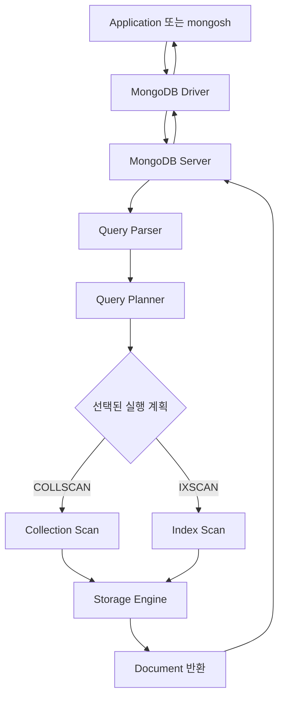
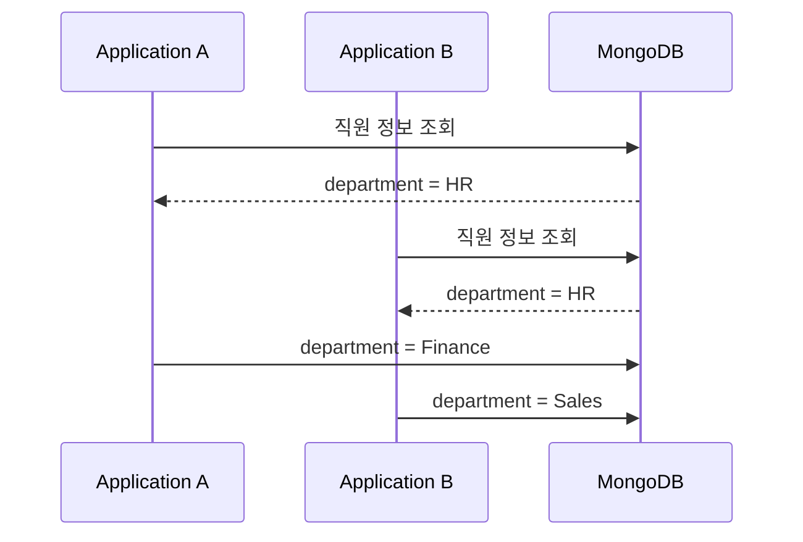
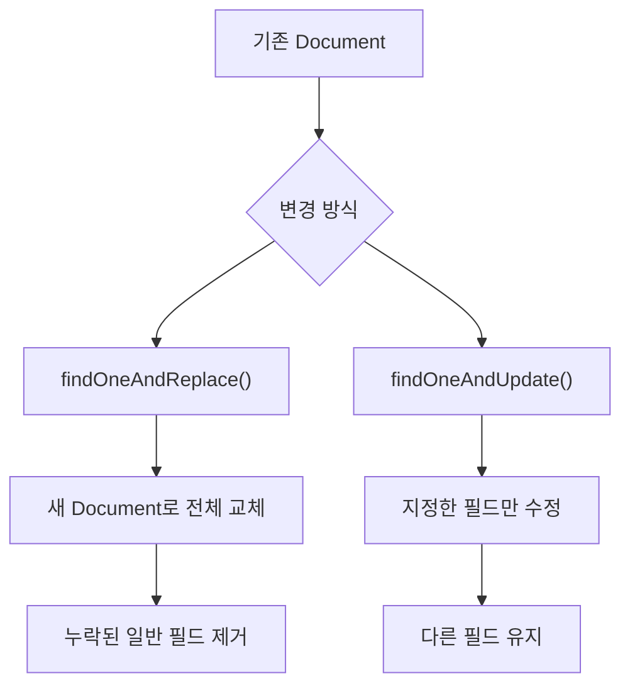
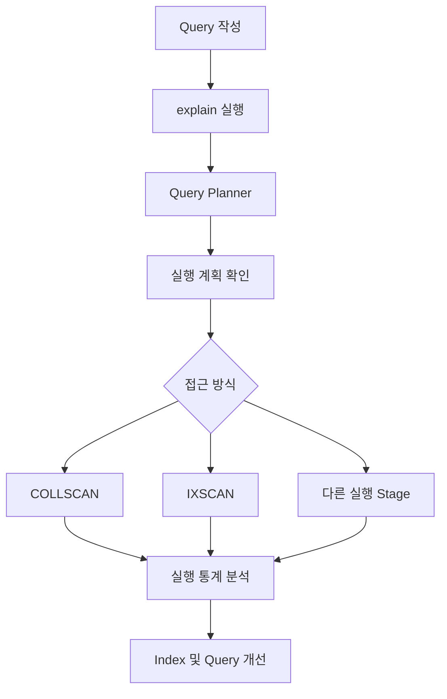
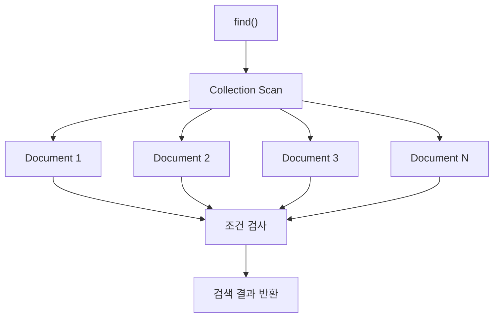
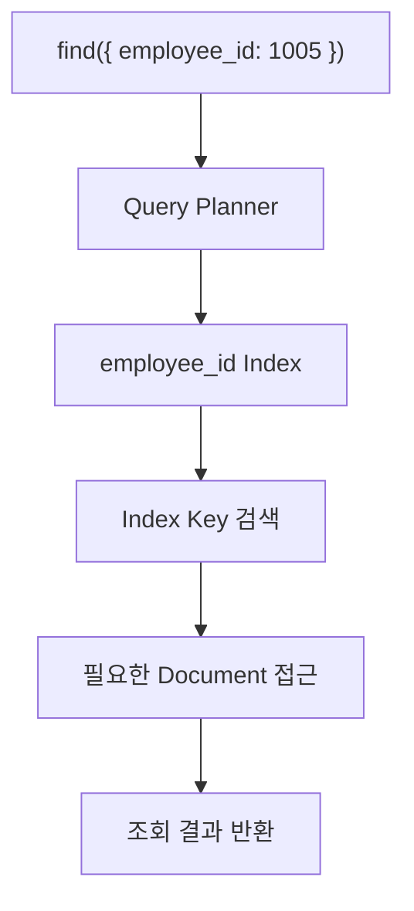
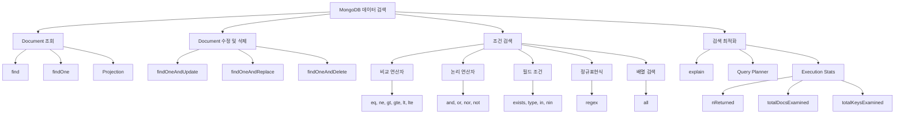

# MongoDB 데이터 검색

# MongoDB 데이터 검색

* toc
{:toc}

---

## MongoDB 데이터 검색: find()부터 조건 연산자, 정규표현식, 실행 계획 분석까지

MongoDB에서 데이터를 저장하는 방법을 이해했다면 다음으로 알아야 할 것은 **필요한 데이터를 효율적으로 검색하는 방법**이다.

관계형 데이터베이스에서는 SQL의 `SELECT`와 `WHERE`를 사용하여 데이터를 조회한다. 반면 MongoDB에서는 `find()`와 다양한 Query Operator를 사용하여 Document를 검색한다.

예를 들어 직원 관리 시스템에서 다음과 같은 요구사항이 발생했다고 가정해 보자.

- 모든 직원의 정보를 조회한다.
- 특정 부서에 속한 직원만 조회한다.
- 직원 번호가 특정 범위에 포함되는 직원을 검색한다.
- 여러 부서 중 하나에 속하는 직원을 조회한다.
- 이메일 주소에 특정 문자열이 포함된 직원을 찾는다.
- 특정 필드가 존재하는 Document만 조회한다.
- 배열에 지정한 값이 모두 포함된 Document를 검색한다.
- 검색 조건에 적합한 인덱스가 사용되는지 확인한다.

이러한 요구사항은 단순한 `find()`부터 비교 연산자, 논리 연산자, 정규표현식, 배열 연산자 등을 조합하여 구현할 수 있다.

그러나 검색 조건을 작성할 수 있다는 것과 검색을 효율적으로 수행한다는 것은 서로 다른 문제다.

데이터가 수십 건이라면 전체 Document를 검사해도 큰 문제가 없을 수 있다. 하지만 데이터가 수백만 건으로 증가하면 적절한 인덱스 없이 실행하는 검색은 상당한 비용을 발생시킬 수 있다.

따라서 MongoDB에서는 **Query 작성 방법뿐만 아니라 `explain()`을 이용하여 실제 실행 계획을 분석하는 방법**까지 이해해야 한다.

이번 글에서는 MongoDB 8.0 환경을 기준으로 다음 내용을 살펴본다.

1. Document와 BSON, `_id`의 역할
2. `find()`의 기본 구조와 Projection
3. `find()` 계열 메서드의 차이
4. `findAndModify()`와 원자적 수정
5. `findOneAndDelete()`, `findOneAndReplace()`, `findOneAndUpdate()`
6. 비교 연산자와 논리 연산자
7. `$exists`, `$type`, `$in`, `$nin`
8. `$regex`를 이용한 문자열 검색
9. `$all`을 이용한 배열 검색
10. `explain()`을 활용한 검색 성능 분석

---

## MongoDB의 Document와 데이터 검색 구조

### Document란?

MongoDB는 데이터를 Document 단위로 저장한다.

Document는 Field와 Value로 이루어진 데이터 구조이며, 실제 저장 형식으로 BSON(Binary JSON)을 사용한다.

관계형 데이터베이스의 Row와 비슷한 역할을 하지만, 하나의 Document에 배열이나 중첩 Document를 포함할 수 있다는 차이가 있다.

예를 들어 다음과 같은 직원 정보가 있다고 가정해 보자.

```javascript
{
  _id: ObjectId("507f1f77bcf86cd799439011"),
  employee_id: 1001,
  name: "Alice Kim",
  email: "alice.kim@example.com",
  department: "HR",
  join_date: ISODate("2018-03-15"),
  salary: 50000
}
```

각 필드는 서로 다른 정보를 표현한다.

| Field | BSON 자료형 | 설명 |
|---|---|---|
| `_id` | ObjectId | MongoDB Document 식별자 |
| `employee_id` | Number | 업무상 직원 식별자 |
| `name` | String | 직원 이름 |
| `email` | String | 이메일 |
| `department` | String | 소속 부서 |
| `join_date` | Date | 입사일 |
| `salary` | Number | 급여 |

여기서 중요한 필드는 `_id`다.

### _id란?

MongoDB는 Collection의 각 Document를 고유하게 식별하기 위해 `_id` 필드를 사용한다.

`_id`는 관계형 데이터베이스의 Primary Key와 유사한 역할을 수행한다.

일반적으로 Document를 저장할 때 `_id`를 지정하지 않으면 MongoDB 드라이버나 서버가 자동으로 생성한다.

```javascript
db.employees.insertOne({
  employee_id: 1001,
  name: "Alice Kim"
});
```

실제로 저장된 Document는 다음과 유사한 구조를 가진다.

```javascript
{
  _id: ObjectId("507f1f77bcf86cd799439011"),
  employee_id: 1001,
  name: "Alice Kim"
}
```

여기서 `_id`와 `employee_id`는 서로 다른 개념이다.

`_id`는 MongoDB가 관리하는 Document의 고유 식별자다.

반면 `employee_id`는 애플리케이션에서 정의한 업무 식별자다.

MongoDB는 기본적으로 `_id`에 대한 유일성을 보장하지만, `employee_id`의 중복 여부를 자동으로 검사하지는 않는다.

따라서 직원 번호가 중복되면 안 되는 시스템이라면 다음과 같이 Unique Index를 추가할 수 있다.

```javascript
db.employees.createIndex(
  {
    employee_id: 1
  },
  {
    unique: true
  }
);
```

이렇게 하면 동일한 직원 번호의 중복 저장을 방지할 수 있다.

다만 기존 Document에 중복된 직원 번호가 존재한다면 Unique Index 생성 자체가 실패할 수 있다.

---

## MongoDB 데이터 검색의 전체 구조

MongoDB의 데이터 검색은 다음과 같은 흐름으로 진행된다.



애플리케이션은 검색 조건을 MongoDB에 전달한다.

MongoDB 서버는 검색 조건을 분석하고, 사용 가능한 인덱스와 데이터 접근 비용 등을 고려하여 실행 계획을 선택한다.

선택된 실행 계획에 따라 Collection을 순차적으로 검사하거나 인덱스를 이용하여 Document를 검색한다.

따라서 같은 `find()` 명령어를 사용하더라도 데이터 구조와 인덱스 상태에 따라 실제 동작 방식이 달라질 수 있다.

---

## MongoDB 검색을 위한 샘플 데이터 구성

이후 예제에서는 직원 관리 데이터를 사용한다.

데이터베이스 이름은 `bizcom_db`, Collection 이름은 `employees`다.

직원 정보에는 다음 필드가 포함된다.

- `employee_id`
- `name`
- `email`
- `department`
- `join_date`
- `salary`

### 데이터베이스 선택

MongoDB Shell에 접속한 후 다음 명령어를 실행한다.

```javascript
use bizcom_db
```

현재 데이터베이스를 확인한다.

```javascript
db
```

실행 결과는 다음과 같다.

```text
bizcom_db
```

### 직원 데이터 저장

다음은 직원 10명의 데이터를 저장하는 전체 코드다.

```javascript
db.employees.insertMany([
  {
    employee_id: 1001,
    name: "Alice Kim",
    email: "alice.kim@example.com",
    department: "HR",
    join_date: ISODate("2018-03-15"),
    salary: 50000
  },
  {
    employee_id: 1002,
    name: "Bob Lee",
    email: "bob.lee@example.com",
    department: "Finance",
    join_date: ISODate("2017-07-22"),
    salary: 55000
  },
  {
    employee_id: 1003,
    name: "Charlie Park",
    email: "charlie.park@example.com",
    department: "IT",
    join_date: ISODate("2019-01-10"),
    salary: 52000
  },
  {
    employee_id: 1004,
    name: "David Choi",
    email: "david.choi@example.com",
    department: "Marketing",
    join_date: ISODate("2016-11-01"),
    salary: 48000
  },
  {
    employee_id: 1005,
    name: "Eva Jung",
    email: "eva.jung@example.com",
    department: "Sales",
    join_date: ISODate("2018-06-20"),
    salary: 51000
  },
  {
    employee_id: 1006,
    name: "Frank Lim",
    email: "frank.lim@example.com",
    department: "Admin",
    join_date: ISODate("2015-09-30"),
    salary: 47000
  },
  {
    employee_id: 1007,
    name: "Grace Kim",
    email: "grace.kim@example.com",
    department: "IT",
    join_date: ISODate("2017-02-14"),
    salary: 53000
  },
  {
    employee_id: 1008,
    name: "Helen Lee",
    email: "helen.lee@example.com",
    department: "Finance",
    join_date: ISODate("2019-05-05"),
    salary: 55000
  },
  {
    employee_id: 1009,
    name: "Ian Park",
    email: "ian.park@example.com",
    department: "HR",
    join_date: ISODate("2014-08-18"),
    salary: 49000
  },
  {
    employee_id: 1010,
    name: "Jane Choi",
    email: "jane.choi@example.com",
    department: "Marketing",
    join_date: ISODate("2020-01-03"),
    salary: 52000
  }
]);
```

`insertMany()`는 여러 Document를 한 번에 삽입하는 메서드다.

정상적으로 실행되면 다음과 유사한 결과가 반환된다.

```javascript
{
  acknowledged: true,
  insertedIds: {
    "0": ObjectId("..."),
    "1": ObjectId("..."),
    "2": ObjectId("..."),
    "3": ObjectId("..."),
    "4": ObjectId("..."),
    "5": ObjectId("..."),
    "6": ObjectId("..."),
    "7": ObjectId("..."),
    "8": ObjectId("..."),
    "9": ObjectId("...")
  }
}
```

`insertedIds`에는 각 Document에 부여된 식별자가 포함된다.

실제 ObjectId 값은 실행 환경에 따라 달라진다.

### 저장된 데이터 확인

```javascript
db.employees.find()
```

Document 개수를 확인하려면 다음 명령어를 실행한다.

```javascript
db.employees.countDocuments({})
```

새로운 Collection에 데이터를 한 번만 저장했다면 다음 결과를 확인할 수 있다.

```text
10
```

직원 데이터를 정리하면 다음과 같다.

| 직원 번호 | 이름 | 부서 | 급여 |
|---|---|---|---:|
| 1001 | Alice Kim | HR | 50,000 |
| 1002 | Bob Lee | Finance | 55,000 |
| 1003 | Charlie Park | IT | 52,000 |
| 1004 | David Choi | Marketing | 48,000 |
| 1005 | Eva Jung | Sales | 51,000 |
| 1006 | Frank Lim | Admin | 47,000 |
| 1007 | Grace Kim | IT | 53,000 |
| 1008 | Helen Lee | Finance | 55,000 |
| 1009 | Ian Park | HR | 49,000 |
| 1010 | Jane Choi | Marketing | 52,000 |

이후 수정과 삭제 예제를 실행하면 데이터가 변경되므로, **검색 조건의 결과를 원본 10건과 비교하려면 변경 작업을 실행하기 전에 확인하거나 샘플 데이터를 다시 준비해야 한다.**

---

## MongoDB find()란?

### find()의 개념

`find()`는 MongoDB Collection에서 조건에 일치하는 Document를 검색하는 메서드다.

기본 문법은 다음과 같다.

```javascript
db.collection.find(query, projection, options)
```

각 인수의 역할은 다음과 같다.

| 인수 | 필수 여부 | 설명 |
|---|---|---|
| query | 선택 | 검색 조건 |
| projection | 선택 | 반환할 필드 |
| options | 선택 | 추가 조회 옵션 |

예를 들어 다음 명령어를 살펴보자.

```javascript
db.employees.find(
  {
    department: "HR"
  },
  {
    _id: 0,
    employee_id: 1,
    name: 1,
    department: 1
  }
);
```

이 명령어는 다음 작업을 수행한다.

1. `department`가 `HR`인 Document를 검색한다.
2. `_id` 필드는 반환하지 않는다.
3. 직원 번호와 이름, 부서만 반환한다.

결과는 다음과 같다.

```javascript
[
  {
    employee_id: 1001,
    name: "Alice Kim",
    department: "HR"
  },
  {
    employee_id: 1009,
    name: "Ian Park",
    department: "HR"
  }
]
```

여기서 중요한 점은 `find()`의 반환값이다.

### find()는 Document 배열을 즉시 반환할까?

`find()`는 조건에 맞는 Document를 조회하기 위한 **Cursor**를 반환한다.

Cursor는 조회 결과를 순회할 수 있는 객체다.

```javascript
const cursor = db.employees.find({
  department: "HR"
});
```

이 시점에서 `cursor`는 단순한 JavaScript 배열이 아니다.

조회 결과를 순회하기 위한 Cursor다.

`mongosh`에서는 다음과 같이 배열로 변환할 수 있다.

```javascript
cursor.toArray()
```

또는 Cursor를 순회할 수 있다.

```javascript
db.employees.find({
  department: "HR"
}).forEach(employee => {
  print(employee.name);
});
```

실행 결과는 다음과 같다.

```text
Alice Kim
Ian Park
```

**Cursor를 사용하는 이유는 대량의 Document를 한 번에 애플리케이션 메모리로 가져오지 않고 순차적으로 처리할 수 있도록 하기 위해서다.**

실제로는 MongoDB Driver가 배치 단위로 데이터를 가져오는 등 Cursor와 네트워크 통신을 관리한다.

따라서 대량의 데이터를 조회할 때 무조건 `toArray()`를 호출하는 것은 주의해야 한다.

공식 문서에서도 `find()`의 반환값을 Cursor로 정의한다. [MongoDB](https://www.mongodb.com/docs/manual/reference/method/db.collection.find/?utm_source=chatgpt.com)

---

## find()의 기본 사용 방법

### 1. 전체 Document 조회

```javascript
db.employees.find()
```

모든 직원 정보를 조회한다.

다음과 같이 빈 객체를 전달할 수도 있다.

```javascript
db.employees.find({})
```

두 명령어 모두 전체 Document를 검색한다.

```text
find()
    ↓
검색 조건 없음
    ↓
전체 Document 조회
```

다만 Collection의 Document가 많다면 전체 데이터를 조회하는 데 상당한 비용이 발생할 수 있다.

### 2. 특정 조건으로 조회

HR 부서 직원을 조회한다.

```javascript
db.employees.find({
  department: "HR"
});
```

여기서 검색 조건은 다음과 같다.

```javascript
{
  department: "HR"
}
```

이는 SQL의 다음 조건과 비슷하다.

```sql
WHERE department = 'HR'
```

전체 SQL로 표현하면 다음과 같다.

```sql
SELECT *
FROM employees
WHERE department = 'HR';
```

### 3. 여러 조건으로 조회

부서가 IT이면서 급여가 50,000 이상인 직원을 조회한다.

```javascript
db.employees.find({
  department: "IT",
  salary: {
    $gte: 50000
  }
});
```

검색 조건이 여러 개 존재하면 기본적으로 AND 조건으로 처리된다.

따라서 다음 조건을 모두 만족해야 한다.

```text
department = IT

AND

salary >= 50000
```

원본 직원 데이터에서는 Charlie Park와 Grace Kim이 조건에 일치한다.

### 4. 필요한 필드만 조회

직원 이름과 부서만 조회한다고 가정해 보자.

```javascript
db.employees.find(
  {},
  {
    _id: 0,
    name: 1,
    department: 1
  }
);
```

두 번째 인수가 Projection이다.

Projection은 조회 결과에 포함할 필드를 지정한다.

| 값 | 의미 |
|---|---|
| `1` | 해당 필드 포함 |
| `0` | 해당 필드 제외 |

`_id`는 기본적으로 반환되기 때문에 제외하려면 명시적으로 `_id: 0`을 지정한다.

### 5. 조회 결과 개수 제한

```javascript
db.employees.find({}).limit(5)
```

최대 5개의 Document를 반환한다.

특정 조건에 결과 제한을 적용할 수도 있다.

```javascript
db.employees.find({
  department: "IT"
}).limit(10);
```

### 6. 정렬

급여가 높은 직원부터 조회하려면 다음과 같이 작성한다.

```javascript
db.employees.find({}).sort({
  salary: -1
});
```

정렬 방향은 다음과 같다.

| 값 | 의미 |
|---|---|
| `1` | 오름차순 |
| `-1` | 내림차순 |

직원 번호를 오름차순으로 정렬하려면 다음과 같이 작성한다.

```javascript
db.employees.find({}).sort({
  employee_id: 1
});
```

정렬 기준이 없는 조회에서는 결과 순서가 항상 같다고 보장할 수 없다.

따라서 페이징이나 순서가 중요한 API에서는 명시적인 정렬 조건을 지정해야 한다.

---

## MongoDB find 계열 메서드

MongoDB에서는 단순 조회뿐만 아니라 Document를 검색하면서 수정하거나 삭제하는 메서드도 제공한다.

대표적으로 다음과 같은 메서드가 있다.

| 메서드 | 역할 | 반환값 |
|---|---|---|
| `find()` | 조건에 맞는 Document 조회 | Cursor |
| `findOne()` | 조건에 맞는 Document 한 개 조회 | Document 또는 null |
| `findAndModify()` | Document 검색 후 수정 또는 삭제 | 수정 전·후 Document 또는 삭제된 Document |
| `findOneAndDelete()` | Document 한 개 삭제 | 삭제 전 Document |
| `findOneAndReplace()` | Document 전체 교체 | 교체 전·후 Document |
| `findOneAndUpdate()` | Document 일부 또는 지정 필드 수정 | 수정 전·후 Document |

이 메서드들은 이름이 비슷하지만 실제 수행하는 작업이 다르다.

특히 다음 세 가지를 구분하는 것이 중요하다.

- 조회만 수행하는 메서드
- 조회와 변경을 하나의 원자적 작업으로 처리하는 메서드
- 변경된 Document를 반환할 수 있는 메서드

---

## findOne()으로 Document 한 개 조회하기

`findOne()`은 검색 조건에 일치하는 Document 한 개를 반환한다.

기본 문법은 다음과 같다.

```javascript
db.collection.findOne(query)
```

### 특정 직원 조회

직원 번호가 1002인 직원을 조회한다.

```javascript
db.employees.findOne({
  employee_id: 1002
});
```

결과는 다음과 유사하다.

```javascript
{
  _id: ObjectId("..."),
  employee_id: 1002,
  name: "Bob Lee",
  email: "bob.lee@example.com",
  department: "Finance",
  join_date: ISODate("2017-07-22T00:00:00.000Z"),
  salary: 55000
}
```

### find()와 findOne()의 차이

```javascript
db.employees.find({
  department: "Finance"
});
```

이 명령어는 Finance 부서에 속하는 모든 직원을 검색한다.

반면 다음 명령어는 한 명의 직원만 반환한다.

```javascript
db.employees.findOne({
  department: "Finance"
});
```

여기서 주의할 점이 있다.

Finance 부서에 여러 명이 존재한다면 `findOne()`이 반드시 특정 직원을 반환한다고 보장할 수 없다.

반환할 Document가 명확해야 한다면 직원 번호와 같은 고유한 필드를 조건으로 사용하는 것이 좋다.

---

## findAndModify()로 Document 수정하기

### findAndModify()란?

`findAndModify()`는 조건에 일치하는 Document 한 개를 검색한 후 수정하거나 삭제하는 메서드다.

검색과 변경이 하나의 원자적 작업으로 처리된다는 특징이 있다.

예를 들어 직원 번호가 1001인 직원의 부서를 HR에서 Finance로 변경한다고 가정해 보자.

### 부서 변경

```javascript
db.employees.findAndModify({
  query: {
    employee_id: 1001
  },
  update: {
    $set: {
      department: "Finance"
    }
  },
  new: true
});
```

각 옵션의 의미는 다음과 같다.

| 옵션 | 설명 |
|---|---|
| `query` | 수정 대상 검색 조건 |
| `update` | 수정할 내용 |
| `$set` | 특정 필드를 추가하거나 변경 |
| `new` | 수정 후 Document 반환 여부 |

여기서 중요한 부분은 다음과 같다.

```javascript
new: true
```

`new: true`를 지정하면 수정이 완료된 Document를 반환한다.

반면 `new: false`이거나 생략하면 기본적으로 수정 전 Document를 반환한다.

### 수정 전 데이터

```javascript
{
  employee_id: 1001,
  name: "Alice Kim",
  department: "HR",
  salary: 50000
}
```

### 수정 후 데이터

```javascript
{
  employee_id: 1001,
  name: "Alice Kim",
  department: "Finance",
  salary: 50000
}
```

변경된 부분은 `department`다.

다른 필드는 그대로 유지된다.

### findAndModify()와 원자성

여기서 중요한 개념은 Atomicity(원자성)다.

다음과 같은 방식으로 데이터를 변경한다고 생각해 보자.



조회와 수정이 분리되어 있다면 두 애플리케이션이 같은 데이터를 읽고 서로 다른 변경을 수행할 수 있다.

이 경우 나중에 수행된 변경이 이전 변경을 덮어쓸 수 있다.

반면 하나의 Document에 대한 조건부 수정은 MongoDB에서 원자적으로 처리된다.

```javascript
db.employees.findOneAndUpdate(
  {
    employee_id: 1001,
    department: "HR"
  },
  {
    $set: {
      department: "Finance"
    }
  },
  {
    returnDocument: "after"
  }
);
```

이 예제는 다음 조건을 모두 만족하는 Document만 변경한다.

```text
employee_id = 1001

AND

department = HR
```

이미 다른 요청에 의해 부서가 변경되었다면 조건에 일치하지 않을 수 있다.

따라서 이런 방식은 특정 상태에서만 변경을 허용해야 하는 상황에 활용할 수 있다.

다만 단일 Document의 원자성이 여러 Document에 걸친 트랜잭션까지 자동으로 보장하는 것은 아니다.

### findAndModify()의 현재 사용 권장 방식

MongoDB 8.0에서도 `findAndModify()`를 사용할 수 있다.

그러나 `mongosh`에서는 Deprecated 메서드로 분류된다.

따라서 새로운 코드에서는 다음 메서드를 사용하는 것이 좋다.

- `findOneAndUpdate()`
- `findOneAndDelete()`
- `findOneAndReplace()`

이는 기존 메서드의 원자적 동작을 이해하되, 새로운 구현에서는 작업 목적에 맞는 명확한 API를 사용하라는 의미다. [MongoDB](https://www.mongodb.com/docs/manual/reference/method/db.collection.findandmodify/?utm_source=chatgpt.com)

---

## findOneAndDelete()로 Document 삭제하기

### findOneAndDelete()란?

`findOneAndDelete()`는 검색 조건에 일치하는 Document 한 개를 삭제하고, 삭제되기 전의 Document를 반환한다.

기본 문법은 다음과 같다.

```javascript
db.collection.findOneAndDelete(filter)
```

### 직원 삭제 예제

직원 번호가 1003인 직원을 조회한다.

```javascript
db.employees.findOne({
  employee_id: 1003
});
```

다음과 같은 정보가 반환된다.

```javascript
{
  _id: ObjectId("..."),
  employee_id: 1003,
  name: "Charlie Park",
  email: "charlie.park@example.com",
  department: "IT",
  join_date: ISODate("2019-01-10T00:00:00.000Z"),
  salary: 52000
}
```

이제 해당 직원을 삭제한다.

```javascript
db.employees.findOneAndDelete({
  employee_id: 1003
});
```

삭제에 성공하면 삭제 이전의 Document가 반환된다.

### 삭제 결과 확인

```javascript
db.employees.findOne({
  employee_id: 1003
});
```

삭제된 직원은 더 이상 조회되지 않는다.

조건에 일치하는 Document가 없다면 `null`이 반환된다.

### deleteOne()과의 차이

MongoDB에는 `deleteOne()`도 존재한다.

```javascript
db.employees.deleteOne({
  employee_id: 1003
});
```

두 메서드의 차이는 반환값이다.

| 메서드 | 삭제 작업 | 반환값 |
|---|---|---|
| `deleteOne()` | Document 한 개 삭제 | 삭제 개수 등 처리 결과 |
| `findOneAndDelete()` | Document 한 개 삭제 | 삭제 전 Document |

`deleteOne()`은 일반적으로 다음과 같은 결과를 반환한다.

```javascript
{
  acknowledged: true,
  deletedCount: 1
}
```

반면 `findOneAndDelete()`는 삭제된 Document 자체를 반환한다.

이 차이는 삭제 이전의 데이터를 활용해야 하는 상황에서 중요하다.

예를 들어 사용자 계정 삭제 작업에서 삭제된 사용자 정보를 감사 로그로 기록해야 한다면 삭제 전 Document가 필요할 수 있다.

다만 반환된 Document를 별도로 저장하는 작업까지 자동으로 하나의 트랜잭션으로 처리되는 것은 아니다.

---

## findOneAndReplace()로 Document 전체 교체하기

### findOneAndReplace()란?

`findOneAndReplace()`는 검색 조건에 일치하는 Document 한 개를 새로운 Document로 교체한다.

여기서 중요한 부분은 **일부 필드를 수정하는 것이 아니라 Document 전체를 교체한다는 것**이다.

### 기존 직원 조회

직원 번호가 1004인 직원을 조회한다.

```javascript
db.employees.findOne({
  employee_id: 1004
});
```

변경 전 Document는 다음과 같다.

```javascript
{
  employee_id: 1004,
  name: "David Choi",
  email: "david.choi@example.com",
  department: "Marketing",
  join_date: ISODate("2016-11-01"),
  salary: 48000
}
```

### Document 전체 교체

다음 명령어를 실행한다.

```javascript
db.employees.findOneAndReplace(
  {
    employee_id: 1004
  },
  {
    employee_id: 1004,
    name: "David Choi",
    email: "new.email@example.com",
    department: "Sales",
    join_date: ISODate("2016-11-01")
  },
  {
    returnDocument: "after"
  }
);
```

이 예제에서는 직원 정보 전체를 새로운 Document로 교체한다.

특히 주의할 부분이 있다.

새로운 Document에는 `salary` 필드가 존재하지 않는다.

### 교체 전 Document

```javascript
{
  employee_id: 1004,
  name: "David Choi",
  email: "david.choi@example.com",
  department: "Marketing",
  join_date: ISODate("2016-11-01"),
  salary: 48000
}
```

### 교체 후 Document

```javascript
{
  employee_id: 1004,
  name: "David Choi",
  email: "new.email@example.com",
  department: "Sales",
  join_date: ISODate("2016-11-01")
}
```

기존에 존재하던 `salary` 필드가 사라졌다.

왜 이런 결과가 발생할까?

`findOneAndReplace()`는 기존 Document를 새로운 Document로 교체하기 때문이다.

교체 Document에 포함되지 않은 일반 필드는 유지되지 않는다.

기존 `_id`는 변경되지 않으며, 교체 Document에서 다른 `_id`를 지정할 수 없다.

### Document 교체와 필드 수정의 차이



**일부 필드만 변경해야 하는 업무에서 전체 교체를 잘못 사용하면 기존 데이터가 사라질 수 있다.**

예를 들어 사용자가 이메일만 변경하는 API를 호출했다고 가정해 보자.

클라이언트가 다음 데이터만 전달했다.

```json
{
  "email": "new.email@example.com"
}
```

이 데이터를 그대로 전체 교체에 사용하면 기존 이름, 부서, 급여 등의 필드가 제거될 수 있다.

따라서 부분 수정 API에서는 일반적으로 `$set`을 이용한 변경을 검토하는 것이 적절하다. [MongoDB](https://www.mongodb.com/docs/v8.0/reference/method/db.collection.findoneandreplace/?utm_source=chatgpt.com)

---

## findOneAndUpdate()로 특정 필드 수정하기

### findOneAndUpdate()란?

`findOneAndUpdate()`는 조건에 일치하는 Document 한 개를 수정하고, 수정 전 또는 수정 후 Document를 반환할 수 있는 메서드다.

`findOneAndReplace()`와 달리 `$set` 등을 사용하여 특정 필드만 변경할 수 있다.

### 직원 부서 변경

직원 번호가 1005인 직원을 조회한다.

```javascript
db.employees.findOne({
  employee_id: 1005
});
```

변경 전 데이터는 다음과 같다.

```javascript
{
  employee_id: 1005,
  name: "Eva Jung",
  email: "eva.jung@example.com",
  department: "Sales",
  join_date: ISODate("2018-06-20"),
  salary: 51000
}
```

이제 부서를 Sales에서 Support로 변경한다.

```javascript
db.employees.findOneAndUpdate(
  {
    employee_id: 1005
  },
  {
    $set: {
      department: "Support"
    }
  },
  {
    returnDocument: "after"
  }
);
```

`$set`은 지정한 필드의 값을 변경하는 연산자다.

기존에 필드가 없다면 새로운 필드를 추가할 수도 있다.

### 수정 후 Document

```javascript
{
  employee_id: 1005,
  name: "Eva Jung",
  email: "eva.jung@example.com",
  department: "Support",
  join_date: ISODate("2018-06-20"),
  salary: 51000
}
```

`department`만 변경되었고 나머지 필드는 그대로 유지된다.

### returnDocument 옵션

`findOneAndUpdate()`와 `findOneAndReplace()`에서는 반환할 Document의 상태를 지정할 수 있다.

```javascript
{
  returnDocument: "after"
}
```

수정 또는 교체가 완료된 Document를 반환한다.

반면 다음과 같이 설정하면 변경 이전의 Document를 반환한다.

```javascript
{
  returnDocument: "before"
}
```

기본 동작은 변경 전 Document를 반환하는 것이다.

| 옵션 | 반환값 |
|---|---|
| `returnDocument: "before"` | 변경 이전 Document |
| `returnDocument: "after"` | 변경 이후 Document |

조건에 일치하는 Document가 없고 `upsert`도 사용하지 않았다면 `null`이 반환된다.

### findOneAndUpdate()와 updateOne()의 차이

다음 명령어도 동일한 필드 수정을 수행할 수 있다.

```javascript
db.employees.updateOne(
  {
    employee_id: 1005
  },
  {
    $set: {
      department: "Support"
    }
  }
);
```

하지만 반환값이 다르다.

| 메서드 | 주요 반환값 |
|---|---|
| `updateOne()` | matchedCount, modifiedCount 등 |
| `findOneAndUpdate()` | 변경 전 또는 변경 후 Document |

수정된 Document가 반드시 필요한 것은 아니라면 `updateOne()`으로 충분할 수 있다.

반면 변경된 Document를 즉시 반환해야 한다면 `findOneAndUpdate()`를 사용할 수 있다.

MongoDB 8.0에서는 정렬 기준에 따라 첫 번째 Document를 수정하는 `updateOne()`의 `sort` 옵션도 지원한다. [MongoDB](https://www.mongodb.com/docs/v8.0/reference/method/db.collection.findoneandupdate/?utm_source=chatgpt.com)

---

## find 계열 메서드 비교

지금까지 살펴본 메서드를 다시 정리하면 다음과 같다.

| 메서드 | 조회 | 수정 | 삭제 | 전체 교체 | Document 반환 |
|---|---|---|---|---|---|
| `find()` | O | X | X | X | Cursor |
| `findOne()` | O | X | X | X | 한 개 |
| `findAndModify()` | O | O | O | O | 변경 또는 삭제된 Document |
| `findOneAndDelete()` | O | X | O | X | 삭제 전 Document |
| `findOneAndReplace()` | O | O | X | O | 교체 전·후 Document |
| `findOneAndUpdate()` | O | O | X | X | 수정 전·후 Document |

특히 `findOneAndUpdate()`와 `findOneAndReplace()`를 혼동하지 않아야 한다.

일부 필드를 수정할 때는 `$set`을 이용한 Update가 적합할 수 있다.

반면 Document 전체를 새로운 구조로 변경해야 한다면 Replace를 검토할 수 있다.

---

## MongoDB 조건 검색을 위한 Query Operator

MongoDB에서는 다양한 Query Operator를 사용하여 검색 조건을 작성할 수 있다.

Query Operator는 일반적으로 `$`로 시작한다.

예를 들어 다음과 같다.

```javascript
{
  employee_id: {
    $gt: 1005
  }
}
```

여기서 `$gt`는 Greater Than을 의미한다.

따라서 직원 번호가 1005보다 큰 Document를 검색한다.

MongoDB의 주요 검색 연산자는 다음과 같이 구분할 수 있다.

| 구분 | 주요 연산자 |
|---|---|
| 비교 연산자 | `$eq`, `$ne`, `$gt`, `$gte`, `$lt`, `$lte` |
| 논리 연산자 | `$and`, `$or`, `$nor`, `$not` |
| 필드 조건 | `$exists`, `$type` |
| 포함 조건 | `$in`, `$nin` |
| 문자열 검색 | `$regex` |
| 배열 검색 | `$all` |
| JavaScript 조건 | `$where` |

각 연산자는 검색 조건을 구성하는 역할이 다르다.

---

## 비교 연산자 이해하기

비교 연산자는 특정 값과 Document의 필드 값을 비교할 때 사용한다.

### 비교 연산자 종류

| 연산자 | 의미 | SQL과 비교 |
|---|---|---|
| `$eq` | 같음 | `=` |
| `$ne` | 같지 않음 | `<>`, `!=` |
| `$gt` | 초과 | `>` |
| `$gte` | 이상 | `>=` |
| `$lt` | 미만 | `<` |
| `$lte` | 이하 | `<=` |

각 연산자를 실제 데이터 조회에 적용해 보자.

### 1. $eq: 같은 값 검색

직원 번호가 1005인 Document를 조회한다.

```javascript
db.employees.find({
  employee_id: 1005
});
```

다음과 같이 `$eq`를 명시적으로 사용할 수도 있다.

```javascript
db.employees.find({
  employee_id: {
    $eq: 1005
  }
});
```

두 조건은 동일한 의미다.

```text
employee_id = 1005
```

### 2. $ne: 같지 않은 값 검색

직원 번호가 1005가 아닌 Document를 조회한다.

```javascript
db.employees.find({
  employee_id: {
    $ne: 1005
  }
});
```

이 조건은 직원 번호가 1005가 아닌 Document에 일치한다.

여기서 주의할 부분이 있다.

**`$ne`는 해당 필드가 존재하지 않는 Document도 포함할 수 있다.**

따라서 직원 번호가 존재하면서 1005가 아닌 Document만 검색하려면 필드 존재 조건을 추가할 수 있다.

```javascript
db.employees.find({
  employee_id: {
    $exists: true,
    $ne: 1005
  }
});
```

이 차이는 유연한 스키마를 사용하는 MongoDB에서 중요하다. [MongoDB](https://www.mongodb.com/docs/v8.0/reference/operator/query/ne/)

### 3. $gt: 초과 검색

직원 번호가 1005보다 큰 Document를 조회한다.

```javascript
db.employees.find({
  employee_id: {
    $gt: 1005
  }
});
```

해당 조건은 다음과 같다.

```text
employee_id > 1005
```

원본 데이터에서는 직원 번호 1006부터 1010까지가 검색 대상이다.

### 4. $gte: 이상 검색

```javascript
db.employees.find({
  employee_id: {
    $gte: 1005
  }
});
```

직원 번호가 1005 이상인 Document를 검색한다.

```text
employee_id >= 1005
```

`$gt`와 달리 1005도 포함된다.

### 5. $lt: 미만 검색

```javascript
db.employees.find({
  employee_id: {
    $lt: 1005
  }
});
```

직원 번호가 1005보다 작은 Document를 검색한다.

```text
employee_id < 1005
```

### 6. $lte: 이하 검색

```javascript
db.employees.find({
  employee_id: {
    $lte: 1005
  }
});
```

직원 번호가 1005 이하인 Document를 검색한다.

```text
employee_id <= 1005
```

### 비교 연산자 전체 예제

```javascript
// employee_id = 1005
db.employees.find({
  employee_id: {
    $eq: 1005
  }
});

// employee_id != 1005
db.employees.find({
  employee_id: {
    $ne: 1005
  }
});

// employee_id > 1005
db.employees.find({
  employee_id: {
    $gt: 1005
  }
});

// employee_id >= 1005
db.employees.find({
  employee_id: {
    $gte: 1005
  }
});

// employee_id < 1005
db.employees.find({
  employee_id: {
    $lt: 1005
  }
});

// employee_id <= 1005
db.employees.find({
  employee_id: {
    $lte: 1005
  }
});
```

---

## 범위 조건 검색하기

비교 연산자를 조합하면 특정 범위에 포함되는 Document를 검색할 수 있다.

예를 들어 직원 번호가 1000보다 크고 1010보다 작은 직원을 조회한다.

```javascript
db.employees.find({
  employee_id: {
    $gt: 1000,
    $lt: 1010
  }
});
```

이 조건은 다음과 같다.

```text
1000 < employee_id < 1010
```

원본 데이터 기준으로 직원 번호 1001부터 1009까지 검색한다.

동일한 조건을 SQL로 표현하면 다음과 같다.

```sql
SELECT *
FROM employees
WHERE employee_id > 1000
  AND employee_id < 1010;
```

반대로 양쪽 경계값을 모두 포함하고 싶다면 `$gte`와 `$lte`를 사용할 수 있다.

```javascript
db.employees.find({
  employee_id: {
    $gte: 1000,
    $lte: 1010
  }
});
```

이처럼 MongoDB에서는 하나의 필드에 여러 비교 조건을 지정할 수 있다.

### 범위 조건과 인덱스

범위 검색이 자주 발생한다면 해당 필드에 인덱스를 생성하는 것을 검토할 수 있다.

```javascript
db.employees.createIndex({
  employee_id: 1
});
```

이 인덱스가 존재하면 MongoDB는 직원 번호의 특정 범위를 인덱스로 검색할 수 있다.

하지만 인덱스가 존재한다고 해서 항상 해당 인덱스를 사용하는 것은 아니다.

실제 인덱스 사용 여부는 이후 `explain()`을 통해 확인할 수 있다.

---

## 논리 연산자 이해하기

논리 연산자는 여러 검색 조건을 조합하는 데 사용한다.

대표적인 연산자는 다음과 같다.

- `$and`
- `$or`
- `$nor`
- `$not`

### 1. $and: 모든 조건 만족

`$and`는 지정한 모든 조건을 만족하는 Document를 검색한다.

예를 들어 나이가 25 이상이고 IT 부서에 소속된 직원을 검색한다고 가정해 보자.

```javascript
{
  $and: [
    {
      age: {
        $gte: 25
      }
    },
    {
      department: "IT"
    }
  ]
}
```

이 조건은 다음과 같다.

```text
age >= 25

AND

department = IT
```

다만 현재 직원 샘플 데이터에는 `age` 필드가 없다.

따라서 이 필터를 현재 `employees` Collection에 그대로 적용하면 해당 조건에 일치하는 Document가 없다.

이 점을 이해하는 것이 중요하다.

MongoDB에서 필드가 존재하지 않는데도 숫자 비교가 자동으로 수행되는 것은 아니다.

실제 직원 데이터를 기준으로 검색하려면 다음과 같이 존재하는 필드를 사용하는 것이 좋다.

```javascript
db.employees.find({
  $and: [
    {
      salary: {
        $gte: 50000
      }
    },
    {
      department: "IT"
    }
  ]
});
```

이 조건은 급여가 50,000 이상이면서 IT 부서에 속하는 직원을 검색한다.

### $and를 명시하지 않아도 될까?

다음과 같이 작성할 수도 있다.

```javascript
db.employees.find({
  salary: {
    $gte: 50000
  },
  department: "IT"
});
```

서로 다른 필드에 조건을 지정하면 기본적으로 AND 관계로 처리된다.

따라서 단순한 AND 조건은 `$and`를 생략할 수 있다.

하지만 여러 연산자를 복잡하게 조합해야 하거나 동일한 필드 조건을 별도의 표현식으로 구성해야 한다면 `$and`가 유용하다.

### 2. $or: 하나 이상의 조건 만족

`$or`는 지정한 조건 중 하나 이상을 만족하는 Document를 검색한다.

예를 들어 HR 또는 Finance 부서에 속하는 직원을 조회한다.

```javascript
db.employees.find({
  $or: [
    {
      department: "HR"
    },
    {
      department: "Finance"
    }
  ]
});
```

SQL로 표현하면 다음과 같다.

```sql
SELECT *
FROM employees
WHERE department = 'HR'
   OR department = 'Finance';
```

원본 데이터 기준으로 다음 직원이 조회된다.

| 직원 번호 | 이름 | 부서 |
|---|---|---|
| 1001 | Alice Kim | HR |
| 1002 | Bob Lee | Finance |
| 1008 | Helen Lee | Finance |
| 1009 | Ian Park | HR |

동일한 필드에서 여러 값 중 하나를 검색하는 경우에는 `$in`을 사용할 수도 있다.

```javascript
db.employees.find({
  department: {
    $in: ["HR", "Finance"]
  }
});
```

### 3. $nor: 모든 조건을 만족하지 않는 Document

`$nor`는 지정한 조건 중 어느 것도 만족하지 않는 Document를 검색한다.

예를 들어 다음 조건을 살펴보자.

```javascript
{
  $nor: [
    {
      age: {
        $gte: 30
      }
    }
  ]
}
```

이 필터는 `age >= 30` 조건에 일치하지 않는 Document를 검색한다.

여기서 주의할 부분은 필드의 존재 여부다.

`age` 필드가 없는 Document는 `age >= 30` 조건에 일치하지 않는다.

따라서 위 `$nor` 조건에는 `age`가 존재하지 않는 Document도 포함될 수 있다.

현재 직원 데이터에는 `age`가 없으므로 이 조건만 적용하면 모든 직원 Document가 검색될 수 있다.

### 실제 직원 데이터에 $nor 적용

HR과 Finance 부서에 속하지 않는 직원을 조회한다고 가정해 보자.

```javascript
db.employees.find({
  $nor: [
    {
      department: "HR"
    },
    {
      department: "Finance"
    }
  ]
});
```

이 조건은 두 부서 중 어느 곳에도 속하지 않는 Document를 검색한다.

단, `department` 필드가 없는 Document도 일치할 수 있다.

필드가 반드시 존재해야 한다면 별도의 `$exists` 조건을 추가할 수 있다.

```javascript
db.employees.find({
  department: {
    $exists: true
  },
  $nor: [
    {
      department: "HR"
    },
    {
      department: "Finance"
    }
  ]
});
```

`$nor`와 누락된 필드의 관계는 실제 검색 결과에 영향을 주므로 주의해야 한다. [MongoDB](https://www.mongodb.com/docs/v8.0/reference/operator/query/nor/)

### 4. $not: 특정 조건 부정

`$not`은 특정 필드의 조건을 부정할 때 사용한다.

예를 들어 급여가 50,000보다 크다는 조건을 부정한다고 가정해 보자.

```javascript
db.employees.find({
  salary: {
    $not: {
      $gt: 50000
    }
  }
});
```

급여가 50,000보다 크지 않은 Document를 검색한다.

다만 이 경우에도 `salary` 필드가 존재하지 않는 Document가 포함될 수 있다.

따라서 다음 조건과 완전히 동일하다고 단순하게 생각해서는 안 된다.

```javascript
db.employees.find({
  salary: {
    $lte: 50000
  }
});
```

두 조건은 필드가 존재하지 않는 Document에 대해 서로 다른 결과를 반환할 수 있다.

---

## $exists: 특정 필드의 존재 여부 검색

MongoDB는 같은 Collection에서도 Document마다 서로 다른 필드를 가질 수 있다.

따라서 특정 필드가 존재하는지 검색해야 하는 경우가 있다.

이를 위해 사용하는 연산자가 `$exists`다.

### 필드가 존재하는 Document 검색

다음 명령어를 실행한다.

```javascript
db.employees.find({
  email: {
    $exists: true
  }
});
```

`email` 필드가 존재하는 모든 Document를 검색한다.

현재 샘플 데이터에는 모든 직원에게 이메일이 존재하므로 원본 10건 모두 일치한다.

### 필드가 존재하지 않는 Document 검색

다음 명령어를 실행한다.

```javascript
db.employees.find({
  address: {
    $exists: false
  }
});
```

`address` 필드가 없는 Document를 검색한다.

현재 직원 샘플 데이터에는 `address` 필드가 없기 때문에 모든 Document가 일치한다.

### $exists와 null의 차이

다음 두 Document를 생각해 보자.

```javascript
{
  name: "Alice",
  address: null
}
```

```javascript
{
  name: "Bob"
}
```

첫 번째 Document에는 `address` 필드가 존재한다.

단지 값이 `null`일 뿐이다.

두 번째 Document에는 `address` 필드 자체가 없다.

따라서 다음 조건은 첫 번째 Document에 일치한다.

```javascript
{
  address: {
    $exists: true
  }
}
```

반면 다음 조건은 두 번째 Document에 일치한다.

```javascript
{
  address: {
    $exists: false
  }
}
```

이처럼 MongoDB에서는 **필드가 없는 상태와 값이 null인 상태를 구분해야 한다.**

---

## $type: 특정 BSON 자료형 검색

`$type`은 필드의 BSON 자료형을 기준으로 Document를 검색한다.

예를 들어 다음과 같은 조건을 사용할 수 있다.

```javascript
{
  age: {
    $type: "int"
  }
}
```

이 조건은 `age`가 BSON Int32 타입인 Document를 검색한다.

### 주요 BSON 자료형

| 타입 이름 | 설명 |
|---|---|
| string | 문자열 |
| int | 32비트 정수 |
| long | 64비트 정수 |
| double | 부동소수점 |
| decimal | Decimal128 |
| date | 날짜 |
| bool | Boolean |
| array | 배열 |
| object | Document |
| objectId | ObjectId |
| null | Null |

현재 직원 샘플 데이터에는 `age` 필드가 없다.

따라서 이 조건으로는 일치하는 Document를 찾을 수 없다.

대신 입사일을 기준으로 검색해 보자.

```javascript
db.employees.find({
  join_date: {
    $type: "date"
  }
});
```

`join_date`가 BSON Date인 Document를 검색한다.

### 문자열 날짜와 BSON Date 구분

예를 들어 다음 두 Document가 있다고 가정해 보자.

```javascript
{
  join_date: "2018-03-15"
}
```

```javascript
{
  join_date: ISODate("2018-03-15")
}
```

첫 번째는 문자열이다.

두 번째는 BSON Date다.

따라서 다음 조건에는 두 번째 Document만 일치한다.

```javascript
{
  join_date: {
    $type: "date"
  }
}
```

실무에서는 날짜를 기준으로 정렬하거나 범위 검색을 수행해야 한다면 자료형을 일관되게 저장하는 것이 중요하다.

---

## $in: 지정한 목록에 포함되는 값 검색

`$in`은 필드 값이 지정한 목록 중 하나와 일치하는 Document를 검색한다.

### 기본 문법

```javascript
{
  field: {
    $in: [value1, value2, value3]
  }
}
```

### 부서 조건 검색

HR, IT, Finance 부서에 속하는 직원을 검색한다고 가정해 보자.

```javascript
db.employees.find({
  department: {
    $in: ["HR", "IT", "Finance"]
  }
});
```

이 조건은 다음과 같다.

```text
department = HR

OR

department = IT

OR

department = Finance
```

SQL로 표현하면 다음과 같다.

```sql
SELECT *
FROM employees
WHERE department IN ('HR', 'IT', 'Finance');
```

### $or와 $in 비교

다음 조건을 살펴보자.

```javascript
db.employees.find({
  $or: [
    {
      department: "HR"
    },
    {
      department: "IT"
    },
    {
      department: "Finance"
    }
  ]
});
```

동일한 필드의 여러 값 중 하나를 검색한다는 점에서 다음 조건과 같은 의미다.

```javascript
db.employees.find({
  department: {
    $in: ["HR", "IT", "Finance"]
  }
});
```

일반적으로 동일한 필드에 대해 여러 값의 일치 여부를 검사하는 경우 `$in`이 간결하다.

반면 서로 다른 필드에 OR 조건을 적용하려면 `$or`를 사용할 수 있다.

---

## $nin: 지정한 목록에 포함되지 않는 값 검색

`$nin`은 Not In의 의미를 가진다.

필드 값이 지정한 목록에 포함되지 않는 Document를 검색한다.

### 기본 문법

```javascript
{
  field: {
    $nin: [value1, value2]
  }
}
```

### 부서 조건 검색

HR, IT, Finance 부서에 속하지 않는 직원을 검색한다.

```javascript
db.employees.find({
  department: {
    $nin: ["HR", "IT", "Finance"]
  }
});
```

원본 직원 데이터에서는 다음 부서가 검색 대상이다.

- Marketing
- Sales
- Admin

하지만 앞에서 부서 변경 예제를 실행했다면 검색 결과는 달라진다.

예를 들어 직원 번호 1005의 부서를 Support로 변경했다면 해당 직원도 검색 대상에 포함된다.

### $nin의 중요한 특징

`$nin`은 지정한 값에 포함되지 않는 Document뿐만 아니라 **해당 필드가 존재하지 않는 Document도 검색할 수 있다.**

예를 들어 다음 Document를 생각해 보자.

```javascript
{
  name: "John"
}
```

여기에는 `department` 필드가 없다.

그런데 다음 조건을 적용하면 어떻게 될까?

```javascript
{
  department: {
    $nin: ["HR", "IT"]
  }
}
```

해당 Document는 검색 결과에 포함될 수 있다.

왜냐하면 `department` 값이 지정한 목록에 포함되어 있지 않기 때문이다.

따라서 업무에서 부서가 반드시 존재해야 한다면 다음과 같이 작성할 수 있다.

```javascript
db.employees.find({
  department: {
    $exists: true,
    $nin: ["HR", "IT", "Finance"]
  }
});
```

이렇게 하면 `department`가 존재하면서 지정한 부서에 포함되지 않는 Document를 검색한다.

MongoDB 공식 문서에서도 `$nin`의 결과에 필드가 존재하지 않는 Document가 포함된다고 설명한다. [MongoDB](https://www.mongodb.com/docs/v8.0/reference/operator/query/nin/)

---

## $in과 $nin의 차이

| 구분 | $in | $nin |
|---|---|---|
| 의미 | 지정한 목록에 포함 | 지정한 목록에 미포함 |
| SQL 비교 | IN | NOT IN과 유사 |
| 여러 값 비교 | 가능 | 가능 |
| 필드가 없는 Document | 일반적인 값 목록에서는 불일치 | 포함될 수 있음 |
| 사용 예시 | 특정 부서 직원 검색 | 특정 부서 제외 |

여기서 주의할 점은 MongoDB의 `$nin`과 SQL의 `NOT IN`이 NULL 처리까지 완전히 동일하지는 않다는 것이다.

MongoDB는 필드가 존재하지 않을 수 있는 Document 모델을 사용한다.

따라서 부정 조건을 작성할 때는 필드 존재 여부까지 함께 고려해야 한다.

---

## 조건 연산자를 조합하여 검색하기

지금까지 살펴본 연산자는 서로 조합할 수 있다.

예를 들어 다음 요구사항이 있다고 가정해 보자.

> 직원 번호가 1000보다 크고 1010보다 작으며, HR 또는 Finance 부서에 속하는 직원을 검색한다.

다음과 같이 작성할 수 있다.

```javascript
db.employees.find({
  employee_id: {
    $gt: 1000,
    $lt: 1010
  },
  department: {
    $in: ["HR", "Finance"]
  }
});
```

이 조건을 분해하면 다음과 같다.

```text
employee_id > 1000

AND

employee_id < 1010

AND

department IN (HR, Finance)
```

### 다른 조건 예제

이메일이 존재하면서 Finance 부서가 아닌 직원을 검색한다.

```javascript
db.employees.find({
  email: {
    $exists: true
  },
  department: {
    $ne: "Finance"
  }
});
```

급여가 50,000 이상이고 IT 또는 Marketing 부서에 속하는 직원을 검색한다.

```javascript
db.employees.find({
  salary: {
    $gte: 50000
  },
  department: {
    $in: ["IT", "Marketing"]
  }
});
```

이처럼 MongoDB에서는 Query Operator를 조합하여 SQL의 WHERE 조건과 유사한 검색을 구현할 수 있다.

---

## $regex: 정규표현식을 이용한 문자열 검색

### $regex란?

`$regex`는 문자열 패턴을 기준으로 Document를 검색하는 연산자다.

정규표현식(Regular Expression)을 이용하여 특정 문자열로 시작하거나, 특정 문자열을 포함하는 값을 검색할 수 있다.

예를 들어 다음과 같은 요구사항이 있다고 가정해 보자.

- 이름이 Ali로 시작하는 직원을 검색한다.
- 이메일에 example.com이 포함된 직원을 검색한다.
- 이름에 a가 포함된 직원을 검색하되 대소문자를 구분하지 않는다.

이러한 조건에 `$regex`를 사용할 수 있다.

### 1. 특정 문자열로 시작하는 값 검색

이름이 `Ali`로 시작하는 직원을 검색한다.

```javascript
db.employees.find({
  name: {
    $regex: /^Ali/
  }
});
```

여기서 중요한 부분은 다음과 같다.

```javascript
/^Ali/
```

정규표현식에서 `^`는 문자열의 시작을 의미한다.

따라서 다음 조건을 만족하는 이름을 검색한다.

```text
Ali로 시작하는 문자열
```

원본 직원 데이터에서는 다음 직원이 일치한다.

```text
Alice Kim
```

### 2. 특정 문자열을 포함하는 값 검색

이메일에 `example.com`이 포함된 직원을 검색한다.

```javascript
db.employees.find({
  email: {
    $regex: /example\.com/
  }
});
```

여기서 `\.`은 마침표를 문자 그대로 검색하기 위한 이스케이프 표현이다.

정규표현식에서 마침표 `.`은 기본적으로 임의의 한 문자를 의미한다.

따라서 다음 두 표현은 의미가 다르다.

```javascript
/example.com/
```

```javascript
/example\.com/
```

첫 번째는 `example`과 `com` 사이에 임의의 한 문자가 존재하는 문자열도 일치할 수 있다.

두 번째는 실제 마침표가 포함된 `example.com`을 검색한다.

이처럼 정규표현식에서는 특수문자의 의미를 정확하게 이해해야 한다.

### 3. 대소문자를 구분하지 않는 검색

이름에 `a`가 포함된 직원을 검색하되 대소문자를 구분하지 않는다고 가정해 보자.

```javascript
db.employees.find({
  name: {
    $regex: /a/i
  }
});
```

여기서 `i`는 Case-Insensitive 옵션이다.

따라서 대문자 `A`와 소문자 `a`를 구분하지 않는다.

예를 들어 다음과 같은 이름이 검색 대상에 포함될 수 있다.

```text
Alice Kim

Charlie Park

David Choi

Eva Jung

Frank Lim
```

검색 조건에 따라 나머지 직원도 일치할 수 있다.

### 정규표현식 주요 문법

| 표현 | 의미 |
|---|---|
| `^` | 문자열 시작 |
| `$` | 문자열 끝 |
| `.` | 임의의 한 문자 |
| `*` | 앞 패턴의 0회 이상 반복 |
| `+` | 앞 패턴의 1회 이상 반복 |
| `\.` | 실제 마침표 |
| `i` | 대소문자 구분 없음 |

### 정규표현식 문자열 형태 사용

다음과 같이 패턴을 문자열로 지정할 수도 있다.

```javascript
db.employees.find({
  name: {
    $regex: "^Ali"
  }
});
```

대소문자 구분 옵션도 별도로 지정할 수 있다.

```javascript
db.employees.find({
  name: {
    $regex: "^ali",
    $options: "i"
  }
});
```

이 방식은 애플리케이션에서 검색 패턴과 옵션을 동적으로 구성할 때 유용하다.

---

## 정규표현식과 인덱스 성능

정규표현식을 사용할 때는 성능을 반드시 고려해야 한다.

다음 두 조건을 비교해 보자.

### 접두사 검색

```javascript
db.employees.find({
  name: {
    $regex: /^Ali/
  }
});
```

### 포함 검색

```javascript
db.employees.find({
  name: {
    $regex: /Ali/
  }
});
```

첫 번째 조건은 `Ali`로 시작하는 문자열을 검색한다.

두 번째 조건은 문자열의 어느 위치에든 `Ali`가 포함되어 있으면 일치할 수 있다.

두 조건은 검색 범위가 다르다.

### 접두사 검색이 유리한 이유

MongoDB에서는 특정 조건을 만족하는 정규표현식에 대해 인덱스를 활용할 수 있다.

예를 들어 다음 인덱스가 있다고 가정해 보자.

```javascript
db.employees.createIndex({
  name: 1
});
```

다음과 같은 접두사 검색은 인덱스의 특정 범위를 활용할 가능성이 있다.

```javascript
db.employees.find({
  name: {
    $regex: /^Ali/
  }
});
```

문자열이 `Ali`로 시작한다는 사실을 이용하여 인덱스의 검색 범위를 좁힐 수 있기 때문이다.

반면 다음과 같은 검색은 인덱스의 시작 지점을 특정하기 어렵다.

```javascript
db.employees.find({
  name: {
    $regex: /Ali/
  }
});
```

따라서 더 많은 인덱스 항목이나 Document를 검사해야 할 수 있다.

### 대소문자 무시 검색의 주의사항

다음과 같은 검색도 주의해야 한다.

```javascript
db.employees.find({
  name: {
    $regex: /^ali/i
  }
});
```

MongoDB의 `$regex`는 Collation을 인식하는 방식의 검색 연산자가 아니다.

따라서 대소문자를 구분하지 않는 인덱스를 생성했다고 해서 `$regex`의 `i` 옵션이 자동으로 효율적인 인덱스 검색을 수행하는 것은 아니다.

MongoDB 공식 문서에서도 대소문자 구분 여부와 접두사 표현에 따라 정규표현식의 인덱스 활용 성능이 달라진다고 설명한다. [MongoDB](https://www.mongodb.com/docs/manual/reference/operator/query/regex/?utm_source=chatgpt.com)

### 실무에서의 활용

단순한 접두사 검색이라면 일반 인덱스를 활용할 수 있는지 검토한다.

하지만 대규모 데이터에서 복잡한 문자열 검색이나 전문 검색이 필요하다면 별도의 검색 기능을 고려해야 한다.

예를 들어 다음과 같은 요구사항이 있다.

- 단어 일부가 포함된 상품 검색
- 오타 허용 검색
- 형태소 기반 검색
- 여러 필드에 대한 검색
- 검색 결과 관련도 정렬

이러한 경우에는 단순한 `$regex`만으로 처리하기보다 MongoDB Search 또는 별도의 검색 엔진을 검토할 수 있다.

---

## $where: JavaScript 기반 검색 조건

MongoDB에는 `$where`라는 연산자도 존재한다.

`$where`는 서버에서 JavaScript 표현식을 평가하여 검색 조건을 판단하는 기능이다.

예를 들어 다음과 같은 형태로 사용할 수 있다.

```javascript
db.employees.find({
  $where: function () {
    return this.salary >= 50000;
  }
});
```

다만 일반적인 숫자 비교에는 `$where`를 사용할 필요가 없다.

다음과 같이 Query Operator를 사용하는 것이 더 적절하다.

```javascript
db.employees.find({
  salary: {
    $gte: 50000
  }
});
```

### $where 사용 시 주의할 점

`$where`는 JavaScript 코드를 평가해야 하므로 일반적인 Query Operator보다 처리 비용이 증가할 수 있다.

또한 MongoDB 8.0에서는 서버 측 JavaScript 함수인 `$where`, `$function`, `$accumulator`가 Deprecated로 표시되었다.

MongoDB 9.0에서는 WASM 기반 JavaScript 엔진을 도입하면서 이 기능들의 Deprecated 상태가 해제되었다.

그러나 일반적인 검색 조건을 작성할 때 `$where`를 우선적으로 사용해야 한다는 의미는 아니다.

**가능하면 `$eq`, `$gte`, `$in` 등의 일반적인 Query Operator로 조건을 표현하는 것이 좋다.**

특히 사용자에게 전달받은 문자열을 서버 측 JavaScript 코드로 직접 구성하는 방식은 보안과 성능 측면에서 주의해야 한다. [MongoDB](https://www.mongodb.com/docs/v8.0/core/server-side-javascript/?utm_source=chatgpt.com)

---

## MongoDB 배열 검색 이해하기

MongoDB에서는 Document의 필드 값으로 배열을 저장할 수 있다.

예를 들어 다음과 같은 데이터베이스 유형 정보가 있다고 가정해 보자.

```javascript
{
  db_id: 1,
  tags: [
    "mongodb",
    "database",
    "nosql"
  ]
}
```

여기서 `tags`는 배열이다.

MongoDB는 배열 내부의 특정 값이 존재하는지 검사하는 기능을 제공한다.

### 배열 검색을 위한 샘플 데이터

다음 명령어를 실행한다.

```javascript
db.dbtype.insertMany([
  {
    db_id: 1,
    tags: [
      "mongodb",
      "database",
      "nosql"
    ]
  },
  {
    db_id: 2,
    tags: [
      "oracle",
      "database"
    ]
  },
  {
    db_id: 3,
    tags: [
      "nosql",
      "casandra"
    ]
  }
]);
```

세 개의 Document를 저장한다.

각 Document의 배열은 다음과 같다.

| db_id | tags |
|---|---|
| 1 | mongodb, database, nosql |
| 2 | oracle, database |
| 3 | nosql, casandra |

### 특정 값이 포함된 배열 검색

`tags`에 `mongodb`가 포함된 Document를 검색하려면 다음과 같이 작성한다.

```javascript
db.dbtype.find({
  tags: "mongodb"
});
```

MongoDB에서는 배열 필드에 대해 단일 값을 조건으로 지정하면 배열 요소 중 해당 값과 일치하는 것이 있는지 검사할 수 있다.

따라서 `db_id`가 1인 Document가 검색된다.

---

## $all: 지정한 값이 모두 포함된 배열 검색

### $all이란?

`$all`은 배열 필드에 지정한 값이 모두 포함되어 있는지 검색하는 연산자다.

기본 문법은 다음과 같다.

```javascript
{
  field: {
    $all: [value1, value2]
  }
}
```

예를 들어 `mongodb`와 `nosql`이라는 태그를 모두 가진 Document를 검색한다고 가정해 보자.

```javascript
db.dbtype.find({
  tags: {
    $all: [
      "mongodb",
      "nosql"
    ]
  }
});
```

검색 결과는 다음과 같다.

```javascript
{
  _id: ObjectId("..."),
  db_id: 1,
  tags: [
    "mongodb",
    "database",
    "nosql"
  ]
}
```

왜 `db_id`가 1인 Document만 검색될까?

다른 Document들을 살펴보자.

**db_id = 1**

```javascript
{
  tags: [
    "mongodb",
    "database",
    "nosql"
  ]
}
```

`mongodb`와 `nosql`을 모두 포함한다.

**db_id = 2**

```javascript
{
  tags: [
    "oracle",
    "database"
  ]
}
```

두 값 모두 포함하지 않는다.

**db_id = 3**

```javascript
{
  tags: [
    "nosql",
    "casandra"
  ]
}
```

`nosql`은 포함하지만 `mongodb`는 포함하지 않는다.

따라서 `db_id = 1`인 Document만 검색된다.

### $all과 $in 비교

두 연산자는 비슷해 보이지만 중요한 차이가 있다.

```javascript
db.dbtype.find({
  tags: {
    $in: [
      "mongodb",
      "nosql"
    ]
  }
});
```

이 조건은 배열의 요소 중 `mongodb` 또는 `nosql`이 하나라도 존재하면 일치한다.

반면 다음 조건은 두 값이 모두 있어야 한다.

```javascript
db.dbtype.find({
  tags: {
    $all: [
      "mongodb",
      "nosql"
    ]
  }
});
```

차이를 정리하면 다음과 같다.

| 구분 | $in | $all |
|---|---|---|
| 조건 | 지정한 값 중 하나 이상 일치 | 지정한 값 모두 일치 |
| 배열 요소 검사 | OR 성격 | AND 성격 |
| 예시 | mongodb 또는 nosql | mongodb 그리고 nosql |

MongoDB 공식 문서에서도 `$all`은 지정한 값이 모두 일치하는 Document를 검색하는 연산자로 설명한다. [MongoDB](https://www.mongodb.com/docs/v8.0/reference/operator/query/all/?utm_source=chatgpt.com)

### $all의 실무 활용

상품 검색 시스템을 생각해 보자.

상품마다 다음과 같은 태그를 저장한다고 가정한다.

```javascript
{
  product_id: 1001,
  tags: [
    "electronics",
    "wireless",
    "bluetooth"
  ]
}
```

사용자가 `wireless`와 `bluetooth` 조건을 모두 선택했다면 다음과 같이 검색할 수 있다.

```javascript
db.products.find({
  tags: {
    $all: [
      "wireless",
      "bluetooth"
    ]
  }
});
```

이러한 방식은 다음 기능에서 활용할 수 있다.

- 상품 태그 검색
- 사용자 관심사 검색
- 기술 스택 필터링
- 콘텐츠 카테고리 검색
- 여러 속성을 모두 만족하는 데이터 검색

다만 배열 검색이 빈번하다면 Multikey Index 등을 함께 검토해야 한다.

---

## MongoDB 검색 성능 최적화를 위한 실행 계획

지금까지 다양한 검색 조건을 살펴보았다.

하지만 Query를 작성하는 것만으로 성능을 보장할 수는 없다.

예를 들어 다음 두 쿼리를 생각해 보자.

```javascript
db.employees.find({
  employee_id: 1005
});
```

```javascript
db.employees.find({
  department: {
    $nin: ["HR", "IT", "Finance"]
  }
});
```

두 쿼리는 모두 `find()`를 사용한다.

그러나 검색하는 조건과 선택적으로 사용하는 인덱스가 다를 수 있다.

따라서 MongoDB가 실제로 데이터를 어떤 방식으로 검색했는지 확인해야 한다.

이때 사용하는 기능이 `explain()`이다.

---

## explain()이란?

`explain()`은 MongoDB Query의 실행 계획과 실행 통계를 확인하는 기능이다.

다음과 같은 정보를 확인할 수 있다.

- 어떤 검색 전략을 선택했는가?
- Collection Scan을 수행했는가?
- Index Scan을 수행했는가?
- 몇 개의 Document를 검사했는가?
- 몇 개의 Index Key를 검사했는가?
- 몇 개의 Document를 반환했는가?
- 쿼리 실행에 얼마나 시간이 소요되었는가?

### 기본 문법

```javascript
db.collection.find().explain()
```

예를 들어 다음과 같이 사용할 수 있다.

```javascript
db.employees.find().explain()
```

특정 조건의 실행 계획도 확인할 수 있다.

```javascript
db.employees.find({
  department: {
    $nin: ["HR", "IT", "Finance"]
  }
}).explain()
```

### explain()의 전체 흐름



여기서 중요한 점은 `explain()`이 단순히 실행 시간을 출력하는 기능이 아니라는 것이다.

MongoDB Query Optimizer가 선택한 실행 계획과 실제 데이터 접근 통계를 확인하는 기능이다.

---

## explain()의 실행 모드

MongoDB에서는 `explain()`의 상세 수준을 지정할 수 있다.

대표적인 모드는 다음과 같다.

| 모드 | 설명 |
|---|---|
| `queryPlanner` | 실행 계획 정보 |
| `executionStats` | 실행 계획과 실행 통계 |
| `allPlansExecution` | 후보 실행 계획 관련 추가 통계 |

### 1. queryPlanner

```javascript
db.employees.find({
  employee_id: 1005
}).explain("queryPlanner");
```

Query Optimizer가 선택한 실행 계획을 확인할 수 있다.

`explain()`의 기본 모드도 `queryPlanner`다.

### 2. executionStats

```javascript
db.employees.find({
  employee_id: 1005
}).explain("executionStats");
```

실행 계획과 함께 실제 실행 통계를 확인할 수 있다.

대표적으로 다음 항목이 포함된다.

```text
executionSuccess

nReturned

totalKeysExamined

totalDocsExamined

executionTimeMillis
```

이 값들은 쿼리의 효율성을 판단하는 데 중요한 지표다.

### 3. allPlansExecution

```javascript
db.employees.find({
  employee_id: 1005
}).explain("allPlansExecution");
```

선택된 실행 계획 외에도 계획 선택 과정에 참여한 후보 실행 계획들의 일부 실행 통계를 확인할 수 있다.

다만 모든 후보 계획이 전체 쿼리를 끝까지 실행한 결과가 제공되는 것은 아니다.

---

## MongoDB 실행 계획의 주요 구성 요소

MongoDB의 `explain()` 결과에는 여러 정보가 포함된다.

대표적으로 다음과 같은 항목이 중요하다.

| 항목 | 의미 |
|---|---|
| `queryPlanner` | 실행 계획 관련 정보 |
| `winningPlan` | 선택된 실행 계획 |
| `executionStats` | 실제 실행 통계 |
| `executionSuccess` | 실행 성공 여부 |
| `nReturned` | 반환된 Document 수 |
| `executionStages` | 실행 Stage 정보 |
| `indexName` | 사용된 인덱스 이름 |
| `totalDocsExamined` | 검사한 Document 수 |
| `totalKeysExamined` | 검사한 Index Key 수 |

MongoDB 버전에 따라 실행 계획의 출력 구조는 달라질 수 있다.

특히 Classic Query Engine과 Slot-Based Execution Engine에서는 실행 계획의 표현 방식이 다를 수 있다.

따라서 `winningPlan.stage`가 항상 같은 깊이에 존재한다고 가정해서는 안 된다.

---

## COLLSCAN이란?

`COLLSCAN`은 Collection Scan을 의미한다.

MongoDB가 Collection의 Document를 순차적으로 검사하는 실행 방식이다.

예를 들어 다음 명령어를 실행한다고 가정해 보자.

```javascript
db.employees.find()
```

특정 조건이 없는 전체 조회다.

이런 상황에서는 Collection Scan이 자연스러운 선택일 수 있다.

### COLLSCAN 실행 구조



Collection Scan은 많은 Document를 검사해야 할 수 있기 때문에 대규모 Collection에서 비효율적일 수 있다.

하지만 항상 나쁜 것은 아니다.

전체 Document를 조회해야 하거나 Collection이 매우 작은 경우에는 Collection Scan이 합리적인 실행 계획일 수 있다.

따라서 `COLLSCAN`이 발생했다는 이유만으로 반드시 인덱스를 추가해야 하는 것은 아니다.

---

## IXSCAN이란?

`IXSCAN`은 Index Scan을 의미한다.

MongoDB가 인덱스를 이용하여 검색하는 방식이다.

예를 들어 다음 쿼리를 생각해 보자.

```javascript
db.employees.find({
  employee_id: 1005
});
```

`employee_id`에 적절한 인덱스가 존재한다면 MongoDB는 해당 인덱스를 이용하여 검색할 수 있다.

### 인덱스 생성

```javascript
db.employees.createIndex({
  employee_id: 1
});
```

이제 다시 실행 계획을 확인한다.

```javascript
db.employees.find({
  employee_id: 1005
}).explain("executionStats");
```

적절한 인덱스가 선택되면 실행 계획에서 `IXSCAN`을 확인할 수 있다.

### IXSCAN 실행 구조



인덱스를 이용하면 전체 Collection을 검사하지 않고 필요한 데이터의 위치를 찾을 수 있다.

다만 `IXSCAN`이 발생했다고 해서 반드시 디스크에서 Document를 읽지 않는 것은 아니다.

검색 조건을 만족하는 Document를 반환하기 위해 실제 Document에 접근해야 한다면 `FETCH` Stage가 함께 나타날 수 있다.

---

## COLLSCAN과 IXSCAN 비교

| 구분 | COLLSCAN | IXSCAN |
|---|---|---|
| 접근 방식 | Collection 순차 검사 | 인덱스 검색 |
| 인덱스 사용 | 사용하지 않음 | 사용 |
| 대량 데이터의 특정 조건 조회 | 많은 Document 검사 가능 | 검색 범위를 줄일 수 있음 |
| 전체 데이터 조회 | 적합할 수 있음 | 항상 유리하지는 않음 |
| 관련 지표 | totalDocsExamined | totalKeysExamined |
| 주요 고려사항 | 검사 Document 수 | 인덱스 선택도와 Document 접근 비용 |

인덱스는 추가적인 저장 공간과 쓰기 비용을 발생시킨다.

따라서 실제 쿼리 패턴을 기준으로 생성해야 한다.

---

## explain("executionStats") 실행 예제

직원 10명이 저장된 Collection을 조회한다고 가정해 보자.

```javascript
db.employees.find().explain("executionStats");
```

조건 없이 전체 Document를 검색하면 다음과 유사한 실행 계획이 선택될 수 있다.

```javascript
{
  queryPlanner: {
    namespace: "bizcom_db.employees",
    winningPlan: {
      stage: "COLLSCAN"
    }
  },
  executionStats: {
    executionSuccess: true,
    nReturned: 10,
    totalKeysExamined: 0,
    totalDocsExamined: 10
  }
}
```

위 결과는 핵심 항목만 표현한 예시다.

실제 MongoDB에서는 Query Engine과 버전에 따라 다른 필드가 함께 반환된다.

또한 앞에서 삭제 예제를 실행했다면 반환 Document 수는 10이 아니라 9가 될 수 있다.

### 실행 결과 분석

#### executionSuccess

```javascript
executionSuccess: true
```

Query가 정상적으로 실행되었는지를 나타낸다.

#### nReturned

```javascript
nReturned: 10
```

실행 결과로 반환된 Document 수다.

#### totalKeysExamined

```javascript
totalKeysExamined: 0
```

검사한 인덱스 키의 수다.

이 예제에서는 Index Scan을 수행하지 않았으므로 0으로 나타날 수 있다.

#### totalDocsExamined

```javascript
totalDocsExamined: 10
```

실행 과정에서 검사한 Document 수다.

전체 10개 Document를 검사하여 10개를 반환한 상황이다.

### 실행 계획 분석에서 중요한 관계

다음 두 값을 함께 확인하는 것이 좋다.

```text
nReturned

totalDocsExamined
```

예를 들어 다음과 같은 결과가 있다고 가정해 보자.

```text
nReturned = 1

totalDocsExamined = 100000
```

100,000개의 Document를 검사했지만 실제로 반환한 Document는 한 개다.

이 경우 검색 조건에 적합한 인덱스가 없는지 검토할 필요가 있다.

반면 다음과 같은 결과라면 어떨까?

```text
nReturned = 1

totalDocsExamined = 1
```

한 개의 Document를 검사하여 한 개를 반환했다.

이 경우 검색 범위를 효과적으로 줄였을 가능성이 있다.

다만 `totalDocsExamined` 값이 작다고 해서 항상 성능이 좋은 것은 아니다.

인덱스 키를 지나치게 많이 검사하거나, 정렬 및 집계 비용이 높거나, 네트워크 전송량이 많을 수도 있기 때문이다.

따라서 다음 항목을 함께 살펴봐야 한다.

- `nReturned`
- `totalDocsExamined`
- `totalKeysExamined`
- `executionTimeMillis`
- 실행 Stage
- 사용된 Index
- 정렬 여부
- 반환 데이터 크기

---

## EOF Stage란?

MongoDB 실행 계획에서는 `EOF`라는 Stage를 확인할 수도 있다.

`EOF`는 End Of File 또는 End Of Stream의 의미로 이해할 수 있다.

MongoDB 실행 계획에서의 핵심 의미는 **더 이상 반환할 결과가 없는 상태**다.

예를 들어 실행 계획에서 다음과 같은 정보가 나타날 수 있다.

```javascript
{
  winningPlan: {
    stage: "EOF"
  }
}
```

이 결과를 단순히 인덱스를 사용하지 않았다는 의미로 해석해서는 안 된다.

`EOF`는 `COLLSCAN`이나 `IXSCAN`과 다른 역할을 가진다.

예를 들어 다음과 같은 상황에서 EOF Stage가 나타날 수 있다.

- 검색 대상 Collection이 존재하지 않는 경우
- 조건을 단순화한 결과 일치하는 Document가 없다는 것을 판단한 경우

실제로 실행 계획에서 `EOF`를 확인했다면 현재 Database와 Collection이 정확한지 먼저 확인하는 것이 좋다.

```javascript
db
```

```javascript
show collections
```

또한 실행 계획의 `namespace`를 확인해야 한다.

```javascript
{
  namespace: "mydev.employees"
}
```

여기서 `mydev.employees`와 `bizcom_db.employees`는 서로 다른 Collection이다.

따라서 다른 데이터베이스에서 `explain()`을 실행하면 전혀 다른 실행 계획이 나타날 수 있다.

이 점은 실제 성능 분석에서 중요한 부분이다.

MongoDB 공식 문서에서도 EOF Stage를 별도로 설명하며, 존재하지 않는 Namespace나 일치할 수 없는 조건과 관련된 이유를 확인할 수 있다고 안내한다. [MongoDB](https://www.mongodb.com/docs/manual/reference/explain-results/?utm_source=chatgpt.com)

---

## explain()을 이용한 검색 성능 비교

이번에는 인덱스를 생성하기 전과 후를 비교해 보자.

직원 번호를 기준으로 자주 조회한다고 가정한다.

### 1. 인덱스 생성 전 실행 계획 확인

먼저 현재 인덱스 목록을 확인한다.

```javascript
db.employees.getIndexes()
```

기본적으로 `_id` 인덱스가 존재한다.

별도로 생성하지 않았다면 `employee_id` 인덱스는 없을 수 있다.

다음 명령어를 실행한다.

```javascript
db.employees.find({
  employee_id: 1005
}).explain("executionStats");
```

적절한 인덱스가 없다면 Collection Scan이 선택될 수 있다.

예를 들어 다음과 같은 결과가 나타날 수 있다.

```javascript
{
  queryPlanner: {
    winningPlan: {
      stage: "COLLSCAN"
    }
  },
  executionStats: {
    executionSuccess: true,
    nReturned: 1,
    totalKeysExamined: 0,
    totalDocsExamined: 10
  }
}
```

전체 직원 10명을 검사하여 한 명을 찾은 상황이다.

### 2. 인덱스 생성

이제 직원 번호에 인덱스를 생성한다.

```javascript
db.employees.createIndex({
  employee_id: 1
});
```

MongoDB는 `employee_id`를 기준으로 검색할 수 있는 인덱스를 생성한다.

### 3. 인덱스 생성 후 실행 계획 확인

동일한 쿼리를 다시 실행한다.

```javascript
db.employees.find({
  employee_id: 1005
}).explain("executionStats");
```

인덱스가 선택되었다면 `IXSCAN` Stage가 나타날 수 있다.

개념적인 실행 계획은 다음과 같다.

```javascript
{
  queryPlanner: {
    winningPlan: {
      stage: "FETCH",
      inputStage: {
        stage: "IXSCAN",
        indexName: "employee_id_1"
      }
    }
  },
  executionStats: {
    executionSuccess: true,
    nReturned: 1,
    totalKeysExamined: 1,
    totalDocsExamined: 1
  }
}
```

이 결과 역시 설명을 위한 단순화된 예시다.

실제 실행 계획은 MongoDB 버전과 Query Engine에 따라 달라질 수 있다.

### 4. 비교

| 항목 | 인덱스 생성 전 예시 | 인덱스 생성 후 예시 |
|---|---|---|
| 실행 방식 | COLLSCAN | IXSCAN + FETCH |
| 반환 Document 수 | 1 | 1 |
| 검사 Document 수 | 10 | 1 |
| 검사 Index Key 수 | 0 | 1 |

인덱스 생성 후에는 검사해야 할 Document 수가 줄어들 수 있다.

그러나 데이터가 10건뿐이라면 실행 시간의 차이가 거의 없을 수도 있다.

MongoDB가 실제로 인덱스를 선택하는지 여부도 데이터 규모와 실행 비용에 영향을 받는다.

따라서 인덱스 효과를 제대로 확인하려면 운영 데이터와 비슷한 크기와 분포를 가진 환경에서 측정하는 것이 좋다.

---

## 실행 계획 분석 시 주의할 점

### 1. 인덱스가 있다고 반드시 사용하는 것은 아니다

MongoDB는 Query Optimizer를 이용하여 실행 계획을 선택한다.

인덱스가 존재하더라도 Collection Scan이 더 효율적이라고 판단하면 인덱스를 사용하지 않을 수 있다.

특히 작은 Collection에서는 이러한 상황을 볼 수 있다.

### 2. COLLSCAN이 무조건 나쁜 것은 아니다

전체 Document를 조회해야 하는 쿼리라면 Collection Scan이 적합할 수 있다.

따라서 `COLLSCAN`이 있다는 이유만으로 무조건 인덱스를 추가하는 것은 바람직하지 않다.

### 3. 검사한 Document 수를 확인한다

다음 비율을 확인하면 검색 효율성을 판단하는 데 도움이 된다.

```text
totalDocsExamined / nReturned
```

예를 들어 다음과 같은 상황을 생각해 보자.

```text
totalDocsExamined = 100000

nReturned = 10
```

많은 Document를 검사했지만 실제 반환된 Document는 적다.

검색 조건과 인덱스를 검토할 필요가 있다.

다만 `nReturned`가 0인 경우에는 해당 비율을 계산할 수 없으며, 검사량이 많다고 해서 항상 인덱스 하나로 문제가 해결되는 것도 아니다.

### 4. 검사한 Index Key 수를 확인한다

```text
totalKeysExamined
```

인덱스가 사용되더라도 너무 많은 Index Key를 검사하면 효율성이 낮을 수 있다.

예를 들어 다음과 같은 조건을 생각해 보자.

```javascript
db.employees.find({
  department: {
    $nin: ["HR", "IT", "Finance"]
  }
});
```

`$nin`과 같은 부정 조건은 검색 범위가 넓어질 수 있다.

따라서 인덱스가 존재한다고 해서 항상 효율적으로 처리되는 것은 아니다.

### 5. 실제 쿼리와 explain() 결과를 구분한다

`explain()`은 쿼리 실행 계획을 분석하기 위한 기능이다.

MongoDB는 `explain()` 실행 시 기존 Plan Cache를 그대로 사용하지 않고 후보 계획을 평가한다.

또한 `explain()` 결과가 실제 애플리케이션의 반복 실행 성능을 완전히 대변하지는 않는다.

따라서 성능 문제를 분석할 때는 실행 계획뿐만 아니라 실제 요청 시간과 서버 지표도 함께 확인해야 한다. [MongoDB](https://www.mongodb.com/docs/v8.0/reference/explain-results/?utm_source=chatgpt.com)

---

## 실무에서 MongoDB 검색을 최적화하는 방법

MongoDB 검색 성능을 개선하려면 단순히 인덱스를 많이 생성하는 것이 아니라 검색 조건과 데이터 모델을 함께 분석해야 한다.

### 1. 검색 조건에 자주 사용되는 필드를 확인한다

먼저 API에서 어떤 필드로 데이터를 조회하는지 파악해야 한다.

예를 들어 직원 관리 API에서 다음 요청이 빈번하다고 가정해 보자.

```text
GET /employees/{employeeId}
```

이 경우 직원 번호 기반 조회가 핵심 접근 패턴이다.

MongoDB에서는 다음과 같이 조회할 수 있다.

```javascript
db.employees.findOne({
  employee_id: 1005
});
```

직원 번호가 고유한 값이라면 Unique Index를 검토할 수 있다.

```javascript
db.employees.createIndex(
  {
    employee_id: 1
  },
  {
    unique: true
  }
);
```

이렇게 하면 검색 성능뿐만 아니라 직원 번호의 중복 저장도 방지할 수 있다.

단, 같은 키 구성의 일반 인덱스가 이미 존재한다면 기존 인덱스를 확인하고 필요한 변경 절차를 검토해야 한다.

### 2. 복합 조건을 고려하여 인덱스를 설계한다

예를 들어 다음과 같은 조회가 빈번하다고 가정해 보자.

```javascript
db.employees.find({
  department: "IT"
}).sort({
  salary: -1
});
```

특정 부서의 직원을 급여가 높은 순서로 조회하는 쿼리다.

이 경우 다음 복합 인덱스를 검토할 수 있다.

```javascript
db.employees.createIndex({
  department: 1,
  salary: -1
});
```

이 인덱스는 다음 순서로 구성된다.

```text
department ASC

salary DESC
```

특정 부서에 대한 조건을 먼저 적용하고, 해당 부서의 급여를 내림차순으로 처리하는 조회 패턴에 적합할 수 있다.

하지만 복합 인덱스의 필드 순서는 실제 검색 조건과 정렬 조건을 기준으로 결정해야 한다.

### 3. 정규표현식의 검색 범위를 줄인다

다음과 같은 검색은 많은 데이터를 검사해야 할 수 있다.

```javascript
db.employees.find({
  name: {
    $regex: /Ali/
  }
});
```

반면 접두사 검색이 요구사항을 만족한다면 다음과 같이 작성할 수 있다.

```javascript
db.employees.find({
  name: {
    $regex: /^Ali/
  }
});
```

적절한 인덱스가 존재할 경우 검색 범위를 줄이는 데 도움이 될 수 있다.

### 4. 필요한 필드만 반환한다

모든 Document 필드가 필요한 것은 아닐 수 있다.

예를 들어 직원 목록 화면에서는 이름과 부서만 필요할 수 있다.

```javascript
db.employees.find(
  {},
  {
    _id: 0,
    employee_id: 1,
    name: 1,
    department: 1
  }
);
```

이렇게 Projection을 사용하면 불필요한 데이터 전송을 줄일 수 있다.

다만 Projection만으로 디스크 접근이 항상 감소하는 것은 아니다.

인덱스만으로 조회를 처리할 수 있는 Covered Query인지 여부도 함께 검토해야 한다.

### 5. 대량 데이터 조회 시 결과 개수를 제한한다

다음 명령어는 모든 직원을 조회한다.

```javascript
db.employees.find({})
```

데이터가 많다면 한 번에 너무 많은 결과를 가져올 수 있다.

따라서 다음과 같이 제한할 수 있다.

```javascript
db.employees.find({}).limit(20)
```

페이지 단위로 조회하려면 정렬과 함께 사용할 수 있다.

```javascript
db.employees.find({})
  .sort({
    employee_id: 1
  })
  .skip(20)
  .limit(20);
```

이 쿼리는 직원 번호로 정렬한 뒤 앞의 20개 결과를 건너뛰고 다음 20개를 조회한다.

다만 `skip()`은 건너뛸 데이터가 많아질수록 비용이 증가할 수 있다.

따라서 대규모 데이터에서는 마지막 조회 키를 기준으로 검색하는 Keyset Pagination도 검토할 수 있다.

```javascript
db.employees.find({
  employee_id: {
    $gt: 1005
  }
})
.sort({
  employee_id: 1
})
.limit(20);
```

이 방식은 마지막으로 조회한 직원 번호를 기준으로 다음 데이터를 검색한다.

단, 정렬 키의 고유성과 인덱스 구성을 함께 고려해야 한다.

### 6. 부정 조건을 주의해서 사용한다

다음과 같은 검색을 생각해 보자.

```javascript
db.employees.find({
  department: {
    $nin: ["HR", "IT", "Finance"]
  }
});
```

제외해야 할 값만 지정하기 때문에 많은 Document가 일치할 수 있다.

또한 필드가 없는 Document도 포함될 수 있다.

따라서 데이터 분포에 따라서는 특정 값만 포함하는 `$in` 조건이 더 효율적일 수 있다.

```javascript
db.employees.find({
  department: {
    $in: ["Marketing", "Sales", "Admin"]
  }
});
```

다만 두 조건은 반드시 동일한 의미가 아니다.

새로운 부서가 추가되거나 부서 필드가 없는 Document가 존재하면 검색 결과가 달라질 수 있다.

따라서 성능 개선을 위해 조건을 변경할 때는 비즈니스 요구사항과 결과의 동등성도 함께 검증해야 한다.

### 7. 필드가 없는 데이터와 null을 구분한다

MongoDB는 유연한 Document 구조를 지원한다.

따라서 다음 두 Document를 구분해야 한다.

```javascript
{
  name: "Alice",
  address: null
}
```

```javascript
{
  name: "Bob"
}
```

첫 번째 Document에는 `address`가 존재한다.

두 번째 Document에는 `address`가 없다.

이 차이는 `$exists`, `$ne`, `$nin`, `$nor` 등의 검색 조건에 영향을 준다.

따라서 데이터 구조가 유연하더라도 필수 필드와 자료형을 명확하게 정의해야 한다.

### 8. Document 전체 교체와 부분 수정을 구분한다

`findOneAndReplace()`는 Document 전체를 교체한다.

반면 `findOneAndUpdate()`는 `$set` 등을 사용하여 필요한 필드만 수정할 수 있다.

예를 들어 이메일만 변경하는 API라면 다음과 같은 부분 수정이 적합할 수 있다.

```javascript
db.employees.findOneAndUpdate(
  {
    employee_id: 1004
  },
  {
    $set: {
      email: "new.email@example.com"
    }
  },
  {
    returnDocument: "after"
  }
);
```

전체 교체를 잘못 사용하면 전달되지 않은 필드가 제거될 수 있으므로 주의해야 한다.

### 9. 조회와 수정 사이의 동시성 문제를 고려한다

다음과 같은 흐름을 생각해 보자.

```text
1. 직원 정보 조회

2. 부서 변경 여부 판단

3. 직원 정보 수정
```

여러 요청이 동시에 실행되면 조회 이후 데이터 상태가 달라질 수 있다.

따라서 특정 상태에서만 변경을 허용해야 한다면 검색 조건과 수정 조건을 하나의 작업으로 구성할 수 있다.

```javascript
db.employees.findOneAndUpdate(
  {
    employee_id: 1001,
    department: "HR"
  },
  {
    $set: {
      department: "Finance"
    }
  },
  {
    returnDocument: "after"
  }
);
```

조건이 일치하지 않으면 해당 Document는 수정되지 않는다.

이러한 방식은 특정 상태 전이를 원자적으로 처리하는 데 활용할 수 있다.

### 10. 실행 계획을 기준으로 인덱스를 검증한다

인덱스를 생성했다고 해서 성능 개선이 보장되는 것은 아니다.

다음 명령어로 실행 계획을 확인해야 한다.

```javascript
db.employees.find({
  employee_id: 1005
}).explain("executionStats");
```

주요 확인 항목은 다음과 같다.

```text
winningPlan

executionStages

indexName

nReturned

totalDocsExamined

totalKeysExamined
```

특히 반환 Document 수에 비해 검사한 Document 수가 지나치게 많은지 확인해야 한다.

또한 인덱스의 개수가 많아지면 쓰기 작업에도 비용이 발생하므로 불필요한 인덱스는 정리해야 한다.

---

## MongoDB 데이터 검색 전체 구조

지금까지 살펴본 내용을 하나의 구조로 정리하면 다음과 같다.



MongoDB의 데이터 검색 기능은 크게 네 영역으로 구분할 수 있다.

첫 번째는 Document를 조회하는 기능이다.

두 번째는 검색과 수정·삭제를 함께 수행하는 기능이다.

세 번째는 다양한 Query Operator를 이용하여 조건을 표현하는 기능이다.

네 번째는 `explain()`을 통해 검색 효율성을 분석하고 개선하는 기능이다.

이 네 영역을 함께 이해해야 실제 서비스에서 안정적이고 효율적인 MongoDB Query를 작성할 수 있다.

---

## MongoDB 데이터 검색 주요 명령어 정리

| 기능 | 명령어 |
|---|---|
| 전체 조회 | `db.employees.find()` |
| 빈 조건 조회 | `db.employees.find({})` |
| 조건 조회 | `db.employees.find({ department: "HR" })` |
| 한 건 조회 | `db.employees.findOne({ employee_id: 1002 })` |
| 한 건 삭제 및 반환 | `db.employees.findOneAndDelete({ employee_id: 1003 })` |
| 일부 필드 수정 | `db.employees.findOneAndUpdate()` |
| Document 전체 교체 | `db.employees.findOneAndReplace()` |
| 같은 값 검색 | `$eq` |
| 다른 값 검색 | `$ne` |
| 초과 검색 | `$gt` |
| 이상 검색 | `$gte` |
| 미만 검색 | `$lt` |
| 이하 검색 | `$lte` |
| 모든 조건 만족 | `$and` |
| 하나 이상의 조건 만족 | `$or` |
| 모든 조건 부정 | `$nor` |
| 특정 조건 부정 | `$not` |
| 필드 존재 여부 | `$exists` |
| BSON 자료형 검색 | `$type` |
| 목록 포함 | `$in` |
| 목록 미포함 | `$nin` |
| 정규표현식 검색 | `$regex` |
| 배열의 모든 값 포함 | `$all` |
| 실행 계획 확인 | `.explain()` |
| 실행 통계 확인 | `.explain("executionStats")` |

---

## 정리

MongoDB에서는 `find()`를 사용하여 Collection에 저장된 Document를 검색할 수 있다.

`find()`는 검색 조건, Projection, Options를 인수로 받으며, 조건에 일치하는 Document를 조회하기 위한 Cursor를 반환한다.

반면 `findOne()`은 조건에 일치하는 Document 한 개를 반환한다.

또한 MongoDB는 조회와 변경을 함께 수행하는 메서드도 제공한다.

`findOneAndDelete()`는 Document를 삭제하고 삭제 전 Document를 반환한다.

`findOneAndReplace()`는 기존 Document를 새로운 Document로 교체한다.

`findOneAndUpdate()`는 `$set` 등의 Update Operator를 사용하여 특정 필드를 수정한다.

특히 Document 전체 교체와 부분 수정은 반드시 구분해야 한다.

전체 교체에서는 새로운 Document에 포함되지 않은 일반 필드가 제거될 수 있기 때문이다.

조건 검색에서는 다양한 Query Operator를 사용할 수 있다.

비교 연산자인 `$eq`, `$ne`, `$gt`, `$gte`, `$lt`, `$lte`를 이용하면 특정 값이나 범위를 검색할 수 있다.

논리 연산자인 `$and`, `$or`, `$nor`, `$not`을 이용하면 복잡한 조건을 조합할 수 있다.

또한 `$exists`와 `$type`을 이용하여 필드의 존재 여부와 BSON 자료형을 검색할 수 있으며, `$in`과 `$nin`을 이용하여 여러 값에 대한 포함 여부를 검사할 수 있다.

정규표현식 기반의 `$regex`는 문자열 패턴 검색에 활용할 수 있다.

하지만 정규표현식은 작성 방식에 따라 인덱스 활용 여부와 검색 성능이 달라지므로 주의해야 한다.

배열 검색에서는 `$all`을 이용하여 지정한 값이 모두 포함된 Document를 검색할 수 있다.

마지막으로 MongoDB의 검색 성능을 분석할 때는 `explain()`을 활용해야 한다.

`explain()`을 사용하면 Query Planner가 선택한 실행 계획과 실행 통계를 확인할 수 있다.

특히 다음 항목은 검색 효율성을 판단하는 중요한 지표다.

- `COLLSCAN`
- `IXSCAN`
- `nReturned`
- `totalDocsExamined`
- `totalKeysExamined`

그러나 인덱스를 사용했다고 해서 항상 빠른 것은 아니며, Collection Scan이 발생했다고 해서 반드시 비효율적인 것도 아니다.

실제 검색 성능은 데이터 규모, 분포, 인덱스, 조회 조건, 정렬, 반환 데이터 크기 등에 따라 달라진다.

따라서 MongoDB Query를 최적화할 때는 단순히 인덱스를 추가하는 것보다 **실제 검색 패턴을 분석하고 실행 계획을 통해 그 효과를 검증하는 과정**이 중요하다.

### 한 줄 요약

**MongoDB는 `find()`와 다양한 Query Operator를 이용해 Document를 검색하며, `findOneAndUpdate()`·`findOneAndReplace()`·`findOneAndDelete()`로 원자적인 단일 Document 변경을 수행하고, `explain()`으로 실제 검색 과정과 인덱스 사용 여부를 분석하여 성능을 최적화할 수 있다.**
