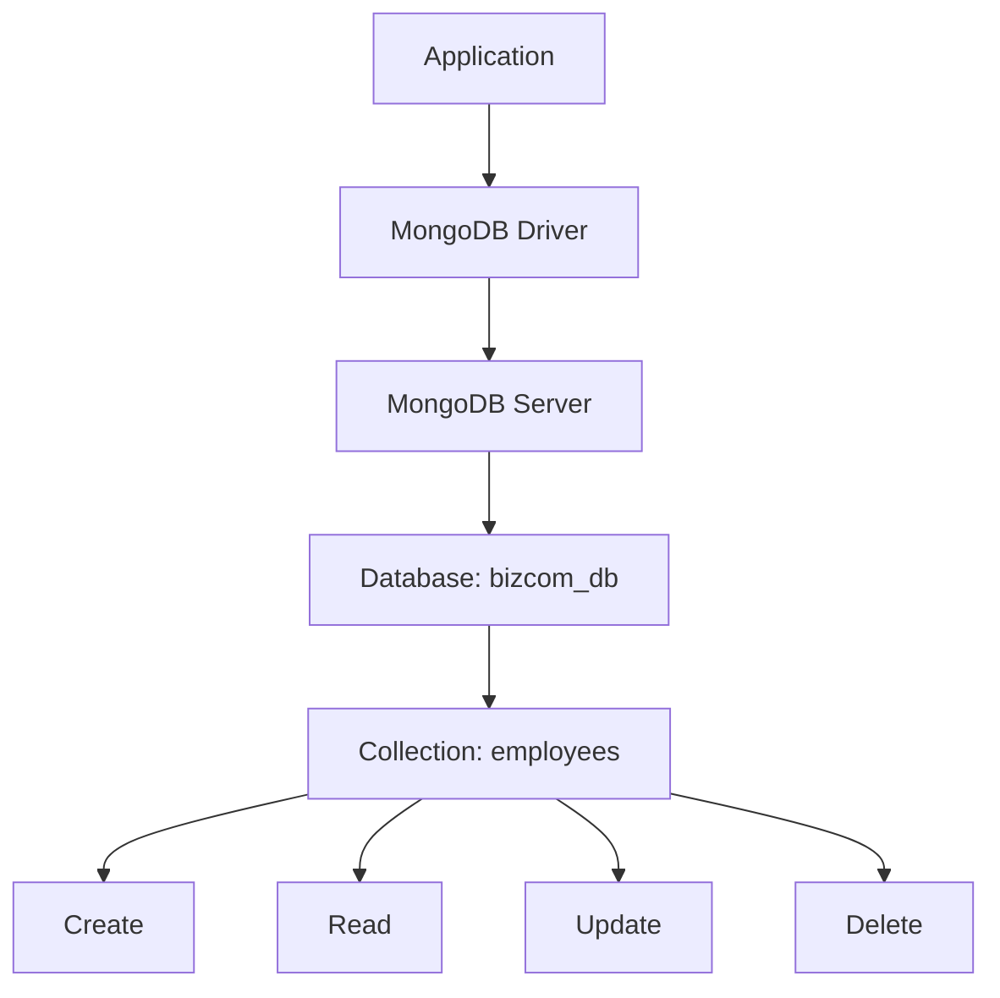
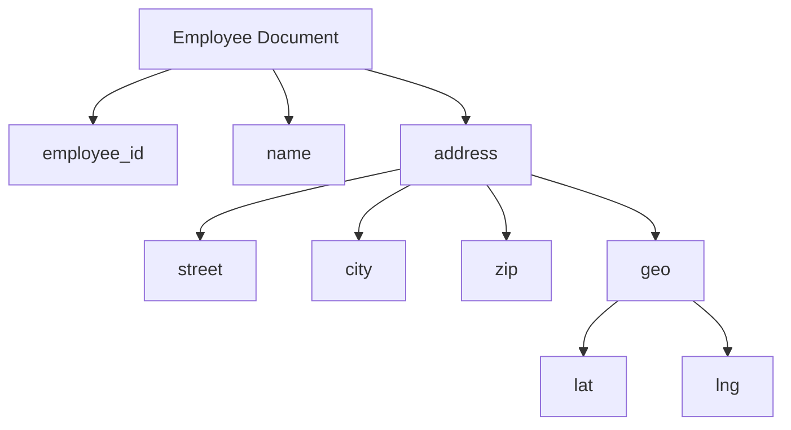
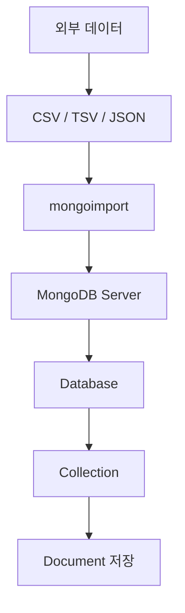
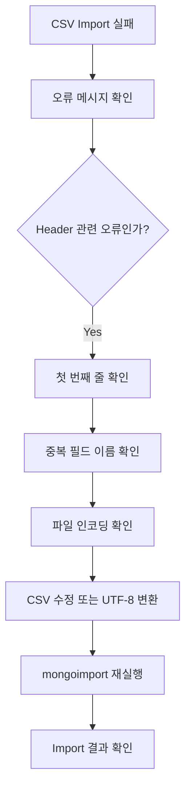
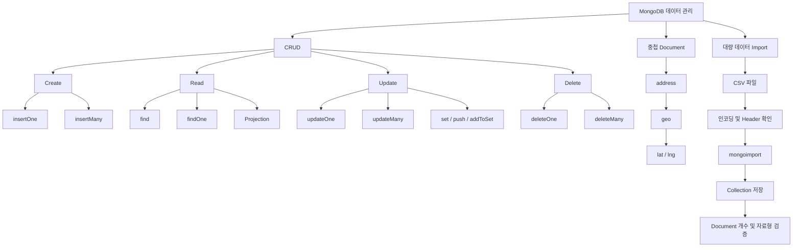

# MongoDB, CRUD 활용

# MongoDB, CRUD 활용

* toc
{:toc}

---

## MongoDB CRUD 활용: Document 생성·조회·수정·삭제부터 대량 CSV 데이터 Import까지

MongoDB는 Document 기반의 NoSQL 데이터베이스로, JSON과 유사한 구조를 이용하여 데이터를 저장하고 관리한다.

MongoDB에서 데이터를 다루기 위해 가장 먼저 이해해야 하는 개념은 **CRUD(Create, Read, Update, Delete)** 다.

CRUD는 데이터베이스에서 수행하는 네 가지 핵심 작업을 의미한다.

- **Create:** 새로운 데이터를 생성한다.
- **Read:** 저장된 데이터를 조회한다.
- **Update:** 기존 데이터를 수정한다.
- **Delete:** 더 이상 필요하지 않은 데이터를 삭제한다.

관계형 데이터베이스에서는 `INSERT`, `SELECT`, `UPDATE`, `DELETE`와 같은 SQL 문법으로 CRUD를 수행한다.

반면 MongoDB에서는 `insertOne()`, `find()`, `updateOne()`, `deleteOne()` 등 Collection에서 제공하는 메서드를 사용한다.

예를 들어 전자상거래 시스템에서 다음과 같은 기능을 개발한다고 가정해 보자.

| 기능 | CRUD | MongoDB |
|---|---|---|
| 신규 회원 가입 | Create | `insertOne()` |
| 상품 목록 조회 | Read | `find()` |
| 사용자 정보 변경 | Update | `updateOne()` |
| 여러 상품 상태 변경 | Update | `updateMany()` |
| 회원 탈퇴 | Delete | `deleteOne()` |
| 만료된 데이터 일괄 삭제 | Delete | `deleteMany()` |

하지만 실제 서비스를 개발할 때는 단순히 CRUD 메서드만 이해해서는 부족하다.

특히 MongoDB에서는 다음과 같은 특징을 함께 고려해야 한다.

1. 하나의 Collection에 서로 다른 구조의 Document를 저장할 수 있다.
2. Document 안에 중첩 Document와 배열을 저장할 수 있다.
3. `$set`, `$push`와 같은 Update Operator를 이용하여 특정 필드만 변경할 수 있다.
4. 하나의 요청으로 여러 Document를 수정하거나 삭제할 수 있다.
5. CSV와 JSON 형태의 외부 데이터를 `mongoimport`로 가져올 수 있다.
6. 대량 데이터 Import 과정에서 인코딩, 중복 필드, 자료형 문제가 발생할 수 있다.

이번 글에서는 MongoDB의 CRUD 기본 개념부터 중첩 Document, 배열 수정, 조건부 삭제, CSV Import 및 데이터 검증까지 실제 명령어를 중심으로 자세히 살펴본다.

---

## MongoDB CRUD란?

### CRUD의 개념

CRUD는 데이터베이스에서 가장 기본적으로 수행하는 네 가지 작업을 의미한다.

| 구분 | 의미 | MongoDB 메서드 |
|---|---|---|
| Create | Document 생성 | `insertOne()`, `insertMany()` |
| Read | Document 조회 | `find()`, `findOne()` |
| Update | Document 수정 | `updateOne()`, `updateMany()` |
| Delete | Document 삭제 | `deleteOne()`, `deleteMany()` |

MongoDB는 이러한 작업을 Collection 단위로 수행한다.

예를 들어 다음과 같은 데이터 구조가 있다고 가정해 보자.

```text
MongoDB Server
    │
    └── bizcom_db
          │
          └── employees
                │
                ├── Employee 1001
                ├── Employee 1002
                ├── Employee 1003
                └── Employee 1004
```

`bizcom_db`는 Database다.

`employees`는 Collection이며, 각 직원 정보는 Document로 저장된다.

CRUD 메서드는 이러한 Collection에 저장된 Document를 대상으로 실행된다.

### MongoDB CRUD 처리 구조



애플리케이션에서 MongoDB에 요청을 전달하면 MongoDB 서버는 해당 Collection을 대상으로 데이터를 생성하거나 조회, 수정, 삭제한다.

### RDBMS와 MongoDB CRUD 비교

| 작업 | RDBMS | MongoDB |
|---|---|---|
| 데이터 생성 | `INSERT INTO` | `insertOne()`, `insertMany()` |
| 데이터 조회 | `SELECT` | `find()`, `findOne()` |
| 데이터 수정 | `UPDATE` | `updateOne()`, `updateMany()` |
| 데이터 삭제 | `DELETE` | `deleteOne()`, `deleteMany()` |
| 조건 지정 | `WHERE` | Filter Document |
| 일부 필드 변경 | `SET` | `$set` |
| 여러 조건 결합 | `AND`, `OR` | `$and`, `$or` |

예를 들어 특정 직원의 급여를 변경하는 SQL은 다음과 같다.

```sql
UPDATE employees
SET salary = 82000
WHERE employee_id = 1011;
```

MongoDB에서는 다음과 같이 작성한다.

```javascript
db.employees.updateOne(
  { employee_id: 1011 },
  { $set: { salary: 82000 } }
);
```

두 명령어는 같은 업무 목적을 가지고 있다.

하지만 MongoDB는 SQL 문자열 대신 BSON Document 형태의 조건과 변경 내용을 사용한다.

---

## MongoDB CRUD를 위한 데이터베이스 준비

이후 예제에서는 직원 관리 시스템을 기준으로 진행한다.

사용할 데이터베이스와 Collection은 다음과 같다.

```text
Database:
bizcom_db

Collection:
employees
```

직원 Document의 기본 구조는 다음과 같다.

```javascript
{
  employee_id: 1001,
  name: "Alice Kim",
  email: "alice.kim@example.com",
  department: "HR",
  join_date: ISODate("2018-03-15"),
  salary: 50000
}
```

각 필드의 의미는 다음과 같다.

| 필드 | 자료형 | 설명 |
|---|---|---|
| employee_id | Number | 직원 번호 |
| name | String | 직원 이름 |
| email | String | 이메일 |
| department | String | 소속 부서 |
| join_date | Date | 입사일 |
| salary | Number | 급여 |

### 데이터베이스 선택

MongoDB Shell에서 다음 명령어를 실행한다.

```javascript
use bizcom_db
```

현재 선택한 데이터베이스를 확인한다.

```javascript
db
```

실행 결과는 다음과 같다.

```text
bizcom_db
```

### Collection 조회

```javascript
show collections
```

이미 `employees` Collection이 존재한다면 목록에 표시된다.

전체 직원 정보를 조회한다.

```javascript
db.employees.find({})
```

Document 개수는 다음 명령어로 확인할 수 있다.

```javascript
db.employees.countDocuments({})
```

앞서 구성한 직원 10명의 데이터가 존재한다면 결과는 `10`이다.

이후 예제에서는 이 직원 데이터에 새로운 직원을 추가하고, 기존 직원의 정보를 변경한다.

단, **수정과 삭제는 실제 데이터에 누적되므로 명령어 실행 순서에 따라 조회 결과가 달라질 수 있다.**

---

## Create: MongoDB에 Document 생성하기

MongoDB에서 Document를 생성하는 대표적인 메서드는 다음 두 가지다.

- `insertOne()`
- `insertMany()`

`insertOne()`은 하나의 Document를 저장한다.

`insertMany()`는 여러 Document를 한 번에 저장한다.

### insertOne()이란?

`insertOne()`은 Collection에 새로운 Document 한 개를 추가하는 메서드다.

기본 문법은 다음과 같다.

```javascript
db.collection.insertOne(document)
```

여기서 `document`는 저장할 데이터다.

### 직원 한 명 추가하기

새로운 직원을 등록한다고 가정해 보자.

```javascript
db.employees.insertOne({
  "employee_id": 1011,
  "name": "Kevin Lee",
  "email": "kevin.lee@example.com",
  "department": "Support",
  "join_date": ISODate("2025-06-01"),
  "salary": 72000
});
```

이 명령어는 직원 번호가 1011인 Document를 저장한다.

각 필드에 저장되는 값은 다음과 같다.

| 필드 | 값 |
|---|---|
| employee_id | 1011 |
| name | Kevin Lee |
| email | kevin.lee@example.com |
| department | Support |
| join_date | 2025-06-01 |
| salary | 72000 |

### insertOne() 실행 결과

정상적으로 저장되면 다음과 유사한 결과가 반환된다.

```javascript
{
  acknowledged: true,
  insertedId: ObjectId("...")
}
```

여기서 각 항목의 의미는 다음과 같다.

**acknowledged**

```javascript
acknowledged: true
```

MongoDB가 쓰기 작업을 확인했다는 의미다.

정확한 데이터 내구성 보장 수준은 Write Concern 설정에 따라 달라질 수 있다.

**insertedId**

```javascript
insertedId: ObjectId("...")
```

새롭게 저장된 Document의 `_id` 값이다.

`_id`를 직접 지정하지 않았다면 MongoDB 드라이버 또는 서버가 식별자를 생성한다.

### 저장한 직원 조회하기

```javascript
db.employees.find({
  employee_id: 1011
});
```

결과는 다음과 유사하다.

```javascript
{
  _id: ObjectId("..."),
  employee_id: 1011,
  name: "Kevin Lee",
  email: "kevin.lee@example.com",
  department: "Support",
  join_date: ISODate("2025-06-01T00:00:00.000Z"),
  salary: 72000
}
```

부서가 Support인 직원을 검색할 수도 있다.

```javascript
db.employees.find({
  department: "Support"
});
```

이 명령어는 특정 직원 번호가 아니라 부서 조건으로 검색한다.

따라서 Support 부서에 여러 직원이 존재하면 해당 직원들이 모두 검색 대상이 된다.

---

## insertMany(): 여러 Document 생성하기

### insertMany()의 개념

`insertMany()`는 여러 Document를 한 번의 메서드 호출로 삽입할 때 사용한다.

기본 문법은 다음과 같다.

```javascript
db.collection.insertMany([
  document1,
  document2,
  document3
])
```

`insertOne()`과 달리 배열을 전달한다.

### 직원 두 명 추가하기

다음과 같이 직원 번호 1012와 1013인 직원을 추가한다.

```javascript
db.employees.insertMany([
  {
    "employee_id": 1012,
    "name": "Lisa Kim",
    "email": "lisa.kim@example.com",
    "department": "HR",
    "join_date": ISODate("2022-03-10"),
    "salary": 51000
  },
  {
    "employee_id": 1013,
    "name": "Mark Lee",
    "email": "mark.lee@example.com",
    "department": "Finance",
    "join_date": ISODate("2020-09-25"),
    "salary": 53000
  }
]);
```

정상적으로 실행되면 두 개의 Document가 저장된다.

### insertMany() 실행 결과

```javascript
{
  acknowledged: true,
  insertedIds: {
    "0": ObjectId("..."),
    "1": ObjectId("...")
  }
}
```

`insertOne()`은 `insertedId`를 반환한다.

반면 `insertMany()`는 여러 Document의 식별자를 `insertedIds`로 반환한다.

### 추가한 직원 조회하기

직원 번호가 1012 또는 1013인 직원을 검색한다.

```javascript
db.employees.find({
  employee_id: {
    $in: [1012, 1013]
  }
});
```

`$in`은 지정한 값 중 하나에 해당하는 Document를 검색하는 연산자다.

SQL로 표현하면 다음과 같다.

```sql
SELECT *
FROM employees
WHERE employee_id IN (1012, 1013);
```

### insertOne()과 insertMany() 비교

| 항목 | insertOne() | insertMany() |
|---|---|---|
| 처리 대상 | Document 한 개 | Document 여러 개 |
| 입력값 | Document | Document 배열 |
| 주요 반환값 | insertedId | insertedIds |
| 활용 사례 | 사용자 한 명 등록 | 데이터 일괄 등록 |
| 원자성 범위 | 단일 Document | 각 Document의 쓰기가 원자적 |

여기서 주의해야 할 부분은 원자성이다.

`insertMany()`를 사용한다고 여러 Document가 반드시 하나의 트랜잭션으로 저장되는 것은 아니다.

기본적으로 `insertMany()`는 순서대로 삽입을 시도하지만, 중간에 오류가 발생하면 이미 저장된 Document가 남아 있을 수 있다.

모든 Document의 저장 성공과 실패를 하나의 단위로 보장해야 한다면 트랜잭션을 별도로 고려해야 한다.

---

## Create 작업에서 주의할 점: 중복 직원 번호

MongoDB에서는 기본적으로 `_id`의 유일성을 보장한다.

하지만 `employee_id`처럼 애플리케이션에서 정의한 필드는 별도의 Unique Index가 없다면 중복될 수 있다.

예를 들어 다음 Document가 이미 존재한다고 가정해 보자.

```javascript
{
  employee_id: 1001,
  name: "Alice Kim",
  department: "HR"
}
```

이 상태에서 다음 명령어를 실행하면 어떻게 될까?

```javascript
db.employees.insertOne({
  employee_id: 1001,
  name: "Alice Kim",
  department: "HR"
});
```

`employee_id`에 Unique Index가 없다면 새로운 `_id`를 가진 Document가 추가될 수 있다.

결과적으로 같은 직원 번호를 가진 Document가 두 개 존재하게 된다.

```text
employees
    │
    ├── Document A
    │      ├── _id: ObjectId("...")
    │      └── employee_id: 1001
    │
    └── Document B
           ├── _id: ObjectId("...")
           └── employee_id: 1001
```

이러한 중복은 업무적으로 문제가 될 수 있다.

예를 들어 다음 명령어를 실행하면 두 Document가 모두 조회될 수 있다.

```javascript
db.employees.find({
  employee_id: 1001
});
```

반면 `employee_id`에 Unique Index가 존재한다면 중복 삽입은 오류로 처리된다.

```javascript
db.employees.createIndex(
  { employee_id: 1 },
  { unique: true }
);
```

직원 번호처럼 중복을 허용하지 않는 업무 식별자는 Unique Index로 관리하는 것이 좋다.

기존에 중복된 값이 존재한다면 먼저 데이터를 정리해야 인덱스를 생성할 수 있다.

---

## MongoDB 중첩 Document 이해하기

MongoDB의 대표적인 특징 중 하나는 Document 내부에 또 다른 Document를 저장할 수 있다는 것이다.

이를 **Embedded Document 또는 중첩 Document**라고 한다.

예를 들어 사용자 주소를 저장한다고 가정해 보자.

관계형 데이터베이스에서는 사용자 테이블과 주소 테이블을 분리할 수 있다.

```text
users
    │
    └── user_id

addresses
    │
    ├── user_id
    ├── street
    ├── city
    └── zip
```

MongoDB에서는 주소 정보를 사용자 Document 내부에 포함할 수 있다.

```javascript
{
  name: "Alice Kim",
  address: {
    street: "123 Main St",
    city: "Seoul",
    zip: "12345"
  }
}
```

이 구조에서는 사용자 정보와 주소 정보를 하나의 Document로 표현한다.

### 중첩 Document의 구조



`address`는 하나의 문자열이 아니라 Document다.

그 안에 `geo`라는 또 다른 Document가 존재할 수도 있다.

이처럼 MongoDB는 여러 단계의 계층적인 데이터 구조를 표현할 수 있다.

---

## address와 geo를 포함한 중첩 Document 생성하기

직원 정보에 주소와 위치 정보를 추가한다고 가정해 보자.

다음 명령어는 주소 정보를 포함한 새로운 Document를 저장한다.

```javascript
db.employees.insertOne({
  "employee_id": 1001,
  "name": "Alice Kim",
  "email": "alice.kim@example.com",
  "department": "HR",
  "join_date": ISODate("2018-03-15"),
  "salary": 50000,
  "address": {
    "street": "123 Main St",
    "city": "Seoul",
    "zip": "12345",
    "geo": {
      "lat": 37.5665,
      "lng": 126.9780
    }
  }
});
```

각 계층의 역할을 살펴보자.

### address

```javascript
"address": {
  "street": "123 Main St",
  "city": "Seoul",
  "zip": "12345",
  "geo": {
    "lat": 37.5665,
    "lng": 126.9780
  }
}
```

주소 정보를 하나의 중첩 Document로 표현한다.

### geo

```javascript
"geo": {
  "lat": 37.5665,
  "lng": 126.9780
}
```

위치 정보를 표현한다.

각 필드의 의미는 다음과 같다.

| 필드 | 의미 |
|---|---|
| lat | 위도(Latitude) |
| lng | 경도(Longitude) |

이 예제에서는 서울의 특정 위치를 나타내는 위도와 경도 값을 사용한다.

다만 `lat`, `lng`로 구성한 객체가 곧바로 GeoJSON Point와 동일한 구조인 것은 아니다.

MongoDB의 지리 공간 검색 기능을 활용하려면 요구사항에 맞는 GeoJSON 구조와 공간 인덱스를 검토해야 한다.

### 이미 존재하는 직원에 주소를 추가하려면?

앞에서 직원 번호 1001인 Document가 이미 존재한다고 가정했다.

그렇다면 새로운 Document를 삽입하는 것보다 기존 Document에 주소를 추가하는 것이 적절할 수 있다.

다음과 같이 `updateOne()`을 사용할 수 있다.

```javascript
db.employees.updateOne(
  {
    employee_id: 1001
  },
  {
    $set: {
      address: {
        street: "123 Main St",
        city: "Seoul",
        zip: "12345",
        geo: {
          lat: 37.5665,
          lng: 126.9780
        }
      }
    }
  }
);
```

이 방식은 기존 직원 Document에 주소 정보를 추가하거나 변경한다.

중복 직원 번호를 가진 Document를 새로 생성하지 않는다는 차이가 있다.

다만 이미 중복된 직원 번호가 존재한다면 `updateOne()`은 조건에 일치하는 Document 중 하나만 변경한다.

따라서 업무 식별자의 유일성을 보장하는 것이 중요하다.

---

## 중첩 Document를 조회하는 Dot Notation

### Dot Notation이란?

MongoDB에서는 중첩 Document의 특정 필드에 접근할 때 **Dot Notation(점 표기법)** 을 사용한다.

예를 들어 다음과 같은 구조가 있다고 가정해 보자.

```javascript
{
  address: {
    city: "Seoul",
    geo: {
      lat: 37.5665,
      lng: 126.9780
    }
  }
}
```

도시를 조회하려면 다음 필드 경로를 사용한다.

```text
address.city
```

위도를 조회하려면 다음과 같이 작성한다.

```text
address.geo.lat
```

중첩 Document의 계층을 점으로 연결하여 표현하는 방식이다.

### 서울에 거주하는 직원 조회

```javascript
db.employees.find({
  "address.city": "Seoul"
});
```

이 명령어는 `address` 내부의 `city`가 `"Seoul"`인 Document를 검색한다.

여기서 중요한 부분은 필드 이름을 문자열로 작성한다는 것이다.

```javascript
"address.city"
```

`address.city`는 최상위 필드 이름이 아니라 중첩 필드에 접근하기 위한 경로다.

### 위도가 37보다 큰 직원 조회

```javascript
db.employees.find({
  "address.geo.lat": {
    $gt: 37
  }
});
```

이 명령어는 다음 조건을 의미한다.

```text
address
    └── geo
         └── lat > 37
```

`$gt`는 Greater Than을 의미한다.

따라서 위도가 37보다 큰 Document를 검색한다.

### 중첩 필드 조회 결과

```javascript
{
  _id: ObjectId("..."),
  employee_id: 1001,
  name: "Alice Kim",
  email: "alice.kim@example.com",
  department: "HR",
  join_date: ISODate("2018-03-15T00:00:00.000Z"),
  salary: 50000,
  address: {
    street: "123 Main St",
    city: "Seoul",
    zip: "12345",
    geo: {
      lat: 37.5665,
      lng: 126.978
    }
  }
}
```

### 필요한 중첩 필드만 반환하기

Projection을 사용하면 필요한 필드만 반환할 수 있다.

```javascript
db.employees.find(
  {
    "address.city": "Seoul"
  },
  {
    _id: 0,
    name: 1,
    "address.city": 1,
    "address.geo.lat": 1
  }
);
```

결과는 다음과 유사하다.

```javascript
{
  name: "Alice Kim",
  address: {
    city: "Seoul",
    geo: {
      lat: 37.5665
    }
  }
}
```

### 중첩 Document의 장점

중첩 Document는 다음과 같은 장점이 있다.

| 장점 | 설명 |
|---|---|
| 계층적 표현 | 데이터의 포함 관계를 자연스럽게 표현 |
| 조회 편의성 | 관련 데이터를 하나의 Document에서 조회 |
| 데이터 응집성 | 함께 사용하는 정보를 묶어서 관리 |
| 단일 Document 원자성 | 관련 필드를 하나의 원자적 작업으로 변경 가능 |

하지만 중첩 Document가 항상 좋은 것은 아니다.

주소 정보가 독립적으로 관리되거나 여러 사용자 사이에서 공유되는 경우에는 별도 Collection으로 분리하는 것이 적절할 수 있다.

또한 중첩 배열이 계속 증가하는 구조라면 Document 크기와 수정 비용을 고려해야 한다.

---

## Update: MongoDB Document 수정하기

MongoDB에서 Document를 수정하는 대표적인 메서드는 다음과 같다.

- `updateOne()`
- `updateMany()`

두 메서드의 차이는 수정 대상의 개수다.

| 메서드 | 수정 대상 |
|---|---|
| updateOne() | 조건에 일치하는 Document 한 개 |
| updateMany() | 조건에 일치하는 모든 Document |

업데이트 메서드는 일반적으로 다음과 같은 구조를 가진다.

```javascript
db.collection.updateOne(
  filter,
  update,
  options
)
```

여기서 각 인수의 의미는 다음과 같다.

| 인수 | 설명 |
|---|---|
| filter | 수정 대상 검색 조건 |
| update | 변경할 내용 |
| options | 추가 옵션 |

---

## updateOne()으로 직원 급여 수정하기

직원 번호가 1011인 Kevin Lee의 급여를 변경한다고 가정해 보자.

현재 급여는 다음과 같다.

```text
72,000
```

변경할 급여는 다음과 같다.

```text
82,000
```

### 1. 변경 전 데이터 확인

```javascript
db.employees.find({
  employee_id: 1011
});
```

결과에서 다음 필드를 확인한다.

```javascript
{
  employee_id: 1011,
  name: "Kevin Lee",
  salary: 72000
}
```

### 2. updateOne() 실행

```javascript
db.employees.updateOne(
  { employee_id: 1011 },
  { $set: { salary: 82000 } }
);
```

이 명령어는 직원 번호가 1011인 Document를 검색한다.

그다음 `$set`을 이용하여 `salary` 값을 82000으로 변경한다.

### 3. 실행 결과 확인

정상적으로 수정되면 다음과 유사한 결과가 반환된다.

```javascript
{
  acknowledged: true,
  matchedCount: 1,
  modifiedCount: 1,
  upsertedCount: 0
}
```

주요 항목은 다음과 같다.

| 항목 | 의미 |
|---|---|
| acknowledged | 쓰기 작업 확인 여부 |
| matchedCount | 검색 조건에 일치한 Document 수 |
| modifiedCount | 실제로 수정된 Document 수 |
| upsertedCount | Upsert로 생성된 Document 수 |

여기서 `matchedCount`와 `modifiedCount`는 서로 다를 수 있다.

예를 들어 이미 급여가 82000인 Document에 동일한 값을 다시 설정했다고 가정해 보자.

```javascript
db.employees.updateOne(
  { employee_id: 1011 },
  { $set: { salary: 82000 } }
);
```

검색 조건에는 일치하지만 실제 데이터가 달라지지 않으면 다음과 같은 결과를 확인할 수 있다.

```javascript
{
  matchedCount: 1,
  modifiedCount: 0
}
```

따라서 `matchedCount`가 1이라고 해서 반드시 데이터가 변경되었다는 의미는 아니다.

### 4. 변경 후 데이터 조회

```javascript
db.employees.find({
  employee_id: 1011
});
```

급여가 82000으로 변경되었는지 확인한다.

---

## $set 연산자 이해하기

`$set`은 MongoDB에서 특정 필드의 값을 변경하거나 새로운 필드를 추가하는 Update Operator다.

예를 들어 다음과 같이 여러 필드를 동시에 수정할 수 있다.

```javascript
db.employees.updateOne(
  {
    employee_id: 1011
  },
  {
    $set: {
      salary: 82000,
      department: "Support",
      updated_at: new Date()
    }
  }
);
```

이 명령어는 다음 필드를 변경한다.

- `salary`
- `department`
- `updated_at`

`updated_at`이 기존에 존재하지 않는 필드라면 새로 추가된다.

### 중첩 Document의 일부 필드만 수정

다음과 같은 주소 정보가 있다고 가정해 보자.

```javascript
{
  address: {
    street: "123 Main St",
    city: "Seoul",
    zip: "12345"
  }
}
```

도시만 변경하고 싶다면 Dot Notation을 활용할 수 있다.

```javascript
db.employees.updateOne(
  {
    employee_id: 1001
  },
  {
    $set: {
      "address.city": "Busan"
    }
  }
);
```

이 명령어는 `address.city`만 변경한다.

기존의 `street`, `zip` 필드는 그대로 유지된다.

반면 다음과 같이 작성하면 결과가 달라질 수 있다.

```javascript
db.employees.updateOne(
  {
    employee_id: 1001
  },
  {
    $set: {
      address: {
        city: "Busan"
      }
    }
  }
);
```

이 경우 기존 `address` Document 전체를 새로운 객체로 설정한다.

따라서 기존의 `street`, `zip`, `geo` 필드가 제거될 수 있다.

**중첩 Document를 수정할 때는 부모 필드 전체를 변경하는 것인지, 특정 하위 필드만 변경하는 것인지 구분해야 한다.**

MongoDB의 `$set`은 존재하지 않는 필드를 추가할 수도 있으며, 경로가 없는 경우 필요한 중첩 Document를 생성할 수 있다. 단, 기존 경로에 호환되지 않는 자료형이 존재하면 오류가 발생할 수 있다. [MongoDB](https://www.mongodb.com/docs/v8.0/reference/operator/update/set/?utm_source=chatgpt.com)

---

## updateMany()로 여러 Document 수정하기

### updateMany()란?

`updateMany()`는 검색 조건에 일치하는 모든 Document를 수정하는 메서드다.

예를 들어 Marketing 부서의 이름을 Sales로 변경한다고 가정해 보자.

### 1. 변경 대상 조회

```javascript
db.employees.find({
  department: "Marketing"
});
```

기존 직원 데이터에서는 Marketing 부서에 속하는 직원이 다음과 같이 존재할 수 있다.

| 직원 번호 | 이름 | 부서 |
|---|---|---|
| 1004 | David Choi | Marketing |
| 1010 | Jane Choi | Marketing |

다만 이전에 부서를 수정한 이력이 있다면 실제 결과는 달라진다.

### 2. 부서 일괄 변경

```javascript
db.employees.updateMany(
  { department: "Marketing" },
  { $set: { department: "Sales" } }
);
```

이 명령어는 Marketing 부서에 속하는 모든 Document를 검색한다.

이후 해당 Document들의 부서를 Sales로 변경한다.

### 3. 변경 결과 확인

```javascript
db.employees.find({
  department: "Sales"
});
```

이제 Marketing에서 Sales로 변경된 직원들도 검색 대상에 포함된다.

### updateOne()과 updateMany() 비교

| 구분 | updateOne() | updateMany() |
|---|---|---|
| 수정 대상 | 한 개 | 여러 개 |
| 검색 조건 | Filter | Filter |
| Update Operator | 사용 가능 | 사용 가능 |
| 단일 Document 원자성 | 보장 | 각 Document별 보장 |
| 전체 작업 원자성 | 단일 Document 범위 | 여러 Document 전체는 보장되지 않음 |

여기서 중요한 점은 `updateMany()`의 원자성이다.

MongoDB는 각 Document에 대한 변경을 원자적으로 처리한다.

하지만 여러 Document를 대상으로 하는 `updateMany()` 전체가 하나의 원자적 작업으로 처리되는 것은 아니다.

예를 들어 100개의 Document 중 일부를 수정한 뒤 오류가 발생하면 이전에 수정한 Document는 그대로 남아 있을 수 있다.

여러 Document의 변경을 하나의 작업 단위로 보장해야 한다면 트랜잭션을 검토해야 한다. [MongoDB](https://www.mongodb.com/docs/manual/reference/method/db.collection.updatemany/?utm_source=chatgpt.com)

---

## $or를 이용하여 여러 조건의 Document 수정하기

MongoDB에서는 `$or`를 이용하여 여러 조건 중 하나 이상을 만족하는 Document를 검색할 수 있다.

예를 들어 다음 조건을 가진 직원을 수정한다고 가정해 보자.

1. 부서가 Support인 직원
2. 급여가 52000 이상인 직원

두 조건 중 하나라도 만족하면 부서를 Customer Service로 변경한다.

### $or 조건으로 updateMany()

```javascript
db.employees.updateMany(
  {
    $or: [
      { department: "Support" },
      { salary: { $gte: 52000 } }
    ]
  },
  {
    $set: {
      department: "Customer Service"
    }
  }
);
```

이 명령어의 검색 조건은 다음과 같다.

```text
department = "Support"

OR

salary >= 52000
```

따라서 Support 부서에 속하거나 급여가 52000 이상인 모든 직원이 수정 대상이 된다.

### 조건 해석

예를 들어 다음 직원들이 존재한다고 가정해 보자.

| 직원 | 부서 | 급여 | 변경 대상 |
|---|---|---:|---|
| A | Support | 45000 | O |
| B | Finance | 55000 | O |
| C | HR | 49000 | X |
| D | IT | 53000 | O |
| E | Sales | 50000 | X |

직원 A는 급여가 52000보다 작지만 부서가 Support이므로 변경된다.

직원 B는 Support 부서가 아니지만 급여가 52000 이상이므로 변경된다.

직원 C는 두 조건 모두 만족하지 않으므로 변경되지 않는다.

### 수정 결과 조회

```javascript
db.employees.find({
  department: "Customer Service"
});
```

변경된 직원 정보를 확인할 수 있다.

### $or 조건 사용 시 주의할 점

`$or`는 조건 중 하나만 만족해도 검색 결과에 포함된다.

따라서 조건의 범위가 예상보다 넓어질 수 있다.

특히 `updateMany()`와 함께 사용하는 경우 잘못된 조건으로 많은 Document를 수정할 수 있다.

운영 환경에서는 수정 전에 동일한 Filter로 검색 대상부터 확인하는 것이 좋다.

```javascript
db.employees.find({
  $or: [
    { department: "Support" },
    { salary: { $gte: 52000 } }
  ]
});
```

대상 Document 수를 확인할 수도 있다.

```javascript
db.employees.countDocuments({
  $or: [
    { department: "Support" },
    { salary: { $gte: 52000 } }
  ]
});
```

이후 수정 대상이 예상한 범위와 일치하는지 확인하고 `updateMany()`를 실행하는 것이 안전하다.

---

## 필드가 없거나 null인 Document 수정하기

MongoDB에서는 같은 Collection 안에서도 Document마다 서로 다른 필드를 가질 수 있다.

예를 들어 다음 두 직원 정보를 생각해 보자.

### address 필드가 없는 Document

```javascript
{
  employee_id: 1002,
  name: "Bob Lee"
}
```

### address 필드가 null인 Document

```javascript
{
  employee_id: 1003,
  name: "Charlie Park",
  address: null
}
```

첫 번째 Document는 `address` 필드 자체가 없다.

두 번째 Document는 `address` 필드가 있지만 값이 `null`이다.

이러한 Document에 기본 주소 정보를 설정해야 할 수 있다.

### $exists와 null 조건 사용

```javascript
db.employees.updateMany(
  {
    $or: [
      { address: { $exists: false } },
      { address: null }
    ]
  },
  {
    $set: {
      address: "Not Provided"
    }
  }
);
```

이 명령어는 `address`가 없거나 `null`인 Document를 검색한다.

그리고 해당 필드에 `"Not Provided"` 문자열을 저장한다.

### $exists의 의미

```javascript
{
  address: {
    $exists: false
  }
}
```

`address` 필드가 존재하지 않는 Document를 검색한다.

반대로 다음 조건은 필드가 존재하는 Document를 검색한다.

```javascript
{
  address: {
    $exists: true
  }
}
```

이때 `address: null`도 필드가 존재하는 상태이므로 `$exists: true`에 일치한다.

### null 조건의 의미

```javascript
{
  address: null
}
```

MongoDB에서는 이 조건이 일반적으로 다음 두 경우에 일치한다.

1. `address`가 명시적으로 `null`인 경우
2. `address` 필드가 존재하지 않는 경우

따라서 앞의 `$or` 조건에서 `{ address: null }`은 이미 필드가 없는 Document까지 포함한다.

즉, 기본적인 MongoDB 문서 구조에서는 다음처럼 간단하게 작성해도 비슷한 검색 결과를 얻을 수 있다.

```javascript
db.employees.updateMany(
  {
    address: null
  },
  {
    $set: {
      address: "Not Provided"
    }
  }
);
```

다만 레거시 BSON `undefined` 값과 관련된 동작은 MongoDB 버전에 따라 차이가 있다. MongoDB 8.0부터 `null` 동등 비교는 `undefined` 값과 더 이상 일치하지 않는다. [MongoDB](https://www.mongodb.com/docs/manual/reference/bson-types/migrate-undefined/?utm_source=chatgpt.com)

---

## address를 문자열로 변경할 때 발생하는 문제

앞에서는 `address`를 중첩 Document로 표현했다.

```javascript
{
  address: {
    street: "123 Main St",
    city: "Seoul",
    zip: "12345",
    geo: {
      lat: 37.5665,
      lng: 126.9780
    }
  }
}
```

그런데 주소가 없는 직원에게 다음과 같이 저장했다.

```javascript
{
  address: "Not Provided"
}
```

두 Document의 `address` 자료형이 다르다.

| Document | address 자료형 |
|---|---|
| 실제 주소가 있는 직원 | Object |
| 주소가 없는 직원 | String |

MongoDB에서는 이러한 구조를 저장할 수 있다.

하지만 애플리케이션에서 `address.city`를 조회하거나 수정해야 한다면 문제가 발생할 수 있다.

예를 들어 다음과 같은 조회를 생각해 보자.

```javascript
db.employees.find({
  "address.city": "Seoul"
});
```

`address`가 문자열인 Document에는 `city`라는 중첩 필드가 존재하지 않는다.

또한 문자열을 가진 `address`에 다음과 같이 하위 필드를 추가하려고 하면 자료형 충돌로 오류가 발생할 수 있다.

```javascript
db.employees.updateOne(
  {
    employee_id: 1002
  },
  {
    $set: {
      "address.city": "Seoul"
    }
  }
);
```

따라서 실무에서는 같은 의미의 필드에 여러 자료형이 혼재하지 않도록 설계하는 것이 좋다.

### 대안: 동일한 Document 구조 유지

주소가 없는 경우에도 다음과 같이 Object 형태를 유지할 수 있다.

```javascript
{
  address: {
    status: "Not Provided"
  }
}
```

이를 적용하려면 다음과 같이 작성할 수 있다.

```javascript
db.employees.updateMany(
  {
    address: null
  },
  {
    $set: {
      address: {
        status: "Not Provided"
      }
    }
  }
);
```

이 방식은 `address`를 문자열 대신 중첩 Document로 유지한다.

또는 주소의 부재를 `null`로 표현하고, 별도의 상태 필드를 관리할 수도 있다.

```javascript
{
  address: null,
  address_status: "Not Provided"
}
```

어떤 방식이 적절한지는 애플리케이션의 데이터 모델과 조회 요구사항에 따라 결정해야 한다.

**MongoDB의 유연한 스키마는 서로 다른 자료형을 저장할 수 있다는 의미지만, 실무에서는 자료형의 일관성을 유지하는 것이 중요하다.**

---

## MongoDB 배열 수정: $push 연산자

MongoDB에서는 배열 필드에 새로운 값을 추가하기 위해 `$push`를 사용할 수 있다.

예를 들어 직원마다 보유 기술이나 역량을 배열로 관리한다고 가정해 보자.

```javascript
{
  employee_id: 1001,
  name: "Alice Kim",
  skills: [
    "Java",
    "Spring Boot"
  ]
}
```

이 직원에게 새로운 역량을 추가하고 싶다면 `$push`를 사용할 수 있다.

### $push 기본 문법

```javascript
db.collection.updateOne(
  filter,
  {
    $push: {
      field: value
    }
  }
)
```

### 여러 직원의 skills 배열에 값 추가

직원 번호가 1001 또는 1002인 직원에게 `Team Leadership`을 추가한다.

```javascript
db.employees.updateMany(
  {
    employee_id: {
      $in: [1001, 1002]
    }
  },
  {
    $push: {
      skills: "Team Leadership"
    }
  }
);
```

이 명령어는 다음 순서로 동작한다.

1. `employee_id`가 1001 또는 1002인 Document를 검색한다.
2. 각 Document의 `skills` 배열을 확인한다.
3. 배열 끝에 `"Team Leadership"`을 추가한다.

### 변경 결과 조회

```javascript
db.employees.find({
  employee_id: {
    $in: [1001, 1002]
  }
});
```

기존에 `skills` 배열이 없었던 Document라면 다음과 같은 필드가 생성될 수 있다.

```javascript
{
  employee_id: 1001,
  skills: [
    "Team Leadership"
  ]
}
```

### skills 필드가 존재하지 않으면?

MongoDB의 `$push`는 대상 배열 필드가 존재하지 않는 경우 새로운 배열을 생성하고 값을 추가할 수 있다.

하지만 필드가 배열이 아닌 다른 자료형이면 작업이 실패한다.

예를 들어 다음과 같은 Document가 있다고 가정해 보자.

```javascript
{
  employee_id: 1001,
  skills: "Java"
}
```

이때 다음 명령어를 실행하면 정상적으로 배열에 추가할 수 없다.

```javascript
db.employees.updateOne(
  {
    employee_id: 1001
  },
  {
    $push: {
      skills: "Spring Boot"
    }
  }
);
```

`skills`가 배열이 아니라 문자열이기 때문이다. [MongoDB](https://www.mongodb.com/ko-kr/docs/manual/reference/operator/update/push/?utm_source=chatgpt.com)

---

## $push는 중복을 허용할까?

`$push`는 배열에 값을 추가할 때 기존 값의 중복 여부를 검사하지 않는다.

예를 들어 다음 Document가 있다고 가정해 보자.

```javascript
{
  employee_id: 1001,
  skills: [
    "Java"
  ]
}
```

다음 명령어를 실행한다.

```javascript
db.employees.updateOne(
  {
    employee_id: 1001
  },
  {
    $push: {
      skills: "Team Leadership"
    }
  }
);
```

결과는 다음과 같다.

```javascript
{
  skills: [
    "Java",
    "Team Leadership"
  ]
}
```

같은 명령어를 다시 실행하면 어떻게 될까?

```javascript
{
  skills: [
    "Java",
    "Team Leadership",
    "Team Leadership"
  ]
}
```

동일한 값이 중복 저장될 수 있다.

### 중복을 방지하려면 $addToSet 사용

배열에 동일한 값이 존재하지 않을 때만 추가하려면 `$addToSet`을 사용할 수 있다.

```javascript
db.employees.updateOne(
  {
    employee_id: 1001
  },
  {
    $addToSet: {
      skills: "Team Leadership"
    }
  }
);
```

`$addToSet`은 배열에 동일한 값이 없다면 추가한다.

이미 존재한다면 중복 추가하지 않는다.

### $push와 $addToSet 비교

| 구분 | $push | $addToSet |
|---|---|---|
| 배열 값 추가 | 가능 | 가능 |
| 중복 값 허용 | 허용 | 동일한 값 중복 추가 방지 |
| 기존 배열 유지 | 유지 | 유지 |
| 주요 활용 | 이벤트 목록, 순서가 있는 데이터 | 태그, 중복 없는 값 목록 |

### 여러 값을 한 번에 추가하려면?

`$push`와 `$each`를 조합할 수 있다.

```javascript
db.employees.updateOne(
  {
    employee_id: 1001
  },
  {
    $push: {
      skills: {
        $each: [
          "Java",
          "Spring Boot",
          "MongoDB"
        ]
      }
    }
  }
);
```

이 명령어는 세 개의 문자열을 배열 요소로 추가한다.

반면 다음과 같이 작성하면 배열 자체가 하나의 요소로 추가될 수 있다.

```javascript
db.employees.updateOne(
  {
    employee_id: 1001
  },
  {
    $push: {
      skills: [
        "Java",
        "Spring Boot",
        "MongoDB"
      ]
    }
  }
);
```

따라서 배열에 여러 값을 개별적으로 추가할 때는 `$each`의 역할을 이해해야 한다.

---

## Delete: MongoDB Document 삭제하기

MongoDB에서 Document를 삭제하는 대표적인 메서드는 다음과 같다.

- `deleteOne()`
- `deleteMany()`

두 메서드의 차이는 삭제할 Document의 개수다.

| 메서드 | 삭제 대상 |
|---|---|
| deleteOne() | 조건에 일치하는 Document 한 개 |
| deleteMany() | 조건에 일치하는 모든 Document |

삭제 작업은 데이터에 직접적인 영향을 주므로 검색 조건을 정확하게 작성해야 한다.

---

## deleteOne()으로 Document 한 개 삭제하기

직원 번호가 1004인 직원을 삭제한다고 가정해 보자.

### 1. 삭제 대상 확인

```javascript
db.employees.find({
  employee_id: 1004
});
```

### 2. Document 삭제

```javascript
db.employees.deleteOne({
  employee_id: 1004
});
```

정상적으로 삭제되면 다음과 유사한 결과를 반환한다.

```javascript
{
  acknowledged: true,
  deletedCount: 1
}
```

`deletedCount`는 실제 삭제된 Document 수를 의미한다.

### 3. 삭제 결과 확인

```javascript
db.employees.find({
  employee_id: 1004
});
```

정상적으로 삭제되었다면 해당 직원이 더 이상 조회되지 않는다.

### deleteOne()의 주의사항

`deleteOne()`은 조건에 일치하는 Document 한 개만 삭제한다.

따라서 직원 번호가 1004인 Document가 여러 개 존재한다면 한 개만 삭제될 수 있다.

이러한 문제가 발생하지 않도록 업무 식별자의 유일성을 보장하는 것이 중요하다.

---

## deleteMany()로 여러 Document 삭제하기

`deleteMany()`는 검색 조건에 일치하는 모든 Document를 삭제한다.

### IT 부서 직원 삭제

먼저 IT 부서 직원을 조회한다.

```javascript
db.employees.find({
  department: "IT"
});
```

삭제 대상이 적절하다면 다음 명령어를 실행한다.

```javascript
db.employees.deleteMany({
  department: "IT"
});
```

이 명령어는 IT 부서에 속한 모든 Document를 삭제한다.

### 삭제 결과 확인

```javascript
db.employees.find({
  department: "IT"
});
```

IT 부서의 Document가 모두 삭제되었다면 조회 결과가 비어 있다.

### 실행 순서에 따른 결과 차이

앞에서 다음 명령어를 이미 실행했다고 가정해 보자.

```javascript
db.employees.updateMany(
  {
    $or: [
      { department: "Support" },
      { salary: { $gte: 52000 } }
    ]
  },
  {
    $set: {
      department: "Customer Service"
    }
  }
);
```

이 경우 급여가 52000 이상인 IT 직원은 이미 Customer Service 부서로 변경되었을 수 있다.

따라서 이후 다음 명령어를 실행해도

```javascript
db.employees.deleteMany({
  department: "IT"
});
```

변경된 직원은 삭제되지 않는다.

삭제 시점의 부서가 더 이상 IT가 아니기 때문이다.

이처럼 **수정과 삭제 명령어는 실행 순서에 따라 결과가 달라진다.**

---

## 급여 조건으로 여러 Document 삭제하기

이번에는 급여가 48000 이하인 직원을 삭제한다고 가정해 보자.

```javascript
db.employees.deleteMany({
  salary: {
    $lte: 48000
  }
});
```

`$lte`는 Less Than or Equal을 의미한다.

따라서 다음 조건에 일치하는 Document를 삭제한다.

```text
salary <= 48000
```

다만 실제 삭제 대상은 앞서 수행한 수정과 삭제 작업의 결과에 따라 달라진다.

### 삭제 전 대상 확인

운영 환경에서는 다음과 같이 삭제 대상부터 조회하는 것이 좋다.

```javascript
db.employees.find({
  salary: {
    $lte: 48000
  }
});
```

삭제 대상 건수도 확인할 수 있다.

```javascript
db.employees.countDocuments({
  salary: {
    $lte: 48000
  }
});
```

조건이 정확한지 확인한 뒤 삭제를 실행한다.

```javascript
db.employees.deleteMany({
  salary: {
    $lte: 48000
  }
});
```

### deleteMany({})를 실행하면?

다음 명령어는 주의해야 한다.

```javascript
db.employees.deleteMany({})
```

빈 Filter는 모든 Document와 일치한다.

따라서 `employees` Collection의 모든 Document가 삭제 대상이 된다.

하지만 Collection 자체는 남아 있다.

반면 다음 명령어는 Collection 자체를 삭제한다.

```javascript
db.employees.drop()
```

두 명령어는 삭제 범위가 다르므로 구분해야 한다.

---

## 복합 조건을 이용한 Document 검색

MongoDB에서는 여러 연산자를 조합하여 복잡한 검색 조건을 구성할 수 있다.

예를 들어 다음 요구사항이 있다고 가정해 보자.

> IT 또는 Support 부서에 속하면서 급여가 50000 이상인 직원을 조회한다.

다음과 같이 작성할 수 있다.

```javascript
db.employees.find({
  $and: [
    {
      department: {
        $in: ["IT", "Support"]
      }
    },
    {
      salary: {
        $gte: 50000
      }
    }
  ]
});
```

이 조건은 다음과 같다.

```text
department IN ("IT", "Support")

AND

salary >= 50000
```

### $and의 역할

`$and`는 지정한 조건을 모두 만족하는 Document를 검색한다.

### $in의 역할

`$in`은 지정한 값 중 하나에 일치하는 Document를 검색한다.

### $gte의 역할

`$gte`는 Greater Than or Equal을 의미한다.

즉, 크거나 같다는 조건을 표현한다.

### SQL과 비교

같은 조건을 SQL로 표현하면 다음과 같다.

```sql
SELECT *
FROM employees
WHERE department IN ('IT', 'Support')
  AND salary >= 50000;
```

MongoDB에서는 Query Operator를 조합하여 같은 목적의 검색 조건을 표현할 수 있다.

### $and를 생략할 수 있을까?

서로 다른 필드에 조건을 지정하는 단순한 경우에는 `$and`를 생략할 수 있다.

```javascript
db.employees.find({
  department: {
    $in: ["IT", "Support"]
  },
  salary: {
    $gte: 50000
  }
});
```

두 조건을 모두 만족해야 하므로 AND 관계로 처리된다.

---

## Projection으로 필요한 필드만 조회하기

MongoDB에서는 Projection을 이용하여 반환할 필드를 선택할 수 있다.

예를 들어 급여가 48000 이하인 직원의 이름과 급여만 확인한다고 가정해 보자.

```javascript
db.employees.find(
  {
    salary: {
      $lte: 48000
    }
  },
  {
    name: 1,
    salary: 1,
    _id: 0
  }
);
```

첫 번째 인수는 검색 조건이다.

```javascript
{
  salary: {
    $lte: 48000
  }
}
```

두 번째 인수는 Projection이다.

```javascript
{
  name: 1,
  salary: 1,
  _id: 0
}
```

Projection의 값은 다음과 같은 의미를 가진다.

| 값 | 의미 |
|---|---|
| 1 | 해당 필드 포함 |
| 0 | 해당 필드 제외 |

따라서 이 명령어는 `name`, `salary`만 반환한다.

### Projection을 사용하는 이유

애플리케이션에서 모든 필드가 필요한 것은 아니다.

예를 들어 직원 목록 화면에서는 이름과 부서만 필요할 수 있다.

```javascript
db.employees.find(
  {},
  {
    _id: 0,
    name: 1,
    department: 1
  }
);
```

이처럼 필요한 필드만 조회하면 불필요한 데이터 전송을 줄일 수 있다.

다만 Projection만 사용했다고 디스크 읽기 비용이 반드시 감소하는 것은 아니다.

인덱스만으로 조회를 처리할 수 있는지, 실제 Document를 읽어야 하는지에 따라 성능 효과가 달라진다.

### 삭제 후 Projection을 실행하면?

앞에서 다음 명령어를 실행했다고 가정해 보자.

```javascript
db.employees.deleteMany({
  salary: {
    $lte: 48000
  }
});
```

이후 다음 명령어를 실행한다.

```javascript
db.employees.find(
  {
    salary: {
      $lte: 48000
    }
  },
  {
    name: 1,
    salary: 1,
    _id: 0
  }
);
```

조건에 일치하는 Document를 이미 삭제했으므로 조회 결과가 없을 수 있다.

이는 Projection의 문제가 아니라 이전 삭제 작업의 결과다.

따라서 예제를 실행할 때는 현재 Collection의 데이터 상태를 함께 고려해야 한다.

---

## MongoDB에서 대량 데이터 Import가 필요한 이유

지금까지는 `insertOne()`과 `insertMany()`를 이용하여 데이터를 저장했다.

하지만 외부에서 수천 건 또는 수백만 건의 데이터를 제공받는 경우에는 어떻게 해야 할까?

예를 들어 다음과 같은 상황을 생각해 보자.

- 공공데이터 CSV를 MongoDB에 저장해야 한다.
- 기존 시스템에서 추출한 데이터를 이전해야 한다.
- 외부 서비스에서 제공한 JSON을 저장해야 한다.
- 주식 종목 정보를 일괄 등록해야 한다.
- 운영 데이터를 개발 환경에 복사해야 한다.

이때 모든 Document를 직접 `insertOne()`으로 작성하는 것은 비효율적이다.

따라서 MongoDB에서는 **`mongoimport`** 를 이용하여 외부 데이터를 가져올 수 있다.

---

## mongoimport란?

`mongoimport`는 CSV, TSV, JSON 형식의 데이터를 MongoDB Collection에 가져오기 위한 명령줄 도구다.

`mongosh`와는 역할이 다르다.

| 도구 | 역할 |
|---|---|
| mongod | MongoDB 서버 |
| mongosh | MongoDB에 접속하여 명령어 실행 |
| mongoimport | 외부 데이터를 MongoDB로 가져오기 |
| mongoexport | MongoDB 데이터를 외부 파일로 내보내기 |

`mongoimport`는 MongoDB Database Tools에 포함된다.

MongoDB 서버나 `mongosh`와 별도로 설치해야 하는 환경도 있으므로 실행 파일을 확인해야 한다.

### mongoimport 버전 확인

Windows 명령 프롬프트 또는 PowerShell에서 다음 명령어를 실행한다.

```powershell
mongoimport --version
```

정상적으로 설치되어 있고 PATH가 설정되어 있다면 버전 정보를 확인할 수 있다.

### mongoimport의 처리 흐름



외부에서 제공된 파일을 `mongoimport`가 읽고, MongoDB 서버에 Document 저장 요청을 전달한다.

---

## 주식 데이터를 MongoDB로 가져오기

이번에는 CSV 형태의 주식 종목 데이터를 MongoDB에 저장하는 상황을 생각해 보자.

주식 데이터는 한국거래소 등의 데이터 제공 시스템에서 CSV 형태로 받을 수 있다.

예를 들어 다음과 같은 정보를 포함할 수 있다.

| 필드 | 설명 |
|---|---|
| 종목코드 | 주식 종목 식별 코드 |
| 종목명 | 종목 이름 |
| 시장구분 | KOSPI, KOSDAQ 등 |
| 종가 | 해당 기준일의 종가 |
| 대비 | 전일 대비 변동 |
| 등락률 | 가격 변동률 |
| 시가 | 장 시작 가격 |
| 고가 | 장중 최고 가격 |
| 저가 | 장중 최저 가격 |
| 거래량 | 거래된 주식 수 |
| 거래대금 | 거래 금액 |
| 시가총액 | 기업의 시장 가치 |

실제 CSV의 필드 구성은 제공된 데이터와 다운로드 조건에 따라 달라질 수 있다.

여기서는 다운로드한 파일이 다음 이름을 가진다고 가정한다.

```text
data_3105_20250603.csv
```

이 파일은 특정 시점의 주식 정보를 포함한 CSV 데이터다.

파일명에 포함된 날짜는 예시 데이터의 기준을 나타내며, 현재 주가나 최신 종목 현황을 의미하지 않는다.

---

## CSV 파일이란?

CSV는 Comma-Separated Values의 약자다.

쉼표로 구분된 텍스트 데이터 형식이다.

예를 들어 다음과 같은 데이터가 있다고 가정해 보자.

```csv
종목코드,종목명,시장구분,종가,거래량
005930,삼성전자,KOSPI,60000,15000000
000660,SK하이닉스,KOSPI,200000,3000000
035420,NAVER,KOSPI,180000,500000
```

첫 번째 줄은 Header다.

```text
종목코드,종목명,시장구분,종가,거래량
```

각 열의 이름을 나타낸다.

두 번째 줄부터는 실제 데이터다.

```text
005930,삼성전자,KOSPI,60000,15000000
```

`mongoimport`는 Header를 이용하여 MongoDB Document의 필드 이름을 구성할 수 있다.

예를 들어 다음과 같은 Document로 저장할 수 있다.

```javascript
{
  "종목코드": "005930",
  "종목명": "삼성전자",
  "시장구분": "KOSPI",
  "종가": "60000",
  "거래량": "15000000"
}
```

다만 위 값들은 자료형을 지정하지 않은 CSV Import의 구조를 설명하기 위한 예시다.

CSV에는 BSON 자료형 정보가 포함되지 않으므로 가져온 후 실제 자료형을 확인해야 한다.

---

## mongoimport의 주요 옵션

`mongoimport`에서 자주 사용하는 옵션은 다음과 같다.

| 옵션 | 설명 |
|---|---|
| `--db` | 대상 데이터베이스 지정 |
| `--collection` | 대상 Collection 지정 |
| `--file` | 가져올 파일 경로 |
| `--type` | 파일 형식 지정 |
| `--headerline` | CSV 또는 TSV의 첫 줄을 필드 이름으로 사용 |
| `--jsonArray` | 하나의 JSON 배열을 포함한 파일 가져오기 |
| `--uri` | MongoDB 연결 URI 지정 |
| `--drop` | Import 전에 대상 Collection 삭제 |
| `--mode` | 기존 Document와의 충돌 처리 방식 |
| `--fields` | CSV/TSV의 필드 이름 지정 |
| `--columnsHaveTypes` | CSV/TSV의 필드 자료형 명시 |

각 옵션을 살펴보자.

### 1. --db

대상 데이터베이스를 지정한다.

```text
--db kospidb
```

데이터를 저장할 데이터베이스 이름이 `kospidb`라는 의미다.

### 2. --collection

대상 Collection을 지정한다.

```text
--collection kospi_stocks
```

CSV 데이터를 `kospi_stocks` Collection에 저장한다.

### 3. --file

가져올 파일의 위치를 지정한다.

```text
--file data_3105_20250603.csv
```

현재 작업 디렉터리에 해당 파일이 존재해야 한다.

다른 위치에 파일이 있다면 전체 경로를 지정할 수 있다.

```text
--file "D:\kospi_data\data_3105_20250603.csv"
```

### 4. --type

가져올 데이터 형식을 지정한다.

```text
--type csv
```

대표적인 값은 다음과 같다.

| 값 | 설명 |
|---|---|
| csv | CSV 데이터 |
| json | JSON 데이터 |
| tsv | Tab-Separated Values 데이터 |

### 5. --headerline

CSV의 첫 번째 줄을 필드 이름으로 사용한다.

```text
--headerline
```

예를 들어 CSV 파일에 다음과 같은 Header가 있다고 가정해 보자.

```csv
종목코드,종목명,시장구분
```

이 경우 MongoDB Document의 필드 이름도 다음과 같이 구성할 수 있다.

```javascript
{
  "종목코드": "...",
  "종목명": "...",
  "시장구분": "..."
}
```

### 6. --jsonArray

하나의 JSON 배열을 포함한 파일을 가져올 때 사용한다.

예를 들어 다음과 같은 JSON 파일이 있다고 가정해 보자.

```json
[
  {
    "name": "Alice",
    "department": "HR"
  },
  {
    "name": "Bob",
    "department": "Finance"
  }
]
```

이 파일을 가져올 때는 다음과 같이 `--jsonArray`를 사용할 수 있다.

```powershell
mongoimport --db bizcom_db --collection employees --type json --jsonArray --file employees.json
```

`--jsonArray`는 CSV를 가져오는 옵션이 아니라 JSON 배열 형식의 입력을 처리하는 옵션이다.

MongoDB 공식 문서에서는 이러한 주요 Import 옵션과 파일 형식별 사용 방법을 설명한다. [MongoDB](https://www.mongodb.com/docs/database-tools/mongoimport/?utm_source=chatgpt.com)

---

## mongoimport를 옵션 없이 실행하면?

Windows 명령 프롬프트에서 다음 명령어를 실행했다고 가정해 보자.

```cmd
mongoimport
```

파일과 Collection 이름 등을 지정하지 않은 상태다.

이 경우 다음과 유사한 메시지가 나타날 수 있다.

```text
no collection specified
using filename '' as collection
error validating settings: invalid collection name
collection name cannot be an empty string
```

이 메시지는 Collection 이름을 결정할 수 없다는 의미다.

`mongoimport`는 입력 파일을 지정한 경우 파일명으로부터 Collection 이름을 유추할 수 있지만, 파일도 지정하지 않았다면 정상적인 Import 설정을 구성하지 못할 수 있다.

따라서 CSV 데이터를 가져올 때는 대상 데이터베이스와 Collection, 파일 형식을 명시하는 것이 좋다.

---

## Windows에서 CSV 파일 경로 확인하기

CSV 파일이 다음 디렉터리에 있다고 가정해 보자.

```text
D:\kospi_data
```

파일 이름은 다음과 같다.

```text
data_3105_20250603.csv
```

Windows 명령 프롬프트를 실행하고 다음 명령어를 사용한다.

```cmd
D:
cd \kospi_data
dir
```

또는 다른 드라이브에서 실행 중이라면 다음과 같이 사용할 수 있다.

```cmd
cd /d D:\kospi_data
dir
```

각 명령어의 의미는 다음과 같다.

| 명령어 | 설명 |
|---|---|
| `D:` | D 드라이브로 이동 |
| `cd \kospi_data` | 해당 디렉터리로 이동 |
| `cd /d D:\kospi_data` | 드라이브와 디렉터리를 함께 변경 |
| `dir` | 현재 디렉터리의 파일 목록 확인 |

정상적으로 파일이 존재한다면 다음과 유사한 목록을 확인할 수 있다.

```text
data_3105_20250603.csv
data_3105_20250603_utf8.csv
```

이제 파일을 MongoDB에 가져올 수 있다.

---

## CSV 데이터를 mongoimport로 가져오기

기본 명령어는 다음과 같다.

```cmd
mongoimport --db kospidb --collection kospi_stocks --type csv --headerline --file data_3105_20250603.csv
```

명령어를 분해하면 다음과 같다.

```text
mongoimport
    │
    ├── --db kospidb
    │
    ├── --collection kospi_stocks
    │
    ├── --type csv
    │
    ├── --headerline
    │
    └── --file data_3105_20250603.csv
```

실행 결과는 다음 구성에 따라 저장된다.

```text
MongoDB Server
    │
    └── kospidb
          │
          └── kospi_stocks
                │
                ├── Document 1
                ├── Document 2
                ├── Document 3
                └── ...
```

여기서 중요한 점은 다음 세 이름이 서로 다른 역할을 가진다는 것이다.

```text
D:\kospi_data
```

CSV 파일이 존재하는 Windows 디렉터리다.

```text
kospidb
```

MongoDB Database 이름이다.

```text
kospi_stocks
```

MongoDB Collection 이름이다.

디렉터리 이름과 Database 이름이 반드시 같을 필요는 없다.

---

## CSV Import 오류: fields cannot be identical

CSV 파일을 가져오는 과정에서 다음과 같은 오류가 발생할 수 있다.

```text
Failed: fields cannot be identical
```

가져오기에 실패한 경우 다음과 같은 결과를 확인할 수 있다.

```text
0 document(s) imported successfully.
0 document(s) failed to import.
```

여기서 `0 document(s) failed to import`는 모든 데이터가 정상적으로 처리되었다는 의미가 아니다.

Header 검증 단계에서 Import가 중단되면 실제 Document를 가져오기도 전에 실패할 수 있다.

따라서 성공적으로 가져온 Document가 0건인지도 함께 확인해야 한다.

### 오류가 발생하는 이유

`--headerline` 옵션을 사용하면 CSV의 첫 번째 줄을 Document의 필드 이름으로 사용한다.

그런데 Header에 중복된 필드 이름이 존재하면 문제가 발생할 수 있다.

예를 들어 다음과 같은 CSV를 생각해 보자.

```csv
종목코드,종목명,종목명,종가
005930,삼성전자,삼성전자,60000
```

`종목명`이라는 필드가 두 번 등장한다.

이 경우 MongoDB Document의 필드 이름이 중복될 수 있다.

또한 한글이 포함된 CSV 파일의 인코딩이 맞지 않으면 Header가 깨져 보이거나 정상적으로 해석되지 않을 수 있다.

다만 **`fields cannot be identical` 오류가 발생했다고 해서 반드시 인코딩만이 원인이라고 단정해서는 안 된다.**

실제 Header에 중복된 이름이 있는지와 파일 인코딩이 정상인지 각각 확인해야 한다.

### CSV Import 오류 분석 순서



---

## CSV 파일 인코딩 이해하기

### 인코딩이란?

문자 인코딩은 텍스트를 바이트 데이터로 표현하는 방식이다.

예를 들어 한글 문자열을 파일에 저장하려면 해당 문자를 어떤 바이트 값으로 표현할지 결정해야 한다.

대표적인 인코딩은 다음과 같다.

- UTF-8
- UTF-16
- EUC-KR
- CP949

특히 Windows 환경에서 생성한 CSV 파일은 프로그램과 저장 옵션에 따라 UTF-8이 아닌 인코딩을 사용할 수 있다.

### 한글 CSV에서 문제가 발생하는 이유

예를 들어 다음과 같은 Header가 있다고 가정해 보자.

```csv
종목코드,종목명,시장구분,종가
```

이 파일을 잘못된 인코딩으로 해석하면 한글이 깨져 보일 수 있다.

그 결과 CSV Header와 데이터 값이 정상적으로 처리되지 않을 수 있다.

따라서 한글이 포함된 CSV 파일은 인코딩을 확인하는 것이 중요하다.

### UTF-8로 저장하기

Windows에서 Excel이나 텍스트 편집기를 이용하여 CSV를 UTF-8로 저장할 수 있다.

Excel에서는 저장 형식 중 다음과 같은 항목을 사용할 수 있다.

```text
CSV UTF-8(쉼표로 분리)
```

프로그램의 버전과 언어 설정에 따라 메뉴 이름은 달라질 수 있다.

UTF-8로 변환한 파일을 다음과 같이 저장한다고 가정해 보자.

```text
data_3105_20250603_utf8.csv
```

원본 파일과 변환된 파일을 구분하면 오류 발생 시 비교하기 쉽다.

### 인코딩 변환 시 주의할 점

파일 확장자만 변경한다고 인코딩이 바뀌는 것은 아니다.

예를 들어 다음과 같이 파일 이름만 변경해도 실제 인코딩은 그대로다.

```text
data_3105_20250603.csv

↓

data_3105_20250603_utf8.csv
```

반드시 파일 내용을 UTF-8로 다시 인코딩하여 저장해야 한다.

또한 인코딩을 변경하더라도 Header에 실제로 중복된 필드가 있다면 해당 문제는 별도로 수정해야 한다.

---

## UTF-8 CSV 파일 가져오기

이제 UTF-8로 저장한 CSV 파일을 사용한다고 가정해 보자.

Windows 명령 프롬프트에서 다음 명령어를 실행한다.

```cmd
cd /d D:\kospi_data
dir
```

파일 목록에서 다음 파일을 확인한다.

```text
data_3105_20250603_utf8.csv
```

이제 `mongoimport`를 실행한다.

```cmd
mongoimport --db kospidb --collection kospi_stocks --type csv --headerline --file data_3105_20250603_utf8.csv
```

### Import 성공 결과

정상적으로 데이터를 가져오면 다음과 같은 메시지가 나타날 수 있다.

```text
connected to: mongodb://localhost/

2879 document(s) imported successfully.
0 document(s) failed to import.
```

여기서 중요한 부분은 두 가지다.

```text
2879 document(s) imported successfully.
```

2879개의 Document를 성공적으로 가져왔다는 의미다.

```text
0 document(s) failed to import.
```

Document Import 과정에서 실패한 건수가 없다는 의미다.

이 결과는 해당 CSV 파일과 당시 Import 조건을 기준으로 한 예시다.

다른 CSV 파일을 사용하거나 데이터가 변경되었다면 Document 개수도 달라질 수 있다.

---

## mongoimport 성공 후 데이터 검증하기

`mongoimport`에서 성공 메시지가 출력되었다면 실제 MongoDB에 데이터가 저장되었는지 확인해야 한다.

### 1. MongoDB Shell 접속

Windows 명령 프롬프트에서 다음 명령어를 실행한다.

```cmd
mongosh
```

`mongoimport`는 운영체제의 터미널에서 실행하는 프로그램이다.

반면 이제 실행할 `use`, `findOne()` 등의 명령어는 `mongosh` 내부에서 실행한다.

두 실행 환경을 구분해야 한다.

### 2. 데이터베이스 선택

```javascript
use kospidb
```

현재 데이터베이스를 확인한다.

```javascript
db
```

결과는 다음과 같다.

```text
kospidb
```

### 3. Collection 목록 확인

```javascript
show collections
```

정상적으로 Import되었다면 다음 Collection을 확인할 수 있다.

```text
kospi_stocks
```

### 4. Document 개수 확인

과거에는 다음 명령어를 사용하기도 했다.

```javascript
db.kospi_stocks.count()
```

해당 명령어로 다음과 같은 결과를 얻을 수 있다.

```text
2879
```

하지만 환경에 따라 다음과 같은 경고가 나타날 수 있다.

```text
DeprecationWarning: Collection.count() is deprecated.
Use countDocuments or estimatedDocumentCount.
```

새로운 코드에서는 목적에 따라 `countDocuments()` 또는 `estimatedDocumentCount()`를 사용하는 것이 좋다.

### countDocuments()

```javascript
db.kospi_stocks.countDocuments({})
```

조건에 일치하는 Document의 정확한 개수를 계산한다.

### estimatedDocumentCount()

```javascript
db.kospi_stocks.estimatedDocumentCount()
```

Collection 메타데이터를 기반으로 Document 개수를 추정한다.

### 두 메서드의 차이

| 구분 | countDocuments() | estimatedDocumentCount() |
|---|---|---|
| 결과 | 조건에 일치하는 정확한 개수 | 메타데이터 기반 추정 개수 |
| Filter 지원 | 지원 | 지원하지 않음 |
| 주요 목적 | 정확한 데이터 개수 확인 | 전체 데이터 수의 빠른 추정 |
| 처리 비용 | 데이터 규모와 조건에 영향받음 | 일반적으로 상대적으로 낮음 |

정확한 Import 결과 검증이 필요하다면 `countDocuments({})`를 사용할 수 있다.

다만 빈 Filter를 이용한 정확한 전체 개수 계산은 Collection Scan을 유발할 수 있으므로 대규모 Collection에서는 비용을 고려해야 한다. [MongoDB](https://www.mongodb.com/docs/manual/reference/method/db.collection.countdocuments/?utm_source=chatgpt.com)

---

## 가져온 주식 Document 조회하기

### Document 한 건 조회

다음 명령어를 실행한다.

```javascript
db.kospi_stocks.findOne({})
```

Collection에 저장된 Document 한 개를 반환한다.

실제 Document의 구조는 CSV Header에 따라 달라진다.

예를 들어 다음과 같은 형태일 수 있다.

```javascript
{
  _id: ObjectId("..."),
  "종목코드": "005930",
  "종목명": "삼성전자",
  "시장구분": "KOSPI",
  "종가": "60000",
  "거래량": "15000000"
}
```

위 Document는 CSV Import 후의 구조를 이해하기 위한 예시다.

실제 저장된 필드와 값은 가져온 CSV 내용에 따라 달라진다.

### 특정 종목 조회

종목명이 삼성전자인 Document를 조회한다.

```javascript
db.kospi_stocks.findOne({
  "종목명": "삼성전자"
});
```

이 명령어는 `종목명` 필드가 `"삼성전자"`인 Document 한 개를 반환한다.

### find()와 findOne()의 차이

```javascript
db.kospi_stocks.find({
  "종목명": "삼성전자"
});
```

조건에 일치하는 Document를 조회하기 위한 Cursor를 반환한다.

반면 다음 명령어는 한 개의 Document를 반환한다.

```javascript
db.kospi_stocks.findOne({
  "종목명": "삼성전자"
});
```

데이터에 여러 기준일의 주가 정보가 저장되어 있다면 동일한 종목명으로 여러 Document가 존재할 수 있다.

따라서 어떤 날짜의 정보를 반환해야 하는지 중요하다면 날짜 조건과 정렬 기준을 함께 고려해야 한다.

---

## Database 이름과 파일 경로를 구분하기

CSV를 가져올 때 다음 명령어를 사용했다고 가정해 보자.

```cmd
mongoimport --db kospidb --collection kospi_stocks --type csv --headerline --file data_3105_20250603_utf8.csv
```

여기서 대상 데이터베이스는 `kospidb`다.

따라서 MongoDB Shell에서도 다음과 같이 선택해야 한다.

```javascript
use kospidb
```

반면 다음과 같이 입력하면

```javascript
use kospi_data
```

다른 데이터베이스를 선택하게 된다.

실제 `kospi_stocks` Collection이 `kospidb`에 저장되어 있다면 `kospi_data`에서는 해당 Collection이 보이지 않을 수 있다.

다시 정리하면 다음과 같다.

| 항목 | 이름 | 의미 |
|---|---|---|
| Windows 디렉터리 | `D:\kospi_data` | CSV 파일 보관 위치 |
| MongoDB Database | `kospidb` | 데이터를 저장한 Database |
| MongoDB Collection | `kospi_stocks` | 주식 Document 저장 공간 |
| CSV 파일 | `data_3105_20250603_utf8.csv` | 가져올 외부 데이터 |

**운영체제의 폴더 이름과 MongoDB Database 이름을 동일한 개념으로 이해해서는 안 된다.**

---

## CSV Import 후 반드시 확인해야 할 자료형 문제

CSV 데이터를 MongoDB에 가져오는 데 성공했다고 해서 모든 데이터가 원하는 자료형으로 저장되었다고 보장할 수는 없다.

CSV는 텍스트 기반 형식이다.

따라서 숫자나 날짜처럼 보이는 값도 MongoDB에서 문자열로 저장될 수 있다.

예를 들어 다음과 같은 CSV가 있다고 가정해 보자.

```csv
종목코드,종목명,종가
005930,삼성전자,60000
000660,SK하이닉스,200000
```

MongoDB에 저장하면 다음과 같은 구조가 될 수 있다.

```javascript
{
  "종목코드": "005930",
  "종목명": "삼성전자",
  "종가": "60000"
}
```

여기서 `종가`는 숫자가 아니라 문자열이다.

### 문자열과 숫자의 차이

다음 두 값은 다르다.

```javascript
{
  "종가": "60000"
}
```

```javascript
{
  "종가": 60000
}
```

첫 번째는 String이다.

두 번째는 Number다.

만약 숫자로 저장해야 할 값을 문자열로 저장한다면 범위 검색과 정렬, 집계에서 예상하지 못한 문제가 발생할 수 있다.

### $type으로 자료형 확인

```javascript
db.kospi_stocks.find({
  "종가": {
    $type: "string"
  }
}).limit(5);
```

이 조건은 `종가`가 문자열인 Document를 검색한다.

숫자 자료형인 Document를 검색하려면 다음과 같이 작성할 수 있다.

```javascript
db.kospi_stocks.find({
  "종가": {
    $type: "number"
  }
}).limit(5);
```

### Aggregation으로 실제 자료형 확인

```javascript
db.kospi_stocks.aggregate([
  {
    $project: {
      _id: 0,
      "종목명": 1,
      "종가": 1,
      "종가자료형": {
        $type: "$종가"
      }
    }
  },
  {
    $limit: 5
  }
]);
```

이 명령어는 종목명과 종가, 종가의 실제 BSON 자료형을 함께 반환한다.

---

## CSV Import 시 자료형을 명시하는 방법

`mongoimport`는 CSV에 자료형 정보가 없다는 점을 보완하기 위해 `--columnsHaveTypes` 옵션을 제공한다.

예를 들어 다음과 같은 CSV 파일을 생각해 보자.

```csv
종목코드.string(),종목명.string(),종가.int32(),거래량.int64()
005930,삼성전자,60000,15000000
000660,SK하이닉스,200000,3000000
```

이 파일은 Header에 각 필드의 자료형을 명시했다.

`mongoimport`에서 다음과 같이 사용할 수 있다.

```cmd
mongoimport --db kospidb --collection kospi_stocks_typed --type csv --headerline --columnsHaveTypes --file stocks_typed.csv
```

각 자료형의 의미는 다음과 같다.

| 자료형 | 의미 |
|---|---|
| string() | 문자열 |
| int32() | 32비트 정수 |
| int64() | 64비트 정수 |
| double() | 실수 |
| decimal() | Decimal128 |
| date(...) | 날짜 |

이렇게 하면 필드별 자료형을 명시적으로 지정할 수 있다.

다만 위 명령어는 해당 형식의 Header를 가진 별도 CSV 파일을 준비한 경우의 예시다.

기존 CSV 파일의 Header가 단순히 `종목명,종가` 형태라면 자료형 정보가 자동으로 추가되지는 않는다.

또한 주식 종목코드처럼 앞자리에 0이 포함되는 식별자는 숫자로 변환하지 않고 문자열로 저장하는 것이 적절할 수 있다.

예를 들어 다음 값은 숫자 5930과 다르다.

```text
005930
```

따라서 단순히 숫자로 보인다는 이유로 모든 필드를 정수로 변환해서는 안 된다.

MongoDB는 CSV/TSV Import에서 자료형을 지정하는 방법을 공식적으로 제공한다. [MongoDB](https://www.mongodb.com/docs/database-tools/mongoimport/mongoimport-examples/?utm_source=chatgpt.com)

---

## mongoimport를 반복 실행하면 어떻게 될까?

대량 데이터 Import에서 중요한 문제 중 하나는 중복 데이터다.

예를 들어 다음 명령어를 실행했다고 가정해 보자.

```cmd
mongoimport --db kospidb --collection kospi_stocks --type csv --headerline --file data_3105_20250603_utf8.csv
```

2879개의 Document를 저장했다.

이후 동일한 명령어를 다시 실행하면 어떻게 될까?

기본적으로 `mongoimport`의 Import 모드는 `insert`다.

따라서 동일한 파일을 다시 가져올 경우 기존 데이터와 별도로 새로운 Document가 추가될 수 있다.

CSV에 `_id`가 없고 업무상 Unique Index도 없다면 중복 데이터가 발생할 수 있다.

### 중복 데이터 예시

```text
1차 Import
    ↓
2879 Documents

2차 Import
    ↓
동일한 2879 Documents 추가 가능

결과
    ↓
중복 데이터 발생 가능
```

따라서 대량 데이터 Import에서는 중복을 방지하는 정책이 필요하다.

### mongoimport의 --mode 옵션

`mongoimport`는 기존 Document와의 관계를 처리하기 위한 `--mode` 옵션을 제공한다.

대표적인 모드는 다음과 같다.

| 모드 | 설명 |
|---|---|
| insert | 새로운 Document 삽입 |
| upsert | 일치하는 Document를 교체하고 없으면 삽입 |
| merge | 일치하는 Document에 데이터를 병합하고 없으면 삽입 |
| delete | 일치하는 Document 삭제 |

다만 `upsert`나 `merge`를 사용하려면 어떤 필드를 기준으로 동일한 데이터를 판단할지 설계해야 한다.

업무 식별자가 명확하지 않다면 원하는 방식으로 중복을 방지하기 어렵다.

### --drop 옵션 사용 시 주의사항

다음과 같이 `--drop` 옵션을 사용할 수도 있다.

```cmd
mongoimport --db kospidb --collection kospi_stocks --type csv --headerline --drop --file data_3105_20250603_utf8.csv
```

이 명령어는 Import 전에 대상 Collection을 삭제한 뒤 데이터를 가져오는 방식이다.

하지만 기존 데이터뿐만 아니라 Collection과 관련된 인덱스도 삭제될 수 있다.

따라서 운영 환경에서는 신중하게 사용해야 한다.

단순히 중복 데이터를 방지하기 위해 무조건 `--drop`을 사용하는 것은 적절하지 않다.

실무에서는 다음과 같은 방식을 검토할 수 있다.

- 종목코드와 기준일 등으로 업무 식별자 구성
- Unique Index를 이용한 중복 방지
- Upsert 기반 데이터 갱신
- 임시 Collection에 Import 후 검증
- 검증이 완료된 데이터만 운영 Collection에 반영

이처럼 Import는 단순한 파일 복사 작업이 아니라 데이터 정합성을 함께 고려해야 하는 작업이다.

---

## MongoDB CRUD 작업의 원자성과 멱등성

CRUD를 이해할 때는 원자성뿐만 아니라 멱등성도 중요하다.

### 원자성이란?

원자성은 하나의 작업이 부분적으로만 적용되지 않도록 하는 성질이다.

MongoDB는 단일 Document에 대한 쓰기 작업의 원자성을 보장한다.

예를 들어 다음 명령어를 생각해 보자.

```javascript
db.employees.updateOne(
  {
    employee_id: 1011
  },
  {
    $set: {
      salary: 82000,
      department: "Support"
    }
  }
);
```

하나의 Document에 있는 두 필드를 함께 변경한다.

MongoDB는 해당 단일 Document 변경을 원자적으로 처리한다.

하지만 `updateMany()`처럼 여러 Document를 변경하는 작업은 전체 변경 과정이 자동으로 하나의 트랜잭션이 되는 것은 아니다.

### 멱등성이란?

멱등성은 같은 작업을 여러 번 수행하더라도 최종 상태가 한 번 수행한 것과 같은 성질이다.

예를 들어 다음 명령어를 생각해 보자.

```javascript
db.employees.updateOne(
  {
    employee_id: 1011
  },
  {
    $set: {
      salary: 82000
    }
  }
);
```

같은 명령어를 여러 번 실행해도 급여의 최종 값은 82000이다.

반면 다음 명령어는 어떨까?

```javascript
db.employees.updateOne(
  {
    employee_id: 1011
  },
  {
    $inc: {
      salary: 1000
    }
  }
);
```

`$inc`는 기존 값에 지정한 숫자를 더한다.

따라서 같은 명령어를 실행할 때마다 급여가 1000씩 증가한다.

### $set, $inc, $push 비교

| 연산자 | 역할 | 동일 요청 반복 시 |
|---|---|---|
| $set | 값 지정 | 같은 값 지정 시 최종 상태 유지 |
| $inc | 값 증가 | 반복할수록 값 증가 |
| $push | 배열 요소 추가 | 동일 요소 중복 추가 가능 |
| $addToSet | 중복 없는 배열 요소 추가 | 같은 값의 중복 추가 방지 |

이 차이는 재시도가 발생하는 분산 시스템에서 중요하다.

예를 들어 네트워크 타임아웃으로 요청 결과를 확인하지 못한 상태에서 동일한 요청을 다시 실행할 수 있다.

이때 멱등성이 없는 작업은 의도하지 않은 중복 변경을 발생시킬 수 있다.

따라서 중요한 데이터 수정 작업은 요청 식별자, 조건부 변경, Unique Index 등을 함께 고려해야 한다.

---

## 실무에서 MongoDB CRUD를 안전하게 사용하는 방법

MongoDB CRUD는 문법이 간단하지만 운영 환경에서는 데이터 정합성, 성능, 복구 가능성을 함께 고려해야 한다.

### 1. 업무 식별자의 유일성을 보장한다

MongoDB는 `_id`의 유일성을 보장한다.

하지만 직원 번호, 주문 번호, 이메일 등 업무에서 사용하는 식별자는 별도의 제약이 필요할 수 있다.

```javascript
db.employees.createIndex(
  {
    employee_id: 1
  },
  {
    unique: true
  }
);
```

이러한 제약은 중복 데이터로 인한 문제를 방지하는 데 중요하다.

### 2. 대량 수정 전에는 동일한 Filter로 조회한다

예를 들어 다음 명령어를 실행하기 전에

```javascript
db.employees.updateMany(
  {
    department: "Marketing"
  },
  {
    $set: {
      department: "Sales"
    }
  }
);
```

먼저 다음 명령어로 대상 데이터를 확인한다.

```javascript
db.employees.find({
  department: "Marketing"
});
```

이렇게 하면 예상하지 못한 Document가 변경되는 상황을 줄일 수 있다.

### 3. 삭제 대상의 개수를 확인한다

다음 명령어는 상당히 많은 데이터를 삭제할 수 있다.

```javascript
db.employees.deleteMany({
  salary: {
    $lte: 48000
  }
});
```

따라서 실제 삭제 전에 대상 건수를 확인하는 것이 좋다.

```javascript
db.employees.countDocuments({
  salary: {
    $lte: 48000
  }
});
```

특히 운영 데이터에서는 삭제 이후 복구 방법도 고려해야 한다.

### 4. 중첩 Document의 자료형을 통일한다

같은 `address` 필드에 Object와 String을 혼합하면 조회와 수정이 복잡해질 수 있다.

따라서 필드의 존재 여부와 자료형을 일관되게 관리하는 것이 좋다.

필요한 경우 MongoDB의 Schema Validation으로 필드 구조를 검증할 수 있다.

### 5. 배열 데이터의 증가를 관리한다

MongoDB는 배열을 쉽게 저장할 수 있지만 배열을 무제한으로 확장해서는 안 된다.

예를 들어 모든 로그인 이력을 하나의 사용자 Document에 계속 추가하면 Document 크기와 수정 비용이 증가할 수 있다.

MongoDB의 일반적인 BSON Document에는 최대 16MiB 크기 제한이 있다.

따라서 계속 증가하는 이력 데이터는 별도 Collection으로 분리하는 방식을 검토해야 한다.

### 6. CSV Import 시 인코딩과 Header를 검증한다

외부 데이터는 신뢰할 수 있는 구조라고 가정해서는 안 된다.

특히 다음 항목을 확인해야 한다.

- 파일 인코딩
- Header의 중복 여부
- 구분자
- 컬럼 개수
- 데이터의 자료형
- 숫자와 문자열의 구분
- 날짜 표현 방식
- 빈 값 처리 정책

CSV Import가 성공하더라도 자료형이 의도와 다르게 저장될 수 있으므로 실제 Document를 조회하여 확인해야 한다.

### 7. 대량 데이터는 별도 Collection에서 검증한다

운영 Collection에 바로 외부 데이터를 가져오면 기존 데이터에 영향을 줄 수 있다.

따라서 중요한 데이터는 별도의 Collection으로 가져온 뒤 검증하는 방식을 고려할 수 있다.

예를 들어 다음과 같이 구성한다.

```text
kospidb
    │
    ├── kospi_stocks
    │
    └── kospi_stocks_import
```

새로운 CSV를 `kospi_stocks_import`에 저장한다.

데이터의 개수와 구조, 중복 여부 등을 확인한다.

검증이 완료되면 운영 데이터 반영 정책에 따라 후속 작업을 수행한다.

### 8. Import 결과를 성공 메시지만으로 판단하지 않는다

`mongoimport`의 성공 메시지는 중요한 확인 수단이다.

하지만 실제 서비스에서는 다음 항목까지 확인하는 것이 좋다.

1. 가져온 Document 개수가 예상과 일치하는가?
2. 중복된 데이터가 없는가?
3. 필수 필드가 존재하는가?
4. 숫자와 날짜가 올바른 자료형인가?
5. 한글이 정상적으로 저장되었는가?
6. 샘플 Document의 값이 원본과 일치하는가?

이러한 검증을 수행해야 Import 결과를 신뢰할 수 있다.

### 9. CRUD 작업의 실행 순서를 관리한다

MongoDB의 변경 작업은 실제 데이터에 즉시 반영된다.

따라서 앞에서 Marketing을 Sales로 변경한 뒤 Marketing 부서를 다시 조회하면 결과가 없을 수 있다.

또한 특정 직원을 삭제한 뒤 같은 직원 번호로 검색하면 결과가 달라진다.

따라서 테스트 환경에서는 초기 데이터 상태를 명확하게 정의하고, 각 작업에 따른 변경 사항을 추적하는 것이 좋다.

### 10. 데이터 수정과 삭제에 감사 로그를 고려한다

중요한 업무 시스템에서는 데이터가 변경되었다는 사실뿐만 아니라 다음 정보가 필요할 수 있다.

- 누가 변경했는가?
- 언제 변경했는가?
- 어떤 값에서 어떤 값으로 변경되었는가?
- 변경 이유는 무엇인가?
- 어떤 요청으로 변경되었는가?

MongoDB는 Document를 변경하는 기능을 제공하지만 업무 감사 로그를 자동으로 완성해 주지는 않는다.

따라서 주문, 결제, 사용자 권한 등 중요한 도메인에서는 별도의 변경 이력 관리가 필요할 수 있다.

---

## MongoDB CRUD와 대량 데이터 Import 전체 구조

지금까지 살펴본 기능을 정리하면 다음과 같다.



MongoDB의 CRUD와 Import는 서로 다른 기능이지만 최종적으로는 Collection에 저장된 Document를 관리한다는 공통점이 있다.

Create는 새로운 Document를 저장한다.

Read는 필요한 Document를 검색한다.

Update는 기존 Document의 필드를 수정한다.

Delete는 조건에 일치하는 Document를 제거한다.

Import는 외부 데이터를 읽어 여러 Document로 저장한다.

그리고 실제 서비스에서는 이러한 작업을 수행하는 것뿐만 아니라 결과가 올바른지 검증하고, 데이터가 중복되거나 손상되지 않도록 관리해야 한다.

---

## MongoDB CRUD 주요 명령어 정리

| 작업 | 명령어 | 설명 |
|---|---|---|
| Document 한 개 생성 | `insertOne()` | 단일 Document 저장 |
| Document 여러 개 생성 | `insertMany()` | 여러 Document 일괄 저장 |
| Document 조회 | `find()` | 조건에 일치하는 Document 검색 |
| Document 한 개 조회 | `findOne()` | 조건에 일치하는 한 개의 Document 반환 |
| Document 한 개 수정 | `updateOne()` | 조건에 일치하는 한 개 수정 |
| Document 여러 개 수정 | `updateMany()` | 조건에 일치하는 모든 Document 수정 |
| 특정 필드 변경 | `$set` | 필드 값 지정 |
| 숫자 증가 | `$inc` | 기존 숫자에 값 더하기 |
| 배열 요소 추가 | `$push` | 배열에 값 추가 |
| 중복 없는 배열 요소 추가 | `$addToSet` | 동일 값이 없을 때 추가 |
| Document 한 개 삭제 | `deleteOne()` | 조건에 일치하는 한 개 삭제 |
| Document 여러 개 삭제 | `deleteMany()` | 조건에 일치하는 모든 Document 삭제 |
| 필드 존재 여부 | `$exists` | 필드가 있는지 확인 |
| 여러 조건 중 하나 만족 | `$or` | OR 조건 |
| 모든 조건 만족 | `$and` | AND 조건 |
| 여러 값 중 하나 일치 | `$in` | 목록 포함 여부 |
| 이상 | `$gte` | 크거나 같음 |
| 이하 | `$lte` | 작거나 같음 |
| 중첩 필드 조회 | Dot Notation | `address.city` 등의 경로 사용 |
| 정확한 Document 수 | `countDocuments()` | 조건에 일치하는 개수 계산 |
| 전체 Document 수 추정 | `estimatedDocumentCount()` | 메타데이터 기반 추정 |
| CSV Import | `mongoimport` | 외부 데이터를 MongoDB로 가져오기 |

---

## 정리

MongoDB의 CRUD는 Document를 생성하고 조회, 수정, 삭제하는 기본적인 데이터 관리 작업이다.

Create 작업에서는 `insertOne()`과 `insertMany()`를 사용한다.

`insertOne()`은 Document 한 개를 저장하고, `insertMany()`는 여러 Document를 한 번에 저장한다.

하지만 여러 Document를 한 번에 삽입한다고 해서 전체 작업이 자동으로 하나의 트랜잭션이 되는 것은 아니다.

Read 작업에서는 `find()`와 `findOne()`을 사용한다.

MongoDB는 중첩 Document 구조를 지원하므로 `address.city`, `address.geo.lat`처럼 Dot Notation을 이용하여 하위 필드를 조회할 수 있다.

Update 작업에서는 `updateOne()`과 `updateMany()`를 사용한다.

`$set`을 활용하면 특정 필드의 값을 변경할 수 있으며, `$push`를 이용하면 배열에 새로운 값을 추가할 수 있다.

다만 `$push`는 중복 값을 허용하므로 중복을 방지해야 한다면 `$addToSet`을 검토해야 한다.

Delete 작업에서는 `deleteOne()`과 `deleteMany()`를 사용한다.

특히 `deleteMany()`는 조건에 일치하는 모든 Document를 삭제하므로 실제 운영 환경에서는 삭제 대상과 개수를 먼저 확인해야 한다.

MongoDB의 유연한 Document 구조는 개발 편의성을 제공하지만 필드 이름과 자료형이 불규칙하게 저장될 수 있다는 문제도 존재한다.

예를 들어 어떤 직원의 `address`는 중첩 Document인데 다른 직원의 `address`는 문자열이라면 애플리케이션에서 데이터를 처리하기 어려워질 수 있다.

따라서 MongoDB를 사용할 때도 필드 구조와 자료형을 일관되게 설계해야 한다.

또한 외부에서 제공하는 CSV나 JSON 데이터를 저장할 때는 `mongoimport`를 활용할 수 있다.

`mongoimport`는 Database와 Collection, 파일 형식, 파일 경로 등을 지정하여 데이터를 가져오는 명령줄 도구다.

하지만 한글이 포함된 CSV에서는 인코딩과 Header 문제가 발생할 수 있으며, 데이터 Import에 성공하더라도 숫자와 날짜가 원하는 BSON 자료형으로 저장되었는지 확인해야 한다.

특히 대량 데이터 Import에서는 중복 데이터 방지와 자료형 검증, 필수 필드 확인, Import 결과 검증이 중요하다.

결국 MongoDB의 CRUD를 제대로 활용한다는 것은 단순히 Document를 생성하고 수정하는 메서드를 아는 것이 아니다.

**데이터 구조와 자료형을 일관되게 관리하고, 수정과 삭제의 영향 범위를 정확하게 이해하며, 대량 데이터 처리에서도 정합성을 유지할 수 있도록 설계하는 것**이 핵심이다.

### 한 줄 요약

**MongoDB는 `insertOne()`·`insertMany()`로 Document를 생성하고, `find()`로 조회하며, `updateOne()`·`updateMany()`와 `$set`·`$push`로 수정하고, `deleteOne()`·`deleteMany()`로 삭제한다. 외부 CSV 데이터는 `mongoimport`로 가져올 수 있으며, 실제 서비스에서는 중복 데이터, BSON 자료형, 인코딩, 원자성 및 데이터 정합성까지 함께 고려해야 한다.**
