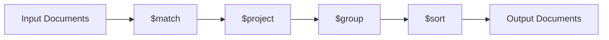
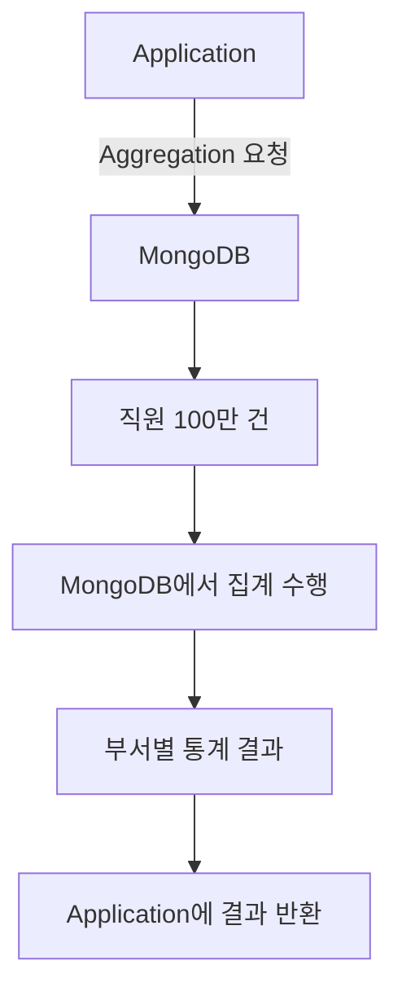
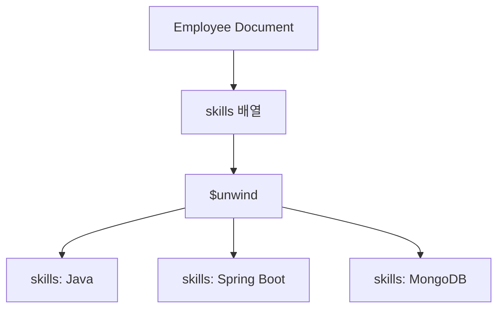
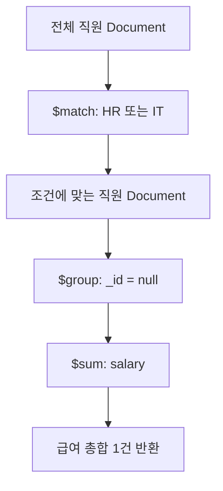
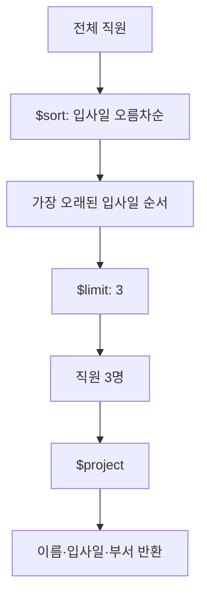
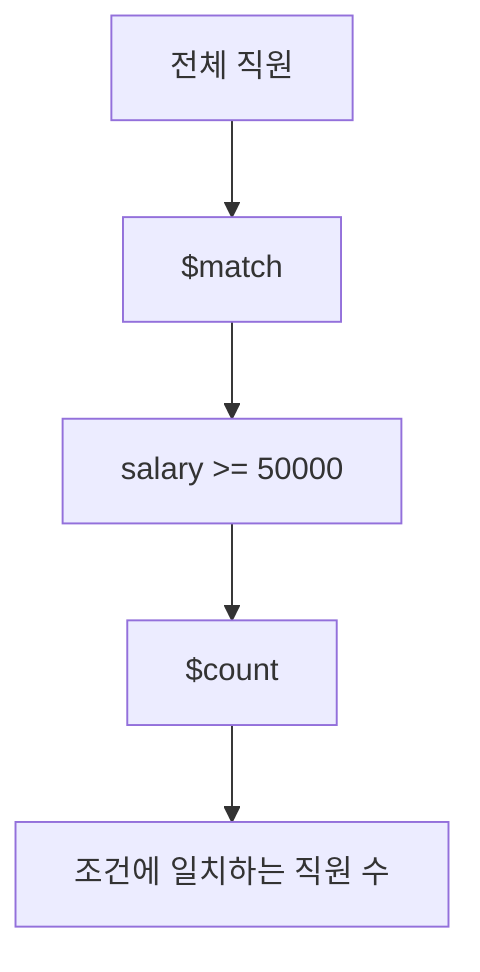
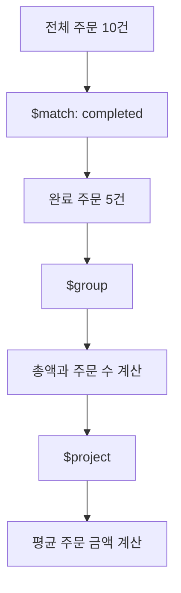
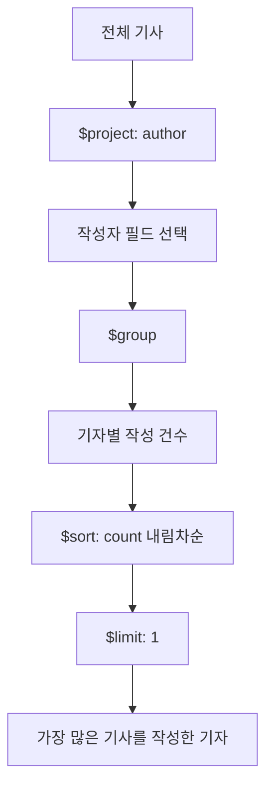
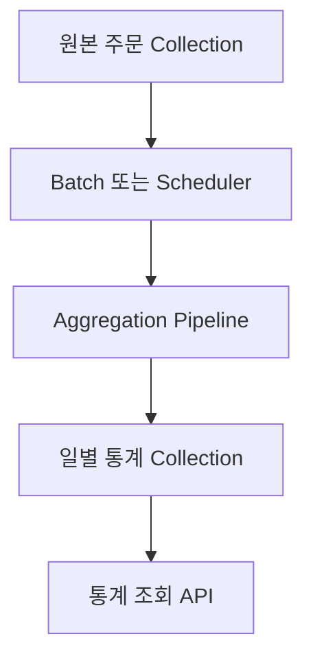
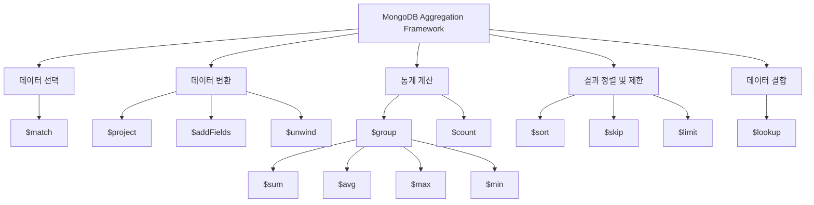

# MongoDB 집계 프레임워크

# MongoDB 집계 프레임워크

* toc
{:toc}

---

## MongoDB Aggregation Framework 완벽 이해: 집계 파이프라인부터 그룹화, 통계 분석, 데이터 변환 및 성능 최적화까지

MongoDB에서 데이터를 조회할 때 가장 먼저 사용하는 메서드는 `find()`다.

`find()`는 특정 조건에 일치하는 Document를 검색하거나 필요한 필드만 반환할 때 유용하다.

하지만 실제 서비스를 개발하다 보면 단순한 데이터 조회만으로 해결하기 어려운 요구사항이 발생한다.

예를 들어 다음과 같은 기능을 구현해야 한다고 가정해 보자.

- 부서별 직원 수와 평균 급여를 계산한다.
- 전체 직원 중 급여가 가장 높은 직원들을 조회한다.
- 특정 부서에 속한 직원들의 급여 합계를 계산한다.
- 주문 상태별 주문 건수와 평균 결제 금액을 계산한다.
- 가장 많은 기사를 작성한 기자를 찾는다.
- 특정 키워드가 포함된 기사들을 최신순으로 조회한다.
- 대량의 주식 데이터에서 특정 조건에 해당하는 종목 수를 계산한다.
- 서로 다른 Collection에 저장된 데이터를 연결하여 조회한다.

이러한 요구사항은 단순히 Document를 검색하는 것에서 끝나지 않는다.

데이터를 필터링하고, 그룹화하고, 계산하고, 정렬한 뒤 원하는 형태로 변환해야 한다.

MongoDB에서는 이러한 작업을 수행하기 위해 **Aggregation Framework(집계 프레임워크)** 를 제공한다.

Aggregation Framework의 핵심은 **Aggregation Pipeline(집계 파이프라인)** 이다.

집계 파이프라인은 여러 데이터 처리 단계를 순서대로 연결하여 복잡한 데이터 분석을 수행하는 기능이다.

예를 들어 직원 데이터에서 IT 부서 직원의 평균 급여를 계산한다고 가정해 보자.

```javascript
db.employees.aggregate([
  {
    $match: {
      department: "IT"
    }
  },
  {
    $group: {
      _id: null,
      averageSalary: {
        $avg: "$salary"
      }
    }
  }
]);
```

위 쿼리는 두 단계로 구성된다.

첫 번째 단계에서는 IT 부서 직원만 선택한다.

두 번째 단계에서는 선택된 직원들의 급여 평균을 계산한다.

이처럼 MongoDB는 여러 연산을 하나의 파이프라인으로 연결하여 데이터를 처리한다.

이번 글에서는 Aggregation Framework의 기본 원리부터 주요 Stage의 동작 방식, 직원·주문·기사·주식 데이터를 활용한 집계 방법, SQL과의 차이점, 그리고 실무에서 중요한 성능 최적화 전략까지 살펴본다.

---

## Aggregation Framework란?

### Aggregation의 개념

Aggregation은 여러 데이터를 수집하고 계산하여 원하는 결과를 만들어 내는 작업을 의미한다.

데이터베이스에서는 주로 다음과 같은 작업에 활용된다.

- 데이터 합계 계산
- 평균 계산
- 최댓값과 최솟값 계산
- 데이터 개수 계산
- 특정 기준으로 그룹화
- 조건에 따른 필터링
- 데이터 구조 변환
- 여러 Collection의 데이터 결합

예를 들어 다음과 같은 직원 데이터가 있다고 가정해 보자.

| 직원 | 부서 | 급여 |
|---|---|---:|
| Alice | HR | 50,000 |
| Bob | Finance | 55,000 |
| Charlie | IT | 52,000 |
| David | Marketing | 48,000 |
| Grace | IT | 53,000 |
| Helen | Finance | 55,000 |

여기서 부서별 평균 급여를 구한다고 가정해 보자.

원하는 결과는 다음과 같다.

| 부서 | 직원 수 | 평균 급여 |
|---|---:|---:|
| HR | 1 | 50,000 |
| Finance | 2 | 55,000 |
| IT | 2 | 52,500 |
| Marketing | 1 | 48,000 |

단순히 데이터를 조회하는 것이 아니라 다음 작업이 필요하다.

1. 같은 부서에 속하는 직원들을 그룹으로 묶는다.
2. 각 그룹의 직원 수를 계산한다.
3. 각 그룹의 급여 합계를 계산한다.
4. 급여 합계를 직원 수로 나누어 평균을 계산한다.
5. 계산 결과를 새로운 형태의 Document로 반환한다.

MongoDB에서는 이러한 작업을 Aggregation Framework로 처리할 수 있다.

### Aggregation Framework의 역할

Aggregation Framework는 MongoDB Collection에 저장된 데이터를 대상으로 다양한 변환과 분석을 수행하는 기능이다.

SQL의 `GROUP BY`, `SUM()`, `AVG()`, `COUNT()`와 비슷한 작업을 할 수 있으며, 단순한 집계뿐 아니라 문서 구조 변경과 다른 Collection의 데이터 결합도 지원한다.

| 기능 | SQL | MongoDB Aggregation |
|---|---|---|
| 조건 필터링 | WHERE | `$match` |
| 필드 선택 | SELECT | `$project` |
| 그룹화 | GROUP BY | `$group` |
| 합계 | SUM() | `$sum` |
| 평균 | AVG() | `$avg` |
| 최댓값 | MAX() | `$max` |
| 최솟값 | MIN() | `$min` |
| 정렬 | ORDER BY | `$sort` |
| 결과 제한 | LIMIT | `$limit` |
| 결과 건너뛰기 | OFFSET | `$skip` |
| 다른 테이블 연결 | JOIN | `$lookup` |

다만 SQL과 MongoDB의 Aggregation Framework는 문법과 처리 모델이 동일하지 않다.

SQL에서는 하나의 쿼리 안에서 여러 절을 조합한다.

반면 MongoDB는 여러 처리 단계를 순서대로 연결하는 파이프라인 모델을 사용한다.

---

## Aggregation Pipeline이란?

### 집계 파이프라인의 개념

Aggregation Pipeline은 여러 Stage를 순서대로 연결하여 데이터를 처리하는 구조다.

각 Stage는 입력으로 받은 Document에 특정 연산을 수행한다.

그리고 처리 결과를 다음 Stage에 전달한다.

즉, **이전 Stage의 출력이 다음 Stage의 입력이 되는 구조**다.



각 단계의 역할은 다음과 같다.

| Stage | 역할 |
|---|---|
| `$match` | 조건에 일치하는 Document 선택 |
| `$project` | 필요한 필드 선택 및 결과 구조 변경 |
| `$group` | 지정한 기준으로 그룹화하고 통계 계산 |
| `$sort` | 결과 정렬 |

예를 들어 직원 데이터에서 특정 부서의 급여 합계를 계산한 후 정렬한다고 가정해 보자.

전체 처리 흐름은 다음과 같다.

```text
전체 직원 데이터
       │
       ▼
$match
특정 부서 직원만 선택
       │
       ▼
$group
부서별 급여 합계 계산
       │
       ▼
$sort
급여 합계 기준 정렬
       │
       ▼
최종 집계 결과
```

각 Stage는 Document의 개수나 구조를 변경할 수 있다.

예를 들어 `$match`는 조건에 일치하지 않는 Document를 제거한다.

`$group`은 여러 Document를 하나의 그룹으로 묶으므로 Document 개수가 줄어들 수 있다.

반대로 `$unwind`는 하나의 Document를 여러 개로 분리하므로 Document 개수가 증가할 수 있다.

따라서 파이프라인에서는 각 Stage의 역할뿐 아니라 **Stage를 통과하면서 데이터의 개수와 구조가 어떻게 변하는지** 이해하는 것이 중요하다.

---

## MongoDB aggregate() 기본 문법

MongoDB에서 집계 파이프라인을 실행할 때는 `aggregate()` 메서드를 사용한다.

기본 구조는 다음과 같다.

```javascript
db.collection.aggregate([
  {
    $match: {
      status: "completed"
    }
  },
  {
    $group: {
      _id: null,
      totalAmount: {
        $sum: "$amount"
      }
    }
  }
]);
```

`aggregate()`에 전달되는 첫 번째 인수는 Stage들의 배열이다.

각 Stage는 하나의 Document로 표현된다.

### 기본 구조 분석

```javascript
db.collection.aggregate([
  { $match: { status: "completed" } },
  { $group: { _id: null, totalAmount: { $sum: "$amount" } } }
]);
```

각 부분의 의미는 다음과 같다.

**db.collection**

집계를 수행할 Collection을 지정한다.

**aggregate()**

집계 파이프라인을 실행한다.

**[ ]**

여러 Stage를 배열 형태로 전달한다.

**$match**

검색 조건에 일치하는 Document를 선택한다.

**$group**

입력 Document를 그룹화하고 합계 등의 집계 값을 계산한다.

**$sum**

값의 합계를 계산하는 Accumulator다.

### Stage와 Accumulator의 차이

MongoDB의 집계 문법을 이해할 때는 Stage와 Accumulator를 구분해야 한다.

예를 들어 다음 코드를 살펴보자.

```javascript
{
  $group: {
    _id: "$department",
    totalSalary: {
      $sum: "$salary"
    }
  }
}
```

여기서 `$group`은 **Stage**다.

입력 Document를 특정 기준으로 그룹화하는 역할을 한다.

반면 `$sum`은 **Accumulator**다.

그룹에 속한 Document들의 값을 누적하여 합계를 계산한다.

즉, 역할이 서로 다르다.

| 구분 | 예시 | 역할 |
|---|---|---|
| Stage | `$group` | 데이터 그룹화 |
| Accumulator | `$sum` | 그룹 내부 값의 합계 계산 |
| Accumulator | `$avg` | 평균 계산 |
| Accumulator | `$max` | 최댓값 계산 |
| Accumulator | `$min` | 최솟값 계산 |

또한 `$count`는 파이프라인 Stage와 Accumulator 양쪽에서 사용할 수 있지만 문법과 사용 위치가 다르다.

이 부분은 이후 자세히 살펴본다.

---

## Aggregation Pipeline을 사용하는 이유

### 1. 애플리케이션의 데이터 처리 부담 감소

Aggregation Framework를 사용하지 않는다면 애플리케이션에서 직접 데이터를 집계해야 할 수 있다.

예를 들어 부서별 평균 급여를 계산한다고 가정해 보자.

일반적인 Java 애플리케이션에서는 다음과 같은 흐름을 생각할 수 있다.

```text
1. MongoDB에서 모든 직원 조회

2. 조회한 데이터를 Java 애플리케이션으로 전달

3. Java에서 부서별 그룹화

4. 각 부서의 급여 합계 계산

5. 직원 수로 나누어 평균 계산

6. 최종 결과 반환
```

이 방식에서는 데이터베이스의 전체 직원 정보를 애플리케이션으로 가져올 수 있다.

직원이 수백만 명이라면 네트워크 전송량과 애플리케이션 메모리 사용량이 증가할 수 있다.

반면 Aggregation Framework를 사용하면 데이터베이스에서 집계를 수행할 수 있다.



이 경우 애플리케이션은 집계에 필요한 모든 원본 Document를 직접 전달받을 필요가 없다.

부서별 통계 결과만 반환받을 수 있다.

다만 데이터베이스에서 집계를 수행하는 만큼 DB 서버의 CPU와 메모리 사용량은 증가할 수 있다.

따라서 모든 분석 작업을 무조건 DB에서 수행하는 것이 아니라 데이터 규모와 처리 비용을 고려해야 한다.

### 2. 복잡한 데이터 분석을 하나의 쿼리로 처리

조건 검색, 그룹화, 계산, 정렬을 여러 요청으로 나누지 않고 하나의 파이프라인으로 표현할 수 있다.

```javascript
db.employees.aggregate([
  {
    $match: {
      salary: {
        $gte: 50000
      }
    }
  },
  {
    $group: {
      _id: "$department",
      employeeCount: {
        $sum: 1
      },
      avgSalary: {
        $avg: "$salary"
      }
    }
  },
  {
    $sort: {
      avgSalary: -1
    }
  }
]);
```

이 파이프라인은 다음 작업을 수행한다.

1. 급여가 50000 이상인 직원을 선택한다.
2. 부서별로 그룹화한다.
3. 각 부서의 직원 수를 계산한다.
4. 각 부서의 평균 급여를 계산한다.
5. 평균 급여가 높은 순서로 정렬한다.

### 3. 단계별로 데이터를 변환할 수 있다

Aggregation Pipeline은 여러 Stage를 조합하여 데이터 구조를 변경할 수 있다.

특히 `$project`, `$addFields`, `$unwind`, `$lookup` 등을 조합하면 단순한 통계 계산을 넘어 복잡한 데이터 변환도 가능하다.

### 4. SQL과 유사한 집계 기능 제공

Aggregation Framework는 SQL의 집계 함수와 유사한 기능을 제공한다.

따라서 RDBMS에 익숙한 개발자라면 SQL의 `GROUP BY`, `SUM`, `AVG`, `COUNT`와 비교하여 이해할 수 있다.

---

## Aggregation Pipeline의 주요 Stage

MongoDB에서 자주 사용하는 Stage는 다음과 같다.

| Stage | 주요 기능 | 대표적인 활용 사례 |
|---|---|---|
| `$match` | 조건에 일치하는 Document 선택 | 특정 부서 직원 조회 |
| `$project` | 출력 필드 선택 및 변환 | 이름과 부서만 반환 |
| `$group` | Document 그룹화 | 부서별 평균 급여 |
| `$sort` | 결과 정렬 | 급여 내림차순 |
| `$limit` | 결과 개수 제한 | 상위 10개 조회 |
| `$skip` | 지정한 개수만큼 건너뛰기 | 페이지네이션 |
| `$unwind` | 배열을 개별 Document로 분리 | 주문 상품별 집계 |
| `$lookup` | 다른 Collection과 데이터 결합 | 직원과 부서 정보 연결 |
| `$addFields` | 계산 필드 추가 | 급여 인상 후 예상 금액 계산 |
| `$count` | 입력 Document 개수 계산 | 조건에 맞는 직원 수 |

각 Stage의 동작을 하나씩 살펴보자.

---

## $match: 조건에 일치하는 Document 선택

`$match`는 조건에 일치하는 Document만 다음 Stage로 전달한다.

SQL의 `WHERE`와 비슷한 역할이다.

### 기본 문법

```javascript
{
  $match: {
    field: value
  }
}
```

예를 들어 HR 부서 직원을 조회하려면 다음과 같이 작성한다.

```javascript
db.employees.aggregate([
  {
    $match: {
      department: "HR"
    }
  }
]);
```

SQL로 표현하면 다음과 같다.

```sql
SELECT *
FROM employees
WHERE department = 'HR';
```

### 비교 연산자 사용

급여가 50000 이상인 직원만 선택한다고 가정해 보자.

```javascript
db.employees.aggregate([
  {
    $match: {
      salary: {
        $gte: 50000
      }
    }
  }
]);
```

여기서 `$gte`는 Greater Than or Equal을 의미한다.

다음 조건과 같다.

```text
salary >= 50000
```

### 여러 조건 조합

IT 또는 HR 부서 직원을 검색한다.

```javascript
db.employees.aggregate([
  {
    $match: {
      department: {
        $in: ["HR", "IT"]
      }
    }
  }
]);
```

`$in`은 지정한 값 중 하나와 일치하는 Document를 선택한다.

### $match를 앞에 배치하는 이유

일반적으로 `$match`는 가능한 한 앞쪽에 배치하는 것이 유리하다.

예를 들어 전체 직원이 100만 명이라고 가정해 보자.

그중 IT 부서 직원이 10만 명이라면 `$match`를 먼저 수행하여 이후 Stage가 처리할 데이터의 양을 줄일 수 있다.

```text
전체 직원 1,000,000건
        │
        ▼
      $match
        │
        ▼
IT 직원 100,000건
        │
        ▼
      $group
        │
        ▼
집계 결과
```

특히 `$match`가 파이프라인 초기에 있고 적절한 인덱스를 사용할 수 있다면 검색 비용을 줄이는 데 도움이 된다.

다만 `$match`가 앞선 Stage에서 새롭게 계산된 필드를 참조해야 한다면 해당 필드를 생성한 Stage보다 앞에 배치할 수 없다.

MongoDB는 일부 Stage의 순서를 자동으로 최적화하기도 한다. [MongoDB](https://www.mongodb.com/ko-kr/docs/manual/core/aggregation-pipeline-optimization/)

---

## $project: 필요한 필드만 반환하기

`$project`는 출력할 필드를 선택하거나 결과 Document의 구조를 변경하는 Stage다.

SQL의 `SELECT`에서 필요한 컬럼을 지정하는 것과 유사하다.

### 기본 문법

```javascript
{
  $project: {
    field1: 1,
    field2: 1,
    _id: 0
  }
}
```

여기서 `1`은 필드 포함, `0`은 필드 제외를 의미한다.

### 이름과 부서만 조회하기

직원 정보에서 이름과 부서만 반환한다고 가정해 보자.

일반적인 `find()`에서는 다음과 같이 작성한다.

```javascript
db.employees.find(
  {},
  {
    name: 1,
    department: 1,
    _id: 0
  }
);
```

Aggregation Pipeline에서는 다음과 같이 작성한다.

```javascript
db.employees.aggregate([
  {
    $project: {
      _id: 0,
      name: 1,
      department: 1
    }
  }
]);
```

두 쿼리는 필요한 필드를 반환한다는 점에서 유사하다.

### _id: 0을 지정하는 이유

MongoDB에서 `_id` 필드는 기본적으로 결과에 포함된다.

예를 들어 다음과 같은 Document가 있다고 가정해 보자.

```javascript
{
  _id: ObjectId("507f1f77bcf86cd799439011"),
  name: "Alice Kim",
  department: "HR",
  salary: 50000
}
```

다음 Projection을 실행한다.

```javascript
{
  $project: {
    name: 1,
    department: 1
  }
}
```

그러면 `_id`가 포함된 결과가 반환될 수 있다.

```javascript
{
  _id: ObjectId("507f1f77bcf86cd799439011"),
  name: "Alice Kim",
  department: "HR"
}
```

반면 `_id: 0`을 지정하면 다음과 같은 결과가 만들어진다.

```javascript
{
  name: "Alice Kim",
  department: "HR"
}
```

### 필드 이름 변경하기

`$project`는 단순히 필드를 포함하거나 제외하는 것뿐 아니라 새로운 필드 이름으로 값을 반환할 수도 있다.

```javascript
db.employees.aggregate([
  {
    $project: {
      _id: 0,
      employeeName: "$name",
      employeeDepartment: "$department"
    }
  }
]);
```

결과는 다음과 같은 형태다.

```javascript
{
  employeeName: "Alice Kim",
  employeeDepartment: "HR"
}
```

여기서 중요한 부분은 `$name`이다.

```javascript
employeeName: "$name"
```

`"$name"`은 입력 Document의 `name` 필드를 참조하는 표현식이다.

반면 다음과 같이 작성하면 의미가 다르다.

```javascript
employeeName: "name"
```

이는 필드의 값이 아니라 일반적인 문자열 `"name"`을 의미한다.

따라서 Aggregation Framework에서는 필드 참조와 문자열 상수를 구분해야 한다.

---

## $group: Document 그룹화와 통계 계산

`$group`은 특정 필드를 기준으로 Document를 그룹화하고 통계 값을 계산하는 Stage다.

SQL의 `GROUP BY`와 비슷하다.

### 기본 문법

```javascript
{
  $group: {
    _id: "$department",
    totalSalary: {
      $sum: "$salary"
    }
  }
}
```

여기서 `_id`는 그룹화 기준이다.

```javascript
_id: "$department"
```

이 코드는 `department` 필드의 값이 같은 Document들을 하나의 그룹으로 묶는다.

`totalSalary`는 각 그룹의 급여 합계를 저장할 출력 필드다.

### $group에서 사용하는 주요 Accumulator

| Accumulator | 설명 |
|---|---|
| `$sum` | 값의 합계 |
| `$avg` | 값의 평균 |
| `$max` | 최댓값 |
| `$min` | 최솟값 |
| `$first` | 그룹에서 첫 번째 값 |
| `$last` | 그룹에서 마지막 값 |
| `$push` | 그룹의 값을 배열로 수집 |
| `$addToSet` | 그룹의 중복 없는 값을 배열로 수집 |

### 부서별 직원 수 계산

```javascript
db.employees.aggregate([
  {
    $group: {
      _id: "$department",
      employeeCount: {
        $sum: 1
      }
    }
  }
]);
```

이 쿼리는 부서별 직원 수를 계산한다.

`$sum: 1`은 각 Document를 하나씩 세는 방식이다.

예를 들어 HR 부서에 두 명이 있다면 다음과 같이 누적된다.

```text
HR 직원 1명 → 1

HR 직원 2명 → 2
```

결과는 다음과 유사하다.

```javascript
[
  {
    _id: "HR",
    employeeCount: 2
  },
  {
    _id: "IT",
    employeeCount: 2
  },
  {
    _id: "Finance",
    employeeCount: 2
  }
]
```

실제 그룹과 직원 수는 Collection의 현재 데이터에 따라 달라진다.

### $sum: 1과 $sum: "$salary"의 차이

다음 두 표현을 비교해 보자.

```javascript
employeeCount: {
  $sum: 1
}
```

```javascript
totalSalary: {
  $sum: "$salary"
}
```

첫 번째는 Document마다 1을 더한다.

따라서 Document 개수를 계산한다.

두 번째는 각 Document의 `salary` 값을 더한다.

따라서 급여 합계를 계산한다.

이 차이는 MongoDB의 그룹 집계를 이해할 때 중요하다.

---

## $group의 _id: null은 무엇을 의미할까?

`$group`에서는 특정 필드 대신 `_id: null`을 사용할 수 있다.

```javascript
{
  $group: {
    _id: null,
    totalSalary: {
      $sum: "$salary"
    }
  }
}
```

이 코드는 특정 필드를 기준으로 그룹을 나누지 않는다.

대신 **입력된 모든 Document를 하나의 그룹으로 묶는다.**

예를 들어 다음 데이터가 있다고 가정해 보자.

| 직원 | 부서 | 급여 |
|---|---|---:|
| Alice | HR | 50,000 |
| Bob | Finance | 55,000 |
| Charlie | IT | 52,000 |

다음 집계를 실행한다.

```javascript
db.employees.aggregate([
  {
    $group: {
      _id: null,
      totalSalary: {
        $sum: "$salary"
      }
    }
  }
]);
```

결과는 다음과 같다.

```javascript
[
  {
    _id: null,
    totalSalary: 157000
  }
]
```

세 직원의 급여 합계를 하나의 결과로 반환한다.

반면 다음과 같이 작성하면 부서별 결과가 생성된다.

```javascript
db.employees.aggregate([
  {
    $group: {
      _id: "$department",
      totalSalary: {
        $sum: "$salary"
      }
    }
  }
]);
```

즉, `_id`에 무엇을 지정하는지에 따라 그룹의 기준이 달라진다.

| _id 설정 | 의미 |
|---|---|
| `_id: null` | 입력 전체를 하나의 그룹으로 처리 |
| `_id: "$department"` | 부서별 그룹화 |
| `_id: "$status"` | 상태별 그룹화 |
| `_id: "$author"` | 작성자별 그룹화 |

MongoDB의 `$group`은 그룹화 필드와 Accumulator를 이용하여 합계, 평균, 개수 등의 값을 계산한다. [MongoDB](https://www.mongodb.com/docs/manual/reference/operator/aggregation/group/)

---

## $sort: Document 정렬하기

`$sort`는 Document를 특정 필드 기준으로 정렬하는 Stage다.

### 기본 문법

```javascript
{
  $sort: {
    field: 1
  }
}
```

정렬 방향은 다음과 같다.

| 값 | 의미 |
|---|---|
| `1` | 오름차순 |
| `-1` | 내림차순 |

### 급여 오름차순 정렬

```javascript
db.employees.aggregate([
  {
    $sort: {
      salary: 1
    }
  }
]);
```

급여가 낮은 직원부터 조회한다.

### 급여 내림차순 정렬

```javascript
db.employees.aggregate([
  {
    $sort: {
      salary: -1
    }
  }
]);
```

급여가 높은 직원부터 조회한다.

### 여러 필드로 정렬

```javascript
db.employees.aggregate([
  {
    $sort: {
      department: 1,
      salary: -1,
      employee_id: 1
    }
  }
]);
```

이 명령어는 다음 순서로 정렬한다.

1. 부서 이름을 오름차순으로 정렬한다.
2. 같은 부서 안에서는 급여를 내림차순으로 정렬한다.
3. 급여도 동일하다면 직원 번호를 오름차순으로 정렬한다.

여기서 마지막 직원 번호와 같은 고유한 정렬 기준을 추가하면 동일한 급여를 가진 직원들 사이에서도 결과 순서를 안정적으로 구성할 수 있다.

---

## $limit: 결과 개수 제한하기

`$limit`은 다음 Stage로 전달할 Document의 최대 개수를 제한한다.

### 기본 문법

```javascript
{
  $limit: 10
}
```

예를 들어 급여가 높은 직원 다섯 명을 조회한다고 가정해 보자.

```javascript
db.employees.aggregate([
  {
    $sort: {
      salary: -1,
      employee_id: 1
    }
  },
  {
    $limit: 5
  }
]);
```

이 파이프라인은 먼저 급여를 정렬한다.

그다음 상위 다섯 개의 Document만 반환한다.

### $sort와 $limit의 순서

다음 두 파이프라인을 비교해 보자.

**정렬 후 제한**

```javascript
db.employees.aggregate([
  {
    $sort: {
      salary: -1
    }
  },
  {
    $limit: 5
  }
]);
```

급여가 높은 직원 다섯 명을 선택한다.

**제한 후 정렬**

```javascript
db.employees.aggregate([
  {
    $limit: 5
  },
  {
    $sort: {
      salary: -1
    }
  }
]);
```

먼저 입력 Document 중 다섯 개만 선택한다.

그다음 선택된 다섯 개를 정렬한다.

따라서 두 파이프라인은 같은 결과를 보장하지 않는다.

**Aggregation Pipeline에서는 Stage의 순서가 결과의 의미를 결정한다.**

MongoDB는 `$sort` 다음에 `$limit`이 존재하고 그 사이에서 문서 개수가 변경되지 않는 경우 두 작업을 최적화할 수 있다. [MongoDB](https://www.mongodb.com/docs/manual/reference/operator/aggregation/sort/)

---

## $skip: 지정한 개수의 Document 건너뛰기

`$skip`은 앞에서부터 지정한 개수의 Document를 건너뛴다.

### 기본 문법

```javascript
{
  $skip: 10
}
```

예를 들어 직원 목록을 페이지 단위로 조회한다고 가정해 보자.

한 페이지에 10명의 직원 정보를 보여주는 경우다.

### 첫 번째 페이지

```javascript
db.employees.aggregate([
  {
    $sort: {
      employee_id: 1
    }
  },
  {
    $skip: 0
  },
  {
    $limit: 10
  }
]);
```

### 두 번째 페이지

```javascript
db.employees.aggregate([
  {
    $sort: {
      employee_id: 1
    }
  },
  {
    $skip: 10
  },
  {
    $limit: 10
  }
]);
```

### 세 번째 페이지

```javascript
db.employees.aggregate([
  {
    $sort: {
      employee_id: 1
    }
  },
  {
    $skip: 20
  },
  {
    $limit: 10
  }
]);
```

페이지 번호에 따른 계산식은 다음과 같다.

```text
skip = (page - 1) × pageSize
```

예를 들어 3페이지이고 페이지 크기가 10이라면 다음과 같다.

```text
skip = (3 - 1) × 10

skip = 20
```

다만 `$skip`을 사용하는 페이지네이션은 뒤쪽 페이지로 갈수록 많은 데이터를 건너뛰어야 할 수 있다.

따라서 대규모 데이터에서는 고유한 정렬 키를 기준으로 다음 데이터를 조회하는 Keyset Pagination을 검토할 수 있다.

---

## $unwind: 배열을 개별 Document로 분리하기

`$unwind`는 배열 필드에 포함된 각 요소를 개별 Document로 분리한다.

예를 들어 다음과 같은 직원 Document가 있다고 가정해 보자.

```javascript
{
  employee_id: 1001,
  name: "Alice Kim",
  skills: [
    "Java",
    "Spring Boot",
    "MongoDB"
  ]
}
```

하나의 Document 안에 세 개의 기술 스택이 배열로 저장되어 있다.

이때 다음 파이프라인을 실행한다.

```javascript
db.employees.aggregate([
  {
    $match: {
      employee_id: 1001
    }
  },
  {
    $unwind: "$skills"
  }
]);
```

결과는 개념적으로 다음과 같다.

```javascript
[
  {
    employee_id: 1001,
    name: "Alice Kim",
    skills: "Java"
  },
  {
    employee_id: 1001,
    name: "Alice Kim",
    skills: "Spring Boot"
  },
  {
    employee_id: 1001,
    name: "Alice Kim",
    skills: "MongoDB"
  }
]
```

실제 결과에는 `_id` 등 기존 Document의 다른 필드도 포함될 수 있다.

### $unwind 처리 구조



하나의 Document가 세 개의 출력 Document로 분리된다.

### $unwind와 $group 조합

직원들이 보유한 기술 스택별 인원 수를 계산할 수 있다.

```javascript
db.employees.aggregate([
  {
    $unwind: "$skills"
  },
  {
    $group: {
      _id: "$skills",
      employeeCount: {
        $sum: 1
      }
    }
  },
  {
    $sort: {
      employeeCount: -1,
      _id: 1
    }
  }
]);
```

이 파이프라인은 다음 작업을 수행한다.

1. 직원별 기술 스택 배열을 분리한다.
2. 같은 기술 스택을 그룹으로 묶는다.
3. 기술 스택별 Document 수를 계산한다.
4. 개수가 많은 순서로 정렬한다.

다만 같은 직원의 `skills` 배열에 동일한 기술이 중복되어 있다면 그 직원이 여러 번 집계될 수 있다.

정확한 보유 직원 수가 필요하다면 데이터의 중복 여부를 함께 고려해야 한다.

### 배열이 비어 있거나 필드가 없는 경우

기본적으로 `$unwind`는 배열이 비어 있거나 필드가 없거나 `null`인 Document를 결과에서 제외할 수 있다.

이를 유지해야 한다면 다음 옵션을 사용할 수 있다.

```javascript
db.employees.aggregate([
  {
    $unwind: {
      path: "$skills",
      preserveNullAndEmptyArrays: true
    }
  }
]);
```

이 옵션은 배열 값이 없는 Document도 후속 처리에 전달해야 하는 상황에서 유용하다. [MongoDB](https://www.mongodb.com/docs/manual/reference/operator/aggregation/unwind/?msockid=0e019178bf74628d2d8c87d3be3e637a)

---

## $lookup: 다른 Collection과 데이터 결합하기

`$lookup`은 다른 Collection의 데이터를 가져와 현재 Document와 결합하는 Stage다.

SQL의 `LEFT OUTER JOIN`과 비슷한 역할을 한다.

### 예시 데이터 구조

직원 정보와 부서 정보를 별도 Collection으로 관리한다고 가정해 보자.

```text
bizcom_db
    │
    ├── employees
    │     ├── employee_id
    │     ├── name
    │     └── department
    │
    └── departments
          ├── _id
          ├── departmentName
          └── manager
```

직원 Document는 다음과 같다.

```javascript
{
  employee_id: 1001,
  name: "Alice Kim",
  department: "HR"
}
```

부서 Document는 다음과 같다.

```javascript
{
  _id: "HR",
  departmentName: "Human Resources",
  manager: "Grace Kim"
}
```

직원 정보를 조회하면서 부서의 전체 이름과 관리자를 함께 반환하고 싶다면 `$lookup`을 사용할 수 있다.

### 부서 데이터 생성

다음 데이터는 `$lookup`의 동작을 이해하기 위한 별도 예제다.

```javascript
db.departments.insertMany([
  {
    _id: "HR",
    departmentName: "Human Resources",
    manager: "Grace Kim"
  },
  {
    _id: "IT",
    departmentName: "Information Technology",
    manager: "Charlie Park"
  },
  {
    _id: "Finance",
    departmentName: "Finance Department",
    manager: "Bob Lee"
  }
]);
```

동일한 `_id`를 가진 Document가 이미 존재한다면 중복 키 오류가 발생하므로 새로운 테스트 환경에서 실행해야 한다.

### $lookup 실행

```javascript
db.employees.aggregate([
  {
    $lookup: {
      from: "departments",
      localField: "department",
      foreignField: "_id",
      as: "departmentInfo"
    }
  }
]);
```

각 옵션의 의미는 다음과 같다.

| 옵션 | 의미 |
|---|---|
| from | 연결할 Collection |
| localField | 현재 Collection의 연결 기준 필드 |
| foreignField | 상대 Collection의 연결 기준 필드 |
| as | 연결 결과를 저장할 배열 필드 이름 |

### 결과 구조

직원과 부서 정보가 일치하면 다음과 같은 결과가 만들어질 수 있다.

```javascript
{
  employee_id: 1001,
  name: "Alice Kim",
  department: "HR",
  departmentInfo: [
    {
      _id: "HR",
      departmentName: "Human Resources",
      manager: "Grace Kim"
    }
  ]
}
```

여기서 중요한 부분은 `departmentInfo`가 배열이라는 것이다.

`$lookup`은 일치하는 결과를 배열로 반환한다.

### $lookup과 $unwind 조합

부서 정보를 배열이 아닌 일반적인 중첩 Document처럼 사용하고 싶다면 `$unwind`를 조합할 수 있다.

```javascript
db.employees.aggregate([
  {
    $lookup: {
      from: "departments",
      localField: "department",
      foreignField: "_id",
      as: "departmentInfo"
    }
  },
  {
    $unwind: {
      path: "$departmentInfo",
      preserveNullAndEmptyArrays: true
    }
  },
  {
    $project: {
      _id: 0,
      employee_id: 1,
      name: 1,
      department: 1,
      departmentName: "$departmentInfo.departmentName",
      manager: "$departmentInfo.manager"
    }
  }
]);
```

이 파이프라인은 직원 정보와 부서 정보를 연결하고 필요한 필드만 반환한다.

### $lookup 사용 시 주의사항

`$lookup`은 편리하지만 다른 Collection을 조회해야 하므로 처리 비용이 발생할 수 있다.

특히 연결 대상 Collection에 적절한 인덱스가 없다면 대량 데이터에서 성능 문제가 발생할 수 있다.

또한 항상 SQL처럼 JOIN을 사용하는 방식이 최선은 아니다.

데이터의 관계와 조회 패턴에 따라 MongoDB의 Embedded Document 모델이 더 효율적일 수도 있다.

MongoDB 공식 문서에서도 `$lookup`을 Left Outer Join 성격의 Stage로 설명하며 연결 대상 필드의 인덱스와 데이터 모델을 중요하게 다룬다. [MongoDB](https://www.mongodb.com/docs/manual/reference/operator/aggregation/lookup/)

---

## $addFields: 계산된 필드 추가하기

`$addFields`는 기존 Document의 필드를 유지하면서 새로운 필드를 추가하는 Stage다.

계산식의 결과를 새로운 필드로 반환할 때 유용하다.

### 기본 문법

```javascript
{
  $addFields: {
    newField: expression
  }
}
```

예를 들어 기존 급여에 10%를 더한 값을 계산한다고 가정해 보자.

```javascript
db.employees.aggregate([
  {
    $addFields: {
      increasedSalary: {
        $multiply: ["$salary", 1.1]
      }
    }
  }
]);
```

여기서 `$multiply`는 여러 값을 곱하는 집계 표현식이다.

```javascript
$multiply: ["$salary", 1.1]
```

현재 Document의 `salary`에 `1.1`을 곱한다.

### 결과 예시

급여가 50000인 직원이 있다고 가정해 보자.

```javascript
{
  name: "Alice Kim",
  salary: 50000
}
```

집계 결과는 다음과 같다.

```javascript
{
  name: "Alice Kim",
  salary: 50000,
  increasedSalary: 55000
}
```

기존 급여는 그대로 유지된다.

계산된 값이 `increasedSalary`라는 새로운 필드로 추가된다.

### $addFields는 실제 데이터를 수정할까?

중요한 점은 **일반적인 Aggregation Pipeline에서 `$addFields`를 사용했다고 해서 Collection에 저장된 Document가 영구적으로 수정되는 것은 아니라는 것**이다.

예를 들어 다음 코드를 실행한다.

```javascript
db.employees.aggregate([
  {
    $addFields: {
      increasedSalary: {
        $multiply: ["$salary", 1.1]
      }
    }
  }
]);
```

이 결과에는 `increasedSalary`가 포함될 수 있다.

하지만 다시 원본 Collection을 조회하면

```javascript
db.employees.find({
  employee_id: 1001
});
```

원래 저장된 Document에는 `increasedSalary`가 없을 수 있다.

`$addFields`는 집계 결과를 변환하는 Stage이기 때문이다.

실제 데이터를 수정하려면 `updateOne()`, `updateMany()` 등의 Update 메서드를 사용하거나 명시적인 쓰기 작업을 수행해야 한다.

참고로 `$addFields`는 집계 단계의 `$set`과 같은 기능이며, 기존 필드와 동일한 이름을 지정하면 집계 결과에서 해당 필드 값을 덮어쓸 수 있다. [MongoDB](https://www.mongodb.com/docs/manual/reference/operator/aggregation/addfields/?jmp=university)

---

## $count: Document 개수 계산하기

`$count`는 이전 Stage에서 전달받은 Document의 개수를 계산한다.

### 기본 문법

```javascript
{
  $count: "resultCount"
}
```

문자열은 결과에 사용할 필드 이름이다.

### 급여가 50000 이상인 직원 수 계산

```javascript
db.employees.aggregate([
  {
    $match: {
      salary: {
        $gte: 50000
      }
    }
  },
  {
    $count: "highSalaryEmployees"
  }
]);
```

첫 번째 단계에서는 급여가 50000 이상인 직원을 선택한다.

두 번째 단계에서는 선택된 Document의 개수를 계산한다.

예를 들어 조건에 맞는 직원이 8명이라면 다음과 같은 결과가 반환된다.

```javascript
[
  {
    highSalaryEmployees: 8
  }
]
```

위 결과는 동작을 설명하기 위한 예시다. 실제 직원 데이터의 개수가 15명으로 집계된 경우도 있으므로 현재 Collection의 상태에 따라 값은 달라진다. mongodb-aggregation-framework-c…

### $count와 $sum: 1의 차이

다음 코드를 살펴보자.

```javascript
db.employees.aggregate([
  {
    $group: {
      _id: null,
      employeeCount: {
        $sum: 1
      }
    }
  }
]);
```

모든 직원의 개수를 계산한다.

다음과 같이 `$count`를 사용할 수도 있다.

```javascript
db.employees.aggregate([
  {
    $count: "employeeCount"
  }
]);
```

두 방식 모두 전체 Document 개수를 계산하는 데 활용할 수 있다.

하지만 결과 형태에 차이가 있다.

`$group`은 기본적으로 그룹 식별자인 `_id`를 포함한다.

반면 `$count` Stage는 지정한 이름의 개수 필드를 반환한다.

또한 `$count`의 입력이 비어 있으면 `{ count: 0 }` 같은 결과 Document를 반환하는 것이 아니라 결과 자체가 비어 있다.

따라서 API에서 항상 숫자 0을 반환해야 한다면 빈 결과에 대한 처리를 별도로 고려해야 한다. [MongoDB](https://www.mongodb.com/ko-kr/docs/v8.0/reference/operator/aggregation/count/)

---

## Aggregation Pipeline 예제 1: HR·IT 부서의 급여 합계

이제 여러 Stage를 조합한 실제 집계 예제를 살펴보자.

직원 관리 시스템에서 다음 요구사항이 발생했다고 가정한다.

> HR과 IT 부서에 속한 직원들의 급여 총합을 계산한다.

### 데이터 구조

직원 데이터는 다음과 같은 구조다.

```javascript
{
  employee_id: 1001,
  name: "Alice Kim",
  department: "HR",
  salary: 50000
}
```

### 집계 코드

```javascript
db.employees.aggregate([
  {
    $match: {
      department: {
        $in: ["HR", "IT"]
      }
    }
  },
  {
    $group: {
      _id: null,
      totalSalary: {
        $sum: "$salary"
      }
    }
  }
]);
```

### 첫 번째 단계: $match

```javascript
{
  $match: {
    department: {
      $in: ["HR", "IT"]
    }
  }
}
```

HR 또는 IT 부서에 속한 직원만 선택한다.

예를 들어 다음과 같은 데이터가 있다고 가정해 보자.

| 직원 | 부서 | 급여 |
|---|---|---:|
| Alice | HR | 50,000 |
| Bob | Finance | 55,000 |
| Charlie | IT | 52,000 |
| Grace | IT | 53,000 |
| Ian | HR | 49,000 |

`$match`를 통과한 결과는 다음과 같다.

| 직원 | 부서 | 급여 |
|---|---|---:|
| Alice | HR | 50,000 |
| Charlie | IT | 52,000 |
| Grace | IT | 53,000 |
| Ian | HR | 49,000 |

Finance 부서인 Bob은 제외된다.

### 두 번째 단계: $group

```javascript
{
  $group: {
    _id: null,
    totalSalary: {
      $sum: "$salary"
    }
  }
}
```

`_id: null`이므로 모든 입력 Document를 하나의 그룹으로 묶는다.

그다음 급여를 합산한다.

```text
50000
+
52000
+
53000
+
49000
=
204000
```

위 다섯 건의 예시 데이터에서 HR·IT 조건에 일치한 네 직원의 합계는 204000이다.

결과는 다음과 같다.

```javascript
[
  {
    _id: null,
    totalSalary: 204000
  }
]
```

### 처리 흐름



여기서 중요한 점은 `$group`의 출력 개수다.

HR과 IT라는 두 부서를 선택했다고 해서 반드시 두 개의 결과가 반환되는 것은 아니다.

현재 코드는 `_id: null`을 사용하므로 모든 직원을 하나의 그룹으로 묶는다.

만약 HR과 IT의 급여 합계를 각각 구하고 싶다면 `_id`를 변경해야 한다.

### 부서별 급여 합계로 변경하기

```javascript
db.employees.aggregate([
  {
    $match: {
      department: {
        $in: ["HR", "IT"]
      }
    }
  },
  {
    $group: {
      _id: "$department",
      totalSalary: {
        $sum: "$salary"
      }
    }
  },
  {
    $sort: {
      _id: 1
    }
  }
]);
```

이 경우 HR과 IT가 서로 다른 그룹이 된다.

예시 데이터의 결과는 다음과 같다.

```javascript
[
  {
    _id: "HR",
    totalSalary: 99000
  },
  {
    _id: "IT",
    totalSalary: 105000
  }
]
```

따라서 `$group`에서 어떤 값을 `_id`로 지정하는지가 집계 결과를 결정한다.

---

## Aggregation Pipeline 예제 2: 직원 이름과 부서만 출력하기

다음 요구사항을 생각해 보자.

> 모든 직원의 이름과 부서만 반환하고 MongoDB의 `_id`는 제외한다.

### find() 사용

```javascript
db.employees.find(
  {},
  {
    name: 1,
    department: 1,
    _id: 0
  }
);
```

### aggregate() 사용

```javascript
db.employees.aggregate([
  {
    $project: {
      _id: 0,
      name: 1,
      department: 1
    }
  }
]);
```

두 방식은 비슷한 결과를 반환할 수 있다.

하지만 사용 목적은 다소 다르다.

`find()`는 단순 조회에 적합하다.

`aggregate()`는 여러 데이터 처리 단계를 조합해야 할 때 유용하다.

따라서 단순히 특정 필드만 반환하려는 목적이라면 반드시 Aggregation Pipeline을 사용할 필요는 없다.

반대로 필드 선택 이후 그룹화나 계산이 필요하다면 Aggregation Framework가 적합하다.

---

## Aggregation Pipeline 예제 3: 급여 10% 인상 후 예상 금액 계산

이번에는 직원의 급여가 10% 인상된다고 가정해 보자.

하지만 실제 저장된 급여를 변경하는 것이 아니라 인상된 예상 급여를 조회하고 싶다.

이 경우 `$addFields`와 `$multiply`를 사용할 수 있다.

### 집계 코드

```javascript
db.employees.aggregate([
  {
    $addFields: {
      increasedSalary: {
        $multiply: ["$salary", 1.1]
      }
    }
  }
]);
```

### 계산 과정

직원 급여가 72000이라고 가정해 보자.

```text
기존 급여 = 72000

인상률 = 10%

인상 후 급여 = 72000 × 1.1

인상 후 급여 = 79200
```

결과는 다음과 같은 형태다.

```javascript
{
  employee_id: 1011,
  name: "Kevin Lee",
  salary: 72000,
  increasedSalary: 79200
}
```

다만 앞서 CRUD 작업을 통해 실제 급여를 82000으로 변경한 상태라면 계산 결과는 달라진다.

```text
82000 × 1.1 = 90200
```

집계는 실행 시점에 저장되어 있는 `salary` 값을 기준으로 계산하기 때문이다.

### 실제 급여는 변경되지 않는다

다시 강조하면 `$addFields`는 계산된 필드를 출력에 추가하는 Stage다.

따라서 원본 Collection의 `salary`를 영구적으로 변경하지 않는다.

이 특성은 다음과 같은 기능에 활용할 수 있다.

- 급여 인상 시뮬레이션
- 할인 적용 후 예상 결제 금액 계산
- 세금 포함 금액 계산
- 환율 변환 결과 조회
- 배송비 포함 총 결제 금액 계산

### 필요한 필드만 반환하기

다음과 같이 `$project`를 추가할 수도 있다.

```javascript
db.employees.aggregate([
  {
    $addFields: {
      increasedSalary: {
        $multiply: ["$salary", 1.1]
      }
    }
  },
  {
    $project: {
      _id: 0,
      name: 1,
      department: 1,
      salary: 1,
      increasedSalary: 1
    }
  }
]);
```

이렇게 하면 실제 급여와 인상 후 예상 급여를 비교할 수 있다.

### 금액 계산에서 주의할 점

급여나 결제 금액처럼 정확도가 중요한 데이터를 계산할 때는 BSON 자료형을 함께 고려해야 한다.

`Double`은 이진 부동소수점의 특성을 가지므로 일부 소수 계산에서 오차가 발생할 수 있다.

정확한 소수 계산이 중요한 금액 데이터라면 `Decimal128`이나 최소 화폐 단위의 정수 표현을 검토하는 것이 좋다.

---

## Aggregation Pipeline 예제 4: 가장 오래 재직한 직원 3명 조회하기

다음 요구사항을 생각해 보자.

> 입사일이 가장 빠른 직원 세 명의 이름, 입사일, 부서를 조회한다.

이 요구사항에서는 다음 작업이 필요하다.

1. 입사일 기준으로 오름차순 정렬한다.
2. 앞의 세 명만 선택한다.
3. 필요한 필드만 반환한다.

### find() 사용

```javascript
db.employees.find(
  {},
  {
    _id: 0,
    name: 1,
    join_date: 1,
    department: 1
  }
).sort({
  join_date: 1
}).limit(3);
```

### aggregate() 사용

```javascript
db.employees.aggregate([
  {
    $sort: {
      join_date: 1
    }
  },
  {
    $limit: 3
  },
  {
    $project: {
      _id: 0,
      name: 1,
      join_date: 1,
      department: 1
    }
  }
]);
```

### Stage별 동작

**1단계: $sort**

```javascript
{
  $sort: {
    join_date: 1
  }
}
```

입사일을 오름차순으로 정렬한다.

따라서 가장 오래전에 입사한 직원이 앞쪽에 배치된다.

**2단계: $limit**

```javascript
{
  $limit: 3
}
```

정렬된 결과 중 앞의 세 개만 선택한다.

**3단계: $project**

```javascript
{
  $project: {
    _id: 0,
    name: 1,
    join_date: 1,
    department: 1
  }
}
```

이름, 입사일, 부서만 반환한다.

### $sort → $limit → $project 순서의 의미

각 Stage의 순서는 다음과 같은 의미를 가진다.



이 파이프라인에서 `$limit`을 `$sort`보다 앞에 배치하면 의미가 달라진다.

먼저 임의의 세 명을 선택한 뒤 그 세 명을 정렬하게 될 수 있기 때문이다.

따라서 상위 N개 데이터를 조회하는 요구사항에서는 정렬 기준을 먼저 결정해야 한다.

### 동일한 입사일이 존재한다면?

여러 직원이 같은 날짜에 입사했다면 입사일만으로는 정렬 순서가 완전히 결정되지 않을 수 있다.

따라서 다음과 같이 고유한 식별자를 추가할 수 있다.

```javascript
db.employees.aggregate([
  {
    $sort: {
      join_date: 1,
      employee_id: 1
    }
  },
  {
    $limit: 3
  },
  {
    $project: {
      _id: 0,
      employee_id: 1,
      name: 1,
      join_date: 1,
      department: 1
    }
  }
]);
```

이렇게 하면 입사일이 같은 직원들 사이에서도 직원 번호를 기준으로 순서를 결정할 수 있다.

---

## Aggregation Pipeline 예제 5: 급여가 50000 이상인 직원 조회

다음 요구사항을 생각해 보자.

> 급여가 50000 이상인 직원의 이름, 부서, 급여만 조회한다.

### 기본 집계 코드

```javascript
db.employees.aggregate([
  {
    $match: {
      salary: {
        $gte: 50000
      }
    }
  },
  {
    $project: {
      _id: 0,
      name: 1,
      department: 1,
      salary: 1
    }
  }
]);
```

### Stage별 동작

**$match**

급여가 50000 이상인 직원만 선택한다.

**$project**

이름과 부서, 급여만 반환한다.

### 급여 내림차순 정렬 추가

급여가 높은 직원부터 반환하려면 `$sort`를 추가하면 된다.

```javascript
db.employees.aggregate([
  {
    $match: {
      salary: {
        $gte: 50000
      }
    }
  },
  {
    $project: {
      _id: 0,
      name: 1,
      department: 1,
      salary: 1
    }
  },
  {
    $sort: {
      salary: -1
    }
  }
]);
```

다음 순서로 처리된다.

```text
전체 직원
   │
   ▼
급여 50000 이상 필터링
   │
   ▼
이름·부서·급여 선택
   │
   ▼
급여 내림차순 정렬
   │
   ▼
최종 결과
```

여기서는 `$project` 이후에도 `salary` 필드를 유지하므로 급여를 기준으로 정렬할 수 있다.

반대로 `$project`에서 `salary`를 제거했다면 후속 `$sort` 단계에서 해당 값으로 정렬할 수 없게 된다.

따라서 Stage를 구성할 때는 **뒤쪽 Stage에서 어떤 필드를 필요로 하는지** 고려해야 한다.

---

## Aggregation Pipeline 예제 6: 부서별 직원 수와 평균 급여

이번에는 가장 대표적인 그룹 집계를 살펴보자.

요구사항은 다음과 같다.

> 부서별 직원 수와 평균 급여를 계산한다.

### 집계 코드

```javascript
db.employees.aggregate([
  {
    $group: {
      _id: "$department",
      employeeCount: {
        $sum: 1
      },
      avgSalary: {
        $avg: "$salary"
      }
    }
  }
]);
```

### 첫 번째: 부서별 그룹화

```javascript
_id: "$department"
```

같은 부서에 속하는 직원들을 하나의 그룹으로 묶는다.

### 두 번째: 직원 수 계산

```javascript
employeeCount: {
  $sum: 1
}
```

그룹에 속한 Document 수를 계산한다.

### 세 번째: 평균 급여 계산

```javascript
avgSalary: {
  $avg: "$salary"
}
```

그룹에 속한 직원들의 평균 급여를 계산한다.

### 결과 구조

실제 결과는 다음과 유사한 형태다.

```javascript
[
  {
    _id: "IT",
    employeeCount: 2,
    avgSalary: 52500
  },
  {
    _id: "HR",
    employeeCount: 2,
    avgSalary: 49500
  }
]
```

위 수치는 각각 급여가 `52000, 53000`인 IT 직원 두 명과 `50000, 49000`인 HR 직원 두 명을 가정한 계산 예시다.

실제 데이터베이스의 결과는 직원의 추가·수정·삭제 이력에 따라 달라진다.

### $avg는 어떻게 계산할까?

예를 들어 IT 부서에 다음 직원이 있다고 가정해 보자.

| 직원 | 급여 |
|---|---:|
| Charlie | 52,000 |
| Grace | 53,000 |

평균 급여는 다음과 같다.

```text
(52000 + 53000) / 2

= 52500
```

MongoDB에서는 `$avg`가 이러한 계산을 수행한다.

다만 `$avg`는 일반적으로 숫자가 아닌 값을 평균 계산에서 제외한다.

따라서 `salary` 필드가 누락되거나 문자열로 저장된 Document가 존재한다면 직원 수와 평균 계산에 사용된 값의 개수가 일치하지 않을 수 있다.

이는 실제 통계 시스템에서 중요한 데이터 품질 문제다.

### 결과의 필드 이름 변경하기

현재 결과에서는 부서명이 `_id` 필드에 저장된다.

```javascript
{
  _id: "IT",
  employeeCount: 2,
  avgSalary: 52500
}
```

API에서 `department`라는 필드 이름을 사용하고 싶다면 `$project`를 추가할 수 있다.

```javascript
db.employees.aggregate([
  {
    $group: {
      _id: "$department",
      employeeCount: {
        $sum: 1
      },
      avgSalary: {
        $avg: "$salary"
      }
    }
  },
  {
    $project: {
      _id: 0,
      department: "$_id",
      employeeCount: 1,
      avgSalary: 1
    }
  },
  {
    $sort: {
      department: 1
    }
  }
]);
```

결과는 다음과 같은 구조다.

```javascript
{
  department: "IT",
  employeeCount: 2,
  avgSalary: 52500
}
```

이렇게 하면 애플리케이션에서 별도의 필드 이름 변경 작업을 수행할 필요가 줄어든다.

---

## Aggregation Pipeline 예제 7: 급여가 50000 이상인 직원 수

다음 요구사항을 생각해 보자.

> 급여가 50000 이상인 직원이 몇 명인지 계산한다.

### 집계 코드

```javascript
db.employees.aggregate([
  {
    $match: {
      salary: {
        $gte: 50000
      }
    }
  },
  {
    $count: "highSalaryEmployees"
  }
]);
```

### 처리 흐름



예를 들어 조건에 일치하는 직원이 15명이라면 결과는 다음과 같다.

```javascript
[
  {
    highSalaryEmployees: 15
  }
]
```

### countDocuments()와 비교

동일한 조건의 정확한 Document 개수만 필요하다면 다음과 같이 작성할 수도 있다.

```javascript
db.employees.countDocuments({
  salary: {
    $gte: 50000
  }
});
```

이 경우 숫자 형태의 개수를 반환한다.

반면 Aggregation Pipeline의 `$count`는 Document 형태로 결과를 반환한다.

### 어떤 방법을 선택해야 할까?

| 상황 | 적합한 방법 |
|---|---|
| 단순 조건에 맞는 Document 수 | `countDocuments()` |
| 여러 Stage를 거친 결과 수 | `$count` |
| 부서별 Document 수 | `$group`과 `$sum: 1` |
| 전체 개수의 빠른 추정 | `estimatedDocumentCount()` |

단순한 개수 조회를 위해 복잡한 파이프라인을 구성할 필요는 없다.

반면 여러 필터링과 데이터 변환을 거친 뒤 개수를 계산한다면 `$count`가 유용하다.

---

## Aggregation Pipeline 예제 8: 부서별 최고 급여와 최저 급여

이번에는 부서별 급여의 최댓값과 최솟값을 계산해 보자.

### 집계 코드

```javascript
db.employees.aggregate([
  {
    $group: {
      _id: "$department",
      maxSalary: {
        $max: "$salary"
      },
      minSalary: {
        $min: "$salary"
      }
    }
  }
]);
```

### $max

```javascript
maxSalary: {
  $max: "$salary"
}
```

그룹에 속한 직원들의 급여 중 가장 큰 값을 반환한다.

### $min

```javascript
minSalary: {
  $min: "$salary"
}
```

그룹에 속한 직원들의 급여 중 가장 작은 값을 반환한다.

### 결과 예시

IT 부서에 다음 직원들이 있다고 가정해 보자.

| 직원 | 급여 |
|---|---:|
| Charlie | 52,000 |
| Grace | 53,000 |
| Kevin | 72,000 |

다음과 같은 결과를 얻을 수 있다.

```javascript
{
  _id: "IT",
  maxSalary: 72000,
  minSalary: 52000
}
```

이 결과는 해당 세 직원이 모두 IT 부서에 속한다고 가정한 예시다.

### 직원 수와 평균 급여까지 함께 계산하기

여러 Accumulator를 하나의 `$group`에서 사용할 수 있다.

```javascript
db.employees.aggregate([
  {
    $group: {
      _id: "$department",
      employeeCount: {
        $sum: 1
      },
      totalSalary: {
        $sum: "$salary"
      },
      avgSalary: {
        $avg: "$salary"
      },
      maxSalary: {
        $max: "$salary"
      },
      minSalary: {
        $min: "$salary"
      }
    }
  },
  {
    $sort: {
      avgSalary: -1
    }
  }
]);
```

이 파이프라인 하나로 다음 정보를 계산할 수 있다.

- 부서별 직원 수
- 부서별 급여 합계
- 부서별 평균 급여
- 부서별 최고 급여
- 부서별 최저 급여

실제 관리자 통계 화면이나 인사 분석 기능에서 활용할 수 있는 구조다.

---

## Aggregation Pipeline 예제 9: 주문 데이터의 평균 금액 계산

이번에는 직원 데이터가 아닌 주문 데이터를 대상으로 집계를 수행해 보자.

다음과 같은 주문 정보가 있다고 가정한다.

```javascript
{
  _id: 1,
  status: "completed",
  amount: 150,
  orderDate: "2025-05-01"
}
```

각 필드의 의미는 다음과 같다.

| 필드 | 설명 |
|---|---|
| _id | 주문 식별자 |
| status | 주문 상태 |
| amount | 주문 금액 |
| orderDate | 주문 날짜 |

여기서 `orderDate`는 문자열로 저장되어 있다.

따라서 BSON Date 자료형과 동일하게 취급해서는 안 된다.

### 주문 데이터 생성

다음은 주문 10건을 저장하는 전체 코드다.

```javascript
use bizcom_db
```

```javascript
db.orders.insertMany([
  {
    "_id": 1,
    "status": "completed",
    "amount": 150,
    "orderDate": "2025-05-01"
  },
  {
    "_id": 2,
    "status": "pending",
    "amount": 200,
    "orderDate": "2025-05-02"
  },
  {
    "_id": 3,
    "status": "completed",
    "amount": 350,
    "orderDate": "2025-05-03"
  },
  {
    "_id": 4,
    "status": "cancelled",
    "amount": 100,
    "orderDate": "2025-05-04"
  },
  {
    "_id": 5,
    "status": "completed",
    "amount": 250,
    "orderDate": "2025-05-05"
  },
  {
    "_id": 6,
    "status": "pending",
    "amount": 300,
    "orderDate": "2025-05-06"
  },
  {
    "_id": 7,
    "status": "completed",
    "amount": 400,
    "orderDate": "2025-05-07"
  },
  {
    "_id": 8,
    "status": "completed",
    "amount": 180,
    "orderDate": "2025-05-08"
  },
  {
    "_id": 9,
    "status": "cancelled",
    "amount": 220,
    "orderDate": "2025-05-09"
  },
  {
    "_id": 10,
    "status": "pending",
    "amount": 130,
    "orderDate": "2025-05-10"
  }
]);
```

이미 동일한 `_id`가 존재한다면 중복 키 오류가 발생하므로 새로운 테스트 Collection에서 실행하거나 기존 데이터 상태를 확인해야 한다.

### 저장한 주문 조회

```javascript
db.orders.find({})
```

새로운 Collection에 위 데이터를 한 번 저장했다면 주문 10건이 존재한다.

### 주문 상태

주문 상태는 다음 세 가지로 구성된다.

| 상태 | 의미 |
|---|---|
| completed | 완료 |
| pending | 대기 |
| cancelled | 취소 |

이제 완료된 주문의 평균 금액을 계산해 보자.

---

## 완료된 주문의 평균 금액 계산

요구사항은 다음과 같다.

> 주문 상태가 completed인 주문들의 평균 amount를 계산한다.

### 집계 코드

```javascript
db.orders.aggregate([
  {
    $match: {
      status: "completed"
    }
  },
  {
    $group: {
      _id: null,
      totalAmount: {
        $sum: "$amount"
      },
      count: {
        $sum: 1
      }
    }
  },
  {
    $project: {
      averageAmount: {
        $divide: ["$totalAmount", "$count"]
      }
    }
  }
]);
```

이 파이프라인은 세 단계로 구성된다.



### 첫 번째 단계: $match

```javascript
{
  $match: {
    status: "completed"
  }
}
```

완료된 주문만 선택한다.

현재 예제에서 완료된 주문은 다음과 같다.

| 주문 번호 | 상태 | 금액 |
|---|---|---:|
| 1 | completed | 150 |
| 3 | completed | 350 |
| 5 | completed | 250 |
| 7 | completed | 400 |
| 8 | completed | 180 |

총 5건이다.

### 두 번째 단계: $group

```javascript
{
  $group: {
    _id: null,
    totalAmount: {
      $sum: "$amount"
    },
    count: {
      $sum: 1
    }
  }
}
```

완료된 주문들의 금액을 합산하고 개수를 계산한다.

총액은 다음과 같다.

```text
150 + 350 + 250 + 400 + 180

= 1330
```

주문 건수는 다음과 같다.

```text
5건
```

따라서 `$group`의 결과는 다음과 같다.

```javascript
{
  _id: null,
  totalAmount: 1330,
  count: 5
}
```

### 세 번째 단계: $project

```javascript
{
  $project: {
    averageAmount: {
      $divide: ["$totalAmount", "$count"]
    }
  }
}
```

`$divide`는 두 값을 나누는 집계 표현식이다.

다음 계산을 수행한다.

```text
1330 / 5

= 266
```

최종 결과는 다음과 같다.

```javascript
[
  {
    _id: null,
    averageAmount: 266
  }
]
```

이처럼 Aggregation Pipeline에서는 앞선 Stage에서 계산한 값을 다음 Stage에서 사용할 수 있다.

### _id 제거하기

최종 결과에서 `_id`가 필요하지 않다면 다음과 같이 작성할 수 있다.

```javascript
db.orders.aggregate([
  {
    $match: {
      status: "completed"
    }
  },
  {
    $group: {
      _id: null,
      totalAmount: {
        $sum: "$amount"
      },
      count: {
        $sum: 1
      }
    }
  },
  {
    $project: {
      _id: 0,
      averageAmount: {
        $divide: ["$totalAmount", "$count"]
      }
    }
  }
]);
```

결과는 다음과 같다.

```javascript
[
  {
    averageAmount: 266
  }
]
```

---

## SQL과 MongoDB Aggregation 비교

같은 요구사항을 SQL로 표현해 보자.

```sql
SELECT
    SUM(amount) / COUNT(*) AS averageAmount
FROM orders
WHERE status = 'completed';
```

MongoDB에서는 다음과 같이 작성했다.

```javascript
db.orders.aggregate([
  {
    $match: {
      status: "completed"
    }
  },
  {
    $group: {
      _id: null,
      totalAmount: {
        $sum: "$amount"
      },
      count: {
        $sum: 1
      }
    }
  },
  {
    $project: {
      _id: 0,
      averageAmount: {
        $divide: ["$totalAmount", "$count"]
      }
    }
  }
]);
```

두 방식의 관계는 다음과 같다.

| SQL | MongoDB |
|---|---|
| WHERE | `$match` |
| SUM(amount) | `$sum: "$amount"` |
| COUNT(*) | `$sum: 1` |
| SUM / COUNT | `$divide` |
| SELECT의 출력 별칭 | `$project` |

### $avg를 사용하면 더 간단하지 않을까?

실제로 평균 금액만 필요하다면 `$avg`를 사용할 수 있다.

```javascript
db.orders.aggregate([
  {
    $match: {
      status: "completed"
    }
  },
  {
    $group: {
      _id: null,
      averageAmount: {
        $avg: "$amount"
      }
    }
  },
  {
    $project: {
      _id: 0,
      averageAmount: 1
    }
  }
]);
```

이 쿼리 역시 완료된 주문의 평균 금액을 계산한다.

다만 두 방식이 모든 데이터 상태에서 항상 같은 계산 의미를 갖는 것은 아니다.

`$avg`는 숫자가 아닌 값을 평균 계산에서 제외한다.

반면 `$sum`과 `$sum: 1`을 이용해 나누는 방식에서는 금액이 없는 Document도 주문 개수에 포함될 수 있다.

따라서 `amount`가 항상 숫자로 저장된다는 규칙이 보장되는지 확인해야 한다.

또한 완료된 주문이 한 건도 없다면 앞의 `$group`은 결과를 반환하지 않으므로 이후 `$project`에서도 결과가 생성되지 않을 수 있다.

실제 API에서는 이러한 빈 결과를 어떻게 처리할지 정의해야 한다.

---

## Aggregation Pipeline 예제 10: 주문 상태별 건수와 평균 금액

이번에는 완료된 주문만 대상으로 하지 않고 모든 주문을 상태별로 그룹화해 보자.

요구사항은 다음과 같다.

> 주문 상태별 주문 건수와 평균 금액을 계산하고 주문 건수가 많은 순서로 정렬한다.

### 집계 코드

```javascript
db.orders.aggregate([
  {
    $group: {
      _id: "$status",
      totalOrders: {
        $sum: 1
      },
      averageAmount: {
        $avg: "$amount"
      }
    }
  },
  {
    $project: {
      _id: 0,
      status: "$_id",
      totalOrders: 1,
      averageAmount: 1
    }
  },
  {
    $sort: {
      totalOrders: -1
    }
  }
]);
```

### 첫 번째 단계: $group

```javascript
{
  $group: {
    _id: "$status",
    totalOrders: {
      $sum: 1
    },
    averageAmount: {
      $avg: "$amount"
    }
  }
}
```

주문 상태를 기준으로 그룹화한다.

따라서 다음 세 그룹이 생성된다.

```text
completed

pending

cancelled
```

각 그룹에서 주문 건수와 평균 금액을 계산한다.

### 두 번째 단계: $project

```javascript
{
  $project: {
    _id: 0,
    status: "$_id",
    totalOrders: 1,
    averageAmount: 1
  }
}
```

그룹화 기준으로 사용한 `_id`를 `status`라는 필드로 변환한다.

### 세 번째 단계: $sort

```javascript
{
  $sort: {
    totalOrders: -1
  }
}
```

주문 건수가 많은 상태부터 정렬한다.

### 실제 계산 결과

주문 데이터 10건을 기준으로 계산하면 다음과 같다.

**completed**

```text
금액 = 150 + 350 + 250 + 400 + 180

합계 = 1330

건수 = 5

평균 = 266
```

**pending**

```text
금액 = 200 + 300 + 130

합계 = 630

건수 = 3

평균 = 210
```

**cancelled**

```text
금액 = 100 + 220

합계 = 320

건수 = 2

평균 = 160
```

따라서 최종 결과는 다음과 같다.

```javascript
[
  {
    status: "completed",
    totalOrders: 5,
    averageAmount: 266
  },
  {
    status: "pending",
    totalOrders: 3,
    averageAmount: 210
  },
  {
    status: "cancelled",
    totalOrders: 2,
    averageAmount: 160
  }
]
```

### SQL로 표현하기

```sql
SELECT
    status,
    COUNT(*) AS totalOrders,
    AVG(amount) AS averageAmount
FROM orders
GROUP BY status
ORDER BY totalOrders DESC;
```

MongoDB의 `$group`과 `$project`, `$sort`를 조합하면 SQL의 `GROUP BY`, `SELECT`, `ORDER BY`와 유사한 작업을 수행할 수 있다.

### 실무에서의 활용

이러한 집계는 주문 관리 시스템에서 자주 활용된다.

예를 들어 관리자 화면에서 다음 정보를 제공할 수 있다.

- 완료 주문 건수
- 결제 대기 주문 건수
- 취소 주문 건수
- 상태별 평균 주문 금액
- 주문 상태별 비율

또한 주문 상태별 통계를 날짜 조건과 조합하면 일별·월별 주문 현황을 분석할 수 있다.

---

## Aggregation Pipeline 예제 11: 가장 많은 기사를 작성한 기자 찾기

이번에는 기사 데이터를 대상으로 집계해 보자.

기사 데이터는 다음과 같은 구조다.

```javascript
{
  author: "Alice",
  title: "경제 성장, 다시 살린다",
  publishedDate: ISODate("2025-05-01")
}
```

각 필드의 의미는 다음과 같다.

| 필드 | 설명 |
|---|---|
| author | 기사 작성자 |
| title | 기사 제목 |
| publishedDate | 발행일 |

### 기사 샘플 데이터

다음은 기사 데이터의 일부를 구성하는 예제다.

```javascript
db.articles.insertMany([
  {
    author: "Alice",
    title: "경제 성장, 다시 살린다",
    publishedDate: ISODate("2025-05-01")
  },
  {
    author: "Bob",
    title: "정치적 변화와 향후 전망",
    publishedDate: ISODate("2025-05-02")
  },
  {
    author: "Charlie",
    title: "기술 혁신이 가져올 미래",
    publishedDate: ISODate("2025-05-03")
  }
]);
```

여기서는 기사 세 건만 예시로 구성했다.

실제 작성자별 기사 건수를 비교하려면 더 많은 기사 데이터가 필요하다.

### 가장 많은 기사를 쓴 기자 조회

```javascript
db.articles.aggregate([
  {
    $project: {
      author: 1
    }
  },
  {
    $group: {
      _id: "$author",
      count: {
        $sum: 1
      }
    }
  },
  {
    $sort: {
      count: -1
    }
  },
  {
    $limit: 1
  }
]);
```

이 파이프라인은 네 단계로 구성된다.

### 첫 번째 단계: $project

```javascript
{
  $project: {
    author: 1
  }
}
```

작성자 정보를 선택한다.

`_id`를 제외하려면 다음과 같이 작성할 수도 있다.

```javascript
{
  $project: {
    _id: 0,
    author: 1
  }
}
```

### 두 번째 단계: $group

```javascript
{
  $group: {
    _id: "$author",
    count: {
      $sum: 1
    }
  }
}
```

작성자별로 기사 수를 계산한다.

### 세 번째 단계: $sort

```javascript
{
  $sort: {
    count: -1
  }
}
```

기사 작성 건수가 많은 순서로 정렬한다.

### 네 번째 단계: $limit

```javascript
{
  $limit: 1
}
```

가장 많은 기사를 작성한 기자 한 명만 반환한다.

### 처리 흐름



예를 들어 전체 기사 데이터에서 Charlie가 네 건을 작성했고 다른 기자들의 작성 건수가 그보다 적다면 다음과 같은 결과가 반환된다.

```javascript
[
  {
    _id: "Charlie",
    count: 4
  }
]
```

다만 앞서 작성한 세 건의 샘플만 저장했다면 각 작성자가 한 건씩이므로 이 결과를 그대로 재현할 수는 없다.

이러한 집계는 다음 기능에서 활용할 수 있다.

- 기자별 기사 작성 순위
- 블로그 작성자별 게시글 수
- 판매자별 판매 상품 수
- 사용자별 리뷰 작성 건수
- 개발자별 이슈 해결 건수

---

## Aggregation Pipeline 예제 12: 특정 키워드가 포함된 최신 기사 조회

이번에는 기사 제목에 특정 키워드가 포함된 데이터를 검색해 보자.

요구사항은 다음과 같다.

> 제목에 '경제'라는 키워드가 포함된 기사를 최신 발행일 순서로 최대 10건 조회한다.

### 집계 코드

```javascript
db.articles.aggregate([
  {
    $match: {
      title: /경제/
    }
  },
  {
    $sort: {
      publishedDate: -1
    }
  },
  {
    $limit: 10
  }
]);
```

### 첫 번째 단계: $match

```javascript
{
  $match: {
    title: /경제/
  }
}
```

기사 제목에 `"경제"`라는 문자열이 포함된 Document를 선택한다.

여기서 `/경제/`는 정규표현식이다.

### 두 번째 단계: $sort

```javascript
{
  $sort: {
    publishedDate: -1
  }
}
```

발행일을 내림차순으로 정렬한다.

따라서 최근 발행된 기사가 앞에 배치된다.

### 세 번째 단계: $limit

```javascript
{
  $limit: 10
}
```

결과를 최대 10건으로 제한한다.

### 결과 예시

전체 기사 데이터에 다음 Document가 존재한다고 가정해 보자.

```javascript
{
  author: "Ivan",
  title: "글로벌 경제 동향",
  publishedDate: ISODate("2025-05-14")
}
```

이 기사는 제목에 `"경제"`가 포함되어 있으므로 검색 대상이 된다.

실제 반환되는 순서와 Document 수는 전체 기사 데이터에 따라 달라진다.

---

## $match와 $limit의 순서에 따른 차이

여기서 중요한 개념이 있다.

다음 두 요구사항은 비슷해 보이지만 서로 다르다.

**첫 번째 요구사항**

> 경제 키워드가 포함된 기사 중 최신 기사 10건을 조회한다.

**두 번째 요구사항**

> 전체 기사 중 최신 기사 10건을 선택한 다음, 그중 경제 키워드가 포함된 기사만 조회한다.

두 요구사항의 파이프라인은 다르다.

### 경제 기사 중 최신 10건

```javascript
db.articles.aggregate([
  {
    $match: {
      title: /경제/
    }
  },
  {
    $sort: {
      publishedDate: -1
    }
  },
  {
    $limit: 10
  }
]);
```

처리 순서는 다음과 같다.

```text
전체 기사
   │
   ▼
경제 키워드 검색
   │
   ▼
검색된 기사 최신순 정렬
   │
   ▼
최대 10건 반환
```

### 전체 최신 10건 중 경제 기사 검색

```javascript
db.articles.aggregate([
  {
    $sort: {
      publishedDate: -1,
      _id: 1
    }
  },
  {
    $limit: 10
  },
  {
    $match: {
      title: /경제/
    }
  }
]);
```

처리 순서는 다음과 같다.

```text
전체 기사
   │
   ▼
최신순 정렬
   │
   ▼
최신 기사 10건 선택
   │
   ▼
경제 키워드 검색
   │
   ▼
조건에 맞는 기사 반환
```

### 두 파이프라인의 결과 차이

예를 들어 전체 기사가 100건이라고 가정해 보자.

가장 최근 발행된 10건에는 경제 기사가 2건밖에 없다.

하지만 전체 기사 중에는 경제 기사가 30건 존재한다.

이 경우 두 파이프라인의 결과는 다음과 같이 달라진다.

| 구분 | 결과 |
|---|---|
| 경제 기사 중 최신 10건 | 최대 10건 |
| 전체 최신 10건 중 경제 기사 | 2건 |

두 결과는 서로 다른 의미를 가진다.

따라서 Aggregation Pipeline에서는 Stage의 순서를 결정할 때 비즈니스 요구사항을 정확하게 해석해야 한다.

특히 `$limit`처럼 결과 개수를 변경하는 Stage는 위치에 따라 최종 결과가 크게 달라질 수 있다.

---

## Aggregation Pipeline 예제 13: KOSPI 데이터에서 특정 조건의 종목 수 계산하기

이번에는 대량의 주식 데이터에 집계 파이프라인을 적용해 보자.

앞서 CSV Import를 통해 다음 데이터베이스에 주식 데이터를 저장했다고 가정한다.

```text
Database:
kospidb

Collection:
kospi_stocks
```

### 데이터베이스 선택

```javascript
use kospidb
```

### 데이터 개수 확인

기존 MongoDB 환경에서는 다음 메서드를 사용하기도 했다.

```javascript
db.kospi_stocks.count()
```

하지만 현재 `mongosh`에서는 `count()`가 Deprecated로 분류되어 있다.

새로운 코드에서는 목적에 따라 다음 메서드를 사용하는 것이 좋다.

```javascript
db.kospi_stocks.countDocuments({})
```

또는 다음과 같이 전체 개수를 추정할 수 있다.

```javascript
db.kospi_stocks.estimatedDocumentCount()
```

`countDocuments()`는 조건에 맞는 정확한 Document 개수를 계산하고, `estimatedDocumentCount()`는 메타데이터 기반의 추정 개수를 반환한다. [MongoDB](https://www.mongodb.com/docs/mongodb-shell/reference/methods/)

### 주식 Document 구조 확인

```javascript
db.kospi_stocks.findOne({})
```

CSV에서 가져온 데이터는 다음과 같은 필드를 포함할 수 있다.

```javascript
{
  "종목코드": "005930",
  "종목명": "삼성전자",
  "시장구분": "KOSPI",
  "소속부": ""
}
```

위 구조는 필드 조건을 설명하기 위한 예시다.

실제 필드 이름과 자료형은 가져온 CSV의 Header 및 Import 설정에 따라 달라진다.

### 소속부가 없거나 비어 있는 Document 검색

다음과 같은 조건의 Document 수를 계산한다고 가정해 보자.

1. `소속부` 필드가 존재하지 않는다.
2. `소속부` 필드의 값이 `null`이다.
3. `소속부` 필드의 값이 빈 문자열이다.

다음 파이프라인을 사용할 수 있다.

```javascript
db.kospi_stocks.aggregate([
  {
    $match: {
      $or: [
        {
          소속부: {
            $exists: false
          }
        },
        {
          소속부: null
        },
        {
          소속부: ""
        }
      ]
    }
  },
  {
    $count: "종목수"
  }
]);
```

### 첫 번째 조건: 필드가 없는 경우

```javascript
{
  소속부: {
    $exists: false
  }
}
```

`소속부` 필드가 존재하지 않는 Document를 검색한다.

### 두 번째 조건: null인 경우

```javascript
{
  소속부: null
}
```

`소속부`가 `null`이거나 해당 필드가 존재하지 않는 Document에 일치한다.

따라서 이 조건은 앞의 `$exists: false` 조건과 일부 중복된다.

### 세 번째 조건: 빈 문자열인 경우

```javascript
{
  소속부: ""
}
```

`소속부` 필드가 존재하지만 값이 빈 문자열인 Document를 검색한다.

`null`과 빈 문자열은 서로 다른 값이다.

### $count로 결과 개수 계산

```javascript
{
  $count: "종목수"
}
```

앞의 `$match`에서 선택된 Document의 개수를 계산한다.

예를 들어 조건에 일치하는 Document가 962건이라면 결과는 다음과 같다.

```javascript
[
  {
    "종목수": 962
  }
]
```

이 값은 특정 데이터 상태에서의 결과 예시이며, 현재 저장된 주식 데이터에 대한 보편적인 고정값은 아니다. mongodb-aggregation-framework-c…

### 이 쿼리가 KOSPI 종목만 조회하는 것일까?

여기서 주의해야 할 부분이 있다.

위 파이프라인에는 KOSPI 시장 여부를 확인하는 조건이 없다.

현재 쿼리가 수행하는 작업은 다음과 같다.

> `kospi_stocks` Collection에서 소속부가 없거나 null 또는 빈 문자열인 Document의 개수를 계산한다.

즉, Collection 이름이 `kospi_stocks`라는 이유만으로 모든 Document가 반드시 KOSPI 종목이라고 보장되지는 않는다.

실제 시장구분 필드가 존재하고 KOSPI 여부를 확인해야 한다면 해당 조건을 명시적으로 추가해야 한다.

예를 들어 데이터에 `"시장구분"`이라는 필드가 있다고 가정하면 다음과 같이 작성할 수 있다.

```javascript
db.kospi_stocks.aggregate([
  {
    $match: {
      "시장구분": "KOSPI",
      $or: [
        {
          소속부: {
            $exists: false
          }
        },
        {
          소속부: null
        },
        {
          소속부: ""
        }
      ]
    }
  },
  {
    $count: "종목수"
  }
]);
```

이렇게 하면 시장구분이 KOSPI이면서 소속부 조건까지 만족하는 Document를 검색한다.

다만 실제 CSV의 필드 이름이 `"시장구분"`인지 먼저 확인해야 한다.

### 더 간결한 조건 표현

MongoDB에서 다음 조건은 필드가 없거나 값이 `null`인 경우 모두 일치할 수 있다.

```javascript
{
  소속부: null
}
```

따라서 앞의 조건은 일반적으로 다음과 같이 간결하게 작성할 수 있다.

```javascript
db.kospi_stocks.aggregate([
  {
    $match: {
      $or: [
        {
          소속부: null
        },
        {
          소속부: ""
        }
      ]
    }
  },
  {
    $count: "종목수"
  }
]);
```

여기서 중요한 것은 문법을 줄이는 것보다 데이터의 실제 상태를 정확하게 이해하는 것이다.

실무에서는 필드가 누락된 경우, 명시적으로 null인 경우, 빈 문자열인 경우를 서로 다른 데이터 품질 문제로 구분해야 할 수도 있다.

---

## Aggregation Pipeline과 find()의 차이

지금까지 여러 집계 예제를 살펴보았다.

그렇다면 단순한 `find()`와 Aggregation Pipeline은 어떻게 구분해서 사용해야 할까?

### find()의 주요 목적

`find()`는 조건에 일치하는 Document를 조회하는 데 적합하다.

예를 들어 특정 부서 직원을 조회한다.

```javascript
db.employees.find({
  department: "IT"
});
```

필요한 필드만 반환할 수도 있다.

```javascript
db.employees.find(
  {
    department: "IT"
  },
  {
    _id: 0,
    name: 1,
    salary: 1
  }
);
```

### aggregate()의 주요 목적

`aggregate()`는 여러 데이터 처리 작업을 조합할 때 유용하다.

```javascript
db.employees.aggregate([
  {
    $match: {
      department: "IT"
    }
  },
  {
    $group: {
      _id: "$department",
      totalSalary: {
        $sum: "$salary"
      },
      avgSalary: {
        $avg: "$salary"
      }
    }
  }
]);
```

### 비교

| 항목 | find() | aggregate() |
|---|---|---|
| 단순 조건 검색 | 적합 | 가능 |
| 필드 선택 | Projection | `$project` |
| 정렬 | sort() | `$sort` |
| 결과 제한 | limit() | `$limit` |
| 그룹화 | 직접 지원하지 않음 | `$group` |
| 복잡한 계산 | 제한적 | 다양한 표현식 |
| 배열 분리 | 직접 지원하지 않음 | `$unwind` |
| 다른 Collection 연결 | 직접 지원하지 않음 | `$lookup` |
| 데이터 변환 | 제한적 | 다양한 Stage 조합 |

단순한 조건 조회라면 `find()`가 더 명확할 수 있다.

반면 여러 단계의 분석이나 데이터 구조 변환이 필요하다면 Aggregation Pipeline을 사용하는 것이 적절하다.

---

## Aggregation Pipeline의 성능 최적화

Aggregation Framework는 강력한 기능을 제공하지만 복잡한 집계를 잘못 구성하면 상당한 성능 비용이 발생할 수 있다.

특히 대량의 데이터를 그룹화하거나 정렬하는 작업에서는 메모리와 CPU 사용량이 증가할 수 있다.

따라서 실제 서비스에서는 Stage를 구성하는 방법과 인덱스 전략을 함께 고려해야 한다.

### 1. $match를 가능한 한 앞에 배치한다

가장 기본적인 최적화 방법은 불필요한 Document를 조기에 제거하는 것이다.

예를 들어 다음 파이프라인을 살펴보자.

```javascript
db.employees.aggregate([
  {
    $match: {
      department: "IT"
    }
  },
  {
    $group: {
      _id: "$department",
      avgSalary: {
        $avg: "$salary"
      }
    }
  }
]);
```

먼저 IT 부서 직원만 선택한다.

따라서 `$group`이 처리해야 할 데이터가 줄어든다.

반면 모든 직원을 그룹화한 다음 결과를 필터링하면 상황에 따라 더 많은 데이터를 처리해야 할 수 있다.

물론 그룹화된 결과에 대한 조건이라면 `$group` 이후에 `$match`를 적용해야 한다.

예를 들어 평균 급여가 50000 이상인 부서만 조회한다면 다음과 같이 작성할 수 있다.

```javascript
db.employees.aggregate([
  {
    $group: {
      _id: "$department",
      avgSalary: {
        $avg: "$salary"
      }
    }
  },
  {
    $match: {
      avgSalary: {
        $gte: 50000
      }
    }
  }
]);
```

여기서는 `avgSalary`가 `$group`에서 생성되기 때문에 `$match`를 그룹화 이전으로 이동할 수 없다.

따라서 **필터링 조건이 원본 Document에 적용되는지, 집계된 결과에 적용되는지** 구분해야 한다.

### 2. 자주 사용하는 검색 조건에 인덱스를 생성한다

예를 들어 다음 쿼리가 자주 실행된다고 가정해 보자.

```javascript
db.employees.aggregate([
  {
    $match: {
      department: "IT"
    }
  },
  {
    $sort: {
      salary: -1
    }
  },
  {
    $limit: 10
  }
]);
```

특정 부서의 직원들을 급여 내림차순으로 조회하는 쿼리다.

이 경우 다음과 같은 복합 인덱스를 검토할 수 있다.

```javascript
db.employees.createIndex({
  department: 1,
  salary: -1
});
```

이 인덱스는 다음 조건에 적합할 수 있다.

```text
department = IT

salary DESC
```

하지만 인덱스를 생성했다고 해서 MongoDB가 반드시 이를 사용하는 것은 아니다.

데이터 규모, 선택도, 실제 실행 계획을 고려해야 한다.

### 3. $sort와 $limit을 함께 사용한다

다음과 같은 쿼리를 생각해 보자.

```javascript
db.employees.aggregate([
  {
    $sort: {
      salary: -1
    }
  },
  {
    $limit: 10
  }
]);
```

MongoDB는 두 Stage를 최적화하여 상위 10개 결과만 유지하는 방식으로 처리할 수 있다.

이는 모든 정렬 결과를 메모리에 유지하는 것보다 효율적일 수 있다.

다만 Stage 사이에 Document의 개수를 변경하는 연산이 존재한다면 최적화 방식이 달라질 수 있다.

### 4. $project를 무조건 앞에 배치할 필요는 없다

Aggregation Pipeline에서 필요한 필드만 남기면 데이터 처리량을 줄일 수 있다고 생각하기 쉽다.

하지만 MongoDB는 집계 파이프라인을 최적화하는 과정에서 필요한 필드만 사용하는 처리를 자동으로 수행할 수 있다.

따라서 단순히 필드 수를 줄이기 위해 `$project`를 파이프라인 맨 앞에 추가한다고 성능이 반드시 개선되는 것은 아니다.

오히려 이후 Stage에서 필요한 필드를 미리 제거하면 쿼리의 의미가 달라질 수 있다.

일반적으로 `$project`는 최종 출력 형태를 구성하는 용도로 사용하고, 특별한 이유가 있을 때 중간 Stage에 배치하는 것이 좋다. [MongoDB](https://www.mongodb.com/docs/v7.0/core/aggregation-pipeline-optimization/)

### 5. $group의 메모리 사용량을 고려한다

`$group`은 여러 Document를 그룹화하고 값을 누적한다.

그룹의 종류가 많아지거나 각 그룹에서 많은 데이터를 유지해야 한다면 메모리 사용량이 증가할 수 있다.

예를 들어 다음과 같이 모든 사용자 ID를 기준으로 그룹화한다고 가정해 보자.

```javascript
db.orders.aggregate([
  {
    $group: {
      _id: "$userId",
      totalAmount: {
        $sum: "$amount"
      }
    }
  }
]);
```

사용자가 수백만 명이라면 많은 그룹을 관리해야 할 수 있다.

따라서 다음 요소를 고려해야 한다.

- 그룹의 개수
- 그룹화 키의 Cardinality
- Accumulator가 유지해야 하는 데이터 크기
- 필터링을 통한 입력 데이터 감소
- 메모리 제한 및 디스크 사용

MongoDB에서는 버전과 서버 설정에 따라 일정 메모리 한도를 초과하는 일부 집계 Stage가 임시 디스크 공간을 사용하도록 설정할 수 있다.

대표적으로 다음과 같은 옵션을 사용할 수 있다.

```javascript
db.employees.aggregate(
  [
    {
      $group: {
        _id: "$department",
        avgSalary: {
          $avg: "$salary"
        }
      }
    }
  ],
  {
    allowDiskUse: true
  }
);
```

`allowDiskUse`는 필요한 경우 일부 집계 Stage가 임시 파일을 사용할 수 있도록 허용하는 옵션이다.

하지만 디스크 사용을 허용한다고 쿼리가 반드시 빨라지는 것은 아니다.

오히려 디스크 I/O가 증가할 수 있으므로 적절한 인덱스와 데이터 처리 범위 축소를 먼저 검토해야 한다. [MongoDB](https://www.mongodb.com/docs/manual/core/aggregation-pipeline-limits/)

---

## explain()으로 Aggregation Pipeline 분석하기

MongoDB에서는 `explain()`을 이용하여 집계 파이프라인의 실행 계획을 분석할 수 있다.

예를 들어 다음 파이프라인을 생각해 보자.

```javascript
db.employees.aggregate([
  {
    $match: {
      department: "IT"
    }
  },
  {
    $sort: {
      salary: -1
    }
  },
  {
    $limit: 10
  }
]);
```

이 쿼리가 인덱스를 사용하는지 확인하려면 실행 계획을 분석해야 한다.

### explain() 실행

```javascript
db.employees.explain("executionStats").aggregate([
  {
    $match: {
      department: "IT"
    }
  },
  {
    $sort: {
      salary: -1
    }
  },
  {
    $limit: 10
  }
]);
```

이 명령어를 사용하면 집계 파이프라인의 실행 계획과 실행 통계를 확인할 수 있다.

### 주요 확인 항목

| 항목 | 설명 |
|---|---|
| queryPlanner | Query 실행 계획 |
| winningPlan | 선택된 실행 계획 |
| executionStats | 실행 통계 |
| nReturned | 반환된 Document 수 |
| totalDocsExamined | 검사한 Document 수 |
| totalKeysExamined | 검사한 Index Key 수 |
| executionTimeMillis | 실행 시간 관련 지표 |

실행 계획의 출력 구조는 MongoDB 버전과 Query Engine에 따라 달라질 수 있다.

특히 Aggregation Pipeline의 일부 Stage는 Query Optimizer에 의해 다른 실행 단계와 결합될 수 있다.

따라서 사용자가 작성한 Stage와 `explain()`에 표시되는 Stage가 반드시 일대일로 대응하는 것은 아니다. [MongoDB](https://www.mongodb.com/docs/manual/reference/explain-results/)

### COLLSCAN

Collection Scan을 의미한다.

Collection의 Document를 직접 검사하는 방식이다.

### IXSCAN

Index Scan을 의미한다.

인덱스를 이용하여 데이터를 검색하는 방식이다.

### 무엇을 중점적으로 분석해야 할까?

다음 두 값을 비교하는 것이 중요하다.

```text
nReturned

totalDocsExamined
```

예를 들어 다음과 같은 상황을 생각해 보자.

```text
nReturned = 10

totalDocsExamined = 100000
```

10개의 Document를 반환하기 위해 100000개의 Document를 검사했다.

이 경우 검색 조건과 인덱스를 검토할 필요가 있다.

하지만 무조건 Index Scan이 Collection Scan보다 빠르다고 단정해서는 안 된다.

전체 데이터 조회나 작은 Collection에서는 Collection Scan이 더 효율적일 수도 있다.

또한 집계에서는 `$group`, `$sort`, `$lookup` 등의 후속 Stage가 전체 비용의 상당 부분을 차지할 수 있으므로 단순히 검사한 Document 수만으로 성능을 판단해서는 안 된다.

---

## 실무에서 Aggregation Framework를 활용하는 12가지 방법

Aggregation Framework는 단순한 통계 계산을 넘어 서비스의 다양한 기능에 활용할 수 있다.

### 1. 주문 상태별 통계 API 구현

관리자 화면에서는 주문 상태별 건수와 평균 주문 금액이 필요할 수 있다.

```javascript
db.orders.aggregate([
  {
    $group: {
      _id: "$status",
      orderCount: {
        $sum: 1
      },
      averageAmount: {
        $avg: "$amount"
      }
    }
  },
  {
    $project: {
      _id: 0,
      status: "$_id",
      orderCount: 1,
      averageAmount: 1
    }
  }
]);
```

이러한 집계는 운영 대시보드에서 활용할 수 있다.

### 2. 부서별 인건비 분석

인사 시스템에서는 부서별 급여 총합과 평균 급여가 필요할 수 있다.

```javascript
db.employees.aggregate([
  {
    $group: {
      _id: "$department",
      employeeCount: {
        $sum: 1
      },
      totalSalary: {
        $sum: "$salary"
      },
      avgSalary: {
        $avg: "$salary"
      }
    }
  }
]);
```

이 데이터를 이용하여 부서별 인력 현황과 비용을 분석할 수 있다.

### 3. 급여 인상 시뮬레이션

실제 급여를 변경하지 않고 인상 후 예상 급여를 계산할 수 있다.

```javascript
db.employees.aggregate([
  {
    $addFields: {
      increasedSalary: {
        $multiply: ["$salary", 1.1]
      }
    }
  }
]);
```

인상률별 예상 비용을 계산하는 데 활용할 수 있다.

### 4. 상위 N개 데이터 조회

관리자 화면에서 매출이 높은 상품이나 판매량이 높은 판매자를 조회해야 할 수 있다.

```javascript
db.orders.aggregate([
  {
    $sort: {
      amount: -1,
      _id: 1
    }
  },
  {
    $limit: 10
  }
]);
```

정렬과 결과 제한을 함께 사용하면 상위 N개 데이터를 조회할 수 있다.

### 5. 사용자별 활동 통계

사용자의 활동 로그가 Collection에 저장되어 있다고 가정해 보자.

사용자별 활동 횟수를 계산할 수 있다.

```javascript
db.events.aggregate([
  {
    $group: {
      _id: "$userId",
      eventCount: {
        $sum: 1
      }
    }
  },
  {
    $sort: {
      eventCount: -1
    }
  }
]);
```

이러한 집계는 사용자 활동 분석이나 참여도 지표에 활용할 수 있다.

### 6. 태그별 콘텐츠 통계

콘텐츠마다 여러 개의 태그가 배열로 저장되어 있다면 `$unwind`와 `$group`을 조합할 수 있다.

```javascript
db.articles.aggregate([
  {
    $unwind: "$tags"
  },
  {
    $group: {
      _id: "$tags",
      articleCount: {
        $sum: 1
      }
    }
  },
  {
    $sort: {
      articleCount: -1
    }
  }
]);
```

이 예제는 `articles`에 `tags` 배열이 존재하는 경우를 가정한다.

### 7. 여러 Collection을 연결한 조회

사용자 정보와 주문 정보를 서로 다른 Collection에 저장하는 경우 `$lookup`을 사용할 수 있다.

```javascript
db.users.aggregate([
  {
    $lookup: {
      from: "orders",
      localField: "_id",
      foreignField: "userId",
      as: "orders"
    }
  }
]);
```

다만 이 쿼리는 `users._id`와 `orders.userId`가 같은 식별자 체계를 사용한다는 전제가 필요하다.

실제 데이터 모델에 맞게 연결 기준을 설계해야 한다.

### 8. 통계 결과의 응답 구조 최적화

집계 결과가 애플리케이션에서 원하는 형태와 다를 수 있다.

예를 들어 `$group`의 결과는 기본적으로 `_id`를 포함한다.

```javascript
{
  _id: "IT",
  employeeCount: 10
}
```

다음과 같이 `$project`를 추가하면 필드 이름을 변경할 수 있다.

```javascript
{
  $project: {
    _id: 0,
    department: "$_id",
    employeeCount: 1
  }
}
```

이러한 방식은 API 응답 DTO에 맞는 구조를 생성하는 데 도움이 된다.

### 9. 데이터 품질 검증

CSV나 외부 API에서 가져온 데이터에는 누락된 필드와 잘못된 자료형이 존재할 수 있다.

Aggregation Framework를 이용하여 이러한 데이터를 분류할 수 있다.

```javascript
db.kospi_stocks.aggregate([
  {
    $group: {
      _id: {
        $type: "$소속부"
      },
      documentCount: {
        $sum: 1
      }
    }
  },
  {
    $sort: {
      documentCount: -1
    }
  }
]);
```

이 집계는 `소속부` 필드의 BSON 자료형별 Document 개수를 계산한다.

필드가 누락된 Document와 문자열을 가진 Document를 구분하는 데 도움이 된다.

### 10. 일별 통계 및 기간별 데이터 분석

주문 데이터를 날짜별로 분석하려면 날짜 필드의 자료형을 올바르게 설계해야 한다.

예를 들어 `createdAt`이 BSON Date로 저장되어 있다면 다음과 같이 일별 집계가 가능하다.

```javascript
db.orders.aggregate([
  {
    $group: {
      _id: {
        $dateToString: {
          format: "%Y-%m-%d",
          date: "$createdAt",
          timezone: "Asia/Seoul"
        }
      },
      orderCount: {
        $sum: 1
      },
      totalAmount: {
        $sum: "$amount"
      }
    }
  },
  {
    $sort: {
      _id: 1
    }
  }
]);
```

이 예제는 `createdAt`이 BSON Date인 별도의 주문 데이터 모델을 가정한다.

앞서 저장한 `orderDate`는 문자열이므로 그대로 동일한 날짜 연산에 사용해서는 안 된다.

이러한 날짜 집계는 일별 주문 통계, 매출 통계, 사용자 활동 통계 등에 활용할 수 있다.

### 11. 사전 집계를 통한 조회 성능 개선

사용자가 통계 화면에 접근할 때마다 대량의 원본 데이터를 집계하면 DB 부하가 증가할 수 있다.

예를 들어 하루에 수백만 건의 주문이 발생하는 시스템에서 매번 전체 주문을 집계한다고 가정해 보자.

이 경우 일정 주기로 집계 결과를 계산하여 별도의 Collection에 저장하는 방식을 검토할 수 있다.



이 방식은 다음과 같은 상황에서 유용하다.

- 실시간성이 크게 중요하지 않은 통계
- 동일한 집계 결과를 반복 조회하는 API
- 원본 데이터가 매우 큰 시스템
- 통계 계산 비용이 높은 시스템

단, 사전 집계에는 데이터 최신성과 재계산 정책이라는 새로운 문제가 발생한다.

따라서 집계 주기, 지연 허용 범위, 데이터 수정 및 취소에 따른 재집계 정책을 함께 설계해야 한다.

### 12. 실시간 집계와 배치 집계의 역할 분리

모든 통계를 실시간으로 계산할 필요는 없다.

예를 들어 다음과 같이 구분할 수 있다.

| 통계 유형 | 처리 방식 |
|---|---|
| 현재 주문 상태별 건수 | 실시간 Aggregation |
| 오늘의 매출 | 실시간 또는 증분 집계 |
| 전월 매출 확정 통계 | 배치 집계 |
| 일별 사용자 활동 분석 | 배치 또는 스트리밍 집계 |
| 관리자의 조건별 상세 분석 | 요청 시 Aggregation |
| 자주 조회하는 통계 대시보드 | 사전 집계 및 캐싱 |

중요한 것은 Aggregation Framework 자체보다 **언제 집계를 수행하고 결과를 어떻게 제공할 것인지** 결정하는 것이다.

---

## Aggregation Pipeline 설계 시 주의해야 할 사항

### 1. Stage 순서가 결과를 변경할 수 있다

`$match`, `$sort`, `$limit` 등의 Stage는 순서에 따라 서로 다른 결과를 만들 수 있다.

따라서 파이프라인의 순서를 단순한 성능 최적화 문제가 아니라 데이터 처리 의미의 문제로 이해해야 한다.

### 2. $group은 입력 Document를 변환한다

`$group`을 수행하면 기존 Document가 그대로 유지되는 것이 아니다.

그룹화 기준과 Accumulator로 구성된 새로운 결과 Document가 생성된다.

따라서 `$group` 이후에 원본 필드를 사용하려면 해당 값을 그룹 결과에 포함하도록 설계해야 한다.

### 3. $addFields는 일반적으로 영구 수정이 아니다

일반적인 조회형 집계에서 `$addFields`는 출력 Document에 계산된 값을 추가한다.

실제 Collection을 수정하는 `updateOne()`과 혼동해서는 안 된다.

### 4. 숫자 자료형을 일관되게 관리한다

`$sum`, `$avg`, `$multiply`, `$divide` 등의 계산은 BSON 자료형에 영향을 받는다.

특히 CSV Import 과정에서 숫자처럼 보이는 값이 문자열로 저장될 수 있다.

따라서 집계 전에 실제 자료형을 확인해야 한다.

### 5. null과 누락된 필드를 구분한다

MongoDB는 Document마다 서로 다른 필드를 가질 수 있다.

따라서 특정 필드가 없는 경우와 명시적으로 `null`인 경우를 구분해야 한다.

또한 빈 문자열은 `null`과 다른 값이다.

이 차이는 `$match`, `$group`, `$count` 등의 결과에 영향을 준다.

### 6. 그룹화 기준의 Cardinality를 고려한다

부서별 그룹화처럼 그룹 수가 적은 경우와 사용자 ID별 그룹화처럼 그룹 수가 매우 많은 경우는 처리 비용이 다르다.

그룹 수가 많아질수록 메모리 사용량이 증가할 수 있으므로 데이터 분포를 고려해야 한다.

### 7. 정렬 기준을 명확하게 지정한다

`$sort`를 사용하지 않으면 결과 순서가 항상 같다고 보장할 수 없다.

특히 페이지네이션이나 상위 N개 조회에서는 정렬 기준을 명시해야 한다.

동일한 값이 존재할 수 있다면 고유한 보조 정렬 키를 추가하는 것이 좋다.

### 8. 인덱스가 모든 Stage를 최적화하는 것은 아니다

인덱스는 주로 검색과 정렬 등 특정 데이터 접근 패턴에서 도움이 된다.

하지만 `$group`, `$lookup`, `$unwind` 등의 처리 비용이 항상 인덱스 하나로 해결되는 것은 아니다.

따라서 전체 파이프라인의 비용을 분석해야 한다.

### 9. 대량 결과를 한 번에 반환하지 않는다

Aggregation Pipeline의 결과가 매우 많다면 애플리케이션 메모리와 네트워크 사용량이 증가할 수 있다.

따라서 필요한 경우 `$limit`과 페이지네이션을 적용해야 한다.

또한 MongoDB Driver의 Cursor 처리 방식도 함께 고려해야 한다.

### 10. 집계 결과의 최신성을 정의한다

실시간 집계와 사전 집계는 서로 다른 특성을 가진다.

실시간 집계는 비교적 최신 데이터를 반영할 수 있지만 계산 비용이 발생한다.

반면 사전 집계는 조회가 빠를 수 있지만 원본 데이터와 시간 차이가 발생할 수 있다.

따라서 비즈니스 요구사항에 따라 최신성 기준을 정의해야 한다.

---

## Aggregation Pipeline 전체 처리 구조

지금까지 살펴본 기능을 하나의 구조로 정리하면 다음과 같다.



Aggregation Framework는 여러 기능을 하나의 파이프라인으로 연결할 수 있다는 특징을 가진다.

다만 모든 Stage를 반드시 사용해야 하는 것은 아니다.

필요한 기능만 조합하면 된다.

예를 들어 단순한 조건 조회라면 `$match` 하나만 사용할 수 있다.

평균 계산이 필요하다면 `$group`을 추가할 수 있다.

결과 정렬이 필요하다면 `$sort`를 추가하면 된다.

이처럼 요구사항에 따라 파이프라인을 점진적으로 구성할 수 있다.

---

## MongoDB Aggregation 주요 문법 정리

| 기능 | Stage 또는 연산자 | 설명 |
|---|---|---|
| 집계 실행 | `aggregate()` | 집계 파이프라인 실행 |
| 조건 검색 | `$match` | 조건에 일치하는 Document 선택 |
| 필드 선택 | `$project` | 출력 필드 지정 |
| 그룹화 | `$group` | 특정 기준으로 Document 그룹화 |
| 정렬 | `$sort` | 오름차순·내림차순 정렬 |
| 개수 제한 | `$limit` | 반환 Document 수 제한 |
| 건너뛰기 | `$skip` | 지정한 개수 건너뛰기 |
| 배열 분리 | `$unwind` | 배열 요소별 Document 생성 |
| 다른 Collection 연결 | `$lookup` | Left Outer Join 형태의 데이터 결합 |
| 새 필드 추가 | `$addFields` | 집계 결과에 계산 필드 추가 |
| 개수 계산 | `$count` | 입력 Document 수 계산 |
| 합계 | `$sum` | 숫자 합계 |
| 평균 | `$avg` | 숫자 평균 |
| 최댓값 | `$max` | 가장 큰 값 |
| 최솟값 | `$min` | 가장 작은 값 |
| 곱셈 | `$multiply` | 숫자 곱셈 |
| 나눗셈 | `$divide` | 숫자 나눗셈 |
| 필드 참조 | `"$field"` | Document 필드 값 참조 |
| 전체 그룹화 | `_id: null` | 모든 입력 Document를 하나의 그룹으로 처리 |
| 필드 기준 그룹화 | `_id: "$field"` | 필드 값별 그룹 생성 |
| 실행 계획 분석 | `explain()` | 집계 실행 계획 확인 |

---

## 정리

MongoDB Aggregation Framework는 Collection에 저장된 데이터를 필터링하고, 변환하고, 그룹화하여 복잡한 통계와 분석 결과를 생성하는 기능이다.

Aggregation Framework의 핵심은 Aggregation Pipeline이다.

집계 파이프라인은 여러 Stage를 순서대로 연결하는 구조이며, 이전 Stage의 출력이 다음 Stage의 입력이 된다.

따라서 Stage의 순서는 단순한 문법적 차이가 아니라 결과의 의미를 결정하는 중요한 요소다.

`$match`는 조건에 일치하는 Document를 선택한다.

`$project`는 필요한 필드를 반환하거나 결과 구조를 변경한다.

`$group`은 특정 기준으로 Document를 그룹화하고 `$sum`, `$avg`, `$max`, `$min` 등의 Accumulator를 이용하여 통계 값을 계산한다.

`$sort`는 결과를 정렬하고, `$limit`과 `$skip`은 반환할 데이터의 범위를 제어한다.

또한 `$unwind`는 배열의 각 요소를 개별 Document로 분리하고, `$lookup`은 서로 다른 Collection의 데이터를 연결할 수 있다.

`$addFields`는 기존 Document에 계산된 필드를 추가하며, `$count`는 이전 Stage에서 전달받은 Document의 개수를 계산한다.

이러한 기능을 조합하면 부서별 급여 통계, 주문 상태별 평균 결제 금액, 작성자별 게시글 수, 특정 키워드가 포함된 최신 콘텐츠 조회 등 다양한 요구사항을 구현할 수 있다.

하지만 Aggregation Framework를 제대로 활용하려면 단순히 Stage의 문법을 아는 것만으로는 부족하다.

특히 다음 내용을 이해해야 한다.

- **Stage의 순서에 따라 집계 결과가 달라질 수 있다.**
- `$group`의 `_id`가 그룹화 기준을 결정한다.
- `$sum: 1`과 `$sum: "$field"`는 서로 다른 의미다.
- `$addFields`는 일반적인 조회형 집계에서 원본 데이터를 영구적으로 수정하지 않는다.
- `$match`를 조기에 적용하면 이후 Stage의 입력 데이터를 줄일 수 있다.
- 인덱스와 실행 계획을 분석해야 실제 성능 개선 효과를 확인할 수 있다.
- 숫자와 날짜의 BSON 자료형은 집계 결과에 영향을 준다.
- 대량 데이터에서는 메모리 사용량과 정렬 비용, 그룹화 비용을 고려해야 한다.
- 실시간 집계와 사전 집계는 비즈니스 요구사항에 따라 선택해야 한다.

실무에서 중요한 것은 모든 집계를 하나의 복잡한 파이프라인으로 구현하는 것이 아니다.

**데이터의 특성과 조회 패턴을 이해하고, 필요한 Stage를 적절한 순서로 조합하며, 실제 실행 계획을 분석하여 성능과 정확성을 함께 확보하는 것**이 핵심이다.

### 한 줄 요약

**MongoDB Aggregation Framework는 `$match`, `$project`, `$group`, `$sort`, `$limit`, `$unwind`, `$lookup`, `$addFields`, `$count` 등의 Stage를 연결하여 데이터 필터링·변환·그룹화·통계 계산을 수행하는 기능이며, 각 Stage의 실행 순서와 데이터 구조, 인덱스 및 메모리 사용량을 함께 고려해야 효율적인 집계 파이프라인을 설계할 수 있다.**
