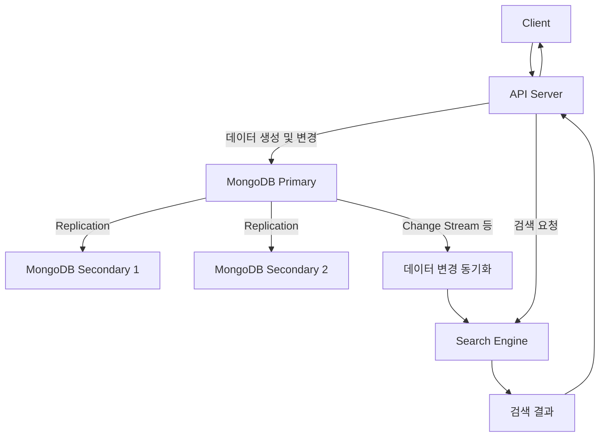
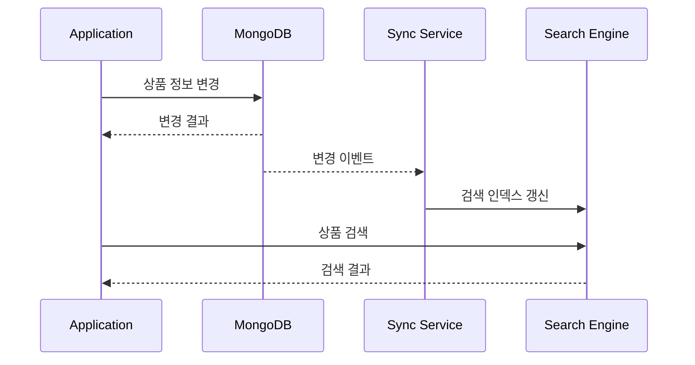
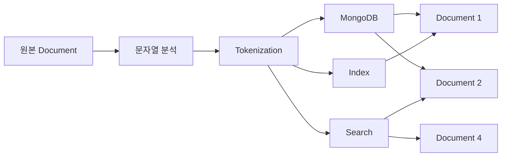
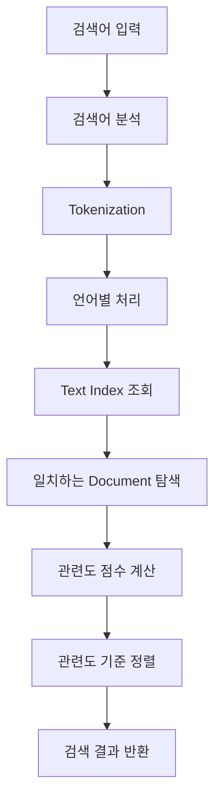
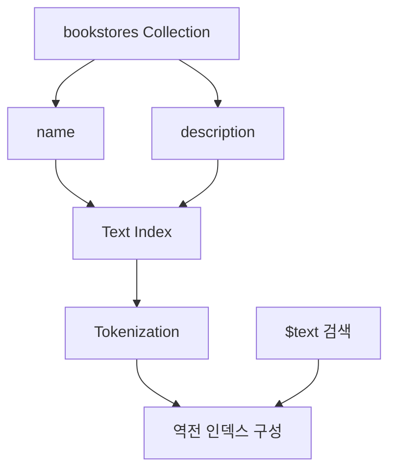
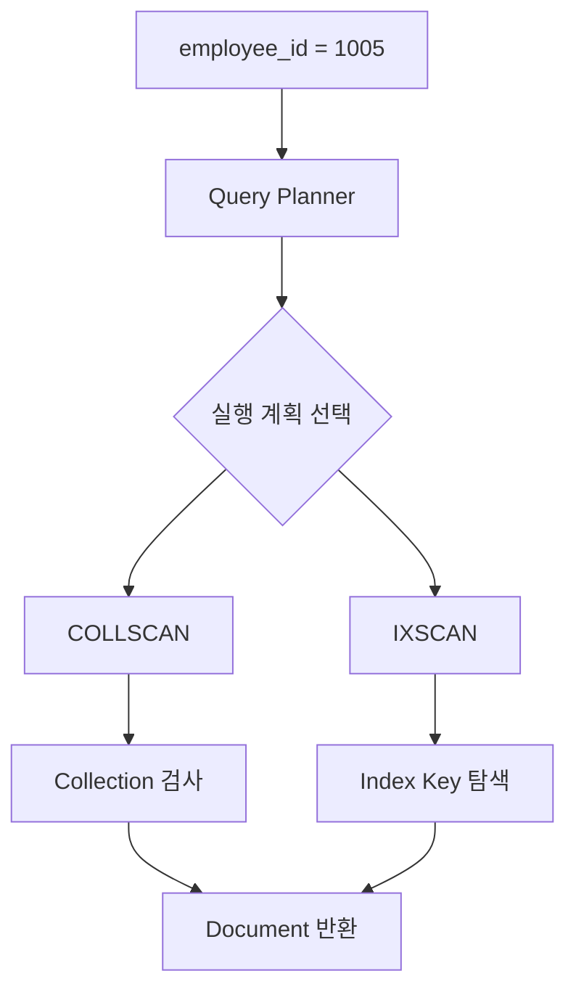
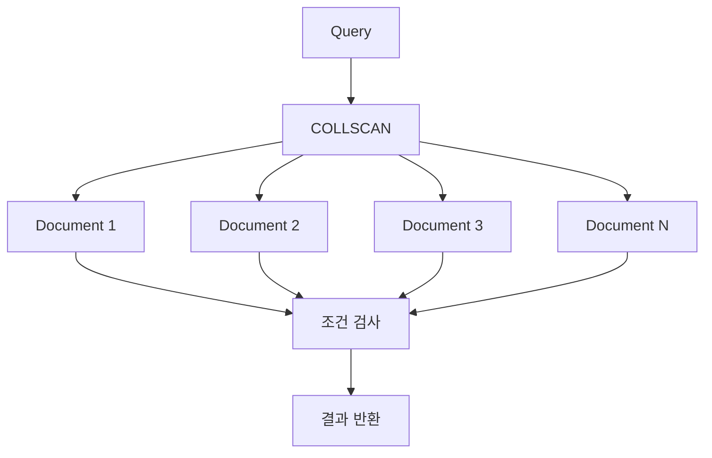
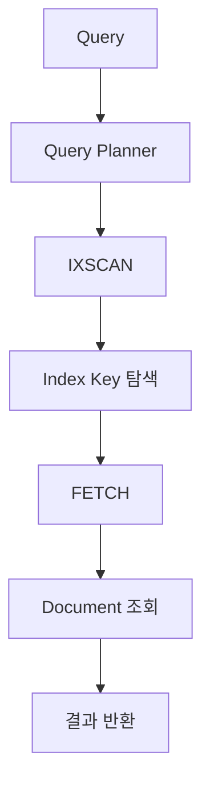
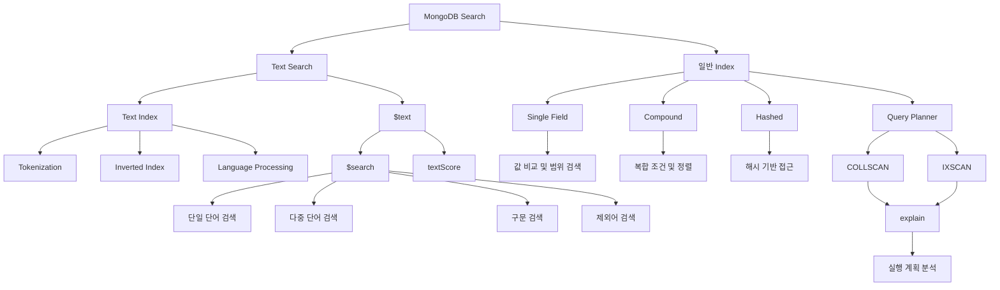

# Text 검색과 INDEX 활용

# Text 검색과 INDEX 활용

* toc
{:toc}

---

## MongoDB Text Search와 Index 완벽 이해: 전문 검색, 역전 인덱스, 관련도 점수 및 검색 성능 최적화

MongoDB에서 데이터를 조회할 때 가장 기본적으로 사용하는 메서드는 `find()`다.

`find()`는 특정 필드의 값이 일치하는 Document를 검색하거나, 비교 연산자를 이용하여 원하는 범위의 데이터를 조회할 때 유용하다.

하지만 실제 서비스를 개발하다 보면 단순한 필드 검색만으로 해결하기 어려운 요구사항이 발생한다.

예를 들어 온라인 쇼핑몰에서 다음과 같은 기능을 구현한다고 가정해 보자.

- 상품 이름에 특정 단어가 포함된 상품을 검색한다.
- 상품 이름뿐만 아니라 상세 설명에서도 검색한다.
- 여러 검색어 중 하나라도 일치하는 상품을 찾는다.
- 여러 단어가 정확한 순서로 등장하는 상품을 검색한다.
- 검색어와 관련성이 높은 상품을 먼저 반환한다.
- 상품 이름에 등장하는 단어를 설명에 등장하는 단어보다 중요하게 평가한다.
- 특정 단어가 포함된 상품은 검색 결과에서 제외한다.
- 텍스트 검색과 가격 범위 조건을 함께 적용한다.
- 가격을 기준으로 정렬하고 일부 필드만 반환한다.
- 실제 검색에 인덱스가 사용되는지 확인한다.

이러한 요구사항을 모두 일반적인 문자열 비교로 처리하기는 어렵다.

MongoDB에서는 문자열 검색을 위해 **Text Search(텍스트 검색)** 기능을 제공한다.

Text Search는 문자열을 단어 단위로 분석하고, Text Index를 활용하여 검색어에 일치하는 Document를 찾는 기능이다.

또한 MongoDB는 검색 결과마다 관련도 점수인 `textScore`를 계산하여 관련성이 높은 데이터를 우선적으로 반환할 수 있도록 지원한다.

그러나 Text Search를 제대로 활용하려면 단순히 `$text` 연산자를 사용하는 방법만 알아서는 부족하다.

검색어가 어떻게 분석되는지, 인덱스가 어떤 구조로 동작하는지, 관련도 점수가 무엇을 의미하는지 이해해야 한다.

특히 일반적인 B-tree 기반 인덱스와 Text Index는 서로 다른 검색 목적을 가지고 있다.

이번 글에서는 MongoDB의 Text Search와 Index를 다음 순서로 자세히 살펴본다.

1. MongoDB Text Search의 개념
2. Text Search와 일반 문자열 검색의 차이
3. MongoDB와 외부 검색 엔진을 함께 사용하는 구조
4. Text Index와 역전 인덱스의 동작 원리
5. Tokenization, Stemming, Stop Words
6. 관련도 점수와 TF·IDF의 개념
7. Text Index 생성 및 관리
8. `$text`와 `$search`를 이용한 단어 검색
9. 다중 키워드 및 구문 검색
10. 필드별 가중치 설정
11. 제외어와 복합 검색 조건
12. 일반 인덱스를 이용한 가격 범위 검색
13. `explain()`을 통한 실행 계획 분석
14. 단일·복합·텍스트·해시 인덱스 비교
15. 실무에서의 인덱스 설계와 성능 최적화

---

## MongoDB Text Search란?

### Text Search의 개념

Text Search는 문자열 데이터에서 특정 단어나 구문을 검색하는 기능이다.

MongoDB에서는 Text Index를 생성한 후 `$text` 연산자를 이용하여 텍스트 검색을 수행할 수 있다.

예를 들어 다음과 같은 상품 정보가 있다고 가정해 보자.

```javascript
{
  _id: 201,
  name: "Tech World",
  description: "Electronics and gadgets",
  price: 150
}
```

이 Document에는 다음과 같은 문자열 필드가 존재한다.

```javascript
name: "Tech World"
```

```javascript
description: "Electronics and gadgets"
```

사용자가 `gadgets`라는 단어를 검색하면 MongoDB는 Text Index를 이용하여 해당 단어가 포함된 Document를 찾을 수 있다.

```javascript
db.bookstores.find({
  $text: {
    $search: "gadgets"
  }
});
```

이 쿼리는 Text Index에 등록된 문자열 필드에서 `gadgets`에 일치하는 단어를 검색한다.

여기서 중요한 점은 **Text Search가 단순한 문자열 포함 여부 검사와 동일하지 않다는 것**이다.

MongoDB의 Text Search는 검색 대상 문자열을 토큰으로 분석하고, 언어별 규칙을 적용하여 검색한다.

따라서 일반적인 문자열 검색과 결과가 달라질 수 있다.

### Text Search의 주요 특징

| 특징 | 설명 |
|---|---|
| 단어 기반 검색 | 문자열을 토큰 단위로 분석 |
| 여러 필드 검색 | 하나의 Text Index에 여러 문자열 필드 포함 가능 |
| 역전 인덱스 | 단어를 기준으로 관련 Document 탐색 |
| 관련도 점수 | 검색어와 Document의 관련성을 점수로 표현 |
| 다중 키워드 | 여러 검색어를 조합하여 검색 |
| 구문 검색 | 정확한 단어 조합을 포함하는 Document 검색 |
| 제외어 | 특정 단어를 포함하는 Document 제외 |
| 필드 가중치 | 특정 필드의 검색 중요도 조정 |
| 언어별 처리 | 지원 언어의 토큰화, 불용어, 어간 처리 |

MongoDB의 기본 Text Search는 자체 관리형 MongoDB 환경에서도 사용할 수 있으며, MongoDB Atlas에서는 더욱 확장된 전문 검색 기능인 MongoDB Search도 제공한다.

다만 이 두 기능은 서로 다른 검색 API와 인덱스 구조를 사용하므로 구분해야 한다. [MongoDB](https://www.mongodb.com/docs/v8.0/core/indexes/index-types/index-text/)

---

## 일반 문자열 검색과 Text Search의 차이

MongoDB에서 문자열을 검색하는 방법은 여러 가지다.

대표적으로 다음 세 가지를 생각할 수 있다.

- 일반적인 동등 비교
- `$regex`를 이용한 패턴 검색
- `$text`를 이용한 Text Search

### 1. 동등 비교

```javascript
db.bookstores.find({
  name: "Tech World"
});
```

이 쿼리는 `name` 필드의 값이 `"Tech World"`와 일치하는 Document를 검색한다.

일반적인 문자열 동등 비교이므로 부분적으로 일치하는 문자열을 찾는 용도는 아니다.

### 2. $regex 검색

```javascript
db.bookstores.find({
  name: {
    $regex: /Tech/
  }
});
```

이 쿼리는 `name`에 `Tech`라는 패턴이 포함된 Document를 검색한다.

정규표현식을 사용하면 문자열의 시작, 끝, 포함 여부 등을 검사할 수 있다.

예를 들어 다음과 같은 접두사 검색이 가능하다.

```javascript
db.bookstores.find({
  name: {
    $regex: /^Tech/
  }
});
```

`^`는 문자열의 시작을 의미한다.

따라서 `Tech`로 시작하는 이름을 검색한다.

### 3. $text 검색

```javascript
db.bookstores.find({
  $text: {
    $search: "gadgets"
  }
});
```

이 쿼리는 Text Index에 등록된 문자열 필드에서 검색어에 일치하는 토큰을 검색한다.

일반적인 문자열 비교와 달리 단어 분석 및 관련도 점수 계산이 가능하다.

### 세 가지 검색 방식 비교

| 구분 | 동등 비교 | $regex | $text |
|---|---|---|---|
| 주요 목적 | 정확한 값 비교 | 문자열 패턴 검색 | 단어 기반 전문 검색 |
| 부분 문자열 검색 | 불가능 | 가능 | 일반적인 부분 문자열 검색과 다름 |
| 여러 필드 검색 | 조건 조합 필요 | 조건 조합 필요 | 하나의 Text Index에 여러 필드 포함 가능 |
| 관련도 점수 | 없음 | 없음 | 제공 |
| 단어 분석 | 없음 | 정규표현식 기반 | 토큰화 및 언어별 처리 |
| 인덱스 | 일반 인덱스 | 특정 패턴에서 일반 인덱스 활용 가능 | Text Index 필요 |
| 주요 활용 | 코드·ID·정확한 이름 | 접두사·패턴 검색 | 제목·설명·콘텐츠 검색 |

여기서 가장 주의할 부분은 부분 문자열 검색이다.

Text Search는 문자열을 토큰 단위로 검색하므로 임의의 문자열 일부를 검색하는 기능과는 다르다.

예를 들어 다음 문자열을 생각해 보자.

```text
blueberry
```

`$regex`에서는 다음과 같이 검색할 수 있다.

```javascript
db.products.find({
  name: /blue/
});
```

하지만 `$text`에서 `blue`를 검색한다고 해서 `blueberry`가 반드시 일치하는 것은 아니다.

MongoDB의 Text Search는 일반적으로 분석된 단어 전체를 기준으로 검색하며, 임의의 접두사나 부분 문자열 검색을 자동으로 제공하지 않는다.

따라서 자동완성, 부분 문자열 검색, 오타 허용 검색 등의 요구사항이 있다면 별도의 검색 전략을 검토해야 한다. [MongoDB](https://www.mongodb.com/docs/v8.0/reference/operator/query/text/)

---

## MongoDB와 외부 검색 엔진을 함께 사용하는 구조

MongoDB 자체에서도 Text Search를 수행할 수 있지만, 모든 서비스가 MongoDB의 기본 Text Search만 사용하는 것은 아니다.

대규모 검색 기능을 제공하는 서비스에서는 MongoDB와 별도의 검색 엔진을 함께 사용하는 아키텍처를 선택하기도 한다.

예를 들어 다음과 같은 구성을 생각해 보자.



이 구조에서는 데이터 저장과 검색의 책임을 분리한다.

MongoDB는 애플리케이션의 주요 데이터를 저장하고 관리한다.

별도의 검색 엔진은 텍스트 검색에 최적화된 인덱스를 관리한다.

### MongoDB의 역할

MongoDB는 다음과 같은 데이터를 관리할 수 있다.

- 사용자 정보
- 상품 정보
- 주문 정보
- 콘텐츠 정보
- 서비스의 주요 비즈니스 데이터

### 검색 엔진의 역할

검색 엔진은 다음과 같은 요구사항을 처리할 수 있다.

- 복잡한 텍스트 검색
- 여러 필드의 관련도 계산
- 자동완성
- 오타 허용 검색
- 형태소 분석
- 검색 결과 정렬
- 대규모 검색 요청 처리

### 왜 데이터를 분리할까?

데이터베이스와 검색 엔진은 최적화해야 하는 작업이 서로 다를 수 있기 때문이다.

MongoDB는 Document 저장과 조회, 수정 등의 작업을 수행한다.

반면 전문 검색 엔진은 검색어 분석과 검색 인덱스를 통한 빠른 문서 탐색에 초점을 맞춘다.

따라서 특정 서비스에서는 두 시스템을 함께 사용하여 역할을 분리한다.

### MongoDB Replication과 검색 데이터 동기화는 다르다

여기서 주의해야 할 개념이 있다.

MongoDB Replica Set의 Replication은 MongoDB 노드 사이에서 데이터를 복제하는 기능이다.

반면 MongoDB와 외부 검색 엔진 사이의 데이터 동기화는 별도의 동기화 구조가 필요하다.

예를 들어 MongoDB Change Streams와 동기화 서비스를 이용할 수 있다.



이 구조에서는 데이터 변경과 검색 인덱스 갱신 사이에 시간 차이가 발생할 수 있다.

즉, 검색 결과가 원본 MongoDB의 최신 상태를 즉시 반영하지 않을 수 있다.

이를 **최종적 일관성(Eventual Consistency)** 관점에서 이해할 수 있다.

실무에서는 다음 사항을 고려해야 한다.

1. 변경 이벤트가 누락되지 않는가?
2. 검색 엔진에 중복 반영되어도 안전한가?
3. 검색 인덱스 갱신에 실패하면 어떻게 재처리할 것인가?
4. 원본 데이터와 검색 데이터의 불일치를 어떻게 탐지할 것인가?
5. 전체 검색 인덱스를 다시 구축해야 한다면 어떻게 처리할 것인가?

따라서 외부 검색 엔진을 도입한다면 검색 성능뿐 아니라 데이터 동기화와 장애 복구 구조까지 함께 설계해야 한다.

---

## Text Index란?

### Text Index의 개념

Text Index는 문자열 필드를 대상으로 단어 기반 검색을 수행할 수 있도록 지원하는 인덱스다.

MongoDB의 Text Index는 문자열을 분석하여 검색에 활용할 수 있는 형태로 관리한다.

이때 중요한 개념이 **Inverted Index(역전 인덱스)** 다.

### 일반 인덱스와 역전 인덱스의 차이

일반적인 데이터 저장 구조를 생각해 보자.

```text
Document ID → Document 내용
```

예를 들어 다음과 같은 데이터가 있다고 가정한다.

| Document ID | 문자열 |
|---|---|
| 1 | MongoDB Index |
| 2 | MongoDB Search |
| 3 | Redis Cache |
| 4 | Search Engine |

이 구조에서는 Document ID를 알고 있다면 해당 Document의 내용을 확인할 수 있다.

하지만 `"Search"`라는 단어를 포함하는 Document를 찾아야 한다면 어떻게 해야 할까?

모든 Document의 문자열을 하나씩 검사하는 방법을 생각할 수 있다.

```text
Document 1 검사
Document 2 검사
Document 3 검사
Document 4 검사
```

데이터가 적다면 큰 문제가 없을 수 있다.

하지만 Document가 수백만 건이라면 모든 문자열을 검사하는 방식은 비효율적이다.

### 역전 인덱스 구조

역전 인덱스는 단어를 기준으로 해당 단어가 등장하는 Document를 연결한다.

```text
MongoDB → Document 1, Document 2

Index   → Document 1

Search  → Document 2, Document 4

Redis   → Document 3

Cache   → Document 3

Engine  → Document 4
```

이를 구조로 표현하면 다음과 같다.



검색어가 `Search`라면 MongoDB는 해당 단어에 대응하는 인덱스 정보를 이용하여 관련 Document를 찾을 수 있다.

모든 문자열을 직접 검사하는 것보다 검색 범위를 줄일 수 있다는 장점이 있다.

### 역전 인덱스를 사용하는 이유

역전 인덱스는 다음과 같은 상황에서 유용하다.

- 문서 제목 검색
- 상품 설명 검색
- 게시글 검색
- 뉴스 기사 검색
- 사용자 리뷰 검색
- 여러 문자열 필드의 통합 검색

하지만 인덱스를 생성한다고 모든 검색이 자동으로 빨라지는 것은 아니다.

검색어가 지나치게 일반적이어서 많은 Document에 등장하거나, 검색 결과의 정렬과 추가 필터링 비용이 크다면 상당한 처리 비용이 발생할 수 있다.

---

## Text Search의 검색 처리 과정

Text Search는 단순히 문자열을 비교하는 작업이 아니다.

일반적으로 다음과 같은 과정을 거쳐 검색한다.



단, **MongoDB는 기본적으로 Text Search 결과를 관련도 점수 순서로 정렬하지 않는다.**

관련도 정렬이 필요하다면 명시적으로 `{ $meta: "textScore" }`를 사용해야 한다.

이제 각 개념을 살펴보자.

---

## Tokenization이란?

Tokenization은 문자열을 검색 가능한 단위인 Token으로 나누는 과정이다.

예를 들어 다음 문자열을 생각해 보자.

```text
Electronics and gadgets
```

이 문자열을 단어 단위로 분리하면 개념적으로 다음과 같은 토큰을 얻을 수 있다.

```text
Electronics

and

gadgets
```

MongoDB는 Text Index를 생성할 때 이러한 토큰화 처리를 수행한다.

이후 언어별 규칙에 따라 일부 단어를 제외하거나 형태를 변환할 수 있다.

### Tokenization을 사용하는 이유

사용자가 `"gadgets"`를 검색했다고 가정해 보자.

전체 문자열이 `"gadgets"`와 정확하게 일치하는 것은 아니다.

하지만 문자열을 단어 단위로 분석한다면 `gadgets`라는 토큰을 찾을 수 있다.

이러한 방식으로 Text Search는 문장이나 설명에 포함된 단어를 검색할 수 있다.

---

## Stop Words란?

Stop Words는 검색에서 특별한 의미가 없거나 지나치게 자주 등장한다고 판단되는 단어를 의미한다.

예를 들어 영어에서는 다음과 같은 단어가 대표적이다.

```text
the

a

an

and
```

이러한 단어는 문장에 자주 등장하지만 문서의 주제를 구분하는 데 큰 도움이 되지 않을 수 있다.

따라서 MongoDB의 영어 Text Index는 일부 Stop Words를 인덱싱 과정에서 제외한다.

예를 들어 다음 문자열을 생각해 보자.

```text
Electronics and gadgets
```

영어 분석 규칙에서는 `and`와 같은 불용어가 제외될 수 있다.

따라서 검색 인덱스에서는 의미 있는 단어를 중심으로 관리하게 된다.

### Stop Words 사용 시 주의할 점

불용어는 모든 언어에서 동일하지 않다.

언어별로 다른 불용어 규칙이 적용된다.

MongoDB Text Index의 기본 언어는 `english`다.

따라서 영어가 아닌 콘텐츠를 다룬다면 인덱스의 언어 설정을 고려해야 한다. [MongoDB](https://www.mongodb.com/ko-kr/docs/v8.0/core/indexes/index-types/index-text/specify-text-index-language/)

---

## Stemming이란?

Stemming은 단어의 변형을 공통된 어간으로 처리하는 과정이다.

예를 들어 다음 단어를 생각해 보자.

```text
book

books
```

또는 다음과 같은 단어가 있다.

```text
garden

gardening
```

영어에서는 단어에 접미사가 붙어 형태가 변하는 경우가 많다.

Text Search는 지원 언어의 어간 분석 규칙을 이용하여 이러한 변형을 처리할 수 있다.

따라서 사용자가 입력한 검색어와 Document에 저장된 문자열이 완전히 같은 형태가 아니더라도 일치하는 결과가 나올 수 있다.

다만 모든 단어 변형이 동일하게 처리되는 것은 아니다.

실제 결과는 인덱스의 언어 설정과 형태소 분석 규칙에 따라 달라진다.

### 한글 검색도 동일하게 처리할까?

여기서 중요한 차이가 있다.

MongoDB의 기본 Text Index는 영어와 일부 유럽 언어 등에 대한 어간 분석을 지원한다.

하지만 기본 Text Index의 지원 언어 목록에는 한국어가 포함되어 있지 않다.

따라서 영어에서 동작하는 Stemming을 한국어 형태소 분석에도 동일하게 기대해서는 안 된다.

예를 들어 다음 문자열을 생각해 보자.

```text
검색하다

검색하는

검색했다
```

이러한 표현을 모두 동일한 의미의 검색어로 처리하려면 한국어 형태소 분석이 필요할 수 있다.

MongoDB의 기본 Text Index만으로 이러한 요구사항을 충분히 처리할 수 있다고 가정하면 안 된다.

한국어 검색이 중요한 서비스라면 한국어 분석기를 지원하는 전문 검색 기능을 검토하는 것이 적절하다.

또는 언어별 불용어와 Stemming을 적용하지 않기 위해 다음과 같이 설정할 수도 있다.

```javascript
db.articles.createIndex(
  {
    title: "text",
    content: "text"
  },
  {
    default_language: "none"
  }
);
```

이 설정은 특정 언어의 어간 분석과 불용어 제거를 사용하지 않는 방식이다.

하지만 `none`을 지정한다고 한국어 형태소 분석이 자동으로 제공되는 것은 아니다. [MongoDB](https://www.mongodb.com/docs/v8.0/reference/text-search-languages/)

---

## Text Search 관련도 점수란?

MongoDB는 Text Search 결과에 대해 관련도 점수인 `textScore`를 제공한다.

관련도 점수는 검색어와 Document가 얼마나 관련성이 있는지를 나타내는 값이다.

예를 들어 사용자가 다음 검색어를 입력했다고 가정해 보자.

```text
art
```

다음 두 Document가 존재한다.

```javascript
{
  name: "Art Supplies",
  description: "Canvas, paints, brushes, and art kits"
}
```

```javascript
{
  name: "Book Haven",
  description: "A paradise for book lovers"
}
```

첫 번째 Document에는 `Art`라는 단어가 등장한다.

반면 두 번째 Document에는 해당 검색어와 직접적으로 일치하는 단어가 없다.

따라서 Text Search에서 두 Document의 검색 관련성은 다르게 평가될 수 있다.

### 관련도 계산에서 이해해야 할 세 가지 개념

검색 관련도를 이해할 때 다음 개념이 자주 등장한다.

1. TF(Term Frequency)
2. IDF(Inverse Document Frequency)
3. Weight(가중치)

이 개념들은 정보 검색 시스템의 일반적인 관련도 평가 원리를 이해하는 데 도움이 된다.

다만 **MongoDB의 `textScore`가 항상 특정한 TF-IDF 수식을 그대로 사용한다고 단정해서는 안 된다.**

MongoDB 서버의 내부 점수 계산은 인덱스 버전과 구현에 영향을 받을 수 있으므로, TF·IDF는 검색 관련도를 이해하기 위한 일반적인 개념으로 구분하는 것이 정확하다.

---

## TF(Term Frequency)

TF는 특정 단어가 하나의 Document에서 얼마나 자주 등장하는지를 나타낸다.

예를 들어 다음 Document를 생각해 보자.

**Document A**

```text
MongoDB Search
```

**Document B**

```text
MongoDB Search MongoDB Index MongoDB
```

`MongoDB`라는 단어가 등장하는 횟수는 다음과 같다.

| Document | 등장 횟수 |
|---|---:|
| A | 1 |
| B | 3 |

단어의 등장 빈도가 높다면 해당 Document가 검색어와 관련이 있을 가능성을 고려할 수 있다.

하지만 등장 횟수가 많다는 이유만으로 항상 더 관련성이 높다고 판단할 수는 없다.

문서 길이와 단어 분포 등 다양한 요소를 함께 고려해야 하기 때문이다.

---

## IDF(Inverse Document Frequency)

IDF는 특정 단어가 전체 Document 집합에서 얼마나 흔하거나 희귀한지를 평가하는 개념이다.

예를 들어 다음과 같은 단어가 있다고 가정해 보자.

```text
product
```

대부분의 상품 설명에 `product`라는 단어가 등장한다면 이 단어만으로 상품을 구분하기 어렵다.

반면 다음과 같은 단어가 있다고 가정해 보자.

```text
MongoDB
```

전체 Document 중 일부에만 등장한다면 특정 주제를 구분하는 데 더 유용할 수 있다.

따라서 정보 검색 시스템에서는 단어의 희귀성을 관련도 평가에 활용하기도 한다.

### TF와 IDF의 관계

개념적으로 다음과 같이 이해할 수 있다.

```text
TF
→ 문서 내부에서 얼마나 자주 등장하는가?

IDF
→ 전체 문서에서 얼마나 희귀한가?
```

이 두 요소를 조합하면 특정 문서가 검색어와 얼마나 관련이 있는지 평가하는 데 도움이 된다.

하지만 실제 MongoDB의 `textScore` 값은 이 개념만으로 직접 계산해서는 안 된다.

---

## Weight(가중치)란?

Weight는 특정 필드의 중요도를 조정하기 위한 값이다.

예를 들어 상품 검색 시스템에서 다음 두 필드를 사용한다고 가정해 보자.

```text
name

description
```

상품 이름은 상품을 직접적으로 설명한다.

반면 상세 설명에는 여러 부가 정보가 포함된다.

따라서 상품 이름에 검색어가 등장하는 경우를 더 중요하게 평가할 수 있다.

이를 위해 Text Index에 필드별 가중치를 지정할 수 있다.

```javascript
db.bookstores.createIndex(
  {
    name: "text",
    description: "text"
  },
  {
    weights: {
      name: 5,
      description: 1
    }
  }
);
```

이 설정은 `name` 필드의 검색 관련도를 `description`보다 중요하게 반영하도록 한다.

가중치가 높을수록 해당 필드의 일치가 점수 계산에서 더 큰 영향을 줄 수 있다.

MongoDB 공식 문서에서도 여러 텍스트 필드에 서로 다른 가중치를 지정하는 기능을 제공한다. [MongoDB](https://www.mongodb.com/docs/v8.0/core/indexes/index-types/index-text/control-text-search-results/)

---

## Text Index 생성 방법

MongoDB에서 Text Index는 `createIndex()`로 생성한다.

### 1. 단일 필드 Text Index

특정 필드 하나에 Text Index를 생성할 수 있다.

```javascript
db.collection.createIndex({
  fieldName: "text"
});
```

예를 들어 상품 이름만 검색한다면 다음과 같이 작성할 수 있다.

```javascript
db.products.createIndex({
  name: "text"
});
```

이 인덱스는 `name` 필드에 대한 단어 기반 검색을 지원한다.

### 2. 여러 필드 Text Index

여러 문자열 필드를 하나의 Text Index에 포함할 수 있다.

```javascript
db.collection.createIndex({
  title: "text",
  description: "text"
});
```

이 경우 `title`과 `description`을 대상으로 텍스트 검색할 수 있다.

### 3. 가중치를 적용한 Text Index

```javascript
db.collection.createIndex(
  {
    title: "text",
    description: "text"
  },
  {
    weights: {
      title: 10,
      description: 5
    }
  }
);
```

여기서는 제목의 중요도를 설명보다 높게 설정했다.

### Text Index의 중요한 제약

MongoDB의 기본 Text Index는 **하나의 Collection에 최대 하나만 생성할 수 있다.**

하지만 그 하나의 Text Index에 여러 문자열 필드를 포함할 수 있다.

예를 들어 다음과 같이 이미 Text Index가 존재한다고 가정해 보자.

```javascript
db.bookstores.createIndex({
  name: "text",
  description: "text"
});
```

이 상태에서 가중치가 다른 Text Index를 별도로 추가하려고 하면 기존 Text Index와 충돌할 수 있다.

따라서 인덱스 가중치를 변경하려면 기존 인덱스 상태를 확인하고 재구성해야 한다. [MongoDB](https://www.mongodb.com/docs/v8.0/core/indexes/index-types/index-text/create-text-index/)

---

## Text Search를 위한 샘플 데이터 생성

이후 예제에서는 여러 종류의 상점 정보를 사용한다.

데이터베이스 이름은 `bizcom_db`다.

Collection 이름은 `bookstores`다.

상점은 다음 필드를 가진다.

```javascript
{
  _id: 201,
  name: "Tech World",
  description: "Electronics and gadgets",
  price: 150
}
```

각 필드의 의미는 다음과 같다.

| 필드 | 설명 |
|---|---|
| `_id` | 상점 식별자 |
| `name` | 상점 이름 |
| `description` | 상점 설명 |
| `price` | 예제 상품 가격 |

### 데이터베이스 선택

```javascript
use bizcom_db
```

현재 데이터베이스를 확인한다.

```javascript
db
```

정상적으로 선택되었다면 다음과 같이 표시된다.

```text
bizcom_db
```

### 상점 데이터 10건 생성

```javascript
db.bookstores.insertMany([
  {
    _id: 201,
    name: "Tech World",
    description: "Electronics and gadgets",
    price: 150
  },
  {
    _id: 202,
    name: "Book Haven",
    description: "A paradise for book lovers",
    price: 25
  },
  {
    _id: 203,
    name: "Fashion Forward",
    description: "Latest trendy clothing",
    price: 80
  },
  {
    _id: 204,
    name: "Organic Market",
    description: "Fresh organic vegetables and fruits",
    price: 10
  },
  {
    _id: 205,
    name: "Toy Kingdom",
    description: "Toys for all ages",
    price: 30
  },
  {
    _id: 206,
    name: "Sports Corner",
    description: "All sports equipment and gear",
    price: 200
  },
  {
    _id: 207,
    name: "Music Hub",
    description: "Instruments and musical accessories",
    price: 120
  },
  {
    _id: 208,
    name: "Garden Supplies",
    description: "Plants, seeds, and gardening tools",
    price: 45
  },
  {
    _id: 209,
    name: "Art Supplies",
    description: "Canvas, paints, brushes, and art kits",
    price: 60
  },
  {
    _id: 210,
    name: "Pet Care",
    description: "Pet foods, toys, and accessories",
    price: 50
  }
]);
```

이 명령어는 총 10개의 Document를 저장한다.

각 Document에는 명시적으로 `_id`를 지정했다.

따라서 같은 코드를 반복 실행하면 동일한 `_id`로 인해 중복 키 오류가 발생할 수 있다.

기존 Collection에 데이터가 없는 상태에서 한 번 실행하는 것을 기준으로 한다.

### 데이터 확인

```javascript
db.bookstores.find({});
```

전체 Document 개수도 확인한다.

```javascript
db.bookstores.countDocuments({});
```

정상적으로 저장되었다면 다음 결과를 확인할 수 있다.

```text
10
```

### 전체 데이터 정리

| ID | 상점 이름 | 설명 | 가격 |
|---|---|---|---:|
| 201 | Tech World | Electronics and gadgets | 150 |
| 202 | Book Haven | A paradise for book lovers | 25 |
| 203 | Fashion Forward | Latest trendy clothing | 80 |
| 204 | Organic Market | Fresh organic vegetables and fruits | 10 |
| 205 | Toy Kingdom | Toys for all ages | 30 |
| 206 | Sports Corner | All sports equipment and gear | 200 |
| 207 | Music Hub | Instruments and musical accessories | 120 |
| 208 | Garden Supplies | Plants, seeds, and gardening tools | 45 |
| 209 | Art Supplies | Canvas, paints, brushes, and art kits | 60 |
| 210 | Pet Care | Pet foods, toys, and accessories | 50 |

상점 이름에는 Book이라는 단어가 포함되어 있지만 실제 데이터는 도서 관련 상점만으로 구성되지 않는다.

전자제품, 의류, 유기농 식품, 장난감, 스포츠, 음악, 원예, 미술, 반려동물 등 여러 분야의 상점 정보가 포함되어 있다.

---

## bookstores Collection에 Text Index 생성하기

이제 `name`과 `description`에 Text Index를 생성한다.

```javascript
db.bookstores.createIndex({
  name: "text",
  description: "text"
});
```

이 명령어는 두 문자열 필드를 대상으로 하나의 Text Index를 생성한다.

### 인덱스 구조



MongoDB는 `name`과 `description`의 문자열을 분석하여 검색 인덱스를 구성한다.

이후 `$text` 연산자를 이용하면 두 필드에서 검색어를 찾을 수 있다.

### 인덱스 확인

```javascript
db.bookstores.getIndexes();
```

이 명령어는 Collection에 생성된 인덱스 목록을 반환한다.

일반적으로 `_id` 인덱스와 새롭게 생성한 Text Index를 확인할 수 있다.

예를 들어 인덱스 이름은 다음과 같은 형태가 될 수 있다.

```text
_id_

name_text_description_text
```

실제 생성된 인덱스 이름은 `getIndexes()` 결과로 확인해야 한다.

---

## $text와 $search의 역할

MongoDB에서 Text Search를 사용할 때 가장 중요한 문법은 다음과 같다.

```javascript
{
  $text: {
    $search: "keyword"
  }
}
```

여기서 `$text`와 `$search`는 서로 다른 역할을 가진다.

### $text

`$text`는 Text Index를 이용하여 텍스트 검색을 수행하는 Query Operator다.

### $search

`$search`는 `$text` 내부에서 검색할 단어나 구문을 지정하는 항목이다.

예를 들어 다음과 같다.

```javascript
db.bookstores.find({
  $text: {
    $search: "gadgets"
  }
});
```

이 쿼리는 `gadgets`라는 검색어를 Text Index에서 검색한다.

### $text 내부의 $search와 Aggregation $search의 차이

이름이 같다는 이유로 두 기능을 혼동해서는 안 된다.

MongoDB에는 다음처럼 `$text` 내부에서 사용하는 `$search`가 있다.

```javascript
{
  $text: {
    $search: "gadgets"
  }
}
```

반면 MongoDB Search에서는 별도의 Aggregation Stage인 `$search`를 사용한다.

두 기능은 검색 API와 인덱스 구성이 다르다.

| 구분 | 기본 Text Search | MongoDB Search |
|---|---|---|
| 검색 방식 | `$text` | `$search` Stage |
| 인덱스 | Text Index | Search Index |
| 주요 목적 | 단어 기반 검색 | 확장된 전문 검색 |
| 검색 관련도 | textScore | Search Score |
| 고급 검색 기능 | 상대적으로 제한적 | 더욱 다양한 검색 기능 지원 |

따라서 검색 기능을 설계할 때 어떤 검색 시스템을 사용하는지 먼저 구분해야 한다. [MongoDB](https://www.mongodb.com/docs/v8.0/reference/operator/query/text/)

---

## Text Search 예제 1: 단일 단어 검색

가장 먼저 `gadgets`라는 단어를 검색해 보자.

### 검색 코드

```javascript
db.bookstores.find(
  {
    $text: {
      $search: "gadgets"
    }
  },
  {
    score: {
      $meta: "textScore"
    }
  }
).sort({
  score: {
    $meta: "textScore"
  }
});
```

이 쿼리는 세 부분으로 구성된다.

1. `$text`로 검색어를 지정한다.
2. Projection에서 관련도 점수를 반환한다.
3. `sort()`로 관련도 점수를 기준으로 정렬한다.

### 첫 번째: 검색 조건

```javascript
{
  $text: {
    $search: "gadgets"
  }
}
```

Text Index에서 `gadgets`에 일치하는 Document를 검색한다.

### 두 번째: 관련도 점수 반환

```javascript
{
  score: {
    $meta: "textScore"
  }
}
```

`$meta`는 검색 결과의 메타데이터를 참조하는 표현식이다.

`"textScore"`를 지정하면 검색 관련도 점수를 가져올 수 있다.

이를 `score`라는 필드 이름으로 반환한다.

### 세 번째: 관련도 정렬

```javascript
.sort({
  score: {
    $meta: "textScore"
  }
});
```

검색 관련도 점수가 높은 Document부터 정렬한다.

### 검색 결과

예제에서는 다음 Document가 검색된다.

```javascript
{
  _id: 201,
  name: "Tech World",
  description: "Electronics and gadgets",
  score: 0.75
}
```

여기서 다음 문자열에 `gadgets`가 포함되어 있다.

```text
Electronics and gadgets
```

따라서 검색 조건에 일치한다.

관련도 점수는 다음과 같다.

```javascript
score: 0.75
```

다만 `0.75`는 특정 데이터와 인덱스 구성에서 관찰된 점수다.

Text Index의 가중치나 검색 대상 데이터가 변경되면 점수도 달라질 수 있다.

또한 실제 `find()`의 Projection에서 `score`만 추가하고 기존 필드를 명시적으로 제외하지 않았다면 원래 Document의 `price` 필드도 반환되는 것이 일반적이다.

따라서 예제의 점수와 표시 필드가 모든 환경에서 완전히 동일하다고 가정해서는 안 된다.

### textScore는 점수가 높을수록 좋을까?

일반적으로 관련도 점수가 높을수록 검색어와 관련성이 높다고 평가된 결과다.

하지만 점수 자체를 절대적인 품질 지표로 해석해서는 안 된다.

예를 들어 다음과 같은 기준을 임의로 정하는 것은 적절하지 않을 수 있다.

```text
score >= 1.0 → 좋은 결과

score < 1.0 → 나쁜 결과
```

검색 점수는 검색어와 데이터, 인덱스 설정에 영향을 받는다.

따라서 서로 다른 검색어의 점수를 단순히 절대값으로 비교하기보다는 동일 검색 요청 안에서 결과의 상대적인 순위를 판단하는 용도로 이해하는 것이 좋다.

---

## Text Search 예제 2: 여러 단어 검색

이번에는 `book` 또는 `art`라는 단어를 포함하는 상점을 검색해 보자.

### 검색 코드

```javascript
db.bookstores.find(
  {
    $text: {
      $search: "book art"
    }
  },
  {
    score: {
      $meta: "textScore"
    }
  }
).sort({
  score: {
    $meta: "textScore"
  }
});
```

여기서 중요한 부분은 다음과 같다.

```javascript
$search: "book art"
```

MongoDB의 `$text`에서 공백으로 구분된 여러 단어는 기본적으로 논리적인 OR 조건으로 검색된다.

즉, 다음과 같은 의미다.

```text
book

OR

art
```

따라서 두 단어를 모두 포함하지 않아도 하나 이상의 검색어에 일치하면 검색 대상이 될 수 있다.

### 검색 결과

예제에서는 다음 상점들이 검색된다.

```javascript
[
  {
    _id: 202,
    name: "Book Haven",
    description: "A paradise for book lovers",
    score: 1.4166666666666665
  },
  {
    _id: 209,
    name: "Art Supplies",
    description: "Canvas, paints, brushes, and art kits",
    score: 1.35
  }
]
```

첫 번째 Document에는 `Book`이라는 단어가 존재한다.

두 번째 Document에는 `Art`라는 단어가 존재한다.

따라서 두 Document 모두 검색 결과에 포함된다.

### 여러 검색어가 항상 AND 조건은 아니다

다음 검색어를 살펴보자.

```javascript
$search: "book art"
```

이 표현은 기본적으로 다음 조건과 다르다.

```text
book AND art
```

두 단어가 모두 포함되어야 한다는 의미가 아니다.

이는 MongoDB의 기본 Text Search를 사용할 때 자주 혼동하는 부분이다.

공식 문서에서도 공백으로 구분된 검색어는 기본적으로 OR 방식으로 처리한다고 설명한다. [MongoDB](https://www.mongodb.com/docs/v8.0/reference/operator/query/text/)

---

## Text Search 예제 3: 정확한 구문 검색

이번에는 `Pet Care`라는 구문을 검색해 보자.

단순히 `Pet` 또는 `Care` 중 하나라도 포함된 Document를 검색하는 것이 아니라, 두 단어가 하나의 구문으로 등장하는 결과를 찾는 것이다.

### 검색 코드

```javascript
db.bookstores.find(
  {
    $text: {
      $search: "\"Pet Care\""
    }
  },
  {
    score: {
      $meta: "textScore"
    }
  }
).sort({
  score: {
    $meta: "textScore"
  }
});
```

여기서 중요한 부분은 다음과 같다.

```javascript
$search: "\"Pet Care\""
```

JavaScript 문자열 안에서 큰따옴표를 포함하기 위해 `\"`를 사용했다.

실제 검색 문자열은 다음과 같은 의미다.

```text
"Pet Care"
```

큰따옴표로 감싼 문자열은 여러 단어로 이루어진 구문 검색에 사용된다.

### 검색 결과

```javascript
{
  _id: 210,
  name: "Pet Care",
  description: "Pet foods, toys, and accessories",
  score: 2.125
}
```

이 Document의 상점 이름은 다음과 같다.

```text
Pet Care
```

검색 구문과 일치하므로 결과에 포함된다.

### 일반 다중 단어 검색과 구문 검색 비교

다음 두 검색어는 의미가 다르다.

```javascript
$search: "Pet Care"
```

```javascript
$search: "\"Pet Care\""
```

첫 번째는 `Pet` 또는 `Care`라는 단어에 일치하는 Document를 검색할 수 있다.

두 번째는 `Pet Care`라는 구문에 일치하는 Document를 검색한다.

| 검색어 | 의미 |
|---|---|
| `Pet Care` | Pet 또는 Care |
| `"Pet Care"` | Pet Care 구문 검색 |

### 구문 검색의 활용

구문 검색은 다음과 같은 상황에서 유용하다.

- 브랜드 이름 검색
- 제품 모델명 검색
- 고정된 서비스 이름 검색
- 특정 문구가 포함된 콘텐츠 검색
- 정확한 표현이 중요한 문서 검색

다만 구문 검색 역시 일반적인 문자열의 모든 문자를 그대로 비교하는 기능과 동일하지 않다.

Text Search의 토큰화와 언어 분석 규칙이 적용된다는 점을 고려해야 한다.

---

## Text Search 예제 4: 필드별 가중치 적용

이제 상품 이름과 설명의 중요도를 다르게 설정해 보자.

다음과 같은 요구사항이 있다고 가정한다.

> 검색어가 상품 이름에 등장하면 상세 설명에 등장하는 경우보다 높은 관련도 점수를 부여한다.

이를 위해 Text Index의 가중치를 설정할 수 있다.

### 가중치를 적용한 인덱스

```javascript
db.bookstores.createIndex(
  {
    name: "text",
    description: "text"
  },
  {
    weights: {
      name: 5,
      description: 1
    }
  }
);
```

이 설정에서 `name`의 가중치는 5다.

`description`의 가중치는 1이다.

따라서 이름에 등장하는 검색어를 더 중요하게 평가하도록 구성한다.

### 이미 Text Index가 존재한다면?

앞에서 다음 인덱스를 생성했다.

```javascript
db.bookstores.createIndex({
  name: "text",
  description: "text"
});
```

MongoDB는 Collection에 하나의 Text Index만 허용한다.

따라서 가중치가 다른 인덱스를 추가로 생성하는 것이 아니라 기존 Text Index를 변경하는 절차가 필요하다.

먼저 현재 인덱스를 확인한다.

```javascript
db.bookstores.getIndexes();
```

Text Index의 이름을 확인한다.

예를 들어 다음 이름이 존재한다고 가정해 보자.

```text
name_text_description_text
```

그다음 기존 Text Index를 삭제한다.

```javascript
db.bookstores.dropIndex(
  "name_text_description_text"
);
```

이제 가중치를 적용한 Text Index를 생성한다.

```javascript
db.bookstores.createIndex(
  {
    name: "text",
    description: "text"
  },
  {
    weights: {
      name: 5,
      description: 1
    }
  }
);
```

변경 후 인덱스 설정을 확인한다.

```javascript
db.bookstores.getIndexes();
```

이 절차는 개발 환경에서 인덱스 구성을 이해하기 위한 예제다.

운영 환경에서는 인덱스 삭제와 재생성 중 검색 요청에 영향을 줄 수 있으므로 변경 계획을 수립해야 한다.

가중치 변경은 기존 인덱스에 영향을 주는 작업이며, 대량의 Collection에서는 인덱스 재구성 비용을 고려해야 한다. [MongoDB](https://www.mongodb.com/docs/manual/core/indexes/index-types/index-text/control-text-search-results/)

---

## Text Search 예제 5: 구문 검색과 제외어 조합

이번에는 다음 요구사항을 생각해 보자.

> `art supplies`라는 구문을 검색하면서 `toys`라는 단어가 포함된 Document는 제외한다.

MongoDB의 `$text`에서는 검색어 앞에 `-`를 붙여 제외 조건을 표현할 수 있다.

### 기본 제외어 검색

```javascript
db.bookstores.find(
  {
    $text: {
      $search: "art -toys"
    }
  },
  {
    score: {
      $meta: "textScore"
    }
  }
).sort({
  score: {
    $meta: "textScore"
  }
});
```

이 검색은 다음과 같은 의미를 가진다.

```text
art 검색

AND

toys를 포함하는 Document 제외
```

### 구문 검색과 제외어 조합

```javascript
db.bookstores.find(
  {
    $text: {
      $search: "\"art supplies\" -toys"
    }
  },
  {
    score: {
      $meta: "textScore"
    }
  }
).sort({
  score: {
    $meta: "textScore"
  }
});
```

이 검색은 `art supplies` 구문에 일치하는 Document 중 `toys`를 포함하는 Document를 제외한다.

### 복합 검색어에서 주의할 점

다음과 같은 검색 문자열도 생각해 볼 수 있다.

```javascript
$search: "\"art supplies\" + " +
         "genuine -toys"
```

이 코드는 JavaScript의 문자열 결합 연산자를 사용한다.

실제로 전달되는 검색 문자열에는 다음 내용이 포함된다.

```text
"art supplies" + genuine -toys
```

하지만 여기서 `+`를 MongoDB Text Search의 일반적인 AND 연산자로 이해해서는 안 된다.

MongoDB의 기본 `$text`는 검색 문자열에서 구문과 제외어 등을 해석하지만, `+`를 붙인다고 Elasticsearch의 Query String과 동일한 의미의 필수 검색 조건을 제공하는 것은 아니다.

또한 `$text` 검색 문자열에 정확한 구문과 일반 단어가 함께 존재하면 구문 일치 여부가 결과를 제한할 수 있다.

따라서 복잡한 검색을 구현할 때는 검색 문자열이 실제로 어떤 조건을 표현하는지 검증해야 한다.

### 제외어의 동작

다음 검색어를 살펴보자.

```javascript
$search: "pet -toys"
```

이 경우 `pet`에 일치하는 Document 중 `toys`가 포함된 Document는 제외된다.

현재 예제의 `Pet Care` Document는 다음 설명을 가진다.

```text
Pet foods, toys, and accessories
```

`toys`가 포함되어 있으므로 제외 조건에 의해 결과에서 제거될 수 있다.

다만 실제 비교는 Text Index의 언어 처리와 어간 분석 규칙에 따라 수행된다.

---

## Text Search 예제 6: 텍스트 검색과 가격 범위 조건 조합

이제 텍스트 검색과 일반적인 숫자 범위 검색을 함께 수행해 보자.

요구사항은 다음과 같다.

> `garden`이라는 단어와 관련된 상점 중 가격이 20 이상, 100 이하인 상점을 검색한다.

### 검색 코드

```javascript
db.bookstores.find(
  {
    $text: {
      $search: "garden"
    },
    price: {
      $gte: 20,
      $lte: 100
    }
  },
  {
    score: {
      $meta: "textScore"
    }
  }
).sort({
  score: {
    $meta: "textScore"
  }
});
```

### 검색 조건 분석

첫 번째 조건은 다음과 같다.

```javascript
$text: {
  $search: "garden"
}
```

`garden`이라는 단어에 일치하는 Document를 검색한다.

두 번째 조건은 다음과 같다.

```javascript
price: {
  $gte: 20,
  $lte: 100
}
```

가격이 20 이상이고 100 이하인 Document를 검색한다.

두 조건이 같은 Query Document에 포함되어 있으므로 AND 관계로 처리된다.

```text
Text Search: garden

AND

20 <= price <= 100
```

### 검색 결과

예제에서 다음 Document가 검색된다.

```javascript
{
  _id: 208,
  name: "Garden Supplies",
  description: "Plants, seeds, and gardening tools",
  price: 45,
  score: 1.375
}
```

상점 이름에 `Garden`이 포함되어 있다.

설명에도 `gardening`이라는 관련 단어가 등장한다.

그리고 가격은 45이므로 지정한 범위에 포함된다.

### Text Index와 일반 인덱스를 동시에 사용할까?

여기서 중요한 점이 있다.

다음 Text Index가 존재한다고 가정해 보자.

```javascript
db.bookstores.createIndex({
  name: "text",
  description: "text"
});
```

또한 가격 인덱스도 존재한다고 가정한다.

```javascript
db.bookstores.createIndex({
  price: 1
});
```

이 상태에서 Text Search와 가격 조건을 함께 사용한다고 해서 MongoDB가 두 인덱스를 반드시 동시에 활용하는 것은 아니다.

`$text` 검색은 Text Index를 필요로 한다.

반면 가격 조건은 일반적인 B-tree 인덱스를 활용할 수 있다.

두 조건을 함께 처리하는 실제 실행 계획은 Query Planner와 인덱스 구성에 영향을 받는다.

따라서 사용 가능한 인덱스가 존재한다는 사실만으로 최종 실행 계획을 단정해서는 안 된다.

실무에서는 `explain()`으로 실제 데이터 접근 방식을 확인해야 한다.

---

## Text Search 예제 7: 구문과 여러 단어를 함께 검색하기

이번에는 `organic vegetables`라는 구문을 검색한다고 가정해 보자.

다음 Document가 존재한다.

```javascript
{
  _id: 204,
  name: "Organic Market",
  description: "Fresh organic vegetables and fruits",
  price: 10
}
```

### 정확한 구문 검색

```javascript
db.bookstores.find(
  {
    $text: {
      $search: "\"organic vegetables\""
    }
  },
  {
    score: {
      $meta: "textScore"
    }
  }
).sort({
  score: {
    $meta: "textScore"
  }
});
```

이 쿼리는 `organic vegetables`라는 구문에 일치하는 Document를 검색한다.

### 일반적인 여러 단어 검색

반면 다음 쿼리는 의미가 다르다.

```javascript
db.bookstores.find(
  {
    $text: {
      $search: "organic vegetables"
    }
  },
  {
    score: {
      $meta: "textScore"
    }
  }
).sort({
  score: {
    $meta: "textScore"
  }
});
```

이 검색은 기본적으로 `organic` 또는 `vegetables`에 일치하는 Document를 검색할 수 있다.

### OR를 문자열에 직접 입력하면 될까?

다음과 같은 표현을 생각해 보자.

```javascript
$search: "\"organic vegetables\" organic OR vegetables"
```

이 문자열에서 `OR`를 SQL이나 검색 엔진의 논리 연산자처럼 해석해서는 안 된다.

MongoDB의 `$text`는 기본적으로 공백으로 구분된 일반 검색어에 OR 동작을 적용한다.

따라서 `OR`라는 단어를 검색 문자열에 명시할 필요가 없다.

또한 영어 불용어 처리 과정에서 `OR`와 같은 일반적인 접속사는 무시될 수 있다.

특히 구문 검색과 일반 단어 검색을 함께 사용하는 경우에는 **정확한 구문이 검색 결과의 필수 조건으로 작용할 수 있다는 점**을 고려해야 한다.

예를 들어 다음 검색 문자열은

```javascript
$search: "\"organic vegetables\" organic vegetables"
```

일반적인 단어 OR 검색만 수행하는 것과 동일하지 않다.

MongoDB의 `$text`는 정확한 구문이 포함된 검색 문자열에서 해당 구문에 일치하는 Document만 반환하도록 동작할 수 있다.

따라서 사용자가 원하는 검색 조건이 단순한 다중 키워드 OR인지, 정확한 구문 검색인지 구분해야 한다. [MongoDB](https://www.mongodb.com/docs/v8.0/core/indexes/index-types/index-text/text-index-restrictions/)

---

## MongoDB Index란?

지금까지 Text Index를 중심으로 검색 방법을 살펴보았다.

하지만 MongoDB에는 Text Index 외에도 다양한 인덱스가 존재한다.

MongoDB Index는 Collection에 저장된 데이터를 효율적으로 검색하기 위한 자료구조다.

### 인덱스가 없는 경우

직원 100만 명의 정보가 저장되어 있다고 가정해 보자.

다음 쿼리를 실행한다.

```javascript
db.employees.find({
  employee_id: 1005
});
```

`employee_id`에 적절한 인덱스가 없다면 MongoDB는 많은 Document를 검사해야 할 수 있다.

이러한 데이터 접근 방식은 Collection Scan으로 나타날 수 있다.

```text
Document 1 검사

Document 2 검사

Document 3 검사

...

Document 1000000 검사
```

### 인덱스가 있는 경우

다음과 같이 인덱스를 생성할 수 있다.

```javascript
db.employees.createIndex({
  employee_id: 1
});
```

적절한 인덱스가 존재하면 MongoDB는 인덱스를 이용하여 필요한 데이터에 접근할 수 있다.



여기서 중요한 점은 **인덱스가 존재한다고 항상 인덱스를 사용하는 것은 아니라는 것**이다.

MongoDB는 Collection의 크기, 데이터 분포, 검색 조건 등을 고려하여 실행 계획을 선택한다.

따라서 인덱스의 효과는 실제 실행 계획을 통해 확인해야 한다.

---

## MongoDB Index를 사용하는 이유

인덱스의 대표적인 목적은 다음 세 가지다.

1. 검색 속도 개선
2. 정렬 성능 개선
3. 데이터 유일성 보장

### 1. 검색 속도 개선

특정 필드를 이용한 검색이 반복된다면 인덱스를 통해 데이터 접근 범위를 줄일 수 있다.

```javascript
db.bookstores.createIndex({
  price: 1
});
```

가격을 기준으로 검색하는 쿼리에서 활용할 수 있다.

### 2. 정렬 성능 개선

다음과 같은 쿼리가 있다고 가정해 보자.

```javascript
db.bookstores.find({}).sort({
  price: 1
});
```

가격 인덱스가 적절하게 활용된다면 별도의 정렬 작업을 줄일 수 있다.

다만 모든 정렬에서 인덱스를 사용할 수 있는 것은 아니다.

필터 조건과 정렬 방향, 복합 인덱스의 필드 순서 등에 영향을 받는다.

### 3. 고유성 보장

특정 필드의 중복을 방지하려면 Unique Index를 사용할 수 있다.

```javascript
db.users.createIndex(
  {
    email: 1
  },
  {
    unique: true
  }
);
```

이 인덱스는 동일한 이메일 값의 중복 저장을 방지하는 데 사용된다.

단, 기존 데이터에 중복된 이메일이 존재한다면 인덱스 생성이 실패할 수 있다.

---

## MongoDB 일반 인덱스를 이용한 가격 검색

이제 Text Search와 별도로 일반 인덱스를 사용해 보자.

대상 Collection은 앞에서 구성한 `bookstores`다.

### 가격 인덱스 생성

```javascript
db.bookstores.createIndex({
  price: 1
});
```

이 코드는 `price` 필드에 오름차순 인덱스를 생성한다.

여기서 `1`은 오름차순을 의미한다.

반면 `-1`은 내림차순을 의미한다.

### 가격 인덱스 확인

```javascript
db.bookstores.getIndexes();
```

정상적으로 생성되었다면 다음과 같은 인덱스 이름을 확인할 수 있다.

```text
price_1
```

---

## 가격 범위 검색하기

이번에는 가격이 20 이상이고 100 이하인 상점을 조회한다.

```javascript
db.bookstores.find({
  price: {
    $gte: 20,
    $lte: 100
  }
}).sort({
  price: 1
});
```

이 쿼리는 다음 조건을 의미한다.

```text
price >= 20

AND

price <= 100
```

그리고 가격을 오름차순으로 정렬한다.

### 검색 결과

원본 데이터 기준으로 다음 상점이 조건에 일치한다.

| ID | 상점 | 가격 |
|---|---|---:|
| 202 | Book Haven | 25 |
| 205 | Toy Kingdom | 30 |
| 208 | Garden Supplies | 45 |
| 210 | Pet Care | 50 |
| 209 | Art Supplies | 60 |
| 203 | Fashion Forward | 80 |

`$gte`는 Greater Than or Equal을 의미한다.

`$lte`는 Less Than or Equal을 의미한다.

따라서 양쪽 경계값을 포함하는 범위 검색이다.

### 범위 검색과 인덱스

가격 인덱스가 존재한다면 MongoDB는 해당 인덱스의 특정 범위를 탐색할 수 있다.

```text
price index
    │
    ├── 10
    ├── 25
    ├── 30
    ├── 45
    ├── 50
    ├── 60
    ├── 80
    ├── 120
    ├── 150
    └── 200
```

이때 조건이 20 이상, 100 이하라면 관련된 범위의 Index Key를 탐색할 수 있다.

그러나 10건처럼 데이터가 매우 적은 경우에는 Collection Scan이 선택될 수도 있다.

실제 인덱스 활용 여부는 실행 계획을 확인해야 한다.

---

## 가격이 가장 낮은 상점 3개 조회

가격이 가장 낮은 상점 세 개를 조회한다고 가정해 보자.

```javascript
db.bookstores.find({})
  .sort({
    price: 1
  })
  .limit(3);
```

이 쿼리는 다음 작업을 수행한다.

1. 전체 상점을 대상으로 조회한다.
2. 가격을 오름차순으로 정렬한다.
3. 앞의 세 개만 반환한다.

### 검색 결과

| ID | 상점 | 가격 |
|---|---|---:|
| 204 | Organic Market | 10 |
| 202 | Book Haven | 25 |
| 205 | Toy Kingdom | 30 |

여기서 중요한 부분은 정렬과 제한의 순서다.

```javascript
.sort({
  price: 1
})
.limit(3)
```

가격순으로 정렬한 뒤 세 개를 선택한다.

만약 먼저 임의의 세 개를 선택하고 정렬한다면 전체 상점 중 최저가 세 개를 보장할 수 없다.

---

## Projection을 이용하여 필요한 필드만 조회하기

가격이 50 이상이고 150 이하인 상점의 이름만 반환한다고 가정해 보자.

```javascript
db.bookstores.find(
  {
    price: {
      $gte: 50,
      $lte: 150
    }
  },
  {
    name: 1,
    _id: 0
  }
);
```

첫 번째 인수는 검색 조건이다.

```javascript
{
  price: {
    $gte: 50,
    $lte: 150
  }
}
```

두 번째 인수는 Projection이다.

```javascript
{
  name: 1,
  _id: 0
}
```

Projection에서 `1`은 포함, `0`은 제외를 의미한다.

### 검색 결과

원본 데이터 기준으로 다음 상점이 조건에 일치한다.

```javascript
[
  {
    name: "Tech World"
  },
  {
    name: "Fashion Forward"
  },
  {
    name: "Music Hub"
  },
  {
    name: "Art Supplies"
  },
  {
    name: "Pet Care"
  }
]
```

이 쿼리에는 정렬 조건이 없으므로 실제 반환 순서는 보장되지 않는다.

### Projection을 사용하면 항상 빨라질까?

Projection을 사용하면 애플리케이션에 반환하는 필드 수를 줄일 수 있다.

따라서 네트워크 전송량을 줄이는 데 도움이 될 수 있다.

하지만 Projection을 사용했다고 해서 MongoDB가 반드시 인덱스만으로 조회를 처리하는 것은 아니다.

예를 들어 다음 인덱스가 있다고 가정해 보자.

```javascript
db.bookstores.createIndex({
  price: 1
});
```

검색 조건은 `price`다.

하지만 반환할 필드는 `name`이다.

이 경우 가격 인덱스만으로 `name` 값을 가져올 수 없을 수 있다.

따라서 실제 Document에 접근하는 `FETCH` 단계가 필요할 수 있다.

반면 다음과 같이 복합 인덱스를 구성하는 경우에는 상황이 달라질 수 있다.

```javascript
db.bookstores.createIndex({
  price: 1,
  name: 1
});
```

검색 조건과 반환 필드를 인덱스에서 모두 충족할 수 있다면 Covered Query를 고려할 수 있다.

다만 실제로 Covered Query가 되는지는 실행 계획으로 확인해야 한다.

---

## explain()이란?

MongoDB에서 Query의 실행 계획을 확인할 때는 `explain()`을 사용한다.

`explain()`은 MongoDB가 데이터를 어떤 방식으로 검색하는지 분석하기 위한 기능이다.

### 기본 문법

```javascript
db.collection.find({}).explain();
```

실행 통계까지 확인하려면 다음과 같이 작성한다.

```javascript
db.collection.find({}).explain("executionStats");
```

### 실행 계획 확인 예제

다음 쿼리의 실행 계획을 확인해 보자.

```javascript
db.bookstores.find(
  {
    price: {
      $gte: 50,
      $lte: 150
    }
  },
  {
    name: 1,
    _id: 0
  }
).explain("executionStats");
```

이 명령어는 다음과 같은 정보를 확인하는 데 사용한다.

- MongoDB가 어떤 실행 계획을 선택했는가?
- 인덱스를 사용했는가?
- 몇 개의 Document를 반환했는가?
- 몇 개의 Index Key를 검사했는가?
- 몇 개의 Document를 검사했는가?
- 실행 과정에서 어떤 Stage를 사용했는가?

---

## explain()의 주요 실행 모드

MongoDB의 `explain()`은 다음과 같은 모드를 제공한다.

| 모드 | 설명 |
|---|---|
| `queryPlanner` | 실행 계획 확인 |
| `executionStats` | 실행 계획과 실행 통계 |
| `allPlansExecution` | 후보 실행 계획 관련 추가 정보 |

### queryPlanner

```javascript
db.bookstores.find({
  price: {
    $gte: 50,
    $lte: 150
  }
}).explain("queryPlanner");
```

Query Planner가 선택한 실행 계획을 확인한다.

### executionStats

```javascript
db.bookstores.find({
  price: {
    $gte: 50,
    $lte: 150
  }
}).explain("executionStats");
```

실행 계획과 실행 통계를 함께 확인한다.

### allPlansExecution

```javascript
db.bookstores.find({
  price: {
    $gte: 50,
    $lte: 150
  }
}).explain("allPlansExecution");
```

실행 계획 선택 과정과 관련된 추가 통계를 확인할 수 있다.

다만 모든 후보 계획의 전체 실행 결과가 제공되는 것은 아니다.

---

## explain() 실행 결과 분석하기

가격 범위 검색의 실행 계획에서 다음과 같은 항목을 확인할 수 있다.

```javascript
{
  explainVersion: "1",
  queryPlanner: {
    namespace: "bizcom_db.bookstores",
    parsedQuery: {
      $and: [
        {
          price: {
            $lte: 150
          }
        },
        {
          price: {
            $gte: 50
          }
        }
      ]
    }
  }
}
```

여기서 `namespace`는 조회 대상 Collection을 의미한다.

```text
bizcom_db.bookstores
```

`parsedQuery`는 MongoDB가 해석한 검색 조건이다.

```javascript
{
  price: {
    $gte: 50,
    $lte: 150
  }
}
```

이 조건은 내부적으로 다음과 같은 AND 조건으로 표현될 수 있다.

```text
price >= 50

AND

price <= 150
```

### IXSCAN

실행 계획에서 다음과 같은 Stage를 확인할 수 있다.

```javascript
{
  stage: "IXSCAN",
  nReturned: 5,
  executionTimeMillisEstimate: 0,
  works: 6,
  advanced: 5
}
```

이는 Index Scan 관련 실행 단계의 일부 항목을 표현한 예시다.

실제 전체 `explain()` 결과에는 더 많은 필드와 Stage가 포함될 수 있다.

### nReturned

```javascript
nReturned: 5
```

해당 실행 단계에서 반환한 결과 수를 의미한다.

최종 쿼리의 반환 건수는 상위 실행 통계의 `nReturned`와 함께 확인하는 것이 좋다.

### executionTimeMillisEstimate

```javascript
executionTimeMillisEstimate: 0
```

해당 Stage의 실행 시간 추정 관련 지표다.

여기서 0이라는 값이 표시되었다고 해서 실제 실행 비용이 완전히 없었다는 의미는 아니다.

특히 데이터가 10건뿐인 예제에서 발생한 실행 시간은 운영 환경의 대용량 Collection과 직접 비교하기 어렵다.

### works

```javascript
works: 6
```

해당 실행 Stage의 작업 호출 횟수와 관련된 내부 실행 통계다.

### advanced

```javascript
advanced: 5
```

Stage가 결과를 생성한 횟수와 관련된 통계다.

이 값은 Query Engine과 실행 계획의 구조에 따라 해석해야 한다.

단순히 `works`와 `advanced`만으로 전체 검색 성능을 평가해서는 안 된다.

---

## COLLSCAN과 IXSCAN 비교

MongoDB 실행 계획에서 자주 등장하는 Stage는 다음 두 가지다.

- `COLLSCAN`
- `IXSCAN`

### COLLSCAN

Collection Scan을 의미한다.

Collection의 Document를 직접 검사하는 방식이다.



인덱스를 사용하지 않고 Collection을 검사한다.

하지만 전체 데이터를 조회하거나 Collection이 매우 작은 경우에는 합리적인 선택일 수 있다.

### IXSCAN

Index Scan을 의미한다.

인덱스를 이용하여 검색 조건에 일치하는 데이터를 찾는 방식이다.



인덱스를 사용하면 전체 Collection을 검사하지 않고 검색 범위를 줄일 수 있다.

다만 인덱스에서 Document의 위치만 확인하고 실제 데이터를 읽어야 하는 경우에는 `FETCH`가 함께 나타날 수 있다.

### 비교

| 구분 | COLLSCAN | IXSCAN |
|---|---|---|
| 접근 방식 | Collection 직접 검사 | 인덱스 탐색 |
| 인덱스 사용 | 없음 | 있음 |
| 특정 값 검색 | 많은 Document 검사 가능 | 탐색 범위 축소 가능 |
| 전체 데이터 조회 | 유리할 수 있음 | 반드시 유리하지 않음 |
| 실행 계획 | COLLSCAN | IXSCAN |
| 주요 확인 항목 | 검사 Document 수 | 검사 Index Key 및 Document 수 |

인덱스가 사용되었다는 사실만으로 쿼리가 효율적이라고 단정해서는 안 된다.

인덱스 키를 지나치게 많이 검사하거나, 실제 Document를 다수 읽거나, 정렬 비용이 높다면 검색 성능이 기대보다 낮을 수 있다.

---

## explain()에서 반드시 확인해야 할 항목

실무에서 `executionStats`를 분석할 때는 다음 항목이 중요하다.

| 항목 | 설명 |
|---|---|
| `nReturned` | 반환된 Document 수 |
| `totalKeysExamined` | 검사한 Index Key 수 |
| `totalDocsExamined` | 검사한 Document 수 |
| `executionTimeMillis` | 실행 시간 |
| `winningPlan` | 선택된 실행 계획 |
| `indexName` | 사용된 인덱스 이름 |
| `COLLSCAN` | Collection Scan |
| `IXSCAN` | Index Scan |
| `FETCH` | 실제 Document 접근 |

### totalDocsExamined와 nReturned 비교

예를 들어 다음과 같은 결과가 있다고 가정해 보자.

```text
nReturned = 5

totalDocsExamined = 100000
```

100000개의 Document를 검사했지만 실제 반환한 Document는 5개다.

이 경우 검색 조건에 적절한 인덱스가 존재하는지 검토할 필요가 있다.

반대로 다음과 같은 결과라면 어떨까?

```text
nReturned = 5

totalDocsExamined = 5
```

검사한 Document 수와 반환한 Document 수가 동일하다.

이 경우 불필요한 Document 접근을 줄였을 가능성이 있다.

하지만 `totalDocsExamined`가 작다고 반드시 빠른 쿼리는 아니다.

많은 Index Key를 검사하거나 별도의 정렬이 발생할 수 있기 때문이다.

따라서 다음 항목을 함께 확인해야 한다.

```text
nReturned

totalDocsExamined

totalKeysExamined

executionTimeMillis
```

### Covered Query라면?

Covered Query는 검색 조건과 반환 필드를 인덱스만으로 처리할 수 있는 쿼리다.

이 경우 실제 Document를 읽지 않아도 될 수 있다.

따라서 실행 통계에서 다음과 같은 값을 확인할 수 있다.

```text
totalDocsExamined = 0
```

하지만 단순히 `IXSCAN`이 존재한다고 Covered Query가 되는 것은 아니다.

`FETCH`가 필요한지와 실제 반환 필드가 인덱스로 충족되는지 확인해야 한다. [MongoDB](https://www.mongodb.com/docs/v8.0/reference/explain-results/)

---

## MongoDB Index의 종류

MongoDB는 다양한 목적에 맞는 인덱스를 제공한다.

대표적인 인덱스는 다음과 같다.

1. Single Field Index
2. Compound Index
3. Text Index
4. Hashed Index

이외에도 배열 데이터를 위한 Multikey Index, 지리 공간 검색을 위한 Geospatial Index 등 여러 종류가 존재한다.

여기서는 네 가지 인덱스를 중심으로 살펴보자.

---

## Single Field Index

Single Field Index는 하나의 필드를 기준으로 생성하는 인덱스다.

### 오름차순 인덱스

```javascript
db.bookstores.createIndex({
  price: 1
});
```

`1`은 오름차순을 의미한다.

### 내림차순 인덱스

```javascript
db.bookstores.createIndex({
  price: -1
});
```

`-1`은 내림차순을 의미한다.

### 사용 사례

다음과 같은 검색에 활용할 수 있다.

```javascript
db.bookstores.find({
  price: {
    $gte: 50
  }
});
```

또는 다음과 같은 정렬에 사용할 수 있다.

```javascript
db.bookstores.find({}).sort({
  price: -1
});
```

단일 필드 인덱스는 검색 조건에 자주 사용되는 필드가 명확할 때 유용하다.

---

## Compound Index

Compound Index는 두 개 이상의 필드를 조합하여 생성하는 인덱스다.

예를 들어 다음과 같이 생성할 수 있다.

```javascript
db.bookstores.createIndex({
  price: 1,
  name: -1
});
```

이 인덱스는 가격과 이름을 함께 관리한다.

### 복합 인덱스의 필드 순서

복합 인덱스에서 중요한 것은 필드 순서다.

다음 두 인덱스를 비교해 보자.

```javascript
db.bookstores.createIndex({
  price: 1,
  name: -1
});
```

```javascript
db.bookstores.createIndex({
  name: -1,
  price: 1
});
```

두 인덱스는 같은 필드를 포함하지만 순서가 다르다.

따라서 검색 조건과 정렬 조건에 따라 활용도가 달라질 수 있다.

### Prefix 개념

다음과 같은 복합 인덱스를 생각해 보자.

```javascript
{
  price: 1,
  name: -1
}
```

이 인덱스는 다음과 같은 Prefix를 가진다.

```text
price
```

```text
price + name
```

반면 `name` 단독 검색은 복합 인덱스의 시작 필드에 해당하지 않는다.

따라서 다음 쿼리가

```javascript
db.bookstores.find({
  name: "Tech World"
});
```

항상 위 복합 인덱스를 효율적으로 사용할 수 있다고 보장할 수 없다.

복합 인덱스에서는 앞쪽 필드부터 어떻게 사용되는지 고려해야 한다.

### ESR 원칙

MongoDB의 복합 인덱스 설계에서는 다음 세 가지 조건을 고려하는 방법이 있다.

- Equality
- Sort
- Range

이를 ESR이라고 한다.

| 구분 | 의미 | 예시 |
|---|---|---|
| Equality | 동등 비교 | `status = completed` |
| Sort | 정렬 | `createdAt DESC` |
| Range | 범위 검색 | `price >= 50` |

예를 들어 주문 상태가 completed이고 최신 주문부터 조회하는 쿼리가 있다고 가정해 보자.

```javascript
db.orders.find({
  status: "completed"
}).sort({
  createdAt: -1
});
```

이 경우 다음과 같은 복합 인덱스를 검토할 수 있다.

```javascript
db.orders.createIndex({
  status: 1,
  createdAt: -1
});
```

먼저 상태 조건을 적용하고, 해당 상태의 데이터를 날짜순으로 탐색하는 접근 패턴에 적합할 수 있다.

다만 ESR은 모든 상황에 기계적으로 적용하는 절대적인 규칙은 아니다.

범위 조건의 선택도가 매우 높다면 Range 필드의 우선순위를 다르게 배치하는 것이 유리할 수 있다.

따라서 실제 쿼리와 데이터 분포를 기준으로 인덱스 순서를 결정해야 한다. [MongoDB](https://www.mongodb.com/docs/v8.0/tutorial/equality-sort-range-guideline/)

---

## Text Index

Text Index는 문자열 데이터에서 단어 기반 검색을 수행하기 위한 인덱스다.

```javascript
db.bookstores.createIndex({
  name: "text",
  description: "text"
});
```

`name`과 `description`에 포함된 단어를 검색할 수 있다.

### 주요 특징

- 단어 기반 검색
- 여러 필드 검색
- 검색 관련도 계산
- 구문 검색
- 제외어 검색
- 필드별 가중치 지원

다만 일반 인덱스와 달리 임의의 범위 검색이나 정렬을 최적화하기 위한 용도로 사용하는 것은 아니다.

특히 Text Index는 일반적인 정렬 작업의 성능 개선을 지원하는 인덱스와 구분해야 한다.

MongoDB 공식 문서에서도 Text Index는 일반적인 정렬을 빠르게 수행하기 위한 인덱스가 아니라고 설명한다. [MongoDB](https://www.mongodb.com/docs/v8.0/core/indexes/index-types/index-text/text-index-restrictions/)

---

## Hashed Index

Hashed Index는 특정 필드의 값을 해시하여 인덱스를 구성한다.

### 생성 방법

```javascript
db.users.createIndex({
  userId: "hashed"
});
```

이 인덱스는 `userId` 값을 해시한 결과를 이용한다.

### Hashed Index의 특징

Hashed Index는 특히 분산 환경에서 데이터를 여러 Shard에 분산시키는 구조와 관련이 있다.

예를 들어 사용자 ID가 다음과 같이 증가한다고 가정해 보자.

```text
1

2

3

4

5

...
```

범위 기반으로 데이터를 분산할 경우에는 특정 범위에 새로운 데이터가 집중될 수 있다.

반면 해시 기반 분산을 사용하면 해시값을 기준으로 데이터를 분산할 수 있다.

따라서 단조롭게 증가하는 키에서 쓰기 부하가 특정 Shard에 집중되는 문제를 완화하는 데 도움이 될 수 있다.

### Hashed Index와 범위 검색

Hashed Index는 해시값을 사용하기 때문에 원본 값의 순서 관계가 그대로 유지되지 않는다.

따라서 다음과 같은 범위 검색을 효율적으로 처리하기 위한 목적으로 적합하지 않을 수 있다.

```javascript
db.users.find({
  userId: {
    $gte: 1000,
    $lte: 2000
  }
});
```

또한 Hashed Index에는 Unique Index 및 배열 필드와 관련된 제약이 존재한다.

따라서 단순히 데이터가 많다는 이유만으로 Hashed Index를 선택해서는 안 된다. [MongoDB](https://www.mongodb.com/docs/v8.0/core/indexes/index-types/index-hashed/)

---

## MongoDB Index 종류 비교

| 구분 | Single Field | Compound | Text | Hashed |
|---|---|---|---|---|
| 주요 목적 | 단일 필드 검색 | 복합 조건 검색 | 단어 기반 검색 | 해시 기반 접근 및 분산 |
| 생성 방식 | `{ price: 1 }` | `{ status: 1, date: -1 }` | `{ name: "text" }` | `{ userId: "hashed" }` |
| 범위 검색 | 적합할 수 있음 | 적합할 수 있음 | 일반적인 숫자 범위 검색용 아님 | 적합하지 않음 |
| 정렬 최적화 | 가능 | 가능 | 일반 정렬 최적화에 부적합 | 부적합 |
| 관련도 점수 | 없음 | 없음 | 지원 | 없음 |
| 대표 사용 사례 | 가격 검색 | 상태별 최신 목록 | 제목·설명 검색 | Hashed Sharding |

인덱스는 목적에 따라 선택해야 한다.

텍스트 검색이 필요하면 Text Index를 검토한다.

범위 검색이 필요하면 일반 인덱스를 검토한다.

여러 조건을 함께 사용하는 쿼리라면 복합 인덱스를 검토한다.

분산 저장을 위한 Shard Key 설계에서는 Hashed Index를 고려할 수 있다.

---

## MongoDB Index 관리하기

인덱스는 생성뿐 아니라 조회와 삭제, 변경도 중요하다.

### 인덱스 조회

```javascript
db.bookstores.getIndexes();
```

현재 Collection의 인덱스 목록을 반환한다.

### 특정 인덱스 삭제

```javascript
db.bookstores.dropIndex(
  "price_1"
);
```

`price_1`이라는 이름의 인덱스를 삭제한다.

실제 삭제할 인덱스의 이름은 `getIndexes()`로 확인해야 한다.

### dropIndexes() 사용

다음 메서드도 사용할 수 있다.

```javascript
db.bookstores.dropIndexes();
```

이 메서드는 삭제 가능한 인덱스를 모두 제거한다.

기본 `_id` 인덱스는 제거되지 않는다.

따라서 운영 환경에서 무심코 실행하면 중요한 인덱스가 제거될 수 있으므로 주의해야 한다.

### 이름을 지정하여 삭제

```javascript
db.bookstores.dropIndexes(
  "price_1"
);
```

특정 인덱스의 이름을 전달하여 삭제할 수도 있다.

MongoDB는 `dropIndex()`와 `dropIndexes()`를 모두 제공하며, Text Index 삭제 시에는 인덱스 이름을 사용하는 것이 적절하다. [MongoDB](https://www.mongodb.com/docs/manual/reference/method/db.collection.dropindexes/)

---

## reIndex()와 인덱스 재구성

MongoDB의 오래된 관리 방법에서는 인덱스를 다시 생성하는 `reIndex()` 메서드를 볼 수 있다.

정확한 메서드 이름은 다음과 같다.

```javascript
db.bookstores.reIndex();
```

`reIndexes()`가 아니라 `reIndex()`다.

그러나 이 메서드는 MongoDB 6.0부터 Deprecated로 분류된다.

또한 MongoDB 5.0 이상에서는 Standalone 인스턴스에서만 실행할 수 있다.

MongoDB Atlas 클러스터에서는 지원되지 않는다.

`reIndex()`는 Collection에 존재하는 인덱스를 제거하고 다시 생성하는 작업이므로 대규모 Collection에서는 상당한 비용이 발생할 수 있다.

따라서 새로운 환경에서는 인덱스 문제를 해결하기 위해 `reIndex()`를 무조건 사용하는 방식은 적절하지 않다.

필요한 인덱스를 확인하고 특정 인덱스를 삭제한 뒤 다시 생성하는 방식 등을 검토해야 한다. [MongoDB](https://www.mongodb.com/docs/v8.0/reference/method/db.collection.reindex/)

---

## 인덱스를 많이 생성하면 무조건 좋을까?

MongoDB Index는 검색 성능을 개선할 수 있지만 추가 비용도 발생시킨다.

예를 들어 다음과 같은 Collection이 있다고 가정해 보자.

```javascript
{
  userId: 1001,
  email: "user@example.com",
  status: "ACTIVE",
  createdAt: ISODate("2025-05-01"),
  updatedAt: ISODate("2025-05-02")
}
```

다음과 같이 여러 인덱스를 생성할 수 있다.

```javascript
db.users.createIndex({
  userId: 1
});
```

```javascript
db.users.createIndex({
  email: 1
});
```

```javascript
db.users.createIndex({
  status: 1
});
```

```javascript
db.users.createIndex({
  createdAt: -1
});
```

```javascript
db.users.createIndex({
  updatedAt: -1
});
```

하지만 인덱스가 많아질수록 데이터를 저장하거나 변경할 때 유지해야 할 인덱스도 증가한다.

### INSERT 발생 시

```text
Document 저장

+

관련 Index Key 생성
```

### UPDATE 발생 시

```text
Document 수정

+

필요한 Index Key 갱신
```

### DELETE 발생 시

```text
Document 삭제

+

관련 Index Key 제거
```

따라서 인덱스 수가 늘어나면 다음 비용이 발생할 수 있다.

- 디스크 사용량 증가
- 메모리 사용량 증가
- 쓰기 작업 비용 증가
- 인덱스 관리 비용 증가
- 인덱스 생성 및 변경 작업의 운영 부담 증가

즉, **인덱스는 많을수록 좋은 것이 아니라 실제 조회 패턴에 맞게 설계할수록 효과적이다.**

---

## 인덱스 선택도와 데이터 분포

인덱스 성능에서 중요한 개념 중 하나는 Selectivity(선택도)다.

선택도는 검색 조건이 전체 데이터 중 얼마나 적은 데이터를 선택하는지와 관련된다.

예를 들어 사용자 100만 명이 있다고 가정해 보자.

### 상태 필드

```javascript
{
  status: "ACTIVE"
}
```

사용자의 90%가 ACTIVE 상태라고 가정한다.

이 경우 다음 조건에 일치하는 사용자는 약 90만 명이다.

```javascript
db.users.find({
  status: "ACTIVE"
});
```

인덱스가 있더라도 매우 많은 Document를 조회해야 할 수 있다.

### 이메일 필드

반면 이메일은 사용자마다 고유하다고 가정해 보자.

```javascript
db.users.find({
  email: "user@example.com"
});
```

이 조건은 한 명의 사용자만 선택할 수 있다.

따라서 이메일 인덱스는 검색 범위를 크게 줄이는 데 도움이 될 수 있다.

### 선택도 비교

| 필드 | 데이터 분포 | 인덱스 활용 가능성 |
|---|---|---|
| status | 대부분 ACTIVE | 검색 범위가 넓을 수 있음 |
| email | 사용자별 고유 | 특정 사용자 검색에 유리 |
| userId | 사용자별 고유 | 특정 사용자 검색에 유리 |
| department | 부서별 분포 | 데이터 분포에 따라 달라짐 |
| createdAt | 시간에 따라 분포 | 범위 검색에 유리할 수 있음 |

하지만 단순히 값의 종류가 적다는 이유만으로 특정 필드에 인덱스를 생성하지 않아야 한다는 의미는 아니다.

실제 쿼리가 어떤 조건과 조합되는지, 정렬이 필요한지, 반환 결과가 얼마나 많은지에 따라 인덱스의 효과는 달라질 수 있다.

---

## 실무에서 MongoDB Text Search와 Index를 활용하는 12가지 방법

### 1. 상품 이름과 설명을 함께 검색한다

상품 검색에서 이름과 설명을 함께 검색해야 한다면 하나의 Text Index에 두 필드를 포함할 수 있다.

```javascript
db.products.createIndex({
  name: "text",
  description: "text"
});
```

이후 다음과 같이 검색한다.

```javascript
db.products.find({
  $text: {
    $search: "wireless"
  }
});
```

단, 기본 Text Search가 자동완성과 부분 문자열 검색까지 모두 지원하는 것은 아니므로 검색 요구사항을 구분해야 한다.

### 2. 상품 이름에 높은 가중치를 부여한다

상품 이름이 설명보다 중요하다면 다음과 같이 구성할 수 있다.

```javascript
db.products.createIndex(
  {
    name: "text",
    description: "text"
  },
  {
    weights: {
      name: 10,
      description: 2
    }
  }
);
```

검색어가 상품 이름에 등장하는 경우를 상대적으로 중요하게 평가하도록 설정할 수 있다.

기존 Text Index가 있다면 별도의 변경 절차가 필요하다.

### 3. 관련도 점수로 검색 결과를 정렬한다

```javascript
db.products.find(
  {
    $text: {
      $search: "wireless"
    }
  },
  {
    score: {
      $meta: "textScore"
    }
  }
).sort({
  score: {
    $meta: "textScore"
  }
});
```

관련도 점수가 높은 검색 결과부터 반환한다.

### 4. 특정 구문을 정확하게 검색한다

```javascript
db.products.find({
  $text: {
    $search: "\"wireless mouse\""
  }
});
```

제품명이나 고정된 표현을 검색할 때 활용할 수 있다.

### 5. 불필요한 검색어를 제외한다

```javascript
db.products.find({
  $text: {
    $search: "wireless -keyboard"
  }
});
```

`wireless`에 일치하는 Document 중 `keyboard`를 포함하는 Document를 제외한다.

### 6. 텍스트 검색과 가격 조건을 조합한다

```javascript
db.products.find({
  $text: {
    $search: "wireless"
  },
  price: {
    $gte: 10000,
    $lte: 100000
  }
});
```

상품 검색에서 자주 등장하는 텍스트 조건과 가격 필터를 함께 사용할 수 있다.

다만 Text Index와 일반 가격 인덱스가 반드시 동시에 사용된다고 가정해서는 안 된다.

### 7. 자주 사용하는 조건에 복합 인덱스를 적용한다

주문 상태와 생성일 기준 조회가 많다고 가정해 보자.

```javascript
db.orders.find({
  status: "completed"
}).sort({
  createdAt: -1
});
```

다음 복합 인덱스를 검토할 수 있다.

```javascript
db.orders.createIndex({
  status: 1,
  createdAt: -1
});
```

조회 조건과 정렬을 함께 고려한 인덱스 설계다.

### 8. 텍스트 검색과 일반 검색을 구분한다

상품 이름이 정확히 일치하는 검색이라면 일반 인덱스를 고려할 수 있다.

```javascript
db.products.find({
  name: "Wireless Mouse"
});
```

반면 단어 기반 검색이라면 Text Index가 적합할 수 있다.

```javascript
db.products.find({
  $text: {
    $search: "wireless mouse"
  }
});
```

동일한 문자열 필드를 검색하더라도 요구사항이 다르면 적절한 인덱스가 달라질 수 있다.

### 9. 불필요한 인덱스를 정리한다

인덱스가 많아질수록 쓰기 비용이 증가할 수 있다.

따라서 실제로 사용하지 않는 인덱스는 검토 대상이 된다.

하지만 사용하지 않는 것으로 보인다고 즉시 삭제해서는 안 된다.

배치 작업이나 특정 시간대에만 사용하는 쿼리가 존재할 수 있기 때문이다.

인덱스 삭제 전에는 관련 쿼리와 실행 계획을 확인해야 한다.

### 10. 데이터가 많아지기 전에 검색 패턴을 분석한다

데이터가 적은 개발 환경에서는 Collection Scan과 Index Scan의 성능 차이를 체감하기 어렵다.

그러나 데이터가 증가하면 문제가 드러날 수 있다.

따라서 실제 서비스의 주요 검색 패턴을 기준으로 인덱스를 설계하는 것이 중요하다.

예를 들어 다음 정보를 정리할 수 있다.

| API | 검색 조건 | 정렬 조건 | 예상 호출 빈도 |
|---|---|---|---|
| 상품 상세 | productId | 없음 | 높음 |
| 상품 목록 | category, status | createdAt DESC | 높음 |
| 상품 검색 | keyword | 관련도 | 높음 |
| 주문 목록 | userId, status | createdAt DESC | 높음 |
| 관리자 통계 | 기간 조건 | 날짜별 | 중간 |

이러한 접근 패턴을 바탕으로 인덱스 후보를 결정할 수 있다.

### 11. explain()으로 실제 인덱스 효과를 검증한다

인덱스를 생성한 후 다음과 같이 확인한다.

```javascript
db.bookstores.find({
  price: {
    $gte: 50,
    $lte: 150
  }
}).explain("executionStats");
```

주요 확인 항목은 다음과 같다.

```text
winningPlan

indexName

nReturned

totalKeysExamined

totalDocsExamined

executionTimeMillis
```

특히 인덱스 생성 전과 후에 어떤 변화가 발생했는지 비교하는 것이 중요하다.

### 12. 검색 기능이 복잡해지면 검색 아키텍처를 분리한다

초기 서비스에서는 MongoDB의 기본 Text Search만으로 충분할 수 있다.

하지만 검색 요구사항이 다음과 같이 발전할 수 있다.

- 한국어 형태소 분석
- 검색어 자동완성
- 오타 허용
- 동의어 검색
- 복잡한 관련도 평가
- 다양한 검색 필터
- 대규모 검색 트래픽
- 검색 결과 하이라이팅

이러한 요구사항이 중요해지면 MongoDB Search 또는 별도의 검색 엔진을 검토할 수 있다.

검색 기능을 분리할 때는 단순히 검색 엔진만 추가하는 것이 아니라 데이터 동기화와 장애 복구까지 함께 설계해야 한다.

---

## MongoDB Text Search와 Index 설계 시 주의해야 할 사항

### 1. Text Index는 Collection당 하나만 생성할 수 있다

기본 Text Index는 하나의 Collection에 하나만 허용된다.

다만 여러 문자열 필드를 하나의 Text Index에 포함할 수 있다.

### 2. 여러 단어는 기본적으로 OR 검색이다

```javascript
$search: "book art"
```

기본적으로 `book` 또는 `art`에 일치하는 Document를 검색한다.

반드시 두 단어가 모두 있어야 하는 것은 아니다.

### 3. 구문 검색은 일반적인 단어 검색과 다르다

```javascript
$search: "\"Pet Care\""
```

정확한 구문 검색을 의미한다.

검색어가 따옴표로 감싸졌는지에 따라 결과가 달라질 수 있다.

### 4. 제외어 검색은 하이픈을 사용한다

```javascript
$search: "art -toys"
```

`toys`를 포함하는 Document를 제외한다.

### 5. textScore는 고정된 절대값이 아니다

점수는 검색어와 데이터, 인덱스 가중치 등에 영향을 받는다.

따라서 특정 점수를 모든 검색 요청의 절대적인 품질 기준으로 사용해서는 안 된다.

### 6. Text Search는 일반적인 부분 문자열 검색이 아니다

Text Search는 토큰 기반 검색이다.

임의의 문자열 일부가 포함되어 있는지 검사하는 `$regex`와 동일하지 않다.

### 7. 인덱스가 존재한다고 반드시 사용하지는 않는다

MongoDB는 Query Planner를 통해 실행 계획을 선택한다.

따라서 실제 인덱스 사용 여부는 `explain()`으로 확인해야 한다.

### 8. 인덱스는 쓰기 비용을 증가시킬 수 있다

INSERT, UPDATE, DELETE가 발생할 때 관련 인덱스도 유지해야 한다.

따라서 불필요한 인덱스를 과도하게 생성하면 쓰기 성능이 저하될 수 있다.

### 9. 복합 인덱스는 필드 순서가 중요하다

```javascript
{
  status: 1,
  createdAt: -1
}
```

이 인덱스와 다음 인덱스는 서로 다른 검색 패턴에 적합할 수 있다.

```javascript
{
  createdAt: -1,
  status: 1
}
```

따라서 실제 쿼리의 필터와 정렬 조건을 기준으로 필드 순서를 결정해야 한다.

### 10. Text Index와 일반 인덱스의 목적을 구분한다

Text Index는 단어 기반 검색에 적합하다.

일반 인덱스는 특정 값 비교와 범위 검색, 정렬 등에 적합할 수 있다.

두 인덱스를 같은 방식으로 이해해서는 안 된다.

---

## MongoDB Text Search와 Index의 전체 구조

지금까지 살펴본 내용을 하나의 구조로 정리하면 다음과 같다.



MongoDB의 검색 기능은 크게 두 가지 관점으로 이해할 수 있다.

첫 번째는 **어떤 데이터를 검색할 것인가**다.

Text Search에서는 검색어를 분석하고 관련된 Document를 찾는다.

두 번째는 **어떤 방식으로 데이터를 빠르게 찾을 것인가**다.

일반 인덱스에서는 검색 조건과 데이터 분포를 고려하여 효율적인 데이터 접근을 지원한다.

그리고 실제 검색 성능은 Query Planner가 선택한 실행 계획과 인덱스 구조에 따라 달라진다.

---

## MongoDB Text Search 및 Index 주요 명령어 정리

| 기능 | 명령어 | 설명 |
|---|---|---|
| Text Index 생성 | `createIndex({ name: "text" })` | 단일 필드 텍스트 인덱스 |
| 여러 필드 Text Index | `createIndex({ name: "text", description: "text" })` | 여러 문자열 필드 검색 |
| Text Search | `$text` | 텍스트 검색 연산자 |
| 검색어 지정 | `$search` | 검색할 단어·구문 지정 |
| 관련도 점수 | `$meta: "textScore"` | 검색 관련도 메타데이터 |
| 여러 단어 검색 | `"book art"` | 기본적인 OR 검색 |
| 구문 검색 | `"\"Pet Care\""` | 정확한 구문 검색 |
| 제외어 검색 | `"art -toys"` | 특정 단어 포함 결과 제외 |
| 이상 조건 | `$gte` | 크거나 같음 |
| 이하 조건 | `$lte` | 작거나 같음 |
| 일반 인덱스 생성 | `createIndex({ price: 1 })` | 가격 오름차순 인덱스 |
| 복합 인덱스 | `createIndex({ status: 1, createdAt: -1 })` | 여러 필드 인덱스 |
| 해시 인덱스 | `createIndex({ userId: "hashed" })` | 해시 기반 인덱스 |
| 인덱스 조회 | `getIndexes()` | 인덱스 목록 확인 |
| 특정 인덱스 삭제 | `dropIndex("price_1")` | 특정 인덱스 제거 |
| 여러 인덱스 삭제 | `dropIndexes()` | 삭제 가능한 인덱스 제거 |
| 실행 계획 확인 | `explain()` | Query 실행 계획 분석 |
| 실행 통계 확인 | `explain("executionStats")` | 실제 실행 통계 확인 |
| Collection Scan | `COLLSCAN` | Collection 직접 검사 |
| Index Scan | `IXSCAN` | 인덱스를 이용한 검색 |

---

## 정리

MongoDB의 Text Search는 문자열 데이터에서 특정 단어나 구문을 검색하기 위한 기능이다.

일반적인 `find()`의 동등 비교나 `$regex`와 달리 Text Search는 Text Index를 이용하여 단어 기반 검색을 수행한다.

Text Index의 핵심 개념은 역전 인덱스다.

역전 인덱스는 단어를 기준으로 해당 단어가 등장하는 Document를 연결하는 구조다.

따라서 검색어에 일치하는 Document를 효율적으로 탐색할 수 있다.

MongoDB에서는 `createIndex()`를 이용하여 Text Index를 생성한다.

여러 문자열 필드를 하나의 Text Index에 포함할 수 있으며, 필드별 가중치를 지정하여 검색 관련도에 영향을 줄 수 있다.

Text Search를 수행할 때는 `$text` 연산자를 사용한다.

`$search`에는 검색할 단어나 구문을 지정한다.

여러 단어를 공백으로 구분하면 기본적으로 OR 검색이 수행된다.

반면 큰따옴표로 묶은 문자열은 구문 검색에 사용된다.

또한 검색어 앞에 `-`를 붙이면 특정 단어를 포함하는 Document를 제외할 수 있다.

검색 결과의 관련도를 확인하려면 `$meta: "textScore"`를 사용할 수 있다.

이를 Projection과 정렬에 적용하면 관련성이 높은 Document를 먼저 반환할 수 있다.

하지만 `textScore`는 검색어와 데이터, 인덱스 설정에 영향을 받기 때문에 고정된 절대값으로 이해해서는 안 된다.

MongoDB는 Text Index 외에도 다양한 인덱스를 제공한다.

Single Field Index는 하나의 필드를 기준으로 검색을 지원한다.

Compound Index는 여러 필드의 검색 조건과 정렬을 고려하여 구성할 수 있다.

Hashed Index는 해시 기반의 데이터 접근과 Sharding에서 활용할 수 있다.

이처럼 인덱스마다 목적이 다르므로 실제 쿼리 패턴에 맞게 선택해야 한다.

또한 인덱스가 존재한다고 해서 항상 해당 인덱스가 사용되는 것은 아니다.

MongoDB는 Query Planner를 통해 실행 계획을 선택한다.

따라서 `explain("executionStats")`를 이용하여 실제 인덱스 사용 여부를 확인해야 한다.

특히 다음 항목을 함께 살펴보는 것이 중요하다.

- `COLLSCAN`
- `IXSCAN`
- `FETCH`
- `nReturned`
- `totalKeysExamined`
- `totalDocsExamined`
- `executionTimeMillis`

실무에서 중요한 것은 인덱스를 가능한 한 많이 생성하는 것이 아니다.

**실제 검색 조건과 데이터 분포를 이해하고, 적절한 인덱스를 설계한 뒤 실행 계획을 분석하여 검색 성능과 쓰기 비용 사이의 균형을 유지하는 것**이 핵심이다.

또한 기본 Text Search만으로 해결하기 어려운 검색 요구사항이 있다면 MongoDB Search 또는 별도의 검색 엔진을 검토할 수 있다.

이 경우에는 검색 인덱스 자체뿐 아니라 원본 데이터와 검색 데이터의 동기화, 장애 복구, 최종적 일관성까지 함께 고려해야 한다.

결국 검색 성능을 최적화한다는 것은 단순히 인덱스를 추가하는 작업이 아니다.

**검색 요구사항을 정확하게 정의하고, 적절한 검색 기술을 선택하며, 실제 실행 결과를 기반으로 지속적으로 검증하고 개선하는 과정**이라고 할 수 있다.

### 한 줄 요약

**MongoDB Text Search는 Text Index와 역전 인덱스를 이용하여 단어·구문 검색 및 관련도 점수 계산을 수행하며, 일반적인 Single Field·Compound·Hashed Index는 데이터 조회 패턴에 맞게 검색과 정렬을 최적화한다. 실제 서비스에서는 `explain()`을 통한 실행 계획 검증과 인덱스 유지 비용까지 함께 고려해야 효율적인 검색 시스템을 구축할 수 있다.**
