# Text 검색과 INDEX 활용

# Text 검색과 INDEX 활용

* toc
{:toc}

---

## MongoDB Text Search와 Index 완벽 이해: Monstache를 이용한 Elasticsearch 연동부터 역전 인덱스, 관련도 검색 및 성능 최적화까지

MongoDB는 Document 기반의 NoSQL 데이터베이스로, JSON과 유사한 BSON 구조를 이용하여 데이터를 저장하고 관리한다.

일반적인 데이터 조회에서는 `find()`를 사용하고, 복잡한 통계나 데이터 변환이 필요한 경우에는 Aggregation Framework를 활용할 수 있다.

하지만 실제 서비스를 개발하다 보면 단순한 조건 검색이나 데이터 집계만으로 해결하기 어려운 요구사항이 발생한다.

예를 들어 다음과 같은 온라인 쇼핑몰을 운영한다고 가정해 보자.

- 상품 이름과 상세 설명에서 특정 키워드를 검색해야 한다.
- 검색어와 관련성이 높은 상품을 먼저 보여줘야 한다.
- 사용자가 검색한 여러 단어 중 하나라도 포함된 상품을 찾아야 한다.
- 특정 문구가 정확하게 포함된 상품을 검색해야 한다.
- 특정 단어가 포함된 상품은 검색 결과에서 제외해야 한다.
- 상품 이름에 등장하는 키워드를 상세 설명에 등장하는 키워드보다 중요하게 평가해야 한다.
- 검색 결과에 가격 범위와 정렬 조건을 함께 적용해야 한다.
- 상품 정보가 변경되면 검색 결과에도 빠르게 반영되어야 한다.
- 데이터가 수백만 건으로 증가하더라도 검색 성능을 유지해야 한다.

MongoDB는 이러한 요구사항을 해결하기 위해 Text Index와 `$text` 연산자를 제공한다.

또한 더욱 복잡한 검색 기능이 필요한 경우에는 Elasticsearch와 같은 별도의 검색 엔진을 함께 사용할 수도 있다.

이때 MongoDB와 Elasticsearch 사이의 데이터를 동기화하는 도구로 활용할 수 있는 것이 **Monstache**다.

Monstache는 MongoDB에 저장된 데이터를 Elasticsearch로 전달하고, 이후 발생하는 데이터 변경을 추적하여 검색 인덱스에 반영하는 데이터 동기화 도구다.

따라서 전체 구조를 이해하려면 다음 세 가지를 구분해야 한다.

| 구성 요소 | 주요 역할 |
|---|---|
| MongoDB | 원본 비즈니스 데이터 저장 및 관리 |
| Monstache | MongoDB의 데이터를 Elasticsearch에 동기화 |
| Elasticsearch | 검색 인덱스 관리 및 전문 검색 수행 |

중요한 점은 **MongoDB의 기본 Text Search와 Elasticsearch를 이용한 전문 검색이 서로 다른 방식이라는 것**이다.

MongoDB의 `$text`는 MongoDB 내부의 Text Index를 사용한다.

반면 Monstache를 이용한 검색 아키텍처에서는 MongoDB의 데이터를 Elasticsearch에 동기화한 다음, Elasticsearch의 검색 API를 사용한다.

이번 글에서는 이러한 아키텍처부터 MongoDB Text Search, 역전 인덱스, 관련도 점수, 일반 인덱스, 실행 계획 분석까지 하나의 흐름으로 살펴본다.

---

## MongoDB와 Elasticsearch를 함께 사용하는 이유

### MongoDB와 검색 엔진의 역할

MongoDB에서도 문자열 검색은 가능하다.

예를 들어 다음과 같은 상품 Document가 있다고 가정해 보자.

```javascript
{
  _id: 1001,
  name: "Wireless Mouse",
  description: "High performance wireless gaming mouse",
  price: 50000,
  category: "Electronics"
}
```

상품 이름을 정확하게 검색하려면 다음과 같이 작성할 수 있다.

```javascript
db.products.find({
  name: "Wireless Mouse"
});
```

특정 문자열이 포함된 상품을 조회하려면 정규표현식을 사용할 수 있다.

```javascript
db.products.find({
  name: {
    $regex: /Wireless/
  }
});
```

Text Index를 생성했다면 단어 기반 검색도 가능하다.

```javascript
db.products.find({
  $text: {
    $search: "wireless"
  }
});
```

이러한 기능만으로도 기본적인 검색 서비스를 구현할 수 있다.

하지만 검색 요구사항이 복잡해지면 다음과 같은 기능이 추가로 필요해질 수 있다.

1. 한국어 형태소 분석
2. 동의어 검색
3. 오타 허용 검색
4. 검색어 자동완성
5. 여러 필드에 대한 복잡한 관련도 계산
6. 검색 결과 하이라이팅
7. 검색 조건별 집계 및 필터링
8. 검색 결과의 점수 조정
9. 높은 검색 트래픽 처리
10. 검색 전용 리소스 확장

이때 전문 검색 엔진을 별도로 사용하는 아키텍처를 고려할 수 있다.

Elasticsearch는 역전 인덱스를 기반으로 다양한 전문 검색 기능을 제공한다.

또한 검색 엔진에 필요한 Analyzer, Tokenizer, Filter 등을 구성하여 텍스트 분석 방식을 조정할 수 있다.

다만 MongoDB 자체의 Text Search도 기본적인 전문 검색을 지원하므로, 별도의 검색 엔진 도입이 모든 서비스에서 필수적인 것은 아니다.

**검색의 복잡도와 운영 비용을 함께 고려하여 적절한 검색 방식을 선택해야 한다.**

---

## MongoDB와 Elasticsearch를 연동한 서비스 아키텍처

MongoDB와 Elasticsearch를 함께 사용하는 시스템에서는 데이터 저장과 검색을 분리할 수 있다.

예를 들어 다음과 같은 아키텍처를 생각해 보자.

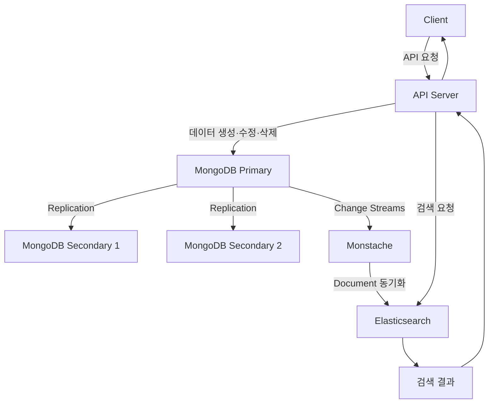

이 구조에서는 MongoDB가 원본 데이터를 관리한다.

MongoDB Replica Set은 Primary와 Secondary로 구성되며, 데이터 복제를 통해 가용성을 높일 수 있다.

Monstache는 MongoDB의 데이터 변경을 추적하여 Elasticsearch의 검색 인덱스를 갱신한다.

사용자가 검색 요청을 보내면 API 서버는 Elasticsearch에서 검색 결과를 조회할 수 있다.

### 각 구성 요소의 역할

| 구성 요소 | 역할 |
|---|---|
| Client | 사용자 요청 전달 |
| API Server | 비즈니스 로직 처리 |
| MongoDB Primary | 데이터 쓰기 및 기본 읽기 처리 |
| MongoDB Secondary | Primary 데이터 복제 및 읽기 부하 분산에 활용 |
| Monstache | MongoDB 데이터 변경 감지 및 Elasticsearch 동기화 |
| Elasticsearch | 전문 검색 인덱스 유지 및 검색 실행 |

여기서 MongoDB Primary를 단순히 쓰기 전용 서버라고 이해해서는 안 된다.

Primary는 쓰기 작업을 처리하며 읽기 작업도 수행할 수 있다.

Secondary는 일반적으로 데이터 복제를 수행하며, 적절한 Read Preference를 설정하면 읽기 요청을 처리할 수 있다.

또한 Elasticsearch는 MongoDB Replica Set의 Secondary가 아니다.

Elasticsearch는 MongoDB의 원본 데이터를 검색에 적합한 형태로 별도 관리하는 시스템이다.

이 차이를 이해해야 MongoDB Replication과 검색 데이터 동기화를 혼동하지 않을 수 있다.

---

## MongoDB Replication과 Elasticsearch 동기화의 차이

MongoDB Replica Set의 Replication과 Monstache를 이용한 데이터 동기화는 목적이 다르다.

### MongoDB Replication

MongoDB Replication은 여러 MongoDB 노드 사이에서 데이터를 복제하는 기능이다.

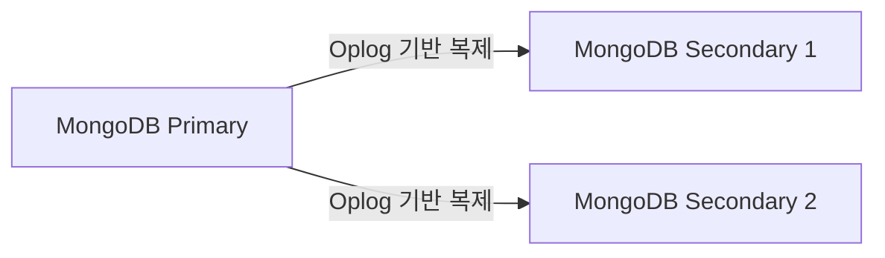

Primary에서 데이터 변경이 발생하면 Secondary는 Oplog를 이용하여 변경 내용을 복제한다.

이 구조의 주요 목적은 다음과 같다.

- 고가용성 확보
- 장애 발생 시 Primary 선출
- 데이터 복제
- 읽기 부하 분산

### Monstache를 이용한 동기화

Monstache는 MongoDB의 변경 사항을 Elasticsearch에 전달한다.

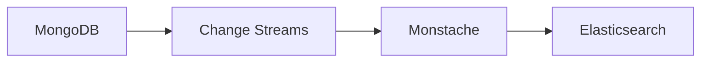

이 구조의 목적은 데이터 복제 자체보다 **검색에 필요한 데이터를 별도 검색 엔진에서 활용하도록 만드는 것**이다.

두 방식을 비교하면 다음과 같다.

| 항목 | MongoDB Replication | Monstache 동기화 |
|---|---|---|
| 목적 | 가용성과 데이터 복제 | 검색 인덱스 동기화 |
| 출발지 | MongoDB | MongoDB |
| 대상 | 다른 MongoDB 노드 | Elasticsearch |
| 데이터 구조 | MongoDB Document | Elasticsearch Document |
| 변경 추적 | Oplog 기반 복제 | Change Streams 등을 활용 |
| 활용 | 장애 복구, 읽기 분산 | 검색 기능 분리 |

따라서 MongoDB와 Elasticsearch를 연동했다고 해서 Elasticsearch를 MongoDB의 복제 노드처럼 취급해서는 안 된다.

---

## Monstache란?

### Monstache의 개념

Monstache는 MongoDB의 데이터를 Elasticsearch로 동기화하는 오픈소스 도구다.

Go 언어로 개발되었으며, MongoDB의 변경 사항을 감지하여 Elasticsearch에 반영할 수 있다.

Monstache는 다음과 같은 기능을 제공한다.

- MongoDB Collection의 기존 데이터 동기화
- 데이터 변경 이벤트 추적
- Elasticsearch 인덱스 갱신
- 특정 Collection만 동기화
- Document 변환 및 필터링
- 동기화 상태 저장 및 재시작 지원
- 여러 Monstache 인스턴스를 이용한 고가용성 구성

Monstache 6 계열은 MongoDB Change Streams를 이용한 변경 감지를 지원한다.

또한 기존 데이터 전체를 읽어 Elasticsearch에 전달하는 Direct Read 기능도 제공한다.

공식 문서에서는 Monstache를 MongoDB와 Elasticsearch 사이의 실시간 데이터 동기화 도구로 소개한다. [GitHub](https://github.com/rwynn/monstache?utm_source=chatgpt.com)

### Monstache가 필요한 이유

MongoDB에서 상품 정보를 수정했다고 가정해 보자.

```javascript
db.products.updateOne(
  {
    _id: 1001
  },
  {
    $set: {
      name: "Wireless Gaming Mouse"
    }
  }
);
```

MongoDB에 저장된 데이터는 변경된다.

하지만 Elasticsearch에 저장된 검색 인덱스가 자동으로 변경되는 것은 아니다.

두 시스템은 별도의 데이터 저장소이기 때문이다.

이때 Monstache를 사용하면 MongoDB에서 발생한 변경을 감지하고 Elasticsearch에 반영할 수 있다.

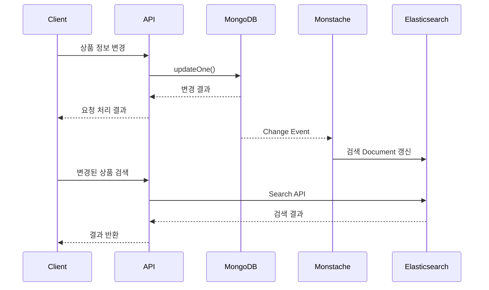

여기서 중요한 부분은 MongoDB의 변경과 Elasticsearch의 갱신이 일반적으로 하나의 원자적 트랜잭션으로 처리되지 않는다는 것이다.

MongoDB에서 변경이 완료되었더라도 Elasticsearch에는 아직 반영되지 않았을 수 있다.

따라서 이런 아키텍처는 일반적으로 최종적 일관성(Eventual Consistency)을 고려해야 한다.

---

## Monstache는 어떻게 MongoDB의 변경을 감지할까?

MongoDB는 데이터 변경 이벤트를 외부 애플리케이션에 전달하기 위한 Change Streams 기능을 제공한다.

Monstache는 이러한 변경 이벤트를 구독하여 Elasticsearch에 반영할 수 있다.

### Change Streams란?

Change Streams는 MongoDB에서 발생한 데이터 변경을 스트림 형태로 전달하는 기능이다.

대표적으로 다음 작업을 감지할 수 있다.

- Insert
- Update
- Replace
- Delete

예를 들어 MongoDB에서 새로운 상품을 등록했다고 가정해 보자.

```javascript
db.products.insertOne({
  _id: 1002,
  name: "Mechanical Keyboard",
  description: "High performance mechanical keyboard",
  price: 120000
});
```

MongoDB에서는 Insert 이벤트가 발생한다.

Monstache는 이 변경을 감지하여 Elasticsearch에 새로운 검색 Document를 생성할 수 있다.

### Change Streams의 동작 구조

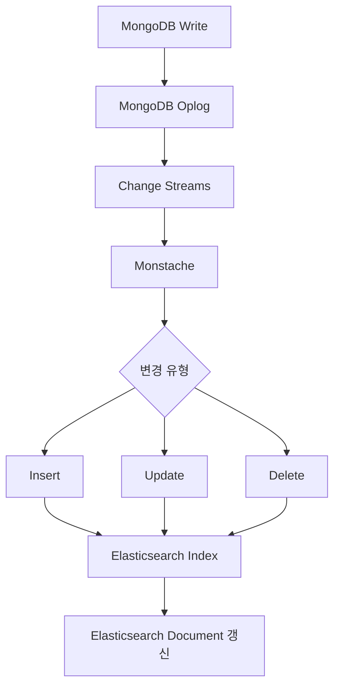

MongoDB Change Streams는 Replica Set 또는 Sharded Cluster에서 사용할 수 있다.

일반적인 Standalone MongoDB 서버에서는 Change Streams를 사용할 수 없다.

따라서 Monstache를 이용하여 실시간 변경 동기화를 구현하려면 MongoDB의 배포 구조도 고려해야 한다. [MongoDB](https://www.mongodb.com/docs/manual/changestreams/?utm_source=chatgpt.com)

---

## Monstache의 초기 동기화와 변경 동기화

Monstache를 사용할 때 반드시 구분해야 하는 두 가지 작업이 있다.

1. 기존 데이터의 초기 동기화
2. 이후 발생하는 데이터 변경 동기화

### 초기 동기화

이미 MongoDB에 100만 건의 상품 데이터가 존재한다고 가정해 보자.

Monstache를 새롭게 실행하면 Elasticsearch에는 해당 상품들이 존재하지 않을 수 있다.

이때 기존 Collection의 데이터를 읽어 Elasticsearch에 전달해야 한다.

Monstache에서는 `direct-read-namespaces` 설정을 사용할 수 있다.

```toml
direct-read-namespaces = ["shop.products"]
```

이 설정은 `shop.products` Collection의 기존 데이터를 읽어 동기화하는 데 사용한다.

### 변경 동기화

초기 동기화 이후에는 MongoDB에서 새롭게 발생하는 변경 사항을 감지해야 한다.

Monstache에서는 다음과 같이 설정할 수 있다.

```toml
change-stream-namespaces = ["shop.products"]
```

이 설정은 해당 Collection의 변경 이벤트를 추적하는 데 사용한다.

### 두 설정의 차이

| 설정 | 역할 |
|---|---|
| `direct-read-namespaces` | 기존 Document를 읽어 초기 동기화 |
| `change-stream-namespaces` | 이후 발생하는 변경 이벤트 구독 |

예를 들어 두 설정을 함께 사용하면 다음과 같은 구조가 된다.

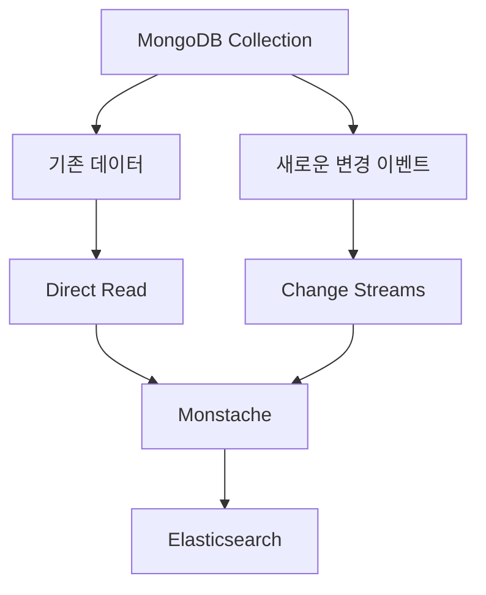

이렇게 하면 기존 데이터와 변경 데이터를 함께 동기화할 수 있다.

다만 실제 Monstache는 Direct Read가 완료될 때까지 Change Streams 처리를 무조건 중단하는 것이 아니다.

초기 데이터 동기화 중에도 발생하는 변경을 처리할 수 있도록 설계되어 있다.

이는 초기 동기화 도중 변경된 데이터가 누락되는 문제를 줄이기 위한 구조다. [rwynn.github.io](https://rwynn.github.io/monstache-site/config/?utm_source=chatgpt.com)

---

## Monstache 설정 파일 이해하기

Monstache는 TOML 형식의 설정 파일을 사용한다.

예를 들어 `bizcom_db.bookstores` Collection을 Elasticsearch와 동기화한다고 가정해 보자.

다음과 같이 설정할 수 있다.

```toml
mongo-url = "mongodb://mongo:27017/?replicaSet=rs0"

elasticsearch-urls = [
  "http://elasticsearch:9200"
]

direct-read-namespaces = [
  "bizcom_db.bookstores"
]

change-stream-namespaces = [
  "bizcom_db.bookstores"
]

resume = true

resume-name = "bookstores-sync"

resume-strategy = 1

direct-read-stateful = true

elasticsearch-retry = true

stats = true

[[mapping]]
namespace = "bizcom_db.bookstores"
index = "bookstores_search"
```

각 설정을 살펴보자.

### mongo-url

```toml
mongo-url = "mongodb://mongo:27017/?replicaSet=rs0"
```

Monstache가 연결할 MongoDB 주소를 지정한다.

여기서 `mongo`는 Docker Compose 환경에서 사용하는 서비스 이름이다.

`rs0`는 MongoDB Replica Set의 이름이다.

### elasticsearch-urls

```toml
elasticsearch-urls = [
  "http://elasticsearch:9200"
]
```

Elasticsearch의 REST API 주소를 지정한다.

일반적으로 Elasticsearch는 HTTP API를 통해 검색과 인덱싱 기능을 제공한다.

### direct-read-namespaces

```toml
direct-read-namespaces = [
  "bizcom_db.bookstores"
]
```

초기 동기화할 Collection을 지정한다.

### change-stream-namespaces

```toml
change-stream-namespaces = [
  "bizcom_db.bookstores"
]
```

변경 이벤트를 추적할 Collection을 지정한다.

### resume

```toml
resume = true
```

Monstache가 재시작되었을 때 이전 동기화 위치를 활용하여 작업을 재개하도록 설정한다.

### resume-strategy

```toml
resume-strategy = 1
```

Change Stream의 Resume Token 기반 재개 전략을 사용하도록 지정한다.

### direct-read-stateful

```toml
direct-read-stateful = true
```

Direct Read가 완료된 Collection의 상태를 저장하여 재시작 시 불필요하게 전체 데이터를 다시 읽는 작업을 줄이는 데 활용한다.

### elasticsearch-retry

```toml
elasticsearch-retry = true
```

Elasticsearch 인덱싱 요청이 실패한 경우 재시도하도록 설정한다.

### mapping

```toml
[[mapping]]
namespace = "bizcom_db.bookstores"
index = "bookstores_search"
```

MongoDB의 `bizcom_db.bookstores` Collection을 Elasticsearch의 `bookstores_search` 인덱스에 연결한다.

별도의 Mapping 설정이 없다면 Monstache는 기본적으로 MongoDB의 Namespace를 Elasticsearch 인덱스 이름으로 사용할 수 있다.

이처럼 Mapping을 지정하면 검색 인덱스의 이름을 업무에 맞게 관리할 수 있다. [rwynn.github.io](https://rwynn.github.io/monstache-site/config/)

---

## Docker Compose로 MongoDB·Monstache·Elasticsearch 구성하기

MongoDB와 Monstache, Elasticsearch의 동작을 이해하기 위해 로컬 개발 환경을 구성해 보자.

여기서는 다음 구성 요소를 사용한다.

| 구성 요소 | 예시 버전 | 역할 |
|---|---|---|
| MongoDB | 7.0 | 원본 Document 저장 |
| Elasticsearch | 8.17.1 | 검색 인덱스 관리 |
| Monstache | 6 계열 | 데이터 동기화 |

아래 버전은 로컬 구성 방식을 설명하기 위한 조합이다. 실제 운영 환경에서는 사용하려는 Monstache 이미지와 MongoDB·Elasticsearch 버전 사이의 호환성을 확인해야 한다.

Monstache 공식 문서의 6 계열은 Elasticsearch 7 이상을 대상으로 설명하지만, 이것만으로 모든 최신 Elasticsearch 버전에서의 동작이 보장되는 것은 아니다.

### 프로젝트 디렉터리 구조

```text
mongodb-search/
├── compose.yml
└── monstache/
    └── config.toml
```

### compose.yml

```yaml
services:
  mongo:
    image: mongo:7.0
    container_name: mongodb-search
    command:
      - mongod
      - --replSet
      - rs0
      - --bind_ip_all
    volumes:
      - mongo_data:/data/db
    restart: unless-stopped

  elasticsearch:
    image: docker.elastic.co/elasticsearch/elasticsearch:8.17.1
    container_name: elasticsearch-search
    environment:
      discovery.type: single-node
      xpack.security.enabled: "false"
      ES_JAVA_OPTS: "-Xms512m -Xmx512m"
    ports:
      - "127.0.0.1:9200:9200"
    volumes:
      - elasticsearch_data:/usr/share/elasticsearch/data
    restart: unless-stopped

  monstache:
    image: rwynn/monstache:rel6
    container_name: monstache-search
    command:
      - -f
      - /monstache/config.toml
    volumes:
      - ./monstache/config.toml:/monstache/config.toml:ro
    depends_on:
      - mongo
      - elasticsearch
    restart: unless-stopped

volumes:
  mongo_data:
  elasticsearch_data:
```

이 구성은 개발 환경을 위한 예제다.

Elasticsearch의 인증을 비활성화했기 때문에 외부에서 접근할 수 있는 운영 환경에 그대로 적용해서는 안 된다.

또한 실제 운영 환경에서는 MongoDB Replica Set을 여러 노드로 구성하고 인증 및 TLS 등을 적용해야 한다.

### 주요 옵션 설명

| 옵션 | 설명 |
|---|---|
| `image` | 사용할 컨테이너 이미지 |
| `container_name` | 컨테이너 이름 |
| `command` | 컨테이너 실행 명령어 |
| `volumes` | 데이터 및 설정 파일 연결 |
| `depends_on` | 컨테이너 시작 순서 설정 |
| `restart` | 컨테이너 재시작 정책 |
| `discovery.type` | Elasticsearch의 단일 노드 구성 |
| `xpack.security.enabled` | Elasticsearch 보안 기능 활성화 여부 |
| `ES_JAVA_OPTS` | Elasticsearch JVM 메모리 설정 |

### Monstache 설정 파일

`monstache/config.toml` 파일은 다음과 같이 작성한다.

```toml
mongo-url = "mongodb://mongo:27017/?replicaSet=rs0"

elasticsearch-urls = [
  "http://elasticsearch:9200"
]

direct-read-namespaces = [
  "bizcom_db.bookstores"
]

change-stream-namespaces = [
  "bizcom_db.bookstores"
]

resume = true

resume-name = "bookstores-sync"

resume-strategy = 1

direct-read-stateful = true

elasticsearch-retry = true

stats = true

[[mapping]]
namespace = "bizcom_db.bookstores"
index = "bookstores_search"
```

### Docker Compose 실행

MongoDB와 Elasticsearch를 먼저 실행한다.

```bash
docker compose up -d mongo elasticsearch
```

컨테이너 상태를 확인한다.

```bash
docker compose ps
```

### MongoDB Replica Set 초기화

Change Streams를 사용하려면 MongoDB가 Replica Set으로 구성되어 있어야 한다.

다음 명령어를 실행한다.

```bash
docker compose exec mongo mongosh
```

MongoDB Shell에서 Replica Set을 초기화한다.

```javascript
rs.initiate({
  _id: "rs0",
  members: [
    {
      _id: 0,
      host: "mongo:27017"
    }
  ]
});
```

Replica Set 상태를 확인한다.

```javascript
rs.status();
```

Primary로 선출되었는지 확인하려면 다음 명령어를 사용할 수 있다.

```javascript
db.hello().isWritablePrimary
```

정상적으로 Primary가 구성되었다면 `true`가 반환된다.

여기서는 Docker 네트워크의 서비스 이름인 `mongo`를 Replica Set 멤버 주소로 사용한다.

따라서 MongoDB에 접속하는 Monstache 컨테이너도 동일한 Docker 네트워크에서 해당 호스트 이름을 해석할 수 있어야 한다.

MongoDB Replica Set에서는 접속에 사용한 주소뿐 아니라 Replica Set이 광고하는 멤버 주소도 클라이언트가 접근할 수 있어야 한다.

이 부분은 Docker 환경에서 MongoDB 연결 문제가 발생하는 대표적인 원인 중 하나다.

### Monstache 실행

MongoDB Replica Set이 Primary 상태가 되고 Elasticsearch가 정상적으로 실행된 것을 확인한 후 Monstache를 시작한다.

```bash
docker compose up -d monstache
```

로그를 확인한다.

```bash
docker compose logs -f monstache
```

실행 결과에서 MongoDB와 Elasticsearch의 연결 상태, 동기화 오류 등을 확인한다.

`depends_on`은 기본적으로 컨테이너의 시작 순서를 제어할 뿐, MongoDB의 Primary 선출이나 Elasticsearch의 실제 준비 완료까지 보장하지 않는다.

따라서 연결 오류가 발생했다면 각 서비스의 준비 상태를 확인해야 한다.

### Elasticsearch 상태 확인

```bash
curl "http://localhost:9200"
```

클러스터 상태를 확인한다.

```bash
curl "http://localhost:9200/_cluster/health?pretty"
```

### 컨테이너 종료

```bash
docker compose down
```

이 명령어는 컨테이너를 종료하고 제거하지만 Named Volume은 기본적으로 유지한다.

반면 다음 명령어는 주의해야 한다.

```bash
docker compose down -v
```

`-v` 옵션을 사용하면 Compose에서 관리하는 Named Volume도 제거할 수 있으므로 개발 환경의 MongoDB와 Elasticsearch 데이터가 삭제될 수 있다.

---

## Monstache를 이용한 데이터 동기화 확인

이제 실제로 MongoDB에 데이터를 저장하고 Elasticsearch에 반영되는지 확인해 보자.

### 1. MongoDB 접속

```bash
docker compose exec mongo mongosh
```

데이터베이스를 선택한다.

```javascript
use bizcom_db
```

### 2. 상품 Document 저장

```javascript
db.bookstores.insertOne({
  _id: 201,
  name: "Tech World",
  description: "Electronics and gadgets",
  price: 150
});
```

Monstache가 정상적으로 실행 중이라면 해당 Document의 변경 이벤트를 감지하고 Elasticsearch에 반영할 수 있다.

### 3. Elasticsearch에서 검색

운영체제의 터미널에서 다음 명령어를 실행한다.

```bash
curl -X GET "http://localhost:9200/bookstores_search/_search?pretty" \
  -H "Content-Type: application/json" \
  -d '{
    "query": {
      "match": {
        "description": "gadgets"
      }
    }
  }'
```

이 명령어는 Elasticsearch의 `bookstores_search` 인덱스를 검색한다.

검색 결과에는 다음과 같은 정보가 포함될 수 있다.

```json
{
  "hits": {
    "hits": [
      {
        "_index": "bookstores_search",
        "_id": "201",
        "_source": {
          "name": "Tech World",
          "description": "Electronics and gadgets",
          "price": 150
        }
      }
    ]
  }
}
```

위 결과는 이해를 위한 핵심 필드 예시다. 실제 응답에는 `_score`, `total` 등의 메타데이터가 포함되며, 데이터 동기화와 인덱스 갱신이 완료된 시점에 검색 결과를 확인할 수 있다.

### 4. MongoDB Document 수정

이제 MongoDB에서 이름을 변경한다.

```javascript
db.bookstores.updateOne(
  {
    _id: 201
  },
  {
    $set: {
      name: "Tech World Plus"
    }
  }
);
```

Elasticsearch에서 해당 Document를 조회한다.

```bash
curl "http://localhost:9200/bookstores_search/_doc/201?pretty"
```

동기화가 완료되었다면 변경된 이름을 확인할 수 있다.

### 5. MongoDB Document 삭제

```javascript
db.bookstores.deleteOne({
  _id: 201
});
```

정상적으로 삭제 이벤트가 처리되면 Elasticsearch에서도 해당 Document가 제거될 수 있다.

다음 명령어로 확인한다.

```bash
curl "http://localhost:9200/bookstores_search/_doc/201?pretty"
```

삭제가 반영되었다면 조회 결과의 `found` 값이 `false`로 나타난다.

---

## Monstache를 이용한 동기화에서 주의할 점

Monstache는 MongoDB와 Elasticsearch를 연결하는 편리한 도구지만, 데이터 동기화가 항상 즉시 성공하는 것은 아니다.

### 1. 최종적 일관성

MongoDB에 데이터가 저장된 직후 Elasticsearch에서 검색되지 않을 수 있다.

다음 과정에 시간이 필요하기 때문이다.

```text
MongoDB 데이터 변경
        ↓
Change Stream 이벤트 전달
        ↓
Monstache 이벤트 처리
        ↓
Elasticsearch 인덱싱 요청
        ↓
Elasticsearch 검색 가능 상태
```

따라서 데이터 저장 직후 반드시 최신 정보를 조회해야 하는 API라면 MongoDB를 직접 조회하는 방식을 고려해야 한다.

### 2. Elasticsearch 장애

Elasticsearch가 일시적으로 중단되면 Monstache가 변경 데이터를 전달하지 못할 수 있다.

이 경우 재시도와 재개 전략이 중요하다.

Monstache는 실패한 인덱싱 요청을 재시도하는 설정을 제공하지만, 모든 장애 상황에서 데이터가 자동으로 복구된다고 가정해서는 안 된다.

### 3. Change Stream 재개

Monstache는 Resume 정보를 이용하여 중단된 지점부터 변경 처리를 재개할 수 있다.

하지만 Change Stream을 재개하려면 필요한 변경 이력이 MongoDB Oplog에 남아 있어야 한다.

장시간 동기화가 중단되어 필요한 Oplog가 사라졌다면 정상적인 재개가 어려울 수 있다.

이 경우 전체 데이터 재동기화가 필요할 수 있다. [MongoDB](https://www.mongodb.com/docs/manual/changestreams/?utm_source=chatgpt.com)

### 4. Elasticsearch Mapping 문제

MongoDB는 유연한 Document 구조를 지원한다.

반면 Elasticsearch는 필드별 Mapping을 관리한다.

예를 들어 처음에는 다음과 같은 데이터가 저장되었다고 가정해 보자.

```javascript
{
  price: 10000
}
```

이후 다른 Document가 다음 값을 사용한다면 문제가 발생할 수 있다.

```javascript
{
  price: "가격 미정"
}
```

MongoDB에서는 이러한 자료형 혼합을 저장할 수 있다.

하지만 Elasticsearch에서는 이미 숫자로 정의된 필드에 문자열이 전달되면 Mapping 충돌이 발생할 수 있다.

따라서 검색 엔진에 동기화할 데이터는 자료형을 일관되게 관리하는 것이 중요하다.

### 5. 동기화 누락과 재처리

실무에서는 다음 항목을 모니터링해야 한다.

| 항목 | 확인 내용 |
|---|---|
| 동기화 지연 | MongoDB 변경이 Elasticsearch에 반영되기까지의 시간 |
| 실패 건수 | Elasticsearch 인덱싱 오류 |
| 재시도 건수 | 실패 후 재처리 횟수 |
| Resume 상태 | 마지막으로 처리한 변경 위치 |
| Document 개수 | MongoDB와 Elasticsearch의 데이터 건수 차이 |
| Mapping 오류 | 자료형 충돌 및 인덱싱 실패 |
| 서비스 상태 | Monstache 프로세스의 정상 실행 여부 |

다만 두 시스템의 Document 개수가 항상 정확히 일치해야 하는 것은 아니다.

필터링된 Document만 동기화하거나 여러 Collection을 하나의 검색 인덱스로 구성할 수도 있기 때문이다.

따라서 데이터 검증 기준은 실제 Mapping 정책에 맞게 정의해야 한다.

---

## MongoDB Text Search와 Elasticsearch 검색의 차이

앞에서는 Monstache를 통해 MongoDB와 Elasticsearch를 연결하는 방법을 살펴보았다.

이제 MongoDB 자체에서 제공하는 Text Search를 이해해 보자.

두 방식의 가장 중요한 차이는 검색을 실제로 수행하는 시스템이다.

### MongoDB Text Search

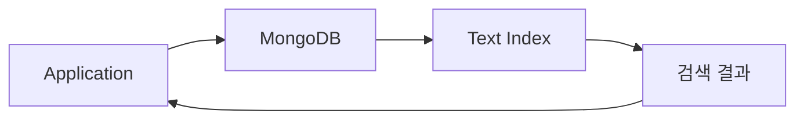

MongoDB 내부의 Text Index를 이용한다.

### Monstache와 Elasticsearch

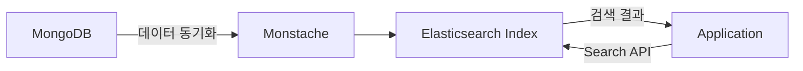

Elasticsearch에 별도로 저장된 검색 인덱스를 이용한다.

### 비교

| 항목 | MongoDB Text Search | Elasticsearch |
|---|---|---|
| 데이터 저장 | MongoDB | 별도 검색 인덱스 |
| 인덱스 | Text Index | Elasticsearch Index |
| 검색 API | `$text` | Query DSL |
| 동기화 도구 | 별도 도구 불필요 | Monstache 등의 동기화 구성 필요 |
| 기본 단어 검색 | 지원 | 지원 |
| 관련도 점수 | textScore | `_score` |
| 자동완성 | 기본 Text Search만으로는 제한적 | 분석기 및 검색 기능 구성 가능 |
| 형태소 분석 | 지원 언어 범위에 제한 | Analyzer 구성 가능 |
| 인프라 비용 | 상대적으로 단순 | 검색 클러스터와 동기화 시스템 관리 필요 |

Elasticsearch를 사용한다고 해서 MongoDB의 Text Index를 반드시 함께 생성해야 하는 것은 아니다.

MongoDB에서 검색을 수행하지 않고 Elasticsearch만 검색용으로 사용한다면 MongoDB Text Index가 불필요할 수 있다.

반대로 MongoDB의 Text Search만 사용한다면 Monstache와 Elasticsearch를 별도로 구성할 필요가 없다.

---

## MongoDB Text Index란?

Text Index는 문자열 데이터를 단어 단위로 검색하기 위한 인덱스다.

MongoDB에서는 `createIndex()`를 이용하여 Text Index를 생성할 수 있다.

예를 들어 다음과 같은 Document가 있다고 가정해 보자.

```javascript
{
  name: "Tech World",
  description: "Electronics and gadgets"
}
```

이름과 설명을 대상으로 Text Index를 생성한다.

```javascript
db.bookstores.createIndex({
  name: "text",
  description: "text"
});
```

이후 다음과 같이 검색할 수 있다.

```javascript
db.bookstores.find({
  $text: {
    $search: "gadgets"
  }
});
```

MongoDB는 Text Index에 저장된 단어 정보를 이용하여 해당 검색어와 일치하는 Document를 찾는다.

### Text Index의 주요 특징

| 특징 | 설명 |
|---|---|
| 단어 기반 검색 | 문자열을 토큰 단위로 분석 |
| 여러 필드 검색 | 여러 문자열 필드를 하나의 Text Index에 포함 |
| 역전 인덱스 | 단어를 기준으로 관련 Document 탐색 |
| 관련도 점수 | textScore를 이용한 결과 평가 |
| 구문 검색 | 여러 단어로 이루어진 표현 검색 |
| 제외어 검색 | 특정 단어가 포함된 Document 제외 |
| 필드 가중치 | 특정 필드의 검색 중요도 조정 |
| 언어별 처리 | 불용어 및 어간 분석 규칙 적용 |

MongoDB의 기본 Text Index는 하나의 Collection에 하나만 생성할 수 있다.

하지만 하나의 Text Index에 여러 문자열 필드를 포함할 수 있다.

---

## 역전 인덱스(Inverted Index)란?

### 역전 인덱스의 개념

역전 인덱스는 특정 단어가 어떤 Document에 등장하는지 빠르게 찾기 위한 자료구조다.

일반적으로 데이터를 다음과 같이 저장한다고 가정해 보자.

| Document ID | 내용 |
|---|---|
| 1 | MongoDB Search |
| 2 | MongoDB Index |
| 3 | Elasticsearch Search |
| 4 | Redis Cache |

이 구조에서는 Document ID를 이용하여 내용을 확인할 수 있다.

하지만 `Search`라는 단어가 포함된 Document를 찾으려면 모든 문자열을 확인해야 할 수 있다.

역전 인덱스에서는 이를 반대로 구성한다.

| Token | Document ID |
|---|---|
| MongoDB | 1, 2 |
| Search | 1, 3 |
| Index | 2 |
| Elasticsearch | 3 |
| Redis | 4 |
| Cache | 4 |

검색어가 `Search`라면 다음 연결을 확인할 수 있다.

```text
Search
   │
   ├── Document 1
   └── Document 3
```

따라서 모든 Document를 처음부터 검사하지 않고도 관련 문서를 찾을 수 있다.

### 역전 인덱스 구조

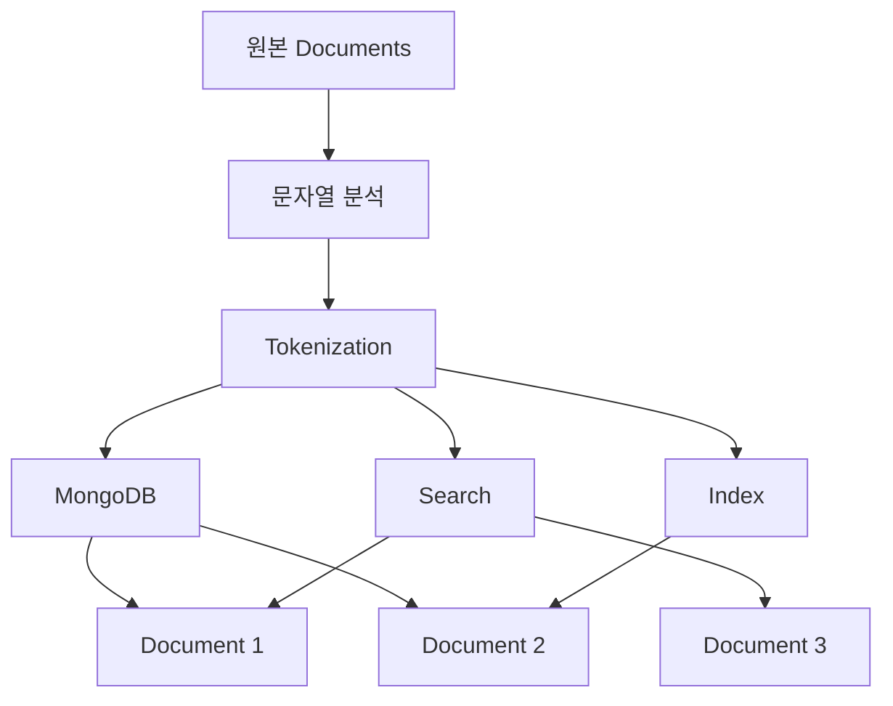

이처럼 역전 인덱스는 단어와 Document의 관계를 관리한다.

MongoDB Text Search뿐 아니라 Elasticsearch와 같은 전문 검색 시스템을 이해할 때도 중요한 개념이다.

---

## Tokenization이란?

Tokenization은 문자열을 검색 가능한 단위인 Token으로 분리하는 과정이다.

예를 들어 다음 문장을 살펴보자.

```text
Electronics and gadgets
```

단어를 분리하면 개념적으로 다음과 같은 토큰을 얻을 수 있다.

```text
Electronics

and

gadgets
```

검색 시스템은 이러한 토큰을 이용하여 인덱스를 생성한다.

사용자가 `gadgets`라는 단어를 검색하면 해당 토큰과 연결된 Document를 찾을 수 있다.

### Tokenization이 필요한 이유

다음 문자열을 생각해 보자.

```javascript
{
  description: "Electronics and gadgets"
}
```

일반적인 동등 비교에서는 다음 조건에 일치하지 않는다.

```javascript
db.bookstores.find({
  description: "gadgets"
});
```

실제 `description` 값은 `"Electronics and gadgets"`이기 때문이다.

하지만 Text Search는 문장을 단어 단위로 분석할 수 있다.

따라서 `gadgets`라는 토큰이 존재하는 Document를 검색할 수 있다.

---

## Stop Words와 Stemming

Text Search에서는 Tokenization 외에도 언어별 처리가 중요하다.

대표적인 개념은 다음 두 가지다.

- Stop Words
- Stemming

### Stop Words

Stop Words는 문서에서 자주 등장하지만 검색 결과를 구분하는 데 상대적으로 중요도가 낮은 단어를 의미한다.

영어에서는 다음과 같은 단어가 대표적이다.

```text
the

a

an

and
```

예를 들어 다음 문장이 있다고 가정해 보자.

```text
Electronics and gadgets
```

영어 Text Index에서는 `and`와 같은 단어가 불용어로 처리될 수 있다.

### Stemming

Stemming은 단어의 변형을 공통된 어간으로 처리하는 과정이다.

예를 들어 다음 단어를 생각해 보자.

```text
book

books
```

또는 다음과 같은 단어가 있다.

```text
garden

gardening
```

언어별 분석 규칙에 따라 서로 연관된 형태로 처리될 수 있다.

따라서 검색어와 Document의 문자열이 완전히 동일하지 않더라도 관련 검색 결과가 반환될 수 있다.

### 한국어 검색에서의 주의사항

MongoDB의 기본 Text Index는 모든 언어에 대한 형태소 분석을 동일하게 지원하지 않는다.

특히 한국어 형태소 분석은 영어의 Stemming과 다르게 처리해야 한다.

예를 들어 다음과 같은 표현을 생각해 보자.

```text
검색하다

검색하는

검색했다
```

이러한 표현을 동일한 검색 의미로 처리하려면 한국어에 적합한 형태소 분석이 필요할 수 있다.

따라서 한국어 검색이 중요한 서비스에서는 검색어 분석 요구사항을 먼저 정의해야 한다.

MongoDB의 기본 Text Index에서 지원하는 언어 목록과 실제 검색 동작은 공식 문서를 기준으로 확인할 수 있다. [MongoDB](https://www.mongodb.com/docs/manual/changestreams/?utm_source=chatgpt.com)

---

## Text Search 관련도 점수란?

MongoDB는 Text Search 결과에 대해 관련도 점수인 `textScore`를 제공한다.

관련도 점수는 검색어와 Document가 얼마나 관련성이 높은지 평가하는 데 사용한다.

예를 들어 사용자가 다음 검색어를 입력했다고 가정해 보자.

```text
art
```

다음 Document가 있다.

```javascript
{
  name: "Art Supplies",
  description: "Canvas, paints, brushes, and art kits"
}
```

이 Document에는 `Art`라는 단어가 이름과 설명에 등장한다.

반면 다음 Document에는 해당 검색어가 등장하지 않는다.

```javascript
{
  name: "Book Haven",
  description: "A paradise for book lovers"
}
```

따라서 두 Document의 검색 관련성은 다르게 평가될 수 있다.

### 관련도 계산의 주요 개념

검색 관련도를 이해할 때 다음 개념이 중요하다.

1. TF(Term Frequency)
2. IDF(Inverse Document Frequency)
3. Weight(가중치)

다만 TF·IDF는 정보 검색의 일반적인 관련도 평가 개념이며, MongoDB의 `textScore`가 특정 TF-IDF 수식을 그대로 사용한다고 단정해서는 안 된다.

---

## TF(Term Frequency)

TF는 특정 단어가 하나의 Document에 얼마나 자주 등장하는지를 의미한다.

예를 들어 다음 두 Document를 생각해 보자.

**Document A**

```text
MongoDB Search
```

**Document B**

```text
MongoDB Search MongoDB Index MongoDB
```

`MongoDB`라는 단어의 등장 횟수는 다음과 같다.

| Document | 등장 횟수 |
|---|---:|
| A | 1 |
| B | 3 |

검색어가 많이 등장한다면 관련성이 높을 가능성이 있다.

하지만 검색 관련도는 단어 등장 횟수만으로 결정되지 않는다.

문서 길이와 검색어 분포 등의 요소를 함께 고려해야 한다.

---

## IDF(Inverse Document Frequency)

IDF는 특정 단어가 전체 Document 집합에서 얼마나 희귀한지를 나타내는 개념이다.

예를 들어 대부분의 상품 설명에 `product`라는 단어가 등장한다고 가정해 보자.

이 단어는 많은 상품에 공통으로 등장하므로 특정 상품을 구분하는 데 상대적으로 유용성이 낮을 수 있다.

반면 특정 Document에만 `MongoDB`라는 단어가 등장한다면 해당 단어는 검색 결과를 구분하는 데 더 유용할 수 있다.

### TF와 IDF 비교

| 개념 | 의미 |
|---|---|
| TF | 하나의 Document 안에서 단어가 얼마나 자주 등장하는가? |
| IDF | 전체 Document에서 해당 단어가 얼마나 희귀한가? |

이 두 개념은 검색 관련도를 이해하는 데 도움이 된다.

다만 실제 MongoDB 점수를 이 두 값만으로 직접 계산해서는 안 된다.

---

## Weight(가중치)

Weight는 특정 필드의 중요도를 조정하는 값이다.

예를 들어 상품 검색에서 다음 두 필드를 사용한다고 가정해 보자.

```text
name

description
```

상품 이름에 검색어가 포함된 경우가 상세 설명에 포함된 경우보다 중요할 수 있다.

이때 Text Index에 가중치를 지정할 수 있다.

```javascript
db.bookstores.createIndex(
  {
    name: "text",
    description: "text"
  },
  {
    weights: {
      name: 5,
      description: 1
    }
  }
);
```

이 설정은 `name`에 등장하는 검색어를 `description`에 등장하는 검색어보다 중요하게 평가하도록 구성한다.

가중치가 높으면 해당 필드에서 발생한 검색어 일치가 관련도 점수에 더 큰 영향을 줄 수 있다.

---

## MongoDB Text Search를 위한 샘플 데이터

이제 실제 데이터를 사용하여 Text Search를 수행해 보자.

데이터베이스 이름은 `bizcom_db`다.

Collection 이름은 `bookstores`다.

### 데이터베이스 선택

```javascript
use bizcom_db
```

### 상점 데이터 생성

```javascript
db.bookstores.insertMany([
  {
    _id: 201,
    name: "Tech World",
    description: "Electronics and gadgets",
    price: 150
  },
  {
    _id: 202,
    name: "Book Haven",
    description: "A paradise for book lovers",
    price: 25
  },
  {
    _id: 203,
    name: "Fashion Forward",
    description: "Latest trendy clothing",
    price: 80
  },
  {
    _id: 204,
    name: "Organic Market",
    description: "Fresh organic vegetables and fruits",
    price: 10
  },
  {
    _id: 205,
    name: "Toy Kingdom",
    description: "Toys for all ages",
    price: 30
  },
  {
    _id: 206,
    name: "Sports Corner",
    description: "All sports equipment and gear",
    price: 200
  },
  {
    _id: 207,
    name: "Music Hub",
    description: "Instruments and musical accessories",
    price: 120
  },
  {
    _id: 208,
    name: "Garden Supplies",
    description: "Plants, seeds, and gardening tools",
    price: 45
  },
  {
    _id: 209,
    name: "Art Supplies",
    description: "Canvas, paints, brushes, and art kits",
    price: 60
  },
  {
    _id: 210,
    name: "Pet Care",
    description: "Pet foods, toys, and accessories",
    price: 50
  }
]);
```

이 명령어는 총 10개의 Document를 저장한다.

이미 같은 `_id`를 가진 Document가 존재한다면 중복 키 오류가 발생할 수 있다.

따라서 새로운 Collection에서 한 번 실행하는 것을 기준으로 한다.

### 데이터 확인

```javascript
db.bookstores.find({});
```

전체 Document 수를 확인한다.

```javascript
db.bookstores.countDocuments({});
```

정상적으로 저장되었다면 다음 결과를 확인할 수 있다.

```text
10
```

### 전체 데이터

| ID | 이름 | 설명 | 가격 |
|---|---|---|---:|
| 201 | Tech World | Electronics and gadgets | 150 |
| 202 | Book Haven | A paradise for book lovers | 25 |
| 203 | Fashion Forward | Latest trendy clothing | 80 |
| 204 | Organic Market | Fresh organic vegetables and fruits | 10 |
| 205 | Toy Kingdom | Toys for all ages | 30 |
| 206 | Sports Corner | All sports equipment and gear | 200 |
| 207 | Music Hub | Instruments and musical accessories | 120 |
| 208 | Garden Supplies | Plants, seeds, and gardening tools | 45 |
| 209 | Art Supplies | Canvas, paints, brushes, and art kits | 60 |
| 210 | Pet Care | Pet foods, toys, and accessories | 50 |

이후 예제에서는 이 데이터를 기준으로 검색한다.

---

## Text Index 생성하기

`name`과 `description`에 Text Index를 생성한다.

```javascript
db.bookstores.createIndex({
  name: "text",
  description: "text"
});
```

이 명령어는 두 필드를 대상으로 하나의 Text Index를 생성한다.

### 인덱스 확인

```javascript
db.bookstores.getIndexes();
```

일반적으로 다음 인덱스를 확인할 수 있다.

```text
_id_

name_text_description_text
```

`_id_`는 MongoDB가 기본적으로 생성하는 인덱스다.

`name_text_description_text`는 생성한 Text Index의 이름으로 사용될 수 있다.

실제 인덱스 이름은 `getIndexes()` 결과에서 확인해야 한다.

---

## $text와 $search 이해하기

MongoDB Text Search의 기본 문법은 다음과 같다.

```javascript
{
  $text: {
    $search: "keyword"
  }
}
```

### $text

Text Index를 이용하여 검색을 수행하는 Query Operator다.

### $search

`$text` 내부에서 실제 검색할 단어나 구문을 지정한다.

예를 들어 다음과 같이 작성할 수 있다.

```javascript
db.bookstores.find({
  $text: {
    $search: "gadgets"
  }
});
```

이 쿼리는 Text Index에서 `gadgets`라는 단어를 검색한다.

여기서 사용하는 `$search`는 Elasticsearch의 Search API나 MongoDB Search의 Aggregation `$search` Stage와 다른 기능이다.

이름이 같다는 이유로 동일한 API라고 이해해서는 안 된다.

---

## Text Search 예제 1: 단일 단어 검색

먼저 `gadgets`라는 단어를 검색해 보자.

```javascript
db.bookstores.find(
  {
    $text: {
      $search: "gadgets"
    }
  },
  {
    score: {
      $meta: "textScore"
    }
  }
).sort({
  score: {
    $meta: "textScore"
  }
});
```

### 검색 조건

```javascript
{
  $text: {
    $search: "gadgets"
  }
}
```

`gadgets`에 일치하는 Document를 검색한다.

### 관련도 점수 반환

```javascript
{
  score: {
    $meta: "textScore"
  }
}
```

`$meta`를 이용하여 검색 관련도 점수를 반환한다.

### 관련도 기준 정렬

```javascript
.sort({
  score: {
    $meta: "textScore"
  }
});
```

관련도 점수가 높은 결과부터 정렬한다.

### 검색 결과

예제에서는 다음 상점이 검색된다.

```javascript
{
  _id: 201,
  name: "Tech World",
  description: "Electronics and gadgets",
  price: 150,
  score: 0.75
}
```

`description`에 `gadgets`라는 단어가 포함되어 있다.

따라서 Text Search 조건에 일치한다.

여기서 `score: 0.75`는 예시 데이터와 인덱스 설정에서 관찰할 수 있는 관련도 점수다.

데이터나 가중치 설정이 변경되면 점수가 달라질 수 있다.

또한 `score`만 Projection에 추가하고 기존 필드를 제외하지 않았다면 원본 Document의 다른 필드도 일반적으로 반환된다.

---

## Text Search 예제 2: 여러 단어 검색

이번에는 `book` 또는 `art`라는 단어를 포함하는 상점을 검색한다.

```javascript
db.bookstores.find(
  {
    $text: {
      $search: "book art"
    }
  },
  {
    score: {
      $meta: "textScore"
    }
  }
).sort({
  score: {
    $meta: "textScore"
  }
});
```

여기서 중요한 부분은 다음과 같다.

```javascript
$search: "book art"
```

MongoDB의 기본 Text Search에서는 공백으로 구분된 검색어를 일반적으로 OR 조건으로 처리한다.

즉, 다음과 같은 의미다.

```text
book

OR

art
```

따라서 두 단어를 모두 포함하지 않아도 하나 이상의 단어에 일치하면 검색 결과에 포함될 수 있다.

### 검색 결과

```javascript
[
  {
    _id: 202,
    name: "Book Haven",
    description: "A paradise for book lovers",
    price: 25,
    score: 1.4166666666666665
  },
  {
    _id: 209,
    name: "Art Supplies",
    description: "Canvas, paints, brushes, and art kits",
    price: 60,
    score: 1.35
  }
]
```

`Book Haven`에는 `Book`이라는 단어가 포함되어 있다.

`Art Supplies`에는 `Art`라는 단어가 포함되어 있다.

따라서 두 Document 모두 검색된다.

---

## Text Search 예제 3: 정확한 구문 검색

이번에는 `Pet Care`라는 구문을 검색한다.

```javascript
db.bookstores.find(
  {
    $text: {
      $search: "\"Pet Care\""
    }
  },
  {
    score: {
      $meta: "textScore"
    }
  }
).sort({
  score: {
    $meta: "textScore"
  }
});
```

여기서 중요한 부분은 다음과 같다.

```javascript
$search: "\"Pet Care\""
```

JavaScript 문자열 내부에서 큰따옴표를 표현하기 위해 `\"`를 사용했다.

실제 검색 문자열은 다음과 같은 의미다.

```text
"Pet Care"
```

### 검색 결과

```javascript
{
  _id: 210,
  name: "Pet Care",
  description: "Pet foods, toys, and accessories",
  price: 50,
  score: 2.125
}
```

상점 이름이 `Pet Care`라는 구문과 일치한다.

### 일반 다중 단어 검색과 구문 검색의 차이

다음 두 검색어는 의미가 다르다.

```javascript
$search: "Pet Care"
```

```javascript
$search: "\"Pet Care\""
```

첫 번째는 `Pet` 또는 `Care`라는 단어에 일치하는 Document를 검색할 수 있다.

두 번째는 `Pet Care`라는 구문을 검색한다.

| 검색 문자열 | 의미 |
|---|---|
| `Pet Care` | Pet 또는 Care |
| `"Pet Care"` | Pet Care 구문 검색 |

이 차이는 브랜드명이나 상품 모델명처럼 정확한 단어 조합이 중요한 검색에서 유용하다.

---

## Text Search 예제 4: 필드별 가중치 설정

상품 이름에 포함된 검색어를 상세 설명에 포함된 검색어보다 중요하게 평가한다고 가정해 보자.

다음과 같이 가중치를 설정할 수 있다.

```javascript
db.bookstores.createIndex(
  {
    name: "text",
    description: "text"
  },
  {
    weights: {
      name: 5,
      description: 1
    }
  }
);
```

### 가중치의 의미

| 필드 | 가중치 |
|---|---:|
| name | 5 |
| description | 1 |

상품 이름에서 검색어가 일치하는 경우를 상대적으로 중요하게 평가한다.

### 기존 Text Index가 있다면?

앞에서 다음 인덱스를 이미 생성했다.

```javascript
db.bookstores.createIndex({
  name: "text",
  description: "text"
});
```

MongoDB의 기본 Text Index는 하나의 Collection에 하나만 생성할 수 있다.

따라서 기존 인덱스가 존재하는 상태에서 새로운 가중치 설정의 Text Index를 추가할 수 없다.

먼저 인덱스를 확인한다.

```javascript
db.bookstores.getIndexes();
```

기존 Text Index의 이름을 확인한 후 삭제한다.

```javascript
db.bookstores.dropIndex(
  "name_text_description_text"
);
```

이제 가중치가 적용된 Text Index를 생성한다.

```javascript
db.bookstores.createIndex(
  {
    name: "text",
    description: "text"
  },
  {
    weights: {
      name: 5,
      description: 1
    }
  }
);
```

변경 후 인덱스를 확인한다.

```javascript
db.bookstores.getIndexes();
```

이 과정은 인덱스의 삭제와 재생성을 포함하므로 운영 환경에서는 신중하게 수행해야 한다.

대량 데이터가 존재한다면 인덱스 재구성 비용과 검색 기능에 미치는 영향을 고려해야 한다.

---

## Text Search 예제 5: 제외어 검색

이번에는 특정 단어를 검색하면서 다른 단어가 포함된 Document는 제외한다고 가정해 보자.

예를 들어 `art`를 검색하면서 `toys`를 제외한다.

```javascript
db.bookstores.find(
  {
    $text: {
      $search: "art -toys"
    }
  },
  {
    score: {
      $meta: "textScore"
    }
  }
).sort({
  score: {
    $meta: "textScore"
  }
});
```

이 검색은 다음 의미를 가진다.

```text
art 검색

AND

toys를 포함하는 Document 제외
```

### 구문 검색과 제외어 조합

다음과 같이 정확한 구문과 제외어를 조합할 수도 있다.

```javascript
db.bookstores.find(
  {
    $text: {
      $search: "\"art supplies\" -toys"
    }
  },
  {
    score: {
      $meta: "textScore"
    }
  }
).sort({
  score: {
    $meta: "textScore"
  }
});
```

이 검색은 `art supplies` 구문에 일치하면서 `toys`를 포함하지 않는 Document를 검색한다.

### + 기호를 사용하면 AND 검색이 될까?

다음과 같은 검색 문자열을 생각해 보자.

```javascript
$search: "\"art supplies\" + " +
         "genuine -toys"
```

여기에는 두 종류의 `+`가 등장한다.

첫 번째는 검색 문자열 내부의 `+`다.

두 번째는 JavaScript 문자열을 연결하는 `+` 연산자다.

문자열 결합 이후 실제 전달되는 검색 문자열은 다음과 같다.

```text
"art supplies" + genuine -toys
```

하지만 MongoDB 기본 `$text`에서는 `+`를 Elasticsearch의 Query String과 동일한 필수 검색 연산자로 이해해서는 안 된다.

따라서 여러 검색어를 반드시 모두 포함해야 하는 요구사항이 있다면 실제 검색 조건을 별도로 검증해야 한다.

복잡한 검색 조건에서는 MongoDB Text Search의 문법적 제약과 전문 검색 엔진의 기능 차이를 이해하는 것이 중요하다.

---

## Text Search 예제 6: 텍스트 검색과 가격 범위 조건

이번에는 `garden`이라는 단어를 검색하면서 가격 범위를 적용해 보자.

요구사항은 다음과 같다.

> Garden 관련 상점 중 가격이 20 이상이고 100 이하인 상점을 검색한다.

```javascript
db.bookstores.find(
  {
    $text: {
      $search: "garden"
    },
    price: {
      $gte: 20,
      $lte: 100
    }
  },
  {
    score: {
      $meta: "textScore"
    }
  }
).sort({
  score: {
    $meta: "textScore"
  }
});
```

검색 조건은 다음과 같다.

```text
garden 검색

AND

price >= 20

AND

price <= 100
```

### 검색 결과

```javascript
{
  _id: 208,
  name: "Garden Supplies",
  description: "Plants, seeds, and gardening tools",
  price: 45,
  score: 1.375
}
```

`Garden Supplies`는 이름에 `Garden`이 포함되어 있다.

설명에도 관련 단어가 등장한다.

가격은 45이므로 지정한 범위에 포함된다.

### Text Index와 가격 인덱스

여기서 Text Search와 가격 범위 검색은 서로 다른 검색 목적을 가진다.

Text Index는 단어 기반 검색을 지원한다.

가격 인덱스는 숫자 범위 검색에 활용할 수 있다.

다음 인덱스가 존재한다고 가정해 보자.

```javascript
db.bookstores.createIndex({
  price: 1
});
```

Text Search와 가격 조건을 함께 사용한다고 해서 MongoDB가 두 인덱스를 반드시 동시에 활용하는 것은 아니다.

실제 실행 계획은 MongoDB Query Planner가 결정한다.

따라서 인덱스 사용 여부를 확인하려면 `explain()`을 사용해야 한다.

---

## Text Search 예제 7: 구문과 여러 검색어 조합

이번에는 다음 Document를 생각해 보자.

```javascript
{
  _id: 204,
  name: "Organic Market",
  description: "Fresh organic vegetables and fruits",
  price: 10
}
```

### 정확한 구문 검색

```javascript
db.bookstores.find(
  {
    $text: {
      $search: "\"organic vegetables\""
    }
  },
  {
    score: {
      $meta: "textScore"
    }
  }
).sort({
  score: {
    $meta: "textScore"
  }
});
```

`organic vegetables`라는 구문에 일치하는 Document를 검색한다.

### 여러 단어 검색

```javascript
db.bookstores.find(
  {
    $text: {
      $search: "organic vegetables"
    }
  },
  {
    score: {
      $meta: "textScore"
    }
  }
).sort({
  score: {
    $meta: "textScore"
  }
});
```

이 검색은 기본적으로 `organic` 또는 `vegetables`에 일치하는 Document를 검색할 수 있다.

### OR 문자열을 직접 입력하는 경우

다음과 같은 검색어를 생각해 보자.

```javascript
$search: "\"organic vegetables\" organic OR vegetables"
```

MongoDB의 `$text`에서는 `OR`를 SQL의 논리 연산자처럼 사용하는 것이 아니다.

공백으로 구분된 일반 검색어는 기본적으로 OR 검색으로 처리된다.

따라서 단순한 OR 검색을 위해 `OR`라는 문자열을 별도로 추가할 필요는 없다.

또한 구문 검색과 일반 검색어를 함께 사용할 때는 정확한 구문이 결과의 필수 조건으로 작용할 수 있다.

따라서 검색 문자열의 구성에 따라 결과가 달라진다는 점을 이해해야 한다.

---

## MongoDB Index란?

지금까지 Text Search와 Text Index를 살펴보았다.

하지만 MongoDB에는 Text Index 외에도 여러 인덱스가 존재한다.

MongoDB Index는 Collection에 저장된 데이터를 효율적으로 검색하기 위한 자료구조다.

일반적으로 MongoDB는 B-tree 계열의 인덱스 구조를 사용한다.

### 인덱스가 없는 경우

다음과 같은 쿼리를 생각해 보자.

```javascript
db.employees.find({
  employee_id: 1005
});
```

`employee_id`에 적절한 인덱스가 없다면 MongoDB는 Collection의 많은 Document를 검사해야 할 수 있다.

```text
Document 1 검사

Document 2 검사

Document 3 검사

...

Document N 검사
```

이러한 접근 방식은 실행 계획에서 `COLLSCAN`으로 나타날 수 있다.

### 인덱스가 있는 경우

다음과 같이 인덱스를 생성한다.

```javascript
db.employees.createIndex({
  employee_id: 1
});
```

MongoDB는 인덱스를 활용하여 검색 범위를 줄일 수 있다.

실행 계획에서 `IXSCAN`이 나타날 수 있다.

다만 인덱스가 존재한다고 반드시 사용되는 것은 아니다.

Collection의 크기와 데이터 분포, 검색 조건 등에 따라 Query Planner가 다른 실행 계획을 선택할 수 있다.

---

## MongoDB Index를 사용하는 이유

인덱스는 크게 세 가지 목적에서 활용된다.

1. 검색 성능 개선
2. 정렬 성능 개선
3. 고유성 제약

### 검색 성능 개선

```javascript
db.bookstores.createIndex({
  price: 1
});
```

가격을 기준으로 검색하는 쿼리에서 활용할 수 있다.

### 정렬 성능 개선

```javascript
db.bookstores.find({}).sort({
  price: 1
});
```

적절한 인덱스가 존재한다면 별도의 정렬 작업을 줄일 수 있다.

### 고유성 보장

```javascript
db.users.createIndex(
  {
    email: 1
  },
  {
    unique: true
  }
);
```

동일한 이메일의 중복 저장을 방지할 수 있다.

---

## 가격 범위 검색을 위한 인덱스 생성

이제 가격을 기준으로 데이터를 검색해 보자.

### 인덱스 생성

```javascript
db.bookstores.createIndex({
  price: 1
});
```

### 가격이 20 이상 100 이하인 상점 조회

```javascript
db.bookstores.find({
  price: {
    $gte: 20,
    $lte: 100
  }
}).sort({
  price: 1
});
```

`$gte`는 Greater Than or Equal이다.

`$lte`는 Less Than or Equal이다.

따라서 양쪽 경계값을 포함하는 범위 검색이다.

### 검색 결과

| ID | 상점 | 가격 |
|---|---|---:|
| 202 | Book Haven | 25 |
| 205 | Toy Kingdom | 30 |
| 208 | Garden Supplies | 45 |
| 210 | Pet Care | 50 |
| 209 | Art Supplies | 60 |
| 203 | Fashion Forward | 80 |

가격이 20 이상이고 100 이하인 상점들이 오름차순으로 반환된다.

---

## 가격이 낮은 상점 3개 조회

이번에는 가격이 가장 낮은 상점 세 개를 조회한다.

```javascript
db.bookstores.find({})
  .sort({
    price: 1
  })
  .limit(3);
```

처리 순서는 다음과 같다.

1. 전체 Document를 조회한다.
2. 가격을 오름차순으로 정렬한다.
3. 앞의 세 개만 반환한다.

### 검색 결과

| ID | 상점 | 가격 |
|---|---|---:|
| 204 | Organic Market | 10 |
| 202 | Book Haven | 25 |
| 205 | Toy Kingdom | 30 |

여기서 중요한 부분은 정렬 후 결과 개수를 제한한다는 점이다.

정렬 없이 `limit(3)`만 실행하면 전체 상점 중 가격이 가장 낮은 세 개를 보장할 수 없다.

---

## Projection을 이용한 필드 선택

가격이 50 이상이고 150 이하인 상점의 이름만 조회한다고 가정해 보자.

```javascript
db.bookstores.find(
  {
    price: {
      $gte: 50,
      $lte: 150
    }
  },
  {
    name: 1,
    _id: 0
  }
);
```

두 번째 인수는 Projection이다.

```javascript
{
  name: 1,
  _id: 0
}
```

여기서 `1`은 필드 포함을 의미한다.

`0`은 필드 제외를 의미한다.

### 검색 결과

```javascript
[
  {
    name: "Tech World"
  },
  {
    name: "Fashion Forward"
  },
  {
    name: "Music Hub"
  },
  {
    name: "Art Supplies"
  },
  {
    name: "Pet Care"
  }
]
```

이 결과의 순서는 정렬 조건을 지정하지 않았으므로 보장되지 않는다.

### Projection과 Covered Query

Projection을 사용하면 반환하는 데이터의 양을 줄일 수 있다.

하지만 Projection을 사용했다고 해서 반드시 MongoDB가 인덱스만으로 조회를 처리하는 것은 아니다.

예를 들어 다음 인덱스가 있다고 가정해 보자.

```javascript
db.bookstores.createIndex({
  price: 1
});
```

검색 조건은 `price`다.

하지만 반환할 필드는 `name`이다.

이 경우 `price` 인덱스만으로 `name`을 가져올 수 없으므로 실제 Document에 접근해야 할 수 있다.

반면 다음처럼 복합 인덱스를 구성하면 상황이 달라질 수 있다.

```javascript
db.bookstores.createIndex({
  price: 1,
  name: 1
});
```

검색 조건과 반환 필드를 인덱스만으로 충족할 수 있다면 Covered Query를 고려할 수 있다.

다만 실제 실행 방식은 `explain()`을 통해 확인해야 한다.

---

## explain()이란?

`explain()`은 MongoDB Query의 실행 계획과 실행 통계를 분석하는 기능이다.

다음과 같은 정보를 확인할 수 있다.

- 어떤 실행 계획이 선택되었는가?
- 인덱스를 사용했는가?
- Collection Scan이 발생했는가?
- 몇 개의 Document를 검사했는가?
- 몇 개의 Index Key를 검사했는가?
- 몇 개의 Document를 반환했는가?
- 쿼리 실행에 얼마나 시간이 소요되었는가?

### 기본 문법

```javascript
db.collection.find({}).explain();
```

실행 통계까지 확인하려면 다음과 같이 작성한다.

```javascript
db.collection.find({}).explain("executionStats");
```

### 실행 계획 확인 예제

```javascript
db.bookstores.find(
  {
    price: {
      $gte: 50,
      $lte: 150
    }
  },
  {
    name: 1,
    _id: 0
  }
).explain("executionStats");
```

이 명령어는 가격 범위 검색의 실제 실행 계획을 분석한다.

---

## explain()의 실행 모드

MongoDB의 `explain()`에는 다음과 같은 모드가 있다.

| 모드 | 설명 |
|---|---|
| `queryPlanner` | 실행 계획 정보 |
| `executionStats` | 실행 계획과 실행 통계 |
| `allPlansExecution` | 후보 실행 계획 관련 추가 정보 |

### queryPlanner

```javascript
db.bookstores.find({
  price: {
    $gte: 50,
    $lte: 150
  }
}).explain("queryPlanner");
```

Query Planner가 선택한 실행 계획을 확인한다.

### executionStats

```javascript
db.bookstores.find({
  price: {
    $gte: 50,
    $lte: 150
  }
}).explain("executionStats");
```

실제 실행 통계를 함께 확인한다.

### allPlansExecution

```javascript
db.bookstores.find({
  price: {
    $gte: 50,
    $lte: 150
  }
}).explain("allPlansExecution");
```

후보 실행 계획과 관련된 추가 실행 통계를 확인할 수 있다.

---

## explain() 실행 결과 분석

다음과 같은 실행 계획 일부가 나타날 수 있다.

```javascript
{
  explainVersion: "1",
  queryPlanner: {
    namespace: "bizcom_db.bookstores",
    parsedQuery: {
      $and: [
        {
          price: {
            $lte: 150
          }
        },
        {
          price: {
            $gte: 50
          }
        }
      ]
    }
  }
}
```

여기서 `namespace`는 조회 대상 Collection이다.

```text
bizcom_db.bookstores
```

`parsedQuery`는 MongoDB가 해석한 검색 조건을 나타낸다.

### IXSCAN

다음과 같은 Stage가 나타날 수 있다.

```javascript
{
  stage: "IXSCAN",
  nReturned: 5,
  executionTimeMillisEstimate: 0,
  works: 6,
  advanced: 5
}
```

이 결과는 Index Scan Stage의 일부 실행 통계를 표현한 예시다.

MongoDB 버전과 Query Engine에 따라 실제 출력 구조는 달라질 수 있다.

### nReturned

```javascript
nReturned: 5
```

해당 Stage에서 반환한 결과 수를 나타낸다.

### executionTimeMillisEstimate

```javascript
executionTimeMillisEstimate: 0
```

해당 Stage의 실행 시간 추정 관련 지표다.

0이 나타났다고 해서 실제 처리 비용이 전혀 없었다는 뜻은 아니다.

### works

```javascript
works: 6
```

실행 Stage의 작업 호출 횟수와 관련된 내부 통계다.

### advanced

```javascript
advanced: 5
```

실행 Stage가 결과를 생성한 횟수와 관련된 통계다.

이러한 값들은 실행 계획의 전체 구조와 함께 해석해야 한다.

---

## COLLSCAN과 IXSCAN의 차이

### COLLSCAN

`COLLSCAN`은 Collection Scan을 의미한다.

MongoDB가 Collection의 Document를 직접 검사하는 방식이다.

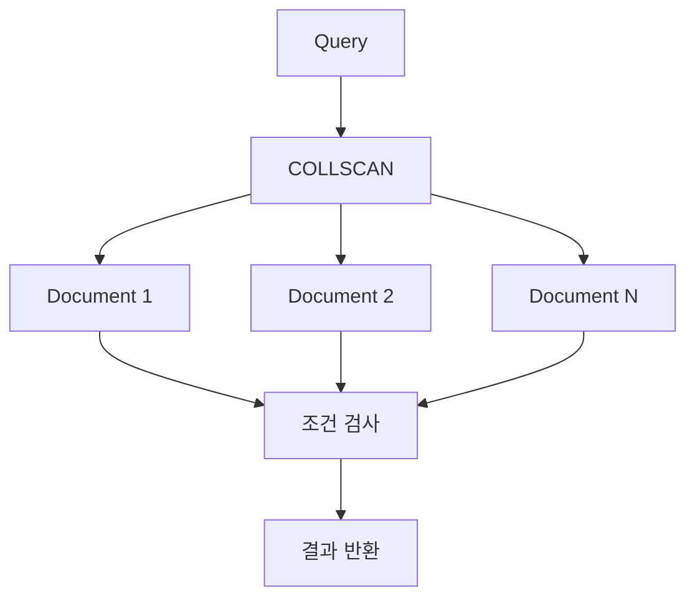

Collection에 적절한 인덱스가 없는 경우에 발생할 수 있다.

하지만 전체 데이터를 조회해야 하거나 Collection이 매우 작은 경우에는 효율적인 선택일 수 있다.

### IXSCAN

`IXSCAN`은 Index Scan을 의미한다.

MongoDB가 인덱스를 이용하여 검색하는 방식이다.

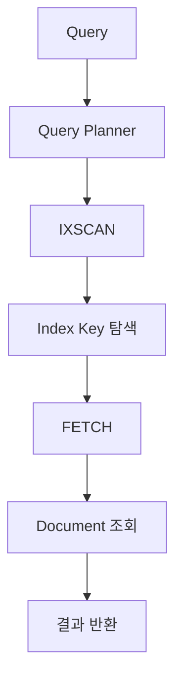

인덱스를 통해 검색 범위를 줄일 수 있다.

하지만 인덱스에서 필요한 필드를 모두 가져올 수 없다면 `FETCH`를 통해 실제 Document를 읽어야 할 수 있다.

### 비교

| 구분 | COLLSCAN | IXSCAN |
|---|---|---|
| 접근 방식 | Collection 직접 검사 | 인덱스 탐색 |
| 인덱스 사용 | 사용하지 않음 | 사용 |
| 특정 값 검색 | 많은 Document 검사 가능 | 검색 범위 축소 가능 |
| 전체 데이터 조회 | 적합할 수 있음 | 반드시 유리하지 않음 |
| 주요 비용 | Document 검사 | Index Key 및 Document 접근 |
| 실행 계획 | COLLSCAN | IXSCAN |

---

## explain()에서 중요한 성능 지표

MongoDB의 실행 계획을 분석할 때 다음 항목을 확인하는 것이 좋다.

| 항목 | 의미 |
|---|---|
| `nReturned` | 반환된 Document 수 |
| `totalDocsExamined` | 검사한 Document 수 |
| `totalKeysExamined` | 검사한 Index Key 수 |
| `executionTimeMillis` | 실행 시간 |
| `winningPlan` | 선택된 실행 계획 |
| `indexName` | 사용된 인덱스 이름 |

### 검사한 Document 수와 반환한 Document 수

예를 들어 다음 결과를 생각해 보자.

```text
nReturned = 5

totalDocsExamined = 100000
```

100000개의 Document를 검사하여 5개를 반환했다.

이 경우 검색 조건에 적합한 인덱스가 존재하는지 검토할 필요가 있다.

반면 다음과 같은 결과라면 어떨까?

```text
nReturned = 5

totalDocsExamined = 5
```

5개의 Document를 검사하여 5개를 반환했다.

이 경우 검색 범위를 효과적으로 줄였을 가능성이 있다.

다만 `totalDocsExamined`가 작다고 해서 무조건 빠른 쿼리는 아니다.

인덱스 키를 많이 검사하거나 별도의 정렬 비용이 발생할 수 있기 때문이다.

따라서 여러 실행 통계를 함께 분석해야 한다. [MongoDB](https://www.mongodb.com/docs/manual/core/indexes/index-types/index-text/text-index-restrictions/?utm_source=chatgpt.com)

---

## MongoDB Index의 종류

MongoDB는 데이터의 특성과 검색 목적에 따라 여러 종류의 인덱스를 제공한다.

대표적인 인덱스는 다음과 같다.

1. Single Field Index
2. Compound Index
3. Text Index
4. Hashed Index

---

## Single Field Index

Single Field Index는 하나의 필드를 기준으로 생성하는 인덱스다.

### 오름차순 인덱스

```javascript
db.bookstores.createIndex({
  price: 1
});
```

### 내림차순 인덱스

```javascript
db.bookstores.createIndex({
  price: -1
});
```

`1`은 오름차순이다.

`-1`은 내림차순이다.

단일 필드 인덱스는 특정 필드를 이용한 검색이나 정렬에 활용할 수 있다.

---

## Compound Index

Compound Index는 두 개 이상의 필드를 조합하여 생성하는 인덱스다.

```javascript
db.bookstores.createIndex({
  price: 1,
  name: -1
});
```

이 인덱스는 `price`와 `name`을 함께 관리한다.

### 필드 순서의 중요성

다음 두 인덱스를 생각해 보자.

```javascript
db.bookstores.createIndex({
  price: 1,
  name: -1
});
```

```javascript
db.bookstores.createIndex({
  name: -1,
  price: 1
});
```

두 인덱스는 같은 필드를 포함한다.

하지만 필드 순서가 다르다.

따라서 검색 조건과 정렬 조건에 따라 활용도가 달라질 수 있다.

### Prefix 개념

다음 복합 인덱스를 살펴보자.

```javascript
{
  price: 1,
  name: -1
}
```

이 인덱스의 Prefix는 다음과 같다.

```text
price
```

```text
price + name
```

반면 `name` 단독 검색은 복합 인덱스의 시작 필드에 해당하지 않는다.

따라서 다음 쿼리가 항상 해당 복합 인덱스를 효율적으로 활용할 수 있는 것은 아니다.

```javascript
db.bookstores.find({
  name: "Tech World"
});
```

복합 인덱스의 설계에서는 필드 순서와 실제 조회 패턴이 중요하다.

---

## 복합 인덱스와 ESR 원칙

MongoDB 복합 인덱스 설계에서는 ESR 원칙을 참고할 수 있다.

ESR은 다음 세 가지를 의미한다.

- Equality
- Sort
- Range

| 요소 | 의미 | 예시 |
|---|---|---|
| Equality | 동등 비교 | `status = completed` |
| Sort | 정렬 | `createdAt DESC` |
| Range | 범위 검색 | `price >= 50000` |

예를 들어 다음과 같은 쿼리를 생각해 보자.

```javascript
db.orders.find({
  status: "completed"
}).sort({
  createdAt: -1
});
```

이 쿼리는 완료된 주문을 최신순으로 조회한다.

다음과 같은 복합 인덱스를 검토할 수 있다.

```javascript
db.orders.createIndex({
  status: 1,
  createdAt: -1
});
```

이 인덱스는 상태 조건과 날짜 정렬을 함께 고려한 구조다.

다만 ESR 원칙이 모든 쿼리에 기계적으로 적용되는 것은 아니다.

데이터 분포와 범위 조건의 선택도에 따라 다른 필드 순서가 유리할 수도 있다.

따라서 실제 실행 계획을 검증해야 한다.

---

## Text Index

Text Index는 문자열 데이터의 단어 기반 검색을 위한 인덱스다.

```javascript
db.bookstores.createIndex({
  name: "text",
  description: "text"
});
```

주요 특징은 다음과 같다.

- 단어 기반 검색
- 여러 필드 검색
- 관련도 점수 계산
- 구문 검색
- 제외어 검색
- 필드별 가중치

Text Index는 일반적인 숫자 범위 검색이나 정렬을 최적화하기 위한 인덱스와는 목적이 다르다.

---

## Hashed Index

Hashed Index는 특정 필드의 값을 해시하여 인덱스를 구성한다.

```javascript
db.users.createIndex({
  userId: "hashed"
});
```

해시값을 기준으로 데이터를 분산하거나 특정 값의 동등 검색에 활용할 수 있다.

특히 MongoDB의 Hashed Sharding과 관련이 있다.

### Hashed Index의 특징

- 해시 기반 데이터 접근
- 동등 검색에 활용 가능
- Hashed Shard Key 구성에 활용
- 원본 값의 순서가 유지되지 않음
- 일반적인 범위 검색과 정렬에는 적합하지 않음

예를 들어 다음과 같은 범위 검색은 Hashed Index의 주요 활용 목적과 맞지 않는다.

```javascript
db.users.find({
  userId: {
    $gte: 1000,
    $lte: 2000
  }
});
```

해시값은 원본 값의 순서를 유지하지 않기 때문이다.

---

## MongoDB Index 종류 비교

| 구분 | Single Field | Compound | Text | Hashed |
|---|---|---|---|---|
| 주요 목적 | 단일 필드 검색 | 복합 조건 및 정렬 | 단어 기반 검색 | 해시 기반 접근 |
| 예시 | `{ price: 1 }` | `{ status: 1, date: -1 }` | `{ name: "text" }` | `{ userId: "hashed" }` |
| 범위 검색 | 활용 가능 | 활용 가능 | 일반 범위 검색용 아님 | 부적합 |
| 정렬 최적화 | 활용 가능 | 활용 가능 | 일반 정렬용 아님 | 부적합 |
| 관련도 점수 | 없음 | 없음 | 지원 | 없음 |
| 주요 활용 | 가격 검색 | 상태별 최신 목록 | 제목 및 설명 검색 | Sharding |

인덱스를 선택할 때는 검색 조건과 데이터 분포를 함께 고려해야 한다.

---

## MongoDB Index 관리하기

### 인덱스 조회

```javascript
db.bookstores.getIndexes();
```

현재 Collection의 인덱스 목록을 확인한다.

### 특정 인덱스 삭제

```javascript
db.bookstores.dropIndex(
  "price_1"
);
```

특정 인덱스 이름을 지정하여 삭제한다.

### 여러 인덱스 삭제

```javascript
db.bookstores.dropIndexes();
```

삭제 가능한 인덱스를 제거한다.

기본 `_id` 인덱스는 삭제되지 않는다.

다만 운영 환경에서 실행하면 검색 성능에 중요한 영향을 줄 수 있으므로 주의해야 한다.

### 인덱스 재구성

오래된 MongoDB 관리 방법에서는 다음 메서드를 볼 수 있다.

```javascript
db.bookstores.reIndex();
```

정확한 이름은 `reIndex()`다.

`reIndexes()`가 아니다.

MongoDB 6.0부터 `reIndex()`는 Deprecated로 분류된다.

또한 MongoDB 5.0 이상에서는 Standalone 환경으로 실행 범위가 제한된다.

따라서 최신 운영 환경에서 인덱스를 재구성하려면 기존 인덱스 상태와 지원 범위를 확인하고 적절한 삭제·재생성 절차를 검토해야 한다.

---

## 인덱스가 많으면 검색이 항상 빨라질까?

MongoDB의 인덱스는 검색 성능을 개선할 수 있지만 추가 비용도 발생한다.

예를 들어 다음과 같은 Document가 있다고 가정해 보자.

```javascript
{
  userId: 1001,
  email: "user@example.com",
  status: "ACTIVE",
  createdAt: ISODate("2025-05-01"),
  updatedAt: ISODate("2025-05-02")
}
```

각 필드에 인덱스를 생성할 수 있다.

```javascript
db.users.createIndex({
  userId: 1
});
```

```javascript
db.users.createIndex({
  email: 1
});
```

```javascript
db.users.createIndex({
  status: 1
});
```

```javascript
db.users.createIndex({
  createdAt: -1
});
```

```javascript
db.users.createIndex({
  updatedAt: -1
});
```

하지만 인덱스가 많아지면 데이터를 저장하거나 수정할 때 유지해야 할 인덱스도 증가한다.

### INSERT 발생 시

```text
Document 저장

+

관련 Index Key 생성
```

### UPDATE 발생 시

```text
Document 수정

+

관련 Index Key 갱신
```

### DELETE 발생 시

```text
Document 삭제

+

관련 Index Key 제거
```

따라서 인덱스가 증가하면 다음 비용이 발생할 수 있다.

- 디스크 사용량 증가
- 메모리 사용량 증가
- 쓰기 성능 저하
- 인덱스 생성 및 변경 비용
- 운영 관리 비용 증가

인덱스는 많을수록 좋은 것이 아니라 실제 조회 패턴에 적합하게 구성하는 것이 중요하다.

---

## 인덱스 선택도와 데이터 분포

인덱스 성능에서 중요한 개념 중 하나는 Selectivity(선택도)다.

선택도는 검색 조건이 얼마나 많은 데이터를 걸러낼 수 있는지와 관련된다.

예를 들어 사용자 100만 명이 존재한다고 가정해 보자.

### 상태 검색

```javascript
db.users.find({
  status: "ACTIVE"
});
```

전체 사용자의 90%가 ACTIVE라면 약 90만 명이 검색 대상이다.

이 경우 인덱스가 있더라도 매우 많은 Document를 조회해야 할 수 있다.

### 이메일 검색

```javascript
db.users.find({
  email: "user@example.com"
});
```

이메일이 고유하다면 한 명의 사용자만 검색될 수 있다.

이 경우 인덱스를 통해 검색 범위를 크게 줄일 수 있다.

### 비교

| 필드 | 데이터 분포 | 검색 특성 |
|---|---|---|
| status | 일부 값에 데이터 집중 | 검색 대상이 많을 수 있음 |
| email | 대부분 고유 | 특정 사용자 검색에 유리 |
| userId | 고유 식별자 | 동등 검색에 유리 |
| department | 부서별 분포 | 선택도에 따라 달라짐 |
| createdAt | 시간 기준 분포 | 범위 검색에 활용 가능 |

다만 선택도만으로 인덱스의 효율성을 판단할 수는 없다.

정렬 조건과 복합 인덱스, 반환 데이터의 크기 등을 함께 고려해야 한다.

---

## 실무에서 Monstache와 MongoDB Index를 활용하는 방법

### 1. 원본 데이터와 검색 데이터를 분리한다

MongoDB는 원본 데이터를 관리하고 Elasticsearch는 검색용 데이터를 관리하도록 역할을 분리할 수 있다.

이렇게 하면 검색에 필요한 인덱스를 비즈니스 데이터 모델과 독립적으로 설계할 수 있다.

### 2. 검색 결과에서 원본 Document를 조회한다

Elasticsearch에서 검색한 Document ID를 이용하여 MongoDB에서 상세 정보를 조회하는 방식도 고려할 수 있다.

예를 들어 Elasticsearch가 다음 ID를 반환했다고 가정해 보자.

```text
201
```

MongoDB에서는 다음과 같이 조회할 수 있다.

```javascript
db.bookstores.findOne({
  _id: 201
});
```

이 방식에서는 Elasticsearch가 검색 대상의 식별자를 찾고 MongoDB가 원본 상세 데이터를 제공한다.

다만 검색 결과의 데이터가 변경되거나 삭제되었을 수 있으므로 원본 조회 결과가 없는 상황도 처리해야 한다.

### 3. 검색 인덱스 갱신 지연을 고려한다

Monstache를 사용하더라도 MongoDB와 Elasticsearch 사이에는 동기화 지연이 발생할 수 있다.

따라서 검색 결과에 최신 정보가 즉시 반영되어야 하는 기능인지 먼저 검토해야 한다.

### 4. 동기화 실패를 모니터링한다

Monstache 로그와 Elasticsearch 인덱싱 오류를 모니터링해야 한다.

특히 Mapping 오류, 네트워크 장애, Resume 실패 등의 상황을 처리할 수 있어야 한다.

### 5. 초기 동기화와 실시간 동기화를 구분한다

기존 데이터는 Direct Read로 동기화하고 이후 변경 데이터는 Change Streams로 동기화할 수 있다.

```text
기존 데이터
     ↓
Direct Read
     ↓
Elasticsearch

변경 데이터
     ↓
Change Streams
     ↓
Monstache
     ↓
Elasticsearch
```

두 기능의 목적과 처리 방식을 구분해야 한다.

### 6. 검색어 분석 방식을 확인한다

MongoDB Text Search와 Elasticsearch는 검색어를 분석하는 방식이 다를 수 있다.

특히 한국어 검색이 필요한 경우에는 적절한 Analyzer를 구성해야 한다.

### 7. 관련도 점수를 절대적인 값으로 해석하지 않는다

MongoDB의 `textScore`와 Elasticsearch의 `_score`는 서로 다른 검색 시스템의 점수다.

따라서 두 값을 직접 비교해서는 안 된다.

또한 동일한 검색 시스템에서도 검색어와 데이터, 인덱스 설정에 따라 점수가 달라질 수 있다.

### 8. 복합 인덱스는 실제 쿼리를 기준으로 구성한다

```javascript
db.orders.createIndex({
  status: 1,
  createdAt: -1
});
```

이 인덱스는 상태와 날짜를 함께 사용하는 조회 패턴에 적합할 수 있다.

하지만 모든 주문 쿼리에 적합한 것은 아니다.

### 9. explain()으로 실행 계획을 검증한다

```javascript
db.bookstores.find({
  price: {
    $gte: 50,
    $lte: 150
  }
}).explain("executionStats");
```

인덱스가 실제로 사용되는지 확인해야 한다.

### 10. 불필요한 인덱스를 줄인다

인덱스는 읽기 성능을 개선할 수 있지만 쓰기 비용을 증가시킨다.

따라서 실제로 사용하지 않는 인덱스는 검토 대상이 된다.

다만 특정 배치나 정기 작업에서 사용되는 인덱스도 있으므로 충분한 사용 패턴을 확인한 후 삭제해야 한다.

### 11. 검색 결과를 캐싱할지 검토한다

검색 요청이 반복되고 결과의 변경 빈도가 낮다면 캐싱을 활용할 수 있다.

하지만 검색 조건의 조합이 매우 다양하거나 검색 결과가 자주 변경된다면 캐시 적중률이 낮을 수 있다.

따라서 Redis 같은 캐시 시스템의 도입도 실제 검색 트래픽과 데이터 변경 패턴을 기준으로 판단해야 한다.

### 12. 동기화 시스템의 복구 전략을 설계한다

Monstache가 중단되거나 Elasticsearch의 검색 인덱스가 손상될 수 있다.

따라서 다음과 같은 복구 절차를 검토해야 한다.

1. Monstache 재시작
2. Resume 상태 확인
3. 누락된 변경 데이터 확인
4. Elasticsearch Mapping 검증
5. 필요 시 전체 데이터 재동기화
6. 데이터 정합성 검증

검색 인덱스는 원본 데이터와 별도로 관리되는 데이터이므로, 재구축할 수 있는 절차를 준비하는 것이 중요하다.

---

## MongoDB·Monstache·Elasticsearch와 Index의 전체 구조

지금까지 살펴본 내용을 하나의 아키텍처로 정리하면 다음과 같다.

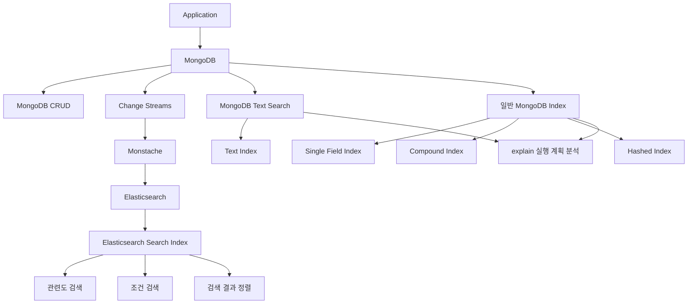

이 구조에서 MongoDB는 비즈니스 데이터를 저장하고 관리한다.

MongoDB 내부의 Text Index와 일반 인덱스를 사용하여 검색할 수도 있다.

반면 검색 요구사항이 복잡해진다면 Monstache를 통해 Elasticsearch에 데이터를 동기화하고 별도의 검색 인덱스를 구성할 수 있다.

두 검색 방식은 서로 배타적인 것은 아니지만, 검색 기능의 요구사항과 운영 비용을 고려하여 역할을 명확하게 구분하는 것이 좋다.

---

## MongoDB Text Search와 Index 주요 명령어 정리

| 기능 | 명령어 | 설명 |
|---|---|---|
| 단일 Text Index | `createIndex({ name: "text" })` | 단일 문자열 필드 검색 |
| 여러 필드 Text Index | `createIndex({ name: "text", description: "text" })` | 여러 문자열 필드 검색 |
| Text Search | `$text` | Text Index 검색 |
| 검색어 지정 | `$search` | 검색할 단어 및 구문 지정 |
| 관련도 점수 | `$meta: "textScore"` | 검색 관련도 점수 반환 |
| 다중 단어 검색 | `"book art"` | 기본 OR 검색 |
| 구문 검색 | `"\"Pet Care\""` | 정확한 구문 검색 |
| 제외어 검색 | `"art -toys"` | 특정 단어 포함 결과 제외 |
| 단일 필드 인덱스 | `createIndex({ price: 1 })` | 가격 인덱스 |
| 복합 인덱스 | `createIndex({ status: 1, createdAt: -1 })` | 복합 조건 검색 |
| 해시 인덱스 | `createIndex({ userId: "hashed" })` | 해시 기반 인덱스 |
| 인덱스 조회 | `getIndexes()` | 인덱스 목록 확인 |
| 특정 인덱스 삭제 | `dropIndex("price_1")` | 특정 인덱스 제거 |
| 전체 인덱스 정리 | `dropIndexes()` | 삭제 가능한 인덱스 제거 |
| 실행 계획 확인 | `explain()` | Query 실행 계획 |
| 실행 통계 확인 | `explain("executionStats")` | 실행 통계 |
| Collection Scan | `COLLSCAN` | Collection 직접 검사 |
| Index Scan | `IXSCAN` | 인덱스 탐색 |
| Monstache 초기 동기화 | `direct-read-namespaces` | 기존 Collection 동기화 |
| Monstache 변경 동기화 | `change-stream-namespaces` | 변경 이벤트 구독 |
| Monstache 재시작 지원 | `resume` | 동기화 재개 설정 |
| Elasticsearch 연결 | `elasticsearch-urls` | 검색 엔진 주소 설정 |

---

## 정리

MongoDB는 기본적인 데이터 조회뿐 아니라 Text Search를 이용한 단어 기반 검색 기능도 제공한다.

Text Search는 Text Index를 활용하여 문자열에 포함된 단어를 검색하고 관련도 점수를 계산할 수 있다.

Text Index의 핵심 개념은 역전 인덱스다.

역전 인덱스는 단어를 기준으로 해당 단어가 포함된 Document를 연결하는 구조다.

이를 통해 검색어와 관련된 Document를 효율적으로 탐색할 수 있다.

MongoDB의 `$text` 연산자는 이러한 Text Index를 이용하여 검색을 수행한다.

`$search`에는 검색어 또는 구문을 지정한다.

여러 단어를 공백으로 구분하면 기본적으로 OR 검색이 수행되며, 큰따옴표를 이용하면 정확한 구문 검색을 수행할 수 있다.

또한 검색어 앞에 `-`를 붙이면 해당 단어가 포함된 Document를 제외할 수 있다.

검색 관련도는 `$meta: "textScore"`를 이용하여 확인할 수 있다.

관련도 점수를 Projection과 정렬에 적용하면 검색어와 관련성이 높은 Document를 우선적으로 반환할 수 있다.

그러나 Text Search가 모든 검색 요구사항을 해결하는 것은 아니다.

한국어 형태소 분석과 자동완성, 동의어 검색, 오타 허용 등 복잡한 전문 검색이 필요하다면 별도의 검색 기능을 검토할 수 있다.

이러한 상황에서는 MongoDB와 Elasticsearch를 함께 사용하는 아키텍처를 고려할 수 있다.

MongoDB는 원본 비즈니스 데이터를 관리한다.

Elasticsearch는 검색에 최적화된 인덱스를 관리한다.

그리고 두 시스템 사이의 데이터 동기화를 수행하는 도구 중 하나가 Monstache다.

Monstache는 MongoDB의 기존 데이터를 Elasticsearch에 전달하고, Change Streams 등을 이용하여 이후 발생하는 데이터 변경을 동기화할 수 있다.

다만 MongoDB와 Elasticsearch의 데이터 변경은 일반적으로 하나의 원자적 트랜잭션으로 처리되지 않는다.

따라서 검색 결과에 동기화 지연이 발생할 수 있으며, 장애 상황에서는 변경 이벤트의 재처리와 검색 인덱스 재구축이 필요할 수 있다.

이러한 구조에서는 다음 요소가 중요하다.

- MongoDB Replica Set 구성
- Change Streams를 통한 변경 감지
- Monstache의 초기 동기화
- Resume 정보를 이용한 재시작
- Elasticsearch Mapping 및 인덱스 관리
- 데이터 동기화 지연 모니터링
- 장애 발생 시 데이터 재처리
- 원본 데이터와 검색 데이터의 정합성 검증

또한 MongoDB의 일반 인덱스는 검색 조건과 정렬 성능을 개선하기 위해 활용할 수 있다.

Single Field Index는 하나의 필드를 기준으로 검색한다.

Compound Index는 여러 필드의 검색 조건과 정렬을 함께 고려한다.

Text Index는 단어 기반 전문 검색을 지원한다.

Hashed Index는 해시 기반 데이터 접근과 Sharding에서 활용할 수 있다.

그러나 인덱스를 많이 생성하는 것이 항상 성능 개선으로 이어지는 것은 아니다.

인덱스가 증가하면 INSERT, UPDATE, DELETE 시 관련 인덱스를 유지해야 하므로 쓰기 비용과 저장 공간 사용량이 증가한다.

따라서 실제 서비스에서는 검색 조건과 데이터 분포를 분석하여 적절한 인덱스를 설계해야 한다.

또한 `explain("executionStats")`를 이용하여 실제 인덱스 사용 여부와 Document 검사량을 확인해야 한다.

결국 검색 시스템의 성능을 최적화하려면 다음 세 가지를 함께 고려해야 한다.

**첫 번째는 검색 요구사항에 적합한 기술을 선택하는 것이다.**

단순한 필드 조회와 범위 검색에는 MongoDB의 일반 인덱스가 적합할 수 있다.

단어 기반 검색에는 Text Index가 적합할 수 있다.

복잡한 전문 검색이 필요하다면 Elasticsearch와 같은 검색 엔진을 고려할 수 있다.

**두 번째는 데이터 동기화 구조를 안정적으로 설계하는 것이다.**

MongoDB와 Elasticsearch를 함께 사용하는 경우 Monstache와 Change Streams를 이용하여 데이터를 동기화할 수 있다.

하지만 데이터 변경과 검색 인덱스 반영 사이에는 지연이 발생할 수 있으므로 최종적 일관성과 장애 복구 전략이 필요하다.

**세 번째는 실제 실행 결과를 바탕으로 인덱스를 최적화하는 것이다.**

인덱스가 존재한다는 사실보다 실제 쿼리에서 효율적으로 사용되는지가 중요하다.

따라서 `explain()`을 통해 실행 계획을 분석하고, 인덱스 유지 비용과 검색 성능 사이의 균형을 고려해야 한다.

### 한 줄 요약

**MongoDB는 Text Index와 `$text`를 이용하여 단어 기반 검색을 수행하며, Monstache와 Change Streams를 활용하면 MongoDB 데이터를 Elasticsearch에 동기화하여 더욱 복잡한 전문 검색 시스템을 구성할 수 있다. 이때 검색 인덱스 설계뿐 아니라 데이터 동기화 지연, 장애 복구, 실행 계획 및 쓰기 비용까지 함께 고려해야 안정적인 검색 아키텍처를 구축할 수 있다.**
