# MongoDB 모니터링

# MongoDB 모니터링

* toc
{:toc}

---

## MongoDB 모니터링 완벽 이해: Compass, mongostat, mongotop부터 Prometheus·Grafana 및 장애 대응까지

MongoDB를 이용하여 애플리케이션을 개발할 때는 데이터를 저장하고 조회하는 기능뿐만 아니라 **데이터베이스가 안정적으로 동작하고 있는지 지속적으로 확인하는 과정**도 중요하다.

개발 환경에서는 몇백 건의 데이터를 저장하고 조회하는 것만으로도 MongoDB의 성능이 충분하다고 생각할 수 있다.

하지만 실제 운영 환경에서는 상황이 달라진다.

사용자가 증가하면서 동시에 실행되는 쿼리가 많아지고, 데이터가 지속적으로 쌓이며, 인덱스 크기와 메모리 사용량도 증가한다.

또한 다음과 같은 문제가 발생할 수 있다.

- 특정 API의 응답 시간이 갑자기 증가한다.
- MongoDB 연결 수가 급격하게 증가한다.
- 특정 Collection에 읽기·쓰기 요청이 집중된다.
- CPU 사용률이 높아지고 서버 응답이 지연된다.
- 메모리 부족으로 디스크 I/O가 증가한다.
- 인덱스가 적절하게 사용되지 않아 Collection Scan이 발생한다.
- 데이터 증가에 따라 저장 공간이 부족해진다.
- MongoDB 서버가 응답하지 않거나 연결이 끊어진다.

이러한 문제를 해결하려면 단순히 서버가 실행 중인지 확인하는 것만으로는 부족하다.

**현재 데이터베이스에서 어떤 작업이 발생하고 있는지, 얼마나 많은 자원을 사용하고 있는지, 어느 지점에서 병목이 발생하는지** 파악할 수 있어야 한다.

MongoDB는 이를 위해 다양한 모니터링 도구와 기능을 제공한다.

대표적으로 MongoDB Compass, `mongostat`, `mongotop`, MongoDB Atlas, Ops Manager 등을 활용할 수 있다.

또한 Prometheus와 Grafana를 연동하면 MongoDB의 성능 지표를 장기간 수집하고 시각화하여 장애 발생 전에 문제의 징후를 파악할 수 있다.

이번 글에서는 MongoDB 모니터링의 기본 개념부터 주요 도구의 사용법, 실제 데이터를 이용한 성능 변화 관찰, Prometheus·Grafana 기반 모니터링 구조, 그리고 운영 환경에서 발생할 수 있는 성능 저하와 장애 대응 방법까지 살펴본다.

---

## MongoDB 모니터링이란?

### 모니터링의 개념

모니터링(Monitoring)은 시스템의 상태와 성능을 지속적으로 관찰하고, 수집한 데이터를 바탕으로 이상 징후를 탐지하는 활동이다.

MongoDB에서는 다음과 같은 항목들이 모니터링 대상이 된다.

| 모니터링 항목 | 확인 내용 |
|---|---|
| CPU | 데이터베이스 프로세스의 CPU 사용량 |
| Memory | MongoDB 및 운영체제의 메모리 사용량 |
| Connections | 현재 연결 수와 사용 가능한 연결 수 |
| Operations | Insert, Query, Update, Delete 등의 작업량 |
| Network | MongoDB로 유입되고 전송되는 네트워크 데이터 |
| Disk I/O | 디스크 읽기·쓰기 활동 |
| Cache | WiredTiger 캐시 사용량과 Dirty 데이터 |
| Query Performance | 쿼리 실행 시간과 처리량 |
| Index | 인덱스 사용 여부와 검색 효율 |
| Replication | Replica Set 상태와 복제 지연 |
| Storage | 데이터 및 인덱스 크기, 저장 공간 사용률 |

예를 들어 다음과 같은 상황을 생각해 보자.

```text
평소 API 응답 시간: 100ms

현재 API 응답 시간: 3,000ms
```

응답 시간이 크게 증가했다는 사실만으로는 원인을 알 수 없다.

다음과 같은 가능성을 함께 살펴봐야 한다.

1. MongoDB에 실행되는 쿼리가 급격하게 증가했는가?
2. 특정 쿼리가 인덱스를 사용하지 않는가?
3. CPU 사용률이 높은가?
4. 메모리가 부족해 디스크 접근이 증가했는가?
5. 커넥션 풀이 고갈되었는가?
6. 특정 Collection에 작업이 집중되었는가?
7. 네트워크 지연이 발생했는가?

이처럼 모니터링은 단순히 수치를 확인하는 활동이 아니라 **문제의 원인을 좁혀 나가기 위한 근거를 확보하는 과정**이다.

---

## MongoDB 모니터링이 필요한 이유

MongoDB 모니터링의 목적은 크게 여섯 가지로 구분할 수 있다.

### 1. 성능 병목 확인과 최적화

데이터베이스의 성능 저하는 다양한 원인으로 발생한다.

예를 들어 특정 Collection에 수백만 건의 Document가 저장되어 있다고 가정해 보자.

다음 쿼리가 자주 실행된다.

```javascript
db.orders.find({
  userId: 1001,
  status: "COMPLETED"
});
```

그런데 `userId`와 `status`를 사용하는 적절한 인덱스가 없다면 많은 Document를 검사해야 할 수 있다.

데이터가 적을 때는 문제가 드러나지 않지만, 데이터가 증가하면 쿼리 실행 시간이 길어질 수 있다.

이때 모니터링을 통해 다음 현상을 발견할 수 있다.

- 쿼리 처리량 증가
- CPU 사용률 상승
- 특정 Collection의 읽기 활동 증가
- 느린 쿼리 발생
- 디스크 읽기 증가

이후 실행 계획을 분석하고 인덱스를 개선하는 방식으로 문제를 해결할 수 있다.

### 2. 장애에 대한 신속한 대응

MongoDB가 응답하지 않거나 연결이 끊어진 경우에는 현재 서버 상태를 빠르게 파악해야 한다.

특히 다음과 같은 상황이 중요하다.

- MongoDB 프로세스 종료
- 서버 메모리 부족
- 디스크 공간 부족
- 네트워크 연결 장애
- Connection 증가
- Replica Set의 Primary 변경
- Secondary 복제 지연

장애가 발생한 이후에만 로그를 확인한다면 원인을 찾는 데 많은 시간이 소요될 수 있다.

반면 평소부터 지표를 수집하고 있다면 장애 발생 전후의 변화를 비교할 수 있다.

### 3. 인프라 비용 절감

모니터링을 통해 리소스 사용량을 분석하면 불필요한 인프라 비용을 줄일 수 있다.

예를 들어 MongoDB 서버에 다음과 같은 자원이 할당되어 있다고 가정해 보자.

```text
CPU: 16 Core
Memory: 64GB
```

하지만 실제 사용량이 장기간 매우 낮다면 현재 인스턴스 크기가 과도할 가능성이 있다.

반대로 평균 사용량은 낮지만 특정 시간대에만 부하가 집중될 수도 있다.

따라서 단순 평균값이 아니라 다음 지표를 함께 확인해야 한다.

- 평균 CPU 사용률
- 최대 CPU 사용률
- 메모리 사용 추세
- 시간대별 요청량
- WiredTiger 캐시 사용량
- 디스크 I/O
- 네트워크 사용량

이러한 데이터를 기반으로 리소스를 조정하면 비용과 성능 사이의 균형을 맞출 수 있다.

### 4. 운영 효율 향상

운영자가 매번 서버에 접속하여 상태를 확인하는 방식은 비효율적이다.

대신 주요 지표를 자동으로 수집하고 대시보드로 제공하면 여러 데이터베이스의 상태를 한곳에서 확인할 수 있다.

예를 들어 다음과 같은 구성이다.

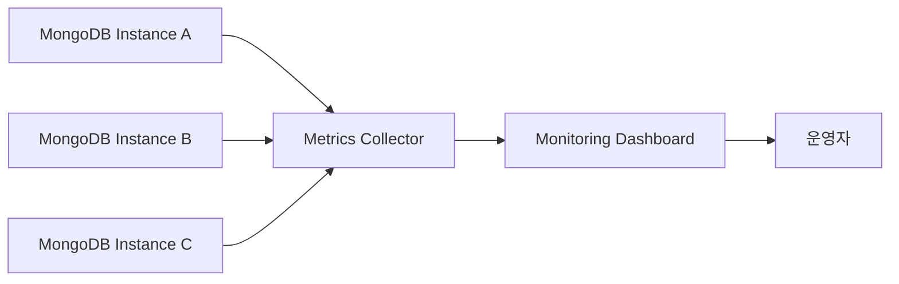

운영자는 개별 서버에 접속하지 않고도 데이터베이스별 상태를 비교할 수 있다.

### 5. 문제 해결 시간 단축

문제가 발생하면 원인을 찾기 위해 다양한 정보를 확인해야 한다.

모니터링 체계가 없다면 다음과 같은 순서로 접근할 수 있다.

```text
장애 발생
    ↓
서버 접속
    ↓
로그 확인
    ↓
시스템 상태 확인
    ↓
쿼리 분석
    ↓
문제 추정
```

반면 모니터링이 구성되어 있다면 장애 발생 시점의 지표를 즉시 확인할 수 있다.

```text
장애 발생
    ↓
알림 확인
    ↓
관련 지표 분석
    ↓
원인 범위 축소
    ↓
조치
```

결과적으로 장애를 탐지하고 복구하는 데 필요한 시간을 줄일 수 있다.

### 6. 장기적인 데이터 안정성 확보

MongoDB의 데이터는 시간이 지남에 따라 증가한다.

특히 로그, 이벤트, 주문, 결제, 사용자 활동 기록과 같은 데이터는 지속적으로 누적된다.

따라서 현재 저장 공간뿐만 아니라 데이터의 성장 추세까지 확인해야 한다.

예를 들어 데이터가 매월 일정한 비율로 증가한다면 향후 저장 공간이 부족해지는 시점을 예상할 수 있다.

이를 바탕으로 저장 공간 확장, 인덱스 정리, 데이터 보관 정책 등을 미리 검토할 수 있다.

---

## MongoDB 모니터링에서 중요한 Metric, Log, Trace

시스템을 모니터링할 때는 일반적으로 세 가지 데이터를 활용한다.

- Metric
- Log
- Trace

각각의 역할이 다르므로 함께 이해하는 것이 중요하다.

### Metric

Metric은 시스템의 상태를 숫자로 표현한 데이터다.

예를 들어 다음과 같은 지표가 있다.

```text
CPU Usage: 75%

Memory Usage: 80%

Connections: 150

Query Rate: 5,000/sec
```

이러한 값들은 시간에 따라 변한다.

따라서 일정한 간격으로 수집하면 시계열 데이터로 관리할 수 있다.

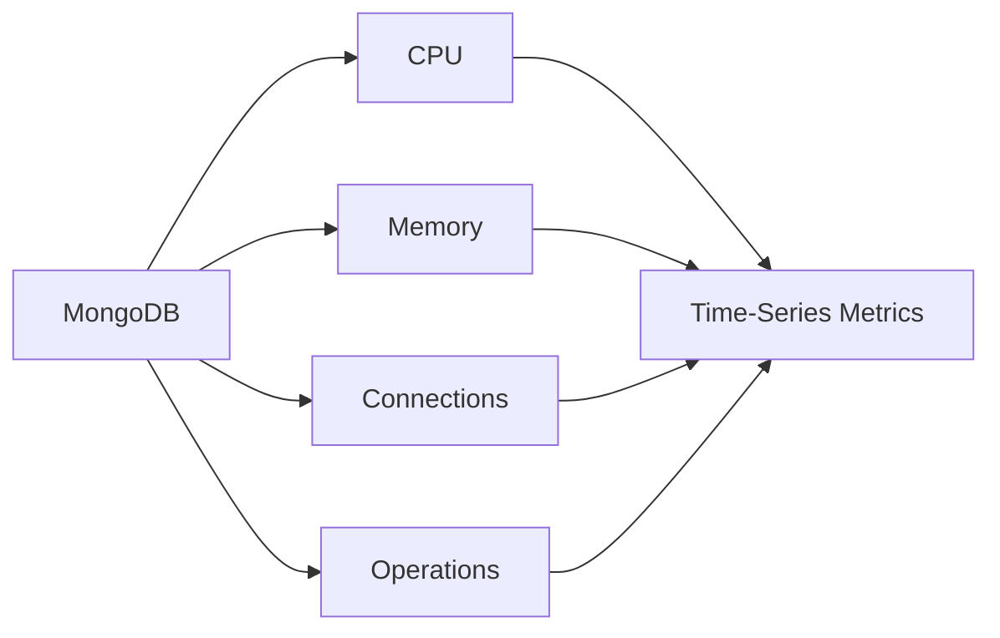

Metric은 시스템에서 이상 징후가 발생했는지 파악하는 데 유용하다.

### Log

Log는 시스템에서 발생한 이벤트와 작업 내용을 기록한 데이터다.

예를 들어 다음과 같은 로그가 발생할 수 있다.

```text
Connection accepted
Authentication failed
Slow query detected
Connection closed
```

Metric이 시스템 상태의 변화를 숫자로 보여준다면 Log는 해당 시점에 어떤 사건이 발생했는지 설명한다.

예를 들어 MongoDB 연결 수가 급격하게 증가한 상황에서 연결 관련 로그를 분석하면 새로운 연결이 반복적으로 생성되고 있는지 확인할 수 있다.

### Trace

Trace는 하나의 요청이 여러 시스템을 통과하는 과정을 추적하는 데이터다.

예를 들어 다음과 같은 요청 흐름을 생각해 보자.

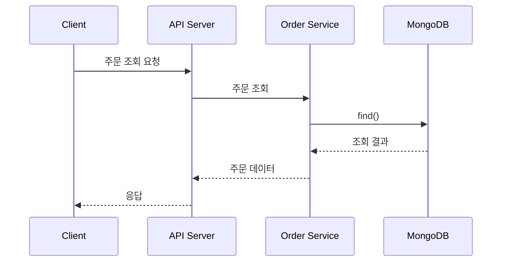

전체 API 응답 시간이 3초라고 가정해 보자.

Trace를 통해 다음과 같은 시간을 확인할 수 있다.

```text
API Gateway: 20ms

Order Service: 100ms

MongoDB Query: 2,800ms

Response Serialization: 80ms
```

이 경우 MongoDB 조회가 전체 응답 시간의 상당 부분을 차지한다는 사실을 파악할 수 있다.

다만 MongoDB의 `mongostat`이나 `mongotop`만으로 이러한 분산 추적 정보가 자동으로 생성되는 것은 아니다.

Trace를 수집하려면 애플리케이션 계층의 별도 계측이 필요하다.

### Metric, Log, Trace 비교

| 구분 | Metric | Log | Trace |
|---|---|---|---|
| 주요 목적 | 시스템 상태 확인 | 이벤트 및 오류 분석 | 요청 처리 흐름 추적 |
| 데이터 형태 | 숫자 기반 시계열 | 이벤트 기록 | 요청별 Span |
| 예시 | CPU 80% | Connection timeout | MongoDB 조회 2.8초 |
| 강점 | 이상 징후 감지 | 원인 분석 | 병목 구간 파악 |
| 대표 도구 | Prometheus | 로그 수집 시스템 | OpenTelemetry 기반 추적 시스템 |

실무에서는 세 가지 데이터를 조합하면 더욱 정확한 장애 분석이 가능하다.

---

## MongoDB 모니터링 프로세스

모니터링은 다음 네 단계로 구성할 수 있다.

**실시간 상태 확인 → 문제 징후 감지 → 원인 분석 → 조치**

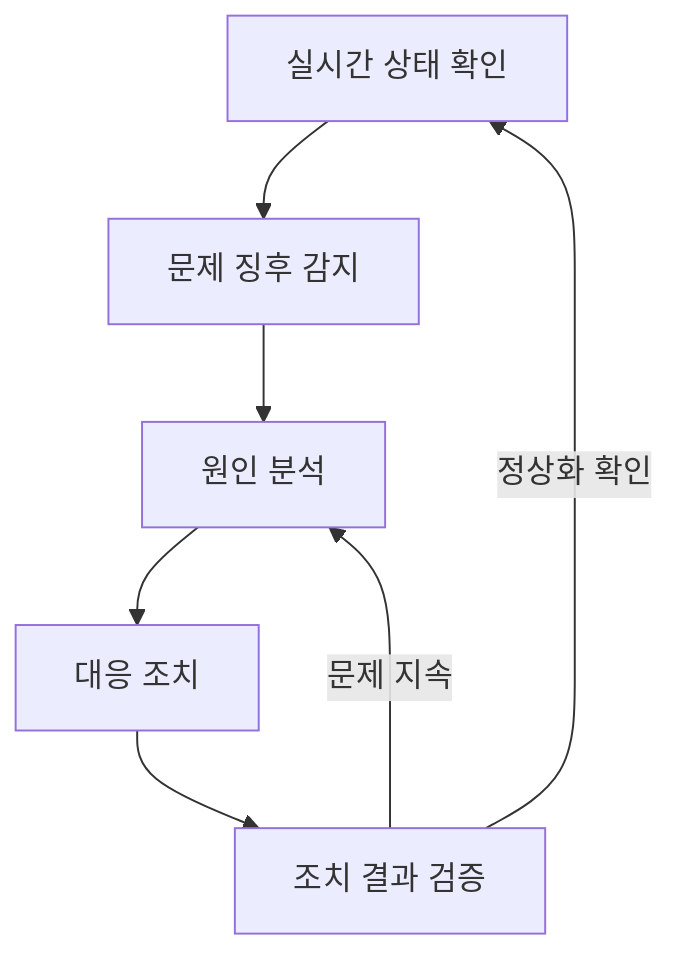

### 1. 실시간 상태 확인

MongoDB의 CPU, 메모리, 연결 수, 쿼리 처리량 등을 지속적으로 확인한다.

### 2. 문제 징후 감지

평소와 다른 패턴이 발생하면 이상 징후로 판단한다.

예를 들어 다음과 같은 상황이다.

```text
평소 Connections: 50

현재 Connections: 500
```

또는 다음과 같은 상황도 있다.

```text
평소 CPU: 30%

현재 CPU: 90%
```

다만 CPU가 특정 수치를 넘었다는 사실만으로 장애를 확정해서는 안 된다.

CPU 사용률은 워크로드의 특성에 따라 정상 범위가 달라질 수 있다.

따라서 평소 사용량과의 차이, 지속 시간, 서비스 응답 시간 등을 함께 고려해야 한다.

### 3. 원인 분석

문제가 발생한 지점을 구체적으로 분석한다.

예를 들어 다음과 같은 질문을 할 수 있다.

- 특정 Collection에 요청이 집중되었는가?
- 느린 쿼리가 증가했는가?
- 인덱스가 사용되지 않는가?
- 메모리 부족으로 디스크 I/O가 증가했는가?
- 연결 수가 과도하게 증가했는가?

### 4. 조치

원인에 따라 적절한 해결 방법을 적용한다.

- 쿼리 최적화
- 인덱스 생성 또는 변경
- 애플리케이션 Connection Pool 조정
- 메모리 및 CPU 확장
- 부하 분산
- 저장 공간 확보
- 장애 노드 복구

마지막으로 조치 이후 지표가 정상화되었는지 확인해야 한다.

---

## MongoDB 모니터링 도구의 종류

MongoDB를 모니터링하는 방법은 크게 GUI, CLI, 클라우드 관리 서비스, 외부 모니터링 시스템으로 구분할 수 있다.

| 도구 | 유형 | 주요 기능 |
|---|---|---|
| MongoDB Compass | GUI | 실시간 성능 그래프 및 데이터 탐색 |
| mongostat | CLI | MongoDB 인스턴스의 작업량과 자원 사용 현황 |
| mongotop | CLI | Collection별 읽기·쓰기 활동 분석 |
| MongoDB Atlas | 클라우드 | 클러스터 모니터링, 알림, 성능 분석 |
| Ops Manager | 관리 플랫폼 | 자체 관리형 MongoDB의 모니터링·자동화·백업 |
| Cloud Manager | 클라우드 관리 도구 | MongoDB 배포 관리 및 모니터링 |
| Prometheus | Metrics 수집 | 시계열 데이터 수집 및 저장 |
| Grafana | 시각화 | 모니터링 대시보드 및 알림 |

이러한 도구는 서로 경쟁 관계라기보다 목적에 따라 함께 사용할 수 있다.

예를 들어 개발 중에는 Compass를 이용하여 성능 변화를 확인할 수 있다.

운영 중 갑작스러운 문제가 발생하면 `mongostat`, `mongotop`으로 현재 상태를 분석할 수 있다.

장기간의 성능 추세를 확인하려면 Prometheus와 Grafana를 활용할 수 있다.

---

## MongoDB Database Tools 설치

### Database Tools란?

MongoDB Database Tools는 MongoDB를 관리하기 위한 명령줄 프로그램 모음이다.

대표적인 도구는 다음과 같다.

| 도구 | 역할 |
|---|---|
| mongodump | MongoDB 데이터 백업 |
| mongorestore | 백업 데이터 복원 |
| mongoexport | 데이터를 JSON·CSV 등으로 내보내기 |
| mongoimport | 외부 데이터를 MongoDB로 가져오기 |
| mongostat | MongoDB 상태 및 성능 확인 |
| mongotop | Collection별 읽기·쓰기 시간 확인 |

MongoDB Database Tools는 MongoDB 서버나 `mongosh`와 별도로 설치될 수 있다.

따라서 MongoDB 서버에 접속할 수 있다고 해서 모든 Database Tools가 설치되어 있다고 보장할 수는 없다.

### 설치 확인

Windows 명령 프롬프트 또는 PowerShell에서 다음 명령어를 실행한다.

```powershell
mongostat --version
```

```powershell
mongotop --version
```

정상적으로 설치되어 있고 PATH에 등록되어 있다면 버전 정보를 확인할 수 있다.

### Windows에서 실행 파일 확인

설치된 실행 파일의 위치를 확인하려면 다음 명령어를 사용할 수 있다.

```cmd
where mongostat
```

```cmd
where mongotop
```

실행 파일이 PATH에 등록되어 있지 않다면 전체 경로를 지정하여 실행하거나 PATH 환경변수를 설정해야 한다.

MongoDB Database Tools는 MongoDB의 공식 다운로드 페이지에서 제공한다.

현재 Database Tools 문서에서는 `mongostat`과 `mongotop`의 명령어, 옵션, 권한 요구사항 등을 별도로 설명한다. [MongoDB](https://www.mongodb.com/docs/database-tools/mongostat/)

---

## MongoDB Atlas를 이용한 모니터링

### MongoDB Atlas란?

MongoDB Atlas는 MongoDB의 관리형 클라우드 데이터베이스 서비스다.

사용자가 MongoDB 서버를 직접 설치하고 운영하는 대신, 클라우드 환경에서 MongoDB 클러스터를 생성하고 관리할 수 있다.

Atlas는 데이터베이스 운영을 위한 다양한 모니터링 기능을 제공한다.

대표적인 기능은 다음과 같다.

- CPU 사용률 확인
- 메모리 사용량 확인
- 연결 수 확인
- 네트워크 트래픽 확인
- 읽기·쓰기 작업량 확인
- 쿼리 성능 분석
- 인덱스 사용 현황 분석
- 클러스터 상태 확인
- 알림 및 경고 설정

### Atlas 모니터링 구조

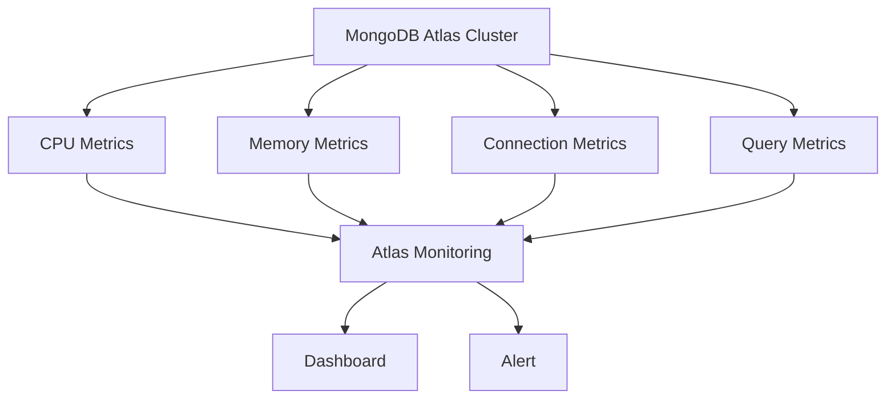

운영자는 Atlas의 대시보드를 통해 MongoDB 상태를 확인할 수 있다.

### 알림 설정

예를 들어 데이터베이스의 연결 수가 급격하게 증가하는 상황을 생각해 보자.

모니터링 시스템에서 미리 정의한 조건을 충족하면 알림을 전달하도록 구성할 수 있다.

```text
MongoDB 연결 수 증가
        ↓
설정한 알림 조건 충족
        ↓
Atlas Alert 발생
        ↓
운영자 알림
        ↓
원인 분석
```

다만 어떤 임계값을 적용할지는 실제 서비스의 평소 연결 수와 사용 패턴을 기준으로 결정해야 한다.

또한 Atlas의 모니터링 기능은 클러스터 유형과 서비스 구성에 따라 지원 범위가 다를 수 있다.

---

## MongoDB Ops Manager와 Cloud Manager

MongoDB는 자체 관리형 환경에서 사용할 수 있는 관리 도구도 제공한다.

### MongoDB Ops Manager

Ops Manager는 MongoDB 인프라를 직접 관리하는 환경에서 활용할 수 있는 관리 플랫폼이다.

대표적인 기능은 다음과 같다.

1. 모니터링
2. 배포 및 구성 자동화
3. 백업
4. 복구
5. 알림 설정

Ops Manager는 MongoDB Agent를 통해 데이터베이스와 서버의 상태를 수집하고 관리할 수 있다.

특히 다음과 같은 환경에서 활용할 수 있다.

- 온프레미스 MongoDB
- 사설 클라우드 환경
- 자체 관리형 MongoDB Cluster

### Cloud Manager

Cloud Manager 역시 MongoDB 배포 환경을 관리하기 위한 도구로 사용되어 왔다.

기존 관리 환경에서는 데이터베이스 상태와 로그, 알림, 백업 등의 기능을 제공한다.

다만 현재 운영 중인 제품의 버전과 계약에 따라 기능 및 지원 범위가 다를 수 있으므로, 새로운 인프라에서는 현재 지원되는 관리 방식을 기준으로 선택해야 한다.

### Atlas와 Ops Manager 비교

| 항목 | MongoDB Atlas | MongoDB Ops Manager |
|---|---|---|
| 주요 환경 | 관리형 클라우드 | 자체 관리형 MongoDB |
| 인프라 관리 | 관리형 서비스 중심 | 사용자 관리 인프라 중심 |
| 성능 모니터링 | 제공 | 제공 |
| 알림 | 제공 | 제공 |
| 백업 | 서비스 구성에 따라 제공 | 구성 및 지원 범위에 따라 제공 |
| 운영 책임 | 일부 관리 업무를 서비스에 위임 | 인프라 운영 책임이 상대적으로 큼 |

Ops Manager는 현재도 자체 관리형 MongoDB의 모니터링, 자동화, 백업 기능을 제공한다. [MongoDB](https://www.mongodb.com/docs/ops-manager/current/application/?msockid=3e1d252cb4e46af9311f334fb5bb6b6b\&utm_source=chatgpt.com)

---

## MongoDB Compass를 이용한 실시간 성능 모니터링

### MongoDB Compass란?

MongoDB Compass는 MongoDB에서 제공하는 GUI 기반 관리 도구다.

Compass를 이용하면 터미널에서 명령어를 실행하지 않고도 Collection의 데이터를 조회하고 관리할 수 있다.

또한 연결된 MongoDB 서버의 성능 정보를 시각적으로 확인할 수 있다.

### Compass의 주요 기능

- Database 및 Collection 탐색
- Document 조회
- 필터 조건 작성
- Aggregation Pipeline 구성
- 인덱스 관리
- 쿼리 실행 계획 분석
- 실시간 성능 그래프 확인

### Performance 화면

Compass의 Performance 화면에서는 다음과 같은 항목들을 확인할 수 있다.

| 영역 | 설명 |
|---|---|
| Operations | 데이터베이스 작업량 |
| Read & Write | 활성 읽기·쓰기와 대기 상태 |
| Network | 연결 및 네트워크 관련 지표 |
| Memory | 메모리 사용 상태 |
| Hottest Collections | 활동량이 높은 Collection |
| Slowest Operations | 처리 시간이 긴 작업 |

Compass의 실시간 성능 화면은 `mongostat`, `mongotop` 등이 제공하는 정보를 시각적으로 확인할 수 있도록 구성되어 있다.

또한 권한이 허용되는 환경에서는 실행 시간이 긴 작업을 확인하고 중단하는 기능도 제공한다. [MongoDB](https://www.mongodb.com/docs/compass/performance/?utm_source=chatgpt.com)

### Compass와 CLI 모니터링의 차이

Compass는 여러 지표를 그래프로 확인할 수 있다는 장점이 있다.

반면 `mongostat`과 `mongotop`은 터미널에서 빠르게 현재 상태를 확인하는 데 유용하다.

| 구분 | Compass | mongostat·mongotop |
|---|---|---|
| 인터페이스 | GUI | CLI |
| 주요 장점 | 직관적인 시각화 | 빠른 명령어 기반 확인 |
| 자동화 | 제한적 | 스크립트와 조합 가능 |
| 운영 서버 사용 | 접근 권한과 환경 고려 | 터미널 접근 시 활용 |
| 주요 목적 | 데이터 탐색 및 실시간 분석 | 인스턴스·Collection 활동 확인 |

---

## MongoDB에 테스트 데이터를 생성하고 성능 변화 관찰하기

이제 실제 데이터를 저장하면서 MongoDB의 성능 지표가 어떻게 변하는지 살펴보자.

먼저 MongoDB Shell에 접속한다.

```bash
mongosh
```

로컬 MongoDB의 기본 포트를 사용한다면 다음과 같이 접속할 수도 있다.

```bash
mongosh "mongodb://127.0.0.1:27017"
```

정상적으로 연결되면 MongoDB Shell에서 데이터베이스 명령어를 실행할 수 있다.

예제 환경에서는 MongoDB 8.0.8과 mongosh 2.5.1을 사용한 구성이 등장하지만, 이는 특정 실행 환경의 버전이며 모든 환경에서 동일한 버전을 사용해야 한다는 의미는 아니다.

또한 인증이 비활성화된 MongoDB에서는 접근 제어가 활성화되어 있지 않다는 경고가 나타날 수 있다.

이러한 설정은 격리된 개발 환경에서만 사용하고, 운영 환경에서는 반드시 인증과 네트워크 접근 제어를 적용해야 한다.

---

## customers Collection에 데이터 9,999건 생성하기

### 데이터베이스 선택

```javascript
use bizcom_db
```

### 데이터 생성 코드

다음 코드는 `customers` Collection에 반복적으로 Document를 생성한다.

```javascript
for (i = 1; i < 10000; i++) {
  db.customers.insert(
    {
      "i": i,
      "cust_name": "user" + i,
      "age": Math.floor(Math.random() * 120),
      "ordered": new Date()
    }
  );
}
```

코드를 분석해 보자.

### 반복 조건

```javascript
for (i = 1; i < 10000; i++)
```

반복문은 `i = 1`부터 시작한다.

그리고 `i < 10000` 조건을 만족하는 동안 반복한다.

따라서 정상적으로 모든 반복이 완료된다면 총 9,999번의 Insert를 시도한다.

다만 반복 횟수가 9,999번이라는 사실과 실제로 9,999개의 Document가 저장되었다는 것은 다르다.

중간에 오류가 발생하거나 작업이 중단될 수 있기 때문이다.

### cust_name

```javascript
"cust_name": "user" + i
```

`i`에 따라 사용자 이름을 생성한다.

```text
user1
user2
user3
...
user9999
```

### age

```javascript
"age": Math.floor(Math.random() * 120)
```

`Math.random()`은 0 이상 1 미만의 난수를 생성한다.

여기에 120을 곱하고 소수점 이하를 버린다.

따라서 `age`에는 0부터 119까지의 정수가 저장될 수 있다.

이는 데이터 생성용 임의 값이며 실제 사용자 나이를 모델링하기 위한 적절한 범위를 의미하는 것은 아니다.

### ordered

```javascript
"ordered": new Date()
```

Document가 생성되는 시점의 날짜와 시간을 저장한다.

따라서 반복 실행 동안 각 Document에 저장되는 시간은 조금씩 달라질 수 있다.

### 생성되는 Document 구조

```javascript
{
  "i": 1,
  "cust_name": "user1",
  "age": 35,
  "ordered": ISODate("...")
}
```

`_id`를 명시하지 않았다면 MongoDB는 고유한 `_id`를 부여한다.

---

## Deprecated된 insert() 대신 insertOne() 사용하기

앞의 코드에서는 다음 메서드를 사용했다.

```javascript
db.customers.insert()
```

하지만 현재 `mongosh`에서는 `insert()`가 Deprecated로 분류되어 있다.

따라서 새로운 코드에서는 `insertOne()`이나 `insertMany()`를 사용하는 것이 좋다. [MongoDB](https://www.mongodb.com/docs/mongodb-shell/reference/compatibility/?utm_source=chatgpt.com)

### insertOne()으로 변경

```javascript
for (let i = 1; i < 10000; i++) {
  db.customers.insertOne({
    i: i,
    cust_name: "user" + i,
    age: Math.floor(Math.random() * 120),
    ordered: new Date()
  });
}
```

이 코드는 앞의 반복문과 같은 목적을 가진다.

다만 다음 두 부분을 개선했다.

**첫 번째는 변수 선언이다.**

```javascript
let i = 1
```

기존 코드에서는 `i`를 명시적으로 선언하지 않았다.

새로운 코드에서는 `let`으로 반복문의 변수를 선언한다.

**두 번째는 Insert 메서드다.**

```javascript
db.customers.insertOne()
```

Deprecated된 `insert()` 대신 `insertOne()`을 사용한다.

### 반복 Insert와 insertMany()의 차이

`insertOne()`을 반복 호출하면 여러 번의 개별 쓰기 요청이 발생한다.

따라서 대량 데이터를 빠르게 저장해야 하는 경우에는 `insertMany()`가 유리할 수 있다.

하지만 이번 예제에서는 **데이터가 지속적으로 삽입될 때 모니터링 그래프가 어떻게 변하는지 관찰하는 것**이 목적이다.

따라서 의도적으로 반복 요청을 발생시키는 방식도 의미가 있다.

다만 이러한 반복문을 운영 데이터베이스에서 그대로 실행하면 불필요한 부하가 발생할 수 있으므로 격리된 테스트 환경에서 사용하는 것이 좋다.

### 저장 결과 확인

```javascript
db.customers.find();
```

전체 Document 수를 확인한다.

```javascript
db.customers.countDocuments({});
```

모든 Insert가 정상적으로 처리되었고 기존 데이터가 없었다면 9,999건이 저장될 수 있다.

하지만 기존 데이터가 존재했거나 일부 요청이 실패했다면 결과가 달라질 수 있다.

---

## 데이터 Insert와 Compass Performance 그래프의 관계

데이터를 반복적으로 삽입하는 동안 Compass의 Performance 화면을 확인하면 작업량과 시스템 자원 사용 패턴의 변화를 관찰할 수 있다.

예를 들어 다음과 같은 변화가 발생할 수 있다.

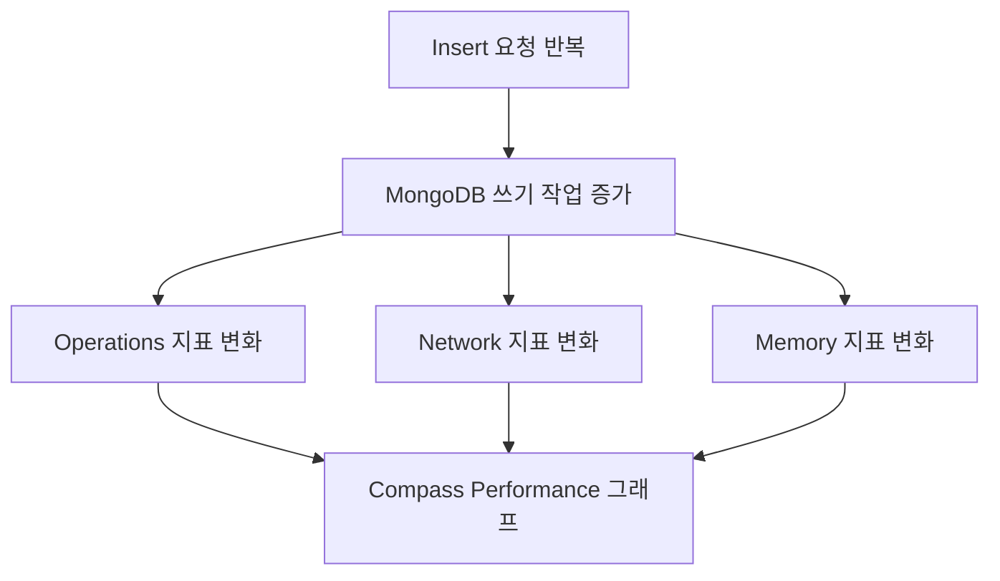

다만 Insert 작업이 증가했다고 해서 CPU, 메모리, 네트워크 사용량이 반드시 동일한 비율로 증가하는 것은 아니다.

데이터의 크기, 인덱스 개수, 스토리지 엔진 상태, 배치 방식 등에 따라 지표가 다르게 나타날 수 있다.

### 그래프에서 확인해야 할 항목

**Operations**

작업량이 증가했는지 확인한다.

**Network**

MongoDB 서버로 유입되는 데이터나 연결 상태에 변화가 있는지 확인한다.

**Memory**

WiredTiger 캐시와 MongoDB 프로세스 메모리 사용 상태를 확인한다.

**Read & Write**

활성 읽기·쓰기와 대기 중인 작업이 증가했는지 확인한다.

특정 그래프가 상승했다는 사실만으로 바로 병목이라고 판단하기보다는 다른 지표와 함께 분석해야 한다.

---

## mongostat이란?

### mongostat의 개념

`mongostat`은 MongoDB 인스턴스의 상태와 작업량을 실시간으로 확인하는 CLI 도구다.

Linux의 `vmstat`과 비슷하게 일정한 간격으로 시스템 상태를 출력한다.

MongoDB에서는 다음과 같은 정보를 확인할 수 있다.

- Insert 작업량
- Query 작업량
- Update 작업량
- Delete 작업량
- Command 실행량
- WiredTiger 캐시 사용률
- 메모리 사용량
- 읽기·쓰기 대기 상태
- 네트워크 트래픽
- 연결 수

`mongostat`은 시스템 전체의 이상 징후를 빠르게 확인하는 데 유용하다.

다만 특정 API의 정확한 응답 시간이나 특정 쿼리의 실행 계획을 직접 제공하는 도구는 아니다.

### mongostat 실행

운영체제의 터미널에서 다음 명령어를 실행한다.

```bash
mongostat
```

MongoDB 서버가 로컬의 기본 포트에서 실행 중이라면 일정한 간격으로 상태 정보가 출력된다.

여기서 주의할 부분은 `mongostat`이 `mongosh` 내부의 JavaScript 명령어가 아니라는 것이다.

따라서 다음과 같이 구분해야 한다.

```text
mongosh
→ MongoDB 데이터 조회·수정 등을 수행하는 Shell

mongostat
→ 운영체제 터미널에서 실행하는 모니터링 프로그램
```

---

## mongostat 실행 옵션

### Host와 Port 지정

다음과 같이 MongoDB 서버 주소를 명시할 수 있다.

```bash
mongostat --host localhost --port 27017
```

각 옵션의 의미는 다음과 같다.

| 옵션 | 설명 |
|---|---|
| `--host` | MongoDB 서버 주소 |
| `--port` | MongoDB 서버 포트 |

기본적으로 `localhost:27017`에 연결하므로 해당 주소를 사용한다면 옵션을 생략할 수도 있다.

### 출력 간격 지정

다음 명령어는 2초 간격으로 상태 정보를 출력한다.

```bash
mongostat --host localhost --port 27017 2
```

마지막의 `2`는 출력 간격을 초 단위로 지정한 것이다.

### 출력 개수 제한

다음 명령어를 실행한다.

```bash
mongostat --host localhost --port 27017 --rowcount 10 1
```

이 명령어는 1초 간격으로 최대 10줄의 통계 데이터를 출력한다.

| 설정 | 의미 |
|---|---|
| `--host localhost` | 로컬 서버 |
| `--port 27017` | MongoDB 기본 포트 |
| `--rowcount 10` | 출력 행 10개 |
| `1` | 1초 간격 |

이러한 옵션은 일정 시간 동안 상태를 관찰한 뒤 자동으로 종료해야 하는 스크립트에서 유용하다.

공식 문서에서는 `--rowcount`와 출력 간격을 이용하여 `mongostat`의 실행 기간을 제어하는 방식을 제공한다. [MongoDB](https://www.mongodb.com/docs/database-tools/mongostat/)

---

## mongostat 출력 결과 이해하기

`mongostat`에서는 다음과 같은 열을 확인할 수 있다.

```text
insert query update delete getmore command dirty used flushes
vsize res qrw arw net_in net_out conn time
```

각 항목을 살펴보자.

### 데이터베이스 작업 관련 지표

| 항목 | 의미 |
|---|---|
| insert | Insert 작업량 |
| query | Query 작업량 |
| update | Update 작업량 |
| delete | Delete 작업량 |
| getmore | Cursor의 추가 데이터 조회 작업 |
| command | 데이터베이스 Command 실행량 |

대부분의 작업량 관련 수치는 관찰 구간을 기준으로 초당 처리량 형태로 표시된다.

다만 현재 MongoDB의 많은 작업이 Command 형태로 실행되므로 `query` 열만으로 모든 조회 요청을 정확히 판단해서는 안 된다.

예를 들어 현대 MongoDB 드라이버에서 실행한 `find` 요청은 Command 관련 통계와 연결될 수 있다.

따라서 정확한 작업 유형과 처리량을 분석하려면 `serverStatus`의 세부 지표나 애플리케이션 메트릭을 함께 확인하는 것이 좋다.

### WiredTiger 관련 지표

| 항목 | 의미 |
|---|---|
| dirty | WiredTiger 캐시에서 Dirty 데이터가 차지하는 비율 |
| used | WiredTiger 캐시의 사용 비율 |
| flushes | Storage Engine의 Flush 관련 통계 |

#### dirty

Dirty 데이터는 메모리에는 변경 내용이 반영되었지만 아직 디스크의 데이터 파일에 완전히 반영되지 않은 데이터를 의미한다.

MongoDB는 WiredTiger 스토리지 엔진을 사용하며, 캐시와 디스크 사이에서 데이터를 관리한다.

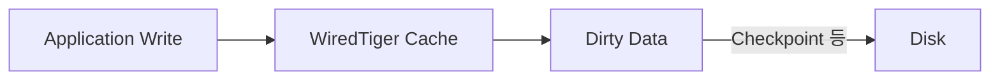

`dirty`가 지속적으로 높게 유지된다면 데이터 쓰기와 디스크 반영 과정의 상태를 확인할 필요가 있다.

다만 `dirty` 값이 높다는 사실만으로 즉시 장애라고 판단해서는 안 된다.

#### used

`used`는 WiredTiger 캐시의 사용 비율이다.

여기서 주의해야 할 점은 **WiredTiger 캐시 사용률과 서버 전체 메모리 사용률이 같은 값이 아니라는 것**이다.

예를 들어 다음 두 수치는 서로 다르게 해석해야 한다.

```text
WiredTiger Cache Used: 80%

OS Memory Used: 80%
```

WiredTiger는 MongoDB 내부의 캐시를 의미한다.

운영체제의 메모리 사용량은 다른 프로세스와 파일 시스템 캐시 등을 포함한다.

따라서 메모리 문제를 분석할 때는 두 지표를 구분해야 한다.

### 메모리 관련 지표

| 항목 | 의미 |
|---|---|
| vsize | 프로세스의 가상 메모리 크기 |
| res | 프로세스의 Resident Memory 크기 |

`vsize`는 MongoDB 프로세스가 사용하는 가상 주소 공간과 관련된다.

`res`는 프로세스가 실제 물리 메모리에 상주시키는 메모리 크기와 관련된다.

일반적으로 메모리 압박을 분석할 때는 `res`뿐 아니라 운영체제의 가용 메모리, Swap, 디스크 I/O 등을 함께 확인해야 한다.

### 읽기·쓰기 작업 관련 지표

| 항목 | 의미 |
|---|---|
| qrw | 읽기·쓰기 대기 작업 수 |
| arw | 활성 읽기·쓰기 작업 수 |

`qrw`는 작업을 수행하기 위해 대기 중인 읽기·쓰기 요청의 수를 나타낸다.

`arw`는 현재 활성 상태인 읽기·쓰기 요청을 나타낸다.

예를 들어 다음 값이 있다고 가정해 보자.

```text
qrw: 10|5
```

이는 읽기 대기와 쓰기 대기 작업이 각각 존재한다는 의미다.

대기 작업이 지속적으로 증가한다면 서버가 요청을 처리하는 속도보다 요청이 들어오는 속도가 빠를 가능성을 검토해야 한다.

하지만 일시적인 대기만으로 병목을 확정할 수는 없다.

### 네트워크 및 연결 지표

| 항목 | 의미 |
|---|---|
| net_in | 서버로 유입되는 네트워크 데이터 |
| net_out | 서버에서 전송하는 네트워크 데이터 |
| conn | 현재 연결 수 |
| time | 측정 시점 |

예를 들어 다음과 같은 상황을 생각해 보자.

```text
평소 Connection: 30

부하 증가 후 Connection: 200
```

이러한 변화가 발생한다면 애플리케이션 연결 패턴과 Connection Pool 설정을 확인할 수 있다.

다만 연결 수가 증가했다고 해서 반드시 비정상이라고 볼 수는 없다.

실제 트래픽 증가나 애플리케이션 인스턴스 확장으로 인해 정상적으로 연결 수가 증가할 수도 있기 때문이다.

---

## mongostat으로 Insert·Query·Update·Delete 관찰하기

이제 데이터를 생성하고 변경하면서 `mongostat`의 출력이 어떻게 달라지는지 확인해 보자.

먼저 별도의 터미널에서 다음 명령어를 실행한다.

```bash
mongostat --host localhost --port 27017
```

이 상태에서 `mongosh`에 접속한다.

```bash
mongosh
```

데이터베이스를 선택한다.

```javascript
use bizcom_db
```

### sales 데이터 생성

```javascript
db.sales.insertMany([
  { item: "monitor", qty: 10, price: 200 },
  { item: "keyboard", qty: 50, price: 20 },
  { item: "mouse", qty: 60, price: 10 }
]);
```

세 개의 상품 Document를 저장한다.

| 상품 | 수량 | 가격 |
|---|---:|---:|
| monitor | 10 | 200 |
| keyboard | 50 | 20 |
| mouse | 60 | 10 |

이때 `mongostat`에서 Insert 및 관련 Command 활동의 변화를 관찰할 수 있다.

### Update 작업

다음 명령어는 `mouse` 상품의 수량을 0으로 변경한다.

```javascript
db.sales.updateMany(
  { item: "mouse" },
  { $set: { qty: 0 } }
);
```

변경된 Document를 확인한다.

```javascript
db.sales.find({
  item: "mouse"
});
```

정상적으로 변경되었다면 `qty`가 0으로 표시된다.

### Query 작업

수량이 10보다 큰 상품을 조회한다.

```javascript
db.sales.find({
  qty: {
    $gt: 10
  }
}).pretty();
```

`$gt`는 Greater Than을 의미한다.

따라서 다음 조건과 같다.

```text
qty > 10
```

현재 데이터에서는 `keyboard`가 해당 조건에 일치한다.

`monitor`는 수량이 정확히 10이므로 제외된다.

`mouse`는 앞에서 수량을 0으로 변경했으므로 제외된다.

### 반복 조회 작업

다음 코드는 동일한 조회를 50번 시도한다.

```javascript
for (let i = 0; i < 50; i++) {
  db.sales.find({
    qty: {
      $gt: 10
    }
  }).pretty();
}
```

여기서 중요한 점이 있다.

`find()`는 Cursor를 반환한다.

따라서 실제 조회 작업의 처리량을 관찰하려면 Cursor의 결과를 소비하는 과정까지 고려해야 한다.

명시적으로 결과를 소비하려면 다음과 같이 작성할 수 있다.

```javascript
for (let i = 0; i < 50; i++) {
  db.sales.find({
    qty: {
      $gt: 10
    }
  }).toArray();
}
```

이렇게 하면 각 반복에서 조회 결과를 배열로 가져온다.

다만 반환 데이터가 매우 많은 경우 `toArray()`는 메모리 사용량을 증가시킬 수 있으므로 대량 데이터 조회에서는 주의해야 한다.

### Delete 작업

수량이 0인 상품을 삭제한다.

```javascript
db.sales.deleteMany({
  qty: {
    $eq: 0
  }
});
```

`$eq`는 Equal을 의미한다.

다음 조건과 같다.

```text
qty = 0
```

앞에서 `mouse`의 수량을 0으로 변경했으므로 해당 Document가 삭제 대상이 된다.

### 작업 전체 흐름

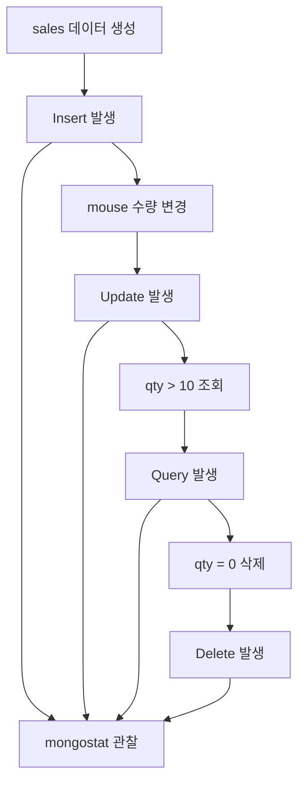

이러한 작업을 실행하면서 `mongostat`을 확인하면 데이터베이스 작업이 발생하는 시점과 지표 변화의 관계를 파악할 수 있다.

---

## Windows 배치 스크립트를 이용한 MongoDB 모니터링

Windows 환경에서는 `.bat` 파일을 이용하여 MongoDB 명령어와 모니터링 명령어를 자동으로 실행할 수 있다.

예를 들어 다음 작업을 자동화한다고 가정해 보자.

1. 테스트 데이터 생성
2. 반복적인 Query 수행
3. Update 수행
4. Delete 수행
5. 일정 시간 동안 `mongostat` 실행
6. 모니터링 종료

Windows 배치 파일에서는 `for /l` 반복문과 `mongosh` 명령어를 조합하여 이러한 작업을 구성할 수 있다.

### 기본 배치 구조

```bat
@echo off
echo MongoDB 모니터링 스크립트 시작
chcp 65001

:: 데이터 삽입
echo 샘플 데이터 삽입 중...

REM MongoDB Shell 명령어 실행
```

여기서 각 명령어의 의미는 다음과 같다.

| 명령어 | 설명 |
|---|---|
| `@echo off` | 실행 중인 명령어 자체의 출력을 숨김 |
| `echo` | 메시지 출력 |
| `chcp 65001` | 콘솔 코드 페이지를 UTF-8로 설정 |
| `::` | 배치 파일에서 사용하는 주석 형태 |
| `REM` | 주석 |
| `for /l` | 숫자 범위 반복 |
| `timeout` | 일정 시간 대기 |
| `start /b` | 별도 창 없이 프로세스 시작 |
| `taskkill` | 실행 중인 프로세스 종료 |

### 반복 작업 부분

다음은 `test_monitor` 데이터베이스를 이용하여 반복적으로 조회·수정·삭제하는 배치 명령어다.

```bat
:: 반복적으로 Query, Update, Delete 수행
for /l %%i in (1,1,10) do (
    echo 쿼리 수행: %%i 차례
    echo use test_monitor; db.sales.find({ qty: { $gt: 10 } }) | mongosh

    echo 업데이트 수행: %%i 차례
    echo use test_monitor; db.sales.updateMany({ item: "mouse" }, { $set: { qty: 0 } }) | mongosh

    echo 삭제 수행: %%i 차례
    echo use test_monitor; db.sales.deleteMany({ qty: { $eq: 0 } }) | mongosh

    timeout /t 1 >nul
)
```

이 코드는 다음과 같은 순서로 동작하도록 작성되어 있다.

```text
Query
  ↓
Update
  ↓
Delete
  ↓
1초 대기
  ↓
반복
```

### %%i의 의미

```bat
for /l %%i in (1,1,10) do (
```

Windows 배치 파일의 `for /l` 구문이다.

각 값은 다음과 같은 의미다.

```text
시작값: 1

증가값: 1

종료값: 10
```

따라서 총 10번 반복한다.

배치 파일에서는 반복 변수를 `%%i`로 표현한다.

반면 Windows 명령 프롬프트에 직접 입력할 때는 `%i`를 사용한다.

### 파이프 연산자

다음 코드를 살펴보자.

```bat
echo use test_monitor; db.sales.find({ qty: { $gt: 10 } }) | mongosh
```

`|`는 앞의 명령어 출력을 다음 프로그램의 표준 입력으로 전달하는 파이프 연산자다.

즉, MongoDB Shell 명령어를 문자열로 출력한 뒤 `mongosh`에 전달하는 구조다.

다만 배치 파일에서 복잡한 JavaScript 명령어를 `echo`와 파이프로 전달하면 인용부호, 특수문자, 셸 처리 방식 등에 영향을 받을 수 있다.

따라서 실무에서는 JavaScript 파일을 별도로 작성하고 `mongosh --file`로 실행하는 방식이 더 명확할 수 있다.

### mongostat 실행과 종료

다음과 같은 명령어를 이용할 수도 있다.

```bat
:: mongostat 실행해서 30초 동안 실시간 모니터링
echo 30초 동안 mongostat 실시간 감시 시작...
start /b "" mongostat --host localhost --port 27017
timeout /t 30
taskkill /im mongostat.exe /f
echo 모니터링 종료

pause
```

이 코드에서 주의해야 할 부분은 두 가지다.

첫 번째는 실행 순서다.

반복적인 데이터베이스 작업이 먼저 완료된 뒤 `mongostat`이 실행되면 실제 반복 작업 중 발생한 부하를 동시에 관찰하지 못할 수 있다.

두 번째는 종료 방식이다.

```bat
taskkill /im mongostat.exe /f
```

이 명령어는 해당 이름으로 실행 중인 프로세스를 강제로 종료한다.

따라서 현재 테스트와 관계없는 다른 `mongostat` 프로세스까지 종료할 수 있다.

운영 환경에서는 이러한 방식보다 실행 개수를 제한하여 프로세스가 자동 종료되도록 구성하는 것이 안전하다.

앞의 배치 예제에서는 초기 데이터 삽입 부분의 일부 명령어가 완전한 형태로 확인되지 않으므로, 이후에는 별도의 실행 가능한 예제를 구성해 보자.

---

## Windows에서 실행 가능한 MongoDB 모니터링 자동화 예제

실제로 부하가 발생하는 동안 `mongostat`을 실행하려면 작업 실행 시점을 겹치게 구성해야 한다.

여기서는 다음 파일을 사용한다.

```text
mongodb-monitoring/
├── seed.js
├── workload.js
└── monitor_mongostat.bat
```

데이터베이스 이름은 `test_monitor`로 지정한다.

앞서 사용한 `bizcom_db.customers`와는 별도의 테스트 데이터베이스다.

### 1. seed.js

먼저 테스트 데이터를 생성한다.

```javascript
const testDb = db.getSiblingDB("test_monitor");

testDb.sales.deleteMany({
  item: {
    $in: ["laptop", "printer", "mouse"]
  }
});

testDb.sales.insertMany([
  {
    item: "laptop",
    qty: 20,
    price: 1000
  },
  {
    item: "printer",
    qty: 15,
    price: 300
  },
  {
    item: "mouse",
    qty: 60,
    price: 10
  }
]);

testDb.users.updateOne(
  {
    name: "Alice"
  },
  {
    $set: {
      age: 30,
      location: "Seoul"
    }
  },
  {
    upsert: true
  }
);

testDb.users.updateOne(
  {
    name: "Bob"
  },
  {
    $set: {
      age: 28,
      location: "Busan"
    }
  },
  {
    upsert: true
  }
);

print("테스트 데이터 생성 완료");
```

이 코드는 `sales`와 `users` Collection에 테스트 데이터를 생성한다.

기존 테스트 상품은 먼저 삭제한 뒤 다시 삽입한다.

따라서 실제 운영 Collection에서 실행해서는 안 된다.

또한 사용자 데이터는 `upsert`를 사용하여 동일한 이름의 Document가 존재하면 수정하고, 없으면 생성한다.

다만 이름에 Unique Index가 없으므로 중복 사용자 데이터가 이미 존재할 경우 완전한 중복 방지까지 보장하는 것은 아니다.

### 2. workload.js

다음은 반복적으로 읽기·쓰기 작업을 수행하는 코드다.

```javascript
const testDb = db.getSiblingDB("test_monitor");

for (let i = 1; i <= 30; i++) {
  print("반복 작업: " + i);

  // Query
  testDb.sales.find({
    qty: {
      $gt: 10
    }
  }).toArray();

  // Update
  testDb.sales.updateMany(
    {
      item: "mouse"
    },
    {
      $set: {
        qty: i % 2 === 0 ? 60 : 0
      }
    }
  );

  // Insert
  testDb.sales.insertOne({
    _id: "monitor-temp-" + i,
    item: "temporary",
    qty: i,
    price: 100
  });

  // Delete
  testDb.sales.deleteOne({
    _id: "monitor-temp-" + i
  });

  sleep(500);
}

print("반복 작업 완료");
```

이 코드는 30번 반복하면서 다음 작업을 수행한다.

```text
Query
  ↓
Update
  ↓
Insert
  ↓
Delete
  ↓
500ms 대기
```

이러한 작업이 발생하는 동안 `mongostat`을 실행하면 작업량의 변화를 관찰할 수 있다.

다만 이 코드는 모니터링 기능을 확인하기 위한 소규모 테스트이며, MongoDB의 최대 처리량이나 성능 한계를 검증하는 부하 테스트는 아니다.

### 3. monitor_mongostat.bat

이제 배치 파일을 작성한다.

```bat
@echo off
chcp 65001 >nul

echo MongoDB 모니터링 시작
echo.

echo 테스트 데이터 생성 중...

mongosh "mongodb://127.0.0.1:27017/test_monitor" --quiet --file seed.js

if errorlevel 1 (
    echo 테스트 데이터 생성 실패
    exit /b 1
)

echo.
echo 반복 작업 시작...

start "" /b cmd /c "mongosh mongodb://127.0.0.1:27017/test_monitor --quiet --file workload.js"

echo.
echo mongostat 모니터링 시작...

mongostat --host localhost --port 27017 --rowcount 30 1

echo.
echo mongostat 모니터링 종료

pause
```

이 배치 파일의 핵심은 다음 부분이다.

```bat
start "" /b cmd /c "mongosh mongodb://127.0.0.1:27017/test_monitor --quiet --file workload.js"
```

반복 작업을 별도로 시작한다.

그다음 다음 명령어로 `mongostat`을 실행한다.

```bat
mongostat --host localhost --port 27017 --rowcount 30 1
```

따라서 반복 작업이 실행되는 동안 MongoDB 상태를 관찰할 수 있다.

또한 `--rowcount 30`을 사용하므로 `mongostat`은 지정한 횟수만큼 출력한 뒤 자동 종료한다.

다른 프로세스를 강제로 종료하는 `taskkill`을 사용할 필요가 없다.

### 실행 방법

Windows 명령 프롬프트에서 파일이 저장된 디렉터리로 이동한다.

```cmd
cd /d C:\mongodb-monitoring
```

배치 파일을 실행한다.

```cmd
monitor_mongostat.bat
```

정상적으로 실행되면 테스트 데이터 생성 이후 반복 작업이 시작되고, 터미널에 MongoDB의 상태 정보가 출력된다.

### 실행 시 주의사항

이 예제는 다음 조건을 전제로 한다.

- MongoDB가 `localhost:27017`에서 실행 중이다.
- `mongosh`가 설치되어 있다.
- `mongostat`이 설치되어 있다.
- 두 프로그램이 PATH에 등록되어 있다.
- `test_monitor` 데이터베이스에 쓰기 권한이 있다.
- 인증이 필요한 경우에는 연결 정보에 적절한 인증 설정을 추가한다.

인증이 필요한 운영 데이터베이스에 접속할 때는 비밀번호를 배치 파일에 평문으로 저장하지 않는 것이 좋다.

---

## mongotop이란?

### mongotop의 개념

`mongotop`은 MongoDB의 Collection별 읽기·쓰기 활동 시간을 확인하는 CLI 도구다.

`mongostat`이 MongoDB 인스턴스 전체의 상태를 보여준다면, `mongotop`은 어떤 Collection에서 활동이 발생하고 있는지 확인하는 데 유용하다.

예를 들어 다음과 같은 상황을 생각해 보자.

```text
MongoDB 전체 CPU 사용률 증가
```

`mongostat`을 통해 전체 작업량이 증가했다는 사실을 확인했다고 가정해 보자.

하지만 어느 Collection에 작업이 집중되었는지는 아직 알 수 없다.

이때 `mongotop`을 사용하면 Collection별 읽기·쓰기 활동을 비교할 수 있다.

### mongostat과 mongotop 비교

| 항목 | mongostat | mongotop |
|---|---|---|
| 모니터링 범위 | MongoDB 인스턴스 전체 | Collection별 활동 |
| 주요 정보 | 작업량, 캐시, 연결, 메모리, 네트워크 | 읽기·쓰기 활동 시간 |
| 주요 목적 | 서버 전체 상태 파악 | 활동이 집중된 Collection 확인 |
| 활용 시점 | 성능 저하의 초기 진단 | 병목 범위 구체화 |

두 도구를 함께 사용하면 전체 상태와 Collection별 활동을 연결하여 분석할 수 있다.

---

## mongotop 실행 방법

### 기본 실행

운영체제 터미널에서 다음 명령어를 실행한다.

```bash
mongotop
```

기본적으로 로컬 MongoDB의 27017 포트에 연결을 시도한다.

일반적으로 1초 간격으로 통계를 출력한다.

### 출력 간격 지정

다음 명령어는 5초 간격으로 결과를 출력한다.

```bash
mongotop 5
```

숫자 `5`는 출력 간격을 의미한다.

### Host와 Port 지정

```bash
mongotop --host localhost --port 27017 5
```

로컬 MongoDB에 연결하고 5초 간격으로 통계를 출력한다.

### 출력 개수 제한

```bash
mongotop --host localhost --port 27017 --rowcount 10 1
```

1초 간격으로 10회 통계를 출력한다.

`mongotop`은 Collection별 읽기·쓰기 작업에 소요된 시간을 수집하는 도구이며, 기본적으로 1초 간격으로 통계를 제공한다. [MongoDB](https://www.mongodb.com/docs/database-tools/mongotop/)

---

## mongotop 출력 결과 이해하기

`mongotop`에서는 일반적으로 다음과 같은 열을 확인할 수 있다.

```text
ns    total    read    write
```

각 열의 의미는 다음과 같다.

| 항목 | 의미 |
|---|---|
| ns | Database와 Collection의 Namespace |
| total | 해당 Namespace의 전체 읽기·쓰기 활동 시간 |
| read | 읽기 활동에 사용된 시간 |
| write | 쓰기 활동에 사용된 시간 |

### ns

Namespace는 Database와 Collection을 조합한 이름이다.

예를 들어 다음과 같다.

```text
bizcom_db.customers
```

여기서 `bizcom_db`는 Database 이름이다.

`customers`는 Collection 이름이다.

### read

Collection에서 읽기 작업을 수행하는 데 사용된 시간을 나타낸다.

### write

Collection에서 쓰기 작업을 수행하는 데 사용된 시간을 나타낸다.

### total

읽기와 쓰기 활동에 사용된 전체 시간을 나타낸다.

여기서 주의해야 할 점이 있다.

**mongotop의 read, write, total 값은 개별 쿼리의 평균 응답 시간이 아니다.**

특정 관찰 구간 동안 MongoDB가 해당 Namespace에서 읽기·쓰기 작업을 수행하는 데 사용한 시간을 나타낸다.

따라서 다음 두 값을 혼동해서는 안 된다.

```text
mongotop read = 50ms
```

```text
API 응답 시간 = 50ms
```

두 수치는 측정 대상과 의미가 다르다.

---

## mongotop 리포트 분석 예제

다음과 같은 결과가 있다고 가정해 보자.

| Collection | READ | WRITE | TOTAL |
|---|---:|---:|---:|
| test.orders | 50ms | 30ms | 80ms |
| test.products | 0ms | 10ms | 10ms |
| test.customers | 5ms | 0ms | 5ms |

이 표를 분석해 보자.

### test.orders

```text
READ: 50ms

WRITE: 30ms

TOTAL: 80ms
```

읽기와 쓰기 활동이 모두 발생했다.

세 Collection 중 전체 활동 시간이 가장 길다.

따라서 해당 시점에는 `orders` Collection의 활동이 상대적으로 많았다고 해석할 수 있다.

다만 이 값만으로 `orders`의 쿼리가 느리거나 병목이 발생했다고 확정할 수는 없다.

### test.products

```text
READ: 0ms

WRITE: 10ms

TOTAL: 10ms
```

쓰기 활동이 관찰되었다.

반면 읽기 활동은 해당 구간에서 0ms로 표시되어 있다.

### test.customers

```text
READ: 5ms

WRITE: 0ms

TOTAL: 5ms
```

읽기 활동이 소규모로 발생한 것으로 볼 수 있다.

### 리포트에서 확인해야 할 핵심

이 표에서는 `orders` Collection에 상대적으로 많은 활동이 발생했다는 사실을 확인할 수 있다.

하지만 다음과 같은 추가 분석이 필요하다.

- 정상적인 트래픽 증가인가?
- 특정 쿼리가 반복 실행되고 있는가?
- 해당 Collection의 인덱스가 적절한가?
- 실제 API 응답 시간이 증가했는가?
- 디스크 I/O나 CPU 사용량도 증가했는가?

또한 실제 CLI에서 모든 Namespace가 `0ms`로 표시되는 경우도 있다.

이는 관찰 구간에 집계된 시간이 표시 단위에서 0으로 나타났다는 의미이며, MongoDB에 아무런 작업도 발생하지 않았다는 것을 항상 보장하지는 않는다.

따라서 한 번의 출력보다 여러 구간에서의 변화와 다른 지표를 함께 확인하는 것이 좋다.

---

## mongostat과 mongotop을 함께 사용하는 방법

두 도구를 조합하면 다음과 같은 분석 흐름을 구성할 수 있다.

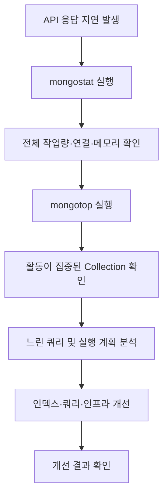

예를 들어 다음과 같은 상황을 생각해 보자.

**첫 번째 단계**

`mongostat`에서 전체 Query 및 Command 작업량이 증가한 것을 확인한다.

**두 번째 단계**

`mongotop`에서 `orders` Collection의 읽기 활동이 집중된 것을 확인한다.

**세 번째 단계**

주문 조회 API의 쿼리를 분석한다.

**네 번째 단계**

실행 계획을 확인한다.

```javascript
db.orders.find({
  userId: 1001,
  status: "COMPLETED"
}).explain("executionStats");
```

**다섯 번째 단계**

적절한 인덱스가 없다면 실제 쿼리 패턴을 기준으로 인덱스 생성 여부를 검토한다.

```javascript
db.orders.createIndex({
  userId: 1,
  status: 1
});
```

**여섯 번째 단계**

인덱스 적용 전후의 실행 계획과 응답 시간을 비교한다.

이처럼 `mongostat`과 `mongotop`은 직접적인 문제 해결 도구라기보다 원인 분석을 위한 출발점이라고 이해하는 것이 좋다.

---

## Prometheus와 Grafana란?

MongoDB Compass와 CLI 도구는 현재 상태를 파악하는 데 유용하다.

하지만 장기간의 데이터를 저장하고 여러 서버의 상태를 비교하려면 별도의 모니터링 시스템이 필요할 수 있다.

이때 자주 사용되는 도구가 Prometheus와 Grafana다.

### Prometheus

Prometheus는 Metric을 수집하고 저장하는 모니터링 시스템이다.

일반적으로 HTTP 엔드포인트를 주기적으로 호출하여 Metric을 수집한다.

이를 Scraping이라고 한다.

### Grafana

Grafana는 Prometheus 등의 데이터 소스에 저장된 정보를 시각화하는 도구다.

다음과 같은 기능을 제공한다.

- 시계열 그래프
- Gauge
- Stat 패널
- 테이블
- 대시보드
- 알림 구성

### Prometheus와 Grafana의 역할

| 구성 요소 | 역할 |
|---|---|
| MongoDB | 모니터링 대상 |
| MongoDB Exporter | MongoDB 상태를 Prometheus 형식으로 노출 |
| Prometheus | Metric 수집 및 저장 |
| Grafana | Metric 조회 및 시각화 |

여기서 중요한 점은 **Prometheus가 MongoDB 내부 상태를 별도의 설정 없이 직접 수집하는 구조로 단순화해서는 안 된다는 것**이다.

일반적인 구성에서는 MongoDB Exporter가 MongoDB의 상태를 조회하고 Prometheus 형식으로 제공한다.

---

## MongoDB·Prometheus·Grafana 모니터링 아키텍처

전체 구조는 다음과 같다.

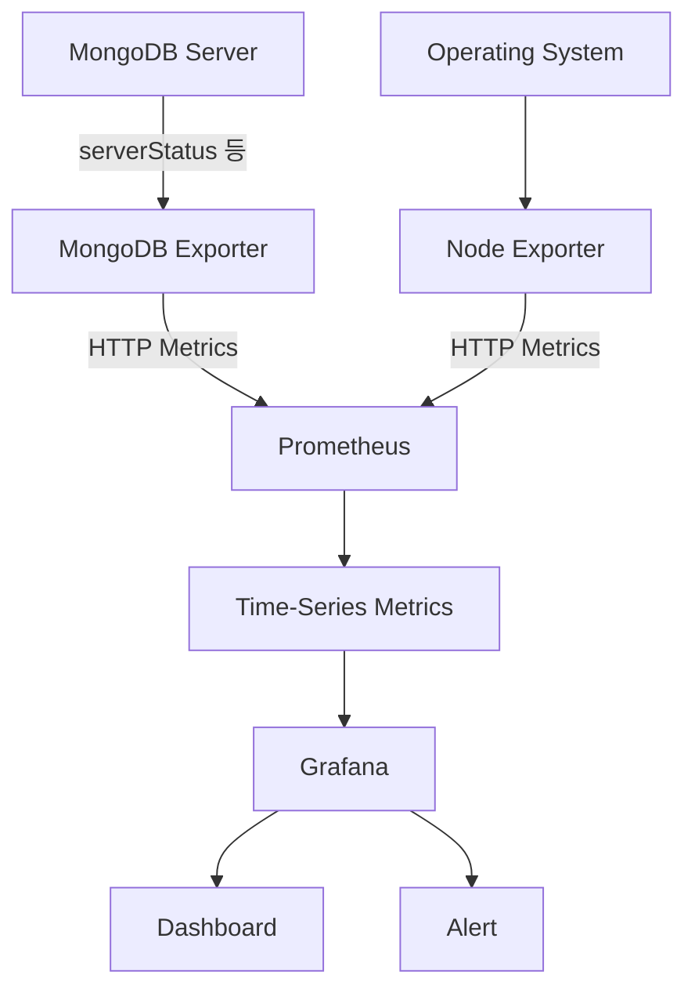

### MongoDB Exporter

MongoDB Exporter는 MongoDB 서버의 상태를 조회하여 Prometheus가 수집할 수 있는 Metric으로 변환한다.

대표적인 수집 대상은 다음과 같다.

- 연결 수
- 작업 카운터
- 서버 업타임
- 복제 상태
- 스토리지 엔진 상태
- 캐시 사용량

### Node Exporter

Node Exporter는 운영체제 수준의 Metric을 수집한다.

대표적으로 다음 정보를 제공한다.

- CPU 사용량
- 메모리 사용량
- 디스크 사용량
- 파일 시스템 상태
- 네트워크 사용량

따라서 MongoDB 내부 지표와 운영체제 지표를 구분하여 수집할 수 있다.

### Prometheus

Prometheus는 Exporter의 HTTP 엔드포인트를 주기적으로 호출하여 Metric을 저장한다.

### Grafana

Grafana는 Prometheus에 저장된 Metric을 조회하여 그래프로 표현한다.

이처럼 각 도구의 책임을 구분하면 MongoDB 내부의 문제인지, 운영체제의 자원 문제인지 함께 분석할 수 있다.

---

## MongoDB Exporter의 역할

MongoDB Exporter의 대표적인 구현 중 하나는 Percona의 MongoDB Exporter다.

이 Exporter는 MongoDB의 `serverStatus`, 복제 상태, Collection 통계 등의 데이터를 이용하여 Metric을 생성할 수 있다.

다만 Metric 이름은 Exporter의 종류와 버전, 활성화한 Collector, 호환성 모드 등에 따라 달라질 수 있다.

특히 Percona MongoDB Exporter는 버전에 따라 Metric 명명 방식이 변경되었으며, 호환성 모드를 제공한다. [GitHub](https://github.com/percona/mongodb_exporter?utm_source=chatgpt.com)

따라서 Grafana 대시보드를 구성할 때는 인터넷에 공개된 쿼리 이름을 그대로 사용하기보다 실제 Exporter가 노출하는 Metric부터 확인해야 한다.

### Metric 확인 방법

MongoDB Exporter가 `localhost:9216`에서 실행 중이라고 가정해 보자.

다음과 같이 확인할 수 있다.

```bash
curl http://localhost:9216/metrics
```

Linux 환경에서는 다음처럼 MongoDB 관련 Metric만 필터링할 수 있다.

```bash
curl -s http://localhost:9216/metrics | grep mongodb_
```

Windows에서는 다음 명령어를 사용할 수 있다.

```cmd
curl http://localhost:9216/metrics | findstr mongodb_
```

이렇게 실제 Metric 이름을 확인한 뒤 Prometheus 쿼리를 작성해야 한다.

---

## Prometheus 설정 구조

Prometheus는 일반적으로 YAML 형식의 설정 파일을 사용한다.

예를 들어 MongoDB Exporter와 Node Exporter를 수집 대상으로 등록한다고 가정해 보자.

### prometheus.yml

```yaml
global:
  scrape_interval: 15s
  evaluation_interval: 15s

scrape_configs:
  - job_name: "mongodb"
    static_configs:
      - targets:
          - "mongodb-exporter:9216"

  - job_name: "node"
    static_configs:
      - targets:
          - "node-exporter:9100"
```

이 코드는 Exporter가 해당 주소에서 실행 중인 환경을 가정한 Prometheus 설정 예시다.

MongoDB Exporter와 Node Exporter의 설치 및 실행 설정을 자동으로 구성해 주는 것은 아니다.

### 주요 옵션

| 옵션 | 설명 |
|---|---|
| `scrape_interval` | Metric 수집 주기 |
| `evaluation_interval` | 규칙 평가 주기 |
| `scrape_configs` | 수집 대상 설정 |
| `job_name` | 수집 작업 이름 |
| `targets` | Metric을 제공하는 Exporter 주소 |

### scrape_interval

```yaml
scrape_interval: 15s
```

Prometheus가 15초마다 Metric을 수집하도록 지정한다.

이 값이 작을수록 더 짧은 간격으로 데이터를 수집할 수 있지만, 수집 요청량과 저장되는 데이터도 증가할 수 있다.

따라서 Metric의 변화 속도와 운영 비용을 함께 고려해야 한다.

### targets

```yaml
targets:
  - "mongodb-exporter:9216"
```

Prometheus가 접근할 Exporter의 주소를 지정한다.

여기서 `mongodb-exporter`는 예시 호스트 이름이다.

Docker Compose 환경이라면 동일한 네트워크에 연결된 서비스 이름을 사용할 수 있다.

일반 서버 환경에서는 실제 Exporter의 호스트 이름 또는 IP 주소를 지정해야 한다.

---

## Prometheus에서 Metric 조회하기

Prometheus는 PromQL(Prometheus Query Language)을 제공한다.

PromQL을 이용하면 수집된 Metric을 조회하거나 계산할 수 있다.

예를 들어 다음과 같은 Metric이 존재한다고 가정해 보자.

```promql
mongodb_connections_current
```

이 표현식은 현재 연결 수를 나타내는 Metric을 조회하는 용도로 사용할 수 있다.

다만 이 이름이 모든 MongoDB Exporter에서 동일하게 제공되는 것은 아니다.

따라서 실제 Exporter의 Metric 목록을 확인해야 한다.

---

## MongoDB 모니터링에서 사용하는 주요 Metric

다음은 MongoDB 모니터링 대시보드에서 활용할 수 있는 대표적인 Metric 이름의 예시다.

| 목적 | Metric 예시 | 의미 |
|---|---|---|
| 현재 연결 수 | `mongodb_connections_current` | 현재 MongoDB 연결 수 |
| 사용 가능한 연결 수 | `mongodb_connections_available` | 추가로 사용 가능한 연결 수 |
| 서버 업타임 | `mongodb_uptime_seconds_total` | 서버 실행 시간 |
| Insert 카운터 | `mongodb_opcounters_insert_total` | Insert 작업의 누적 카운터 |
| 사용 가능한 시스템 메모리 | `node_memory_MemAvailable_bytes` | 운영체제의 가용 메모리 |

여기서 `mongodb_`로 시작하는 Metric 이름은 Exporter 구현에 따라 달라질 수 있다.

반면 `node_memory_MemAvailable_bytes`는 Linux Node Exporter에서 제공하는 메모리 관련 Metric이다.

이 차이를 이해해야 한다.

### 현재 연결 수

```promql
mongodb_connections_current
```

현재 MongoDB 서버의 연결 수를 확인하는 용도로 사용할 수 있다.

MongoDB 내부에서는 다음과 같이 연결 관련 정보를 확인할 수 있다.

```javascript
db.serverStatus().connections
```

예를 들어 다음과 같은 구조가 반환될 수 있다.

```javascript
{
  current: 50,
  available: 800,
  totalCreated: 1200
}
```

여기서 각 값의 의미는 다음과 같다.

| 항목 | 의미 |
|---|---|
| current | 현재 연결 수 |
| available | 추가로 사용할 수 있는 연결 수 |
| totalCreated | 서버 시작 이후 생성된 연결의 누적 수 |

`totalCreated`는 현재 활성 연결 수가 아니라 지금까지 생성된 연결의 누적 수다.

따라서 `current`와 동일하게 해석해서는 안 된다. [MongoDB](https://www.mongodb.com/docs/manual/reference/command/serverstatus/?utm_source=chatgpt.com)

### 사용 가능한 연결 수

```promql
mongodb_connections_available
```

사용 가능한 연결 수를 확인할 수 있다.

현재 연결 수가 증가하면서 사용 가능한 연결 수가 지속적으로 감소한다면 연결 관리 상태를 분석할 필요가 있다.

하지만 연결 수가 많다고 해서 곧바로 Connection Leak이라고 판단해서는 안 된다.

애플리케이션 인스턴스 수 증가나 Connection Pool 설정에 따라 정상적으로 많은 연결을 유지할 수도 있기 때문이다.

### MongoDB 업타임

```promql
mongodb_uptime_seconds_total
```

MongoDB 서버가 실행된 시간을 확인하기 위한 Metric 이름의 예시다.

서버 업타임이 갑자기 짧아졌다면 재시작이 발생했을 가능성을 검토할 수 있다.

다만 운영자가 의도적으로 재시작했을 수도 있으므로 배포 및 유지보수 이력과 함께 분석해야 한다.

또한 실제 Exporter에서는 업타임 Metric의 이름이나 자료형이 다를 수 있다.

### Insert 작업 카운터

```promql
mongodb_opcounters_insert_total
```

Insert 작업의 누적 횟수를 나타내는 Counter Metric의 예시다.

여기서 중요한 것은 누적 값 자체보다 시간에 따른 증가율이다.

---

## Prometheus Counter와 Gauge 이해하기

Prometheus Metric을 정확하게 해석하려면 Counter와 Gauge의 차이를 이해해야 한다.

### Counter

Counter는 일반적으로 증가하는 값을 나타내는 Metric이다.

예를 들어 Insert 요청의 누적 횟수를 생각해 보자.

```text
10:00 → 1,000

10:01 → 1,500

10:02 → 2,100
```

값이 증가한다.

다만 프로세스 재시작 등으로 Counter가 초기화될 수 있다.

따라서 누적 값만으로 현재 처리량을 판단하기 어렵다.

### Gauge

Gauge는 증가하거나 감소할 수 있는 값을 나타낸다.

예를 들어 현재 연결 수를 생각해 보자.

```text
10:00 → 30

10:01 → 50

10:02 → 40
```

연결 수는 증가하거나 감소할 수 있다.

따라서 현재 상태를 표현하는 데 적합하다.

### Counter와 Gauge 비교

| 구분 | Counter | Gauge |
|---|---|---|
| 값의 변화 | 일반적으로 증가 | 증가·감소 가능 |
| 대표 예시 | 누적 요청 수 | 현재 연결 수 |
| 주요 분석 | 증가율 | 현재 값과 변화 추세 |
| PromQL | `rate()`, `increase()` | 원래 값 또는 집계 함수 |

---

## rate()를 이용한 MongoDB 작업량 분석

Insert 카운터가 다음과 같이 존재한다고 가정해 보자.

```promql
mongodb_opcounters_insert_total
```

누적 값을 그대로 확인하는 것보다 일정 시간 동안 초당 얼마나 증가했는지 계산하는 것이 유용할 수 있다.

이때 `rate()`를 사용할 수 있다.

```promql
rate(mongodb_opcounters_insert_total[5m])
```

이 쿼리는 최근 5분 동안 Counter가 증가한 속도를 초당 평균 증가율로 계산한다.

### 왜 rate()가 필요할까?

다음과 같은 상황을 생각해 보자.

```text
10:00 → Insert 누적 10,000

10:01 → Insert 누적 10,600
```

1분 동안 카운터가 600 증가했다.

따라서 평균 증가율은 다음과 같다.

```text
600 / 60초 = 초당 10
```

Prometheus의 `rate()`는 이러한 계산을 수행할 때 활용할 수 있다.

다만 실제 Counter의 재설정과 샘플 간격도 고려한다.

### increase()

특정 기간 동안 얼마나 증가했는지 확인하고 싶다면 `increase()`를 사용할 수 있다.

```promql
increase(mongodb_opcounters_insert_total[5m])
```

최근 5분 동안의 증가량을 계산한다.

두 함수의 차이는 다음과 같다.

| 함수 | 의미 |
|---|---|
| `rate()` | 초당 평균 증가율 |
| `increase()` | 지정한 기간의 증가량 |

운영 대시보드에서는 초당 처리량을 확인하기 위해 `rate()`를 자주 사용한다.

단, 위 Metric 이름은 실제 Exporter가 해당 이름을 노출하는 경우에만 사용할 수 있다.

---

## MongoDB 메모리 모니터링과 PromQL

메모리 사용량을 확인할 때는 Metric의 의미와 단위를 정확하게 해석해야 한다.

예를 들어 다음 표현식이 있다고 가정해 보자.

```promql
node_memory_MemAvailable_bytes / 1024 / 1024
```

이 쿼리는 운영체제에서 사용 가능한 메모리를 MiB 단위로 변환한다.

### 계산 과정

`node_memory_MemAvailable_bytes`는 바이트 단위로 측정된 가용 메모리다.

1024로 한 번 나누면 KiB가 된다.

1024로 다시 나누면 MiB가 된다.

```text
Bytes
  ↓ / 1024
KiB
  ↓ / 1024
MiB
```

따라서 다음 표현식은 **메모리 사용량이 아니라 가용 메모리**를 나타낸다.

```promql
node_memory_MemAvailable_bytes / 1024 / 1024
```

이 부분은 특히 주의해야 한다.

### 메모리 사용률 계산

Linux Node Exporter에서 전체 메모리와 가용 메모리 Metric을 사용할 수 있다면 다음과 같이 메모리 사용률을 계산할 수 있다.

```promql
100 * (
  1 -
  node_memory_MemAvailable_bytes
  /
  node_memory_MemTotal_bytes
)
```

이 표현식은 전체 메모리에서 가용 메모리가 차지하는 비율을 제외하여 사용률을 계산한다.

단, 해당 지표가 실제 MongoDB 프로세스만의 메모리 사용률을 의미하는 것은 아니다.

운영체제 전체의 메모리 사용 상태를 나타낸다.

### MongoDB 메모리와 시스템 메모리 비교

| 지표 | 의미 |
|---|---|
| WiredTiger Cache Used | MongoDB 내부 캐시 사용률 |
| MongoDB Resident Memory | MongoDB 프로세스의 상주 메모리 |
| Node Available Memory | 운영체제의 가용 메모리 |
| Node Memory Usage | 운영체제 전체 메모리 사용률 |

메모리 부족 문제를 분석할 때는 이러한 값을 함께 확인해야 한다.

Node Exporter의 메모리 관련 Metric은 Prometheus의 공식 모니터링 구성에서도 사용된다. [prometheus.io](https://prometheus.io/docs/guides/node-exporter/?utm_source=chatgpt.com)

---

## Grafana를 이용한 MongoDB 모니터링

### Grafana의 역할

Grafana는 Prometheus에서 수집한 Metric을 시각화한다.

운영자가 직접 PromQL을 실행하지 않아도 주요 지표를 대시보드에서 확인할 수 있도록 구성할 수 있다.

예를 들어 다음과 같은 대시보드를 만들 수 있다.

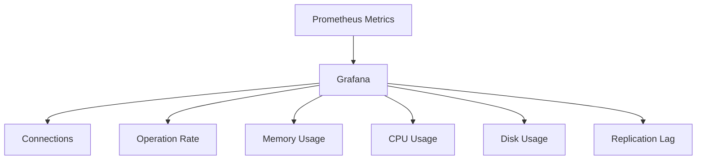

### Grafana 패널의 종류

| 패널 | 주요 활용 |
|---|---|
| Time Series | 시간에 따른 값의 변화 |
| Stat | 현재 수치 표시 |
| Gauge | 사용률과 임계값 표현 |
| Table | 여러 인스턴스의 지표 비교 |
| Bar Chart | Collection 또는 서버별 지표 비교 |

예를 들어 현재 연결 수는 Stat 패널로 표현할 수 있다.

```promql
mongodb_connections_current
```

최근 5분 동안의 Insert 증가율은 Time Series 패널로 표현할 수 있다.

```promql
rate(mongodb_opcounters_insert_total[5m])
```

가용 메모리는 다음과 같이 표시할 수 있다.

```promql
node_memory_MemAvailable_bytes / 1024 / 1024
```

단, Grafana 패널에서 사용하는 Metric 이름은 실제 Prometheus가 수집한 데이터와 일치해야 한다.

---

## Grafana 대시보드에서 No data가 발생하는 이유

Grafana 대시보드를 구성했는데 다음 메시지가 표시될 수 있다.

```text
No data
```

이는 해당 패널에서 표시할 데이터가 없다는 의미다.

하지만 `No data`가 표시되었다고 해서 반드시 MongoDB에 장애가 발생한 것은 아니다.

다음과 같은 원인이 있을 수 있다.

1. Prometheus가 Exporter에 연결하지 못했다.
2. Exporter가 정상적으로 실행되지 않았다.
3. MongoDB Exporter가 MongoDB에 연결하지 못했다.
4. PromQL에서 존재하지 않는 Metric 이름을 사용했다.
5. Grafana의 데이터 소스가 잘못 설정되었다.
6. 조회 시간 범위에 데이터가 존재하지 않는다.
7. Metric의 Label 조건이 실제 데이터와 일치하지 않는다.

### 문제 확인 순서

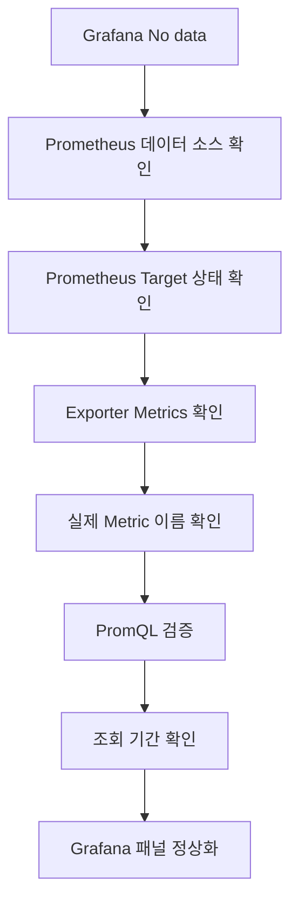

### 1. Prometheus Target 확인

Prometheus의 Targets 화면에서 Exporter가 정상적으로 Scraping되고 있는지 확인한다.

### 2. Exporter 확인

다음 명령어로 Exporter가 Metric을 제공하는지 확인한다.

```bash
curl http://localhost:9216/metrics
```

### 3. PromQL 확인

Prometheus에서 실제 Metric 이름을 검색한다.

예를 들어 다음과 같이 연결 수와 관련된 Metric 이름이 존재하는지 확인할 수 있다.

```promql
{__name__=~".*connections.*"}
```

이 표현식은 이름에 `connections`가 포함된 Metric을 검색하는 데 사용할 수 있다.

### 4. Grafana 데이터 소스 확인

Grafana에서 Prometheus 데이터 소스가 올바른 주소를 바라보고 있는지 확인한다.

### 5. 시간 범위 확인

최근 5분으로 설정된 대시보드에서 데이터 수집이 이전에 종료되었다면 결과가 없을 수 있다.

따라서 조회 시간을 넓혀서 확인할 필요가 있다.

### Prometheus의 up Metric

Prometheus는 Scraping 대상의 상태를 나타내는 `up` Metric을 제공한다.

예를 들어 다음과 같이 확인할 수 있다.

```promql
up{job="mongodb"}
```

여기서 결과가 1이라면 Prometheus가 해당 Scraping 대상에 정상적으로 접근했다는 의미다.

하지만 **Exporter가 정상적으로 응답한다는 것과 MongoDB 데이터베이스가 정상이라는 것은 서로 다르다.**

Exporter 프로세스는 실행 중이지만 MongoDB에 연결하지 못하는 상황도 발생할 수 있기 때문이다.

따라서 데이터베이스의 실제 상태를 확인하려면 Exporter가 제공하는 MongoDB 상태 Metric도 함께 확인해야 한다.

---

## Grafana 대시보드 JSON의 역할

Grafana 대시보드는 JSON 형태로 정의할 수 있다.

대시보드 JSON에는 일반적으로 다음과 같은 정보가 포함된다.

- 대시보드 제목
- 패널 구성
- 데이터 소스
- PromQL
- 시각화 유형
- 시간 범위
- 변수
- 알림 관련 설정

예를 들어 하나의 Time Series 패널을 구성하려면 다음 정보가 필요하다.

```text
Panel Title
    ↓
MongoDB Connections

Data Source
    ↓
Prometheus

Query
    ↓
mongodb_connections_current

Visualization
    ↓
Time Series
```

Grafana는 대시보드 JSON을 Export하거나 Import하여 동일한 구성을 다른 환경에 적용할 수 있다.

다만 JSON을 다른 환경에 가져오더라도 데이터 소스의 UID나 Metric 이름이 일치하지 않으면 정상적으로 동작하지 않을 수 있다.

따라서 대시보드를 공유할 때는 Exporter의 버전과 Metric 이름, 데이터 소스 설정을 함께 관리하는 것이 좋다.

---

## MongoDB 모니터링 사례 1: 성능 저하 문제 분석

### 상황

사용자의 요청이 급격하게 증가하면서 서비스의 응답 시간이 길어졌다고 가정해 보자.

기존에는 빠르게 처리되던 조회 API가 점점 느려진다.

일부 요청에서는 Timeout도 발생한다.

```text
정상 상태
API 응답 시간: 100ms

문제 발생
API 응답 시간: 3,000ms
```

이때 가장 먼저 해야 할 일은 문제가 발생한 지점을 좁히는 것이다.

### 1. mongostat으로 전체 상태 확인

```bash
mongostat --host localhost --port 27017
```

다음 항목을 확인한다.

- Query 및 Command 작업량
- 연결 수
- 읽기·쓰기 대기 작업
- 캐시 사용량
- 메모리 상태
- 네트워크 트래픽

예를 들어 요청량 증가와 함께 읽기 대기 작업이 증가했다면 MongoDB가 들어오는 요청을 처리하는 데 어려움을 겪고 있을 가능성을 검토할 수 있다.

### 2. mongotop으로 Collection별 활동 확인

```bash
mongotop --host localhost --port 27017 1
```

어느 Collection에 읽기·쓰기 작업이 집중되는지 확인한다.

예를 들어 `orders` Collection에서 읽기 활동이 크게 증가했다고 가정해 보자.

그렇다면 주문 조회 쿼리의 실행 계획을 분석할 수 있다.

### 3. 실행 계획 확인

```javascript
db.orders.find({
  userId: 1001,
  status: "COMPLETED"
}).explain("executionStats");
```

여기서 다음 항목을 확인한다.

```text
nReturned

totalDocsExamined

totalKeysExamined

executionTimeMillis
```

특히 많은 Document를 검사했는데 실제 반환된 Document가 적다면 인덱스 설계를 검토할 수 있다.

### 4. 인덱스 최적화

다음과 같은 복합 인덱스를 고려할 수 있다.

```javascript
db.orders.createIndex({
  userId: 1,
  status: 1
});
```

다만 인덱스를 추가했다고 반드시 성능이 개선되는 것은 아니다.

실제 쿼리 패턴과 데이터 분포를 확인하고 실행 계획을 비교해야 한다.

### 5. 자원 확장 검토

인덱스와 쿼리 최적화 이후에도 CPU나 메모리 자원이 지속적으로 부족하다면 인스턴스 크기 또는 클러스터 확장을 검토할 수 있다.

하지만 단순히 서버의 CPU를 증가시키는 방식만으로 모든 문제가 해결되지는 않는다.

비효율적인 쿼리가 계속 실행된다면 서버를 확장한 후에도 유사한 문제가 반복될 수 있다.

### 전체 대응 흐름

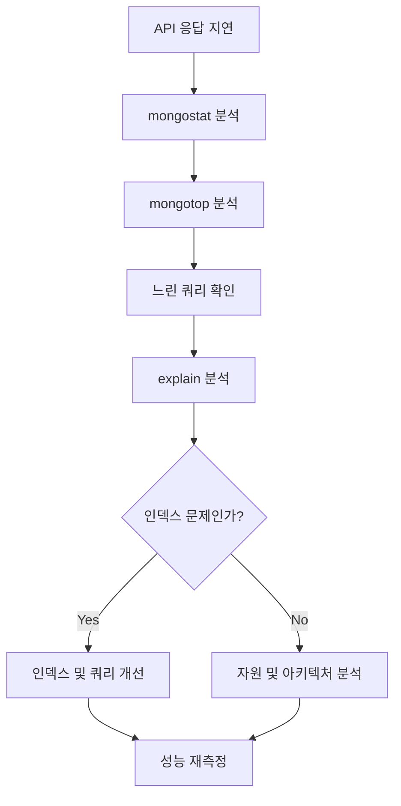

이러한 방식으로 단계별로 원인을 좁혀 나가는 것이 중요하다.

---

## MongoDB 모니터링 사례 2: 장애 발생 시 원인 신속 진단

### 상황

MongoDB 서버가 갑자기 응답하지 않거나 애플리케이션에서 연결 오류가 발생했다고 가정해 보자.

다음과 같은 오류가 나타날 수 있다.

```text
MongoDB Connection Timeout
```

또는 다음과 같은 상황이 발생할 수도 있다.

```text
Connection Refused
```

하지만 이러한 오류가 발생했다고 해서 MongoDB 프로세스가 반드시 종료되었다고 판단해서는 안 된다.

네트워크 문제나 인증 문제, Connection Pool 고갈 등의 원인도 존재할 수 있다.

### 1. MongoDB 연결 상태 확인

먼저 MongoDB 서버에 연결할 수 있는지 확인한다.

```bash
mongosh "mongodb://127.0.0.1:27017"
```

연결할 수 있다면 MongoDB 내부 상태를 확인한다.

```javascript
db.serverStatus().connections
```

연결 수와 사용 가능한 연결 수를 확인한다.

### 2. mongostat 확인

```bash
mongostat --host localhost --port 27017
```

연결할 수 있다면 최근 작업량과 연결 수 변화를 관찰한다.

연결 자체가 실패한다면 서버 프로세스, 포트, 네트워크 등의 상태를 확인해야 한다.

### 3. 운영체제 지표 확인

다음 항목을 확인한다.

- CPU 사용률
- 가용 메모리
- 디스크 사용률
- 디스크 I/O
- 네트워크 연결
- MongoDB 프로세스 상태

특히 디스크 공간이 부족한 상황에서는 데이터베이스의 쓰기 작업에 문제가 발생할 수 있다.

### 4. MongoDB 로그 확인

로그에서 오류가 발생한 시점과 내용을 확인한다.

다음과 같은 내용을 중점적으로 살펴볼 수 있다.

```text
Connection accepted

Connection closed

Authentication failed

Slow operation

Storage error
```

다만 어떤 로그가 실제로 출력되는지는 MongoDB 버전과 설정, 발생한 오류의 종류에 따라 달라진다.

### 5. 근본 원인 분석

다음과 같은 원인을 검토할 수 있다.

| 원인 | 확인 항목 |
|---|---|
| 네트워크 장애 | 연결 가능 여부, DNS, 방화벽 |
| 연결 폭증 | Connection Pool 및 서버 연결 수 |
| 메모리 부족 | 프로세스 메모리, 시스템 가용 메모리 |
| 디스크 부족 | 파일 시스템 사용률 |
| 쿼리 병목 | 느린 쿼리 및 실행 계획 |
| 서버 프로세스 장애 | MongoDB 로그와 프로세스 상태 |
| Replica Set 문제 | Primary 상태 및 복제 지연 |

### 6. 대응 조치

원인을 확인한 후 적절한 조치를 수행한다.

- 연결 설정 수정
- Connection Pool 개선
- 쿼리 최적화
- 디스크 공간 확보
- 서버 복구
- Replica Set 상태 복구
- 리소스 확장

특히 서버를 재시작하기 전에 장애 원인을 분석하는 것이 중요하다.

재시작으로 일시적으로 서비스가 정상화되더라도 근본적인 문제가 남아 있다면 장애가 다시 발생할 수 있다.

---

## MongoDB 모니터링 사례 3: 데이터 증가에 따른 용량 계획

### 상황

서비스 사용자가 증가하면서 MongoDB에 저장되는 데이터도 지속적으로 증가한다고 가정해 보자.

예를 들어 다음과 같은 데이터가 저장될 수 있다.

- 주문 데이터
- 결제 이력
- 사용자 활동 로그
- 알림 이력
- 애플리케이션 이벤트
- 감사 로그

이러한 데이터는 서비스 운영 기간이 길어질수록 누적될 수 있다.

따라서 현재 저장 공간뿐 아니라 앞으로 얼마나 증가할지도 예측해야 한다.

### 1. 데이터 크기 확인

MongoDB에서는 Database 통계를 확인할 수 있다.

```javascript
db.stats();
```

Collection의 데이터 크기와 저장 공간을 확인할 수도 있다.

```javascript
db.orders.stats();
```

이러한 통계에는 데이터 크기와 저장 공간, 인덱스 크기 등의 정보가 포함될 수 있다.

실제 출력 필드는 MongoDB 버전과 Collection 특성에 따라 달라질 수 있다.

### 2. 인덱스 크기 확인

인덱스는 검색 성능을 개선할 수 있지만 저장 공간을 사용한다.

```javascript
db.orders.totalIndexSize();
```

이 메서드를 이용하면 해당 Collection의 전체 인덱스 크기를 확인할 수 있다.

또한 다음 명령어로 인덱스 목록을 확인한다.

```javascript
db.orders.getIndexes();
```

인덱스가 과도하게 많거나 중복된 역할을 수행하는 인덱스가 존재한다면 정리할 수 있는지 검토해야 한다.

다만 인덱스 삭제 전에 실제 사용 여부를 충분히 확인해야 한다.

### 3. 데이터 증가율 확인

예를 들어 다음과 같은 저장 공간 사용 추세가 있다고 가정해 보자.

| 월 | 저장 공간 |
|---|---:|
| 1월 | 100GB |
| 2월 | 120GB |
| 3월 | 145GB |
| 4월 | 175GB |

데이터가 지속적으로 증가하고 있다.

이 추세를 그래프로 표현하면 다음과 같다.


다만 과거 증가율이 미래에도 동일하게 유지된다고 단정해서는 안 된다.

서비스의 사용자 수, 기능 변경, 보관 정책, 이벤트 발생량 등에 따라 성장률이 달라질 수 있다.

### 4. 확장 전략 검토

데이터 증가에 따라 다음과 같은 방법을 고려할 수 있다.

**수직 확장**

MongoDB 서버의 CPU, 메모리, 디스크를 증가시킨다.

**수평 확장**

Sharding을 이용하여 데이터를 여러 Shard에 분산한다.

**인덱스 최적화**

불필요한 인덱스를 정리하고 실제 검색 패턴에 맞게 인덱스를 재설계한다.

**데이터 보관 정책**

오래된 데이터를 별도 저장소로 이전하거나 보관 기간을 정의한다.

**백업 정책**

데이터 크기 증가에 따라 백업 소요 시간과 복구 가능 시간도 함께 검토한다.

### 5. 용량 계획에서 중요한 점

단순히 데이터 파일의 크기만 고려해서는 안 된다.

다음 요소를 함께 분석해야 한다.

- 원본 데이터 크기
- 인덱스 크기
- 데이터 증가율
- 쓰기 요청량
- 읽기 요청량
- 디스크 I/O
- 백업 저장 공간
- 복구 시간
- 샤딩 필요 여부

따라서 MongoDB의 용량 계획은 스토리지뿐 아니라 전체 시스템의 운영 구조와 연결된 문제다.

---

## MongoDB 모니터링에서 중요한 운영 지표

앞에서 살펴본 내용을 바탕으로 운영 환경에서 우선적으로 확인할 수 있는 지표를 정리해 보자.

| 분류 | 주요 지표 | 확인 목적 |
|---|---|---|
| 연결 | Current Connections | 연결 수 변화 |
| 연결 | Available Connections | 추가 연결 가능 여부 |
| 처리량 | Insert Rate | 쓰기 처리량 |
| 처리량 | Query/Command Rate | 읽기 및 Command 활동 |
| 캐시 | WiredTiger Cache Used | 캐시 사용 상태 |
| 캐시 | Dirty Cache | 디스크 반영이 필요한 데이터 |
| 메모리 | Resident Memory | MongoDB 프로세스 메모리 |
| 시스템 | Available Memory | 운영체제 가용 메모리 |
| 시스템 | CPU Usage | 자원 사용량 |
| 디스크 | Disk Usage | 저장 공간 부족 여부 |
| 디스크 | Disk I/O | 디스크 작업 집중 여부 |
| 쿼리 | Query Latency | 쿼리 응답 시간 |
| 쿼리 | Documents Examined | 검색 효율 |
| 복제 | Replication Lag | Secondary 복제 지연 |
| 용량 | Index Size | 인덱스 저장 공간 |
| 용량 | Data Size | 원본 데이터 증가 추세 |

이러한 지표를 모두 같은 중요도로 관리할 필요는 없다.

서비스의 특성과 장애 위험에 따라 우선순위를 결정하는 것이 좋다.

---

## 실무에서 MongoDB 모니터링 체계를 개선하는 10가지 방법

### 1. 단순한 서버 상태보다 서비스 응답 시간을 함께 모니터링한다

CPU 사용률이 낮다고 해서 사용자 경험이 좋은 것은 아니다.

예를 들어 MongoDB CPU 사용률이 낮더라도 특정 쿼리의 응답 시간이 길어질 수 있다.

따라서 다음 지표를 함께 확인하는 것이 좋다.

```text
API Latency

MongoDB Query Latency

CPU Usage

Connections
```

특히 애플리케이션의 P95, P99 응답 시간과 MongoDB 지표를 함께 관찰하면 데이터베이스 문제가 사용자 경험에 어떤 영향을 주는지 분석할 수 있다.

### 2. 평균값보다 변화 추세를 확인한다

평균 CPU 사용률이 40%라고 가정해 보자.

하지만 특정 시간대에 CPU가 95%까지 증가할 수도 있다.

이러한 순간적인 부하가 API Timeout과 연결될 수 있다.

따라서 평균값뿐 아니라 최대값, 지속 시간, 변화 패턴을 함께 분석해야 한다.

### 3. 쿼리의 응답 시간과 작업량을 구분한다

`mongostat`에서 Query 관련 수치가 높다고 해서 반드시 쿼리가 느린 것은 아니다.

많은 쿼리를 빠르게 처리하고 있을 수도 있기 때문이다.

반대로 Query 작업량이 적더라도 하나의 비효율적인 쿼리가 매우 오래 실행될 수 있다.

따라서 처리량과 응답 시간을 구분해야 한다.

### 4. Collection별 활동을 확인한다

MongoDB 전체의 작업량만 보면 어느 Collection에 문제가 있는지 판단하기 어렵다.

따라서 `mongotop`을 이용하여 활동이 집중된 Collection을 확인하는 것이 좋다.

그다음 해당 Collection에서 실행되는 주요 쿼리를 분석할 수 있다.

### 5. Connection Pool을 애플리케이션 관점에서도 모니터링한다

MongoDB 서버의 연결 수만으로 Connection Pool 상태를 모두 파악할 수는 없다.

애플리케이션에서는 다음과 같은 정보도 중요하다.

- 사용 중인 연결 수
- 유휴 연결 수
- 연결을 기다리는 요청 수
- 연결 획득 대기 시간
- 연결 생성 실패 횟수

특히 Spring Boot와 MongoDB Java Driver를 사용하는 경우에는 애플리케이션의 Connection Pool 계측을 함께 검토할 수 있다.

이렇게 하면 MongoDB 서버의 연결 수 증가가 정상적인 트래픽 증가인지, 애플리케이션의 연결 관리 문제인지 분석하는 데 도움이 된다.

### 6. MongoDB 내부 메모리와 운영체제 메모리를 구분한다

WiredTiger 캐시 사용률이 높다고 해서 서버 전체 메모리가 부족하다고 단정해서는 안 된다.

반대로 WiredTiger 캐시 사용률이 낮더라도 다른 프로세스나 운영체제의 메모리 사용으로 인해 문제가 발생할 수 있다.

따라서 MongoDB와 운영체제의 지표를 함께 확인해야 한다.

### 7. 알림은 단일 임계값보다 지속 시간을 함께 고려한다

예를 들어 CPU 사용률이 잠깐 증가했다고 즉시 장애 알림을 발생시키면 불필요한 알림이 많아질 수 있다.

따라서 다음과 같이 알림 조건을 구성할 수 있다.

```text
CPU 사용률이 높은 상태

AND

일정 시간 이상 지속

AND

API 응답 시간 증가
```

이러한 방식은 단일 지표만 사용하는 것보다 불필요한 알림을 줄이는 데 도움이 될 수 있다.

다만 실제 임계값은 서비스의 정상 사용 패턴과 SLO를 기준으로 정해야 한다.

### 8. 운영 이벤트와 Metric을 연결한다

성능 저하가 발생한 시점에 어떤 변경이 있었는지 확인하는 것도 중요하다.

예를 들어 다음과 같은 이벤트가 있을 수 있다.

```text
14:00 애플리케이션 배포

14:05 MongoDB Query 증가

14:07 API 응답 시간 증가
```

이러한 정보를 함께 관리하면 배포 변경이 성능에 영향을 주었는지 분석할 수 있다.

### 9. 저장 공간뿐 아니라 데이터 성장 속도를 모니터링한다

현재 디스크 사용률이 50%라고 해서 충분한 여유가 있다고 단정할 수 없다.

하루에 수십 GB씩 데이터가 증가한다면 짧은 시간 안에 저장 공간이 부족해질 수 있다.

따라서 현재 사용량과 함께 증가율을 확인해야 한다.

### 10. 모니터링 자체의 정상 동작 여부도 확인한다

MongoDB가 정상적으로 실행되고 있더라도 Prometheus의 Scraping이 중단되면 모니터링 데이터가 수집되지 않을 수 있다.

따라서 데이터베이스뿐 아니라 다음 구성 요소도 확인해야 한다.

- MongoDB Exporter
- Node Exporter
- Prometheus
- Grafana
- 알림 전달 경로

모니터링 시스템이 중단된 상태에서는 장애가 발생해도 운영자가 이를 인지하지 못할 수 있다.

---

## MongoDB 모니터링 전체 아키텍처

지금까지 살펴본 도구와 기능을 하나의 구조로 정리하면 다음과 같다.

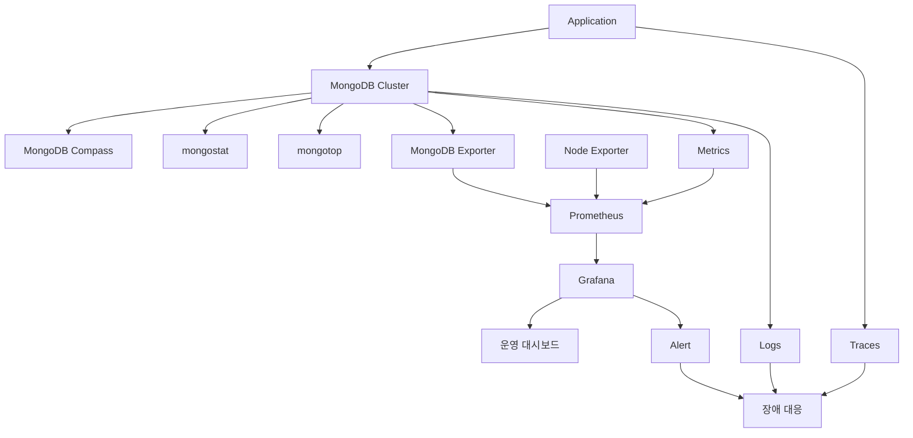

각 도구는 서로 다른 역할을 가진다.

**MongoDB Compass**

데이터베이스 상태를 GUI로 확인하고 실시간 성능 그래프를 분석한다.

**mongostat**

MongoDB 인스턴스 전체의 작업량, 연결 수, 메모리 등을 확인한다.

**mongotop**

Collection별 읽기·쓰기 활동 시간을 확인한다.

**Prometheus**

MongoDB와 시스템 Metric을 지속적으로 수집하고 저장한다.

**Grafana**

수집된 Metric을 시각화하여 장기간의 추세와 이상 징후를 확인한다.

**Metric·Log·Trace**

시스템 상태와 이벤트, 요청 처리 흐름을 서로 다른 관점에서 분석하는 데 사용한다.

이러한 정보를 결합하면 단순히 장애가 발생했다는 사실을 넘어 장애의 원인과 영향을 더욱 구체적으로 파악할 수 있다.

---

## MongoDB 모니터링 도구 및 명령어 정리

| 도구 및 명령어 | 주요 기능 |
|---|---|
| `mongosh` | MongoDB Shell 접속 |
| `db.serverStatus()` | MongoDB 서버 상태 확인 |
| `db.stats()` | Database 통계 확인 |
| `db.collection.stats()` | Collection 통계 확인 |
| `db.collection.getIndexes()` | 인덱스 목록 확인 |
| `db.collection.totalIndexSize()` | 인덱스 전체 크기 확인 |
| `db.collection.find()` | Document 조회 |
| `db.collection.insertOne()` | Document 한 개 생성 |
| `db.collection.insertMany()` | Document 여러 개 생성 |
| `db.collection.updateMany()` | 여러 Document 수정 |
| `db.collection.deleteMany()` | 여러 Document 삭제 |
| `explain("executionStats")` | 쿼리 실행 계획과 실행 통계 확인 |
| `mongostat` | MongoDB 전체 작업량 및 자원 상태 확인 |
| `mongotop` | Collection별 읽기·쓰기 활동 확인 |
| `mongostat --rowcount 30 1` | 1초 간격으로 30회 출력 |
| `mongotop 5` | 5초 간격으로 Collection 활동 출력 |
| MongoDB Compass | GUI 기반 모니터링 |
| MongoDB Atlas | 관리형 클라우드 모니터링 |
| Ops Manager | 자체 관리형 MongoDB 모니터링 및 운영 |
| Prometheus | Metric 수집 및 저장 |
| Grafana | Metric 시각화 및 알림 |

---

## 정리

MongoDB 모니터링은 데이터베이스의 상태를 지속적으로 확인하고 성능 저하나 장애의 징후를 빠르게 파악하기 위한 활동이다.

MongoDB를 안정적으로 운영하려면 단순히 데이터베이스 프로세스가 실행 중인지 확인하는 것만으로는 부족하다.

CPU와 메모리, 연결 수, 쿼리 처리량, 네트워크 트래픽, 디스크 I/O, 캐시 사용률 등의 지표를 함께 분석해야 한다.

모니터링의 기본적인 흐름은 다음과 같다.

**실시간 상태 확인 → 문제 징후 감지 → 원인 분석 → 조치**

이 과정에서 MongoDB는 다양한 도구를 제공한다.

MongoDB Compass는 GUI를 이용하여 실시간 성능 그래프와 Collection 상태를 확인할 수 있도록 지원한다.

`mongostat`은 MongoDB 인스턴스 전체의 상태를 실시간으로 확인하는 CLI 도구다.

Insert, Query, Update, Delete 등의 작업량과 연결 수, 메모리, 캐시, 네트워크 관련 지표를 확인할 수 있다.

`mongotop`은 Collection별 읽기·쓰기 활동을 분석하는 도구다.

이를 통해 어떤 Collection에서 작업이 집중되고 있는지 확인할 수 있다.

두 도구는 서로 다른 관점의 정보를 제공하므로 함께 사용하는 것이 유용하다.

예를 들어 MongoDB 전체 작업량이 증가했다면 `mongostat`으로 상태를 확인하고, `mongotop`으로 활동이 집중된 Collection을 파악할 수 있다.

그다음 해당 Collection에서 실행되는 쿼리의 실행 계획을 분석하여 인덱스나 쿼리 구조를 개선할 수 있다.

하지만 이러한 CLI 도구만으로 장기간의 모니터링 체계를 완성하기는 어렵다.

장기간의 추세 분석과 자동화된 알림이 필요하다면 Prometheus와 Grafana를 함께 활용할 수 있다.

Prometheus는 MongoDB Exporter와 Node Exporter를 통해 데이터베이스 및 운영체제의 Metric을 수집한다.

Grafana는 수집된 Metric을 그래프로 표현하고, 사용자가 정의한 조건에 따라 알림을 구성할 수 있다.

다만 Prometheus에서 사용하는 Metric 이름은 Exporter의 종류와 버전에 따라 달라질 수 있다.

따라서 실제 Exporter가 제공하는 Metric을 확인한 후 PromQL을 작성해야 한다.

또한 MongoDB 내부의 캐시 사용률과 운영체제의 메모리 사용률은 서로 다른 지표이므로 구분해야 한다.

특히 다음 세 가지 운영 상황에서는 모니터링의 중요성이 더욱 커진다.

**첫 번째는 성능 저하다.**

사용자 요청이 증가하면서 쿼리 실행 시간이 길어졌다면 전체 작업량, Collection별 활동, 인덱스 사용 여부 등을 확인해야 한다.

문제가 발생했다는 사실만으로 서버를 확장하기보다 실제 병목 원인을 먼저 분석해야 한다.

**두 번째는 장애 대응이다.**

MongoDB 연결이 끊어지거나 서버가 응답하지 않는 상황에서는 연결 수와 서버 로그, 네트워크, 메모리, 디스크 상태 등을 확인해야 한다.

서버를 재시작하여 일시적으로 문제가 해결되더라도 근본 원인이 남아 있다면 같은 문제가 반복될 수 있다.

**세 번째는 용량 계획이다.**

서비스 운영 기간이 길어지면 데이터와 인덱스가 지속적으로 증가할 수 있다.

따라서 현재 저장 공간뿐 아니라 데이터 증가율과 디스크 I/O, 인덱스 크기, 백업 정책 등을 함께 고려해야 한다.

결국 MongoDB 모니터링에서 중요한 것은 수치를 많이 수집하는 것이 아니다.

**서비스에 영향을 미치는 핵심 지표를 선정하고, 이상 징후를 빠르게 탐지하며, Metric·Log·Trace와 실제 실행 계획을 연결하여 문제의 원인을 정확하게 파악하는 것**이 핵심이다.

또한 모니터링 체계는 구축하는 것으로 끝나는 것이 아니라 운영 환경의 변화에 따라 지속적으로 개선해야 한다.

서비스의 사용자 수와 데이터 규모가 증가하면 정상적인 지표 범위도 달라질 수 있기 때문이다.

따라서 평소의 정상 상태를 기준으로 지표를 분석하고, 실제 장애와 성능 개선 경험을 바탕으로 알림 조건과 모니터링 항목을 지속적으로 보완하는 것이 좋다.

### 한 줄 요약

**MongoDB 모니터링은 Compass, mongostat, mongotop 등을 이용하여 데이터베이스의 작업량과 자원 사용 상태를 분석하고, Prometheus·Grafana를 통해 장기간의 성능 지표를 수집·시각화하는 과정이다. 실무에서는 단순한 상태 확인을 넘어 쿼리 병목 분석, 장애 원인 진단, 데이터 증가에 따른 용량 계획까지 연결하여 안정적인 데이터베이스 운영 체계를 구축하는 것이 중요하다.**
