# MongoDB & 애플리케이션 실습

# MongoDB & 애플리케이션 실습

* toc
{:toc}

---

## MongoDB와 애플리케이션 연동 완벽 이해: Node.js·Java·PyMongo부터 Python 크롤링, Flask 웹 서비스 및 Docker 3-Tier 아키텍처까지

MongoDB를 이용하여 데이터를 생성하고 조회하는 방법을 이해했다면, 다음으로 중요한 것은 **실제 애플리케이션에서 MongoDB를 어떻게 사용하는지** 이해하는 것이다.

MongoDB Shell인 `mongosh`에서는 다음과 같은 명령어로 데이터를 저장할 수 있다.

```javascript
use appdb

db.users.insertOne({
  name: "Kevin",
  age: 49
});
```

하지만 실제 서비스에서는 사용자가 직접 MongoDB Shell에 접속하여 데이터를 저장하지 않는다.

사용자는 웹 브라우저나 모바일 애플리케이션을 통해 요청을 전달하고, 백엔드 애플리케이션은 해당 요청을 처리하면서 데이터베이스에 접근한다.

예를 들어 사용자가 회원가입을 요청하면 다음과 같은 흐름으로 데이터가 저장된다.

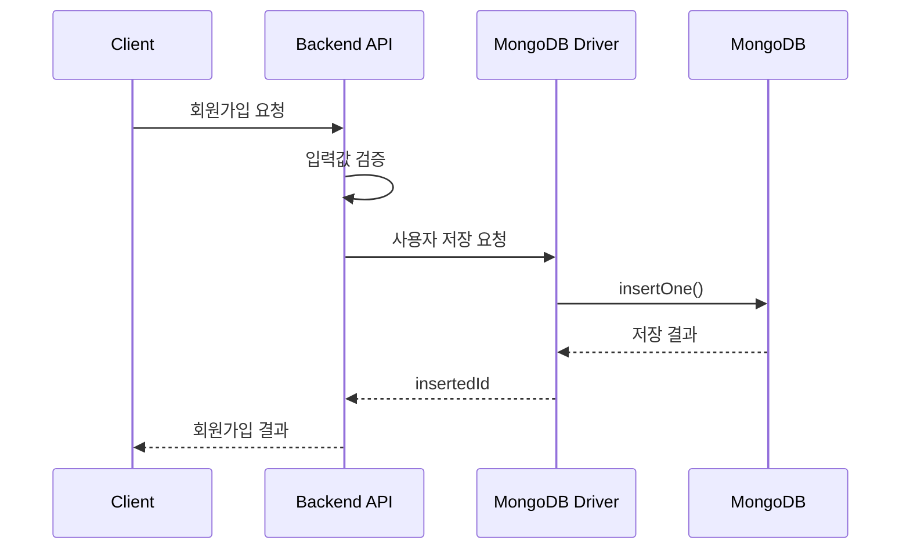

여기서 백엔드 애플리케이션이 MongoDB와 통신할 수 있도록 연결해 주는 구성 요소가 **MongoDB Driver**다.

MongoDB는 다양한 프로그래밍 언어에서 사용할 수 있는 공식 드라이버를 제공한다.

대표적으로 다음과 같은 드라이버가 있다.

| 프로그래밍 언어 | MongoDB 드라이버 | 주요 사용 환경 |
|---|---|---|
| Node.js | MongoDB Node.js Driver | Node.js 기반 API 서버 |
| Java | MongoDB Java Driver | Java·Spring Boot 기반 백엔드 |
| Python | PyMongo | Python 애플리케이션, 데이터 수집 및 처리 |

또한 MongoDB는 단순히 웹 서비스의 데이터를 저장하는 용도뿐 아니라 외부 데이터를 수집하고 가공하는 시스템에서도 활용할 수 있다.

예를 들어 Python으로 웹사이트의 음악 차트를 수집하여 MongoDB에 저장하고, Flask를 이용해 웹 페이지에 표시하는 애플리케이션을 구현할 수 있다.

더 나아가 Docker를 이용하면 프런트엔드, 백엔드, MongoDB를 각각 독립적인 컨테이너로 실행하여 3-Tier 애플리케이션을 구성할 수도 있다.

이번 글에서는 이러한 구조를 세 가지 관점으로 살펴본다.

1. **MongoDB Driver**: Node.js, Java, Python 애플리케이션에서 MongoDB에 연결하는 방법
2. **Python 크롤링과 Flask**: 외부 데이터를 MongoDB에 저장하고 웹 페이지에 출력하는 방법
3. **Docker 3-Tier 아키텍처**: 프런트엔드·백엔드·MongoDB를 컨테이너로 분리하여 연결하는 방법

각 기술의 개념뿐 아니라 실제 코드와 실행 방법, 내부 동작 원리, 실무에서 고려해야 할 사항까지 함께 살펴보자.

---

## MongoDB와 애플리케이션을 연결하는 구조

### MongoDB Driver란?

MongoDB Driver는 프로그래밍 언어에서 MongoDB 서버와 통신할 수 있도록 제공되는 라이브러리다.

애플리케이션에서 MongoDB에 접근하려면 다음과 같은 작업이 필요하다.

- MongoDB 서버와 연결
- 데이터베이스 선택
- Collection 선택
- Document 생성
- Document 조회
- Document 수정
- Document 삭제
- 연결 및 오류 관리

MongoDB Driver는 이러한 작업을 각 프로그래밍 언어에 맞는 API로 제공한다.

예를 들어 MongoDB Shell에서는 다음과 같이 데이터를 저장한다.

```javascript
db.users.insertOne({
  name: "Kevin",
  age: 49
});
```

Python 애플리케이션에서는 다음과 같이 작성할 수 있다.

```python
db.users.insert_one({
    "name": "Kevin",
    "age": 49
})
```

Java에서는 다음과 같이 작성할 수 있다.

```java
collection.insertOne(
    new Document("name", "Kevin")
        .append("age", 49)
);
```

프로그래밍 언어마다 문법은 다르지만 최종적으로 수행하는 작업은 동일하다.

MongoDB의 Collection에 Document를 저장하는 것이다.

### 애플리케이션과 MongoDB의 통신 구조

전체 연결 구조는 다음과 같다.

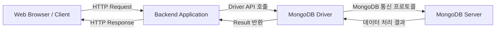

각 구성 요소의 역할을 살펴보자.

**Client**

사용자의 요청을 생성한다.

예를 들어 회원가입, 상품 검색, 주문 조회 등의 요청을 전달한다.

**Backend Application**

요청에 필요한 비즈니스 로직을 처리한다.

입력값을 검증하고 필요한 데이터를 조회하거나 변경한다.

**MongoDB Driver**

애플리케이션의 데이터베이스 작업을 MongoDB 서버와 통신할 수 있는 형태로 처리한다.

**MongoDB Server**

실제 데이터를 저장하고 조회하며, 작업 결과를 반환한다.

여기서 중요한 점은 애플리케이션이 MongoDB와 직접 TCP 통신을 구현할 필요가 없다는 것이다.

MongoDB Driver가 연결 관리와 프로토콜 처리 등 복잡한 부분을 담당한다.

---

## MongoDB Driver를 사용하는 이유

### 1. 프로그래밍 언어에 맞는 API 제공

MongoDB는 BSON 기반의 Document 데이터 모델을 사용한다.

하지만 각 프로그래밍 언어에서는 데이터를 표현하는 방식이 다르다.

예를 들어 JavaScript에서는 객체를 사용한다.

```javascript
{
  name: "Kevin",
  age: 49
}
```

Python에서는 Dictionary를 사용한다.

```python
{
    "name": "Kevin",
    "age": 49
}
```

Java에서는 `Document` 객체 등을 사용할 수 있다.

```java
new Document("name", "Kevin")
    .append("age", 49);
```

MongoDB Driver는 이러한 언어별 데이터 구조를 BSON으로 변환하거나 BSON에서 언어별 객체로 복원한다.

### 2. Connection 관리

MongoDB와 통신하려면 서버에 연결해야 한다.

```text
mongodb://localhost:27017
```

Driver는 연결 생성, 연결 재사용, 서버 선택, 오류 처리 등의 기능을 제공한다.

특히 장시간 실행되는 백엔드 애플리케이션에서는 Connection Pool을 활용할 수 있다.

### 3. CRUD 기능 제공

MongoDB Driver는 데이터베이스의 주요 작업을 지원한다.

| 작업 | Node.js | Java | Python |
|---|---|---|---|
| Insert | `insertOne()` | `insertOne()` | `insert_one()` |
| Find | `find()` | `find()` | `find()` |
| Update | `updateOne()` | `updateOne()` | `update_one()` |
| Delete | `deleteOne()` | `deleteOne()` | `delete_one()` |

이처럼 각 언어의 명명 규칙에 따라 API가 제공된다.

### 4. 다양한 데이터베이스 기능 지원

MongoDB Driver는 단순 CRUD 외에도 다음과 같은 기능을 지원한다.

- Aggregation
- Index
- Transaction
- Bulk Operations
- Change Streams
- Read Preference
- Write Concern

지원 범위와 사용 방식은 드라이버 및 MongoDB 서버 버전에 따라 달라질 수 있다.

공식 MongoDB Driver는 MongoDB에서 제공하는 프로그래밍 언어별 인터페이스를 통해 이러한 기능을 사용할 수 있도록 한다. [MongoDB](https://www.mongodb.com/docs/drivers/java/sync/current/get-started/?utm_source=chatgpt.com)

---

## MongoDB 연결 문자열 이해하기

MongoDB Driver를 사용할 때 공통으로 등장하는 값이 있다.

```text
mongodb://localhost:27017
```

이 문자열을 **Connection String 또는 Connection URI**라고 한다.

기본 구조는 다음과 같다.

```text
mongodb://<host>:<port>
```

각 항목의 의미는 다음과 같다.

| 항목 | 설명 |
|---|---|
| `mongodb://` | MongoDB 표준 연결 프로토콜 |
| `localhost` | MongoDB 서버 주소 |
| `27017` | MongoDB 기본 포트 |

### localhost의 의미

`localhost`는 현재 프로그램이 실행되는 환경 자체를 의미한다.

예를 들어 Python 애플리케이션과 MongoDB가 같은 PC에서 실행된다면 다음 주소를 사용할 수 있다.

```python
MongoClient("mongodb://localhost:27017/")
```

하지만 Python 애플리케이션이 Docker 컨테이너 내부에서 실행되고 MongoDB는 다른 컨테이너에서 실행된다면 상황이 달라진다.

컨테이너 내부에서 `localhost`는 해당 컨테이너 자신을 의미한다.

따라서 다른 MongoDB 컨테이너에 접근하려면 Docker 네트워크에서 접근할 수 있는 주소를 사용해야 한다.

이 부분은 뒤에서 Docker 3-Tier 아키텍처를 설명할 때 자세히 살펴보자.

---

## Node.js에서 MongoDB 연결하기

### MongoDB Node.js Driver란?

MongoDB Node.js Driver는 Node.js 애플리케이션에서 MongoDB에 접근할 수 있도록 제공되는 공식 라이브러리다.

Node.js는 비동기 I/O를 기반으로 동작하므로 MongoDB Driver 역시 비동기 API를 제공한다.

주요 기능은 다음과 같다.

- Promise 기반 비동기 API
- CRUD
- Aggregation
- Index 관리
- Transaction
- Connection Pool

### MongoDB Driver 설치

Node.js 프로젝트를 생성한다.

```bash
npm init -y
```

이 명령어는 기본 `package.json` 파일을 생성한다.

MongoDB Driver를 설치한다.

```bash
npm install mongodb
```

설치가 완료되면 `package.json`에 MongoDB Driver 의존성이 추가된다.

### Node.js MongoDB 연결 코드

다음은 `mydb` 데이터베이스의 `myCollection` Collection에 Document를 저장하는 코드다.

```javascript
const { MongoClient } = require('mongodb');

const client = new MongoClient('mongodb://localhost:27017');

async function run() {
  await client.connect();

  const db = client.db('mydb');

  const collection = db.collection('myCollection');

  await collection.insertOne({
    name: 'Kevin',
    age: 49
  });

  await client.close();
}

run();
```

이 코드를 단계별로 살펴보자.

### 1. MongoClient 가져오기

```javascript
const { MongoClient } = require('mongodb');
```

설치한 `mongodb` 패키지에서 `MongoClient`를 가져온다.

`MongoClient`는 MongoDB 서버와 연결하고 데이터베이스 작업을 수행할 수 있도록 제공되는 객체다.

### 2. MongoClient 생성

```javascript
const client = new MongoClient('mongodb://localhost:27017');
```

MongoDB 서버의 연결 정보를 이용하여 클라이언트를 생성한다.

다만 클라이언트 객체를 생성하는 것과 실제 연결이 완료되는 것은 구분해야 한다.

### 3. MongoDB 서버 연결

```javascript
await client.connect();
```

MongoDB 서버와 연결하는 작업을 수행한다.

여기서 `await`는 비동기 작업이 완료될 때까지 해당 비동기 함수의 다음 코드 실행을 기다리는 역할을 한다.

현재 MongoDB Node.js Driver는 CRUD 작업 시 자동 연결을 수행하는 방식도 지원하지만, 명시적인 `connect()` 호출은 연결 단계와 작업 단계를 구분하기 쉽게 만든다. [MongoDB](https://www.mongodb.com/docs/drivers/node/current/connect/mongoclient/?msockid=2aa1b90d9dec68e704f2af9f9ca66939\&utm_source=chatgpt.com)

### 4. Database 선택

```javascript
const db = client.db('mydb');
```

`mydb` 데이터베이스를 선택한다.

### 5. Collection 선택

```javascript
const collection = db.collection('myCollection');
```

`myCollection` Collection을 선택한다.

여기서 Collection 이름의 대소문자에 주의해야 한다.

```text
myCollection
```

```text
mycollection
```

두 이름은 서로 다른 Collection을 가리킬 수 있다.

따라서 애플리케이션 전체에서 Collection 명명 규칙을 일관되게 유지해야 한다.

### 6. Document 저장

```javascript
await collection.insertOne({
  name: 'Kevin',
  age: 49
});
```

MongoDB에 하나의 Document를 저장한다.

### 7. 연결 종료

```javascript
await client.close();
```

MongoDB Client가 사용하는 리소스를 정리한다.

---

## Node.js MongoDB 연결 코드 개선하기

앞의 예제는 기본적인 연결 흐름을 이해하기에는 충분하다.

하지만 예외가 발생하면 `client.close()`가 실행되지 않을 수 있다.

예를 들어 다음 코드에서 오류가 발생했다고 가정해 보자.

```javascript
await collection.insertOne({
  name: 'Kevin',
  age: 49
});
```

오류가 발생하면 이후 코드가 실행되지 않을 수 있다.

따라서 `try-finally`를 사용하는 것이 좋다.

### 개선한 전체 코드

```javascript
const { MongoClient } = require('mongodb');

const uri = process.env.MONGODB_URI || 'mongodb://localhost:27017';

const client = new MongoClient(uri);

async function run() {
  try {
    await client.connect();

    const db = client.db('mydb');
    const collection = db.collection('myCollection');

    const result = await collection.insertOne({
      name: 'Kevin',
      age: 49
    });

    console.log('Document 저장 성공');
    console.log('insertedId:', result.insertedId);
  } finally {
    await client.close();
  }
}

run().catch(error => {
  console.error('MongoDB 작업 실패:', error);
  process.exitCode = 1;
});
```

### 개선한 부분

첫 번째는 환경변수 사용이다.

```javascript
const uri = process.env.MONGODB_URI || 'mongodb://localhost:27017';
```

운영 환경에서는 MongoDB 연결 정보를 코드에 고정하지 않고 환경별로 전달할 수 있다.

두 번째는 저장 결과 확인이다.

```javascript
const result = await collection.insertOne({
  name: 'Kevin',
  age: 49
});
```

MongoDB Driver는 저장 작업의 결과를 반환한다.

`result.insertedId`를 이용하면 생성된 Document의 `_id`를 확인할 수 있다.

세 번째는 리소스 정리다.

```javascript
finally {
  await client.close();
}
```

작업 도중 오류가 발생하더라도 연결 리소스를 정리한다.

다만 실제 웹 서버에서는 HTTP 요청마다 `MongoClient`를 생성하고 종료하는 구조보다, 애플리케이션에서 재사용 가능한 Client를 관리하는 방식이 일반적으로 적합하다.

### 실행 방법

코드를 `app.js`로 저장한다.

```bash
node app.js
```

정상적으로 저장되면 다음과 같은 메시지를 확인할 수 있다.

```text
Document 저장 성공
insertedId: ...
```

`insertedId`는 실제 생성된 Document에 따라 달라진다.

---

## Java에서 MongoDB 연결하기

### MongoDB Java Driver란?

MongoDB Java Driver는 Java 애플리케이션에서 MongoDB를 사용할 수 있도록 제공되는 공식 드라이버다.

Java 환경에서는 동기 방식의 MongoDB Java Sync Driver를 사용할 수 있다.

Spring Boot를 사용하지 않는 일반 Java 프로젝트에서도 MongoDB Driver를 직접 이용할 수 있다.

### Java MongoDB 연결 코드

다음은 MongoDB에 연결한 뒤 `mydb` 데이터베이스의 `mycollection` Collection에 데이터를 저장하는 코드다.

```java
import com.mongodb.client.MongoClients;
import com.mongodb.client.MongoClient;
import com.mongodb.client.MongoDatabase;
import com.mongodb.client.MongoCollection;

try (MongoClient mongoClient =
    MongoClients.create("mongodb://localhost:27017")) {

    MongoDatabase database = mongoClient.getDatabase("mydb");

    MongoCollection<Document> collection =
        database.getCollection("mycollection");

    collection.insertOne(
        new Document("name", "Charlie")
            .append("age", 40)
    );
}
```

이 코드는 MongoDB Java Driver를 이용한 핵심 연결 및 저장 로직이다.

실제 Java 프로그램으로 실행하려면 `Document`의 import, 클래스, `main()` 메서드, 드라이버 의존성 등이 추가로 필요하다.

### MongoClients.create()

```java
MongoClients.create("mongodb://localhost:27017")
```

MongoDB Client를 생성한다.

### getDatabase()

```java
MongoDatabase database = mongoClient.getDatabase("mydb");
```

MongoDB의 `mydb` 데이터베이스를 선택한다.

### getCollection()

```java
MongoCollection<Document> collection =
    database.getCollection("mycollection");
```

`mycollection` Collection을 선택한다.

### Document 생성

```java
new Document("name", "Charlie")
    .append("age", 40)
```

Java의 `Document` 객체를 이용하여 MongoDB Document를 생성한다.

다음과 같은 데이터를 표현한다.

```json
{
  "name": "Charlie",
  "age": 40
}
```

### insertOne()

```java
collection.insertOne(
    new Document("name", "Charlie")
        .append("age", 40)
);
```

생성한 Document를 MongoDB에 저장한다.

---

## Java에서 실행 가능한 전체 MongoDB 예제

이제 앞의 코드를 실제 Java 애플리케이션 형태로 구성해 보자.

### 프로젝트 구조

```text
mongodb-java-example/
├── settings.gradle
├── build.gradle
└── src/
    └── main/
        └── java/
            └── MongoInsertExample.java
```

### settings.gradle

```groovy
rootProject.name = 'mongodb-java-example'
```

### build.gradle

```groovy
plugins {
    id 'java'
    id 'application'
}

repositories {
    mavenCentral()
}

dependencies {
    implementation 'org.mongodb:mongodb-driver-sync:5.14.0'
}

application {
    mainClass = 'MongoInsertExample'
}
```

여기서는 MongoDB Java Sync Driver 5.14.0을 예시 버전으로 사용한다.

드라이버 버전은 서버 호환성과 프로젝트의 Java 버전을 고려하여 선택해야 한다.

MongoDB 공식 문서는 동기 Java Driver의 의존성으로 `mongodb-driver-sync`를 사용하도록 안내한다. [MongoDB](https://www.mongodb.com/docs/drivers/java/sync/current/get-started/)

### MongoInsertExample.java

```java
import com.mongodb.client.MongoClient;
import com.mongodb.client.MongoClients;
import com.mongodb.client.MongoCollection;
import com.mongodb.client.MongoDatabase;
import org.bson.Document;

public class MongoInsertExample {

    public static void main(String[] args) {

        String uri = System.getenv("MONGODB_URI");

        if (uri == null || uri.isBlank()) {
            uri = "mongodb://localhost:27017";
        }

        try (MongoClient mongoClient = MongoClients.create(uri)) {

            MongoDatabase database =
                    mongoClient.getDatabase("mydb");

            MongoCollection<Document> collection =
                    database.getCollection("mycollection");

            Document document = new Document("name", "Charlie")
                    .append("age", 40);

            collection.insertOne(document);

            System.out.println("Document 저장 성공");
            System.out.println("Inserted ID: " + document.get("_id"));
        }
    }
}
```

### try-with-resources

다음 부분을 살펴보자.

```java
try (MongoClient mongoClient = MongoClients.create(uri)) {
```

Java의 `try-with-resources` 구문이다.

작업이 끝나면 `MongoClient`의 `close()`가 자동으로 호출된다.

따라서 예외가 발생하더라도 연결 리소스를 정리할 수 있다.

### Document의 _id

다음 코드를 실행한다.

```java
collection.insertOne(document);
```

MongoDB Driver는 `_id`가 없는 Document에 식별자를 부여하여 저장할 수 있다.

따라서 저장 후 다음 값을 확인할 수 있다.

```java
document.get("_id")
```

### 실행 방법

Gradle Wrapper가 구성되어 있다면 다음 명령어로 실행할 수 있다.

```bash
./gradlew run
```

Windows에서는 다음과 같이 실행한다.

```cmd
gradlew.bat run
```

위 명령어는 Gradle Wrapper가 생성되어 있다는 전제하에 사용한다.

### Java 애플리케이션에서 중요한 점

실제 백엔드 서버에서는 MongoDB 요청마다 Client를 생성하고 종료하는 방식을 피하는 것이 좋다.

`MongoClient`는 Connection Pool을 관리하므로 애플리케이션에서 재사용하도록 구성하는 것이 일반적으로 적합하다.

Spring Boot 환경에서는 Spring Data MongoDB를 이용하여 데이터 접근 계층을 추상화할 수도 있다.

---

## Node.js와 Java MongoDB Driver 비교

| 구분 | Node.js Driver | Java Driver |
|---|---|---|
| 프로그래밍 언어 | JavaScript·TypeScript | Java |
| Client | MongoClient | MongoClient |
| Database 선택 | `client.db()` | `getDatabase()` |
| Collection 선택 | `db.collection()` | `getCollection()` |
| Document | JavaScript 객체 | Document 객체 등 |
| 비동기 처리 | Promise·async/await | 동기 Driver 기준 Blocking |
| 주요 활용 | Node.js API 서버 | Java·Spring Boot 서비스 |

두 드라이버는 API 형태가 다르지만 MongoDB의 데이터 모델을 공유한다.

따라서 사용하는 언어가 달라도 동일한 Collection의 Document에 접근할 수 있다.

---

## Python에서 MongoDB 연결하기

### PyMongo란?

PyMongo는 Python에서 MongoDB를 사용하기 위한 공식 드라이버다.

Python에서는 Dictionary를 이용하여 MongoDB Document를 직관적으로 표현할 수 있다.

또한 다음과 같은 작업을 지원한다.

- MongoDB 연결
- CRUD
- Aggregation
- Index 생성
- Transaction
- Bulk Operations
- Change Streams

PyMongo는 동기 API를 제공하며, 현재는 `AsyncMongoClient`를 이용한 비동기 API도 지원한다.

새로운 비동기 Python 애플리케이션에서는 PyMongo Async API를 검토할 수 있다. [MongoDB](https://www.mongodb.com/docs/languages/python/pymongo-driver/current/reference/migration/?utm_source=chatgpt.com)

### PyMongo 설치

```bash
python -m pip install pymongo
```

설치가 완료되면 Python에서 다음 모듈을 가져올 수 있다.

```python
from pymongo import MongoClient
```

---

## PyMongo를 이용한 Document 저장

다음 코드를 살펴보자.

```python
from pymongo import MongoClient

client = MongoClient('mongodb://localhost:27017/')

db = client.appdb

doc = {
    'name': 'kevin.lee',
    'age': 49
}

db.apptest.insert_one(doc)
```

이 코드는 Python 애플리케이션에서 MongoDB에 연결하고 Document 하나를 저장한다.

### 1. MongoClient 생성

```python
client = MongoClient('mongodb://localhost:27017/')
```

로컬 MongoDB에 접근할 Client를 생성한다.

PyMongo의 `MongoClient`는 연결 관리와 Connection Pool을 담당한다.

### 2. Database 선택

```python
db = client.appdb
```

`appdb` 데이터베이스를 선택한다.

이 코드는 다음과 같은 표현과 유사하다.

```python
db = client["appdb"]
```

### 3. Document 생성

```python
doc = {
    'name': 'kevin.lee',
    'age': 49
}
```

Python Dictionary로 데이터를 생성한다.

MongoDB에 저장되면 BSON Document로 관리된다.

### 4. Collection 선택 및 저장

```python
db.apptest.insert_one(doc)
```

`appdb` 데이터베이스의 `apptest` Collection에 Document를 저장한다.

이를 전체 경로로 표현하면 다음과 같다.

```text
appdb.apptest
```

여기서 다음 코드는 다른 의미를 가진다.

```python
db.appdb.insert_one(doc)
```

이 표현은 `appdb` 데이터베이스 안의 `appdb` Collection에 데이터를 저장한다.

즉, 다음 두 Collection은 서로 다르다.

```text
appdb.apptest
```

```text
appdb.appdb
```

이후 조회 대상은 `appdb.apptest`이므로 저장 코드도 `db.apptest.insert_one(doc)`로 일관되게 사용하는 것이 적절하다.

---

## PyMongo 저장 결과 확인하기

Python 코드를 실행한 후 MongoDB Shell에서 데이터를 확인할 수 있다.

### Database 선택

```javascript
use appdb
```

### Document 조회

```javascript
db.apptest.find({})
```

정상적으로 저장되었다면 다음과 같은 Document를 확인할 수 있다.

```javascript
{
  _id: ObjectId("..."),
  name: "kevin.lee",
  age: 49
}
```

여기서 `_id`는 MongoDB Document의 고유 식별자다.

명시적으로 `_id`를 지정하지 않았다면 MongoDB Driver가 ObjectId를 생성할 수 있다.

### InsertOneResult

PyMongo의 `insert_one()`은 저장 결과를 반환한다.

예를 들어 다음과 같은 객체다.

```text
InsertOneResult(
    ObjectId('6831d2d72b8e610b9351791d'),
    acknowledged=True
)
```

이 결과에서 중요한 부분은 `acknowledged`다.

```python
acknowledged=True
```

이는 지정한 Write Concern에 따라 쓰기 작업이 승인되었다는 의미다.

다만 이것만으로 데이터가 모든 Replica Set 멤버에 복제되었다거나 영구적인 내구성이 모든 조건에서 보장된다고 단정해서는 안 된다.

### inserted_id 확인

다음과 같이 저장 결과를 확인할 수 있다.

```python
from pymongo import MongoClient

with MongoClient('mongodb://localhost:27017/') as client:

    db = client.appdb

    doc = {
        'name': 'kevin.lee',
        'age': 49
    }

    result = db.apptest.insert_one(doc)

    print("acknowledged:", result.acknowledged)
    print("inserted_id:", result.inserted_id)
```

여기서는 `with` 문을 사용했다.

작업이 종료되면 MongoDB Client의 리소스를 정리할 수 있다.

PyMongo 공식 문서에서도 작업이 완료된 후 `MongoClient.close()` 또는 Context Manager를 이용하여 리소스를 정리하는 방식을 설명한다. [MongoDB](https://www.mongodb.com/docs/languages/python/pymongo-driver/current/connect/mongoclient/)

---

## MongoClient, Database, Collection의 관계

MongoDB Driver를 이해할 때 중요한 개념은 다음 세 가지다.

1. MongoClient
2. Database
3. Collection

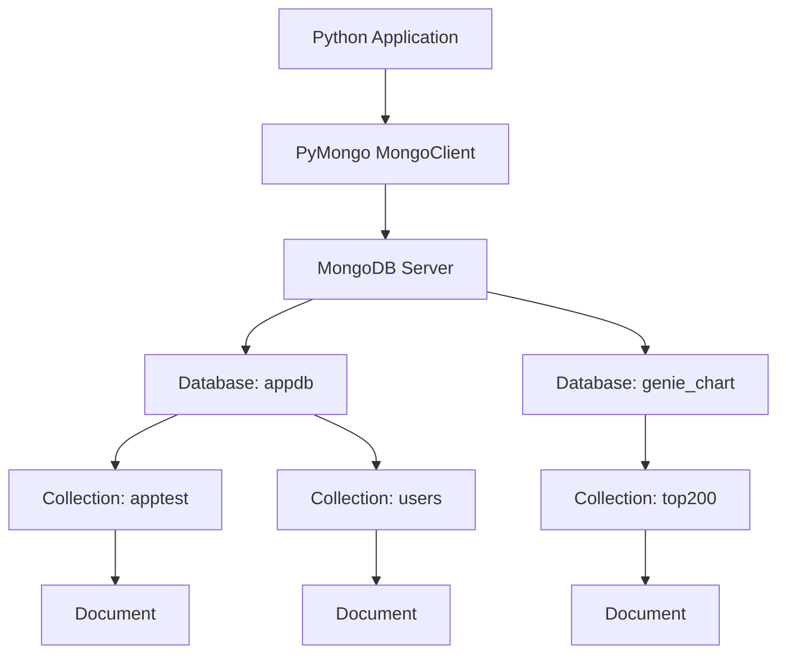

### MongoClient

MongoDB 서버에 접근하기 위한 클라이언트다.

### Database

여러 Collection을 관리하는 논리적인 데이터베이스다.

### Collection

여러 Document를 저장하는 논리적인 집합이다.

### Document

실제 데이터가 저장되는 단위다.

관계형 데이터베이스와 비교하면 다음과 같이 이해할 수 있다.

| RDBMS | MongoDB |
|---|---|
| Database | Database |
| Table | Collection |
| Row | Document |
| Column | Field |

다만 MongoDB의 Document는 중첩 객체와 배열 등을 포함할 수 있으므로 관계형 데이터베이스의 Row와 완전히 동일한 구조는 아니다.

---

## Python 크롤링 데이터를 MongoDB에 저장하기

이제 MongoDB Driver를 활용하여 실제 데이터 수집 애플리케이션을 구성해 보자.

전체 시스템은 다음과 같다.

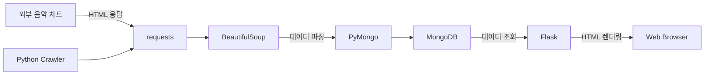

이 구조에서는 크게 세 가지 작업이 발생한다.

**첫 번째는 데이터 수집이다.**

Python으로 외부 웹사이트에 HTTP 요청을 보내 HTML을 가져온다.

**두 번째는 데이터 저장이다.**

HTML에서 필요한 데이터를 추출한 뒤 MongoDB에 저장한다.

**세 번째는 데이터 제공이다.**

Flask 애플리케이션에서 MongoDB 데이터를 조회하고 HTML 페이지에 출력한다.

이를 구현하기 위해 다음 라이브러리를 사용한다.

| 라이브러리 | 역할 |
|---|---|
| requests | HTTP 요청 |
| BeautifulSoup | HTML 파싱 |
| PyMongo | MongoDB 연결 및 데이터 저장 |
| Flask | 웹 애플리케이션 |
| Jinja | HTML 템플릿 렌더링 |

---

## Python 크롤링 환경 구성하기

### 프로젝트 생성

프로젝트 디렉터리를 생성한다.

```bash
mkdir mongo_project
```

```bash
cd mongo_project
```

### 가상환경 생성

```bash
python -m venv .venv
```

가상환경을 활성화한다.

Linux 및 macOS에서는 다음과 같이 실행한다.

```bash
source .venv/bin/activate
```

Windows PowerShell에서는 다음과 같이 실행할 수 있다.

```powershell
.venv\Scripts\Activate.ps1
```

### 라이브러리 설치

```bash
python -m pip install requests beautifulsoup4 pymongo flask
```

각 라이브러리는 다음 역할을 담당한다.

```text
requests
→ 웹사이트에 HTTP 요청

BeautifulSoup
→ HTML 문서 파싱

PyMongo
→ MongoDB 데이터 저장 및 조회

Flask
→ 웹 서버와 라우팅

Jinja
→ HTML 템플릿 렌더링
```

---

## requests를 이용하여 웹 페이지 가져오기

Python에서 HTTP 요청을 보내려면 `requests` 라이브러리를 사용할 수 있다.

다음은 음악 차트 페이지에 접근하는 예제다.

```python
import requests

headers = {
    'User-Agent': 'Mozilla/5.0 (Windows NT 10.0; Win64; x64) '
                  'AppleWebKit/537.36 (KHTML, like Gecko) '
                  'Chrome/73.0.3683.86 Safari/537.36'
}

response = requests.get(
    'https://www.genie.co.kr/chart/top200?ditc=D&rtm=Y',
    headers=headers
)

print(response.status_code)
```

여기서는 `requests.get()`을 사용한다.

### requests.get()

```python
requests.get(url, headers=headers)
```

지정한 URL에 HTTP GET 요청을 보낸다.

### User-Agent

```python
headers = {
    'User-Agent': 'Mozilla/5.0 ...'
}
```

HTTP 요청에 User-Agent 헤더를 추가한다.

User-Agent는 요청을 보내는 클라이언트에 관한 정보를 전달하는 헤더다.

다만 User-Agent를 설정했다고 해서 모든 웹사이트의 데이터에 접근할 수 있는 것은 아니다.

웹사이트의 접근 정책, 인증, 차단 정책 등에 따라 요청이 실패할 수 있다.

### status_code

```python
response.status_code
```

HTTP 응답 상태 코드를 확인한다.

대표적으로 다음과 같은 상태 코드가 있다.

| 상태 코드 | 의미 |
|---|---|
| 200 | 요청 성공 |
| 403 | 접근 거부 |
| 404 | 리소스를 찾을 수 없음 |
| 429 | 요청 제한 |
| 500 | 서버 내부 오류 |

실제 서비스에서는 HTTP 상태 코드뿐 아니라 Timeout과 네트워크 오류도 처리해야 한다.

---

## BeautifulSoup를 이용하여 HTML 데이터 추출하기

### BeautifulSoup란?

BeautifulSoup는 HTML과 XML 문서를 파싱하는 Python 라이브러리다.

HTML 문서의 특정 태그와 속성을 선택하여 필요한 데이터를 추출할 수 있다.

예를 들어 다음과 같은 HTML이 있다고 가정해 보자.

```html
<tr>
    <td class="number">1</td>
    <td class="info">
        <a class="title ellipsis">Song Title</a>
        <a class="artist ellipsis">Artist Name</a>
    </td>
</tr>
```

이 HTML에서 필요한 정보는 다음과 같다.

```text
rank: 1

title: Song Title

artist: Artist Name
```

BeautifulSoup를 이용하면 CSS Selector로 해당 정보를 추출할 수 있다.

---

## 음악 차트 데이터 추출하기

다음은 HTTP 요청부터 HTML 파싱, 데이터 출력까지 연결한 코드다.

```python
import requests
from bs4 import BeautifulSoup

headers = {
    'User-Agent': 'Mozilla/5.0 (Windows NT 10.0; Win64; x64)'
                  'AppleWebKit/537.36 (KHTML, like Gecko) '
                  'Chrome/73.0.3683.86 Safari/537.36'
}

data = requests.get(
    'https://www.genie.co.kr/chart/top200?ditc=D&rtm=Y',
    headers=headers
)

soup = BeautifulSoup(data.text, 'html.parser')

trs = soup.select(
    '#body-content > div.newest-list > div > table > tbody > tr'
)

for tr in trs:
    title = tr.select_one(
        'td.info > a.title.ellipsis'
    ).text.strip()

    rank = tr.select_one(
        'td.number'
    ).text[0:2].strip()

    artist = tr.select_one(
        'td.info > a.artist.ellipsis'
    ).text

    print(rank, title, artist)
```

이 코드는 페이지에 포함된 차트 행을 추출한다.

각 부분을 살펴보자.

### HTML 파싱

```python
soup = BeautifulSoup(data.text, 'html.parser')
```

HTTP 응답으로 가져온 HTML 문자열을 BeautifulSoup 객체로 변환한다.

### select()

```python
trs = soup.select(
    '#body-content > div.newest-list > div > table > tbody > tr'
)
```

CSS Selector를 이용하여 차트 행에 해당하는 `tr` 요소들을 선택한다.

### select_one()

```python
title = tr.select_one(
    'td.info > a.title.ellipsis'
).text.strip()
```

현재 행에서 제목에 해당하는 요소 하나를 선택한다.

### strip()

```python
.text.strip()
```

문자열 앞뒤의 공백과 줄바꿈을 제거한다.

### 순위 추출

```python
rank = tr.select_one(
    'td.number'
).text[0:2].strip()
```

순위에 해당하는 문자열의 앞 두 글자를 추출한다.

여기서 주의해야 할 부분이 있다.

이 방식은 순위가 최대 두 자리라는 가정에 의존한다.

예를 들어 다음 값을 생각해 보자.

```text
100
```

앞의 두 글자만 추출하면 다음 결과가 나온다.

```text
10
```

따라서 100위 이상의 순위를 처리해야 한다면 문자열의 앞 두 글자만 추출하는 방식은 적절하지 않다.

또한 실제 웹사이트의 HTML 구조가 변경되면 CSS Selector가 더 이상 일치하지 않을 수 있다.

따라서 크롤링 코드는 HTML 구조에 대한 검증이 필요하다.

---

## 수집한 데이터를 MongoDB에 저장하기

이제 크롤링한 데이터를 MongoDB에 저장해 보자.

저장 대상은 다음과 같다.

```text
Database: genie_chart

Collection: top200
```

Document에는 다음 세 가지 필드를 저장한다.

```javascript
{
  rank: 1,
  title: "Song Title",
  artist: "Artist Name"
}
```

### 전체 저장 코드

다음은 HTTP 요청부터 MongoDB 저장까지 연결한 예제다.

```python
import requests
from bs4 import BeautifulSoup
from pymongo import MongoClient

# MongoDB 연결
client = MongoClient('mongodb://localhost:27017/')

db = client.genie_chart
collection = db.top200

# 크롤링 요청
headers = {
    'User-Agent': 'Mozilla/5.0 (Windows NT 10.0; Win64; x64) '
                  'AppleWebKit/537.36 (KHTML, like Gecko) '
                  'Chrome/73.0.3683.86 Safari/537.36'
}

response = requests.get(
    'https://www.genie.co.kr/chart/top200?ditc=D&rtm=Y',
    headers=headers
)

if response.status_code == 200:

    soup = BeautifulSoup(response.text, 'html.parser')

    trs = soup.select(
        '#body-content > div.newest-list > div > table > tbody > tr'
    )

    # 데이터를 넣기 전에 기존 데이터를 삭제 (필요시)
    collection.delete_many({})

    for tr in trs:

        title_elem = tr.select_one(
            'td.info > a.title.ellipsis'
        )

        rank_elem = tr.select_one(
            'td.number'
        )

        artist_elem = tr.select_one(
            'td.info > a.artist.ellipsis'
        )

        title = (
            title_elem.text.strip()
            if title_elem
            else "정보 없음"
        )

        # rank는 정수형으로 저장
        try:
            rank = int(
                rank_elem.text.strip()[0:2]
            )
        except:
            rank = None

        artist = (
            artist_elem.text.strip()
            if artist_elem
            else "정보 없음"
        )

        # MongoDB에 저장
        collection.insert_one({
            'rank': rank,
            'title': title,
            'artist': artist
        })

    print("데이터 저장 완료.")

else:
    print("페이지 요청 실패:", response.status_code)
```

전체 흐름은 다음과 같다.

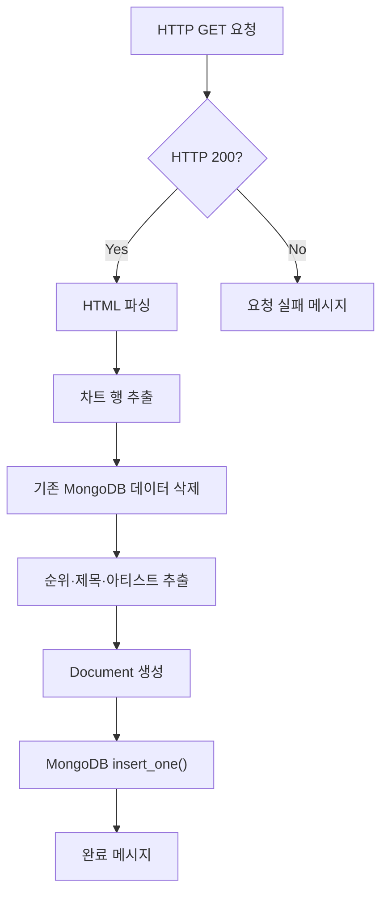

여기서 중요한 부분은 MongoDB의 데이터 저장 메서드뿐 아니라 **데이터를 삭제하고 다시 저장하는 처리 방식**이다.

---

## delete_many({})의 동작 원리

다음 코드를 살펴보자.

```python
collection.delete_many({})
```

이 코드는 Collection에서 조건에 일치하는 Document들을 삭제한다.

그런데 검색 조건이 빈 Dictionary다.

```python
{}
```

MongoDB에서는 빈 조건이 모든 Document에 일치한다.

따라서 다음 명령어는 Collection의 모든 Document를 삭제한다.

```python
collection.delete_many({})
```

이는 MongoDB Shell의 다음 명령어와 유사하다.

```javascript
db.top200.deleteMany({});
```

### 왜 기존 데이터를 삭제할까?

음악 차트처럼 정기적으로 갱신되는 데이터에서는 이전 데이터를 제거하고 최신 데이터를 다시 저장하는 방식을 사용할 수 있다.

예를 들어 다음과 같은 흐름이다.

```text
기존 차트 데이터
       ↓
전체 삭제
       ↓
새로운 차트 수집
       ↓
MongoDB 저장
```

하지만 이 방식에는 중요한 문제가 있다.

### 데이터 삭제 이후 저장 실패

다음 상황을 생각해 보자.

```text
1. 기존 차트 데이터 50건 존재

2. collection.delete_many({}) 실행

3. 기존 데이터 50건 삭제

4. 새로운 데이터 저장 시작

5. 10건 저장 후 오류 발생
```

이 경우 MongoDB에는 10건만 남게 된다.

즉, 데이터 갱신 도중 실패하면 사용자가 불완전한 데이터를 조회할 수 있다.

따라서 운영 환경에서는 전체 삭제 후 재삽입하는 방식을 그대로 사용하기보다 안전한 데이터 갱신 전략을 고려해야 한다.

---

## 음악 차트 데이터 저장 로직 개선하기

기본 저장 코드는 동작 원리를 이해하기에는 충분하지만, 실제 서비스에서는 몇 가지 문제를 개선해야 한다.

대표적으로 다음과 같다.

| 문제 | 개선 방향 |
|---|---|
| HTTP Timeout 미설정 | 요청 Timeout 적용 |
| HTTP 오류 처리 부족 | `raise_for_status()` 사용 |
| CSS Selector 변경 가능성 | 데이터 구조 검증 |
| 순위 앞 두 글자만 추출 | 정규표현식 등으로 순위 파싱 |
| 무조건 전체 삭제 | Upsert 또는 교체 전략 |
| 개별 Insert 반복 | 필요 시 Bulk Write 고려 |
| MongoClient 미종료 | Context Manager 사용 |

### 개선한 데이터 수집 코드

다음 코드는 **기존 데이터를 전체 삭제하지 않고 순위를 기준으로 Upsert**하는 예제다.

```python
import re
import requests

from bs4 import BeautifulSoup
from pymongo import MongoClient

URL = "https://www.genie.co.kr/chart/top200?ditc=D&rtm=Y"

HEADERS = {
    "User-Agent": (
        "Mozilla/5.0 (Windows NT 10.0; Win64; x64) "
        "AppleWebKit/537.36 (KHTML, like Gecko) "
        "Chrome/73.0.3683.86 Safari/537.36"
    )
}


def parse_rank(text):
    match = re.match(r"\d+", text.strip())

    if not match:
        return None

    return int(match.group())


def fetch_chart():
    response = requests.get(
        URL,
        headers=HEADERS,
        timeout=10
    )

    response.raise_for_status()

    soup = BeautifulSoup(
        response.text,
        "html.parser"
    )

    rows = soup.select(
        "#body-content > div.newest-list > div > table > tbody > tr"
    )

    songs = []

    for row in rows:
        rank_element = row.select_one("td.number")
        title_element = row.select_one(
            "td.info > a.title.ellipsis"
        )
        artist_element = row.select_one(
            "td.info > a.artist.ellipsis"
        )

        if not all([
            rank_element,
            title_element,
            artist_element
        ]):
            continue

        rank = parse_rank(
            rank_element.get_text(strip=True)
        )

        title = title_element.get_text(strip=True)
        artist = artist_element.get_text(strip=True)

        if rank is None or not title or not artist:
            continue

        songs.append({
            "rank": rank,
            "title": title,
            "artist": artist
        })

    if not songs:
        raise ValueError(
            "유효한 차트 데이터를 찾을 수 없습니다."
        )

    return songs


def save_chart(songs):
    with MongoClient(
        "mongodb://localhost:27017/",
        serverSelectionTimeoutMS=5000
    ) as client:

        collection = client.genie_chart.top200

        for song in songs:
            collection.update_one(
                {
                    "rank": song["rank"]
                },
                {
                    "$set": song
                },
                upsert=True
            )

        print(f"{len(songs)}건 저장 요청 완료")


def main():
    songs = fetch_chart()

    print(f"수집한 데이터: {len(songs)}건")

    save_chart(songs)


if __name__ == "__main__":
    main()
```

이 코드는 다음과 같은 개선점을 가진다.

### 1. Timeout 설정

```python
response = requests.get(
    URL,
    headers=HEADERS,
    timeout=10
)
```

HTTP 요청이 무기한 대기하지 않도록 Timeout을 설정한다.

### 2. HTTP 오류 처리

```python
response.raise_for_status()
```

HTTP 오류 상태가 반환된 경우 예외를 발생시킨다.

### 3. 순위 파싱 개선

```python
match = re.match(r"\d+", text.strip())
```

문자열의 시작 부분에 연속된 숫자가 존재하는지 확인한다.

따라서 한 자리 또는 두 자리 숫자만 처리하는 방식보다 유연하다.

다만 실제 순위 표시 문자열이 어떤 구조인지에 따라 추가 처리가 필요할 수 있다.

### 4. 빈 데이터 검증

```python
if not songs:
    raise ValueError(
        "유효한 차트 데이터를 찾을 수 없습니다."
    )
```

HTML 구조 변경 등으로 데이터가 하나도 수집되지 않았다면 저장 작업을 진행하지 않는다.

### 5. Upsert 사용

```python
collection.update_one(
    {
        "rank": song["rank"]
    },
    {
        "$set": song
    },
    upsert=True
)
```

`upsert=True`는 검색 조건에 일치하는 Document가 존재하면 수정하고, 없으면 새로운 Document를 생성한다.

따라서 기존 데이터를 먼저 전체 삭제하지 않아도 된다.

다만 이 코드에도 한계가 있다.

- 동일한 순위가 중복 저장되지 않도록 하려면 Unique Index를 고려해야 한다.
- 수집 대상에서 사라진 이전 순위 데이터는 자동으로 삭제되지 않는다.
- 여러 수집 작업이 동시에 실행되면 충돌이 발생할 수 있다.
- 모든 순위를 한 번에 교체하는 원자적 작업은 아니다.
- 데이터 수집이 일부만 성공한 경우에는 불완전한 차트가 반영될 수 있다.

따라서 정확한 전체 차트 스냅샷이 필요한 시스템에서는 별도의 임시 Collection에 데이터를 저장한 뒤 검증하여 전환하는 방식도 고려할 수 있다.

또한 이 코드는 수집 및 저장 구조를 개선한 예제이며, 대상 웹사이트의 현재 HTML 구조와 수집 정책에 대해 실제 실행을 검증한 결과는 아니다.

---

## MongoDB에 저장된 음악 차트 확인하기

MongoDB에 데이터가 저장되었다면 다음과 같이 조회할 수 있다.

### Database 선택

```javascript
use genie_chart
```

### Collection 확인

```javascript
show collections
```

`top200` Collection이 생성되었다면 목록에서 확인할 수 있다.

### 전체 데이터 조회

```javascript
db.top200.find({})
```

### 순위 기준 정렬

```javascript
db.top200.find({}).sort({
  rank: 1
})
```

여기서 `1`은 오름차순을 의미한다.

따라서 순위가 낮은 숫자부터 정렬한다.

### 데이터 개수 확인

```javascript
db.top200.countDocuments({})
```

이 명령어는 실제 Collection에 저장된 Document의 개수를 확인한다.

여기서 중요한 점은 **Collection 이름이 `top200`이라고 해서 반드시 200건의 데이터가 저장되어 있는 것은 아니라는 것**이다.

현재 예제의 크롤링 코드에는 추가 페이지를 순회하는 로직이 없다.

따라서 수집한 HTML에 몇 개의 차트 행이 존재하는지에 따라 실제 저장 건수가 달라진다.

데이터 조회 화면에서는 1위부터 50위까지의 데이터가 확인되지만, 그것만으로 200건 전체가 저장되었다고 단정할 수는 없다. mongodb-application-code-and-co…

---

## Flask를 이용하여 MongoDB 데이터를 웹 페이지에 출력하기

### Flask란?

Flask는 Python으로 웹 애플리케이션을 개발할 수 있도록 제공되는 경량 웹 프레임워크다.

Flask를 이용하면 다음과 같은 기능을 구현할 수 있다.

- HTTP 요청 처리
- URL 라우팅
- HTML 템플릿 렌더링
- JSON 응답
- 데이터베이스 연동
- 웹 API 개발

이번에는 MongoDB에 저장된 음악 차트 데이터를 HTML 표로 출력하는 웹 애플리케이션을 구현한다.

### 전체 구조

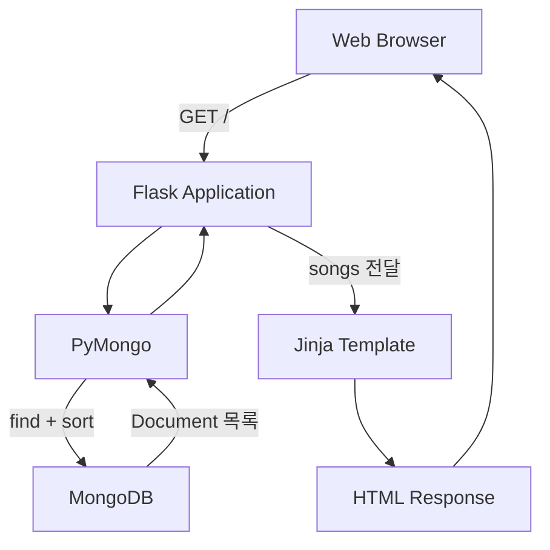

브라우저에서 `/` 경로로 요청을 보내면 Flask가 MongoDB에서 차트 데이터를 조회한다.

이후 조회 결과를 HTML 템플릿에 전달하고, 최종 HTML을 만들어 브라우저에 반환한다.

---

## Flask 프로젝트 폴더 구조

프로젝트는 다음과 같이 구성한다.

```text
mongo_project/
├── app.py
└── templates/
    └── index.html
```

각 파일의 역할은 다음과 같다.

| 파일 | 역할 |
|---|---|
| `app.py` | Flask 애플리케이션 및 MongoDB 조회 |
| `templates/index.html` | 음악 차트 HTML 화면 |

Flask는 기본적으로 `templates` 디렉터리에서 HTML 템플릿을 찾는다.

따라서 `index.html`을 프로젝트 루트가 아닌 `templates` 디렉터리에 저장해야 한다.

---

## Flask app.py 전체 코드

다음은 MongoDB의 `genie_chart.top200` Collection에 연결하고, 데이터를 조회하여 HTML 페이지로 전달하는 코드다.

```python
from flask import Flask, render_template
from pymongo import MongoClient

app = Flask(__name__)

# MongoDB 연결
client = MongoClient('mongodb://localhost:27017/')

db = client.genie_chart
collection = db.top200


@app.route('/')
def index():
    # 컬렉션의 모든 문서를 'rank' 기준 오름차순 정렬하여 읽기
    songs = list(
        collection.find({}).sort('rank', 1)
    )

    return render_template(
        'index.html',
        songs=songs
    )


if __name__ == '__main__':
    app.run(debug=True)
```

각 부분을 자세히 살펴보자.

### Flask 애플리케이션 생성

```python
app = Flask(__name__)
```

Flask 애플리케이션 객체를 생성한다.

이 객체를 통해 라우팅과 웹 요청 처리를 구성한다.

### MongoDB Client 생성

```python
client = MongoClient('mongodb://localhost:27017/')
```

MongoDB Client를 생성한다.

Flask 애플리케이션이 MongoDB에 접근할 때 이 Client를 사용한다.

### Database 선택

```python
db = client.genie_chart
```

`genie_chart` 데이터베이스를 선택한다.

### Collection 선택

```python
collection = db.top200
```

`top200` Collection을 선택한다.

### 라우팅

```python
@app.route('/')
def index():
```

브라우저에서 `/` 경로로 요청을 보내면 `index()` 함수가 실행된다.

예를 들어 다음 주소에 접근한다.

```text
http://127.0.0.1:5000/
```

### MongoDB 조회

```python
songs = list(
    collection.find({}).sort('rank', 1)
)
```

이 부분은 중요한 코드다.

먼저 다음 쿼리를 살펴보자.

```python
collection.find({})
```

빈 검색 조건으로 Collection의 모든 Document를 조회한다.

다음은 정렬 조건이다.

```python
.sort('rank', 1)
```

`rank`를 기준으로 오름차순 정렬한다.

마지막으로 `list()`를 사용한다.

```python
list(...)
```

PyMongo의 `find()`는 Cursor를 반환한다.

`list()`는 Cursor의 결과를 모두 소비하여 Python List로 변환한다.

따라서 `songs`에는 다음과 같은 데이터가 저장될 수 있다.

```python
[
    {
        "rank": 1,
        "title": "Song A",
        "artist": "Artist A"
    },
    {
        "rank": 2,
        "title": "Song B",
        "artist": "Artist B"
    }
]
```

### HTML 템플릿 렌더링

```python
return render_template(
    'index.html',
    songs=songs
)
```

Flask의 `render_template()`을 이용하여 HTML을 생성한다.

여기서 `songs=songs`는 Python의 `songs` 변수를 HTML 템플릿에 전달한다는 의미다.

---

## Jinja 템플릿으로 음악 차트 출력하기

Flask에서는 Jinja 템플릿 엔진을 이용하여 HTML 안에서 변수를 출력하거나 반복문을 실행할 수 있다.

다음은 음악 차트를 표 형태로 출력하는 전체 HTML 코드다.

### templates/index.html

```html
<!DOCTYPE html>
<html lang="ko">
<head>
    <meta charset="UTF-8" />

    <title>My Music Chart</title>

    <style>
        table {
            width: 80%;
            margin: auto;
            border-collapse: collapse;
        }

        th, td {
            border: 1px solid #ccc;
            padding: 8px;
            text-align: center;
        }

        th {
            background-color: #f2f2f2;
        }

        h1 {
            text-align: center;
            margin-top: 20px;
        }
    </style>
</head>

<body>
    <h1>My Music Chart</h1>

    <table>
        <thead>
            <tr>
                <th>순위</th>
                <th>제목</th>
                <th>아티스트</th>
            </tr>
        </thead>

        <tbody>
            
            <tr>
                <td>{{ song.rank }}</td>
                <td>{{ song.title }}</td>
                <td>{{ song.artist }}</td>
            </tr>
            
        </tbody>
    </table>
</body>
</html>
```

### Jinja 반복문

다음 부분을 살펴보자.

```html

```

Flask에서 전달한 `songs`를 순회하는 반복문이다.

Python의 다음 코드와 개념적으로 비슷하다.

```python
for song in songs:
    print(song)
```

Jinja에서는 반복문의 시작과 종료를 다음과 같이 표현한다.

```html



```

### 변수 출력

```html
<td>{{ song.rank }}</td>
```

현재 `song`의 `rank` 값을 출력한다.

```html
<td>{{ song.title }}</td>
```

현재 `song`의 `title` 값을 출력한다.

```html
<td>{{ song.artist }}</td>
```

현재 `song`의 `artist` 값을 출력한다.

### Jinja 템플릿 렌더링 구조

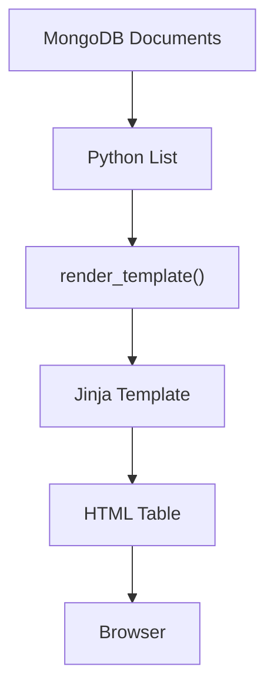

Flask는 Python에서 조회한 데이터를 Jinja에 전달한다.

Jinja는 HTML 템플릿의 반복문과 변수 표현식을 처리하여 최종 HTML을 생성한다.

이처럼 데이터 조회 로직과 화면 구성 코드를 분리할 수 있다는 것이 템플릿 엔진의 장점이다.

---

## Flask 웹 애플리케이션 실행하기

프로젝트 구조가 다음과 같다고 가정해 보자.

```text
D:\mongo_project
├── app.py
└── templates
    └── index.html
```

Windows 명령 프롬프트에서 프로젝트 디렉터리로 이동한다.

```cmd
cd /d D:\mongo_project
```

Flask 애플리케이션을 실행한다.

```cmd
python app.py
```

정상적으로 실행되면 다음과 같은 메시지를 확인할 수 있다.

```text
Serving Flask app 'app'
Debug mode: on
Running on http://127.0.0.1:5000
```

브라우저에서 다음 주소에 접근한다.

```text
http://127.0.0.1:5000
```

정상적으로 실행되었다면 다음과 같은 형태의 음악 차트 표가 나타난다.

| 순위 | 제목 | 아티스트 |
|---|---|---|
| 1 | Song A | Artist A |
| 2 | Song B | Artist B |
| 3 | Song C | Artist C |

실제로 표시되는 데이터는 MongoDB의 `top200` Collection에 저장된 Document에 따라 달라진다.

### debug=True의 의미

다음 코드를 살펴보자.

```python
app.run(debug=True)
```

`debug=True`는 Flask의 디버그 모드를 활성화한다.

개발 중 오류를 확인하고 변경 사항을 반영하는 데 유용하지만, 운영 환경에서는 사용하지 않아야 한다.

Flask 공식 문서에서도 내장 개발 서버와 디버거를 운영 환경에 사용하지 않도록 안내한다. [Flask Documentation](https://flask.palletsprojects.com/en/stable/server/?utm_source=chatgpt.com)

---

## MongoDB에 데이터를 추가하면 Flask 화면도 변경될까?

지금까지 구성한 Flask 애플리케이션은 요청이 발생할 때마다 MongoDB에서 데이터를 조회한다.

```python
@app.route('/')
def index():

    songs = list(
        collection.find({}).sort('rank', 1)
    )

    return render_template(
        'index.html',
        songs=songs
    )
```

따라서 MongoDB의 데이터가 변경된 후 브라우저에서 새로운 요청을 보내면 변경된 결과를 확인할 수 있다.

### 새로운 음악 데이터 추가

MongoDB Shell에서 다음 명령어를 실행한다.

```javascript
use genie_chart
```

```javascript
db.top200.insertOne({
  rank: 51,
  title: "거리에서",
  artist: "김광석"
});
```

이 명령어는 다음 Document를 생성한다.

```javascript
{
  _id: ObjectId("..."),
  rank: 51,
  title: "거리에서",
  artist: "김광석"
}
```

### 저장 결과 확인

```javascript
db.top200.find({})
```

또는 다음과 같이 조회할 수 있다.

```javascript
db.top200.find({
  rank: 51
})
```

정상적으로 저장되었다면 다음 데이터를 확인할 수 있다.

```javascript
{
  rank: 51,
  title: "거리에서",
  artist: "김광석"
}
```

### 브라우저에서 확인

Flask 애플리케이션이 실행 중인 상태에서 브라우저를 새로고침한다.

그러면 `index()` 함수가 다시 실행된다.

이때 MongoDB에서 최신 데이터를 조회한다.

```python
collection.find({}).sort('rank', 1)
```

따라서 HTML 표에서도 다음 데이터가 표시될 수 있다.

| 순위 | 제목 | 아티스트 |
|---|---|---|
| 51 | 거리에서 | 김광석 |

### 데이터 추가 후 조회 흐름

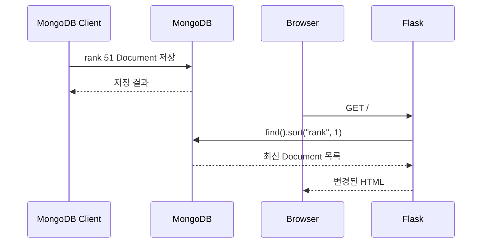

이 예제에서는 별도의 WebSocket이나 실시간 Push 기능이 필요하지 않다.

브라우저가 요청할 때마다 서버에서 MongoDB를 다시 조회하기 때문이다.

다만 브라우저를 새로고침하지 않아도 자동으로 화면이 변경되는 기능은 별도로 구현해야 한다.

또한 동일한 51위 Document를 반복해서 `insertOne()`으로 저장하면 중복된 순위의 데이터가 생길 수 있다.

따라서 운영 환경에서는 순위의 유일성을 보장할지, 차트 날짜별로 데이터를 구분할지 등의 데이터 모델링이 필요하다.

---

## Flask와 MongoDB를 함께 사용할 때 고려할 점

### 1. MongoClient 재사용

Flask 애플리케이션에서는 일반적으로 요청마다 MongoClient를 생성하기보다 애플리케이션이 사용할 Client를 재사용하는 구조를 검토할 수 있다.

단, 멀티프로세스 환경에서는 프로세스 간 Client 객체를 부적절하게 공유하지 않도록 주의해야 한다.

### 2. 조회 데이터 개수 제한

현재 코드는 다음과 같다.

```python
songs = list(collection.find({}).sort('rank', 1))
```

이 코드는 Collection의 모든 Document를 조회하여 Python List로 변환한다.

데이터가 50건 정도라면 큰 문제가 없을 수 있다.

하지만 수백만 건이라면 메모리 사용량이 증가할 수 있다.

따라서 실제 서비스에서는 `limit()` 또는 Pagination을 고려해야 한다.

```python
songs = list(
    collection.find({})
        .sort('rank', 1)
        .limit(100)
)
```

이 코드는 최대 100개의 Document를 조회한다.

### 3. Index 적용

순위를 기준으로 자주 정렬한다면 인덱스를 검토할 수 있다.

```javascript
db.top200.createIndex({
  rank: 1
});
```

이 인덱스는 `rank` 기준 정렬에 활용될 수 있다.

다만 인덱스가 실제로 사용되는지는 실행 계획을 확인해야 한다.

```javascript
db.top200.find({})
  .sort({ rank: 1 })
  .explain("executionStats")
```

### 4. 데이터 저장과 화면 조회의 책임 분리

실제 프로젝트에서는 다음 역할을 분리하는 것이 좋다.

```text
Crawler
→ 외부 데이터 수집

MongoDB
→ 데이터 저장

Flask
→ 데이터 조회 및 웹 응답

Jinja
→ HTML 화면 구성
```

이렇게 하면 크롤러를 변경하더라도 Flask의 화면 처리 로직을 유지할 수 있다.

---

## Docker를 이용한 MongoDB 애플리케이션 구성

지금까지는 Python이나 Java 애플리케이션이 로컬 MongoDB에 직접 연결하는 방식을 살펴보았다.

이제 Docker를 이용하여 서비스를 여러 컨테이너로 분리하는 방법을 살펴보자.

예제로 사용하는 시스템은 방명록 애플리케이션이다.

전체 구성은 다음 세 가지로 이루어진다.

1. Frontend
2. Backend
3. MongoDB

이를 **3-Tier Architecture**라고 부를 수 있다.

---

## 3-Tier Architecture란?

3-Tier Architecture는 애플리케이션을 역할에 따라 세 계층으로 나누는 구조다.

일반적으로 다음과 같이 구분한다.

| 계층 | 주요 역할 |
|---|---|
| Presentation Tier | 사용자 인터페이스 |
| Application Tier | 비즈니스 로직 |
| Data Tier | 데이터 저장 |

이번 방명록 애플리케이션에서는 각 계층을 Docker 컨테이너로 구성한다.

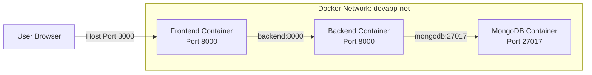

이 구조의 핵심은 각 계층이 별도의 컨테이너로 실행된다는 점이다.

### Frontend

사용자가 접근하는 웹 화면을 제공한다.

### Backend

방명록 데이터를 생성하고 조회하는 비즈니스 로직을 담당한다.

### MongoDB

방명록 데이터를 저장한다.

컨테이너를 역할별로 분리하면 개별 구성 요소를 독립적으로 관리하기 쉬워진다.

다만 컨테이너를 나누었다는 사실만으로 서비스의 확장성과 가용성이 자동으로 보장되는 것은 아니다.

서비스별 상태 관리와 네트워크, 데이터 저장 방식 등을 함께 고려해야 한다.

---

## Docker 네트워크가 필요한 이유

Docker에서 여러 컨테이너를 실행하면 각 컨테이너는 독립된 네트워크 환경을 가질 수 있다.

이때 컨테이너들이 서로 통신하려면 적절한 네트워크 구성이 필요하다.

예를 들어 다음 세 컨테이너가 있다고 가정해 보자.

```text
frontend

backend

mongodb
```

각 컨테이너가 동일한 사용자 정의 Docker 네트워크에 연결되어 있다면 컨테이너 이름을 이용하여 서로 접근할 수 있다.

```text
frontend
    ↓
backend:8000
    ↓
mongodb:27017
```

Docker의 사용자 정의 Bridge Network는 컨테이너 이름 또는 별칭을 이용한 DNS 해석을 지원한다. [Docker Documentation](https://docs.docker.com/engine/network/drivers/bridge/)

### Docker 네트워크 생성

다음 명령어를 실행한다.

```bash
docker network create devapp-net
```

`devapp-net`이라는 이름의 네트워크를 생성한다.

이미 동일한 이름의 네트워크가 있다면 다음과 같은 오류가 발생할 수 있다.

```text
Error response from daemon:
network with name devapp-net already exists
```

이 오류는 네트워크가 이미 존재한다는 의미다.

따라서 이미 필요한 네트워크가 구성되어 있다면 다시 생성할 필요가 없다.

### 네트워크 확인

```bash
docker network ls
```

현재 Docker 네트워크 목록을 확인한다.

특정 네트워크의 상세 정보를 확인하려면 다음 명령어를 사용할 수 있다.

```bash
docker network inspect devapp-net
```

이 명령어를 통해 해당 네트워크에 연결된 컨테이너 등의 정보를 확인할 수 있다.

---

## Docker로 MongoDB 컨테이너 실행하기

먼저 MongoDB를 실행한다.

```bash
docker run -d \
  --name=mongodb \
  -p 17017:27017 \
  --restart=always \
  --network=devapp-net \
  mongo:4
```

이 명령어를 자세히 살펴보자.

### -d

```bash
-d
```

컨테이너를 백그라운드에서 실행한다.

### --name

```bash
--name=mongodb
```

컨테이너 이름을 `mongodb`로 지정한다.

다른 컨테이너에서는 이 이름을 이용하여 MongoDB에 접근할 수 있다.

### -p

```bash
-p 17017:27017
```

호스트와 컨테이너의 포트를 연결한다.

형식은 다음과 같다.

```text
호스트 포트:컨테이너 포트
```

따라서 다음과 같이 동작한다.

```text
Host:17017
    ↓
MongoDB Container:27017
```

호스트에서 MongoDB에 접근할 때는 다음 주소를 사용할 수 있다.

```text
localhost:17017
```

반면 같은 Docker 네트워크의 다른 컨테이너에서는 다음 주소를 사용할 수 있다.

```text
mongodb:27017
```

### --restart

```bash
--restart=always
```

Docker의 재시작 정책을 지정한다.

컨테이너가 종료되었을 때 다시 시작하도록 설정한다.

다만 이 설정은 애플리케이션의 모든 장애를 자동으로 복구한다는 의미는 아니다.

### --network

```bash
--network=devapp-net
```

앞에서 생성한 `devapp-net` 네트워크에 연결한다.

### mongo:4

```bash
mongo:4
```

MongoDB 4 계열 이미지를 사용한다.

여기서 버전에 관한 주의가 필요하다.

예제 환경에서 실행된 MongoDB 버전은 4.4.29다.

MongoDB 4.4는 2024년 2월 29일에 공식 지원이 종료된 버전이다.

따라서 기존 구성의 동작 방식을 이해하기 위한 예제로만 참고하고, 새로운 운영 환경에서는 지원되는 MongoDB 버전과 드라이버 호환성을 검토해야 한다. [MongoDB](https://www.mongodb.com/legal/support-policy/lifecycles?msockid=2fe7b42793d365141884a2e4926f6415)

또한 위 명령어에는 Docker Volume 설정과 MongoDB 인증 설정이 포함되어 있지 않다.

따라서 운영 환경에 그대로 적용하기에는 적절하지 않다.

---

## Docker로 Backend 컨테이너 실행하기

MongoDB 컨테이너를 실행한 후 백엔드 애플리케이션을 실행한다.

```bash
docker run -d \
  --name=backend \
  --network=devapp-net \
  --restart=always \
  -e PORT=8000 \
  -e GUESTBOOK_DB_ADDR=mongodb:27017 \
  dbgurum/guestbook:backend_1.0
```

이 명령어에서는 두 가지 환경변수가 중요하다.

### PORT

```bash
-e PORT=8000
```

백엔드 애플리케이션이 사용하는 포트 설정을 전달한다.

여기서 `PORT`는 Docker 자체의 표준 포트 설정이 아니라 해당 애플리케이션이 읽도록 구현된 환경변수다.

### GUESTBOOK_DB_ADDR

```bash
-e GUESTBOOK_DB_ADDR=mongodb:27017
```

백엔드가 MongoDB에 접근하기 위한 주소를 전달한다.

이를 분리하면 다음과 같다.

```text
mongodb
→ MongoDB 컨테이너 이름

27017
→ MongoDB 컨테이너 내부 포트
```

따라서 백엔드는 다음 주소를 이용하여 MongoDB에 접근하도록 구성된다.

```text
mongodb:27017
```

### 왜 localhost를 사용하지 않을까?

백엔드는 별도의 Docker 컨테이너에서 실행된다.

따라서 백엔드 컨테이너 내부에서 다음 주소를 사용하면

```text
localhost:27017
```

백엔드 컨테이너 자신에게 접근하려고 한다.

MongoDB는 다른 컨테이너에서 실행 중이므로 올바른 연결 주소가 아니다.

이 경우 Docker 네트워크에서 접근 가능한 MongoDB 컨테이너 이름을 사용해야 한다.

### Backend는 외부 포트를 공개하지 않는다

백엔드 실행 명령어에는 다음 옵션이 없다.

```bash
-p 8000:8000
```

따라서 백엔드 포트를 호스트에 직접 게시하지 않는다.

하지만 같은 Docker 네트워크에 속한 Frontend 컨테이너는 백엔드의 내부 포트로 접근할 수 있다.

즉, 외부 포트 게시 여부와 컨테이너 간 통신 가능 여부는 구분해야 한다.

---

## Docker로 Frontend 컨테이너 실행하기

이제 프런트엔드 애플리케이션을 실행한다.

```bash
docker run -d \
  --name=frontend \
  -p 3000:8000 \
  --network=devapp-net \
  --restart=always \
  -e PORT=8000 \
  -e GUESTBOOK_API_ADDR=backend:8000 \
  dbgurum/guestbook:frontend_1.0
```

여기서 중요한 설정은 다음 세 가지다.

### 1. 포트 매핑

```bash
-p 3000:8000
```

호스트의 3000번 포트를 프런트엔드 컨테이너의 8000번 포트와 연결한다.

따라서 사용자는 다음 주소로 접근할 수 있다.

```text
http://localhost:3000
```

다른 PC에서 접근하려면 Docker가 실행되는 호스트의 접근 가능한 IP 주소를 사용해야 한다.

### 2. PORT

```bash
-e PORT=8000
```

프런트엔드 애플리케이션의 내부 서비스 포트를 설정한다.

### 3. GUESTBOOK_API_ADDR

```bash
-e GUESTBOOK_API_ADDR=backend:8000
```

프런트엔드가 사용할 백엔드 주소를 전달한다.

여기서 `backend`는 백엔드 컨테이너의 이름이다.

따라서 같은 Docker 네트워크에서 백엔드에 접근할 수 있다.

다만 실제 프런트엔드 이미지가 이 주소를 서버 측에서 사용하는지, 어떤 API 경로로 요청하는지는 이미지 내부 구현에 따라 결정된다.

제공된 설정만으로 구체적인 HTTP API 경로까지 확정할 수는 없다.

---

## Docker 컨테이너 간 통신 구조

전체 포트 구성을 정리하면 다음과 같다.

| 구성 요소 | 호스트 포트 | 컨테이너 포트 | 내부 접근 주소 |
|---|---:|---:|---|
| Frontend | 3000 | 8000 | `frontend:8000` |
| Backend | 게시하지 않음 | 8000 | `backend:8000` |
| MongoDB | 17017 | 27017 | `mongodb:27017` |

### 외부 사용자 요청

```text
http://localhost:3000
```

사용자의 요청은 호스트 3000번 포트를 통해 Frontend 컨테이너로 전달된다.

### Frontend에서 Backend 접근

```text
backend:8000
```

프런트엔드와 백엔드는 같은 Docker 네트워크를 사용한다.

### Backend에서 MongoDB 접근

```text
mongodb:27017
```

백엔드는 MongoDB 컨테이너 이름을 이용하여 데이터베이스에 접근한다.

### 전체 통신 흐름

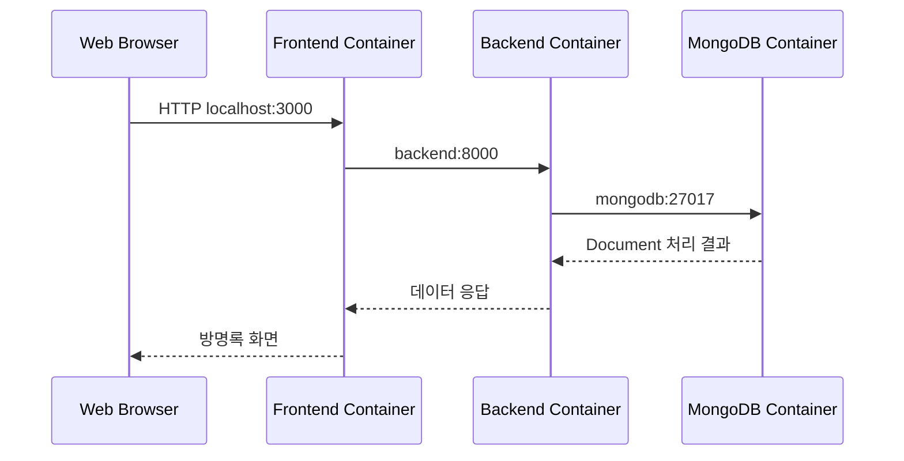

이 구조에서 외부 사용자는 MongoDB에 직접 접근할 필요가 없다.

일반적인 서비스 설계에서는 데이터베이스를 외부에 직접 공개하지 않고 백엔드 애플리케이션을 통해서만 접근하도록 구성하는 것이 적절하다.

따라서 MongoDB의 호스트 포트 공개 여부는 개발 환경과 운영 환경의 보안 요구사항을 고려하여 결정해야 한다.

---

## Docker 컨테이너 실행 상태 확인하기

세 개의 컨테이너를 실행했다면 다음 명령어로 상태를 확인할 수 있다.

```bash
docker ps
```

정상적으로 실행 중이라면 다음 컨테이너를 확인할 수 있다.

```text
frontend

backend

mongodb
```

### 주요 확인 항목

| 항목 | 설명 |
|---|---|
| CONTAINER ID | 컨테이너 식별자 |
| IMAGE | 사용 중인 이미지 |
| STATUS | 실행 상태 |
| PORTS | 포트 연결 정보 |
| NAMES | 컨테이너 이름 |

예를 들어 다음과 같이 표시될 수 있다.

```text
frontend  0.0.0.0:3000->8000/tcp
backend   8000/tcp
mongodb   0.0.0.0:17017->27017/tcp
```

실제 출력은 Docker 환경에 따라 달라질 수 있다.

여기서 `backend`는 호스트에 포트를 게시하지 않았더라도 동일한 Docker 네트워크의 다른 컨테이너에서 접근할 수 있다.

### 네트워크 확인

```bash
docker network inspect devapp-net
```

이 명령어로 세 컨테이너가 같은 네트워크에 연결되어 있는지 확인할 수 있다.

---

## 방명록 애플리케이션의 데이터 저장 흐름

이제 웹 브라우저에서 방명록을 등록하는 상황을 생각해 보자.

사용자가 다음 정보를 입력한다.

```text
Writer: kevin.lee

Message: hi
```

사용자가 등록 버튼을 누르면 애플리케이션은 해당 데이터를 백엔드로 전달한다.

백엔드는 MongoDB에 데이터를 저장한다.

저장되는 Document는 다음과 같은 구조를 가질 수 있다.

```javascript
{
  name: "kevin.lee",
  body: "hi",
  date: ISODate("2025-06-03T00:00:00Z"),
  __v: 0
}
```

여기서 각 필드의 의미를 살펴보자.

| 필드 | 설명 |
|---|---|
| `name` | 작성자 |
| `body` | 방명록 내용 |
| `date` | 등록 날짜 |
| `__v` | Document 버전 관련 필드 |

`__v`는 Node.js의 Mongoose에서 기본 Version Key로 사용하는 필드명과 같다.

따라서 해당 애플리케이션이 Mongoose를 사용하는 구조일 가능성이 있지만, 실제 백엔드 소스코드가 없는 상태에서 이를 확정할 수는 없다.

### 방명록 데이터 처리 구조

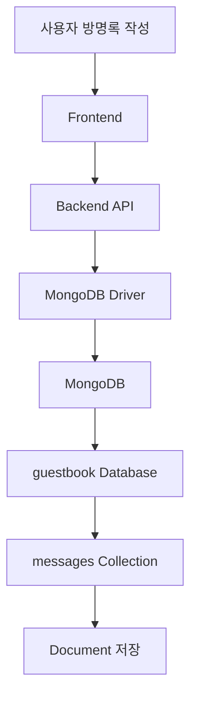

---

## MongoDB 컨테이너 로그 확인하기

Docker에서는 컨테이너의 표준 출력 및 표준 오류 로그를 확인할 수 있다.

MongoDB 컨테이너 로그를 확인하려면 다음 명령어를 사용한다.

```bash
docker logs mongodb
```

실시간으로 로그를 확인하려면 `-f` 옵션을 사용한다.

```bash
docker logs -f mongodb
```

여기서 `mongodb`는 앞에서 `--name=mongodb`로 지정한 컨테이너 이름이다.

### -f 옵션

```bash
-f
```

로그 출력을 계속 따라가도록 한다.

따라서 새로운 로그가 발생하면 터미널에 추가로 출력된다.

### MongoDB 로그에서 확인할 수 있는 항목

MongoDB는 JSON 형태의 구조화된 로그를 출력할 수 있다.

대표적으로 다음과 같은 영역이 있다.

| 항목 | 설명 |
|---|---|
| NETWORK | 네트워크 및 연결 |
| STORAGE | 스토리지 엔진 |
| INDEX | 인덱스 |
| COMMAND | MongoDB 명령 처리 |
| ACCESS | 인증 및 접근 제어 |

예를 들어 MongoDB에 새로운 연결이 생성되면 네트워크 관련 로그가 발생할 수 있다.

또한 Collection에 인덱스가 생성되면 인덱스 관련 로그가 출력될 수 있다.

하지만 로그가 출력되었다는 사실만으로 데이터 저장 작업이 정상적으로 완료되었다고 단정할 수는 없다.

실제 Document가 저장되었는지는 데이터베이스를 조회하여 확인해야 한다.

---

## MongoDB 컨테이너 내부에 접속하기

Docker에서는 `docker exec` 명령어를 이용하여 실행 중인 컨테이너 내부에서 프로그램을 실행할 수 있다.

MongoDB 4.4 기반 컨테이너에서는 다음 명령어를 사용할 수 있다.

```bash
docker exec -it mongodb mongo
```

여기서 각 옵션의 의미는 다음과 같다.

| 옵션 | 설명 |
|---|---|
| `docker exec` | 실행 중인 컨테이너에서 명령 실행 |
| `-i` | 표준 입력 유지 |
| `-t` | TTY 할당 |
| `mongodb` | 컨테이너 이름 |
| `mongo` | 실행할 MongoDB Shell |

예제 환경에서는 다음 버전 정보가 표시된다.

```text
MongoDB shell version v4.4.29
MongoDB server version: 4.4.29
```

여기서 중요한 점은 MongoDB 4 계열의 레거시 Shell인 `mongo`를 사용한다는 것이다.

현재 MongoDB 환경에서는 별도 `mongosh`를 사용하는 것이 일반적이다.

따라서 최신 MongoDB 이미지에서는 다음 명령어를 사용할 수 있다.

```bash
docker exec -it mongodb mongosh
```

다만 사용 중인 이미지에 `mongosh`가 설치되어 있어야 한다.

이처럼 Docker 컨테이너에서 실행할 MongoDB Shell 명령어는 MongoDB 이미지 버전에 따라 달라질 수 있다.

---

## MongoDB Database와 Collection 확인하기

MongoDB Shell에 접속했다면 다음 명령어로 데이터베이스 목록을 확인한다.

```javascript
show dbs
```

예를 들어 다음과 같은 데이터베이스가 표시될 수 있다.

```text
admin

config

guestbook

local
```

### guestbook 데이터베이스 선택

```javascript
use guestbook
```

### Collection 목록 확인

```javascript
show collections
```

정상적으로 방명록 데이터가 저장되어 있다면 다음 Collection을 확인할 수 있다.

```text
messages
```

### Document 조회

```javascript
db.messages.find()
```

다음과 같은 데이터가 저장되어 있을 수 있다.

```javascript
{
  _id: ObjectId("..."),
  name: "hylee",
  body: "welcome~",
  date: ISODate("2025-06-04T00:00:00Z"),
  __v: 0
}
```

```javascript
{
  _id: ObjectId("..."),
  name: "kevin.lee",
  body: "hi",
  date: ISODate("2025-06-03T00:00:00Z"),
  __v: 0
}
```

이 데이터는 방명록에 저장되는 Document의 구조를 보여준다.

웹 페이지에서 입력한 작성자와 메시지가 MongoDB의 `messages` Collection에 저장된다는 점을 확인할 수 있다. mongodb-application-code-and-co…

---

## 방명록을 등록했는데 화면이 바로 변경되지 않는다면?

방명록을 등록한 직후 목록이 비어 있다가 이후에 데이터가 표시되는 상황이 발생할 수 있다.

하지만 이러한 현상만으로 특정 원인을 확정할 수는 없다.

예를 들어 다음과 같은 가능성이 있다.

1. Frontend가 데이터를 다시 조회하지 않았다.
2. Backend 응답 처리에 문제가 발생했다.
3. 등록 이후 목록 갱신 로직이 실행되지 않았다.
4. 브라우저에서 이전 화면 상태를 유지하고 있다.
5. API 요청이 실패했다.
6. 서버의 데이터 조회 결과가 예상과 다르다.

이 경우에는 다음 순서로 확인할 수 있다.

### 1. MongoDB 데이터 확인

```javascript
use guestbook
```

```javascript
db.messages.find()
```

Document가 존재한다면 적어도 MongoDB에는 데이터가 저장된 상태일 수 있다.

### 2. Backend 로그 확인

```bash
docker logs backend
```

실시간 로그를 확인한다.

```bash
docker logs -f backend
```

### 3. Frontend 로그 확인

```bash
docker logs frontend
```

### 4. MongoDB 로그 확인

```bash
docker logs mongodb
```

### 5. 컨테이너 상태 확인

```bash
docker ps
```

### 6. 네트워크 확인

```bash
docker network inspect devapp-net
```

이렇게 단계별로 확인하면 문제가 발생한 위치를 좁혀 나갈 수 있다.

특히 다음 세 가지 상황을 구분하는 것이 중요하다.

```text
MongoDB에 데이터가 없음
→ 저장 요청 또는 DB 처리 확인

MongoDB에 데이터는 있음
→ Backend 조회 및 응답 확인

Backend 응답은 정상
→ Frontend 화면 갱신 로직 확인
```

실제 원인을 파악하려면 API 요청과 응답, 컨테이너 로그, MongoDB 데이터를 함께 확인해야 한다.

---

## Docker Compose로 3-Tier 애플리케이션 관리하기

지금까지는 `docker run` 명령어를 이용하여 세 개의 컨테이너를 개별적으로 실행했다.

하지만 실제 프로젝트에서는 여러 컨테이너의 실행 설정을 하나의 파일로 관리하는 것이 편리할 수 있다.

Docker Compose를 이용하면 다음 설정을 하나의 YAML 파일에서 관리할 수 있다.

- 컨테이너 이미지
- 포트 매핑
- 환경변수
- 네트워크
- Volume
- 재시작 정책
- 서비스 간 시작 순서

### Docker Compose 프로젝트 구조

```text
guestbook-project/
└── compose.yml
```

### compose.yml 전체 코드

다음 코드는 앞에서 사용한 3-Tier 구성을 Docker Compose로 표현한 예제다.

```yaml
services:
  mongodb:
    image: mongo:4
    container_name: mongodb

    ports:
      - "127.0.0.1:17017:27017"

    volumes:
      - mongodb_data:/data/db

    networks:
      - devapp-net

    restart: unless-stopped

  backend:
    image: dbgurum/guestbook:backend_1.0
    container_name: backend

    environment:
      PORT: "8000"
      GUESTBOOK_DB_ADDR: "mongodb:27017"

    depends_on:
      - mongodb

    networks:
      - devapp-net

    restart: unless-stopped

  frontend:
    image: dbgurum/guestbook:frontend_1.0
    container_name: frontend

    ports:
      - "127.0.0.1:3000:8000"

    environment:
      PORT: "8000"
      GUESTBOOK_API_ADDR: "backend:8000"

    depends_on:
      - backend

    networks:
      - devapp-net

    restart: unless-stopped

networks:
  devapp-net:
    external: true

volumes:
  mongodb_data:
```

이 Compose 파일은 기존 컨테이너 구성을 이해하기 쉽게 재구성한 예제다.

기존의 `docker run` 명령어와 달리 MongoDB 데이터 저장을 위한 Named Volume을 추가했다.

또한 호스트의 포트 바인딩을 `127.0.0.1`로 제한했다.

다만 MongoDB 4 계열과 방명록 이미지의 조합은 레거시 환경을 재현하기 위한 구성이며, 이미지의 현재 배포 상태와 신규 환경에서의 실행 호환성이 검증되었다는 의미는 아니다.

새로운 운영 환경에서는 지원되는 MongoDB 버전, 인증, TLS, 백업, 이미지 보안 등을 고려하여 별도로 구성해야 한다.

### 주요 설정 설명

| 설정 | 설명 |
|---|---|
| `image` | 사용할 Docker 이미지 |
| `container_name` | 컨테이너 이름 |
| `ports` | 호스트와 컨테이너 포트 연결 |
| `environment` | 애플리케이션 환경변수 |
| `depends_on` | 서비스 시작 순서 |
| `networks` | Docker 네트워크 |
| `volumes` | 데이터 저장 공간 |
| `restart` | 재시작 정책 |

### Named Volume

```yaml
volumes:
  - mongodb_data:/data/db
```

MongoDB의 데이터 디렉터리를 Named Volume과 연결한다.

이렇게 하면 컨테이너를 삭제하고 다시 생성하더라도 해당 Volume을 유지하는 동안 데이터가 남을 수 있다.

다만 Volume 자체를 삭제하거나 파일이 손상되는 경우까지 보호하는 것은 아니므로 별도의 백업이 필요하다.

### depends_on

```yaml
depends_on:
  - mongodb
```

Backend가 MongoDB 서비스 이후에 시작되도록 구성한다.

다만 이 설정만으로 MongoDB의 실제 연결 준비 상태까지 보장하는 것은 아니다.

따라서 실제 운영 구성에서는 Health Check와 재시도 로직 등을 검토하는 것이 좋다.

---

## Docker Compose 실행 방법

### 1. 네트워크 생성

위 Compose 파일에서는 외부 네트워크를 사용하도록 설정했다.

```yaml
networks:
  devapp-net:
    external: true
```

따라서 네트워크가 존재하지 않는다면 먼저 생성한다.

```bash
docker network create devapp-net
```

이미 존재한다면 다시 생성하지 않는다.

### 2. 기존 컨테이너 확인

```bash
docker ps -a
```

동일한 이름의 컨테이너가 이미 존재하면 새 Compose 서비스와 이름이 충돌할 수 있다.

따라서 기존 컨테이너가 있다면 실행 상태와 데이터 보존 필요성을 먼저 확인해야 한다.

### 3. 서비스 실행

```bash
docker compose up -d
```

Compose 파일에 정의된 서비스를 백그라운드에서 실행한다.

### 4. 실행 상태 확인

```bash
docker compose ps
```

정상적으로 실행된다면 다음 서비스를 확인할 수 있다.

```text
mongodb

backend

frontend
```

### 5. 로그 확인

```bash
docker compose logs mongodb
```

```bash
docker compose logs backend
```

```bash
docker compose logs frontend
```

### 6. 브라우저 접속

다음 주소에 접근한다.

```text
http://localhost:3000
```

방명록 웹 화면이 표시되는지 확인한다.

### 7. MongoDB 연결 확인

레거시 MongoDB 컨테이너에서는 다음과 같이 접속할 수 있다.

```bash
docker compose exec mongodb mongo
```

MongoDB Shell에서 다음 명령어를 실행한다.

```javascript
show dbs
```

```javascript
use guestbook
```

```javascript
show collections
```

```javascript
db.messages.find()
```

### 8. 서비스 종료

```bash
docker compose down
```

컨테이너와 Compose에서 관리하는 일부 리소스를 제거한다.

Named Volume은 기본적으로 유지한다.

반면 다음 명령어는 주의해야 한다.

```bash
docker compose down -v
```

`-v` 옵션을 사용하면 Compose에서 관리하는 Named Volume도 삭제할 수 있다.

따라서 MongoDB에 저장된 데이터가 삭제될 수 있다.

---

## Docker 환경에서 MongoDB 연결 주소를 설계하는 방법

Docker를 처음 사용할 때 자주 혼동하는 부분은 `localhost`와 컨테이너 이름의 차이다.

다음 세 가지 상황을 비교해 보자.

### 상황 1. 로컬 Python에서 Docker MongoDB에 접근

MongoDB 컨테이너를 다음과 같이 실행했다고 가정한다.

```bash
docker run -d \
  --name=mongodb \
  -p 17017:27017 \
  --network=devapp-net \
  mongo:4
```

호스트에서 실행되는 Python 애플리케이션은 다음 주소를 사용한다.

```python
MongoClient("mongodb://localhost:17017")
```

호스트 17017번 포트가 MongoDB 컨테이너의 27017번 포트로 연결되기 때문이다.

### 상황 2. Backend 컨테이너에서 MongoDB에 접근

Backend도 `devapp-net`에 연결되어 있다면 다음 주소를 사용한다.

```text
mongodb:27017
```

이 경우 호스트의 17017번 포트를 사용할 필요가 없다.

### 상황 3. 다른 PC에서 MongoDB에 접근

Docker가 실행되는 호스트의 외부 접근 가능한 IP 주소와 게시된 포트를 사용해야 한다.

하지만 이 경우에는 네트워크와 방화벽, 인증 설정을 신중하게 구성해야 한다.

특히 운영 데이터베이스를 인터넷에 직접 공개하는 방식은 피하는 것이 좋다.

### 연결 주소 비교

| 실행 위치 | MongoDB 접근 주소 |
|---|---|
| 호스트에서 실행되는 애플리케이션 | `localhost:17017` |
| 동일 Docker 네트워크의 Backend | `mongodb:27017` |
| MongoDB 컨테이너 내부 | `localhost:27017` |

이처럼 같은 MongoDB 서버에 접근하더라도 **클라이언트가 어디에서 실행되는지에 따라 연결 주소가 달라질 수 있다.**

---

## MongoDB 애플리케이션 개발에서 중요한 설계 포인트

지금까지 살펴본 구조를 실무 관점에서 정리해 보자.

### 1. MongoClient를 요청마다 생성하지 않는다

MongoDB Driver는 Connection Pool을 관리할 수 있다.

따라서 일반적으로 애플리케이션에서 재사용 가능한 Client를 구성하는 것이 좋다.

요청마다 Client를 생성하고 종료하면 연결 생성 및 해제 비용이 반복될 수 있다.

### 2. MongoDB 연결 정보를 환경변수로 관리한다

다음과 같이 연결 주소를 코드에 직접 작성할 수 있다.

```python
MongoClient("mongodb://localhost:27017")
```

하지만 실제 서비스에서는 환경마다 주소가 다를 수 있다.

따라서 환경변수나 별도의 설정 시스템을 사용하는 것이 좋다.

### 3. Collection 이름의 일관성을 유지한다

다음 이름들은 서로 다를 수 있다.

```text
myCollection

mycollection
```

따라서 명명 규칙을 일관되게 유지해야 한다.

### 4. 데이터 갱신 시 전체 삭제를 신중하게 사용한다

```python
collection.delete_many({})
```

이 코드는 Collection의 모든 Document를 삭제한다.

따라서 외부 데이터 수집 시스템에서 이 명령어를 사용하는 경우 데이터 손실 가능성을 고려해야 한다.

### 5. 데이터 수집 결과를 검증한다

HTTP 응답이 200이라고 해서 필요한 데이터가 정상적으로 수집되었다고 보장할 수 없다.

웹사이트의 HTML 구조가 변경되었을 수 있기 때문이다.

따라서 수집 건수와 필수 필드, 데이터 형식 등을 검증해야 한다.

### 6. 정렬 필드에 적절한 인덱스를 검토한다

```python
collection.find({}).sort("rank", 1)
```

이러한 정렬이 자주 발생한다면 `rank` 인덱스를 검토할 수 있다.

```javascript
db.top200.createIndex({
  rank: 1
});
```

### 7. 대량 조회 시 Pagination을 고려한다

```python
list(collection.find({}))
```

전체 Document를 한 번에 메모리로 가져오는 방식은 데이터가 많아지면 문제가 될 수 있다.

따라서 데이터의 규모에 따라 `limit()`과 Pagination을 고려해야 한다.

### 8. Docker 내부 통신과 외부 포트 공개를 구분한다

Frontend와 Backend가 통신하기 위해 반드시 Backend의 포트를 호스트에 게시해야 하는 것은 아니다.

동일한 Docker 네트워크에 연결되어 있다면 내부 주소를 사용할 수 있다.

### 9. MongoDB 데이터 저장 공간을 관리한다

Docker 컨테이너에 Volume을 설정하지 않으면 컨테이너 제거 및 재생성 과정에서 데이터가 유실될 수 있다.

따라서 데이터의 지속성이 필요한 환경에서는 Volume과 백업 정책을 함께 구성해야 한다.

### 10. MongoDB 인증을 활성화한다

개발 환경에서는 인증이 없는 MongoDB를 사용할 수 있다.

하지만 운영 환경에서는 인증과 접근 제어가 필요하다.

특히 외부 네트워크에 데이터베이스 포트를 공개하는 경우에는 보안 위험이 커질 수 있다.

### 11. 서비스별 장애 범위를 분리한다

3-Tier Architecture에서는 각 계층의 문제를 구분할 수 있다.

예를 들어 다음과 같다.

```text
Frontend 오류
→ 화면 및 프런트엔드 로그 확인

Backend 오류
→ API 처리 및 백엔드 로그 확인

MongoDB 오류
→ 데이터베이스 연결 및 쿼리 확인
```

이러한 구조는 문제를 분석할 때 책임 범위를 구분하는 데 도움이 된다.

### 12. 개발 환경과 운영 환경을 구분한다

개발 환경에서 사용하는 설정을 운영 환경에 그대로 적용해서는 안 된다.

예를 들어 다음과 같은 설정은 운영 환경에서 개선해야 한다.

- Flask `debug=True`
- 인증 없는 MongoDB
- 지원이 종료된 MongoDB 버전
- 데이터 Volume 미설정
- 평문으로 작성된 비밀번호
- 무제한 데이터 조회
- 전체 Collection 삭제 후 재삽입

운영 환경에서는 보안, 안정성, 모니터링, 데이터 백업 등을 함께 고려해야 한다.

---

## MongoDB 애플리케이션의 전체 아키텍처

지금까지 살펴본 내용을 하나의 구조로 정리하면 다음과 같다.

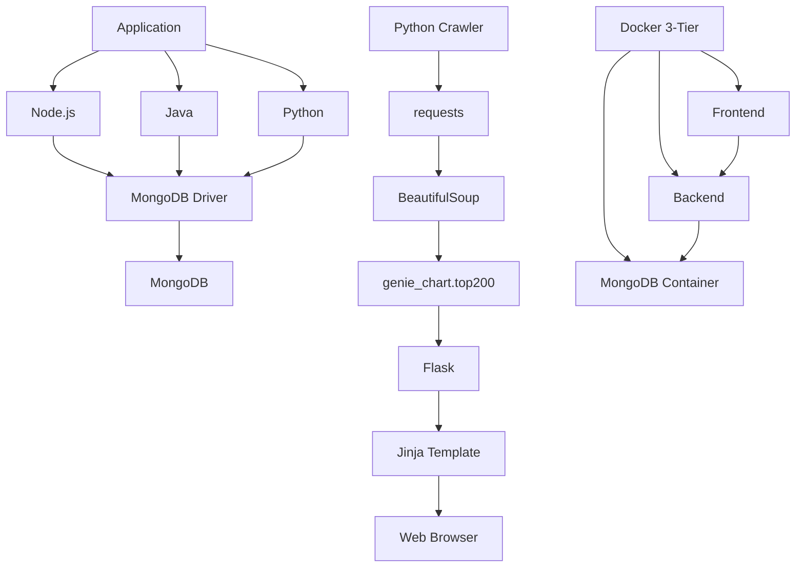

이 구조는 MongoDB를 활용하는 세 가지 중요한 패턴을 보여준다.

첫 번째는 프로그래밍 언어별 MongoDB Driver를 이용한 데이터 접근이다.

두 번째는 외부 데이터를 수집하여 MongoDB에 저장하고 웹 서비스에서 제공하는 구조다.

세 번째는 Docker를 이용하여 애플리케이션 계층을 분리하고 MongoDB를 독립된 데이터 저장 계층으로 사용하는 구조다.

---

## 주요 명령어와 코드 정리

| 구분 | 명령어·API | 설명 |
|---|---|---|
| Node.js Driver 설치 | `npm install mongodb` | MongoDB Driver 설치 |
| Node.js 연결 | `new MongoClient()` | MongoDB Client 생성 |
| Node.js 저장 | `insertOne()` | Document 하나 저장 |
| Java Client | `MongoClients.create()` | MongoDB Client 생성 |
| Java Database | `getDatabase()` | Database 선택 |
| Java Collection | `getCollection()` | Collection 선택 |
| Java 저장 | `insertOne()` | Document 저장 |
| PyMongo 설치 | `pip install pymongo` | Python Driver 설치 |
| PyMongo 연결 | `MongoClient()` | MongoDB Client 생성 |
| PyMongo 저장 | `insert_one()` | Document 하나 저장 |
| PyMongo 조회 | `find()` | Document 조회 |
| PyMongo 수정 | `update_one()` | Document 수정 |
| PyMongo 삭제 | `delete_many()` | 조건에 일치하는 Document 삭제 |
| HTTP 요청 | `requests.get()` | 웹 페이지 요청 |
| HTML 파싱 | `BeautifulSoup()` | HTML 파싱 |
| HTML 선택 | `select()` | 여러 요소 선택 |
| HTML 선택 | `select_one()` | 단일 요소 선택 |
| Flask 라우팅 | `@app.route()` | URL 요청 처리 |
| Flask 렌더링 | `render_template()` | HTML 템플릿 렌더링 |
| Jinja 반복문 | `` | HTML 반복 렌더링 |
| Jinja 변수 | `{{ variable }}` | 변수 출력 |
| Docker 네트워크 | `docker network create` | 사용자 정의 네트워크 생성 |
| Docker 실행 | `docker run -d` | 컨테이너 백그라운드 실행 |
| Docker 환경변수 | `-e` | 컨테이너 환경변수 전달 |
| Docker 포트 | `-p` | 호스트 포트 게시 |
| Docker 상태 | `docker ps` | 실행 중인 컨테이너 확인 |
| Docker 로그 | `docker logs` | 컨테이너 로그 확인 |
| Docker 내부 실행 | `docker exec` | 컨테이너 내부 명령 실행 |
| Docker Compose 실행 | `docker compose up -d` | 여러 서비스 실행 |
| Docker Compose 종료 | `docker compose down` | 서비스 종료 및 제거 |

---

## 정리

MongoDB는 다양한 프로그래밍 언어에서 사용할 수 있는 공식 Driver를 제공한다.

Node.js에서는 MongoDB Node.js Driver를 사용한다.

Java에서는 MongoDB Java Driver를 사용할 수 있다.

Python에서는 PyMongo를 이용하여 MongoDB에 접근할 수 있다.

세 드라이버는 문법과 실행 모델이 다르지만 기본적인 역할은 동일하다.

**애플리케이션에서 MongoDB 서버와 통신하고, Document를 생성·조회·수정·삭제할 수 있도록 지원하는 것**이다.

MongoDB Driver를 이용하면 애플리케이션이 데이터베이스의 통신 프로토콜과 연결 관리 기능을 직접 구현할 필요가 없다.

특히 실제 백엔드 서비스에서는 Connection Pool과 Client 재사용, 오류 처리, Timeout 등의 요소까지 고려해야 한다.

또한 MongoDB는 외부 데이터를 수집하는 시스템에서도 활용할 수 있다.

Python에서는 `requests`를 이용하여 HTTP 요청을 보내고, BeautifulSoup로 HTML을 분석할 수 있다.

이후 PyMongo를 통해 수집한 데이터를 MongoDB의 Collection에 저장할 수 있다.

이러한 구조는 데이터 수집과 저장을 분리할 수 있다는 장점이 있다.

하지만 웹 크롤링에서는 몇 가지 주의할 점이 있다.

첫째, 웹사이트의 HTML 구조가 변경되면 기존 CSS Selector가 정상적으로 동작하지 않을 수 있다.

둘째, HTTP 요청이 성공했다고 해서 원하는 데이터가 모두 수집되었다고 보장할 수 없다.

셋째, 데이터를 저장하기 전에 기존 Collection 전체를 삭제하면 수집 실패 시 데이터가 유실될 수 있다.

따라서 실제 서비스에서는 수집 결과 검증, 오류 처리, 데이터 갱신 전략 등을 함께 설계해야 한다.

수집한 데이터를 웹 서비스에 제공할 때는 Flask를 활용할 수 있다.

Flask는 MongoDB에서 데이터를 조회하고 `render_template()`을 통해 Jinja 템플릿에 전달할 수 있다.

Jinja는 전달받은 데이터를 HTML에 반복적으로 출력한다.

이러한 구조를 이용하면 데이터 수집, 데이터 저장, 웹 화면 생성의 책임을 분리할 수 있다.

더 나아가 Docker를 이용하면 프런트엔드, 백엔드, MongoDB를 별도의 컨테이너로 구성할 수 있다.

3-Tier Architecture에서는 각 계층이 서로 다른 역할을 담당한다.

Frontend는 사용자 인터페이스를 제공한다.

Backend는 비즈니스 로직과 데이터 처리를 담당한다.

MongoDB는 데이터를 저장한다.

이때 Docker 네트워크를 이용하면 컨테이너 이름을 통해 서로 통신할 수 있다.

예를 들어 다음과 같은 구조다.

```text
User Browser
     ↓
localhost:3000
     ↓
Frontend Container
     ↓
backend:8000
     ↓
Backend Container
     ↓
mongodb:27017
     ↓
MongoDB Container
```

여기서 특히 중요한 점은 호스트 포트와 컨테이너 내부 포트의 차이다.

호스트에서 Docker MongoDB에 접근할 때는 게시된 포트인 `localhost:17017`을 사용할 수 있다.

반면 같은 Docker 네트워크에 속한 백엔드 컨테이너는 `mongodb:27017`을 사용한다.

이처럼 애플리케이션이 실행되는 위치에 따라 MongoDB 연결 주소가 달라질 수 있다.

또한 운영 환경에서는 Docker Volume을 이용한 데이터 보존, MongoDB 인증, 지원되는 서버 버전, 네트워크 접근 제어 등을 함께 고려해야 한다.

결국 MongoDB를 애플리케이션에서 제대로 활용하려면 단순히 CRUD 메서드를 사용하는 방법만 알아서는 부족하다.

**MongoDB Driver의 연결 구조, 데이터 수집과 저장 전략, 웹 애플리케이션의 요청 처리 흐름, Docker 네트워크와 컨테이너 간 통신 구조를 함께 이해해야 한다.**

이러한 개념을 이해하면 Python 데이터 수집 시스템부터 Java·Node.js 기반 백엔드 서비스, Docker 기반 분산 애플리케이션까지 MongoDB를 다양한 구조에서 활용할 수 있다.

### 한 줄 요약

**MongoDB는 Node.js·Java·PyMongo 등의 공식 Driver를 통해 애플리케이션과 연결할 수 있으며, Python의 requests·BeautifulSoup로 수집한 데이터를 MongoDB에 저장하고 Flask·Jinja로 웹 페이지에 제공할 수 있다. 또한 Docker를 이용하면 Frontend·Backend·MongoDB를 독립된 컨테이너로 구성하여 3-Tier Architecture를 구현할 수 있으며, 실제 운영에서는 연결 관리, 데이터 갱신 전략, 컨테이너 네트워크, 데이터 영속성과 보안을 함께 고려하는 것이 중요하다.**
