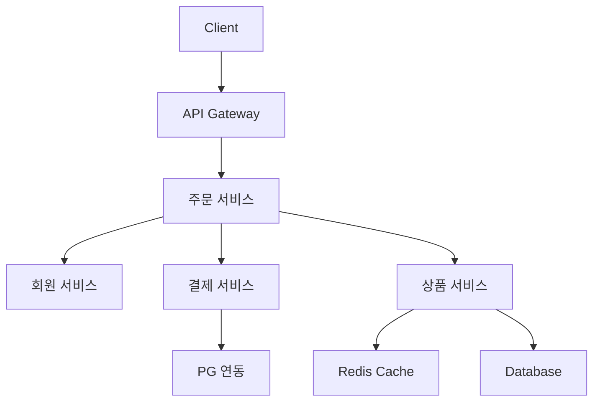
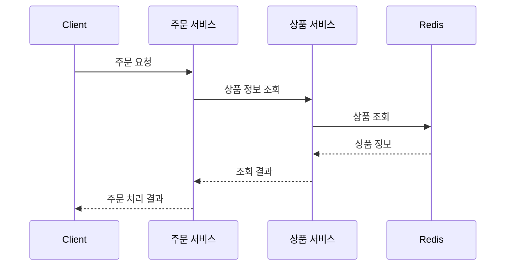
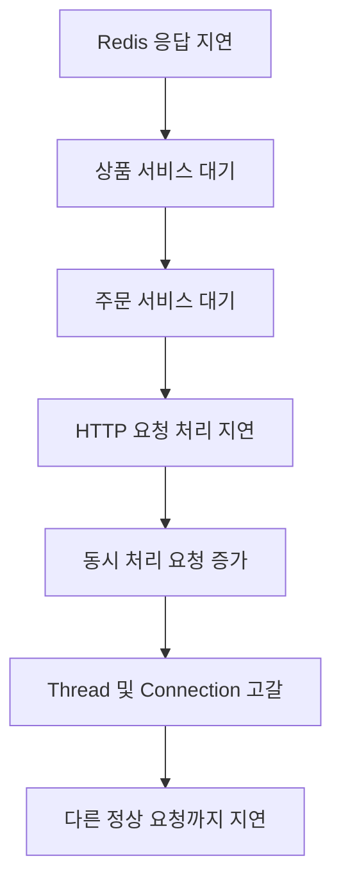
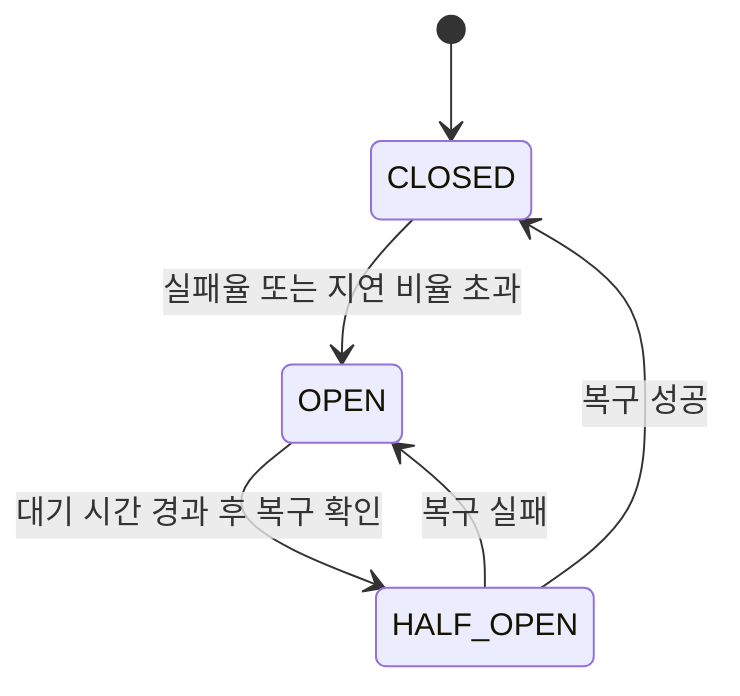
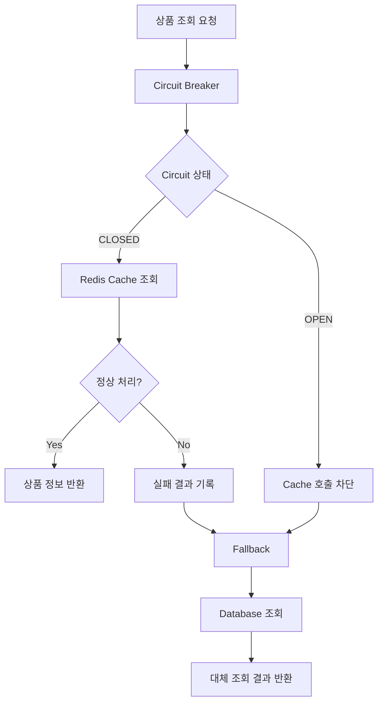
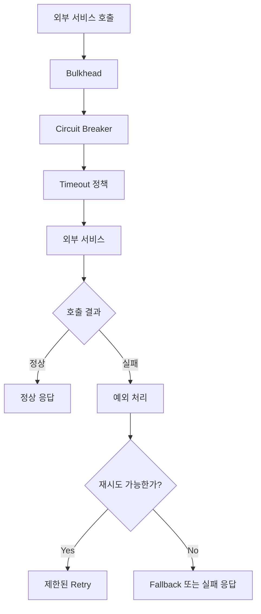
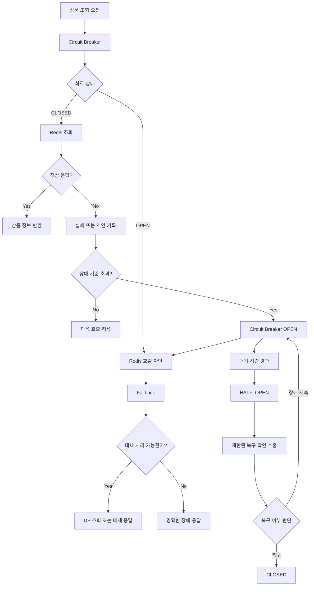

# Resilience4J - 1. MSA 장애 대응 방법
[https://youtu.be/UpwJOImeYcA?si=mN20Wra-NisvYh9t](https://youtu.be/UpwJOImeYcA?si=mN20Wra-NisvYh9t)

# Resilience4J - 1. MSA 장애 대응 방법
* toc
{:toc}

---

## Resilience4j란? MSA 장애 전파와 Circuit Breaker를 이용한 장애 대응

마이크로서비스 아키텍처(MSA)는 하나의 애플리케이션을 여러 서비스로 분리하고, 각 서비스가 독립적으로 개발·배포·확장될 수 있도록 구성하는 방식이다.

예를 들어 쇼핑몰 시스템을 구축한다고 생각해보자.

하나의 애플리케이션에서 회원, 주문, 결제, 배송 기능을 모두 처리하는 대신 각각의 서비스를 분리할 수 있다.

```text
회원 서비스
주문 서비스
결제 서비스
배송 서비스
알림 서비스
```

서비스마다 담당하는 역할이 명확하고, 특정 기능에 트래픽이 집중되면 해당 서비스만 확장할 수 있다는 장점이 있다.

하지만 서비스가 여러 개로 나뉘었다고 해서 각각이 완전히 독립적으로 동작하는 것은 아니다.

주문을 처리하려면 회원 정보를 확인해야 하고, 결제를 요청해야 하며, 결제가 완료되면 배송과 알림 서비스를 호출해야 할 수도 있다.

즉, 하나의 사용자 요청을 처리하기 위해 여러 마이크로서비스가 서로 통신한다.



문제는 이러한 서비스 간 통신이 항상 정상적으로 이루어지는 것은 아니라는 점이다.

네트워크 연결이 끊어질 수도 있고, 특정 서비스가 비정상 종료될 수도 있다. 응답은 정상적으로 반환하지만 평소보다 지나치게 오래 걸리는 상황도 발생한다.

모놀리식 애플리케이션에서도 장애는 발생하지만, MSA에서는 **하나의 서비스에서 시작된 장애가 네트워크 호출을 통해 다른 서비스로 확산될 수 있다.**

이러한 장애 전파를 줄이고, 일부 서비스가 정상적으로 동작하지 않더라도 전체 시스템이 가능한 범위에서 기능을 제공하도록 만드는 것이 내결함성(Fault Tolerance) 설계의 중요한 목표다.

Java와 Spring 환경에서 이를 구현할 때 사용할 수 있는 대표적인 라이브러리가 **Resilience4j**다.

---

## Resilience4j란?

Resilience4j는 Java 애플리케이션을 위한 경량 내결함성 라이브러리다.

외부 서비스 호출 과정에서 발생하는 실패, 지연, 과도한 요청 등으로 인해 전체 애플리케이션이 영향을 받지 않도록 여러 장애 대응 패턴을 제공한다.

Resilience4j에서 제공하는 대표적인 기능은 다음과 같다.

| 기능              | 역할                     | 해결하려는 문제   |
| --------------- | ---------------------- | ---------- |
| Circuit Breaker | 장애가 발생한 대상에 대한 호출 차단   | 장애 전파 방지   |
| Retry           | 실패한 요청을 정해진 정책에 따라 재시도 | 일시적인 오류 복구 |
| TimeLimiter     | 작업 완료 대기 시간 제한         | 장시간 지연 방지  |
| Bulkhead        | 동시 실행 가능한 작업 수 제한      | 리소스 고갈 방지  |
| RateLimiter     | 일정 시간 동안 허용할 호출 수 제한   | 과도한 요청 제어  |

각 기능은 서로 다른 문제를 해결한다.

예를 들어 외부 서비스가 응답하지 않는다면 Timeout을 적용할 수 있고, 일시적인 네트워크 오류라면 Retry를 사용할 수 있다.

반복적인 실패가 발생하는 서비스에 대해서는 Circuit Breaker를 이용해 호출을 일시적으로 차단할 수 있다.

이처럼 Resilience4j는 단일 장애 처리 기능이 아니라 여러 내결함성 패턴을 조합할 수 있도록 구성되어 있다.

이번에는 그중에서도 가장 대표적인 **Circuit Breaker**를 중심으로 살펴본다.

---

## MSA에서는 왜 장애가 전파될까?

MSA에서 장애가 발생하는 상황을 이해하려면 서비스 간 호출 구조부터 살펴볼 필요가 있다.

다음과 같은 시스템이 있다고 가정하자.

```text
Client
   ↓
주문 서비스
   ↓
상품 서비스
   ↓
Redis
```

사용자가 주문을 생성하면 주문 서비스는 상품 서비스에 상품 정보를 요청한다.

상품 서비스는 Redis에서 상품 정보를 조회한 뒤 응답한다.

정상적인 상황에서는 다음과 같이 동작한다.



상품 정보 조회가 빠르게 완료된다면 큰 문제가 없다.

그런데 어느 순간 Redis에 문제가 발생했다고 생각해보자.

원인은 다양할 수 있다.

Redis 서버의 CPU 사용률이 높아졌을 수도 있고, 네트워크 지연이 발생했을 수도 있다. Connection Pool이 부족하거나 특정 명령어의 실행 시간이 길어진 상황일 수도 있다.

평소 100ms 정도 걸리던 조회가 20초 이상 걸리기 시작한다.

```text
정상

상품 정보 조회
→ 100ms
```

```text
장애 발생

상품 정보 조회
→ 20,000ms
```

상품 서비스는 Redis의 응답을 기다린다.

그동안 주문 서비스 역시 상품 서비스의 응답을 기다려야 한다.

결국 Redis에서 발생한 지연이 상품 서비스를 거쳐 주문 서비스까지 전달된다.



중요한 것은 Redis 하나가 느려졌을 뿐인데 주문 서비스의 처리 성능까지 영향을 받을 수 있다는 점이다.

이것이 MSA에서 장애 전파를 방지해야 하는 이유다.

---

## 장애는 크게 실패와 지연으로 구분할 수 있다

서비스 간 호출에서 발생하는 문제를 단순화하면 실패(Failure)와 지연(Slow Call)으로 나눠서 생각할 수 있다.

두 상황은 비슷하게 느껴지지만 장애 대응 관점에서는 차이가 있다.

### 실패(Failure)

실패는 요청이 정상적으로 완료되지 않은 상황이다.

예를 들어 외부 API 서버에 요청했는데 연결 자체가 실패했다고 가정해보자.

```text
주문 서비스
    ↓
결제 서비스 요청
    ↓
Connection refused
```

또는 서버가 내부 오류를 반환한다.

```http
HTTP/1.1 500 Internal Server Error
```

이러한 상황에서는 호출한 쪽에서 비교적 명확하게 실패를 확인할 수 있다.

Java에서는 다음과 같은 예외가 발생할 수 있다.

```text
ConnectException

SocketTimeoutException

HttpServerErrorException

ResourceAccessException
```

다만 모든 HTTP 오류 응답을 동일한 장애로 취급해서는 안 된다.

예를 들어:

```http
HTTP/1.1 404 Not Found
```

는 단순히 요청한 리소스가 존재하지 않는 정상적인 비즈니스 결과일 수도 있다.

마찬가지로:

```http
HTTP/1.1 400 Bad Request
```

는 클라이언트의 잘못된 입력 때문일 수 있다.

따라서 Resilience4j에 장애를 기록할 때는 HTTP 상태 코드 자체뿐 아니라 **그 오류가 실제로 의존 서비스의 가용성 문제를 의미하는지** 판단해야 한다.

### 지연(Slow Call)

지연은 요청이 완료되기는 하지만 정상적인 처리 시간보다 지나치게 오래 걸리는 상황이다.

예를 들어 다음과 같은 응답을 받았다고 하자.

```http
HTTP/1.1 200 OK
```

HTTP 상태 코드만 보면 정상이다.

하지만 응답을 받기까지 30초가 걸렸다면 어떨까?

```text
요청 시작

    ↓

30초 대기

    ↓

HTTP 200 OK
```

기술적으로 요청은 성공했지만 사용자 입장에서는 정상적인 서비스라고 보기 어렵다.

주문 버튼을 눌렀는데 30초 동안 화면이 멈춰 있다면 이미 심각한 사용자 경험 문제다.

여기서 기억해야 할 점이 있다.

**HTTP 요청의 성공 여부와 서비스의 정상적인 응답 성능은 서로 다른 문제다.**

이를 비교하면 다음과 같다.

| 상황         | HTTP 결과 |      응답 시간 | 서비스 관점             |
| ---------- | ------- | ---------: | ------------------ |
| 정상 처리      | 200     |      100ms | 정상                 |
| 느린 처리      | 200     |        20초 | 성능 장애 가능           |
| 서버 오류      | 500     |      200ms | 실패                 |
| 연결 실패      | 응답 없음   | 연결 단계에서 실패 | 실패                 |
| 연결 대기      | 응답 없음   |        30초 | 지연 또는 Timeout      |
| 존재하지 않는 상품 | 404     |       50ms | 정상적인 비즈니스 결과일 수 있음 |

따라서 서비스 상태를 HTTP 상태 코드만으로 판단하면 지연 장애를 놓칠 수 있다.

---

## 지연 장애가 더 위험해질 수 있는 이유

응답이 바로 실패하면 호출한 서비스는 빠르게 예외를 처리할 수 있다.

반대로 응답이 오지 않는 상태가 지속되면 요청을 처리하는 리소스가 계속 점유될 수 있다.

예를 들어 주문 서비스의 Servlet Thread가 200개라고 가정하자.

이것은 설명을 위한 가정이며 실제 Thread 수는 서버 설정에 따라 달라진다.

정상적인 상황에서는 요청 하나가 100ms 안에 완료된다.

그런데 상품 서비스 호출이 20초씩 걸리기 시작한다.

```text
Request A → 20초 대기

Request B → 20초 대기

Request C → 20초 대기

Request D → 20초 대기
```

새로운 요청이 계속 들어오면 대기 중인 Thread가 증가한다.

```text
사용 가능한 Thread

200
 ↓
150
 ↓
100
 ↓
50
 ↓
0
```

Thread가 모두 점유되면 주문 서비스 자체의 로직에는 문제가 없더라도 새로운 요청을 처리하지 못할 수 있다.

이때 장애는 다음 순서로 확대된다.

```text
외부 의존 서비스 지연
        ↓
호출 서비스의 Thread 점유 증가
        ↓
처리 대기 요청 증가
        ↓
응답 시간 증가
        ↓
Timeout 발생
        ↓
전체 처리량 감소
```

이런 상황을 **장애의 연쇄 전파(Cascading Failure)**&#xB77C;고 부른다.

MSA에서는 특정 서비스에 장애가 발생했을 때 다른 서비스가 함께 영향을 받지 않도록 호출 경계에서 보호 장치를 마련해야 한다.

---

## Circuit Breaker란?

Circuit Breaker는 전기 회로의 차단기에서 가져온 개념이다.

전기 회로에 과도한 전류가 흐르면 차단기가 회로를 끊어 더 큰 사고를 방지한다.

소프트웨어에서도 비슷한 원리를 적용한다.

외부 서비스 호출이 반복적으로 실패하거나 지나치게 느려지는 상황에서 해당 서비스에 대한 호출을 일시적으로 차단한다.

예를 들어 다음과 같은 구조가 있다고 하자.

```text
주문 서비스
    ↓
상품 서비스
```

상품 서비스에서 계속 오류가 발생한다고 가정해보자.

Circuit Breaker가 없다면 주문 서비스는 매번 상품 서비스에 요청한다.

```text
상품 서비스 호출 → 실패

상품 서비스 호출 → 실패

상품 서비스 호출 → 실패

상품 서비스 호출 → 실패
```

이미 상품 서비스가 비정상적인 상태라는 사실을 알고 있음에도 계속 요청을 보낸다.

반면 Circuit Breaker가 적용되어 있다면 일정 기준 이상 실패가 발생했을 때 호출을 차단한다.

```text
상품 서비스 호출 → 실패

상품 서비스 호출 → 실패

상품 서비스 호출 → 실패

장애 기준 초과

Circuit Breaker OPEN
```

이후에는 상품 서비스에 실제 요청을 보내지 않는다.

```text
주문 서비스
    ↓
Circuit Breaker
    ↓
OPEN 상태 확인
    ↓
상품 서비스 호출 차단
```

이렇게 하면 이미 장애가 발생한 서비스에 불필요한 요청을 반복해서 보내지 않을 수 있다.

Resilience4j의 Circuit Breaker는 실패율뿐 아니라 일정 시간 이상 소요된 호출의 비율을 기준으로도 회로를 열 수 있다.

---

## Circuit Breaker의 세 가지 상태

Circuit Breaker를 이해하려면 다음 세 가지 상태를 알아야 한다.

```text
CLOSED

OPEN

HALF_OPEN
```

이름만 보면 OPEN이 정상이고 CLOSED가 비정상처럼 느껴질 수 있다.

하지만 실제 의미는 반대다.

| 상태        | 의미                | 외부 호출    |
| --------- | ----------------- | -------- |
| CLOSED    | 회로가 연결된 정상 상태     | 허용       |
| OPEN      | 장애로 인해 회로가 차단된 상태 | 차단       |
| HALF_OPEN | 복구 여부를 확인하는 상태    | 제한적으로 허용 |

### CLOSED: 정상적으로 호출하는 상태

CLOSED는 Circuit Breaker가 닫혀 있다는 뜻이다.

전기 회로가 연결되어 전류가 흐르는 것처럼 외부 서비스 호출을 허용한다.

```text
주문 서비스
    ↓
Circuit Breaker CLOSED
    ↓
상품 서비스
```

이 상태에서는 요청 결과를 지속적으로 기록한다.

```text
성공

실패

응답 시간
```

그리고 수집한 결과를 기준으로 서비스의 장애 비율을 계산한다.

장애 비율이 설정한 임계값을 초과하면 OPEN 상태로 변경된다.

### OPEN: 호출을 차단하는 상태

OPEN은 회로가 열려 외부 호출을 차단한 상태다.

```text
주문 서비스
    ↓
Circuit Breaker OPEN
    X
상품 서비스
```

이때 호출을 시도하면 Resilience4j는 일반적으로 다음 예외를 발생시킨다.

```java
CallNotPermittedException
```

이 예외는 상품 서비스가 직접 반환한 오류가 아니다.

**Circuit Breaker가 현재 외부 호출을 허용하지 않기 때문에 발생한 예외**다.

별도의 Fallback이 설정되어 있다면 해당 예외를 처리해 대체 응답을 반환하도록 구성할 수 있다.

### HALF_OPEN: 복구 여부를 확인하는 상태

Circuit Breaker가 OPEN 상태라고 해서 영원히 호출을 차단하는 것은 아니다.

일정 시간이 지나면 일부 호출을 허용하여 대상 서비스가 복구되었는지 확인한다.

```text
OPEN
    ↓
일정 시간 경과
    ↓
HALF_OPEN
    ↓
일부 요청 허용
```

허용된 요청들이 정상적으로 처리되면 CLOSED로 돌아갈 수 있다.

반대로 여전히 실패율이나 지연 비율이 높다면 다시 OPEN 상태가 된다.



이 상태 전환 구조가 Circuit Breaker의 핵심이다.

---

## Circuit Breaker가 장애를 판단하는 기준

Circuit Breaker는 단순히 한 번 실패했다고 무조건 회로를 여는 방식이 아니다.

일정한 호출 결과를 수집하고, 설정한 기준에 따라 상태를 변경한다.

대표적으로 다음과 같은 설정이 있다.

| 설정                                      | 의미                      |
| --------------------------------------- | ----------------------- |
| `failureRateThreshold`                  | 회로를 열기 위한 실패율 임계값       |
| `slowCallRateThreshold`                 | 느린 호출 비율 임계값            |
| `slowCallDurationThreshold`             | 느린 호출로 판단할 응답 시간        |
| `slidingWindowSize`                     | 호출 결과를 집계할 범위           |
| `minimumNumberOfCalls`                  | 장애율 판단에 필요한 최소 호출 수     |
| `waitDurationInOpenState`               | OPEN 상태에서 대기할 시간        |
| `permittedNumberOfCallsInHalfOpenState` | HALF_OPEN에서 허용할 시험 호출 수 |

이 설정들은 서비스의 정상적인 응답 시간과 트래픽 특성을 고려해 결정해야 한다.

---

## 실패율 기반 장애 판단

다음과 같은 정책을 적용했다고 생각해보자.

```text
최근 10개 호출 결과 확인

실패율 50% 이상이면

Circuit Breaker OPEN
```

실제 호출 결과가 다음과 같다고 가정하자.

| 호출 | 결과 |
| -: | -- |
|  1 | 성공 |
|  2 | 실패 |
|  3 | 실패 |
|  4 | 성공 |
|  5 | 실패 |
|  6 | 성공 |
|  7 | 실패 |
|  8 | 실패 |
|  9 | 성공 |
| 10 | 실패 |

전체 10개 호출 중 6개가 실패했다.

```text
전체 호출 = 10

실패 호출 = 6

실패율 = 60%
```

설정된 실패율 임계값은 50%다.

따라서 장애 기준을 초과한다.

```text
60% >= 50%

Circuit Breaker OPEN
```

이후 요청은 실제 외부 서비스에 전달되지 않고 차단된다.

단, 실패율 계산에는 `minimumNumberOfCalls` 조건도 적용된다.

최소 호출 수가 10개라면 3개의 요청이 모두 실패했더라도 아직 Circuit Breaker가 열리지 않을 수 있다.

Resilience4j는 이러한 방식으로 Sliding Window에 기록된 결과를 집계하며, 최소 호출 수에 도달한 이후 실패율과 느린 호출 비율을 평가한다.

---

## 응답이 200이어도 Circuit Breaker가 열릴 수 있다

이번에는 실패율이 아니라 응답 시간을 기준으로 생각해보자.

상품 조회 API는 평소 100ms 정도 걸린다.

그런데 어느 순간 다음과 같은 상황이 발생한다.

| 호출 | HTTP 상태 |   응답 시간 |
| -: | ------- | ------: |
|  1 | 200     |   100ms |
|  2 | 200     |   150ms |
|  3 | 200     | 3,000ms |
|  4 | 200     | 4,000ms |
|  5 | 200     | 2,500ms |
|  6 | 200     |   100ms |
|  7 | 200     | 3,500ms |
|  8 | 200     | 4,000ms |
|  9 | 200     |   120ms |
| 10 | 200     | 3,000ms |

모든 HTTP 응답은 200이다.

하지만 응답 시간은 정상적이지 않다.

다음과 같은 설정이 있다고 가정하자.

```yaml
resilience4j:
  circuitbreaker:
    instances:
      productService:
        slidingWindowSize: 10
        minimumNumberOfCalls: 10
        slowCallDurationThreshold: 2s
        slowCallRateThreshold: 50
```

이 설정은 2초를 초과한 호출을 느린 호출로 분류한다.

그리고 느린 호출의 비율이 50% 이상이면 Circuit Breaker를 OPEN 상태로 전환한다.

위 예제에서는 10개 중 6개가 2초를 초과했다.

```text
전체 호출 = 10

느린 호출 = 6

Slow Call Rate = 60%
```

따라서:

```text
60% >= 50%

Circuit Breaker OPEN
```

이 가능하다.

여기에서 중요한 점은 HTTP 200 응답도 느린 호출로 집계할 수 있다는 것이다.

즉 Resilience4j는 **실패뿐 아니라 성능 저하를 기준으로도 장애 전파를 줄일 수 있다.**

---

## Circuit Breaker를 적용한 장애 대응 흐름

이제 앞에서 살펴본 상품 서비스와 Redis 구조에 Circuit Breaker를 적용해보자.

정상적인 요청 흐름은 다음과 같다.

```text
주문 서비스
    ↓
상품 서비스
    ↓
Redis Cache
    ↓
상품 정보 반환
```

Redis가 정상일 때는 Cache에서 상품 정보를 조회한다.

하지만 Redis에 장애가 발생한다면 다른 방법으로 데이터를 조회할 수 있도록 구성하고 싶다.

예를 들어 Cache 접근이 실패했을 때 DB에서 직접 상품을 조회하는 Fallback을 사용할 수 있다.



이 구조에서는 Redis에 문제가 발생하더라도 상품 서비스가 반드시 즉시 중단되는 것은 아니다.

Cache 호출을 차단하고 DB를 통해 상품 정보를 조회할 수 있다면 일부 기능을 계속 제공할 수 있다.

다만 이러한 구조는 Fallback이 안전하다는 전제가 필요하다.

DB도 과부하 상태라면 오히려 장애를 더 확대할 수 있기 때문이다.

---

## Fallback이란?

Fallback은 원래 처리하려던 작업이 실패했을 때 실행하는 대체 처리 로직이다.

예를 들어 상품 정보를 Redis에서 조회하다가 실패했다면 Database에서 직접 조회할 수 있다.

```text
정상

Redis 조회
    ↓
상품 정보 반환
```

```text
장애

Redis 조회 실패
    ↓
Fallback
    ↓
Database 조회
    ↓
상품 정보 반환
```

또 다른 예로 외부 추천 서비스가 장애를 일으켰을 때 추천 상품 대신 인기 상품 목록을 반환할 수도 있다.

```text
추천 서비스 정상
→ 개인화 추천 상품
```

```text
추천 서비스 장애
→ 인기 상품 목록
```

핵심은 모든 기능을 완벽하게 유지하려는 것이 아니라 **일부 기능을 축소하더라도 전체 서비스를 사용할 수 있게 만드는 것**이다.

이러한 방식을 Graceful Degradation이라고 한다.

Resilience4j는 `@CircuitBreaker`에서 Fallback 메서드를 지정하는 기능을 제공한다.

---

## Fallback을 구현할 때 주의해야 할 점

Fallback은 편리하지만 잘못 설계하면 오히려 장애를 확대할 수 있다.

예를 들어 정상적으로 Redis를 사용하는 이유가 Database 부하를 줄이기 위해서라고 생각해보자.

```text
일반적인 트래픽

10,000 RPS
```

대부분의 상품 조회가 Redis에서 처리되고 있다.

그런데 Redis 장애가 발생해 모든 요청을 DB로 보내면 어떻게 될까?

```text
Redis 장애
    ↓
Fallback 실행
    ↓
모든 요청이 DB 조회
    ↓
DB Connection 증가
    ↓
DB CPU 증가
    ↓
DB 응답 지연
```

이렇게 되면 Redis 장애를 피하려다가 Database까지 장애가 발생할 수 있다.

따라서 Fallback은 단순히 다른 저장소를 호출하도록 구성하는 것만으로 충분하지 않다.

데이터베이스에 직접 접근하는 요청 수를 제한하거나, 일시적으로 기본값을 반환하거나, 일부 기능을 비활성화하는 전략까지 고려해야 한다.

**Fallback 역시 실제로 처리할 수 있는 용량 안에서 설계해야 한다.**

---

## Circuit Breaker와 Retry는 서로 다른 기능이다

Circuit Breaker를 이해할 때 자주 혼동하는 것이 Retry다.

두 기능의 목적은 다르다.

Retry는 실패한 작업을 다시 시도한다.

```text
외부 API 호출
    ↓
실패
    ↓
재시도
    ↓
성공
```

반면 Circuit Breaker는 장애가 발생한 대상에 대한 호출을 차단한다.

```text
외부 API 호출
    ↓
반복적인 실패
    ↓
Circuit Breaker OPEN
    ↓
추가 호출 차단
```

즉:

```text
Retry
→ 다시 호출한다.
```

```text
Circuit Breaker
→ 당분간 호출하지 않는다.
```

라고 이해하면 된다.

두 기능은 함께 사용할 수도 있지만 반드시 조심해야 한다.

외부 서비스가 이미 과부하 상태인데 모든 요청을 여러 번 재시도하면 오히려 부하가 증가한다.

예를 들어 주문 서비스에서 결제 서비스에 요청할 때 한 요청당 세 번씩 재시도한다고 생각해보자.

```text
사용자 요청 100건

각 요청 최대 3번 시도

최대 300번의 외부 호출
```

장애 상황에서 요청량이 세 배 가까이 증가할 수 있다.

따라서 Retry를 적용할 때는 재시도 횟수, 대기 시간, Backoff, Jitter, 예외 종류, 멱등성 등을 함께 고려해야 한다.

특히 결제와 같은 상태 변경 작업에서는 결과를 알 수 없는 상태에서 무조건 재시도하면 중복 결제가 발생할 수 있다.

---

## Circuit Breaker는 Timeout을 대신하지 않는다

또 하나 중요한 점이 있다.

Circuit Breaker가 느린 요청을 감지할 수 있다고 해서 현재 실행 중인 요청을 자동으로 중단하는 것은 아니다.

예를 들어 어떤 요청이 30초 동안 실행되었다고 생각해보자.

Circuit Breaker의 Slow Call 기준이 2초로 설정되어 있다고 해서 2초가 되는 순간 해당 요청을 자동으로 취소하는 것은 아니다.

일반적으로 호출이 완료되거나 예외로 종료된 뒤 소요 시간을 집계한다.

```text
요청 시작
    ↓
2초 경과
    ↓
아직 요청 수행 중
    ↓
30초 후 응답
    ↓
Slow Call 기록
```

따라서 다음 두 기능을 구분해야 한다.

```text
Circuit Breaker

느린 호출 비율 감지
→ 장애 기준 초과 시 이후 호출 차단
```

```text
Timeout / TimeLimiter

요청 완료 대기 시간 제한
→ 설정한 시간 이후 대기 중단
```

Resilience4j의 `TimeLimiter`는 비동기 작업의 완료 대기 시간을 제어하는 기능을 제공한다. 다만 실제 네트워크 요청이 취소되는지는 비동기 작업과 HTTP 클라이언트의 취소 지원 여부에 따라 달라진다.

따라서 실무에서는 HTTP Client의 Connect Timeout과 Read 또는 Response Timeout을 함께 설정하는 것이 중요하다.

---

## Resilience4j의 주요 기능 비교

지금까지 설명한 기능을 다시 정리해보자.

| 패턴              | 핵심 질문                       | 대표적인 대응        |
| --------------- | --------------------------- | -------------- |
| Circuit Breaker | 이 서비스를 계속 호출해도 되는가?         | 장애율이 높으면 호출 차단 |
| Retry           | 이 오류는 다시 시도하면 성공할 가능성이 있는가? | 제한적으로 재시도      |
| TimeLimiter     | 이 작업을 얼마나 기다릴 것인가?          | 대기 시간 제한       |
| Bulkhead        | 이 작업에 리소스를 얼마나 할당할 것인가?     | 동시 호출 수 제한     |
| RateLimiter     | 일정 시간 동안 호출을 몇 번 허용할 것인가?   | 요청 속도 제한       |
| Fallback        | 원래 작업이 실패하면 무엇을 제공할 것인가?    | 대체 처리          |

이 중 Circuit Breaker는 장애가 계속 발생하는 의존성에 대한 추가 호출을 차단하여 장애 확산을 줄이는 역할을 한다.

Bulkhead는 동시 실행 수를 제한하여 느린 호출이 전체 리소스를 점유하는 것을 방지하는 데 도움이 된다.

Resilience4j 공식 구현에서도 Circuit Breaker의 Sliding Window 크기와 동시 실행 제한은 별개이며, 동시 실행 수 제한에는 Bulkhead를 사용하도록 안내한다.

---

## Circuit Breaker의 복구 과정

Circuit Breaker가 OPEN 상태가 되면 외부 호출을 차단한다.

그런데 외부 서비스가 실제로 복구되었는지 어떻게 확인할까?

Resilience4j에서는 일정 시간이 경과한 뒤 HALF_OPEN 상태에서 제한적인 호출을 허용하는 방식으로 복구를 판단할 수 있다.

예를 들어 다음과 같은 설정이 있다고 가정하자.

```text
OPEN 대기 시간
→ 10초

HALF_OPEN 허용 호출
→ 3개
```

Circuit Breaker가 OPEN 상태가 된다.

```text
10:00:00

Circuit Breaker OPEN
```

이후 10초가 지나면 복구 여부를 확인할 수 있는 상태가 된다.

```text
10:00:10

HALF_OPEN 진입 가능
```

그리고 제한된 수의 호출을 허용한다.

```text
Probe 1 → 성공

Probe 2 → 성공

Probe 3 → 성공
```

장애율과 느린 호출 비율이 기준보다 낮으면 CLOSED 상태로 돌아갈 수 있다.

```text
HALF_OPEN
    ↓
복구 판단 성공
    ↓
CLOSED
```

반대로 다시 오류가 발생하면 OPEN 상태로 돌아갈 수 있다.

```text
HALF_OPEN
    ↓
복구 판단 실패
    ↓
OPEN
```

여기에서 주의할 점은 **OPEN 상태인 Circuit Breaker가 기본적으로 별도의 Retry 작업을 계속 실행하는 것은 아니라는 것**이다.

Resilience4j는 기본 설정에서 대기 시간이 경과한 뒤 새로운 호출이 들어왔을 때 HALF_OPEN 전환을 시도한다. 주기적으로 상태 전환을 수행하도록 별도 옵션을 활성화할 수도 있지만, 이것이 외부 서비스를 백그라운드에서 반복 호출한다는 뜻은 아니다.

---

## Resilience4j를 Spring Boot에 적용하기

이제 간단한 적용 구조를 살펴보자.

여기부터는 앞에서 설명한 장애 대응 시나리오를 Spring Boot 코드로 확장한 예제다.

Spring Boot 3 환경에서는 Resilience4j Starter를 이용할 수 있다.

```gradle
dependencies {
    implementation 'org.springframework.boot:spring-boot-starter-web'
    implementation 'org.springframework.boot:spring-boot-starter-aop'
    implementation 'org.springframework.boot:spring-boot-starter-actuator'

    implementation "io.github.resilience4j:resilience4j-spring-boot3:${resilience4jVersion}"
}
```

여기서 `resilience4jVersion`에는 프로젝트의 Spring Boot 및 Java 버전과 호환되는 Resilience4j 버전을 지정해야 한다.

Spring Boot Starter의 Annotation 기능은 Spring AOP를 이용하므로 AOP 의존성이 필요하다.

Resilience4j의 Spring Boot 연동 문서 역시 Actuator와 AOP 의존성을 함께 사용하도록 안내한다.

---

## application.yml에서 Circuit Breaker 설정하기

상품 캐시 조회를 보호하는 Circuit Breaker를 만든다고 가정하자.

이름은 `productCache`로 지정한다.

```yaml
resilience4j:
  circuitbreaker:
    instances:
      productCache:
        slidingWindowType: COUNT_BASED
        slidingWindowSize: 10
        minimumNumberOfCalls: 5

        failureRateThreshold: 50

        slowCallDurationThreshold: 2s
        slowCallRateThreshold: 50

        waitDurationInOpenState: 10s
        permittedNumberOfCallsInHalfOpenState: 3

        automaticTransitionFromOpenToHalfOpenEnabled: false
```

각 설정의 의미는 다음과 같다.

| 옵션                                      | 설정값         | 의미                          |
| --------------------------------------- | ----------- | --------------------------- |
| `slidingWindowType`                     | COUNT_BASED | 최근 호출 수 기준 집계               |
| `slidingWindowSize`                     | 10          | 최근 10개 호출 결과 관리             |
| `minimumNumberOfCalls`                  | 5           | 최소 5개 호출 이후 장애율 판단          |
| `failureRateThreshold`                  | 50          | 실패율이 50% 이상이면 OPEN          |
| `slowCallDurationThreshold`             | 2s          | 2초 초과 호출을 Slow Call로 분류     |
| `slowCallRateThreshold`                 | 50          | Slow Call 비율이 50% 이상이면 OPEN |
| `waitDurationInOpenState`               | 10s         | OPEN 이후 복구 시도까지 대기          |
| `permittedNumberOfCallsInHalfOpenState` | 3           | HALF_OPEN에서 최대 3개 시험 호출 허용  |

예를 들어 최근 호출 결과가 다음과 같다고 하자.

```text
1. 성공

2. 실패

3. 실패

4. 성공

5. 실패
```

최소 호출 수인 5개를 충족했고 실패율은 60%다.

```text
3 / 5 = 60%
```

설정된 실패율 임계값은 50%이므로 Circuit Breaker가 OPEN 상태로 전환될 수 있다.

실무에서는 위 숫자를 그대로 사용하는 것보다 실제 요청량과 정상 응답 시간, 장애 허용 수준을 기준으로 조정해야 한다.

---

## @CircuitBreaker를 이용한 Fallback 구현

Spring Boot에서는 `@CircuitBreaker` Annotation으로 특정 메서드에 Circuit Breaker를 적용할 수 있다.

앞에서 살펴본 Redis 조회와 Database Fallback을 예제로 생각해보자.

```java
@Service
@RequiredArgsConstructor
public class ProductQueryService {

    private final ProductCacheClient productCacheClient;
    private final ProductRepository productRepository;

    @CircuitBreaker(
            name = "productCache",
            fallbackMethod = "loadFromDatabase"
    )
    public ProductDto getProduct(Long productId) {

        return productCacheClient.getProduct(productId);
    }

    private ProductDto loadFromDatabase(
            Long productId,
            Throwable throwable
    ) {

        Product product = productRepository
                .findById(productId)
                .orElseThrow(
                        () -> new ProductNotFoundException(productId)
                );

        return ProductDto.from(product);
    }
}
```

`ProductCacheClient`, `ProductRepository`, `ProductDto` 등은 이미 애플리케이션에 구현되어 있다고 가정한 예제다.

핵심은 다음 부분이다.

```java
@CircuitBreaker(
        name = "productCache",
        fallbackMethod = "loadFromDatabase"
)
```

`productCache`라는 Circuit Breaker를 적용하고, 메서드 실행 중 예외가 발생하면 `loadFromDatabase()`로 대체 처리할 수 있도록 구성했다.

정상적인 경우에는 다음과 같이 동작한다.

```text
getProduct()
    ↓
productCacheClient.getProduct()
    ↓
Cache 조회 성공
    ↓
ProductDto 반환
```

반면 Cache 조회에서 예외가 발생했다면 다음과 같이 동작할 수 있다.

```text
getProduct()
    ↓
Cache 조회 실패
    ↓
Fallback
    ↓
Database 조회
    ↓
ProductDto 반환
```

Circuit Breaker가 OPEN 상태라면 Cache 조회 자체를 허용하지 않고 Fallback을 실행할 수 있다.

Resilience4j의 Fallback 메서드는 기본 메서드와 대응되는 매개변수를 받고, 마지막에 발생한 예외를 처리할 수 있는 인자를 추가하는 방식으로 정의할 수 있다.

---

## 반드시 알아야 할 Fallback 동작의 특징

다음과 같은 상황을 생각해보자.

```text
Cache 조회 시작
    ↓
5초 소요
    ↓
정상 응답
```

설정된 Slow Call 기준은 2초다.

이 요청은 정상 응답을 반환했지만 Slow Call로 기록될 수 있다.

그렇다고 해서 이미 정상적으로 완료된 호출이 자동으로 Fallback으로 변경되는 것은 아니다.

Circuit Breaker는 호출 결과와 실행 시간을 기록하고, 이를 바탕으로 이후 호출을 허용할지 판단한다.

따라서:

```text
느린 호출 1건 발생
    ↓
Slow Call로 집계
    ↓
필요한 호출 수 및 비율 충족
    ↓
Circuit Breaker OPEN
    ↓
이후 요청부터 호출 차단
    ↓
Fallback
```

과 같은 흐름이 된다.

**느린 요청에 즉시 대체 응답을 반환하고 싶다면 HTTP Timeout이나 TimeLimiter 같은 별도의 시간 제한이 필요하다.**

또한 Fallback 메서드를 지정하면 업무상 예외까지 대체 처리될 수 있으므로 실제 운영에서는 `CallNotPermittedException`, Timeout, 네트워크 오류 등 처리 대상 예외를 구분하는 것이 좋다.

---

## Circuit Breaker만 적용하면 모든 장애가 해결될까?

Circuit Breaker는 장애 전파를 줄이는 데 도움이 되지만 완전한 장애 해결책은 아니다.

예를 들어 Cache 서버가 계속 느린 상태라면 Circuit Breaker가 OPEN 상태가 되기 전까지 일부 요청은 지연을 겪을 수 있다.

또한 Circuit Breaker가 CLOSED 상태라고 해서 동시 호출 수가 제한되는 것은 아니다.

요청이 한꺼번에 몰리면 다수의 Thread가 외부 서비스 호출을 동시에 수행할 수 있다.

따라서 실제로는 다음과 같은 구조를 함께 고려한다.



위 구조는 각 패턴의 역할을 설명하기 위한 개념적인 흐름이며, 실제 적용 순서와 Retry·Fallback의 위치는 요구사항에 따라 달라진다.

특히 Resilience4j Annotation을 여러 개 함께 사용할 경우 AOP 적용 순서까지 영향을 주므로 설정을 검토해야 한다.

---

## 실무에서 Resilience4j를 적용할 때 고려할 10가지

Resilience4j를 적용할 때는 단순히 `@CircuitBreaker`를 붙이는 것보다 어떤 장애를 방어하려는지 먼저 결정하는 것이 중요하다.

### 1. 모든 API에 동일한 Circuit Breaker를 적용하지 않는다

외부 결제 API, 상품 조회 API, 사용자 조회 API는 각각 장애 특성이 다르다.

상품 조회는 대체 데이터를 반환할 수 있지만 결제 승인은 실패 여부를 명확히 확인해야 한다.

따라서 Circuit Breaker는 의존성이나 기능별로 분리하는 것이 좋다.

### 2. 정상 응답 시간을 먼저 측정한다

평소 100ms가 걸리는 API와 5초가 걸리는 API에 같은 Slow Call 기준을 적용하는 것은 적절하지 않다.

평균 응답 시간뿐 아니라 P95, P99 Latency를 확인하고 정상적인 응답 분포를 기준으로 설정해야 한다.

### 3. 모든 예외를 시스템 장애로 취급하지 않는다

존재하지 않는 상품을 요청해서 발생한 예외는 정상적인 비즈니스 실패일 수 있다.

이러한 오류까지 Circuit Breaker 실패율에 포함하면 실제 장애가 아닌데도 회로가 열릴 수 있다.

반대로 Connection Timeout, 5xx 오류 등은 의존성 장애를 판단하는 중요한 기준이 될 수 있다.

### 4. Retry는 반드시 제한적으로 적용한다

장애가 발생한 서비스에 무제한으로 Retry를 보내면 서버의 회복을 방해할 수 있다.

재시도 횟수와 대기 시간, 재시도 가능한 오류를 명확하게 구분해야 한다.

특히 결제, 주문, 정산 같은 작업은 멱등성 보장이 없는 상태에서 무조건 재시도하면 안 된다.

### 5. Fallback이 새로운 장애를 만들지 않도록 한다

Cache 장애가 발생했을 때 모든 요청을 DB로 보내는 것이 항상 좋은 대응은 아니다.

DB 처리 용량을 고려해 일부 요청만 허용하거나 임시 데이터를 반환하는 정책이 필요할 수 있다.

### 6. Timeout을 별도로 설정한다

Circuit Breaker는 느린 호출을 집계하지만 이미 실행 중인 요청의 시간을 직접 제한하는 것은 아니다.

HTTP Client의 Connect Timeout과 Response Timeout 등을 별도로 구성해야 한다.

### 7. 동시 실행 수를 제한한다

Circuit Breaker가 CLOSED 상태라면 외부 서비스로 많은 요청이 동시에 전달될 수 있다.

이때 Bulkhead를 이용하면 특정 의존성에 할당되는 동시 실행 수를 제한할 수 있다.

### 8. Circuit Breaker 상태를 모니터링한다

운영 환경에서는 Circuit Breaker가 OPEN 상태로 전환되는 빈도와 원인을 확인해야 한다.

예를 들어 다음 지표를 수집할 수 있다.

```text
Circuit Breaker State

Failure Rate

Slow Call Rate

Rejected Calls

Fallback 실행 횟수
```

Actuator와 Micrometer를 이용해 이러한 지표를 수집할 수 있다.

### 9. 분산 환경에서는 인스턴스별 상태를 고려한다

일반적인 Resilience4j Circuit Breaker는 애플리케이션 프로세스 내부에서 상태를 관리한다.

예를 들어 서버가 세 대라면 각각의 Circuit Breaker 상태가 다를 수 있다.

```text
Server A → OPEN

Server B → CLOSED

Server C → HALF_OPEN
```

따라서 분산 환경에서는 개별 인스턴스의 상태와 전체 트래픽 상황을 함께 모니터링하는 것이 좋다.

### 10. 장애 상황을 직접 재현해서 검증한다

정상적인 환경에서 요청이 성공하는지만 확인해서는 부족하다.

실제 장애 대응을 검증하려면 다음 상황을 재현해야 한다.

```text
외부 API 연결 실패

응답 시간 증가

HTTP 500 발생

네트워크 Timeout

Circuit Breaker OPEN

HALF_OPEN 복구

Fallback 실패
```

특히 Fallback까지 실패했을 때 애플리케이션이 어떤 응답을 반환하는지도 확인해야 한다.

---

## Resilience4j와 Netflix Hystrix의 관계

Spring Cloud 환경에서 Circuit Breaker를 이야기하면 Netflix Hystrix도 함께 등장한다.

과거 Spring Cloud Netflix에서는 Hystrix를 이용해 Circuit Breaker 패턴을 적용하는 사례가 많았다.

하지만 Hystrix가 유지보수 중심 단계로 전환되고 적극적인 기능 개발이 중단되면서 Resilience4j가 주요 대안 중 하나로 활용되기 시작했다.

다만 Resilience4j가 Hystrix의 소스 코드를 그대로 이어받은 후속 프로젝트라는 의미는 아니다.

**Resilience4j는 Hystrix와 유사한 내결함성 문제를 해결하는 별도의 라이브러리**다.

Spring Cloud에서도 Circuit Breaker 추상화를 통해 Resilience4j 같은 구현체를 사용할 수 있도록 지원한다.

이를 구분하면 다음과 같다.

| 구분        | Hystrix                    | Resilience4j                                |
| --------- | -------------------------- | ------------------------------------------- |
| 목적        | 내결함성 및 장애 전파 방지            | 내결함성 및 장애 전파 방지                             |
| 대표 패턴     | Circuit Breaker            | Circuit Breaker                             |
| 추가 기능     | Thread 격리, Fallback 등      | Retry, TimeLimiter, Bulkhead, RateLimiter 등 |
| 개발 방향     | 유지보수 중심으로 전환               | 별도 프로젝트로 개발 및 활용                            |
| Spring 연동 | 과거 Spring Cloud Netflix 환경 | Spring Boot 및 Spring Cloud Circuit Breaker  |

Resilience4j는 여러 패턴을 모듈화하여 필요한 기능을 조합할 수 있다는 특징이 있다.

---

## 실무에서의 활용: 캐시 장애를 어떻게 처리할 것인가?

마지막으로 실제 시스템에서 발생할 수 있는 상황을 하나 생각해보자.

상품 서비스에서 Redis를 이용해 상품 정보를 조회하고 있다.

정상적인 상황에서는 Cache를 이용하므로 빠르게 응답한다.

```text
Client
    ↓
상품 서비스
    ↓
Redis
    ↓
100ms 응답
```

그런데 Redis 응답 시간이 증가하기 시작한다.

```text
100ms

500ms

1,000ms

3,000ms

10,000ms
```

이러한 상황에서 아무런 보호 장치가 없다면 요청을 처리하는 Thread가 계속 Redis 응답을 기다리게 된다.

따라서 다음과 같은 정책을 고려할 수 있다.

| 항목                     | 예시 정책              |
| ---------------------- | ------------------ |
| Cache Response Timeout | 500ms              |
| Circuit Breaker 실패율    | 50%                |
| Slow Call 기준           | 300ms              |
| Slow Call 비율           | 50%                |
| OPEN 유지 시간             | 10초                |
| HALF_OPEN 시험 호출        | 3개                 |
| Fallback               | 제한된 DB 조회 또는 대체 응답 |

위 수치는 이해를 위한 예시다. 실제 설정은 서비스의 응답 시간과 트래픽 특성에 따라 조정해야 한다.

전체 흐름은 다음과 같다.



이 구조의 목적은 Redis에 장애가 발생하지 않도록 만드는 것이 아니다.

Redis는 여전히 장애가 발생할 수 있다.

대신 Redis 장애가 발생했을 때 상품 서비스와 주문 서비스까지 함께 장애가 확대되는 상황을 줄이는 것이다.

그리고 복구 가능성을 확인하면서 정상적인 호출 구조로 돌아갈 수 있도록 한다.

---

## 정리

마이크로서비스 아키텍처에서는 여러 서비스가 서로 API를 호출하며 하나의 비즈니스 요청을 처리한다.

이때 특정 서비스가 실패하거나 응답이 지연되면 호출 관계를 통해 다른 서비스까지 영향을 받을 수 있다.

```text
Redis 지연
    ↓
상품 서비스 지연
    ↓
주문 서비스 지연
    ↓
Thread 및 Connection 점유
    ↓
전체 서비스 처리량 감소
```

이러한 장애 전파를 줄이기 위해 Resilience4j를 사용할 수 있다.

Resilience4j는 Java 애플리케이션을 위한 내결함성 라이브러리로 Circuit Breaker, Retry, TimeLimiter, Bulkhead 등 여러 장애 대응 패턴을 제공한다.

그중 Circuit Breaker는 외부 서비스 호출의 실패율과 느린 호출 비율을 관찰하고, 설정한 임계값을 초과하면 해당 서비스에 대한 추가 호출을 일시적으로 차단하는 기능이다.

Circuit Breaker에는 세 가지 주요 상태가 있다.

```text
CLOSED

외부 호출 허용
실패율 및 지연 비율 기록
```

```text
OPEN

외부 호출 차단
CallNotPermittedException 발생 가능
Fallback 수행 가능
```

```text
HALF_OPEN

일부 호출만 허용
대상 서비스 복구 여부 확인
```

전체 흐름은 다음과 같다.

```text
정상 호출

    ↓

CLOSED

    ↓

실패율 또는 Slow Call 비율 증가

    ↓

장애 임계값 초과

    ↓

OPEN

    ↓

외부 호출 차단

    ↓

Fallback 실행 가능

    ↓

일정 시간 경과

    ↓

HALF_OPEN

    ↓

복구 확인

    ↓

CLOSED 또는 OPEN
```

또한 **Circuit Breaker는 Retry나 Timeout과 동일한 기능이 아니다.**

Retry는 실패한 요청을 다시 시도하고, Timeout은 요청을 기다리는 시간을 제한하며, Circuit Breaker는 장애가 발생한 대상에 대한 추가 호출을 차단한다.

실제 운영에서는 이러한 기능을 서비스 특성에 맞게 조합하는 것이 중요하다.

특히 Fallback을 적용할 때는 대체 처리 자체가 다른 시스템에 과도한 부하를 발생시키지 않는지 확인해야 한다.

결국 Resilience4j의 목적은 모든 장애를 없애는 것이 아니라, **일부 서비스가 실패하거나 느려지더라도 장애가 전체 시스템으로 확대되지 않도록 격리하고 가능한 범위에서 서비스를 지속하도록 만드는 것**이다.

### 한 줄 요약

Resilience4j는 MSA에서 발생하는 실패와 지연 장애가 다른 서비스로 전파되지 않도록 돕는 Java 내결함성 라이브러리이며, Circuit Breaker를 통해 장애율이나 느린 호출 비율이 기준을 초과한 의존성의 호출을 일시적으로 차단하고 Fallback과 복구 확인 과정을 통해 시스템의 안정성을 높일 수 있다.
