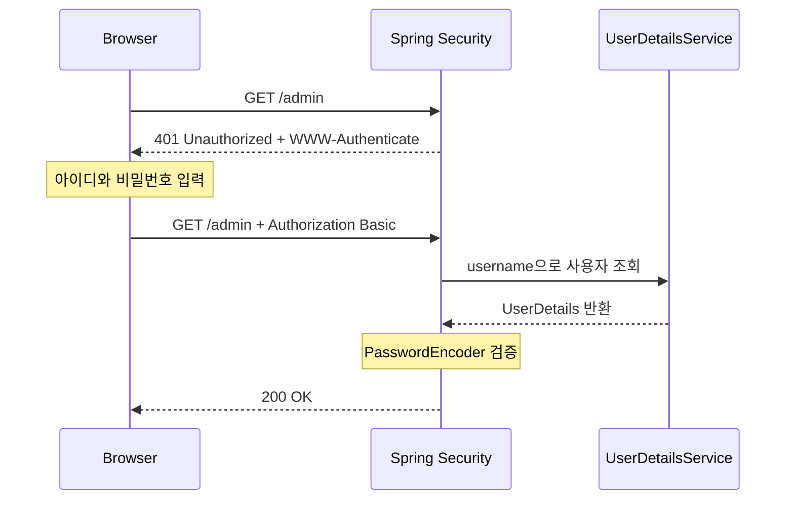
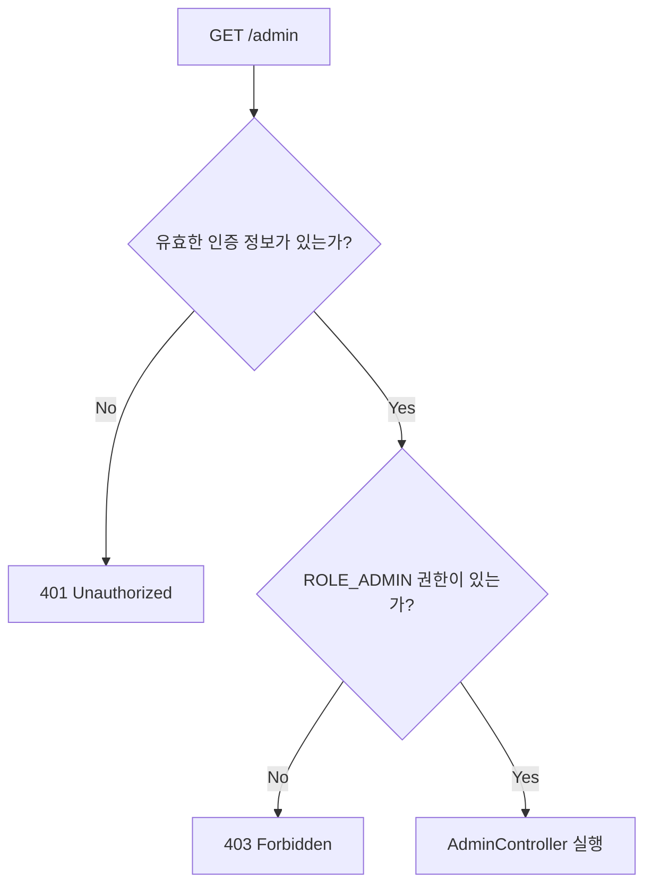
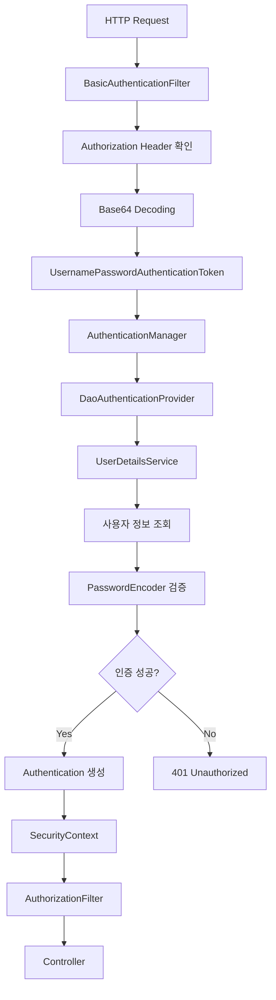
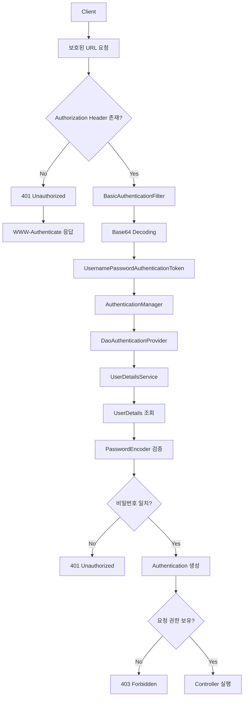

# 스프링 시큐리티 6 - 13. http basic 방식 로그인
[https://youtu.be/7gEqj2_pcto?si=XrXHHYI1YObiu45x](https://youtu.be/7gEqj2_pcto?si=XrXHHYI1YObiu45x)

# 스프링 시큐리티 6 - 13. http basic 방식 로그인
* toc
{:toc}

---

## Spring Security HTTP Basic 인증의 동작 원리와 Form Login 비교

Spring Security에서 사용자 인증을 구현할 때 가장 익숙한 방식은 Form Login이다.

로그인 페이지를 만들고 사용자가 아이디와 비밀번호를 입력하면 Spring Security가 이를 검증한 뒤 로그인 상태를 유지하는 방식이다.

지금까지 구현했던 로그인도 이러한 구조였다.

```text
사용자
   ↓
로그인 페이지
   ↓
아이디와 비밀번호 입력
   ↓
POST /loginProc
   ↓
Spring Security 인증
   ↓
HTTP Session을 통한 로그인 상태 유지
```

하지만 모든 서비스에서 로그인 페이지가 필요한 것은 아니다.

예를 들어 내부 API 서버나 간단한 관리 도구에서는 별도의 HTML 로그인 화면 없이 HTTP 요청에 인증 정보를 포함하는 방식이 더 적합할 수 있다.

Spring Security는 이를 위해 **HTTP Basic Authentication**을 지원한다.

HTTP Basic은 아이디와 비밀번호를 HTTP `Authorization` 헤더에 담아 전송하는 인증 방식이다.

```http
GET /admin HTTP/1.1
Host: localhost:8080
Authorization: Basic YWRtaW46MTIzNA==
```

여기서 `YWRtaW46MTIzNA==`는 다음 문자열을 Base64로 인코딩한 결과다.

```text
admin:1234
```

서버는 요청에 포함된 인증 정보를 추출하고, 저장된 사용자 정보와 비교하여 접근 여부를 결정한다.

Form Login과 달리 로그인 페이지나 별도의 로그인 처리 URL을 반드시 만들 필요가 없다는 것이 특징이다.

다만 HTTP Basic은 구조가 간단한 만큼 보안상 주의할 점도 많다.

특히 **Base64는 암호화가 아니기 때문에 HTTPS를 사용하지 않는 HTTP Basic 인증은 위험하다.**

이번에는 HTTP Basic이 어떤 구조로 동작하는지부터 Spring Security 설정 방법, 내부 인증 과정, Form Login과의 차이, 실제 서비스에서 사용할 때 고려해야 할 부분까지 살펴본다.

---

## HTTP Basic 인증이란?

HTTP Basic Authentication은 HTTP 프로토콜에서 정의한 기본적인 인증 방식이다.

사용자는 서버에 접근하기 위해 아이디와 비밀번호를 제공하고, 클라이언트는 이를 HTTP 요청의 `Authorization` 헤더에 포함한다.

HTTP Basic은 별도의 로그인 API를 호출하여 인증 토큰을 발급받는 구조가 아니다.

보호된 리소스에 접근할 때 요청 자체에 인증 정보를 포함한다.

예를 들어 다음과 같은 API가 있다고 가정하자.

```http
GET /admin
```

이 API는 관리자 권한을 가진 사용자만 접근할 수 있다.

인증 정보 없이 요청하면 서버는 인증이 필요하다는 응답을 반환한다.

```http
HTTP/1.1 401 Unauthorized
WWW-Authenticate: Basic realm="Restricted"
```

브라우저는 `WWW-Authenticate` 헤더를 확인하고 사용자에게 아이디와 비밀번호를 입력받는 인증 창을 표시할 수 있다.

사용자가 인증 정보를 입력하면 브라우저는 이를 Base64로 인코딩하여 다시 요청한다.

```http
GET /admin HTTP/1.1
Authorization: Basic YWRtaW46MTIzNA==
```

서버는 Authorization 헤더에서 사용자 정보를 가져와 인증을 진행한다.

이처럼 **서버가 인증을 요구하고 클라이언트가 Authorization 헤더로 응답하는 구조**가 HTTP Basic 인증의 핵심이다.

HTTP 표준에서는 이러한 과정을 Challenge-Response 방식으로 정의하고 있다.

---

## HTTP Basic 인증의 전체 동작 구조

HTTP Basic 인증이 이루어지는 과정을 먼저 살펴보자.



이 과정을 나누면 다음과 같다.

**인증 정보 없이 요청**

```text
Client
   ↓
GET /admin
   ↓
Spring Security
   ↓
인증 정보 없음
   ↓
401 Unauthorized
```

**서버가 인증을 요구**

```http
HTTP/1.1 401 Unauthorized
WWW-Authenticate: Basic realm="Restricted"
```

**클라이언트가 인증 정보를 포함해 재요청**

```http
GET /admin HTTP/1.1
Authorization: Basic ...
```

**Spring Security 인증**

```text
Authorization Header
        ↓
username/password 추출
        ↓
UserDetailsService
        ↓
사용자 조회
        ↓
PasswordEncoder
        ↓
Authentication 생성
```

이후 인증과 인가에 성공하면 요청한 Controller가 실행된다.

---

## HTTP Basic에서 Base64를 사용하는 이유

HTTP Basic 인증에서는 아이디와 비밀번호를 하나의 문자열로 결합한다.

형식은 다음과 같다.

```text
username:password
```

예를 들어:

```text
admin:1234
```

라는 문자열을 Base64로 변환한다.

```text
admin:1234
     ↓
Base64 Encoding
     ↓
YWRtaW46MTIzNA==
```

그리고 `Authorization` 헤더에 `Basic`이라는 인증 Scheme과 함께 전송한다.

```http
Authorization: Basic YWRtaW46MTIzNA==
```

HTTP Basic에서 Base64를 사용하는 이유는 아이디와 비밀번호를 HTTP 헤더로 전달할 수 있는 문자열 형태로 표현하기 위해서다.

중요한 점은 **Base64가 보안 알고리즘이 아니라 인코딩 방식이라는 것**이다.

---

## Base64는 암호화가 아니다

Base64는 누구나 쉽게 원래 문자열로 되돌릴 수 있다.

다음 문자열이 있다고 하자.

```text
YWRtaW46MTIzNA==
```

Base64 디코딩을 수행하면:

```text
admin:1234
```

가 나온다.

특별한 암호화 키도 필요하지 않다.

터미널에서 직접 확인할 수도 있다.

```bash
printf 'admin:1234' | base64
```

실행 결과:

```text
YWRtaW46MTIzNA==
```

반대로 디코딩하면:

```bash
printf 'YWRtaW46MTIzNA==' | base64 --decode
```

Linux에서 다음 결과를 확인할 수 있다.

```text
admin:1234
```

macOS에서는 다음과 같이 사용할 수 있다.

```bash
printf 'YWRtaW46MTIzNA==' | base64 -D
```

결과는 동일하다.

따라서 HTTP Basic의 인증 정보를 탈취당하면 원본 아이디와 비밀번호가 쉽게 노출될 수 있다.

이 때문에 HTTP Basic 인증을 사용할 때는 반드시 HTTPS를 적용해야 한다.

MDN 역시 Basic 인증의 Base64 인코딩이 암호학적 보안을 제공하지 않으므로 HTTPS를 사용해야 한다고 명시하고 있다.

---

## BCrypt와 Base64는 완전히 다르다

앞에서 회원가입 기능을 구현할 때 BCrypt를 사용했다.

```java
passwordEncoder.encode(rawPassword);
```

그런데 HTTP Basic에서도 Base64를 사용하므로 두 기술이 어떤 관계인지 헷갈릴 수 있다.

역할을 비교해보자.

| 구분              | Base64                | BCrypt           |
| --------------- | --------------------- | ---------------- |
| 목적              | 데이터를 문자열로 인코딩         | 비밀번호를 안전하게 저장    |
| 원문 복원           | 가능                    | 복호화 기능 없음        |
| 비밀 키            | 필요 없음                 | 필요 없음            |
| 주요 사용 위치        | HTTP Authorization 헤더 | 회원 정보 저장소        |
| 보안 목적           | 제공하지 않음               | 비밀번호 대입 공격 비용 증가 |
| Spring Security | HTTP Basic 인증 정보 표현   | PasswordEncoder  |

HTTP Basic 인증을 사용하더라도 서버에는 비밀번호를 BCrypt Hash로 저장할 수 있다.

즉 다음 두 과정이 동시에 존재한다.

```text
Client

username:password
        ↓
Base64 Encoding
        ↓
Authorization Header
        ↓
HTTPS
        ↓
Server
        ↓
Base64 Decoding
        ↓
입력한 원본 Password
        ↓
PasswordEncoder.matches()
        ↑
DB에 저장된 BCrypt Hash
```

클라이언트에서 Base64로 변환하는 것과 서버에서 BCrypt로 비밀번호를 검증하는 것은 서로 다른 작업이다.

---

## HTTP Basic과 Form Login의 차이

두 방식의 가장 큰 차이는 인증 정보를 전달하고 로그인 상태를 유지하는 방법에 있다.

### Form Login

Form Login에서는 별도의 로그인 페이지가 존재한다.

```html
<form action="/loginProc" method="post">

    <input
        type="text"
        name="username"
    >

    <input
        type="password"
        name="password"
    >

    <button type="submit">
        로그인
    </button>

</form>
```

사용자가 로그인 버튼을 누르면 다음 요청이 발생한다.

```http
POST /loginProc
```

Spring Security는 이를 검증하고 일반적인 세션 기반 구성에서는 인증 상태를 HTTP Session과 연결한다.

이후 브라우저는 Session Cookie를 사용하여 로그인 상태를 유지한다.

```text
최초 로그인

username/password
        ↓
Spring Security
        ↓
Authentication
        ↓
HTTP Session
```

이후 요청:

```http
GET /mypage
Cookie: JSESSIONID=...
```

### HTTP Basic

HTTP Basic에서는 별도의 로그인 Form이 필요하지 않다.

보호된 리소스에 접근할 때 HTTP 헤더에 인증 정보를 포함한다.

```http
GET /mypage
Authorization: Basic ...
```

그리고 일반적인 Stateless HTTP Basic 구성에서는 매 요청마다 전달된 인증 정보를 검증한다.

```text
GET /mypage
    ↓
Authorization Header
    ↓
사용자 인증
    ↓
Controller
```

다음 요청에서도 인증 정보가 포함된다.

```text
GET /orders
    ↓
Authorization Header
    ↓
사용자 인증
    ↓
Controller
```

Spring Security 공식 문서에서도 HTTP Basic을 매 요청마다 사용자를 다시 인증할 수 있는 Stateless 인증 메커니즘으로 설명하고 있다.

---

## Form Login과 HTTP Basic 비교

| 구분         | Form Login                           | HTTP Basic                |
| ---------- | ------------------------------------ | ------------------------- |
| 로그인 UI     | 별도 로그인 페이지                           | 브라우저 인증 창 또는 HTTP 클라이언트   |
| 인증 정보 전달   | Form POST                            | Authorization 헤더          |
| 대표적인 인증 처리 | UsernamePasswordAuthenticationFilter | BasicAuthenticationFilter |
| 로그인 상태 유지  | 일반적으로 HTTP Session                   | 일반적으로 요청별 인증              |
| Cookie     | 세션 기반이면 사용                           | 인증 자체에 필수 아님              |
| 비밀번호 전달    | 로그인 시 전송                             | 보호된 요청마다 전송 가능            |
| 로그아웃       | Spring Security 로그아웃 처리              | 클라이언트의 Credential 제거가 필요  |
| 대표적인 활용    | 일반적인 웹 서비스                           | 내부 API, 간단한 보호 리소스        |
| HTTPS      | 필수적으로 권장                             | 사실상 필수                    |

두 방식은 서로 경쟁하는 기술이라기보다 서로 다른 요구사항을 해결하는 인증 방식이다.

---

## Spring Security에서 HTTP Basic 활성화하기

이제 실제 Spring Security 설정을 살펴보자.

기존 Form Login 설정은 다음과 같았다.

```java
.formLogin(form -> form
        .loginPage("/login")
        .loginProcessingUrl("/loginProc")
        .permitAll()
)
```

HTTP Basic을 사용하려면 `httpBasic()`을 설정하면 된다.

```java
.httpBasic(Customizer.withDefaults())
```

여기에서 `Customizer.withDefaults()`는 Spring Security가 제공하는 기본 HTTP Basic 설정을 사용하겠다는 의미다.

다음과 같이 작성할 수 있다.

```java
@Bean
public SecurityFilterChain securityFilterChain(
        HttpSecurity http
) throws Exception {

    http
            .authorizeHttpRequests(auth -> auth
                    .anyRequest()
                    .authenticated()
            )

            .httpBasic(Customizer.withDefaults());

    return http.build();
}
```

이것만으로 기본적인 HTTP Basic 인증 구성이 가능하다.

Spring Security 공식 문서에서도 `httpBasic(withDefaults())`를 HTTP Basic을 명시적으로 활성화하는 기본 설정으로 안내한다.

---

## HTTP Basic 설정을 명시해야 하는 이유

Spring Boot에 Spring Security를 추가하고 아무 Security 설정도 작성하지 않으면 기본 인증 설정이 적용되는 경우가 있다.

이 환경에서는 기본 Form Login과 HTTP Basic이 제공될 수 있다.

하지만 개발자가 직접 `SecurityFilterChain`을 등록하면 기존의 자동 설정을 그대로 기대해서는 안 된다.

예를 들어:

```java
@Bean
public SecurityFilterChain securityFilterChain(
        HttpSecurity http
) throws Exception {

    http
            .authorizeHttpRequests(auth -> auth
                    .anyRequest()
                    .authenticated()
            );

    return http.build();
}
```

와 같이 구성했다면 HTTP Basic을 사용하려는 의도를 명확히 표현하는 것이 좋다.

```java
.httpBasic(Customizer.withDefaults())
```

Spring Security의 사용자 정의 Servlet 보안 구성에서는 HTTP Basic을 명시적으로 설정하도록 안내하고 있다.

---

## HTTP Basic 인증 예제 구성

이번 예제에서는 다음 환경을 사용한다고 가정한다.

```text
Spring Boot
Spring Security
BCryptPasswordEncoder
InMemoryUserDetailsManager
```

사용자 정보는 메모리에 저장한다.

앞에서 구현했던 MySQL 기반 `CustomUserDetailsService`를 사용해도 HTTP Basic 인증은 가능하다.

하지만 우선 인증 방식 자체를 이해하기 위해 별도의 데이터베이스 없이 구현해보자.

프로젝트 구조는 다음과 같다.

```text
src/main/java
└── com.example.security
    ├── config
    │   └── SecurityConfig.java
    │
    └── controller
        └── MainController.java
```

필요한 의존성은 다음과 같다.

```gradle
dependencies {
    implementation 'org.springframework.boot:spring-boot-starter-web'
    implementation 'org.springframework.boot:spring-boot-starter-security'
}
```

---

## SecurityConfig 전체 코드

다음과 같이 설정할 수 있다.

```java
package com.example.security.config;

import org.springframework.context.annotation.Bean;
import org.springframework.context.annotation.Configuration;
import org.springframework.security.config.Customizer;
import org.springframework.security.config.annotation.web.builders.HttpSecurity;
import org.springframework.security.config.annotation.web.configurers.AbstractHttpConfigurer;
import org.springframework.security.config.http.SessionCreationPolicy;
import org.springframework.security.core.userdetails.User;
import org.springframework.security.core.userdetails.UserDetails;
import org.springframework.security.core.userdetails.UserDetailsService;
import org.springframework.security.crypto.bcrypt.BCryptPasswordEncoder;
import org.springframework.security.crypto.password.PasswordEncoder;
import org.springframework.security.provisioning.InMemoryUserDetailsManager;
import org.springframework.security.web.SecurityFilterChain;

@Configuration
public class SecurityConfig {

    @Bean
    public SecurityFilterChain securityFilterChain(
            HttpSecurity http
    ) throws Exception {

        http
                .authorizeHttpRequests(auth -> auth
                        .requestMatchers("/")
                        .permitAll()

                        .requestMatchers(
                                "/admin",
                                "/admin/**"
                        )
                        .hasRole("ADMIN")

                        .anyRequest()
                        .authenticated()
                )

                .formLogin(AbstractHttpConfigurer::disable)

                .httpBasic(Customizer.withDefaults())

                .sessionManagement(session -> session
                        .sessionCreationPolicy(
                                SessionCreationPolicy.STATELESS
                        )
                );

        return http.build();
    }

    @Bean
    public PasswordEncoder passwordEncoder() {

        return new BCryptPasswordEncoder();
    }

    @Bean
    public UserDetailsService userDetailsService(
            PasswordEncoder passwordEncoder
    ) {

        UserDetails user = User
                .withUsername("user1")
                .password(
                        passwordEncoder.encode("user12345!")
                )
                .roles("USER")
                .build();

        UserDetails admin = User
                .withUsername("admin1")
                .password(
                        passwordEncoder.encode("admin12345!")
                )
                .roles("ADMIN")
                .build();

        return new InMemoryUserDetailsManager(
                user,
                admin
        );
    }
}
```

이 코드에서 사용자 계정과 비밀번호는 로컬에서 인증 흐름을 확인하기 위한 예제 값이다. 운영 환경에서는 비밀번호를 소스 코드에 직접 포함하지 않아야 한다.

또한 여기에서는 HTTP Basic을 요청별 인증 방식으로 사용하기 위해 `STATELESS` 정책을 명시했다.

HTTP Basic을 사용한다고 해서 반드시 이 설정을 추가해야 하는 것은 아니다.

인증 방식을 HTTP Basic으로 선택하는 것과 애플리케이션의 Session 생성 정책을 결정하는 것은 구분할 필요가 있다.

---

## SecurityConfig의 주요 설정

먼저 URL별 인가 설정이다.

```java
.authorizeHttpRequests(auth -> auth
        .requestMatchers("/")
        .permitAll()

        .requestMatchers(
                "/admin",
                "/admin/**"
        )
        .hasRole("ADMIN")

        .anyRequest()
        .authenticated()
)
```

루트 경로는 누구나 접근할 수 있다.

```text
GET /
→ permitAll
```

관리자 경로는 `ROLE_ADMIN`이 필요하다.

```text
GET /admin
→ ROLE_ADMIN 필요
```

나머지는 인증된 사용자만 접근할 수 있다.

```text
GET /mypage
→ authenticated
```

다음은 Form Login 비활성화다.

```java
.formLogin(AbstractHttpConfigurer::disable)
```

현재 예제에서는 HTML 기반 로그인 페이지를 사용하지 않을 것이므로 Form Login을 비활성화한다.

다음이 HTTP Basic 활성화다.

```java
.httpBasic(Customizer.withDefaults())
```

그리고 Session 정책을 Stateless로 설정했다.

```java
.sessionManagement(session -> session
        .sessionCreationPolicy(
                SessionCreationPolicy.STATELESS
        )
)
```

이 설정은 Spring Security가 인증 상태를 HTTP Session에 저장하고 재사용하지 않도록 구성한다.

따라서 현재 예제에서는 각 요청에 포함된 Authorization 헤더가 인증의 기준이 된다.

참고로 `STATELESS`는 모든 Servlet API의 Session 생성 가능성을 전역적으로 없애는 설정은 아니다. Spring Security의 인증 상태 저장 정책을 제어하는 설정으로 이해하는 것이 정확하다.

---

## HTTP Basic 인증을 확인할 Controller 만들기

인증 동작을 확인하기 위해 간단한 Controller를 작성한다.

```java
package com.example.security.controller;

import org.springframework.security.core.Authentication;
import org.springframework.web.bind.annotation.GetMapping;
import org.springframework.web.bind.annotation.RestController;

@RestController
public class MainController {

    @GetMapping("/")
    public String main() {

        return "Main Page";
    }

    @GetMapping("/user")
    public String user(
            Authentication authentication
    ) {

        return authentication.getName()
                + "님 환영합니다.";
    }

    @GetMapping("/admin")
    public String admin(
            Authentication authentication
    ) {

        return authentication.getName()
                + " 관리자 페이지입니다.";
    }
}
```

현재 `/user`는 인증된 사용자라면 접근할 수 있다.

```java
.anyRequest().authenticated()
```

반면 `/admin`은 관리자 권한이 필요하다.

```java
.hasRole("ADMIN")
```

따라서 같은 HTTP Basic 인증을 사용하더라도 사용자의 Role에 따라 접근 결과가 달라진다.

---

## 브라우저에서 HTTP Basic 인증 확인하기

애플리케이션을 실행한다.

```bash
./gradlew bootRun
```

먼저 브라우저에서 다음 주소로 접근한다.

```text
http://localhost:8080/
```

루트 경로는 `permitAll()`로 설정했으므로 정상적으로 접근할 수 있다.

```text
Main Page
```

이번에는 관리자 페이지에 접근한다.

```text
http://localhost:8080/admin
```

인증 정보가 없는 상태라면 Spring Security는 인증이 필요하다고 판단한다.

```http
HTTP/1.1 401 Unauthorized
WWW-Authenticate: Basic realm="Realm"
```

브라우저는 이 응답을 확인하고 아이디와 비밀번호를 입력하는 인증 창을 표시할 수 있다.

다음 관리자 계정을 입력한다.

```text
username = admin1
password = admin12345!
```

인증에 성공하면 관리자 페이지로 접근한다.

```text
admin1 관리자 페이지입니다.
```

반대로 일반 사용자 계정으로 인증하면 어떻게 될까?

```text
username = user1
password = user12345!
```

사용자 인증은 성공한다.

하지만 해당 사용자는 `ROLE_USER`만 가지고 있다.

따라서 `/admin`에 접근할 권한이 없다.

결과적으로 다음 응답을 받게 된다.

```http
HTTP/1.1 403 Forbidden
```

인증에는 성공했지만 인가에 실패한 것이다.

---

## 401 Unauthorized와 403 Forbidden의 차이

HTTP Basic을 사용할 때 가장 많이 접하는 상태 코드가 401과 403이다.

두 상태 코드는 의미가 다르다.

| 상태 코드            | 의미                   | 예시                 |
| ---------------- | -------------------- | ------------------ |
| 401 Unauthorized | 유효한 인증 정보가 없거나 인증 실패 | 비밀번호가 틀림           |
| 403 Forbidden    | 요청을 수행할 권한이 없음       | 일반 사용자가 관리자 API 접근 |

예를 들어 인증 정보 없이 관리자 API에 접근한다.

```http
GET /admin
```

Spring Security는 인증이 필요하다고 판단한다.

```http
HTTP/1.1 401 Unauthorized
WWW-Authenticate: Basic realm="Realm"
```

반면 `ROLE_USER`를 가진 사용자가 인증에 성공한 뒤 관리자 API에 접근하면:

```text
Authentication
→ 성공

Authorization
→ 실패
```

이므로 일반적인 설정에서는 다음 결과가 나온다.

```http
HTTP/1.1 403 Forbidden
```

이를 흐름으로 나타내면 다음과 같다.



이 차이는 HTTP Basic뿐 아니라 다른 Spring Security 인증 방식에서도 중요하다.

---

## curl로 HTTP Basic 인증 확인하기

HTTP Basic은 브라우저보다 HTTP Client를 이용하면 동작을 더 명확하게 확인할 수 있다.

먼저 인증 정보 없이 요청한다.

```bash
curl -i http://localhost:8080/admin
```

일반적으로 다음과 같은 응답을 확인할 수 있다.

```http
HTTP/1.1 401 Unauthorized
WWW-Authenticate: Basic realm="Realm"
```

이제 관리자 계정으로 요청한다.

```bash
curl -i -u admin1 http://localhost:8080/admin
```

`-u` 옵션은 HTTP Basic 인증에 사용할 사용자 정보를 지정한다.

위 명령은 비밀번호를 명령줄에 직접 포함하지 않았으므로 curl이 비밀번호 입력을 요청한다.

```text
Enter host password for user 'admin1':
```

비밀번호를 입력한다.

```text
admin12345!
```

인증과 인가가 모두 성공하면 다음과 같은 응답을 확인할 수 있다.

```http
HTTP/1.1 200 OK
Content-Type: text/plain;charset=UTF-8

admin1 관리자 페이지입니다.
```

이번에는 일반 사용자 계정으로 요청한다.

```bash
curl -i -u user1 http://localhost:8080/admin
```

비밀번호를 올바르게 입력하더라도 관리자 권한이 없으므로 다음과 같이 응답할 수 있다.

```http
HTTP/1.1 403 Forbidden
```

여기서 `-u` 옵션으로 비밀번호를 명령줄에 직접 입력하는 방식은 Shell History나 프로세스 정보 등에 Credential이 노출될 위험이 있으므로 주의해야 한다.

또한 `localhost`를 벗어난 실제 서비스에서는 HTTPS를 사용해야 한다.

---

## WWW-Authenticate 헤더는 무슨 역할을 할까?

HTTP Basic 인증을 이해하려면 두 HTTP 헤더를 구분해야 한다.

첫 번째는 서버가 클라이언트에게 인증을 요구할 때 사용하는 헤더다.

```http
WWW-Authenticate: Basic realm="Restricted"
```

두 번째는 클라이언트가 서버에 인증 정보를 전달할 때 사용하는 헤더다.

```http
Authorization: Basic ...
```

역할을 정리하면 다음과 같다.

| 헤더               | 방향              | 역할              |
| ---------------- | --------------- | --------------- |
| WWW-Authenticate | Server → Client | 인증 방식과 보호 영역 안내 |
| Authorization    | Client → Server | 인증 정보 전달        |

HTTP Basic 인증에서는 서버가 인증이 필요하다는 응답을 보내고 클라이언트가 이에 맞는 인증 정보를 전달한다.

```text
Client

GET /admin
        ↓
Server

401 Unauthorized
WWW-Authenticate: Basic
        ↓
Client

Authorization: Basic ...
        ↓
Server

인증 진행
```

여기에서 `realm`은 인증이 적용되는 보호 영역을 식별하기 위한 값이다.

예를 들어:

```http
WWW-Authenticate: Basic realm="Admin Area"
```

처럼 지정할 수 있다.

일부 브라우저는 이 정보를 인증 창에 표시하거나 Credential 적용 범위를 판단하는 데 활용한다.

---

## Spring Security 내부에서는 어떤 Filter가 동작할까?

Form Login에서는 다음 Filter가 핵심 역할을 했다.

```java
UsernamePasswordAuthenticationFilter
```

HTTP Basic에서는 다음 Filter가 사용된다.

```java
BasicAuthenticationFilter
```

HTTP Basic 요청이 들어오면 `BasicAuthenticationFilter`가 Authorization 헤더를 확인한다.

```http
Authorization: Basic ...
```

그리고 헤더에 포함된 Base64 값을 디코딩하여 username과 password를 추출한다.

그 결과를 바탕으로 인증 요청 객체를 생성한다.

```java
UsernamePasswordAuthenticationToken
```

이 객체를 `AuthenticationManager`에 전달한다.

Spring Security 공식 문서에서도 `BasicAuthenticationFilter`가 username/password를 추출하여 `UsernamePasswordAuthenticationToken`을 생성하고 AuthenticationManager에 전달하는 흐름을 설명한다.

---

## HTTP Basic의 내부 인증 과정

전체 흐름을 정리하면 다음과 같다.



앞에서 구현한 DB 기반 로그인과 비교하면 많은 부분이 동일하다.

차이가 있다면 인증 요청을 처음 받아들이는 Filter다.

```text
Form Login

UsernamePasswordAuthenticationFilter
```

```text
HTTP Basic

BasicAuthenticationFilter
```

그 이후에는 동일한 `AuthenticationManager`와 `AuthenticationProvider` 구조를 활용할 수 있다.

---

## DB 기반 로그인에서도 HTTP Basic을 사용할 수 있을까?

가능하다.

앞에서 구현했던 MySQL 기반 인증은 다음 구조였다.

```text
CustomUserDetailsService
        ↓
UserRepository
        ↓
MySQL
```

HTTP Basic은 사용자 정보를 저장하는 방식이 아니라 클라이언트가 인증 정보를 전달하는 방식이다.

따라서 사용자 정보가 메모리에 있든 데이터베이스에 있든 HTTP Basic 인증을 사용할 수 있다.

예를 들어 다음 클래스가 있다고 가정하자.

```java
@Service
@RequiredArgsConstructor
public class CustomUserDetailsService
        implements UserDetailsService {

    private final UserRepository userRepository;

    @Override
    public UserDetails loadUserByUsername(
            String username
    ) throws UsernameNotFoundException {

        UserEntity user =
                userRepository
                        .findByUsername(username)
                        .orElseThrow(
                                () -> new UsernameNotFoundException(
                                        "사용자를 찾을 수 없습니다."
                                )
                        );

        return new CustomUserDetails(user);
    }
}
```

이 경우에도 SecurityFilterChain에서 다음 설정을 사용하면 된다.

```java
.httpBasic(Customizer.withDefaults())
```

이후 인증 흐름은 다음과 같다.

```text
HTTP Basic
    ↓
BasicAuthenticationFilter
    ↓
AuthenticationManager
    ↓
DaoAuthenticationProvider
    ↓
CustomUserDetailsService
    ↓
UserRepository
    ↓
MySQL
    ↓
BCrypt Password 검증
```

즉 **Form Login과 HTTP Basic은 사용자 정보를 조회하는 저장소와 독립적으로 구성할 수 있다.**

앞에서 구현한 `CustomUserDetailsService`가 이미 있다면 새로운 `InMemoryUserDetailsManager`를 추가할 필요도 없다.

---

## HTTP Basic과 Session의 관계

HTTP Basic은 일반적으로 Stateless 인증 방식으로 사용된다.

Stateless는 서버가 사용자별 로그인 상태를 유지하지 않고 각 요청에 포함된 인증 정보를 기반으로 요청을 처리하는 구조를 의미한다.

Form Login 기반의 세션 인증은 다음과 같다.

```text
최초 로그인
    ↓
Authentication
    ↓
HTTP Session
    ↓
이후 Session Cookie로 사용자 확인
```

반면 HTTP Basic을 Stateless로 구성하면 다음과 같다.

```text
Request 1

Authorization: Basic ...
    ↓
Authentication
    ↓
Request 처리
```

다음 요청에서도:

```text
Request 2

Authorization: Basic ...
    ↓
Authentication
    ↓
Request 처리
```

가 반복된다.

이때 중요한 점은 HTTP Basic이 반드시 HTTP Session을 전혀 사용할 수 없는 인증 방식이라는 뜻은 아니라는 것이다.

Spring Security는 필요하다면 HTTP Basic으로 인증한 결과를 Session에 저장하도록 구성할 수도 있다.

하지만 일반적인 사용 목적에서는 매 요청마다 인증 정보를 제공하는 Stateless 형태가 자연스럽다.

---

## HTTP Basic은 왜 별도의 로그아웃이 어려울까?

Form Login에서는 다음 요청을 통해 로그아웃을 처리할 수 있었다.

```http
POST /logout
```

Spring Security는 Session을 무효화하고 SecurityContext를 정리하는 등의 작업을 수행한다.

그런데 HTTP Basic은 상황이 다르다.

Stateless HTTP Basic에서는 클라이언트가 매 요청마다 인증 정보를 보낸다.

```http
Authorization: Basic ...
```

서버에서 현재 요청의 인증 상태를 제거하더라도 클라이언트가 다음 요청에서 같은 Authorization 헤더를 보내면 다시 인증할 수 있다.

```text
서버에서 인증 정보 정리
        ↓
Client가 다음 요청 전송
        ↓
Authorization: Basic ...
        ↓
다시 인증 성공
```

따라서 HTTP Basic에는 세션 기반 로그인처럼 일관되게 동작하는 표준 로그아웃 흐름이 없다.

브라우저가 Basic Credential을 기억하고 있다면 서버에서 로그아웃 API를 호출하더라도 브라우저가 다음 요청에서 인증 정보를 다시 보내는 상황이 발생할 수 있다.

이것도 일반 사용자용 웹 서비스에서 Form Login이나 다른 인증 방식을 선호하는 이유 중 하나다.

---

## HTTP Basic의 보안상 주의할 점

HTTP Basic은 구현이 간단하지만 실제로 사용할 때 몇 가지 보안 사항을 반드시 고려해야 한다.

### HTTPS를 사용해야 한다

HTTP Basic은 Authorization 헤더에 Base64로 인코딩된 아이디와 비밀번호를 포함한다.

Base64는 암호화가 아니므로 평문 HTTP로 통신하면 인증 정보가 노출될 위험이 있다.

```text
HTTP Basic
        +
HTTP
        ↓
인증 정보 노출 위험
```

반면 HTTPS에서는 TLS가 HTTP 요청을 암호화하여 전송한다.

```text
HTTP Basic
        +
HTTPS
        ↓
TLS로 전송 구간 보호
```

따라서 실제 서비스에서는 HTTPS 사용을 기본 전제로 두어야 한다.

### 비밀번호가 반복해서 전송된다

일반적인 Stateless HTTP Basic에서는 보호된 요청마다 아이디와 비밀번호가 포함될 수 있다.

```text
GET /users
→ Authorization Basic
```

```text
GET /orders
→ Authorization Basic
```

```text
GET /products
→ Authorization Basic
```

따라서 인증 정보를 취급하는 구간이 많아진다.

Application Log, Reverse Proxy, API Gateway, APM 등에서 Authorization 헤더가 그대로 기록되지 않도록 관리해야 한다.

### Credential Rotation을 고려해야 한다

HTTP Basic은 보통 고정된 계정과 비밀번호를 사용한다.

비밀번호가 노출되었거나 계정이 변경되어야 한다면 Credential을 교체해야 한다.

특히 여러 내부 서비스가 동일한 계정을 공유한다면 계정 교체 시 영향을 받는 서비스가 많아진다.

서비스별로 독립적인 Credential을 사용하고 Secret 관리 시스템과 연결하는 방식을 고려할 수 있다.

---

## HTTP Basic에서 CSRF를 비활성화해도 될까?

앞에서 CSRF를 살펴보면서 세션과 Cookie를 사용하는 인증 구조에서는 CSRF 공격을 고려해야 한다고 정리했다.

그렇다면 HTTP Basic은 어떨까?

HTTP Basic은 일반적으로 Stateless 인증이므로 CSRF를 무조건 비활성화해도 된다고 생각하기 쉽다.

하지만 이 부분은 주의해야 한다.

**HTTP Basic을 사용하는 브라우저도 인증 정보를 자동으로 재전송할 수 있기 때문이다.**

예를 들어 브라우저가 HTTP Basic Credential을 기억하고 있는 상태라면 다른 사이트에서 시작된 요청에 인증 정보가 포함될 수 있다.

따라서 HTTP Basic을 사용하는 웹 애플리케이션도 CSRF 공격의 영향을 받을 수 있다.

MDN에서도 HTTP Basic 인증을 사용하는 사이트는 브라우저가 인증 정보를 반복 전송한다는 특성 때문에 CSRF 공격에 취약할 수 있다고 설명한다.

따라서 다음처럼 판단해야 한다.

| 환경                                      | CSRF 고려                          |
| --------------------------------------- | -------------------------------- |
| 브라우저 기반 HTTP Basic 인증                   | 필요                               |
| Form Login + Session Cookie             | 필요                               |
| 서버 간 HTTP Basic 인증                      | 브라우저 자동 Credential 전송과 위험 모델이 다름 |
| 명시적으로 Authorization 헤더를 구성하는 API Client | 클라이언트의 인증 정보 전송 구조에 따라 판단        |

특히 HTTP Basic으로 데이터를 변경하는 웹 애플리케이션을 구성한다면 CSRF를 단순히 비활성화해서는 안 된다.

이번 전체 예제에서도 CSRF 보호를 별도로 비활성화하지 않았다.

따라서 GET 요청은 정상적으로 인증할 수 있지만 POST, PUT, DELETE 등의 상태 변경 요청에서는 기본 CSRF 보호가 적용될 수 있다.

---

## API 전용 서버라면 CSRF를 비활성화할 수 있을까?

서버 간 통신처럼 브라우저가 인증 정보를 자동으로 첨부하지 않는 구조에서는 CSRF 보호가 필요하지 않을 수 있다.

예를 들어 내부 Batch 서버가 다음과 같이 직접 Authorization 헤더를 구성한다고 가정하자.

```text
Batch Server
    ↓
Authorization: Basic ...
    ↓
Internal API Server
```

이 구조는 브라우저에서 세션 Cookie나 Basic Credential을 자동 전송하는 구조와 다르다.

따라서 서비스의 인증 경로가 이런 API Client로 제한되어 있고 브라우저 기반 인증이 존재하지 않는다면 CSRF 보호를 비활성화하는 선택을 고려할 수 있다.

```java
http
        .csrf(AbstractHttpConfigurer::disable);
```

하지만 이 코드는 모든 애플리케이션에 적용하는 기본 설정이 아니다.

**HTTP Basic을 사용하므로 CSRF가 필요 없다는 것이 아니라, 해당 API의 클라이언트와 인증 정보 전송 방식을 검토한 결과 CSRF 보호가 필요하지 않은 경우에 한해 비활성화하는 것**이다.

---

## HTTP Basic은 어떤 상황에서 사용할까?

HTTP Basic은 간단한 구조가 장점이다.

사용자에게 별도의 로그인 페이지를 제공하지 않아도 되고 HTTP 표준 헤더만으로 인증을 수행할 수 있다.

그래서 다음과 같은 환경에서 고려할 수 있다.

### 내부 운영 도구

일반 사용자에게 공개하지 않는 단순한 내부 도구를 보호할 때 사용할 수 있다.

다만 관리자 기능이 포함된다면 HTTPS뿐 아니라 네트워크 접근 제한, 강한 인증 정책, 감사 로그 등을 함께 고려해야 한다.

### 개발 및 테스트 환경

특정 API에 간단한 인증을 적용하고 동작을 확인할 때 유용하다.

예를 들어:

```bash
curl -u admin1 https://internal.example.com/admin
```

처럼 별도의 로그인 UI 없이 인증을 수행할 수 있다.

### 내부 서비스 통신

Spring Cloud 환경에서 Config Server나 Eureka Server 같은 내부 인프라 서비스에 접근 제어를 적용하는 사례에서도 HTTP Basic을 볼 수 있다.

예를 들어:

```text
Application A
    ↓
HTTP Basic
    ↓
Config Server
```

또는:

```text
Service
    ↓
HTTP Basic
    ↓
Eureka Server
```

처럼 구성할 수 있다.

다만 내부 네트워크라는 이유만으로 안전하다고 판단해서는 안 된다.

운영 환경에서는 TLS, mTLS, OAuth2 Client Credentials, Workload Identity 같은 인증 방식을 함께 비교하는 것이 좋다.

서비스 간 통신 규모가 커질수록 고정 아이디와 비밀번호를 공유하는 HTTP Basic 방식은 Credential 관리 부담이 증가할 수 있기 때문이다.

---

## Form Login과 HTTP Basic을 함께 사용할 수 있을까?

가능하다.

예를 들어 하나의 Spring Boot 애플리케이션에 다음 두 종류의 요청이 있다고 생각해보자.

```text
/admin/**
→ 관리자 웹 화면
```

```text
/internal/**
→ 내부 서비스 전용 API
```

관리자 화면은 Form Login을 사용하고 내부 API는 HTTP Basic을 사용하도록 분리할 수 있다.

이럴 때는 여러 개의 `SecurityFilterChain`을 사용하는 방법을 고려할 수 있다.

예를 들어 구조는 다음과 같다.

```text
HTTP Request
    ↓
FilterChainProxy
    ↓
요청 URL 확인
    ├── /internal/**
    │       ↓
    │   HTTP Basic
    │
    └── 그 외
            ↓
        Form Login
```

단순히 하나의 SecurityFilterChain에 두 인증 방식을 모두 활성화하는 것도 가능하지만, 경로별로 서로 다른 인증 정책이 필요하다면 SecurityFilterChain을 분리하는 편이 더 명확할 수 있다.

---

## 여러 SecurityFilterChain을 사용하는 예제

내부 API는 HTTP Basic을 사용하고 나머지 웹 화면은 Form Login을 사용한다고 가정해보자.

다음은 인증 방식과 URL 매칭을 분리한 예제다.

```java
package com.example.security.config;

import org.springframework.context.annotation.Bean;
import org.springframework.context.annotation.Configuration;
import org.springframework.core.annotation.Order;
import org.springframework.security.config.Customizer;
import org.springframework.security.config.annotation.web.builders.HttpSecurity;
import org.springframework.security.config.annotation.web.configurers.AbstractHttpConfigurer;
import org.springframework.security.config.http.SessionCreationPolicy;
import org.springframework.security.web.SecurityFilterChain;

@Configuration
public class SecurityConfig {

    @Bean
    @Order(1)
    public SecurityFilterChain internalSecurityFilterChain(
            HttpSecurity http
    ) throws Exception {

        http
                .securityMatcher("/internal/**")

                .authorizeHttpRequests(auth -> auth
                        .anyRequest()
                        .hasRole("ADMIN")
                )

                .httpBasic(Customizer.withDefaults())

                .formLogin(AbstractHttpConfigurer::disable)

                .sessionManagement(session -> session
                        .sessionCreationPolicy(
                                SessionCreationPolicy.STATELESS
                        )
                );

        return http.build();
    }

    @Bean
    @Order(2)
    public SecurityFilterChain webSecurityFilterChain(
            HttpSecurity http
    ) throws Exception {

        http
                .authorizeHttpRequests(auth -> auth
                        .requestMatchers(
                                "/",
                                "/login"
                        )
                        .permitAll()

                        .anyRequest()
                        .authenticated()
                )

                .formLogin(form -> form
                        .loginPage("/login")
                        .loginProcessingUrl("/loginProc")
                        .permitAll()
                )

                .httpBasic(AbstractHttpConfigurer::disable);

        return http.build();
    }
}
```

이제 다음과 같이 동작한다.

```text
GET /internal/config
    ↓
첫 번째 SecurityFilterChain
    ↓
HTTP Basic 인증
```

반면:

```text
GET /mypage
    ↓
두 번째 SecurityFilterChain
    ↓
Form Login 인증
```

여기에서 `@Order`는 SecurityFilterChain의 우선순위를 결정한다.

```java
@Order(1)
```

이 먼저 검사된다.

요청이 첫 번째 FilterChain의 `securityMatcher()` 조건에 맞지 않으면 다음 FilterChain을 확인한다.

참고로 이 예제는 인증 방식 분리를 보여주기 위한 구성이다. 내부 API에 상태 변경 요청이 존재한다면 앞에서 살펴본 것처럼 CSRF 정책을 별도로 결정해야 한다.

또한 두 FilterChain이 동일한 사용자 저장소를 사용할 수도 있고, 인증 요구사항에 따라 서로 다른 AuthenticationProvider를 사용할 수도 있다.

---

## HTTP Basic을 사용할 때 실무에서 고려할 점

HTTP Basic은 설정 한 줄로 활성화할 수 있지만 실제 운영에서는 인증 방식의 선택 자체보다 주변 보안 정책이 더 중요할 수 있다.

### HTTPS는 기본 전제다

HTTP Basic Credential은 Base64 인코딩된 문자열이므로 TLS가 없는 통신 구간에서는 인증 정보 노출 위험이 크다.

내부망이라고 해서 HTTP 통신을 허용하는 것보다는 HTTPS를 적용하는 것이 좋다.

### Authorization 헤더가 로그에 남지 않도록 한다

Basic 인증에서는 Authorization 헤더에 원본 비밀번호를 복원할 수 있는 정보가 포함된다.

따라서 API Gateway, Reverse Proxy, 애플리케이션 로그 등에 Authorization 헤더를 그대로 출력하지 않아야 한다.

### 계정과 비밀번호를 여러 서비스가 공유하지 않는다

여러 서비스가 동일한 Basic Credential을 사용하면 하나의 Credential이 노출되었을 때 여러 서비스가 영향을 받을 수 있다.

서비스마다 독립적인 계정과 접근 권한을 부여하는 것을 고려해야 한다.

### 비밀번호 저장에는 BCrypt 같은 PasswordEncoder를 사용한다

HTTP Basic에서 Base64를 사용하는 것은 클라이언트가 Credential을 전달하는 과정이다.

서버에 저장되는 비밀번호는 별도의 Password Hashing Algorithm으로 보호해야 한다.

```text
전송
→ Base64 + HTTPS

저장
→ BCrypt Hash
```

두 보안 계층을 구분해야 한다.

### 사용자 권한을 별도로 검증한다

HTTP Basic 인증이 성공했다고 모든 API에 접근할 수 있는 것은 아니다.

Spring Security의 `hasRole()`이나 `hasAuthority()` 등을 통해 인가를 처리해야 한다.

### 로그아웃 요구사항을 확인한다

브라우저 기반 HTTP Basic은 Credential 캐싱과 재전송 때문에 일반적인 세션 로그아웃처럼 동작하지 않는다.

명확한 로그아웃 UX가 필요한 서비스라면 다른 인증 방식이 더 적절할 수 있다.

### 브라우저에서 사용할 경우 CSRF 위험을 검토한다

Stateless 인증이라는 이유만으로 CSRF 공격에서 안전한 것은 아니다.

브라우저가 인증 정보를 자동으로 재전송하는 상황을 고려해야 한다.

### 요청마다 인증 검증 비용이 발생할 수 있다

일반적인 Stateless HTTP Basic에서는 매 요청마다 비밀번호를 검증한다.

특히 BCrypt처럼 의도적으로 계산 비용이 높은 PasswordEncoder를 사용한다면 요청량에 따라 인증 처리 비용이 커질 수 있다.

따라서 높은 처리량이 필요한 API에서는 세션이나 단기 인증 토큰 등 다른 인증 구조와 비교해야 한다.

### 비밀번호 교체 정책을 설계한다

Credential이 노출되거나 내부 서비스 계정이 변경될 때 비밀번호를 안전하게 교체할 수 있어야 한다.

고정 비밀번호를 소스 코드에 포함하는 방식은 운영 환경에서 피해야 한다.

### 내부망 접근 제어를 함께 적용한다

HTTP Basic만으로 내부 서비스 보안을 완성할 수는 없다.

Network Policy, Firewall, Private Endpoint, TLS 등 여러 계층을 결합하는 것이 좋다.

### 고정 계정보다 더 적합한 인증 방식이 있는지 검토한다

서비스 간 인증에서는 OAuth2 Client Credentials나 mTLS처럼 서비스의 신원을 확인하는 데 더 적합한 방식이 있을 수 있다.

HTTP Basic은 간단하다는 장점이 있지만 장기적으로 모든 내부 서비스 통신의 기본 인증 방식으로 사용하는 것이 항상 좋은 선택은 아니다.

---

## 전체 구조 정리

지금까지 구현한 HTTP Basic 인증의 흐름을 최종적으로 정리해보자.



Spring Security의 Form Login과 비교하면 다음과 같이 정리할 수 있다.

```text
Form Login

Login Form
    ↓
UsernamePasswordAuthenticationFilter
    ↓
AuthenticationManager
    ↓
AuthenticationProvider
    ↓
UserDetailsService
    ↓
PasswordEncoder
    ↓
Authentication
```

HTTP Basic은 다음과 같다.

```text
HTTP Basic

Authorization Header
    ↓
BasicAuthenticationFilter
    ↓
AuthenticationManager
    ↓
AuthenticationProvider
    ↓
UserDetailsService
    ↓
PasswordEncoder
    ↓
Authentication
```

두 방식의 핵심 차이는 사용자의 Credential을 전달받는 방법이다.

그 이후 Spring Security 내부에서 사용하는 사용자 조회와 비밀번호 검증 구조는 상당 부분 공유할 수 있다.

---

## 정리

Spring Security에서 HTTP Basic Authentication은 별도의 로그인 페이지 없이 HTTP Authorization 헤더를 이용해 사용자를 인증하는 방식이다.

클라이언트는 다음 형식으로 아이디와 비밀번호를 결합한다.

```text
username:password
```

이를 Base64로 인코딩한다.

```text
admin:1234
    ↓
YWRtaW46MTIzNA==
```

그리고 HTTP 헤더에 포함한다.

```http
Authorization: Basic YWRtaW46MTIzNA==
```

Spring Security는 `BasicAuthenticationFilter`를 통해 해당 인증 정보를 처리한다.

```text
Authorization Header
        ↓
BasicAuthenticationFilter
        ↓
AuthenticationManager
        ↓
DaoAuthenticationProvider
        ↓
UserDetailsService
        ↓
PasswordEncoder
        ↓
Authentication
```

HTTP Basic 활성화는 다음 설정을 사용한다.

```java
.httpBasic(Customizer.withDefaults())
```

인증 정보가 없거나 유효하지 않다면 일반적으로 다음 응답을 반환한다.

```http
HTTP/1.1 401 Unauthorized
WWW-Authenticate: Basic realm="Realm"
```

인증은 성공했지만 접근 권한이 없다면 일반적으로 다음 결과가 발생한다.

```http
HTTP/1.1 403 Forbidden
```

Form Login과 비교했을 때 HTTP Basic의 가장 큰 특징은 다음과 같다.

| Form Login               | HTTP Basic                |
| ------------------------ | ------------------------- |
| HTML 로그인 Form            | HTTP Authorization 헤더     |
| 로그인 처리 URL               | 보호된 리소스 요청에서 인증           |
| 일반적으로 Session 기반         | 일반적으로 Stateless           |
| Session Cookie로 인증 상태 유지 | 요청마다 Credential 전달        |
| 로그인·로그아웃 UI 구현 가능        | 브라우저 Credential 관리의 제약 존재 |

그리고 HTTP Basic에서 반드시 기억해야 할 것이 있다.

**Base64는 암호화가 아니다.**

따라서 HTTP Basic을 사용할 때 HTTPS를 적용해야 하며, 서버에 저장하는 비밀번호 역시 BCrypt 같은 Password Hashing Algorithm으로 보호해야 한다.

또한 HTTP Basic이 Stateless로 사용된다고 해서 CSRF 위험이 무조건 사라지는 것은 아니다.

브라우저가 인증 정보를 자동으로 재전송하는 경우에는 CSRF 공격을 고려해야 한다.

결국 HTTP Basic은 별도의 로그인 페이지 없이 빠르게 인증 환경을 만들 수 있다는 장점이 있지만, Credential 관리와 로그아웃, 인증 비용, CSRF, 서비스 간 인증 정책까지 고려해 적용해야 한다.

### 한 줄 요약

Spring Security의 HTTP Basic 인증은 `Authorization: Basic <Base64(username:password)>` 헤더로 전달된 인증 정보를 `BasicAuthenticationFilter`가 처리하는 방식으로, 별도의 로그인 페이지 없이 인증할 수 있지만 Base64 자체는 보안 기능이 없으므로 HTTPS와 안전한 비밀번호 저장, 적절한 인가 및 Credential 관리가 반드시 필요하다.
