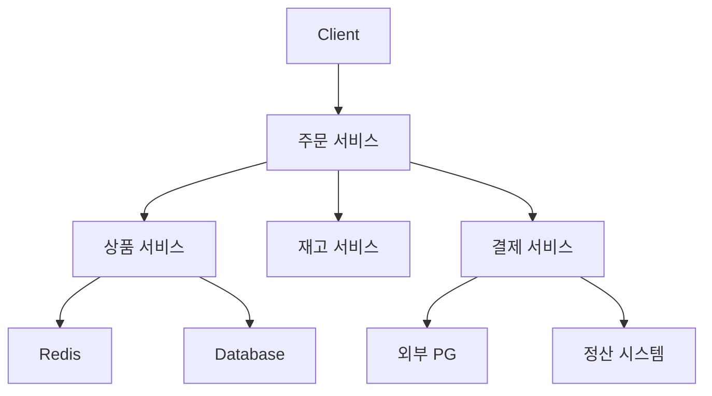
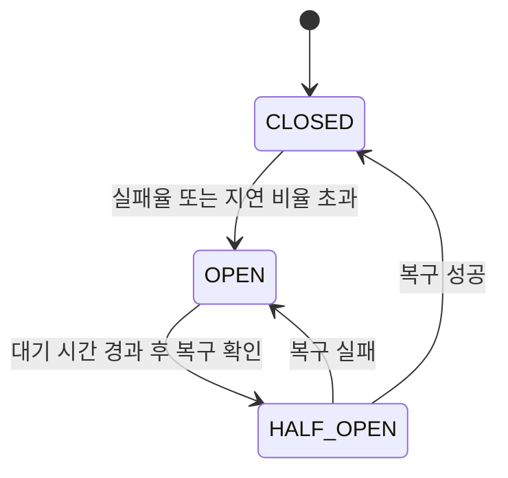
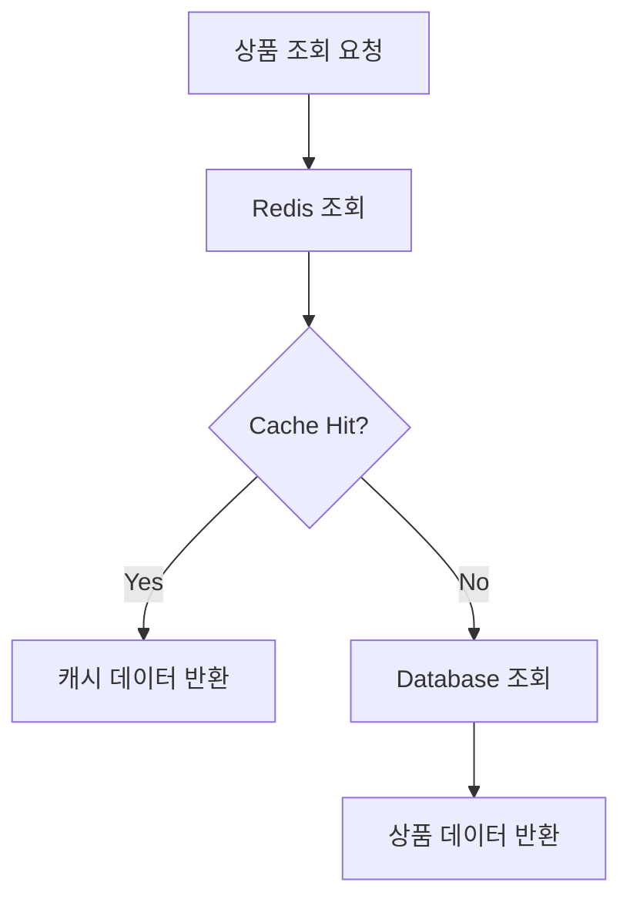
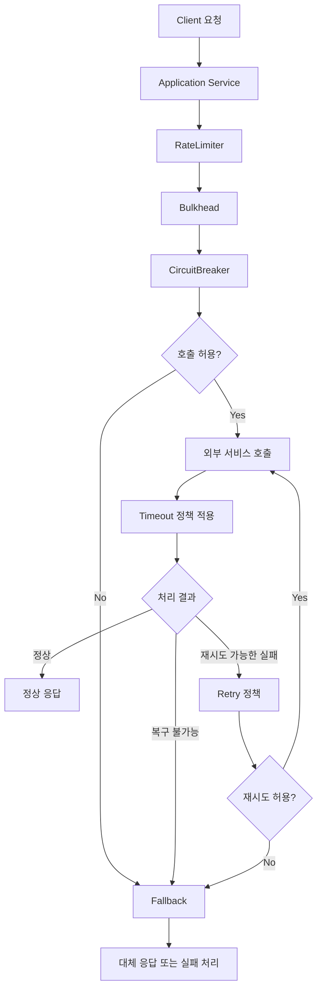

# Resilience4J - 2. 제공 모듈 역할 및 동작
[https://youtu.be/EL2XEh6l_Rc?si=ru_u9AQst5ITSgbU](https://youtu.be/EL2XEh6l_Rc?si=ru_u9AQst5ITSgbU)

# Resilience4J - 2. 제공 모듈 역할 및 동작
* toc
{:toc}

---

## Resilience4j 핵심 모듈과 MSA 장애 대응 전략

마이크로서비스 아키텍처에서는 여러 서비스가 서로 API를 호출하며 하나의 비즈니스 요청을 처리한다.

예를 들어 사용자가 상품을 주문하는 과정을 생각해보자.

주문 서비스는 상품 정보를 확인하고, 재고를 조회하고, 결제를 요청해야 한다. 결제가 완료되면 배송 서비스와 알림 서비스까지 호출할 수 있다.



정상적인 상황에서는 각 서비스가 빠르게 응답하기 때문에 문제가 없다.

그런데 상품 서비스가 갑자기 느려지거나, 결제 서비스에 연결할 수 없거나, Redis에서 응답이 오지 않는다면 어떻게 될까?

주문 서비스는 다른 서비스의 응답을 기다리는 동안 Thread나 Connection 같은 리소스를 계속 점유할 수 있다.

특히 동기 방식으로 서비스를 호출한다면 하나의 서비스에서 발생한 지연이 상위 호출 서비스까지 전파될 가능성이 있다.

```text
Redis 응답 지연
       ↓
상품 서비스 응답 지연
       ↓
주문 서비스 처리 지연
       ↓
대기 중인 요청 증가
       ↓
Thread 및 Connection 고갈
       ↓
전체 서비스 처리량 감소
```

이를 방지하려면 장애가 발생했을 때 단순히 예외를 처리하는 것 이상의 전략이 필요하다.

어떤 요청은 빠르게 실패시키고, 어떤 요청은 재시도하며, 특정 서비스에 전달되는 호출 수를 제한하거나 대체 데이터를 반환할 수도 있어야 한다.

이러한 장애 대응 기능을 제공하는 Java 라이브러리가 **Resilience4j**다.

Resilience4j는 CircuitBreaker, Retry, Bulkhead, RateLimiter, TimeLimiter, Cache 등 여러 모듈을 제공한다.

각 모듈은 해결하려는 문제가 다르다.

따라서 단순히 모든 기능을 적용하기보다 어떤 장애 상황에 어떤 모듈이 필요한지 이해하는 것이 중요하다.

---

## Resilience4j란?

Resilience4j는 Java 애플리케이션의 내결함성(Fault Tolerance)을 높이기 위한 라이브러리다.

내결함성이란 일부 구성요소에 문제가 발생하더라도 시스템 전체가 즉시 중단되지 않고 가능한 범위에서 기능을 유지할 수 있는 능력을 의미한다.

예를 들어 추천 서비스가 장애를 일으켰다고 해서 쇼핑몰의 주문 기능까지 중단될 필요는 없다.

추천 기능을 일시적으로 제공하지 못하더라도 사용자는 상품을 조회하고 주문할 수 있어야 한다.

```text
추천 서비스 장애

       ↓

개인화 추천 불가능

       ↓

인기 상품으로 대체

       ↓

주문 기능은 정상 유지
```

이처럼 일부 기능의 장애가 전체 서비스에 영향을 주지 않도록 구성하는 것이 내결함성 설계의 중요한 목표다.

Resilience4j는 이러한 구조를 구현하기 위해 여러 기능을 모듈 형태로 제공한다.

공식적으로 제공되는 주요 Core Module은 다음과 같다.

| 모듈                            | 주요 역할                |
| ----------------------------- | -------------------- |
| `resilience4j-circuitbreaker` | 장애가 발생한 대상에 대한 호출 차단 |
| `resilience4j-retry`          | 실패한 작업 재시도           |
| `resilience4j-bulkhead`       | 동시 실행 수 제한           |
| `resilience4j-ratelimiter`    | 일정 시간 동안 허용할 호출 수 제한 |
| `resilience4j-timelimiter`    | 비동기 작업의 완료 대기 시간 제한  |
| `resilience4j-cache`          | 처리 결과 캐싱             |

이 외에도 Spring Boot, Reactor, Micrometer와 연동하기 위한 모듈을 제공한다.

실무에서 자주 사용하는 기능은 CircuitBreaker와 Retry이지만, 서비스의 장애 특성에 따라 Bulkhead와 RateLimiter가 더 중요한 경우도 있다.

---

## 왜 여러 장애 대응 모듈이 필요할까?

처음에는 CircuitBreaker 하나만 적용하면 대부분의 장애를 해결할 수 있을 것처럼 느껴질 수 있다.

하지만 장애에는 여러 형태가 있다.

예를 들어 외부 API가 계속 500 오류를 반환하는 상황과 정상적인 응답을 반환하지만 30초씩 걸리는 상황은 다르다.

또한 외부 API가 정상적으로 동작하더라도 순간적으로 수천 개의 요청이 동시에 들어오면 리소스가 부족해질 수 있다.

각각의 상황에 필요한 대응도 다르다.

| 장애 상황                   | 적합한 대응                      |
| ----------------------- | --------------------------- |
| 외부 서비스가 지속적으로 실패        | CircuitBreaker              |
| 일시적인 네트워크 오류            | Retry                       |
| 특정 서비스 호출이 너무 오래 걸림     | TimeLimiter 또는 HTTP Timeout |
| 특정 작업에 동시 요청이 집중        | Bulkhead                    |
| 외부 API의 초당 호출 수를 제한해야 함 | RateLimiter                 |
| 원본 서비스를 사용할 수 없음        | Fallback                    |
| 반복 조회 비용이 높음            | Cache                       |

여기서 중요한 점은 **하나의 모듈이 모든 장애를 해결하지 않는다는 것**이다.

CircuitBreaker는 이미 불안정해진 서비스에 대한 호출을 차단하지만, 실행 중인 요청의 응답 시간을 자동으로 제한하지는 않는다.

Retry는 일시적인 오류를 해결할 수 있지만, 장애가 지속되는 상황에서는 오히려 요청량을 증가시킬 수 있다.

Bulkhead는 동시 실행 수를 제한하지만 호출이 성공하는지 실패하는지는 판단하지 않는다.

각 모듈의 책임을 정확히 구분해야 하는 이유다.

---

## CircuitBreaker: 장애가 발생한 서비스의 호출 차단

CircuitBreaker는 Resilience4j에서 가장 대표적인 모듈이다.

특정 서비스의 호출 결과를 관찰하다가 실패율이나 느린 호출 비율이 설정한 기준을 넘으면 해당 서비스로의 추가 호출을 차단한다.

예를 들어 주문 서비스가 재고 서비스를 호출한다고 가정하자.

```text
주문 서비스
      ↓
재고 서비스
```

정상적인 상황에서는 다음과 같이 동작한다.

```text
재고 조회 → 성공
재고 조회 → 성공
재고 조회 → 성공
```

그런데 재고 서비스에 장애가 발생한다.

```text
재고 조회 → 실패
재고 조회 → 실패
재고 조회 → 실패
```

장애가 지속되는데도 주문 서비스가 계속 요청을 보낸다면 재고 서비스의 회복을 방해하고 주문 서비스의 리소스까지 소모할 수 있다.

CircuitBreaker는 일정 기준 이상 실패가 발생하면 호출을 차단한다.

```text
재고 조회 실패 증가
        ↓
실패율 임계값 초과
        ↓
CircuitBreaker OPEN
        ↓
추가 재고 조회 차단
```

이후 주문 서비스는 재고 서비스를 직접 호출하지 않고 즉시 실패를 처리하거나 Fallback을 실행할 수 있다.

### CircuitBreaker의 세 가지 상태

CircuitBreaker에는 세 가지 주요 상태가 있다.

| 상태        | 의미             | 동작        |
| --------- | -------------- | --------- |
| CLOSED    | 정상적으로 연결된 상태   | 호출 허용     |
| OPEN      | 장애로 인해 차단된 상태  | 호출 차단     |
| HALF_OPEN | 복구 여부를 확인하는 상태 | 제한된 호출 허용 |

상태 전환 구조는 다음과 같다.



CLOSED 상태에서는 실제 호출 결과를 수집한다.

실패율이나 Slow Call 비율이 설정한 임계값 이상이 되면 OPEN 상태로 변경한다.

OPEN 상태에서는 호출을 차단한다.

일정 시간이 경과하면 HALF_OPEN 상태에서 제한된 수의 호출을 허용해 복구 여부를 판단한다.

Resilience4j는 호출 결과를 집계하기 위해 Count-Based 또는 Time-Based Sliding Window를 사용한다.

### 실패율 기반 CircuitBreaker

다음과 같이 설정했다고 가정하자.

```text
최근 10개 호출 기록

실패율 50% 이상

→ CircuitBreaker OPEN
```

실제 호출 결과가 다음과 같다면:

```text
성공
실패
실패
성공
실패
실패
성공
실패
성공
실패
```

전체 10개 중 6개가 실패했다.

```text
전체 호출: 10

실패 호출: 6

실패율: 60%
```

실패율이 50% 이상이므로 CircuitBreaker가 OPEN 상태로 전환될 수 있다.

단, `minimumNumberOfCalls`에 설정한 최소 호출 수를 충족해야 한다.

### 느린 호출도 장애로 판단할 수 있다

CircuitBreaker는 실패한 호출만 감지하는 것이 아니다.

정상 응답을 반환했더라도 지나치게 오래 걸린 호출을 집계할 수 있다.

예를 들어 다음과 같은 설정이 있다고 가정하자.

```yaml
resilience4j:
  circuitbreaker:
    instances:
      inventoryService:
        slidingWindowSize: 10
        minimumNumberOfCalls: 10

        failureRateThreshold: 50

        slowCallDurationThreshold: 2s
        slowCallRateThreshold: 50
```

여기서는 2초를 초과한 호출을 느린 호출로 판단한다.

최근 10개 호출 중 6개가 2초를 초과했다면:

```text
Slow Call Rate = 60%
```

가 된다.

HTTP 응답이 모두 200이었더라도 설정된 지연 비율을 초과했다면 CircuitBreaker가 열릴 수 있다.

여기서 기억할 점은 CircuitBreaker가 **느린 호출을 기록하는 기능과 이미 실행 중인 호출을 중단하는 기능은 다르다**는 것이다.

응답 시간이 2초를 초과했다고 해서 해당 요청을 그 순간 자동으로 중단하지는 않는다.

---

## Fallback: 정상 처리가 불가능할 때 대체 로직 실행

Fallback은 원래 수행하려던 작업이 실패했을 때 실행하는 대체 처리 로직이다.

예를 들어 상품 추천 서비스를 호출한다고 생각해보자.

```text
상품 서비스
     ↓
추천 서비스
     ↓
개인화 추천 상품 반환
```

추천 서비스가 장애를 일으키면 개인화 추천 결과를 제공할 수 없다.

이때 다음처럼 대체 결과를 반환할 수 있다.

```text
추천 서비스 장애
       ↓
Fallback 실행
       ↓
인기 상품 목록 반환
```

사용자에게 개인화 추천을 제공하지는 못하지만 상품 목록 자체는 계속 보여줄 수 있다.

이러한 방식을 Graceful Degradation이라고 한다.

전체 기능을 완벽하게 제공하지 못하더라도 핵심 기능을 유지하는 전략이다.

### Fallback 구현 예시

Spring Boot에서는 `@CircuitBreaker`의 `fallbackMethod` 속성을 이용할 수 있다.

```java
@Service
@RequiredArgsConstructor
public class RecommendationService {

    private final RecommendationClient recommendationClient;
    private final PopularProductService popularProductService;

    @CircuitBreaker(
            name = "recommendationService",
            fallbackMethod = "getPopularProducts"
    )
    public List<ProductDto> getRecommendations(Long userId) {

        return recommendationClient.getRecommendations(userId);
    }

    private List<ProductDto> getPopularProducts(
            Long userId,
            Throwable throwable
    ) {

        return popularProductService.getPopularProducts();
    }
}
```

`RecommendationClient`, `PopularProductService`, `ProductDto`는 애플리케이션에서 별도로 구현한 구성요소라고 가정한다.

정상적인 상황에서는 추천 서비스를 호출한다.

```text
getRecommendations()
       ↓
RecommendationClient
       ↓
개인화 추천 상품 반환
```

반면 추천 서비스 호출이 예외로 종료되거나 CircuitBreaker가 호출을 차단하면 Fallback을 실행할 수 있다.

```text
getRecommendations()
       ↓
추천 서비스 호출 실패
       ↓
getPopularProducts()
       ↓
인기 상품 반환
```

### Fallback은 CircuitBreaker가 OPEN일 때만 실행될까?

반드시 그렇지는 않다.

이 부분은 정확히 구분해야 한다.

Fallback은 CircuitBreaker의 상태가 OPEN으로 변경되었을 때뿐 아니라, 보호 대상 메서드에서 예외가 발생했을 때도 실행될 수 있다.

예를 들어 CircuitBreaker가 CLOSED 상태라도 다음과 같은 예외가 발생할 수 있다.

```text
CircuitBreaker CLOSED
       ↓
추천 서비스 호출
       ↓
Connection Timeout
       ↓
Fallback 실행
```

즉 Fallback은 회로가 열렸을 때만 사용하는 기능이 아니다.

또한 Fallback은 `resilience4j-fallback`이라는 독립된 Core Module이라기보다 Spring 연동의 `fallbackMethod`와 예외 복구 메커니즘을 통해 구현할 수 있는 대체 처리 전략이다.

Resilience4j의 Spring Boot 연동은 예외 유형에 따라 적절한 Fallback 메서드를 선택하도록 지원한다.

### Fallback에서 주의해야 할 점

Fallback이 항상 성공할 것이라고 가정해서는 안 된다.

예를 들어 Redis 장애가 발생해 Database에서 직접 데이터를 조회하도록 구성했다고 생각해보자.

```text
Redis 장애
    ↓
Fallback
    ↓
Database 조회
```

문제는 Redis에 집중되던 조회 요청이 모두 Database로 전달될 수 있다는 것이다.

Database가 해당 요청량을 감당하지 못한다면 Redis 장애가 Database 장애로 확대될 수 있다.

따라서 Fallback에는 별도의 호출 제한이나 Bulkhead를 적용하는 것도 고려해야 한다.

또한 결제처럼 데이터 정합성이 중요한 작업에서는 Fallback으로 무조건 성공 응답을 반환해서는 안 된다.

실제 결제 결과를 모르는 상태라면 성공이 아니라 결과 확인이 필요한 상태로 관리해야 한다.

---

## Retry: 일시적인 실패를 다시 시도

Retry는 실패한 요청을 일정 조건에 따라 재시도하는 모듈이다.

예를 들어 외부 배송 조회 API를 호출했는데 순간적인 네트워크 오류가 발생했다고 생각해보자.

```text
배송 조회 요청
       ↓
네트워크 오류
       ↓
재시도
       ↓
정상 응답
```

이처럼 일시적인 장애라면 한두 번의 재시도로 정상 처리될 수 있다.

Resilience4j의 Retry는 재시도 횟수, 재시도 간격, 대상 예외 등을 설정할 수 있다.

### Retry의 동작 방식

예를 들어 최대 세 번까지 시도하도록 설정했다고 가정하자.

```text
1차 시도
   ↓
실패
   ↓
300ms 대기
   ↓
2차 시도
   ↓
실패
   ↓
300ms 대기
   ↓
3차 시도
   ↓
성공
```

여기서 `maxAttempts=3`은 최초 요청까지 포함한 총 시도 횟수다.

즉 최초 요청 이후 세 번 더 재시도한다는 의미가 아니다.

### Retry 설정 예시

```yaml
resilience4j:
  retry:
    instances:
      deliveryService:
        maxAttempts: 3
        waitDuration: 300ms
```

이 설정은 배송 서비스 호출이 재시도 대상으로 판단되면 최대 세 번의 시도를 수행하도록 한다.

실무에서는 모든 예외를 재시도하기보다 재시도할 가치가 있는 예외를 명시하는 편이 좋다.

예를 들어:

```text
ConnectException
→ 일시적인 연결 오류일 수 있음

SocketTimeoutException
→ 재시도 전 요청 처리 여부 확인 필요

400 Bad Request
→ 동일한 요청을 재시도해도 대부분 해결되지 않음

404 Not Found
→ 리소스 부재가 정상적인 결과일 수 있음
```

Resilience4j는 예외뿐 아니라 특정 반환 결과를 기준으로 Retry 여부를 결정하는 설정도 제공한다.

### Retry와 CircuitBreaker의 차이

두 모듈을 비교하면 다음과 같다.

| 구분     | Retry        | CircuitBreaker      |
| ------ | ------------ | ------------------- |
| 목적     | 일시적인 실패 복구   | 지속적인 장애 전파 방지       |
| 핵심 동작  | 다시 호출        | 호출 차단               |
| 적합한 상황 | 일시적인 네트워크 오류 | 반복적인 실패 또는 응답 지연    |
| 주의할 점  | 요청량 증가       | 정상 요청까지 일시적으로 차단 가능 |

Retry는 다시 호출하는 기능이고, CircuitBreaker는 호출하지 않도록 만드는 기능이다.

두 기능을 함께 사용할 수 있지만 무조건 함께 적용해야 하는 것은 아니다.

특히 Retry가 너무 많이 발생하면 장애가 발생한 서비스의 부하를 더욱 증가시킬 수 있다.

### 결제 API에서 Retry가 위험한 이유

다음과 같은 상황을 생각해보자.

```text
결제 승인 요청
       ↓
PG 서버에서 결제 승인 완료
       ↓
응답 전 네트워크 오류
       ↓
클라이언트 Timeout
```

호출한 서비스에서는 Timeout이 발생했기 때문에 결제가 실패했다고 판단하기 쉽다.

하지만 실제 PG에서는 결제가 완료되었을 수 있다.

이 상태에서 동일한 결제 승인 요청을 무조건 재시도하면 중복 결제 위험이 발생한다.

따라서 결제나 주문과 같은 상태 변경 작업에서는 멱등성 키, 거래 상태 조회, 대사 처리 등을 고려해야 한다.

```text
Timeout 발생
      ↓
결과 불명확
      ↓
거래 상태 확인
      ↓
필요한 경우에만 재처리
```

이러한 작업은 단순히 Retry 횟수를 조정하는 것만으로 해결되지 않는다.

---

## Bulkhead: 동시 실행 수 제한

Bulkhead는 동시에 실행할 수 있는 작업의 수를 제한하는 모듈이다.

이름은 선박의 격벽에서 유래했다.

배 내부를 여러 공간으로 나누면 한쪽 공간에 물이 들어오더라도 전체 공간으로 침수가 확대되는 것을 줄일 수 있다.

소프트웨어에서도 비슷한 방식으로 리소스를 분리한다.

예를 들어 하나의 서버에서 다음 작업을 처리한다고 생각해보자.

```text
상품 조회
주문 생성
결제 처리
알림 전송
```

그런데 알림 서비스가 느려져 알림 전송 작업이 오랫동안 완료되지 않는다면 어떻게 될까?

알림 요청이 계속 증가하면서 전체 서버의 Thread를 점유할 수 있다.

```text
알림 서비스 응답 지연
        ↓
알림 처리 Thread 증가
        ↓
Thread Pool 고갈
        ↓
상품 조회 및 주문 처리에도 영향
```

Bulkhead를 사용하면 알림 처리에 사용할 수 있는 동시 실행 수를 제한할 수 있다.

### Bulkhead 설정 예시

```yaml
resilience4j:
  bulkhead:
    instances:
      notificationService:
        maxConcurrentCalls: 10
        maxWaitDuration: 0ms
```

이 설정은 `notificationService`라는 Bulkhead를 통과해 동시에 실행할 수 있는 호출을 최대 10개로 제한한다.

```text
동시 실행 중인 알림 요청

1
2
3
...
10
```

이미 10개가 실행 중이라면 새로운 요청은 허용되지 않는다.

```text
11번째 요청
      ↓
Bulkhead 허용량 초과
      ↓
요청 거부
```

여기서는 대기 시간이 0ms이므로 여유가 없으면 즉시 거부한다.

이때 대표적으로 `BulkheadFullException`이 발생할 수 있다.

### SemaphoreBulkhead와 ThreadPoolBulkhead

Resilience4j는 두 가지 Bulkhead 구현 방식을 제공한다.

| 구분     | SemaphoreBulkhead    | ThreadPoolBulkhead        |
| ------ | -------------------- | ------------------------- |
| 제한 대상  | 동시 실행 수              | 전용 Thread Pool과 Queue     |
| 핵심 기술  | Semaphore            | Thread Pool               |
| 작업 실행  | 호출 측 실행 환경 사용        | 별도 실행 풀 사용                |
| 적합한 상황 | 동시 접근 제한             | 작업 실행 리소스 분리              |
| 주요 설정  | `maxConcurrentCalls` | Pool Size, Queue Capacity |

SemaphoreBulkhead는 Semaphore를 이용해 동시에 실행할 수 있는 작업 수를 제한한다.

ThreadPoolBulkhead는 별도 Thread Pool과 대기 Queue를 사용해 작업을 격리한다.

Resilience4j는 두 구현체를 공식적으로 제공한다.

### CircuitBreaker와 Bulkhead의 차이

CircuitBreaker가 CLOSED 상태라고 해서 동시에 실행되는 요청 수까지 제한하는 것은 아니다.

예를 들어 CircuitBreaker의 Sliding Window Size가 10이라고 해도 동시 요청 10개만 허용한다는 의미가 아니다.

```text
CircuitBreaker
→ 장애율을 판단하고 호출 허용 여부 결정
```

```text
Bulkhead
→ 동시에 몇 개까지 실행할지 결정
```

따라서 외부 API가 정상적으로 동작하더라도 호출량이 많아 문제가 발생할 수 있다면 Bulkhead가 필요할 수 있다.

---

## RateLimiter: 일정 시간 동안 호출 수 제한

RateLimiter는 특정 시간 동안 허용할 호출 수를 제한하는 모듈이다.

예를 들어 외부 API가 다음과 같은 사용량 제한을 가지고 있다고 생각해보자.

```text
1초당 최대 100회 호출
```

그런데 애플리케이션에서 갑자기 1초에 500번 요청한다면 외부 API가 요청을 거부할 수 있다.

이러한 상황에서 RateLimiter를 사용할 수 있다.

### RateLimiter 설정 예시

```yaml
resilience4j:
  ratelimiter:
    instances:
      externalApi:
        limitForPeriod: 100
        limitRefreshPeriod: 1s
        timeoutDuration: 0ms
```

이 설정은 다음 의미를 가진다.

```text
1초 동안 최대 100회 호출 허용
```

호출 허용량을 모두 사용했다면 다음 요청은 허용되지 않는다.

```text
101번째 요청
      ↓
RateLimiter 허용량 초과
      ↓
즉시 거부
```

`timeoutDuration`이 0ms이므로 새로운 허용량을 기다리지 않는다.

허용량을 얻지 못했을 때는 `RequestNotPermitted` 예외가 발생할 수 있다.

Resilience4j의 RateLimiter는 일정 주기마다 호출 허용량을 관리하는 방식으로 동작한다.

### RateLimiter는 CPU나 메모리 사용률을 직접 감지할까?

RateLimiter를 서버 리소스 보호 기능으로 생각할 수 있지만 정확히는 구분해야 한다.

RateLimiter는 CPU나 메모리 사용률을 직접 측정하여 요청을 제한하는 기능이 아니다.

주로 일정 시간 동안 허용할 호출 수를 관리한다.

```text
RateLimiter

1초당 100회
```

반면 Bulkhead는 다음처럼 동시 실행 수를 제한한다.

```text
Bulkhead

동시 실행 최대 10개
```

둘의 기준이 다르다.

### Bulkhead와 RateLimiter 비교

| 구분       | Bulkhead       | RateLimiter       |
| -------- | -------------- | ----------------- |
| 제한 기준    | 동시에 실행 중인 작업 수 | 일정 시간 동안 호출 수     |
| 예시       | 동시 호출 최대 10개   | 초당 호출 최대 100회     |
| 주요 목적    | 리소스 점유 격리      | 호출 속도 제어          |
| 대표적인 사용처 | 느린 외부 API      | 호출량 제한이 있는 외부 API |

예를 들어 요청 하나가 30초 동안 실행되는 API라면 초당 호출 수가 적어도 동시에 실행 중인 작업이 누적될 수 있다.

이 경우 RateLimiter만으로 충분하지 않을 수 있다.

반대로 각 요청이 매우 빠르게 끝나더라도 외부 API가 초당 호출 수를 제한한다면 Bulkhead만으로는 사용량 제한을 지키기 어렵다.

---

## TimeLimiter: 작업 완료 대기 시간 제한

TimeLimiter는 특정 작업이 완료되기를 기다리는 시간을 제한하는 모듈이다.

예를 들어 외부 API 요청이 평소에는 100ms 정도 걸리지만 장애가 발생하면 30초 이상 걸린다고 생각해보자.

```text
정상 요청

100ms
```

```text
장애 요청

30,000ms
```

이때 호출한 서비스가 30초 동안 응답을 기다리면 사용자 요청도 지연될 수 있다.

TimeLimiter는 설정한 시간 안에 작업이 완료되지 않으면 Timeout으로 처리할 수 있도록 지원한다.

### TimeLimiter 설정 예시

```yaml
resilience4j:
  timelimiter:
    instances:
      inventoryService:
        timeoutDuration: 2s
        cancelRunningFuture: true
```

위 설정은 해당 TimeLimiter가 적용된 작업을 최대 2초 동안 기다리도록 한다.

개념적으로 다음과 같다.

```text
비동기 작업 시작
       ↓
2초 동안 대기
       ↓
작업 미완료
       ↓
Timeout 처리
```

Resilience4j의 TimeLimiter는 `Future`나 `CompletionStage`와 같은 비동기 작업을 대상으로 실행 완료 시간을 제한하는 기능을 제공한다.

### CircuitBreaker의 Slow Call과 무엇이 다를까?

이 부분이 특히 헷갈리기 쉽다.

CircuitBreaker도 응답 시간을 측정하고 TimeLimiter도 시간을 다룬다.

하지만 목적은 다르다.

**CircuitBreaker의 Slow Call**

```text
호출 시작
    ↓
응답 완료
    ↓
실행 시간 측정
    ↓
느린 호출로 기록
    ↓
이후 호출의 허용 여부 판단
```

**TimeLimiter**

```text
작업 시작
    ↓
설정된 시간까지 대기
    ↓
완료되지 않음
    ↓
Timeout 처리
```

비교하면 다음과 같다.

| 구분       | CircuitBreaker Slow Call | TimeLimiter      |
| -------- | ------------------------ | ---------------- |
| 주요 목적    | 지연 비율을 이용한 장애 감지         | 완료 대기 시간 제한      |
| 동작 시점    | 호출 결과 및 실행 시간 집계         | 지정한 시간 초과        |
| 현재 요청 중단 | 직접 보장하지 않음               | Timeout 처리 가능    |
| 이후 요청 차단 | 임계값 초과 시 가능              | 자체적인 회로 차단 기능 없음 |

따라서 CircuitBreaker의 Slow Call 설정을 했다고 해서 HTTP Client의 Timeout 설정을 생략해서는 안 된다.

### TimeLimiter는 실행 중인 작업을 반드시 종료할까?

그렇지는 않다.

이 부분도 정확히 이해해야 한다.

TimeLimiter가 Timeout을 반환했다고 해서 외부 HTTP 요청이나 내부 Thread가 즉시 종료되었다는 보장은 없다.

예를 들어 `CompletableFuture`를 이용해 비동기 작업을 실행했다면 Timeout 이후에도 실제 작업이 계속 실행되고 있을 수 있다.

작업 취소 가능 여부는 사용 중인 Future 구현과 HTTP Client, Thread의 인터럽트 처리 방식 등에 따라 달라진다.

따라서 실제 서비스에서는 다음을 함께 고려해야 한다.

```text
TimeLimiter
        +
HTTP Client Timeout
        +
실행 중 작업의 취소 가능 여부
```

---

## Cache: 반복 작업의 결과 재사용

Resilience4j는 Cache 기능도 제공한다.

Cache는 이전에 계산하거나 조회한 결과를 저장하고, 같은 데이터가 필요할 때 재사용하는 방식이다.

예를 들어 상품 정보를 조회한다고 생각해보자.

```text
상품 조회 요청
       ↓
Database 조회
       ↓
상품 정보 반환
```

동일한 상품에 대한 요청이 반복된다면 매번 Database를 조회하는 것은 비효율적일 수 있다.

Cache를 적용하면 다음과 같이 동작한다.

```text
상품 조회 요청
       ↓
Cache 조회
       ↓
Cache Hit
       ↓
기존 결과 반환
```

반면 데이터가 존재하지 않으면 원본 데이터 저장소를 조회한다.

```text
상품 조회 요청
       ↓
Cache 조회
       ↓
Cache Miss
       ↓
Database 조회
       ↓
결과 저장
       ↓
상품 정보 반환
```

Resilience4j의 Cache 기능은 JCache 기반의 캐시 추상화를 이용해 기존 계산 결과를 재사용할 수 있도록 지원한다.

### Cache와 Fallback은 다르다

Cache Miss가 발생했다고 해서 반드시 장애가 발생한 것은 아니다.

```text
Cache Miss
→ 아직 캐시에 데이터가 없음
```

이것은 정상적인 데이터 조회 흐름일 수 있다.

반면:

```text
Cache Connection Timeout
→ 캐시 서버에서 응답하지 않음
```

은 실제 장애 상황일 수 있다.

따라서 다음 두 개념을 구분해야 한다.

| 구분      | Cache Miss      | Fallback                 |
| ------- | --------------- | ------------------------ |
| 의미      | 캐시에 원하는 데이터가 없음 | 원래 작업을 처리할 수 없어 대체 작업 실행 |
| 장애 여부   | 일반적으로 정상적인 흐름   | 실패 또는 차단 상황에서 사용 가능      |
| 대표적인 처리 | 원본 저장소 조회       | 대체 데이터 또는 다른 처리 경로 사용    |

Cache는 성능 최적화 수단이고, Fallback은 장애 대응 전략이다.

두 기능을 함께 사용할 수는 있지만 같은 개념은 아니다.

---

## Resilience4j 모듈 전체 비교

지금까지 살펴본 모듈을 하나의 표로 정리해보자.

| 모듈             | 판단 기준             | 핵심 동작      | 대표적인 예시            |
| -------------- | ----------------- | ---------- | ------------------ |
| CircuitBreaker | 실패율, Slow Call 비율 | 추가 호출 차단   | 장애가 발생한 결제 조회 API  |
| Fallback       | 원래 작업의 예외 또는 차단   | 대체 처리      | 추천 실패 시 인기 상품      |
| Retry          | 재시도 가능한 오류 또는 결과  | 다시 호출      | 일시적인 네트워크 오류       |
| Bulkhead       | 동시 실행 수           | 병렬 작업 제한   | 외부 알림 API 동시 호출 제한 |
| RateLimiter    | 일정 기간의 호출 수       | 호출 속도 제한   | 초당 100회 제한 API     |
| TimeLimiter    | 작업 완료 대기 시간       | Timeout 처리 | 비동기 재고 조회          |
| Cache          | 데이터 존재 여부         | 기존 결과 재사용  | 상품 상세 정보 캐싱        |

이 중 Fallback은 다른 모듈과 연결해 사용하는 대체 처리 전략이라는 점을 구분하면 좋다.

---

## 예제: 상품 조회 시스템에 여러 모듈 적용하기

이번에는 상품 조회 서비스를 예로 들어 여러 모듈을 어떻게 조합할 수 있는지 살펴보자.

다음과 같은 구조를 생각해보자.

```text
Client
   ↓
상품 서비스
   ↓
Redis
   ↓
Database
```

상품 서비스는 먼저 Redis에서 상품 정보를 조회한다.

Cache에 데이터가 없다면 Database를 조회한다.

정상적인 상황에서는 다음과 같이 동작한다.



그런데 Redis나 Database에 장애가 발생할 수 있다.

이때 Resilience4j의 여러 모듈을 활용하면 다음과 같은 대응 정책을 구성할 수 있다.

### 1. Cache 호출에 CircuitBreaker 적용

Redis 조회가 계속 실패한다면 일정 시간 동안 Redis 호출을 차단할 수 있다.

```text
Redis 실패 증가
       ↓
CircuitBreaker OPEN
       ↓
Redis 호출 차단
```

### 2. Cache 호출에 Timeout 적용

Redis 조회가 장시간 지연되는 것을 방지하기 위해 Redis Client의 Timeout을 설정한다.

```text
Redis 조회
       ↓
500ms 초과
       ↓
Timeout
```

단, 위 시간은 예시이며 실제 값은 정상적인 Redis 응답 시간과 네트워크 환경을 기준으로 결정해야 한다.

### 3. Database Fallback에 Bulkhead 적용

Redis 장애 시 DB로 직접 조회하는 Fallback을 제공한다면 DB에 과도한 요청이 집중되지 않도록 제한할 수 있다.

```text
Redis 장애
       ↓
Fallback
       ↓
Bulkhead
       ↓
Database 조회
```

이렇게 하면 Redis 장애가 Database 장애로 확대될 가능성을 줄일 수 있다.

### 4. Database도 장애라면 대체 응답 제공

Database까지 응답할 수 없는 상황이라면 모든 요청에 대해 무조건 성공한 것처럼 데이터를 만들어 반환해서는 안 된다.

상품 정보가 필수인 요청이라면 명확한 장애 응답이 필요할 수 있다.

반면 추천 상품이나 최근 본 상품처럼 부가적인 기능은 미리 준비한 대체 데이터를 반환할 수 있다.

이처럼 **업무의 중요도에 따라 Fallback 전략이 달라져야 한다.**

---

## Spring Boot에서 여러 모듈 설정하기

Spring Boot 3 환경에서는 Resilience4j Starter를 이용해 여러 모듈을 설정할 수 있다.

Gradle 의존성은 다음과 같은 형태로 구성할 수 있다.

```gradle
dependencies {
    implementation 'org.springframework.boot:spring-boot-starter-web'
    implementation 'org.springframework.boot:spring-boot-starter-aop'
    implementation 'org.springframework.boot:spring-boot-starter-actuator'

    implementation "io.github.resilience4j:resilience4j-spring-boot3:${resilience4jVersion}"
}
```

`resilience4jVersion`은 Gradle Properties 또는 프로젝트의 의존성 관리 설정에서 정의한 버전 변수다. Spring Boot와 호환되는 버전을 지정해야 한다.

Resilience4j의 Spring Boot Starter는 Annotation 기반 기능과 AOP Aspect, 설정 파일 연동을 제공한다.

### application.yml 예제

각 모듈을 사용하는 대표적인 설정을 모아보자.

```yaml
resilience4j:

  circuitbreaker:
    instances:
      inventoryService:
        slidingWindowType: COUNT_BASED
        slidingWindowSize: 10
        minimumNumberOfCalls: 5
        failureRateThreshold: 50
        slowCallDurationThreshold: 2s
        slowCallRateThreshold: 50
        waitDurationInOpenState: 10s
        permittedNumberOfCallsInHalfOpenState: 3

  retry:
    instances:
      deliveryService:
        maxAttempts: 3
        waitDuration: 300ms

  bulkhead:
    instances:
      notificationService:
        maxConcurrentCalls: 10
        maxWaitDuration: 0ms

  ratelimiter:
    instances:
      externalApi:
        limitForPeriod: 100
        limitRefreshPeriod: 1s
        timeoutDuration: 0ms

  timelimiter:
    instances:
      asyncInventoryService:
        timeoutDuration: 2s
        cancelRunningFuture: true
```

이 설정을 작성했다고 해서 모든 HTTP 호출에 자동으로 동일한 정책이 적용되는 것은 아니다.

각 인스턴스 이름을 실제 보호할 메서드나 호출에 연결해야 한다.

예를 들어 다음과 같은 Annotation을 사용할 수 있다.

```java
@CircuitBreaker(name = "inventoryService")
```

```java
@Retry(name = "deliveryService")
```

```java
@Bulkhead(name = "notificationService")
```

```java
@RateLimiter(name = "externalApi")
```

`@TimeLimiter`는 `CompletableFuture`나 `CompletionStage` 같은 비동기 반환 타입에 적용하는 구성이 대표적이다.

각 Annotation을 어떤 메서드에 적용할지는 호출 대상과 장애 처리 정책을 기준으로 결정해야 한다.

---

## 여러 모듈을 함께 사용할 때의 실행 구조

실제 서비스에서는 하나의 외부 호출에 여러 기능을 함께 적용할 수 있다.

예를 들어 재고 서비스 호출에는 다음 정책이 필요할 수 있다.

```text
1. 동시 실행 수 제한

2. CircuitBreaker 상태 확인

3. 외부 API 호출

4. 응답 시간 제한

5. 일시적인 실패라면 재시도

6. 최종 실패 시 Fallback
```

이때 중요한 것은 적용 순서다.

예를 들어 Retry가 CircuitBreaker 내부에 있는지, 외부에 있는지에 따라 실제 호출 횟수와 실패율 집계 방식이 달라질 수 있다.

```text
Retry
  └── CircuitBreaker
        └── External API
```

와:

```text
CircuitBreaker
  └── Retry
        └── External API
```

는 동일한 구조가 아니다.

첫 번째 구조에서는 재시도마다 CircuitBreaker를 통과할 수 있다.

두 번째 구조에서는 여러 번 재시도한 결과가 CircuitBreaker 관점에서 하나의 호출 결과처럼 집계될 수 있다.

실제 동작은 적용한 Decorator와 AOP 순서에 따라 결정되므로 함께 사용할 때는 이를 반드시 확인해야 한다.

Resilience4j의 Spring Boot 연동에서도 여러 Annotation을 함께 사용하는 경우 Aspect 적용 순서를 고려하도록 구성되어 있다.

---

## 실무에서의 활용

Resilience4j를 실제 서비스에 적용할 때는 어떤 모듈을 사용할지보다 **어떤 장애를 어떻게 처리할 것인지**부터 정하는 것이 좋다.

다음은 실무에서 검토할 만한 대표적인 설계 방향이다.

### 1. 외부 서비스별로 CircuitBreaker를 분리한다

회원 서비스, 결제 서비스, 알림 서비스는 장애 특성이 서로 다르다.

여러 의존성을 하나의 CircuitBreaker로 묶으면 한 서비스의 장애 때문에 정상적인 다른 서비스 호출까지 차단될 수 있다.

따라서 보호 대상 의존성과 장애 격리 단위를 기준으로 CircuitBreaker를 분리하는 것이 좋다.

예를 들어:

```text
paymentProvider
inventoryService
notificationService
```

처럼 이름을 구분할 수 있다.

다만 같은 외부 서비스라도 조회와 상태 변경의 장애 정책이 크게 다르다면 CircuitBreaker를 별도로 두는 것도 고려할 수 있다.

### 2. 실패율뿐 아니라 Slow Call Rate를 확인한다

장애는 반드시 HTTP 500으로 나타나지 않는다.

외부 서비스가 HTTP 200을 반환하더라도 응답이 평소보다 훨씬 오래 걸리면 전체 서비스가 영향을 받을 수 있다.

따라서 CircuitBreaker에서는 실패율과 함께 Slow Call Rate를 확인하는 것이 좋다.

다만 Slow Call 기준은 임의로 정하지 않는다.

평균 응답 시간뿐 아니라 P95, P99 Latency를 측정하고 실제 정상적인 응답 분포를 기준으로 결정해야 한다.

### 3. Retry는 일시적인 오류에만 적용한다

Retry는 가장 쉽게 적용할 수 있지만 잘못 사용하면 장애를 확대하기 쉽다.

이미 과부하가 발생한 서비스에 요청을 반복해서 보내면 서버가 정상 상태로 돌아오는 시간을 늦출 수 있다.

따라서 Retry 횟수, 대기 시간, 재시도 대상 예외를 명시해야 한다.

특히 외부 서비스가 `429 Too Many Requests`를 반환한다면 무조건 즉시 재시도하기보다 서버가 제공하는 Retry-After 정책 등을 고려하는 편이 좋다.

### 4. 결제와 주문 처리에는 멱등성 정책을 함께 적용한다

결제 승인이나 주문 생성처럼 상태를 변경하는 작업에서는 Timeout이 발생했다고 해서 실제 작업이 실패했다고 단정할 수 없다.

응답을 받지 못했을 뿐 외부 시스템에서 처리가 완료되었을 수 있기 때문이다.

따라서 Retry를 적용하려면 멱등성 키나 거래 상태 조회, 대사 처리 같은 별도 보호 장치가 필요하다.

실제 결제 시스템에서는 단순 재시도보다 **결과가 불명확한 거래를 안전하게 복구할 수 있는 구조**가 더 중요하다.

### 5. Bulkhead는 리소스 격리 관점에서 설계한다

알림 API가 느리다는 이유로 주문 API까지 처리하지 못하는 상황은 피해야 한다.

Bulkhead를 이용하면 알림과 같이 장애 가능성이 있는 작업의 동시 실행 수를 제한할 수 있다.

중요한 점은 Bulkhead가 정상적인 요청도 제한할 수 있다는 것이다.

따라서 최대 동시 실행 수를 지나치게 작게 설정하면 정상적인 트래픽에서도 요청이 거부될 수 있다.

현재 서비스의 처리량과 응답 시간, Thread Pool 구성을 함께 고려해야 한다.

### 6. RateLimiter는 인스턴스별 제한인지 확인한다

Resilience4j의 일반적인 RateLimiter는 애플리케이션 프로세스 내부에서 호출 허용량을 관리한다.

예를 들어 다음과 같이 설정했다고 생각해보자.

```text
서버 한 대당 초당 100회
```

서버가 세 대라면 전체적으로는 최대 300회 가까운 호출이 발생할 수 있다.

```text
Server A → 100회

Server B → 100회

Server C → 100회
```

따라서 외부 API가 전체 시스템 기준으로 초당 100회만 허용한다면 인스턴스별 RateLimiter 설정만으로는 충분하지 않을 수 있다.

이 경우 API Gateway나 Redis 기반 분산 Rate Limiting 같은 구조도 고려해야 한다.

### 7. TimeLimiter와 HTTP Client Timeout을 함께 설계한다

TimeLimiter를 적용하더라도 실제 네트워크 요청이 즉시 취소되는 것은 아닐 수 있다.

예를 들어 TimeLimiter는 2초로 설정했지만 HTTP Client의 Read Timeout이 30초라면 실제 네트워크 작업은 더 오래 실행될 가능성이 있다.

따라서 Connect Timeout, Read 또는 Response Timeout, 전체 요청 처리 시간 제한을 함께 설계해야 한다.

특히 Blocking HTTP Client와 비동기 HTTP Client는 Timeout과 취소 동작이 다르므로 사용 중인 Client의 특성을 확인해야 한다.

### 8. Fallback이 잘못된 비즈니스 결과를 반환하지 않도록 한다

상품 추천이 실패했을 때 인기 상품을 보여주는 것은 비교적 안전한 대체 처리일 수 있다.

하지만 결제 승인 결과를 알 수 없는데 Fallback에서 성공을 반환하는 것은 위험하다.

마찬가지로 재고 조회에 실패했다고 해서 재고가 충분한 것으로 처리하면 초과 판매가 발생할 수 있다.

따라서 Fallback에서는 단순히 정상 응답을 반환하는 것보다 데이터의 정확성과 비즈니스 의미를 먼저 고려해야 한다.

### 9. Fallback 대상 시스템도 보호한다

Redis 장애 시 Database로 직접 조회하도록 구성하면 기능을 유지할 수 있다.

하지만 모든 요청이 DB로 집중되면 DB까지 장애가 발생할 수 있다.

따라서 Fallback에도 동시 실행 수 제한이나 호출 속도 제한을 적용할 수 있다.

또는 일부 요청에 대해 오래된 캐시 데이터를 제한적으로 사용하거나, 기능을 일시적으로 비활성화하는 정책이 더 적절할 수도 있다.

### 10. Cache Miss와 Cache 장애를 구분한다

Cache Miss는 정상적인 상황이다.

요청한 데이터가 Cache에 존재하지 않으므로 원본 저장소에서 조회하면 된다.

하지만 Redis Timeout이나 Connection Error는 캐시 시스템의 장애일 수 있다.

이 둘을 같은 방식으로 처리하면 CircuitBreaker의 실패율이 불필요하게 증가하거나 비정상적인 Fallback이 실행될 수 있다.

따라서 Cache Miss는 일반적인 조회 흐름으로 처리하고, 실제 캐시 연결 장애에 대해서만 장애 대응 정책을 적용하는 것이 좋다.

### 11. CircuitBreaker가 OPEN인 이유를 모니터링한다

CircuitBreaker가 OPEN 상태로 전환되었다는 사실만으로는 장애 원인을 알 수 없다.

다음과 같은 지표를 함께 확인해야 한다.

```text
Failure Rate

Slow Call Rate

Rejected Call Count

CircuitBreaker State

Fallback Count

Retry Count
```

예를 들어 HTTP 500 오류 때문에 OPEN이 되었는지, 응답 시간이 증가해 Slow Call Rate가 높아졌는지에 따라 대응 방법이 달라진다.

Micrometer와 Spring Boot Actuator를 이용해 관련 지표를 수집하고, Grafana 등의 모니터링 환경에서 확인할 수 있다.

### 12. CircuitBreaker를 적용했다고 장애 대응이 완료된 것은 아니다

CircuitBreaker는 불안정한 의존성에 대한 추가 호출을 차단하는 기능이다.

하지만 외부 서비스 자체를 복구하는 것은 아니다.

또한 CircuitBreaker가 CLOSED 상태에서는 여전히 많은 요청이 동시에 실행될 수 있다.

따라서 장애 특성에 따라 Timeout, Bulkhead, Retry, Fallback을 적절하게 조합해야 한다.

무엇보다 실제 장애 상황을 재현하여 설정한 정책이 의도대로 동작하는지 확인해야 한다.

### 13. 정상 처리와 장애 처리의 응답을 구분한다

Fallback에서 대체 데이터를 반환하면 HTTP 상태 코드는 200일 수 있다.

그렇다고 해서 모든 비즈니스 기능이 정상적으로 처리되었다는 의미는 아니다.

예를 들어 추천 서비스 장애로 인기 상품을 반환했다면 해당 응답은 정상적인 개인화 추천 결과가 아니다.

따라서 내부 지표나 응답 메타데이터를 통해 정상 처리와 대체 처리를 구분할 수 있도록 설계하는 것이 좋다.

### 14. 장애가 발생하지 않았을 때도 보호 정책이 성능에 미치는 영향을 확인한다

장애 대응 모듈은 문제가 발생했을 때만 영향을 주는 것이 아니다.

Bulkhead는 정상적인 트래픽에서도 동시 실행 수를 제한할 수 있고, RateLimiter는 호출 속도를 제어한다.

Retry는 장애 발생 시 요청 처리 시간을 늘릴 수 있으며, 여러 AOP Decorator를 적용하면 호출 흐름도 복잡해진다.

따라서 장애 대응 모듈을 적용한 이후에는 정상 트래픽에서의 응답 시간과 처리량도 함께 확인해야 한다.

---

## 모듈별 역할을 직관적으로 구분하기

Resilience4j를 처음 접할 때는 이름보다 각 모듈이 어떤 질문에 답하는지 기억하는 것이 더 쉽다.

**CircuitBreaker**

```text
"지금 이 서비스를 계속 호출해도 괜찮을까?"

→ 장애가 반복되면 호출하지 않는다.
```

**Retry**

```text
"다시 시도하면 성공할 가능성이 있을까?"

→ 정해진 조건에서 다시 호출한다.
```

**Bulkhead**

```text
"동시에 몇 개의 작업을 처리할 수 있을까?"

→ 동시 실행 수를 제한한다.
```

**RateLimiter**

```text
"일정 시간 동안 몇 번 호출할 수 있을까?"

→ 호출 속도를 제한한다.
```

**TimeLimiter**

```text
"이 작업이 끝날 때까지 얼마나 기다릴까?"

→ 완료 대기 시간을 제한한다.
```

**Fallback**

```text
"원래 작업을 할 수 없다면 무엇을 제공할까?"

→ 대체 로직을 실행한다.
```

**Cache**

```text
"이미 처리한 결과를 다시 사용할 수 있을까?"

→ 저장된 결과를 재사용한다.
```

각 모듈의 역할을 이렇게 구분하면 어떤 상황에서 무엇을 적용해야 하는지 판단하기가 쉬워진다.

---

## 전체 구조

지금까지 살펴본 모듈을 하나의 MSA 장애 대응 구조로 표현하면 다음과 같다.



이 구조는 여러 모듈이 담당하는 역할을 이해하기 위한 개념적인 흐름이다.

실제 Spring Boot에서는 Annotation과 Decorator의 적용 순서에 따라 Retry, CircuitBreaker, Fallback의 실행 범위가 달라질 수 있다.

따라서 여러 모듈을 함께 사용하는 경우에는 설정뿐 아니라 실제 호출 순서를 확인해야 한다.

---

## 정리

Resilience4j는 마이크로서비스 아키텍처에서 발생하는 장애를 대비하기 위한 Java 내결함성 라이브러리다.

하나의 서비스에서 장애가 발생했을 때 다른 서비스로 문제가 전파되지 않도록 여러 장애 대응 기능을 제공한다.

대표적인 기능은 다음과 같다.

| 모듈             | 한 줄 정리                        |
| -------------- | ----------------------------- |
| CircuitBreaker | 장애가 반복되면 외부 호출을 차단한다          |
| Retry          | 실패한 요청을 정해진 횟수만큼 재시도한다        |
| Bulkhead       | 동시에 실행할 수 있는 작업 수를 제한한다       |
| RateLimiter    | 일정 시간 동안 허용할 호출 수를 제한한다       |
| TimeLimiter    | 작업 완료를 기다리는 시간을 제한한다          |
| Cache          | 이전에 처리한 결과를 저장해 재사용한다         |
| Fallback       | 원래 작업을 수행할 수 없을 때 대체 처리를 실행한다 |

각 모듈은 서로 다른 목적을 가지고 있다.

CircuitBreaker는 장애가 발생한 서비스에 대한 호출을 차단하지만 실행 중인 작업을 직접 중단하는 기능은 아니다.

Retry는 일시적인 장애를 복구할 수 있지만 잘못 적용하면 요청량을 증가시킬 수 있다.

Bulkhead는 동시 실행 수를 제한하고, RateLimiter는 일정 기간 동안 허용할 호출 수를 제한한다.

TimeLimiter는 비동기 작업의 완료 대기 시간을 관리하며, Cache는 반복적인 조회나 계산 비용을 줄이는 데 활용할 수 있다.

Fallback은 원래 처리가 불가능할 때 실행하는 대체 전략이지만, 대체 처리 자체가 새로운 장애를 만들지 않도록 설계해야 한다.

결국 중요한 것은 모든 모듈을 적용하는 것이 아니다.

```text
장애 상황 분석
       ↓
어떤 리소스가 영향을 받는지 확인
       ↓
적절한 장애 대응 모듈 선택
       ↓
모듈별 임계값 설정
       ↓
Fallback 및 복구 정책 구성
       ↓
장애 상황 재현
       ↓
모니터링 및 설정 개선
```

이러한 과정을 통해 실제 서비스 특성에 맞는 장애 대응 구조를 만드는 것이 중요하다.

특히 MSA에서는 하나의 장애가 여러 서비스로 확산되는 것을 줄여야 하므로 **실패를 빠르게 감지하는 것뿐 아니라, 기다리는 시간과 동시에 실행되는 작업 수를 제한하고, 복구 가능한 오류와 복구할 수 없는 오류를 구분하는 것**이 중요하다.

### 한 줄 요약

Resilience4j는 CircuitBreaker, Retry, Bulkhead, RateLimiter, TimeLimiter, Cache 등의 모듈을 통해 MSA에서 발생하는 실패·지연·과부하에 대응하는 내결함성 라이브러리이며, 각 모듈의 역할을 구분하고 적절한 Fallback과 복구 전략을 조합해 장애가 전체 시스템으로 전파되는 것을 줄이는 것이 핵심이다.
