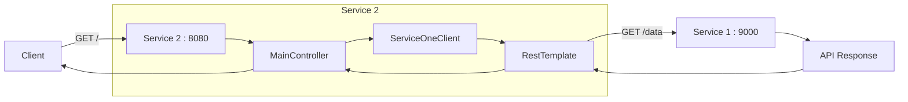
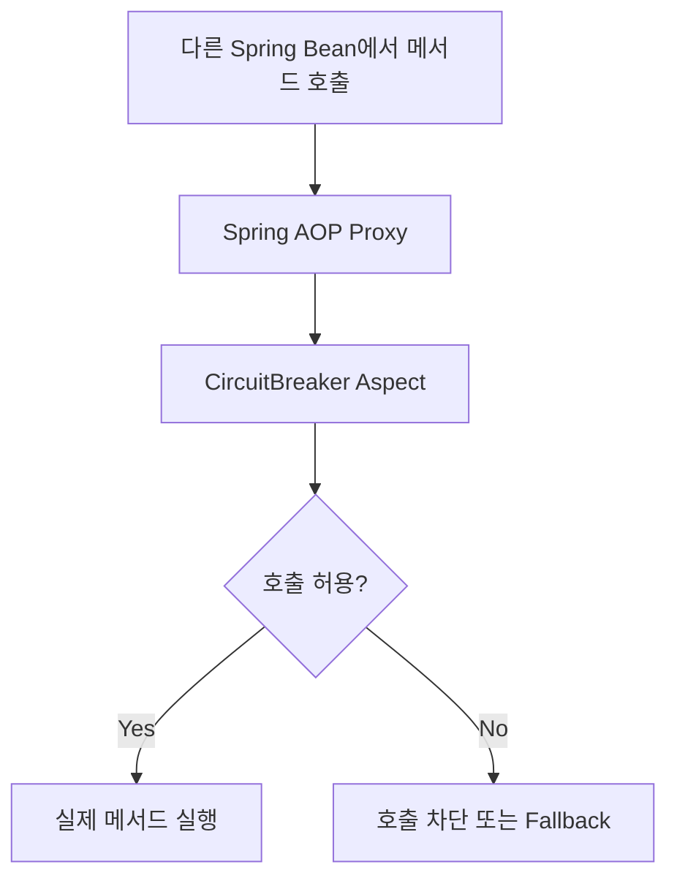
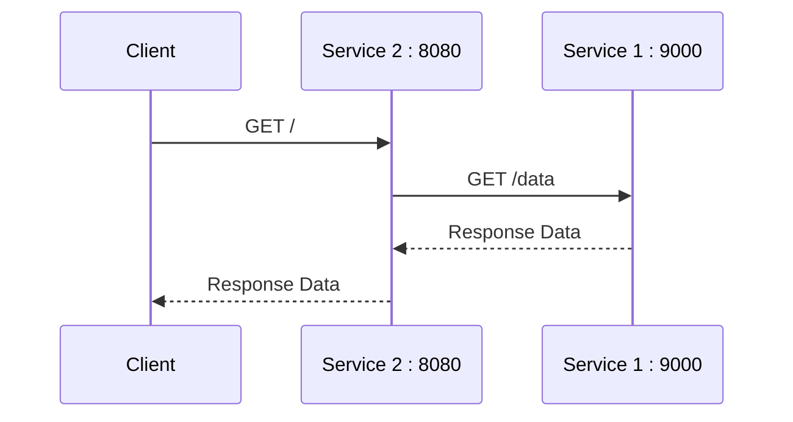
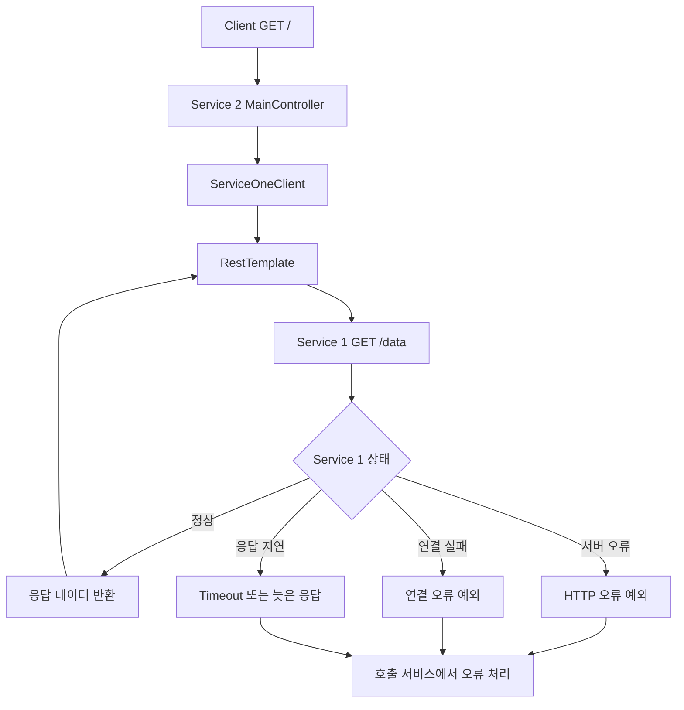

# Resilience4J - 3. 프로젝트 시작 의존성 추가
[https://youtu.be/f7-t8o9NbFI?si=_deChTP7fjQOJlAp](https://youtu.be/f7-t8o9NbFI?si=_deChTP7fjQOJlAp)

# Resilience4J - 3. 프로젝트 시작 의존성 추가
* toc
{:toc}

---

## Resilience4j 프로젝트 구축: Spring Boot 의존성 설정과 RestTemplate 기반 MSA 통신

Resilience4j를 사용하면 마이크로서비스 간 통신에서 발생하는 실패나 응답 지연을 감지하고, 장애가 다른 서비스로 확산되는 상황을 줄일 수 있다.

하지만 CircuitBreaker나 Retry 같은 기능을 적용하려면 먼저 서비스 간 통신 구조가 필요하다.

단순히 하나의 Spring Boot 애플리케이션에서 메서드를 호출하는 것만으로는 실제 MSA 환경에서 발생하는 네트워크 장애를 확인하기 어렵다.

예를 들어 다음과 같은 두 서비스가 있다고 생각해보자.

```text
Service 2
   ↓
HTTP Request
   ↓
Service 1
```

Service 2는 Service 1의 API를 호출하고, Service 1은 요청 결과를 반환한다.

정상적인 상황에서는 문제가 없다.

그런데 Service 1이 갑자기 응답하지 않거나, HTTP 500 오류를 반환하거나, 평소 100ms 정도 걸리던 요청에 10초 이상 소요된다면 어떻게 될까?

Service 2에서는 이 상황을 감지하고 적절한 장애 대응 로직을 수행해야 한다.

이번에는 이러한 구조를 만들기 위해 Spring Boot 프로젝트를 구성하고, `RestTemplate`을 이용해 다른 서비스의 API를 호출하는 환경을 구축한다.

전체적으로 다음 구조를 완성하는 것이 목표다.



현재는 두 서비스가 HTTP로 통신하는 기본 구조를 구현한다.

이후 Service 1에서 의도적으로 오류나 지연을 발생시키면 Service 2에 CircuitBreaker, Retry, TimeLimiter 등을 적용해 각 기능의 동작을 확인할 수 있다.

---

## 프로젝트 구성 환경

먼저 사용할 기술 환경을 정리해보자.

| 항목              | 설정                |
| --------------- | ----------------- |
| Language        | Java              |
| Java Version    | 17                |
| Spring Boot     | 3.2.0             |
| Build Tool      | Gradle Groovy DSL |
| Spring Cloud    | 2023.0.0          |
| Web Framework   | Spring MVC        |
| HTTP Client     | RestTemplate      |
| Fault Tolerance | Resilience4j      |
| Service 2 Port  | 8080              |
| Service 1 Port  | 9000              |

Spring Boot 3.2.0은 Java 17 이상을 요구한다.

Spring Cloud는 Spring Boot와 버전 호환성을 고려해야 한다. Spring Cloud 2023.0.0은 Spring Boot 3.2.0을 기반으로 출시되었으므로 두 버전을 함께 사용하는 구성이 가능하다.

다만 Spring Boot 3.2.0과 Spring Cloud 2023.0.x는 현재 신규 운영 프로젝트에서 선택할 최신 지원 버전은 아니다.

여기서는 해당 버전의 API를 기준으로 구조를 재현하고, 새로운 프로젝트에서는 지원 중인 Spring Boot 및 Spring Cloud 조합을 선택하는 것이 좋다.

---

## Spring Boot 프로젝트 생성

프로젝트는 Spring Initializr 또는 IntelliJ IDEA에서 생성할 수 있다.

이번 예제에서는 Service 2라는 이름의 애플리케이션을 구성한다.

프로젝트 정보는 다음과 같이 설정한다.

| 항목           | 값                      |
| ------------ | ---------------------- |
| Project      | Gradle - Groovy        |
| Language     | Java                   |
| Spring Boot  | 3.2.0                  |
| Group        | com.example            |
| Artifact     | service-two            |
| Package Name | com.example.servicetwo |
| Packaging    | Jar                    |
| Java         | 17                     |

프로젝트를 생성하면 다음과 같은 기본 구조가 만들어진다.

```text
service-two
├── gradle
│   └── wrapper
├── src
│   ├── main
│   │   ├── java
│   │   │   └── com/example/servicetwo
│   │   │       └── ServiceTwoApplication.java
│   │   └── resources
│   │       └── application.properties
│   └── test
├── build.gradle
├── settings.gradle
└── gradlew
```

이제 Resilience4j와 서비스 간 HTTP 통신에 필요한 의존성을 추가한다.

---

## Resilience4j 의존성 이해하기

Resilience4j를 Spring Boot에서 사용하는 방법은 크게 두 가지로 구분할 수 있다.

하나는 **Spring Cloud CircuitBreaker가 제공하는 추상화를 이용하는 방식**이다.

다른 하나는 **Resilience4j의 Spring Boot 연동 기능을 직접 사용하는 방식**이다.

두 방식 모두 내부적으로 Resilience4j를 활용할 수 있지만, 애플리케이션 코드에서 사용하는 API는 다르다.

| 구분         | Spring Cloud CircuitBreaker                        | Resilience4j 직접 연동            |
| ---------- | -------------------------------------------------- | ----------------------------- |
| 주요 의존성     | `spring-cloud-starter-circuitbreaker-resilience4j` | `resilience4j-spring-boot3`   |
| 핵심 추상화     | CircuitBreakerFactory                              | Resilience4j API 및 Annotation |
| 대표적인 사용 방식 | `factory.create().run()`                           | `@CircuitBreaker`             |
| 설정         | Spring Cloud와 Resilience4j 설정                      | Resilience4j 설정               |
| 활용 목적      | Spring Cloud 추상화 기반 장애 대응                          | Resilience4j 기능 직접 활용         |

Spring Cloud CircuitBreaker는 Resilience4j를 포함한 CircuitBreaker 구현체를 일관된 API로 사용할 수 있도록 추상화를 제공한다.

반면 Resilience4j의 Spring Boot Starter는 `@CircuitBreaker`, `@Retry`, `@RateLimiter`, `@Bulkhead` 같은 Annotation과 AOP 기반 연동을 제공한다.

두 방식을 구분해서 이해하면 의존성을 추가할 때 혼란을 줄일 수 있다.

---

## Spring Cloud CircuitBreaker 의존성 추가하기

먼저 Spring Cloud CircuitBreaker를 사용하는 구성을 살펴보자.

Spring Cloud는 Resilience4j를 사용하는 애플리케이션을 위한 Starter를 제공한다.

Spring MVC 기반의 일반적인 동기 애플리케이션에서는 다음 의존성을 사용할 수 있다.

```gradle
implementation 'org.springframework.cloud:spring-cloud-starter-circuitbreaker-resilience4j'
```

WebFlux 기반의 Reactive 애플리케이션에서는 별도의 Reactor Starter를 사용할 수 있다.

```gradle
implementation 'org.springframework.cloud:spring-cloud-starter-circuitbreaker-reactor-resilience4j'
```

이번 프로젝트는 Spring MVC와 RestTemplate을 사용하므로 첫 번째 의존성을 선택한다.

Spring Cloud 공식 문서 역시 일반 애플리케이션과 Reactive 애플리케이션을 위한 Starter를 구분해서 제공한다.

### Spring Cloud BOM이 필요한 이유

Spring Cloud 의존성을 추가할 때는 Spring Boot와 호환되는 버전을 관리해야 한다.

Spring Boot와 Spring Cloud는 각각 독립적인 릴리스 체계를 가지고 있기 때문이다.

예를 들어 다음과 같은 구성이 있다고 하자.

```text
Spring Boot 3.2.0

Spring Cloud 2023.0.0
```

Spring Cloud 내부에는 여러 프로젝트가 포함되어 있다.

```text
Spring Cloud

├── Commons
├── Config
├── Gateway
├── CircuitBreaker
└── 기타 모듈
```

이 모듈들에 개별적으로 버전을 지정하면 호환되는 버전을 관리하기 어려워질 수 있다.

이 문제를 해결하기 위해 BOM(Bill of Materials)을 사용한다.

BOM은 관련 의존성의 버전을 일관되게 관리하기 위한 설정이다.

Gradle에서는 다음과 같이 Spring Cloud BOM을 가져올 수 있다.

```gradle
ext {
    set('springCloudVersion', '2023.0.0')
}

dependencyManagement {
    imports {
        mavenBom "org.springframework.cloud:spring-cloud-dependencies:${springCloudVersion}"
    }
}
```

이렇게 하면 Spring Cloud 관련 의존성에 매번 버전을 명시하지 않아도 호환되는 버전을 사용할 수 있다.

---

## Spring AOP가 필요한 이유

Resilience4j는 Spring Boot 환경에서 Annotation을 이용해 장애 대응 기능을 적용할 수 있다.

예를 들어 다음과 같은 코드다.

```java
@CircuitBreaker(name = "serviceOne")
public String getData() {
    return restTemplate.getForObject("/data", String.class);
}
```

이 Annotation을 사용하면 해당 메서드 호출에 CircuitBreaker 정책을 적용할 수 있다.

Spring 환경에서는 이러한 기능을 AOP 기반으로 구현한다.

따라서 Annotation 방식의 Resilience4j 기능을 사용할 계획이라면 다음 의존성을 추가해야 한다.

```gradle
implementation 'org.springframework.boot:spring-boot-starter-aop'
```

Spring AOP는 프록시를 이용해 메서드 호출 전후에 부가 기능을 실행할 수 있도록 한다.

개념적으로 다음과 같은 구조다.



여기서 중요한 점이 있다.

**AOP 의존성을 추가했다고 해서 모든 메서드에 CircuitBreaker가 자동으로 적용되는 것은 아니다.**

실제 보호할 메서드에 Annotation을 사용하거나, 다른 방식으로 Resilience4j 기능을 연결해야 한다.

또한 Spring AOP를 사용하는 Annotation 방식은 일반적으로 Spring이 관리하는 Bean 사이의 호출을 대상으로 동작한다.

같은 클래스 내부에서 자기 자신의 메서드를 직접 호출하는 경우에는 프록시를 거치지 않아 Annotation이 적용되지 않을 수 있다.

이 부분은 Resilience4j를 실제로 구현할 때 반드시 확인해야 한다.

---

## resilience4j-all은 반드시 필요한가?

Resilience4j 의존성을 검색하면 다음 모듈을 발견할 수 있다.

```gradle
implementation 'io.github.resilience4j:resilience4j-all'
```

이 모듈은 여러 Resilience4j 기능을 통합해서 제공하기 위한 의존성이다.

하지만 Spring Boot에서 Resilience4j를 사용한다고 해서 반드시 추가해야 하는 것은 아니다.

현재 공식 Spring Boot 연동 방식에서는 다음 Starter를 사용한다.

```gradle
implementation "io.github.resilience4j:resilience4j-spring-boot3:${resilience4jVersion}"
```

그리고 AOP와 Actuator 의존성을 함께 구성한다.

```gradle
implementation 'org.springframework.boot:spring-boot-starter-aop'
implementation 'org.springframework.boot:spring-boot-starter-actuator'
```

Resilience4j 공식 문서에서도 Spring Boot 3 연동 시 이러한 구성을 안내한다.

즉 다음 두 가지 방식을 구분해야 한다.

**Spring Cloud를 통한 연동**

```gradle
implementation 'org.springframework.cloud:spring-cloud-starter-circuitbreaker-resilience4j'
```

**Resilience4j 직접 연동**

```gradle
implementation "io.github.resilience4j:resilience4j-spring-boot3:${resilience4jVersion}"
```

두 방식을 무조건 함께 추가할 필요는 없다.

Spring Cloud CircuitBreaker의 Resilience4j Starter는 버전에 따라 필요한 Resilience4j 모듈을 전이 의존성으로 포함한다.

따라서 먼저 실제 의존성 트리를 확인하고 부족한 모듈이 있는지 판단하는 것이 좋다.

특히 `resilience4j-all`을 무조건 추가하면 필요한 기능보다 많은 의존성을 가져오거나 버전 충돌을 확인하기 어려워질 수 있다.

---

## build.gradle 전체 설정

이번 프로젝트에서는 Spring Cloud CircuitBreaker Starter를 사용하는 구성을 기준으로 작성한다.

`build.gradle`은 다음과 같다.

```gradle
plugins {
    id 'java'
    id 'org.springframework.boot' version '3.2.0'
    id 'io.spring.dependency-management' version '1.1.4'
}

group = 'com.example'
version = '0.0.1-SNAPSHOT'

java {
    toolchain {
        languageVersion = JavaLanguageVersion.of(17)
    }
}

repositories {
    mavenCentral()
}

ext {
    set('springCloudVersion', '2023.0.0')
}

dependencies {

    // Spring MVC 기반 웹 애플리케이션
    implementation 'org.springframework.boot:spring-boot-starter-web'

    // Spring Cloud CircuitBreaker + Resilience4j
    implementation 'org.springframework.cloud:spring-cloud-starter-circuitbreaker-resilience4j'

    // Annotation 기반 장애 대응을 위한 AOP
    implementation 'org.springframework.boot:spring-boot-starter-aop'

    // 운영 상태 및 메트릭 확인
    implementation 'org.springframework.boot:spring-boot-starter-actuator'

    // 테스트
    testImplementation 'org.springframework.boot:spring-boot-starter-test'
}

dependencyManagement {
    imports {
        mavenBom "org.springframework.cloud:spring-cloud-dependencies:${springCloudVersion}"
    }
}

tasks.named('test') {
    useJUnitPlatform()
}
```

이제 각 의존성이 어떤 역할을 하는지 정리해보자.

| 의존성                                                | 역할                                           |
| -------------------------------------------------- | -------------------------------------------- |
| `spring-boot-starter-web`                          | Controller 및 Spring MVC 기반 HTTP 서버           |
| `spring-cloud-starter-circuitbreaker-resilience4j` | Spring Cloud CircuitBreaker와 Resilience4j 연동 |
| `spring-boot-starter-aop`                          | Annotation 기반 AOP 기능                         |
| `spring-boot-starter-actuator`                     | 애플리케이션 상태 및 메트릭 관리                           |
| `spring-boot-starter-test`                         | 테스트 코드 작성                                    |

이 단계에서는 Resilience4j를 실제 메서드에 적용하지 않는다.

우선 관련 라이브러리를 사용할 수 있는 환경만 준비한다.

---

## Gradle 의존성 적용 및 확인

Gradle 설정을 수정했다면 의존성을 다시 불러와야 한다.

IntelliJ IDEA에서는 Gradle 프로젝트 새로고침 기능을 사용하면 된다.

터미널에서도 직접 확인할 수 있다.

```bash
./gradlew dependencies --configuration runtimeClasspath
```

이 명령은 실행 환경에서 사용되는 의존성 구성을 출력한다.

출력 내용에는 Spring Web과 Spring Cloud CircuitBreaker 관련 모듈이 포함되어 있어야 한다.

Resilience4j 관련 의존성만 확인하고 싶다면 다음 명령을 사용할 수 있다.

```bash
./gradlew dependencyInsight \
    --dependency resilience4j \
    --configuration runtimeClasspath
```

이 명령은 Resilience4j 관련 모듈의 선택 버전과 의존성 경로를 확인할 때 유용하다.

실제 출력에서는 선택된 Resilience4j 모듈과 버전, 전이 의존성 정보를 확인할 수 있다.

예를 들어 다음과 같은 정보를 찾을 수 있다.

```text
resilience4j-circuitbreaker
resilience4j-core
resilience4j-spring-boot3
```

실제 포함되는 모듈은 선택한 Starter와 버전에 따라 달라진다.

의존성을 추가했다고 바로 모든 기능이 동작하는 것은 아니다.

하지만 이 단계에서 Gradle 의존성이 정상적으로 해결되는지 확인하면 이후 발생하는 문제를 줄일 수 있다.

---

## Service 2와 Service 1의 역할

이제 실제 애플리케이션을 구성해보자.

전체적으로 두 개의 Spring Boot 서버가 존재한다고 가정한다.

```text
Service 2
Port: 8080
```

```text
Service 1
Port: 9000
```

Service 2는 외부 클라이언트의 요청을 받고 Service 1을 호출한다.

Service 1은 데이터를 반환하는 역할을 한다.



현재 구현할 핵심은 Service 2다.

Service 2에서 RestTemplate을 이용해 Service 1의 API를 호출할 수 있도록 구성한다.

이후 Service 1에서 실패와 지연을 발생시키면 같은 호출 구조에 Resilience4j를 적용할 수 있다.

---

## RestTemplate이란?

`RestTemplate`은 Spring Framework에서 제공하는 동기식 HTTP Client다.

다른 서버에 HTTP 요청을 보내고 응답을 받을 수 있다.

예를 들어 다음 코드가 있다고 하자.

```java
String response = restTemplate.getForObject(
        "http://localhost:9000/data",
        String.class
);
```

이 코드는 다음 URL로 GET 요청을 보낸다.

```text
http://localhost:9000/data
```

그리고 응답 본문을 String으로 변환해 반환한다.

```text
Service 2
   ↓
RestTemplate
   ↓
HTTP GET
   ↓
Service 1
   ↓
HTTP Response
   ↓
String
```

RestTemplate은 동기 방식이므로 호출한 Thread가 응답을 기다리는 구조다.

이 특징은 이후 Resilience4j를 이해할 때도 중요하다.

외부 서비스의 응답이 지연되면 RestTemplate을 호출한 Thread도 영향을 받을 수 있기 때문이다.

---

## RestTemplate의 동기 호출 구조

예를 들어 다음 메서드가 있다고 생각해보자.

```java
public String getData() {

    return restTemplate.getForObject(
            "/data",
            String.class
    );
}
```

이 메서드는 외부 HTTP 요청이 완료되거나 예외가 발생할 때까지 일반적으로 호출 Thread를 점유한다.

정상적인 상황에서는 다음과 같이 동작한다.

```text
Thread A
   ↓
RestTemplate 호출
   ↓
Service 1 응답 대기
   ↓
100ms 후 응답
   ↓
메서드 종료
```

그런데 Service 1의 응답이 느려지면 다음과 같이 동작할 수 있다.

```text
Thread A
   ↓
RestTemplate 호출
   ↓
Service 1 응답 대기
   ↓
1초
   ↓
3초
   ↓
5초
   ↓
응답 또는 Timeout
```

이러한 호출이 동시에 증가하면 서버의 요청 처리 Thread가 부족해질 수 있다.

따라서 RestTemplate을 사용할 때는 Timeout 설정이 중요하다.

또한 RestTemplate 자체에 CircuitBreaker 기능이 기본으로 포함되어 있는 것은 아니다.

Resilience4j를 적용하려면 별도의 보호 정책을 구성해야 한다.

---

## RestTemplate을 Spring Bean으로 등록하기

매번 RestTemplate 객체를 새로 생성하는 것보다 Spring Bean으로 등록하여 사용하는 편이 관리하기 편하다.

예를 들어 다음과 같이 직접 객체를 생성할 수도 있다.

```java
RestTemplate restTemplate = new RestTemplate();
```

하지만 이렇게 사용하면 Timeout이나 공통 설정을 여러 곳에서 반복해야 할 수 있다.

Spring Boot에서는 `RestTemplateBuilder`를 제공하므로 이를 이용해 RestTemplate을 구성할 수 있다.

다음과 같은 Configuration 클래스를 작성해보자.

```java
package com.example.servicetwo.config;

import java.time.Duration;

import org.springframework.beans.factory.annotation.Value;
import org.springframework.boot.web.client.RestTemplateBuilder;
import org.springframework.context.annotation.Bean;
import org.springframework.context.annotation.Configuration;
import org.springframework.web.client.RestTemplate;

@Configuration
public class RestClientConfig {

    @Bean
    public RestTemplate serviceOneRestTemplate(
            RestTemplateBuilder builder,
            @Value("${clients.service-one.base-url}") String baseUrl
    ) {

        return builder
                .rootUri(baseUrl)
                .setConnectTimeout(Duration.ofSeconds(1))
                .setReadTimeout(Duration.ofSeconds(2))
                .build();
    }
}
```

이 클래스에서는 `RestTemplate`을 Spring Bean으로 등록한다.

`RestTemplateBuilder`를 이용해 공통 URL과 Timeout을 설정했다.

Spring Boot 3.2의 `RestTemplateBuilder`는 `rootUri()`, `setConnectTimeout()`, `setReadTimeout()`을 제공한다.

각 설정을 살펴보자.

---

## rootUri()는 어떤 역할을 할까?

다음 설정이 있다고 생각해보자.

```java
.rootUri("http://localhost:9000")
```

이 설정은 RestTemplate이 사용할 기본 URL을 지정한다.

따라서 다음과 같이 요청할 수 있다.

```java
restTemplate.getForObject(
        "/data",
        String.class
);
```

전체 URL을 매번 작성할 필요가 없다.

RestTemplate은 다음 URL을 구성한다.

```text
http://localhost:9000/data
```

즉:

```text
rootUri
→ http://localhost:9000
```

```text
request path
→ /data
```

두 값을 결합해 요청한다.

프로젝트에서 동일한 외부 서비스를 여러 번 호출한다면 이러한 방식이 유용하다.

예를 들어:

```java
restTemplate.getForObject(
        "/users",
        String.class
);
```

```java
restTemplate.getForObject(
        "/products",
        String.class
);
```

처럼 사용할 수 있다.

다만 `rootUri()`는 RestTemplate의 URL을 문자열로 전달하는 메서드에서, 요청 URL이 `/`로 시작하는 경우에 적용된다는 점을 알아두어야 한다.

`URI` 객체를 직접 전달하거나 절대 URL을 사용하는 경우에는 같은 방식으로 적용된다고 가정해서는 안 된다.

---

## Connect Timeout과 Read Timeout 설정

이번 예제에서는 다음 두 가지 Timeout을 설정했다.

```java
.setConnectTimeout(Duration.ofSeconds(1))
```

```java
.setReadTimeout(Duration.ofSeconds(2))
```

각각의 역할은 다르다.

### Connect Timeout

Connect Timeout은 원격 서버와 연결을 수립하는 과정에서 기다릴 수 있는 시간을 제한한다.

예를 들어 Service 1이 실행되지 않았거나 네트워크 연결에 문제가 발생한 상황을 생각해보자.

```text
Service 2
    ↓
Service 1 연결 시도
    ↓
연결 수립 실패 또는 지연
```

설정된 연결 제한 시간을 초과하면 연결 오류가 발생할 수 있다.

단, 대상 포트에서 연결을 즉시 거부하는 상황이라면 Timeout까지 기다리지 않고 바로 실패할 수도 있다.

### Read Timeout

Read Timeout은 연결이 수립된 이후 응답 데이터를 읽는 과정에서 기다리는 시간을 제한한다.

예를 들어 연결은 정상적으로 이루어졌지만 Service 1이 요청 처리를 오랫동안 수행하고 있다고 생각해보자.

```text
Service 2
    ↓
Service 1 연결 성공
    ↓
요청 전달
    ↓
응답 데이터 대기
```

Read Timeout은 이러한 상황에서 무한정 응답을 기다리지 않도록 제한하는 데 사용한다.

다만 Read Timeout을 모든 HTTP 요청의 전체 실행 시간을 보장하는 절대 제한 시간으로 이해해서는 안 된다.

실제 의미는 사용하는 HTTP Client 구현체에 따라 달라질 수 있다.

| 구분    | Connect Timeout    | Read Timeout              |
| ----- | ------------------ | ------------------------- |
| 목적    | 연결 수립 대기 제한        | 응답 데이터 읽기 대기 제한           |
| 대표 상황 | 연결 지연              | 서버 응답 지연                  |
| 설정 예시 | 1초                 | 2초                        |
| 주의점   | 연결 거부는 즉시 실패할 수 있음 | 전체 요청 시간 제한과 동일하지 않을 수 있음 |

실무에서는 외부 API의 응답 시간과 네트워크 환경에 맞게 값을 결정해야 한다.

---

## 외부 서비스 주소를 application.yml로 분리하기

다음 값을 Java 코드에 직접 작성할 수도 있다.

```java
.rootUri("http://localhost:9000")
```

하지만 운영 환경에서는 외부 서비스 주소가 달라질 수 있다.

로컬 환경에서는 다음 주소를 사용한다.

```text
http://localhost:9000
```

반면 개발 서버에서는 다음과 같은 주소를 사용할 수 있다.

```text
http://service-one.dev.internal
```

운영 환경에서는 또 다른 주소를 사용할 수 있다.

따라서 외부 서비스 주소는 설정 파일로 분리하는 편이 좋다.

`application.yml`을 다음과 같이 작성한다.

```yaml
spring:
  application:
    name: service-two

server:
  port: 8080

clients:
  service-one:
    base-url: http://localhost:9000
```

이제 Java 코드에서는 설정값을 주입받는다.

```java
@Value("${clients.service-one.base-url}") String baseUrl
```

그리고 다음과 같이 사용한다.

```java
.rootUri(baseUrl)
```

이렇게 하면 환경별로 URL을 변경할 때 Java 코드를 수정할 필요가 줄어든다.

---

## RestTemplate Bean을 직접 주입하는 이유

RestTemplate을 Bean으로 등록했다면 실제 사용하는 곳에서는 Bean을 주입받아야 한다.

예를 들어 다음과 같이 Configuration 클래스의 메서드를 매번 직접 호출하는 구조는 피하는 것이 좋다.

```java
restClientConfig.serviceOneRestTemplate(...);
```

이 방식은 새로운 객체 생성이나 Bean 관리 방식에 대한 혼란을 만들 수 있다.

RestTemplate 자체를 주입받으면 더 단순하게 사용할 수 있다.

```java
private final RestTemplate restTemplate;
```

하지만 프로젝트에 RestTemplate Bean이 여러 개 존재한다면 어떤 Bean을 주입받아야 하는지 명확하지 않을 수 있다.

따라서 `@Qualifier`를 사용할 수 있다.

```java
public ServiceOneClient(
        @Qualifier("serviceOneRestTemplate")
        RestTemplate restTemplate
) {
    this.restTemplate = restTemplate;
}
```

이렇게 하면 이름이 `serviceOneRestTemplate`인 Bean을 명시적으로 주입받는다.

이 구조는 여러 마이크로서비스를 호출하는 프로젝트에서 특히 유용하다.

예를 들어:

```text
UserRestTemplate

PaymentRestTemplate

InventoryRestTemplate
```

처럼 서비스별로 HTTP Client를 분리할 수 있기 때문이다.

각 Client에 서로 다른 Timeout과 공통 Header 설정을 적용할 수도 있다.

---

## ServiceOneClient 구현하기

이제 실제로 Service 1을 호출하는 클래스를 작성한다.

HTTP 통신 로직을 Controller에서 직접 구현할 수도 있지만, 실제 애플리케이션에서는 호출 책임을 별도 클래스로 분리하는 것이 좋다.

이번에는 `ServiceOneClient`를 만든다.

```java
package com.example.servicetwo.client;

import org.springframework.beans.factory.annotation.Qualifier;
import org.springframework.stereotype.Component;
import org.springframework.web.client.RestTemplate;

@Component
public class ServiceOneClient {

    private final RestTemplate restTemplate;

    public ServiceOneClient(
            @Qualifier("serviceOneRestTemplate")
            RestTemplate restTemplate
    ) {
        this.restTemplate = restTemplate;
    }

    public String getData() {

        return restTemplate.getForObject(
                "/data",
                String.class
        );
    }
}
```

코드를 보면 역할이 명확하다.

`ServiceOneClient`는 Service 1의 API를 호출하는 역할만 담당한다.

```java
public String getData() {

    return restTemplate.getForObject(
            "/data",
            String.class
    );
}
```

이 메서드가 호출되면 다음 HTTP 요청이 발생한다.

```http
GET /data HTTP/1.1
Host: localhost:9000
```

Service 1이 String 응답을 반환한다면 RestTemplate은 이를 String으로 변환한다.

이제 Controller에서는 HTTP 통신의 세부 설정을 직접 알 필요가 없다.

---

## MainController 구현하기

클라이언트의 요청을 받아 Service 1을 호출할 Controller를 작성한다.

```java
package com.example.servicetwo.controller;

import com.example.servicetwo.client.ServiceOneClient;
import org.springframework.web.bind.annotation.GetMapping;
import org.springframework.web.bind.annotation.RestController;

@RestController
public class MainController {

    private final ServiceOneClient serviceOneClient;

    public MainController(ServiceOneClient serviceOneClient) {
        this.serviceOneClient = serviceOneClient;
    }

    @GetMapping("/")
    public String main() {

        return serviceOneClient.getData();
    }
}
```

`@RestController`는 `@Controller`와 `@ResponseBody`를 결합한 역할을 한다.

따라서 반환한 String을 View 이름으로 해석하는 대신 HTTP 응답 본문으로 전달한다.

```java
@GetMapping("/")
public String main() {

    return serviceOneClient.getData();
}
```

위 메서드의 흐름은 다음과 같다.

```text
GET http://localhost:8080/
            ↓
MainController
            ↓
ServiceOneClient.getData()
            ↓
RestTemplate
            ↓
GET http://localhost:9000/data
            ↓
Service 1 응답
            ↓
Client 응답
```

이 구조를 통해 Service 2는 Service 1의 API를 호출할 수 있다.

---

## Controller와 HTTP Client를 분리하는 이유

단순한 프로젝트에서는 다음과 같이 Controller 내부에서 RestTemplate을 호출할 수도 있다.

```java
@RestController
public class MainController {

    private final RestTemplate restTemplate;

    public MainController(RestTemplate restTemplate) {
        this.restTemplate = restTemplate;
    }

    @GetMapping("/")
    public String main() {

        return restTemplate.getForObject(
                "/data",
                String.class
        );
    }
}
```

이 방식도 동작한다.

하지만 실제 프로젝트에서는 외부 서비스 호출 로직이 점점 복잡해진다.

예를 들어 Service 1을 호출할 때 다음과 같은 처리가 추가될 수 있다.

```text
HTTP Header 구성

인증 정보 전달

Timeout 설정

응답 데이터 변환

외부 API 오류 처리

Retry

CircuitBreaker

Fallback
```

이런 기능을 Controller 내부에 계속 추가하면 Controller가 HTTP 통신과 장애 대응까지 모두 담당하게 된다.

반면 호출 로직을 별도 클래스로 분리하면 역할을 명확하게 구분할 수 있다.

| 구성요소             | 책임                        |
| ---------------- | ------------------------- |
| MainController   | HTTP 요청 수신 및 응답           |
| ServiceOneClient | Service 1 API 호출          |
| RestClientConfig | RestTemplate Bean 및 공통 설정 |
| Service 1        | 실제 데이터 제공                 |

나중에 CircuitBreaker를 적용할 때도 `ServiceOneClient` 또는 별도의 Service 계층에 정책을 적용할 수 있다.

따라서 프로젝트 규모가 커질 가능성이 있다면 처음부터 외부 서비스 호출을 분리하는 편이 유지보수에 유리하다.

---

## Service 2 프로젝트 전체 구조

지금까지 작성한 클래스를 정리하면 다음과 같다.

```text
service-two
├── build.gradle
├── settings.gradle
├── gradlew
│
└── src
    └── main
        ├── java
        │   └── com/example/servicetwo
        │       ├── ServiceTwoApplication.java
        │       │
        │       ├── config
        │       │   └── RestClientConfig.java
        │       │
        │       ├── client
        │       │   └── ServiceOneClient.java
        │       │
        │       └── controller
        │           └── MainController.java
        │
        └── resources
            └── application.yml
```

애플리케이션 시작 클래스는 다음과 같이 작성한다.

```java
package com.example.servicetwo;

import org.springframework.boot.SpringApplication;
import org.springframework.boot.autoconfigure.SpringBootApplication;

@SpringBootApplication
public class ServiceTwoApplication {

    public static void main(String[] args) {

        SpringApplication.run(
                ServiceTwoApplication.class,
                args
        );
    }
}
```

현재까지 완성된 것은 Service 2다.

Service 2는 8080 포트에서 실행되며, 9000 포트에서 실행되는 Service 1의 `/data` API를 호출하도록 구성되어 있다.

---

## Service 1을 간단하게 만들어 동작 확인하기

Service 2에서 외부 API를 호출할 준비가 완료되었더라도 Service 1이 실행되지 않으면 정상적인 응답을 받을 수 없다.

따라서 통신 구조를 확인하기 위해 최소한의 Service 1을 추가로 구성해보자.

이 서비스는 데이터를 반환하는 역할만 담당한다.

별도의 Spring Boot 프로젝트를 만들고 포트를 9000으로 설정한다.

`application.yml`은 다음과 같다.

```yaml
spring:
  application:
    name: service-one

server:
  port: 9000
```

이제 Controller를 작성한다.

```java
package com.example.serviceone.controller;

import org.springframework.web.bind.annotation.GetMapping;
import org.springframework.web.bind.annotation.RestController;

@RestController
public class DataController {

    @GetMapping("/data")
    public String getData() {

        return "Response from Service One";
    }
}
```

이렇게 하면 다음 API가 생성된다.

```http
GET http://localhost:9000/data
```

응답은 다음과 같다.

```text
Response from Service One
```

이제 두 서비스를 모두 실행하면 Service 2에서 Service 1의 API를 호출할 수 있다.

---

## 서비스 실행 및 확인

먼저 Service 1을 실행한다.

Service 1 프로젝트 디렉터리에서 다음 명령을 입력한다.

```bash
./gradlew bootRun
```

Spring Boot 애플리케이션이 정상적으로 실행되면 9000 포트에서 요청을 받을 수 있다.

다음 명령으로 확인한다.

```bash
curl -i http://localhost:9000/data
```

정상적인 경우 다음과 같은 응답을 확인할 수 있다.

```http
HTTP/1.1 200 OK
Content-Type: text/plain;charset=UTF-8

Response from Service One
```

이제 Service 2 프로젝트를 실행한다.

```bash
./gradlew bootRun
```

Service 2는 8080 포트에서 실행된다.

다음 요청을 보내보자.

```bash
curl -i http://localhost:8080/
```

정상적인 경우 다음과 같은 응답을 확인할 수 있다.

```http
HTTP/1.1 200 OK
Content-Type: text/plain;charset=UTF-8

Response from Service One
```

Service 2의 Controller에서는 `"Response from Service One"`이라는 문자열을 직접 반환하지 않았다.

해당 값은 Service 1이 반환한 응답이다.

따라서 다음 호출이 정상적으로 수행되었다는 것을 확인할 수 있다.

```text
Client
   ↓
Service 2 : 8080
   ↓
RestTemplate
   ↓
Service 1 : 9000
   ↓
Response
   ↓
Service 2
   ↓
Client
```

---

## Service 1이 종료되면 어떻게 될까?

이제 Service 1을 종료한 상태에서 Service 2에 요청해보자.

```bash
curl -i http://localhost:8080/
```

Service 2는 여전히 실행 중이다.

하지만 Service 1은 종료되어 있으므로 다음 요청이 실패한다.

```text
Service 2
    ↓
RestTemplate
    ↓
localhost:9000
    ↓
Connection refused
```

RestTemplate은 연결 오류를 예외로 전달한다.

현재는 별도의 예외 처리나 Fallback이 없으므로 일반적인 설정에서는 Service 2가 HTTP 500 오류를 반환할 수 있다.

```http
HTTP/1.1 500 Internal Server Error
```

이것이 장애 대응 기능을 적용하기 전의 기본적인 동작이다.

Service 2는 정상적으로 실행 중이지만 의존하는 Service 1이 응답하지 않아 요청 처리에 실패한다.

Resilience4j를 적용하면 이러한 상황에서 장애 발생 횟수를 기록하거나, 일정 기준 이상 실패가 발생했을 때 추가 호출을 차단하는 정책을 구성할 수 있다.

---

## Service 1에서 응답 지연을 발생시키기

이번에는 Service 1이 종료되지 않고 정상적으로 응답하지만 처리 시간이 길어지는 상황을 만들어보자.

앞에서 작성한 Service 1의 Controller에 다음 API를 추가할 수 있다.

```java
@GetMapping("/delay")
public String delay() throws InterruptedException {

    Thread.sleep(5000);

    return "Delayed Response";
}
```

이 API는 응답을 반환하기 전에 5초 동안 대기한다.

Service 1에 직접 호출하면 다음과 같이 동작한다.

```bash
curl -i http://localhost:9000/delay
```

약 5초 뒤 다음 응답을 받을 수 있다.

```http
HTTP/1.1 200 OK

Delayed Response
```

이 경우 HTTP 상태 코드는 200이지만 응답 시간이 5초다.

다만 Service 2의 RestTemplate에는 다음 설정이 존재한다.

```java
.setReadTimeout(Duration.ofSeconds(2))
```

따라서 Service 2에서 `/delay`를 호출하도록 변경하면 Service 1이 정상 응답을 반환하기 전에 Read Timeout이 발생할 수 있다.

```text
Service 2
    ↓
GET /delay
    ↓
2초 동안 응답 대기
    ↓
Read Timeout
    ↓
예외 발생
```

이 상황은 앞에서 살펴본 **응답 지연이 호출 서비스의 장애로 이어질 수 있는 구조**를 확인하는 데 유용하다.

`Thread.sleep()`은 장애를 인위적으로 재현하기 위한 예시일 뿐 실제 비즈니스 로직에 사용하는 방식은 아니다.

---

## RestTemplate과 CircuitBreaker의 관계

여기서 중요한 점을 하나 짚고 넘어가자.

현재 Service 2에는 Resilience4j 관련 의존성이 추가되어 있다.

하지만 RestTemplate 호출에는 아직 CircuitBreaker가 적용되지 않았다.

```java
public String getData() {

    return restTemplate.getForObject(
            "/data",
            String.class
    );
}
```

이 메서드는 일반적인 HTTP 호출이다.

Resilience4j 의존성이 존재한다고 해서 해당 메서드의 실패율을 자동으로 계산하거나 회로를 차단하는 것은 아니다.

CircuitBreaker를 적용하려면 해당 호출에 명시적으로 연결해야 한다.

예를 들어 Annotation 방식에서는 다음과 같이 구성할 수 있다.

```java
@CircuitBreaker(
        name = "serviceOne",
        fallbackMethod = "fallback"
)
public String getData() {

    return restTemplate.getForObject(
            "/data",
            String.class
    );
}
```

또는 Spring Cloud CircuitBreaker의 `CircuitBreakerFactory`를 사용하는 방식도 있다.

이러한 설정이 실제로 적용되어야 Resilience4j가 호출 결과를 관찰하고 장애 정책을 수행한다.

현재 구성은 그 이전 단계다.

**외부 API를 호출할 수 있는 구조를 먼저 만든 다음, 해당 호출에 장애 대응 기능을 적용하는 순서**로 이해하면 된다.

---

## Spring Cloud CircuitBreaker를 이용하는 방식

Spring Cloud CircuitBreaker를 선택했다면 `CircuitBreakerFactory`라는 추상화를 사용할 수 있다.

예를 들어 다음과 같은 구조다.

```java
package com.example.servicetwo.client;

import org.springframework.cloud.client.circuitbreaker.CircuitBreaker;
import org.springframework.cloud.client.circuitbreaker.CircuitBreakerFactory;
import org.springframework.stereotype.Component;
import org.springframework.web.client.RestTemplate;

@Component
public class ServiceOneClient {

    private final RestTemplate restTemplate;
    private final CircuitBreaker circuitBreaker;

    public ServiceOneClient(
            RestTemplate serviceOneRestTemplate,
            CircuitBreakerFactory<?, ?> circuitBreakerFactory
    ) {

        this.restTemplate = serviceOneRestTemplate;

        this.circuitBreaker =
                circuitBreakerFactory.create("serviceOne");
    }

    public String getData() {

        return circuitBreaker.run(
                () -> restTemplate.getForObject(
                        "/data",
                        String.class
                ),
                throwable -> "Service One is unavailable"
        );
    }
}
```

이 예제에서는 `CircuitBreakerFactory`를 이용해 `serviceOne`이라는 CircuitBreaker를 생성한다.

그리고 `run()` 메서드에 실제 외부 호출과 Fallback을 전달한다.

```java
circuitBreaker.run(
        () -> restTemplate.getForObject(
                "/data",
                String.class
        ),
        throwable -> "Service One is unavailable"
);
```

정상적인 상황에서는 RestTemplate이 Service 1을 호출한다.

반면 호출 중 예외가 발생하거나 CircuitBreaker가 호출을 차단하면 지정한 Fallback을 실행할 수 있다.

단, 현재 예제에서는 세부 장애율이나 지연 임계값을 설정하지 않았으므로 실제 회로 전환은 기본 정책의 영향을 받는다.

Spring Cloud CircuitBreaker는 이러한 `CircuitBreakerFactory` 추상화를 통해 Resilience4j 구현을 사용할 수 있도록 지원한다.

이 방식은 Spring Cloud의 추상화에 의존한다.

반면 Resilience4j의 Annotation을 직접 사용하는 방식은 다음과 같다.

```java
@CircuitBreaker(
        name = "serviceOne",
        fallbackMethod = "fallback"
)
```

두 방식은 목적은 유사하지만 적용 방법이 다르므로 프로젝트에서 어떤 방식을 사용할지 정하는 것이 좋다.

---

## RestTemplate 대신 RestClient를 사용할 수도 있다

Spring Framework 6.1부터는 `RestClient`라는 동기식 HTTP Client도 제공한다.

따라서 Spring Boot 3.2 환경에서는 RestTemplate 외에 RestClient를 사용할 수도 있다.

예를 들어 RestTemplate은 다음과 같이 작성한다.

```java
String response = restTemplate.getForObject(
        "/data",
        String.class
);
```

RestClient에서는 다음과 같은 형태로 사용할 수 있다.

```java
String response = restClient.get()
        .uri("/data")
        .retrieve()
        .body(String.class);
```

둘 다 동기식 HTTP 호출을 수행할 수 있지만 API 사용 방식이 다르다.

| 구분               | RestTemplate | RestClient    |
| ---------------- | ------------ | ------------- |
| 호출 방식            | 메서드 중심       | Fluent API    |
| 동기 방식            | O            | O             |
| Spring Framework | 오래전부터 제공     | 6.1부터 제공      |
| 기존 프로젝트 활용       | 많음           | 신규 코드에서 고려 가능 |
| Resilience4j 연동  | 가능           | 가능            |

이번 프로젝트에서는 RestTemplate을 사용하지만, Resilience4j가 RestTemplate 전용 라이브러리인 것은 아니다.

RestClient나 WebClient를 사용하는 구조에도 적용할 수 있다.

다만 WebClient는 Reactive 방식이므로 호출 모델과 오류 처리 방식이 달라진다는 점을 고려해야 한다.

---

## 실무에서 외부 API Client를 설계할 때 고려할 점

단순한 API 호출 예제에서는 URL과 HTTP Method만 알면 충분할 수 있다.

하지만 실제 MSA 환경에서는 외부 HTTP Client에 대한 설정이 서비스 안정성과 직접 연결된다.

### Timeout은 기본적으로 설정한다

외부 서비스를 호출할 때 Timeout을 설정하지 않으면 예상보다 오랫동안 요청이 대기할 수 있다.

특히 동기 HTTP 호출에서는 대기 시간이 증가할수록 Thread 점유 시간이 길어질 수 있다.

따라서 외부 서비스의 특성에 맞게 Connect Timeout과 Read Timeout 등을 설정하는 것이 좋다.

### HTTP Client를 요청마다 새로 만들지 않는다

매 요청마다 RestTemplate이나 내부 HTTP Client를 새로 생성하면 공통 설정 관리가 어려워질 수 있다.

RestTemplate을 Bean으로 등록하고 재사용하도록 구성하는 것이 좋다.

다만 실제 Connection Pool 재사용 여부는 RestTemplate 자체보다 내부 `ClientHttpRequestFactory`와 HTTP Client 구현체에 따라 결정된다.

즉 RestTemplate을 Bean으로 등록했다고 자동으로 원하는 Connection Pool이 설정되는 것은 아니다.

### 서비스별로 Timeout을 다르게 적용한다

상품 조회와 결제 승인, 외부 통계 조회는 정상적인 응답 시간이 다를 수 있다.

따라서 모든 외부 API에 동일한 Timeout을 적용하는 것은 적절하지 않을 수 있다.

서비스별 Client를 구성하면 각 의존성의 특성에 맞는 Timeout을 설정하기 편하다.

### 외부 API 주소는 환경 설정으로 분리한다

로컬 개발과 운영 환경에서는 외부 서비스 주소가 다를 수 있다.

따라서 URL을 소스 코드에 직접 작성하기보다 설정 파일이나 서비스 디스커버리 환경을 통해 관리하는 것이 좋다.

### Controller에서 외부 통신을 직접 처리하지 않는다

Controller가 다른 서비스 호출과 예외 처리, 장애 대응까지 모두 담당하면 역할이 복잡해진다.

외부 API 호출을 담당하는 Client 클래스를 분리하고, 필요한 비즈니스 로직은 Service 계층에서 관리하는 구조가 유지보수에 유리하다.

### 호출 오류를 구분해서 처리한다

모든 HTTP 오류를 같은 장애로 취급해서는 안 된다.

예를 들어 HTTP 404는 요청한 데이터가 존재하지 않는 정상적인 결과일 수 있다.

반면 500 오류나 연결 실패는 실제 의존 서비스 장애를 의미할 수 있다.

Resilience4j를 적용할 때도 이 차이를 고려해야 한다.

### Retry를 적용하기 전에 멱등성을 확인한다

단순 조회 API는 재시도해도 상대적으로 문제가 적을 수 있다.

반면 결제 승인이나 주문 생성처럼 상태를 변경하는 API는 Timeout 이후 결과가 불명확할 수 있다.

따라서 Retry를 적용하기 전에 멱등성 키와 중복 처리 방지 정책 등을 검토해야 한다.

### Fallback이 다른 서비스를 과부하시키지 않도록 한다

외부 Cache가 장애를 일으켰을 때 Database로 직접 조회하도록 구성할 수 있다.

하지만 모든 요청이 Database로 몰리면 장애가 더 확대될 수 있다.

Fallback도 별도의 처리 용량과 호출 제한을 고려해야 한다.

### 외부 서비스 호출 결과를 모니터링한다

실제 운영에서는 다음 지표가 중요하다.

| 지표                   | 의미                      |
| -------------------- | ----------------------- |
| Request Count        | 외부 API 호출 수             |
| Success Rate         | 정상 처리 비율                |
| Error Rate           | 오류 비율                   |
| P95 Latency          | 전체 호출 중 95%가 완료되는 응답 시간 |
| P99 Latency          | 전체 호출 중 99%가 완료되는 응답 시간 |
| Timeout Count        | Timeout 발생 횟수           |
| CircuitBreaker State | CircuitBreaker 상태       |

이러한 지표를 확인하면 특정 서비스에서 어떤 문제가 발생하는지 판단하기 쉬워진다.

### 여러 서버가 존재한다면 localhost를 사용하지 않는다

이번에는 두 Spring Boot 애플리케이션을 같은 PC에서 실행한다고 가정했다.

```text
Service 2 → localhost:9000
```

하지만 실제 운영 환경에서는 서비스가 서로 다른 서버나 컨테이너에서 실행될 수 있다.

이때 `localhost`는 요청을 보내는 애플리케이션이 실행 중인 환경 자신을 의미한다.

따라서 실제 서비스 주소는 DNS, Kubernetes Service, Service Discovery 등을 이용해 구성해야 한다.

---

## Resilience4j 적용 전 최종 구조

지금까지 만든 구조를 정리하면 다음과 같다.



현재는 Service 1의 요청이 실패하거나 지연되었을 때 RestTemplate이 예외를 발생시키고, Service 2에서 해당 예외를 처리해야 하는 상태다.

Resilience4j를 적용하면 이 구조에 다음 기능들을 추가할 수 있다.

```text
CircuitBreaker
→ 반복되는 실패나 지연 감지

Retry
→ 재시도 가능한 오류에 대한 재호출

TimeLimiter
→ 비동기 작업의 완료 대기 시간 제한

Bulkhead
→ 동시 실행 수 제한

Fallback
→ 정상 처리가 어려울 때 대체 응답 제공
```

특히 CircuitBreaker를 적용할 때는 **어느 메서드 호출을 하나의 장애 격리 단위로 볼 것인지** 정하는 것이 중요하다.

예를 들어 `ServiceOneClient.getData()`를 보호 대상으로 선택하면 해당 외부 호출의 실패율과 응답 시간을 기준으로 정책을 구성할 수 있다.

---

## 정리

Resilience4j를 적용하기 위해서는 먼저 외부 서비스 호출 구조가 필요하다.

이번에는 Spring Boot 3.2.0, Java 17, Gradle Groovy DSL 환경에서 두 개의 마이크로서비스가 HTTP로 통신하는 구조를 만들었다.

Service 2는 8080 포트에서 요청을 받는다.

```text
GET http://localhost:8080/
```

그리고 RestTemplate을 이용해 Service 1을 호출한다.

```text
GET http://localhost:9000/data
```

Service 1이 정상적으로 응답하면 Service 2는 해당 데이터를 클라이언트에 반환한다.

전체 흐름은 다음과 같다.

```text
Client
    ↓
Service 2
    ↓
MainController
    ↓
ServiceOneClient
    ↓
RestTemplate
    ↓
Service 1
    ↓
HTTP Response
    ↓
Client
```

Resilience4j를 사용할 수 있도록 Spring Cloud CircuitBreaker Starter를 추가했다.

```gradle
implementation 'org.springframework.cloud:spring-cloud-starter-circuitbreaker-resilience4j'
```

Annotation 기반 기능을 사용할 수 있도록 Spring AOP도 추가했다.

```gradle
implementation 'org.springframework.boot:spring-boot-starter-aop'
```

Spring Cloud CircuitBreaker는 `CircuitBreakerFactory` 추상화를 제공하고, Resilience4j의 Spring Boot 연동은 `@CircuitBreaker` 같은 Annotation 기반 방식을 지원한다.

따라서 실제 프로젝트에서는 사용할 API와 의존성 구성을 구분해 선택해야 한다.

또한 `resilience4j-all`은 반드시 추가해야 하는 필수 의존성이 아니다.

RestTemplate은 `RestTemplateBuilder`를 이용해 Bean으로 등록했다.

```java
@Bean
public RestTemplate serviceOneRestTemplate(
        RestTemplateBuilder builder,
        @Value("${clients.service-one.base-url}") String baseUrl
) {

    return builder
            .rootUri(baseUrl)
            .setConnectTimeout(Duration.ofSeconds(1))
            .setReadTimeout(Duration.ofSeconds(2))
            .build();
}
```

이 설정을 통해 외부 서비스의 기본 URL과 Timeout을 관리할 수 있다.

그리고 ServiceOneClient에서는 다음 메서드로 Service 1을 호출한다.

```java
public String getData() {

    return restTemplate.getForObject(
            "/data",
            String.class
    );
}
```

중요한 점은 **Resilience4j 의존성을 추가했다고 해서 장애 대응 기능이 자동으로 적용되는 것은 아니라는 것**이다.

현재는 외부 API 호출 환경만 구축한 상태다.

이후 보호할 메서드에 CircuitBreaker를 적용하고, 실패율과 Slow Call 비율, Sliding Window, Fallback 등을 설정해야 실제 장애 대응 기능이 동작한다.

또한 CircuitBreaker를 적용하더라도 HTTP Client의 Timeout과 예외 처리, 리소스 관리가 불필요해지는 것은 아니다.

외부 호출 자체를 안정적으로 설계한 다음 장애 대응 기능을 추가해야 한다.

### 한 줄 요약

Resilience4j를 적용하려면 먼저 Spring Boot 프로젝트에 관련 의존성을 구성하고, RestTemplate 같은 HTTP Client를 통해 마이크로서비스 간 호출 구조를 만들어야 하며, 이후 해당 외부 호출에 CircuitBreaker와 Retry 등의 정책을 명시적으로 적용해야 장애 전파를 줄일 수 있다.
