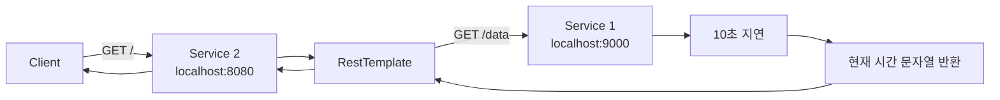
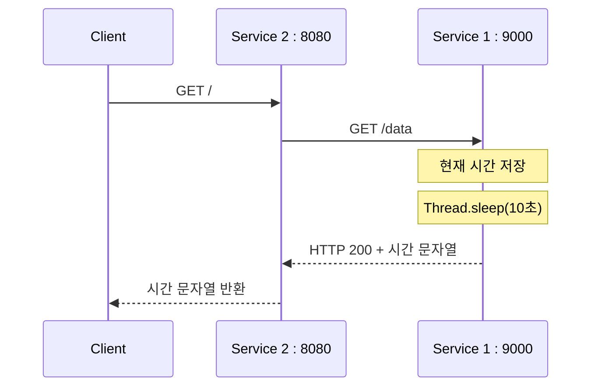
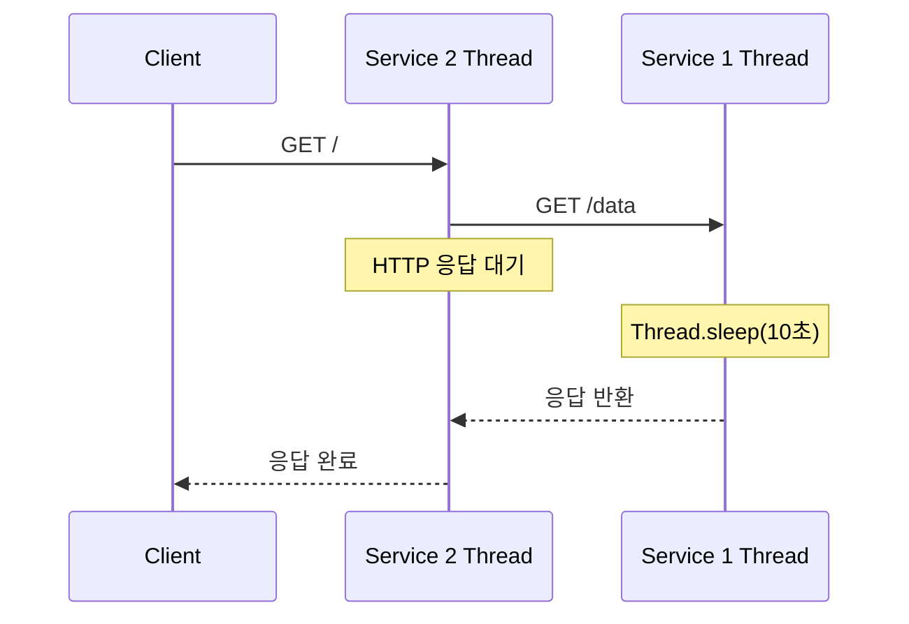
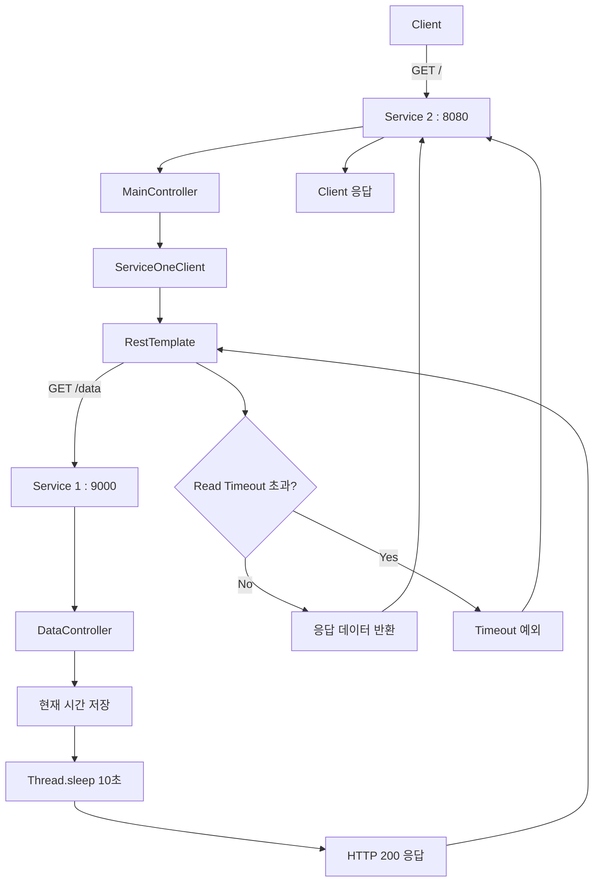

# Resilience4J - 4. 호출용 API 서버 구축
[https://youtu.be/mN8RtsKAaBI?si=_531aAqFkeubKloC](https://youtu.be/mN8RtsKAaBI?si=_531aAqFkeubKloC)

# Resilience4J - 4. 호출용 API 서버 구축
* toc
{:toc}

---

## Resilience4j 장애 재현 환경 구축: Spring Boot API 서버와 RestTemplate 통신

마이크로서비스 아키텍처에서는 하나의 서비스가 다른 서비스의 API를 호출하는 일이 빈번하게 발생한다.

예를 들어 주문 서비스에서 상품 정보를 확인하거나, 결제 서비스에서 외부 PG의 승인 결과를 조회하는 상황을 생각해보자.

```text
주문 서비스
    ↓
상품 서비스
    ↓
상품 정보 반환
```

정상적인 상황에서는 요청에 대한 응답이 빠르게 반환되기 때문에 특별한 문제가 발생하지 않는다.

하지만 실제 운영 환경에서는 외부 서비스가 항상 정상적으로 응답한다는 보장이 없다.

서버가 중단되거나 네트워크 연결에 실패할 수도 있고, 요청은 정상적으로 처리되지만 응답이 지나치게 오래 걸릴 수도 있다.

특히 **응답이 느려지는 상황은 HTTP 상태 코드만으로 장애를 판단하기 어렵다.**

예를 들어 다음 두 요청을 비교해보자.

| 구분    | HTTP 상태 코드 | 응답 시간    |
| ----- | ---------- | -------- |
| 정상 요청 | 200 OK     | 100ms    |
| 지연 요청 | 200 OK     | 10,000ms |

두 요청 모두 HTTP 200을 반환한다.

하지만 두 번째 요청은 10초 동안 응답하지 않았기 때문에 사용자 경험과 서버 리소스 측면에서 문제가 발생할 수 있다.

이러한 상황에 대응하기 위해 사용할 수 있는 것이 Resilience4j의 CircuitBreaker다.

CircuitBreaker는 외부 호출의 실패율이나 느린 호출 비율을 측정하고, 설정한 임계값을 초과하면 해당 의존성에 대한 추가 호출을 일시적으로 차단한다.

다만 CircuitBreaker의 동작을 확인하려면 실제로 실패하거나 지연되는 외부 API가 필요하다.

이번에는 **Spring Boot 애플리케이션 두 개를 구성하여 서비스 간 HTTP 통신을 구현하고, 호출 대상 서비스에서 의도적으로 10초의 지연을 발생시키는 환경**을 만들어보자.

---

## 전체 아키텍처

이번에 구성할 시스템은 두 개의 Spring Boot 애플리케이션으로 이루어진다.

**Service 1은 데이터를 제공하는 API 서버**이고, **Service 2는 Service 1을 호출하는 클라이언트 역할의 서버**다.

| 구분    | Service 1       | Service 2                 |
| ----- | --------------- | ------------------------- |
| 역할    | 데이터 제공          | 외부 API 호출                 |
| Port  | 9000            | 8080                      |
| API   | `GET /data`     | `GET /`                   |
| 주요 기능 | 현재 시간 반환, 응답 지연 | RestTemplate을 이용한 HTTP 호출 |
| 장애 대응 | 장애를 재현하는 대상     | 향후 Resilience4j 적용 대상     |

전체 요청 흐름은 다음과 같다.



사용자가 Service 2의 루트 경로로 요청하면 내부적으로 Service 1의 `/data` API를 호출한다.

Service 1에서는 요청을 받은 뒤 10초 동안 대기하고, 현재 시간 정보를 문자열로 반환한다.

Service 2는 이 응답을 받아 사용자에게 그대로 전달한다.

여기서 중요한 것은 **Service 2에 직접적인 장애가 없어도 Service 1의 응답 지연 때문에 Service 2의 응답 시간이 증가한다는 점**이다.

이 구조를 이용하면 이후 CircuitBreaker가 어떤 상황에서 필요한지 확인할 수 있다.

---

## 왜 별도의 API 서버를 구성할까?

Resilience4j는 Java 메서드에도 적용할 수 있지만, 실제 MSA에서는 네트워크를 통해 다른 서비스를 호출하는 상황에서 많이 사용된다.

네트워크 호출에는 같은 JVM 내부의 메서드 호출과 다른 특성이 존재한다.

예를 들어 다음과 같은 일반적인 Java 메서드 호출을 생각해보자.

```java
public String getData() {
    return "Hello";
}
```

이 메서드는 동일한 애플리케이션 내부에서 실행된다.

반면 다음 코드는 다른 서버에 HTTP 요청을 전송한다.

```java
public String getData() {
    return restTemplate.getForObject(
            "/data",
            String.class
    );
}
```

이 경우에는 다양한 외부 요인의 영향을 받는다.

| 상황         | 발생할 수 있는 문제            |
| ---------- | ---------------------- |
| 대상 서버 종료   | Connection Refused     |
| 네트워크 연결 지연 | Connect Timeout        |
| API 처리 지연  | Read Timeout 또는 응답 지연  |
| 서버 내부 오류   | HTTP 500               |
| 잘못된 API 경로 | HTTP 404               |
| 요청량 급증     | Thread 및 Connection 고갈 |

단순한 내부 메서드 호출만으로는 이러한 상황을 충분히 재현하기 어렵다.

따라서 호출하는 서비스와 호출받는 서비스를 분리하면 실제 MSA에서 발생하는 문제를 더 구체적으로 확인할 수 있다.

---

## Spring Boot 프로젝트 생성

먼저 데이터를 제공하는 Service 1 프로젝트를 생성한다.

Spring Initializr 또는 IntelliJ IDEA에서 다음과 같이 설정한다.

| 항목          | 값                      |
| ----------- | ---------------------- |
| Project     | Gradle - Groovy        |
| Language    | Java                   |
| Spring Boot | 3.2.0                  |
| Group       | com.example            |
| Artifact    | service-one            |
| Package     | com.example.serviceone |
| Packaging   | Jar                    |
| Java        | 17                     |

이번 프로젝트는 외부 요청을 받아 문자열을 반환하는 간단한 API 서버다.

따라서 복잡한 의존성은 필요하지 않다.

기본적으로 Spring Web만 추가하면 된다.

Resilience4j 관련 의존성은 **호출 대상의 장애를 감지하고 대응할 Service 2에 적용할 예정**이므로 Service 1에는 필수적이지 않다.

### build.gradle

`build.gradle`은 다음과 같이 작성한다.

```gradle
plugins {
    id 'java'
    id 'org.springframework.boot' version '3.2.0'
    id 'io.spring.dependency-management' version '1.1.4'
}

group = 'com.example'
version = '0.0.1-SNAPSHOT'

java {
    toolchain {
        languageVersion = JavaLanguageVersion.of(17)
    }
}

repositories {
    mavenCentral()
}

dependencies {
    implementation 'org.springframework.boot:spring-boot-starter-web'

    testImplementation 'org.springframework.boot:spring-boot-starter-test'
}

tasks.named('test') {
    useJUnitPlatform()
}
```

`spring-boot-starter-web`은 Spring MVC 기반 웹 애플리케이션에 필요한 기본 구성을 제공한다.

내부적으로 Spring MVC와 내장 Servlet Container 등을 이용해 HTTP 요청을 처리할 수 있도록 구성된다.

따라서 별도의 Tomcat 서버를 설치하지 않아도 Spring Boot 애플리케이션을 실행할 수 있다.

---

## 프로젝트 구조

프로젝트를 생성한 뒤 다음과 같은 구조로 구성한다.

```text
service-one
├── build.gradle
├── settings.gradle
├── gradlew
│
└── src
    └── main
        ├── java
        │   └── com/example/serviceone
        │       ├── ServiceOneApplication.java
        │       │
        │       └── controller
        │           └── DataController.java
        │
        └── resources
            └── application.properties
```

현재 필요한 클래스는 두 개다.

`ServiceOneApplication`은 Spring Boot 애플리케이션을 실행한다.

`DataController`는 외부 요청을 받아 현재 시간을 반환하는 API를 제공한다.

실제 프로젝트라면 Controller와 Service 계층을 분리하겠지만, 현재는 네트워크 지연을 재현하는 것이 목적이므로 단순하게 구성한다.

---

## Spring Boot Application 클래스

먼저 애플리케이션 실행 클래스를 작성한다.

```java
package com.example.serviceone;

import org.springframework.boot.SpringApplication;
import org.springframework.boot.autoconfigure.SpringBootApplication;

@SpringBootApplication
public class ServiceOneApplication {

    public static void main(String[] args) {
        SpringApplication.run(
                ServiceOneApplication.class,
                args
        );
    }
}
```

`@SpringBootApplication`은 Spring Boot 애플리케이션의 기본 설정과 컴포넌트 스캔을 활성화한다.

따라서 하위 패키지에 존재하는 `DataController`도 Spring Bean으로 등록할 수 있다.

---

## DataController 구현

이제 Service 1의 핵심인 `DataController`를 작성해보자.

요구사항은 간단하다.

사용자가 다음 API를 호출한다.

```http
GET /data
```

서버는 현재 시간 정보를 문자열로 반환한다.

먼저 지연 없이 동작하는 코드를 작성해보자.

```java
package com.example.serviceone.controller;

import java.time.LocalDateTime;

import org.springframework.web.bind.annotation.GetMapping;
import org.springframework.web.bind.annotation.RestController;

@RestController
public class DataController {

    @GetMapping("/data")
    public String getData() {

        LocalDateTime now = LocalDateTime.now();

        return now.toString();
    }
}
```

이 코드에는 두 가지 주요 Annotation이 있다.

### @RestController

```java
@RestController
```

`@RestController`는 HTTP 요청을 처리하고, 반환값을 응답 본문에 작성하도록 하는 Annotation이다.

다음 두 Annotation을 결합한 형태로 이해할 수 있다.

```java
@Controller
@ResponseBody
```

따라서 `getData()`에서 반환한 String은 View 이름이 아니라 HTTP Response Body에 작성된다.

### @GetMapping

```java
@GetMapping("/data")
```

해당 메서드를 다음 HTTP 요청과 연결한다.

```http
GET /data
```

클라이언트가 `/data` 경로로 GET 요청을 보내면 `getData()` 메서드가 실행된다.

---

## LocalDateTime으로 현재 시간 반환하기

현재 시간은 다음 코드를 통해 가져온다.

```java
LocalDateTime now = LocalDateTime.now();
```

`LocalDateTime.now()`는 애플리케이션이 실행되는 환경의 기본 시간대를 기준으로 현재 날짜와 시간을 반환한다.

예를 들어 다음과 같은 값이다.

```text
2026-10-16T09:30:25.123456
```

이 값은 `LocalDateTime` 타입이다.

하지만 Controller의 반환 타입이 String이므로 문자열로 변환해야 한다.

```java
return now.toString();
```

또는 다음과 같이 작성할 수도 있다.

```java
return String.valueOf(now);
```

두 방식 모두 날짜와 시간 정보를 문자열로 표현할 수 있다.

따라서 최종적으로 다음과 같은 응답을 반환한다.

```http
HTTP/1.1 200 OK
Content-Type: text/plain;charset=UTF-8

2026-10-16T09:30:25.123456
```

위 시간은 응답 형식을 보여주기 위한 예시다.

실제 값은 요청 시점과 서버 환경에 따라 달라진다.

---

## 의도적으로 10초의 응답 지연 만들기

이제 정상적인 API에 의도적으로 응답 지연을 추가해보자.

Java에서는 `Thread.sleep()`을 이용해 현재 Thread를 일정 시간 대기시킬 수 있다.

```java
Thread.sleep(10_000);
```

`Thread.sleep()`의 인자는 밀리초(ms) 단위다.

따라서 `10_000`은 10,000ms를 의미한다.

즉 약 10초 동안 현재 Thread를 대기시킨다.

```text
HTTP 요청 수신
      ↓
Controller 실행
      ↓
Thread.sleep(10_000)
      ↓
약 10초 대기
      ↓
응답 반환
```

여기서 중요한 것은 `Thread.sleep()`이 비동기 작업을 생성하는 것이 아니라는 점이다.

현재 메서드를 실행 중인 Thread가 대기 상태에 들어간다.

Spring MVC의 일반적인 동기 요청 처리 구조에서는 Servlet Container의 요청 처리 Thread가 이 메서드를 실행한다.

따라서 요청이 많아질 경우 Thread 점유 문제가 발생할 수 있다.

이번에는 이러한 지연 상황을 의도적으로 재현하기 위해 사용한다.

---

## DataController 최종 코드

이제 10초의 지연을 포함한 Controller를 완성해보자.

```java
package com.example.serviceone.controller;

import java.time.LocalDateTime;

import org.springframework.http.HttpStatus;
import org.springframework.web.bind.annotation.GetMapping;
import org.springframework.web.bind.annotation.RestController;
import org.springframework.web.server.ResponseStatusException;

@RestController
public class DataController {

    @GetMapping("/data")
    public String getData() {

        String requestTime = LocalDateTime.now().toString();

        try {
            Thread.sleep(10_000);
        } catch (InterruptedException e) {

            Thread.currentThread().interrupt();

            throw new ResponseStatusException(
                    HttpStatus.SERVICE_UNAVAILABLE,
                    "요청 처리가 중단되었습니다.",
                    e
            );
        }

        return requestTime;
    }
}
```

코드를 순서대로 살펴보자.

먼저 현재 시간을 문자열로 변환한다.

```java
String requestTime = LocalDateTime.now().toString();
```

이 값은 **Controller 메서드가 실행되기 시작한 시점의 시간**이다.

다음으로 10초 동안 대기한다.

```java
Thread.sleep(10_000);
```

대기가 정상적으로 완료되면 처음에 저장한 시간 문자열을 반환한다.

```java
return requestTime;
```

따라서 다음과 같은 흐름이 만들어진다.

```text
09:30:00

GET /data

      ↓

requestTime = 09:30:00

      ↓

Thread.sleep(10_000)

      ↓

09:30:10

      ↓

Response Body = 09:30:00
```

여기서 주의할 점은 **응답에 포함된 시간과 실제 응답이 완료된 시간이 다를 수 있다는 것**이다.

현재 코드는 지연이 시작되기 전에 시간을 저장하기 때문이다.

만약 응답이 완료되는 시점의 시간을 반환하고 싶다면 다음처럼 순서를 변경하면 된다.

```java
Thread.sleep(10_000);

return LocalDateTime.now().toString();
```

현재 예제에서는 요청을 처리하기 시작한 시각을 저장한 뒤 10초 후 반환하도록 구성한다.

### InterruptedException 처리

`Thread.sleep()`은 `InterruptedException`을 발생시킬 수 있다.

이 예외는 대기 중인 Thread에 인터럽트가 전달되었을 때 발생한다.

예제에서는 다음 코드를 사용했다.

```java
Thread.currentThread().interrupt();
```

이는 인터럽트 상태를 복원하기 위한 처리다.

이후 `ResponseStatusException`을 발생시켜 요청이 정상적으로 완료되지 않았음을 표현한다.

Java의 `InterruptedException` 문서에서도 예외를 포착한 뒤 다시 전달하거나 Thread의 인터럽트 상태를 복원하는 방식을 안내한다.

실제 애플리케이션에서는 인터럽트를 무시하고 정상 응답을 반환하지 않도록 주의해야 한다.

---

## 서버 포트 설정

Service 1은 9000 포트에서 실행하도록 구성한다.

`application.properties`에 다음 설정을 추가한다.

```properties
spring.application.name=service-one

server.port=9000
```

Spring Boot는 기본적으로 8080 포트를 사용한다.

하지만 Service 2가 이미 8080 포트를 사용할 예정이므로 Service 1은 다른 포트에서 실행해야 한다.

현재 구성은 다음과 같다.

```text
Service 1
→ localhost:9000

Service 2
→ localhost:8080
```

따라서 각각 독립적인 Spring Boot 프로세스로 실행할 수 있다.

---

## Service 1 실행하기

이제 Service 1을 실행한다.

프로젝트 디렉터리에서 다음 명령을 입력한다.

```bash
./gradlew bootRun
```

정상적으로 실행되면 Spring Boot의 내장 Tomcat이 9000 포트에서 요청을 받는다.

이제 다음 URL로 요청할 수 있다.

```text
http://localhost:9000/data
```

터미널에서는 `curl`을 이용해 확인한다.

```bash
curl -i http://localhost:9000/data
```

요청을 보낸 뒤 약 10초가 지나면 다음과 같은 응답을 받을 수 있다.

```http
HTTP/1.1 200 OK
Content-Type: text/plain;charset=UTF-8

2026-10-16T09:30:00.123456
```

실제 날짜와 시간은 요청마다 달라진다.

중요한 것은 다음 두 가지다.

첫째, Service 1이 HTTP 200으로 정상 응답한다.

둘째, 응답이 반환되기까지 약 10초가 걸린다.

즉 의도적으로 **HTTP 요청은 성공하지만 응답이 느린 상황**을 만든 것이다.

---

## curl로 응답 시간 측정하기

브라우저에서는 응답이 느리다는 것을 체감할 수 있지만, 정확한 소요 시간을 확인하기는 어렵다.

이때 `curl`의 `-w` 옵션을 사용하면 HTTP 요청에 걸린 시간을 출력할 수 있다.

다음 명령을 실행해보자.

```bash
curl -sS \
  -o /dev/null \
  -w 'HTTP Status: %{http_code}\nTotal Time: %{time_total}s\n' \
  http://localhost:9000/data
```

각 옵션의 의미는 다음과 같다.

| 옵션              | 의미                  |
| --------------- | ------------------- |
| `-sS`           | 진행률은 숨기고 오류 메시지는 표시 |
| `-o /dev/null`  | 응답 본문을 화면에 출력하지 않음  |
| `-w`            | 지정한 형식으로 요청 결과 출력   |
| `%{http_code}`  | HTTP 상태 코드          |
| `%{time_total}` | 전체 요청 소요 시간         |

정상적인 경우 다음과 유사한 결과를 확인할 수 있다.

```text
HTTP Status: 200
Total Time: 10.012345s
```

위 값은 예시다.

실제 소요 시간은 서버 부하, 네트워크, 스케줄링 등에 따라 조금씩 달라질 수 있다.

이렇게 하면 HTTP 상태 코드가 200이어도 응답 시간이 지나치게 길다는 사실을 확인할 수 있다.

---

## Service 2에서 Service 1 호출하기

이제 앞에서 만든 Service 2와 연결해보자.

Service 2는 8080 포트에서 실행되며, `RestTemplate`을 이용해 Service 1의 API를 호출한다.

전체 구조는 다음과 같다.



Service 2는 Service 1의 응답이 돌아올 때까지 대기한다.

따라서 Service 1에서 발생시킨 10초의 지연이 Service 2의 응답 시간에도 반영된다.

다만 여기에는 확인해야 할 설정이 하나 있다.

바로 RestTemplate의 Timeout이다.

---

## 이전 RestTemplate 설정과의 차이

앞에서 Service 2의 RestTemplate을 다음과 같이 구성했다.

```java
return builder
        .rootUri(baseUrl)
        .setConnectTimeout(Duration.ofSeconds(1))
        .setReadTimeout(Duration.ofSeconds(2))
        .build();
```

여기서 Read Timeout은 2초다.

그런데 Service 1은 10초 동안 응답을 반환하지 않는다.

```text
Service 1 응답 지연
→ 약 10초

Service 2 Read Timeout
→ 2초
```

이 상태에서 Service 2가 Service 1을 호출하면 어떻게 될까?

Service 2는 10초 뒤 응답을 받는 대신 **약 2초 후 Read Timeout 예외가 발생할 가능성이 높다.**

```text
Service 2
    ↓
RestTemplate
    ↓
GET /data
    ↓
Service 1에서 10초 지연
    ↓
Service 2는 2초만 대기
    ↓
Read Timeout
    ↓
호출 실패
```

따라서 이번처럼 10초 지연된 정상 응답을 확인하려면 Service 2의 Read Timeout을 더 길게 설정해야 한다.

이것은 Resilience4j 동작의 차이가 아니라 HTTP Client의 Timeout 설정에 따른 결과다.

---

## RestTemplate Read Timeout 수정하기

이번에는 Read Timeout을 15초로 변경한다.

```java
.setReadTimeout(Duration.ofSeconds(15))
```

이렇게 하면 10초 동안 지연되는 Service 1의 응답을 받을 수 있도록 충분한 대기 시간을 제공한다.

Service 2의 RestTemplate 설정을 다음과 같이 수정한다.

```java
package com.example.servicetwo.config;

import java.time.Duration;

import org.springframework.beans.factory.annotation.Value;
import org.springframework.boot.web.client.RestTemplateBuilder;
import org.springframework.context.annotation.Bean;
import org.springframework.context.annotation.Configuration;
import org.springframework.web.client.RestTemplate;

@Configuration
public class RestClientConfig {

    @Bean
    public RestTemplate serviceOneRestTemplate(
            RestTemplateBuilder builder,
            @Value("${clients.service-one.base-url}") String baseUrl
    ) {

        return builder
                .rootUri(baseUrl)
                .setConnectTimeout(Duration.ofSeconds(1))
                .setReadTimeout(Duration.ofSeconds(15))
                .build();
    }
}
```

Spring Boot 3.2의 `RestTemplateBuilder`는 `setConnectTimeout(Duration)`과 `setReadTimeout(Duration)`을 통해 기반 HTTP Client의 연결·읽기 Timeout을 설정할 수 있다.

이제 Service 2는 Service 1의 10초 지연 응답을 받아 반환할 수 있다.

여기서 15초라는 값은 지연을 확인하기 위한 설정이다.

실제 운영에서는 외부 API의 정상적인 처리 시간과 전체 요청 처리 시간 예산을 고려해서 Timeout을 결정해야 한다.

---

## Service 2의 application.yml

Service 2에는 Service 1의 주소를 설정한다.

```yaml
spring:
  application:
    name: service-two

server:
  port: 8080

clients:
  service-one:
    base-url: http://localhost:9000
```

다음 설정은 Service 1의 기본 URL을 의미한다.

```yaml
clients:
  service-one:
    base-url: http://localhost:9000
```

RestTemplateBuilder에서는 이 값을 `rootUri()`에 전달했다.

```java
.rootUri(baseUrl)
```

따라서 Service 1의 `/data` API를 호출할 때 전체 URL을 반복해서 작성하지 않아도 된다.

---

## ServiceOneClient 구현

이제 RestTemplate을 이용해 Service 1을 호출하는 클래스를 작성한다.

```java
package com.example.servicetwo.client;

import org.springframework.beans.factory.annotation.Qualifier;
import org.springframework.stereotype.Component;
import org.springframework.web.client.RestTemplate;

@Component
public class ServiceOneClient {

    private final RestTemplate restTemplate;

    public ServiceOneClient(
            @Qualifier("serviceOneRestTemplate")
            RestTemplate restTemplate
    ) {
        this.restTemplate = restTemplate;
    }

    public String getData() {

        return restTemplate.getForObject(
                "/data",
                String.class
        );
    }
}
```

핵심 코드는 다음 부분이다.

```java
return restTemplate.getForObject(
        "/data",
        String.class
);
```

`getForObject()`는 GET 요청을 보내고 응답 본문을 지정한 타입으로 변환해 반환한다.

여기서는 반환 타입으로 `String.class`를 지정했다.

따라서 Service 1의 응답이 다음과 같다면:

```text
2026-10-16T09:30:00.123456
```

해당 문자열이 그대로 반환된다.

`RestTemplate.getForObject()`는 HTTP GET 요청의 응답 본문을 지정한 타입으로 변환하는 기능을 제공한다.

---

## MainController 구현

이제 Service 2의 Controller에서 `ServiceOneClient`를 호출한다.

```java
package com.example.servicetwo.controller;

import com.example.servicetwo.client.ServiceOneClient;
import org.springframework.web.bind.annotation.GetMapping;
import org.springframework.web.bind.annotation.RestController;

@RestController
public class MainController {

    private final ServiceOneClient serviceOneClient;

    public MainController(ServiceOneClient serviceOneClient) {
        this.serviceOneClient = serviceOneClient;
    }

    @GetMapping("/")
    public String main() {

        return serviceOneClient.getData();
    }
}
```

이 코드에서 Controller는 HTTP 요청을 받는 역할만 담당한다.

Service 1에 대한 실제 HTTP 호출은 `ServiceOneClient`가 수행한다.

```text
MainController
    ↓
ServiceOneClient
    ↓
RestTemplate
    ↓
Service 1
```

외부 API 호출을 별도의 클래스로 분리한 이유는 이후 Resilience4j를 적용할 때도 중요하다.

CircuitBreaker를 Controller 전체에 적용할 수도 있지만, 외부 서비스 호출 단위로 적용하면 장애의 영향을 받는 범위를 더 명확하게 관리할 수 있다.

---

## 두 서버를 실행하고 통신 확인하기

이제 두 Spring Boot 애플리케이션을 실행한다.

먼저 Service 1을 실행한다.

```bash
cd service-one

./gradlew bootRun
```

Service 1이 9000 포트에서 실행되는지 확인한다.

```bash
curl -i http://localhost:9000/data
```

약 10초 뒤 현재 시간 문자열이 반환된다.

다음으로 별도의 터미널에서 Service 2를 실행한다.

```bash
cd service-two

./gradlew bootRun
```

Service 2는 8080 포트에서 실행된다.

이제 Service 2의 루트 경로를 호출한다.

```bash
curl -i http://localhost:8080/
```

이 요청은 Service 2의 Controller로 전달된다.

Service 2는 RestTemplate을 이용해 Service 1의 `/data` API를 호출한다.

Service 1에서 10초 동안 대기한 뒤 응답을 반환한다.

정상적인 경우 다음과 같은 결과를 확인할 수 있다.

```http
HTTP/1.1 200 OK
Content-Type: text/plain;charset=UTF-8

2026-10-16T09:30:00.123456
```

여기서 중요한 것은 **8080 포트로 요청했지만 실제 데이터는 9000 포트의 Service 1에서 만들어졌다는 점**이다.

요청 흐름은 다음과 같다.

```text
Client
    ↓
GET localhost:8080/
    ↓
Service 2
    ↓
RestTemplate
    ↓
GET localhost:9000/data
    ↓
Service 1
    ↓
10초 대기
    ↓
응답 반환
    ↓
Service 2
    ↓
Client
```

Service 2 자체에서는 `Thread.sleep()`을 호출하지 않는다.

하지만 Service 1의 응답을 기다리는 동안 Service 2의 요청 처리도 지연된다.

---

## Service 1과 Service 2의 응답 시간 비교

이번에는 두 서버의 응답 시간을 비교해보자.

먼저 Service 1에 직접 요청한다.

```bash
curl -sS \
  -o /dev/null \
  -w 'Service 1: %{time_total}s\n' \
  http://localhost:9000/data
```

예상되는 결과는 다음과 유사하다.

```text
Service 1: 10.012345s
```

이번에는 Service 2를 통해 요청한다.

```bash
curl -sS \
  -o /dev/null \
  -w 'Service 2: %{time_total}s\n' \
  http://localhost:8080/
```

예상되는 결과는 다음과 같다.

```text
Service 2: 10.035678s
```

위 값은 설명을 위한 예시이며 실제 실행 결과는 다를 수 있다.

두 요청 모두 약 10초가 걸린다.

다만 Service 2에서는 추가적인 HTTP 통신과 내부 처리 시간이 발생하므로 Service 1에 직접 접근하는 것보다 약간 더 오래 걸릴 수 있다.

이 결과를 통해 다음 사실을 확인할 수 있다.

**동기 방식으로 다른 서비스를 호출하는 경우, 하위 서비스의 응답 지연은 상위 서비스의 응답 시간에도 직접적인 영향을 준다.**

---

## RestTemplate에서 동기 호출이 문제가 되는 이유

RestTemplate은 일반적인 사용 방식에서 동기식 HTTP Client로 동작한다.

예를 들어 다음 코드가 있다고 생각해보자.

```java
public String getData() {

    return restTemplate.getForObject(
            "/data",
            String.class
    );
}
```

이 메서드를 실행한 Thread는 외부 HTTP 호출이 완료되거나 예외가 발생할 때까지 대기한다.

전체 흐름은 다음과 같다.



문제는 요청이 하나일 때보다 여러 개가 동시에 발생할 때 더 커진다.

예를 들어 사용자가 동시에 100개의 요청을 보낸다고 가정하자.

```text
Request 1  → Service 1 대기

Request 2  → Service 1 대기

Request 3  → Service 1 대기

...

Request 100 → Service 1 대기
```

Service 2에서는 여러 요청 처리 Thread가 외부 응답을 기다리게 된다.

Service 1에서도 여러 Servlet Thread가 `Thread.sleep()` 상태로 대기하게 된다.

이러한 상황이 지속되면 사용 가능한 Thread 수가 감소하고, 새로운 요청이 처리 대기 상태에 놓일 수 있다.

따라서 **하위 서비스의 지연은 단순히 응답 시간이 느려지는 문제를 넘어 리소스 고갈로 이어질 가능성이 있다.**

---

## HTTP 200이어도 장애 상황일 수 있다

이번에 구현한 `/data` API는 HTTP 200을 반환한다.

```http
HTTP/1.1 200 OK
```

하지만 응답 시간이 10초다.

여기서 중요한 질문이 있다.

**HTTP 200을 반환한 요청은 항상 정상적인 요청일까?**

그렇지 않다.

HTTP 상태 코드는 요청이 HTTP 프로토콜 관점에서 어떻게 처리되었는지를 표현한다.

반면 서비스의 정상적인 응답 시간은 별도의 품질 기준이다.

예를 들어 상품 조회 API의 응답 시간 목표가 500ms라고 가정하자.

| 응답 시간    | HTTP 상태 | 서비스 관점   |
| -------- | ------- | -------- |
| 100ms    | 200     | 정상       |
| 300ms    | 200     | 정상       |
| 1,000ms  | 200     | 응답 목표 초과 |
| 5,000ms  | 200     | 심각한 지연   |
| 10,000ms | 200     | 성능 장애 가능 |

Resilience4j의 CircuitBreaker는 이러한 상황을 Slow Call로 기록할 수 있다.

예를 들어 다음과 같은 설정을 적용했다고 생각해보자.

```yaml
resilience4j:
  circuitbreaker:
    instances:
      serviceOne:
        slidingWindowSize: 10
        minimumNumberOfCalls: 5
        slowCallDurationThreshold: 3s
        slowCallRateThreshold: 50
```

이 설정에서는 3초를 초과한 호출을 Slow Call로 분류한다.

그리고 충분한 호출 결과가 쌓인 뒤 Slow Call 비율이 설정한 임계값 이상이 되면 CircuitBreaker를 OPEN 상태로 전환할 수 있다.

Service 1의 `/data` API는 약 10초가 걸리므로 정상 응답을 반환하더라도 Slow Call로 집계될 수 있다.

단, 현재 프로젝트에는 아직 해당 설정과 CircuitBreaker 연결을 적용하지 않았다.

이 구성은 이후 지연 장애를 감지할 때 사용할 수 있는 정책의 예시다.

---

## Read Timeout을 2초로 변경하면 어떻게 될까?

이번에는 Service 2의 RestTemplate 설정을 다시 변경해보자.

```java
.setReadTimeout(Duration.ofSeconds(2))
```

Service 1은 여전히 10초 동안 대기한다.

그러면 다음 상황이 발생한다.

```text
Service 2
    ↓
RestTemplate 요청
    ↓
Service 1
    ↓
10초 대기
```

Service 2에서는 약 2초 후 Read Timeout이 발생할 수 있다.

```text
Service 2

2초 경과

    ↓

Read Timeout

    ↓

예외 발생
```

반면 Service 1은 이미 시작한 작업을 계속 수행하고 있을 수 있다.

따라서 **Service 2의 Timeout이 발생했다고 해서 Service 1에서 실행 중인 작업이 반드시 취소되는 것은 아니다.**

이 차이는 실제 MSA에서 매우 중요하다.

특히 결제 승인이나 주문 생성처럼 상태를 변경하는 API라면 호출자가 Timeout을 받았더라도 서버에서는 작업이 완료되었을 수 있다.

이런 상황에서 무조건 재시도하면 중복 처리 문제가 발생할 수 있다.

---

## 발생할 수 있는 예외

RestTemplate에서는 외부 API 호출 중 다양한 예외가 발생할 수 있다.

대표적으로 다음과 같은 예외가 있다.

| 예외                         | 발생 상황                     |
| -------------------------- | ------------------------- |
| `ResourceAccessException`  | 연결 실패, Timeout 등 I/O 오류   |
| `HttpClientErrorException` | 기본 오류 처리기에서 4xx 응답 처리     |
| `HttpServerErrorException` | 기본 오류 처리기에서 5xx 응답 처리     |
| `RestClientException`      | RestTemplate 관련 예외의 상위 타입 |

예를 들어 Read Timeout이 발생하면 일반적으로 `ResourceAccessException`으로 전달될 수 있다.

```text
RestTemplate

    ↓

Read Timeout

    ↓

ResourceAccessException
```

Service 2에서 이 예외를 별도로 처리하지 않는다면 일반적인 Spring Boot 설정에서는 최종 클라이언트에 HTTP 500 오류를 반환할 수 있다.

```http
HTTP/1.1 500 Internal Server Error
```

즉 다음과 같이 구분해야 한다.

**Service 1에 직접 요청**

```text
10초 지연
    ↓
HTTP 200
```

**Service 2를 통해 요청하고 Read Timeout이 2초인 경우**

```text
약 2초 대기
    ↓
Read Timeout
    ↓
Service 2에서 예외 발생
    ↓
HTTP 500 가능
```

같은 외부 서비스에 대한 요청이라도 HTTP Client의 Timeout 설정에 따라 결과가 달라질 수 있다.

---

## CircuitBreaker와 Timeout의 역할 구분

앞에서 Resilience4j의 여러 모듈을 살펴봤다.

여기서 특히 중요한 것이 CircuitBreaker와 Timeout의 차이다.

CircuitBreaker는 외부 호출의 실패율이나 느린 호출 비율을 집계하여 이후 호출을 차단하는 기능이다.

반면 Timeout은 현재 호출을 얼마나 기다릴지 제한하는 기능이다.

두 기능은 서로 다른 문제를 해결한다.

| 항목           | CircuitBreaker    | Timeout              |
| ------------ | ----------------- | -------------------- |
| 주요 목적        | 반복되는 장애 전파 방지     | 장시간 대기 방지            |
| 판단 기준        | 실패율, Slow Call 비율 | 경과 시간                |
| 현재 호출의 대기 제한 | 직접 보장하지 않음        | 설정된 대기 제한 적용         |
| 이후 호출 차단     | 가능                | 자체적인 회로 차단 기능 없음     |
| 주요 활용        | 장애가 지속되는 의존성 보호   | 느린 HTTP 호출에 대한 시간 제한 |

예를 들어 외부 API가 10초 동안 응답하지 않는 상황에서 Read Timeout이 2초라면 현재 호출은 Timeout으로 종료될 수 있다.

그리고 이러한 Timeout이 반복된다면 CircuitBreaker는 예외를 실패로 집계해 회로를 열 수 있다.

```text
외부 API 응답 지연
        ↓
Read Timeout
        ↓
실패로 기록
        ↓
실패율 증가
        ↓
CircuitBreaker OPEN
        ↓
이후 호출 차단
```

반대로 Read Timeout이 15초이고 외부 서비스가 10초 후 정상 응답한다면 현재 호출은 성공하지만 CircuitBreaker에서는 Slow Call로 기록할 수 있다.

```text
외부 API 응답 지연
        ↓
10초 후 HTTP 200
        ↓
호출은 성공
        ↓
Slow Call로 집계
        ↓
느린 호출 비율 증가
        ↓
CircuitBreaker OPEN 가능
```

따라서 실패율과 Slow Call 비율은 서로 다른 장애 신호다.

---

## 실무에서의 활용

이번에 만든 두 서버 구조는 간단하지만 실제 운영 환경에서 발생하는 여러 장애 문제와 연결된다.

### 1. 지연 장애를 재현하는 환경으로 활용할 수 있다

외부 서비스에서 `Thread.sleep()`을 이용하면 일정 시간 응답을 지연시키는 상황을 만들 수 있다.

이후 Service 2에 CircuitBreaker를 적용하고 Slow Call 비율에 따라 상태가 변경되는지 확인할 수 있다.

### 2. HTTP 상태 코드와 응답 시간을 함께 확인한다

HTTP 200이라고 해서 서비스가 정상적인 성능을 제공한다고 판단해서는 안 된다.

실제 운영에서는 응답 시간과 오류율을 함께 확인해야 한다.

### 3. Timeout은 서비스별로 다르게 설정한다

상품 조회, 결제 승인, 외부 통계 조회는 정상적인 응답 시간이 다를 수 있다.

따라서 모든 외부 API에 동일한 Timeout을 적용하기보다 기능별 요구사항을 고려해야 한다.

### 4. 동기 호출은 Thread 점유를 고려한다

RestTemplate은 동기식 HTTP Client다.

외부 서비스의 응답이 지연되면 호출한 Thread도 대기한다.

따라서 서버의 동시 처리량과 Thread Pool 크기, 외부 API 응답 시간을 함께 고려해야 한다.

### 5. Fallback이 새로운 장애를 만들지 않도록 한다

외부 API가 실패했을 때 다른 저장소를 호출하도록 구성할 수 있다.

하지만 모든 요청이 대체 저장소에 집중되면 새로운 장애가 발생할 수 있다.

Fallback에도 별도의 용량 제한이 필요할 수 있다.

### 6. Timeout 이후의 처리 상태를 확인한다

특히 결제나 주문 같은 상태 변경 요청에서는 호출자가 Timeout을 받았더라도 상대 서비스에서 작업이 완료되었을 수 있다.

따라서 멱등성 키와 결과 조회, 중복 처리 방지 정책 등을 함께 설계해야 한다.

### 7. LocalDateTime은 시간대 정보를 포함하지 않는다

현재 예제에서는 다음 코드를 사용했다.

```java
LocalDateTime.now()
```

이 값은 애플리케이션의 기본 시간대를 기준으로 날짜와 시간을 생성하지만, 결과 자체에는 시간대나 UTC Offset 정보가 포함되지 않는다.

따라서 여러 국가나 서버 환경에서 발생한 이벤트 시간을 비교해야 한다면 `Instant` 또는 `OffsetDateTime`을 사용하는 것이 더 적절할 수 있다.

### 8. Thread.sleep()은 운영 환경에서의 장애 처리 방법이 아니다

이번에는 응답 지연을 재현하기 위해 사용했다.

실제 비즈니스 로직에서 `Thread.sleep()`으로 문제를 해결하려고 하면 Thread 점유 시간이 증가하고 서버 처리량이 감소할 수 있다.

지연을 재현하기 위한 코드와 운영 환경의 정상적인 처리 코드는 구분해야 한다.

### 9. CircuitBreaker의 보호 단위를 명확하게 정한다

Service 2에서 Service 1의 여러 API를 호출한다면 모든 요청을 하나의 CircuitBreaker로 보호하는 것이 적절한지 검토해야 한다.

예를 들어 상품 조회와 주문 생성이 서로 다른 장애 특성을 가진다면 별도의 CircuitBreaker를 사용하는 것이 더 적합할 수 있다.

### 10. 장애 복구까지 함께 검증한다

CircuitBreaker가 OPEN 상태로 변경되는 것만 확인하면 부족하다.

대상 서비스가 복구되었을 때 HALF_OPEN 상태에서 정상 호출을 확인하고 CLOSED 상태로 돌아가는 과정도 검증해야 한다.

이러한 복구 과정까지 확인해야 실제 장애 대응 정책이 의도대로 동작하는지 판단할 수 있다.

---

## 다음 단계에서 활용할 장애 시나리오

현재 Service 1은 10초 지연 후 정상 응답을 반환한다.

이 환경을 기반으로 다음과 같은 장애 상황을 재현할 수 있다.

| 시나리오                | Service 1 동작              | Service 2 결과      |
| ------------------- | ------------------------- | ----------------- |
| 정상 응답               | 즉시 HTTP 200               | 정상 처리             |
| 느린 응답               | 10초 후 HTTP 200            | 느린 호출             |
| Read Timeout        | 10초 지연, Client Timeout 2초 | Timeout 예외        |
| 서버 중단               | Service 1 종료              | 연결 실패             |
| 서버 오류               | HTTP 500 반환               | 5xx 예외            |
| CircuitBreaker OPEN | 외부 호출 차단                  | Fallback 또는 차단 예외 |

이러한 상황은 Resilience4j의 장애 대응 기능을 확인하는 데 활용할 수 있다.

다만 현재는 CircuitBreaker가 아직 적용되지 않았다.

따라서 외부 API가 느리거나 실패하더라도 CircuitBreaker의 OPEN, HALF_OPEN, CLOSED 상태 전환은 발생하지 않는다.

실제 상태 전환을 확인하려면 Service 2의 호출 메서드에 CircuitBreaker를 연결하고 관련 정책을 설정해야 한다.

---

## 전체 동작 구조

현재 완성된 구조를 정리하면 다음과 같다.



실제 흐름에서는 RestTemplate의 Read Timeout이 충분히 길다면 Service 1의 응답을 정상적으로 받을 수 있다.

반대로 Read Timeout이 더 짧다면 Service 1의 응답을 기다리는 중 예외가 발생할 수 있다.

따라서 **같은 10초 지연 상황이라도 HTTP Client 설정에 따라 성공한 느린 호출이 될 수도 있고, Timeout으로 실패한 호출이 될 수도 있다.**

이 차이는 이후 CircuitBreaker의 Failure Rate와 Slow Call Rate를 구분할 때 중요한 기준이 된다.

---

## 정리

Resilience4j를 적용하기 위한 첫 번째 단계는 서비스 간 HTTP 호출 환경을 구축하는 것이다.

이번에는 Spring Boot 애플리케이션 두 개를 이용해 다음 구조를 만들었다.

```text
Service 2
localhost:8080

    ↓

RestTemplate

    ↓

Service 1
localhost:9000
```

Service 1에서는 다음 API를 제공한다.

```http
GET /data
```

이 API는 현재 시간을 문자열로 생성한 뒤 10초 동안 대기하고 응답을 반환한다.

핵심 코드는 다음과 같다.

```java
@GetMapping("/data")
public String getData() throws InterruptedException {

    String requestTime = LocalDateTime.now().toString();

    Thread.sleep(10_000);

    return requestTime;
}
```

위 코드는 핵심 동작만 보여주는 축약 예제이며, 실제 Controller에서는 앞서 작성한 것처럼 인터럽트에 대한 예외 처리를 포함하는 편이 좋다.

Service 2에서는 RestTemplate을 이용해 API를 호출한다.

```java
public String getData() {

    return restTemplate.getForObject(
            "/data",
            String.class
    );
}
```

이때 Read Timeout이 2초라면 Service 1의 10초 지연 응답을 받기 전에 Timeout이 발생할 수 있다.

반대로 Read Timeout을 15초로 설정하면 약 10초 후 정상 응답을 받을 수 있다.

```java
.setReadTimeout(Duration.ofSeconds(15))
```

따라서 다음 두 가지 상황을 구분할 수 있다.

**첫 번째는 지연되었지만 성공한 요청이다.**

```text
10초 대기
    ↓
HTTP 200
    ↓
Slow Call
```

**두 번째는 대기 시간 제한을 초과하여 실패한 요청이다.**

```text
2초 대기
    ↓
Read Timeout
    ↓
Exception
    ↓
Failure
```

이 차이를 이해하는 것이 중요하다.

Resilience4j의 CircuitBreaker는 호출이 실패하는 상황뿐 아니라 정상 응답을 반환하더라도 지나치게 오래 걸리는 호출을 감지할 수 있기 때문이다.

또한 느린 요청이 발생하면 해당 호출을 처리하는 Thread가 계속 점유될 수 있으므로, 서비스 간 동기 호출에서는 Timeout과 리소스 사용량을 함께 고려해야 한다.

결국 이번에 구현한 Service 1과 Service 2의 통신 구조는 **CircuitBreaker가 왜 필요하고, 실패율과 지연 비율을 어떻게 구분해야 하는지 확인하기 위한 기본 환경**이다.

### 한 줄 요약

Spring Boot에서 Service 1(9000)의 API에 `Thread.sleep(10_000)`으로 10초 지연을 만들고 Service 2(8080)에서 RestTemplate으로 호출하면, HTTP 200을 반환하는 Slow Call과 Read Timeout으로 실패하는 호출의 차이를 확인할 수 있으며, 이를 기반으로 Resilience4j의 CircuitBreaker 장애 대응 기능을 적용할 수 있다.
