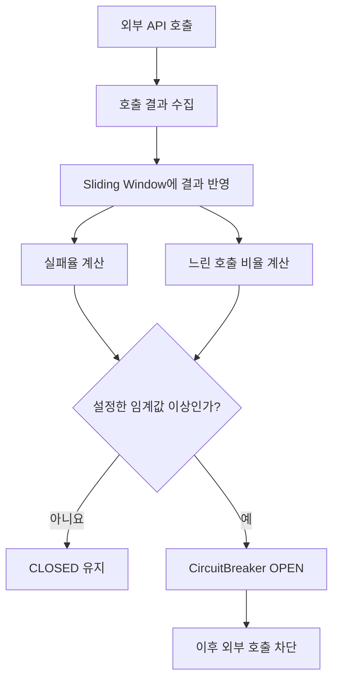
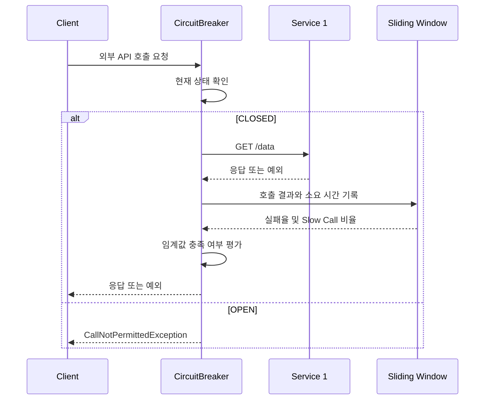

# Resilience4J - 5. 슬라이딩 윈도우 기법
[https://youtu.be/vfDXRZqrzSs?si=K1LZlruq9csK4vzs](https://youtu.be/vfDXRZqrzSs?si=K1LZlruq9csK4vzs)

# Resilience4J - 5. 슬라이딩 윈도우 기법
* toc
{:toc}

---

### Resilience4j Sliding Window 알고리즘과 CircuitBreaker의 실패율·지연율 계산 원리

마이크로서비스 아키텍처에서는 하나의 서비스가 다른 서비스를 호출하는 과정에서 다양한 장애가 발생할 수 있다.

대표적인 장애 유형은 외부 API 호출 실패와 응답 지연이다.

예를 들어 주문 서비스가 상품 서비스의 API를 호출한다고 가정해보자.

```text
주문 서비스
    ↓
상품 서비스
    ↓
상품 정보 반환
```

평소에는 100ms 안에 응답하던 상품 서비스가 갑자기 10초 이상 걸리거나, 일부 요청에서 HTTP 500 오류를 반환하기 시작한다면 주문 서비스에도 영향을 줄 수 있다.

이러한 상황에서 Resilience4j의 CircuitBreaker를 적용하면 실패율과 느린 호출 비율을 기준으로 외부 서비스에 대한 추가 호출을 차단할 수 있다.

그런데 여기서 중요한 질문이 있다.

**CircuitBreaker는 어떤 기준으로 서비스에 장애가 발생했다고 판단할까?**

단순히 요청 한 번이 실패했다고 CircuitBreaker를 OPEN 상태로 변경한다면 일시적인 네트워크 오류에도 정상적인 서비스 호출이 차단될 수 있다.

반대로 과거부터 발생한 모든 요청의 성공·실패 결과를 누적한다면 최근에 발생한 장애를 빠르게 감지하기 어려울 수 있다.

예를 들어 지난 일주일 동안 10만 건의 요청이 성공했지만 최근 100건의 요청이 모두 실패했다고 생각해보자.

전체 기간을 기준으로 계산한 실패율은 약 0.1%에 불과하다.

하지만 최근 요청만 보면 실패율은 100%다.

```text
전체 기간의 실패율
→ 약 0.1%

최근 100건의 실패율
→ 100%
```

서비스가 현재 정상적으로 동작하는지 판단하려면 과거의 모든 요청보다 **최근 호출 결과를 중심으로 상태를 평가하는 것**이 적절하다.

이때 사용하는 개념이 **Sliding Window(슬라이딩 윈도우)**&#xB2E4;.

Resilience4j의 CircuitBreaker는 Sliding Window를 이용해 최근 호출의 성공, 실패, 응답 시간을 집계하고, 설정한 임계값을 기준으로 회로를 차단할지 판단한다.

---

### Sliding Window란?

Sliding Window는 일정한 범위의 데이터를 관찰하면서 새로운 데이터가 들어오면 관찰 범위를 이동시키는 알고리즘이다.

직역하면 움직이는 창이라는 의미다.

예를 들어 다음과 같은 숫자 배열이 있다고 생각해보자.

```text
[10, 20, 30, 40, 50, 60, 70]
```

여기에서 연속된 세 개의 숫자만 관찰하려고 한다.

처음에는 다음 세 값을 확인한다.

```text
[10, 20, 30] 40 50 60 70
```

윈도우를 오른쪽으로 한 칸 이동하면 가장 오래된 10이 제외되고 새로운 40이 들어온다.

```text
10 [20, 30, 40] 50 60 70
```

다시 한 칸 이동한다.

```text
10 20 [30, 40, 50] 60 70
```

이 과정을 계속 반복한다.

여기서 중요한 특징은 두 가지다.

첫째, 관찰하는 데이터의 범위가 제한되어 있다.

둘째, 새로운 데이터가 추가될 때 오래된 데이터가 관찰 대상에서 제외된다.

즉 Sliding Window는 전체 데이터를 매번 분석하는 대신 최근의 일정 범위에 집중한다.

이러한 특성 때문에 네트워크 흐름 제어, 데이터 스트림 분석, 요청 속도 제한, 시스템 모니터링 등 여러 분야에서 활용된다.

Resilience4j에서는 이 개념을 CircuitBreaker의 장애 판단에 사용한다.

---

### 왜 CircuitBreaker에 Sliding Window가 필요할까?

CircuitBreaker는 외부 서비스를 보호하기 위해 일정 수준 이상의 실패나 지연이 발생하면 추가 호출을 차단한다.

그렇다면 실패를 어떻게 판단해야 할까?

가장 간단한 방법은 실패 횟수를 누적하는 것이다.

```text
전체 요청 수 = 100,000

전체 실패 수 = 100
```

이 경우 실패율은 0.1%다.

그런데 최근에 발생한 요청만 확인해보면 다음과 같을 수 있다.

```text
최근 요청 10건

실패 = 10건
성공 = 0건
```

최근 실패율은 100%다.

전체 기간만 바라보면 현재 장애가 발생했다는 사실을 놓칠 수 있다.

반대로 장애가 이미 복구되었는데 과거에 발생한 실패 기록을 계속 반영한다면 정상적인 서비스도 오랫동안 비정상으로 판단할 수 있다.

따라서 장애 판단에는 최근 상황을 반영하는 방식이 필요하다.

Sliding Window는 다음과 같은 역할을 한다.

* 최근 일정 개수 또는 일정 시간 동안의 호출 결과를 집계한다.
* 새로운 호출 결과가 추가되면 오래된 결과를 제외한다.
* 집계된 결과를 이용해 실패율과 느린 호출 비율을 계산한다.
* 계산한 비율이 임계값 이상이면 CircuitBreaker의 상태 변경을 판단한다.

핵심은 **현재 서비스의 장애 상태를 판단하기 위해 관찰 범위를 지속적으로 갱신한다는 것**이다.

---

### Sliding Window의 기본 동작 구조

예를 들어 최근 7개 요청의 결과를 확인한다고 생각해보자.

성공은 `S`, 실패는 `F`로 표현하겠다.

```text
S = Success
F = Failure
```

처음 7개 요청의 결과는 다음과 같다.

```text
[S, S, F, S, F, S, F]
```

총 7개 중 3개가 실패했다.

```text
전체 호출 = 7

성공 = 4

실패 = 3
```

실패율은 다음과 같이 계산한다.

**Failure Rate = (실패한 호출 수 / 전체 집계 호출 수) × 100**

따라서 다음과 같다.

```text
Failure Rate

= (3 / 7) × 100

≈ 42.86%
```

여기서 CircuitBreaker의 실패율 임계값을 50%로 설정했다고 가정하자.

현재 실패율은 약 42.86%이므로 임계값에 도달하지 않았다.

따라서 다른 조건에 문제가 없다면 CircuitBreaker는 CLOSED 상태를 유지한다.

그런데 새로운 요청이 하나 더 발생했고 이번에도 실패했다고 생각해보자.

```text
새로운 호출 결과 = F
```

Sliding Window의 크기는 7이므로 기존의 가장 오래된 결과 하나를 제외해야 한다.

기존 Window는 다음과 같다.

```text
[S, S, F, S, F, S, F]
```

가장 오래된 `S`가 제거된다.

그리고 새로운 `F`가 추가된다.

```text
[S, F, S, F, S, F, F]
```

이제 다시 실패율을 계산해보자.

```text
전체 호출 = 7

성공 = 3

실패 = 4
```

따라서 실패율은 다음과 같다.

```text
Failure Rate

= (4 / 7) × 100

≈ 57.14%
```

실패율이 50%를 초과했다.

CircuitBreaker가 최소 호출 수 조건을 충족했고 다른 설정이 기본적인 상태 전환을 허용한다면 OPEN 상태로 변경된다.

이 과정을 정리하면 다음과 같다.

| 구분        | Window        |    실패율 | 상태     |
| --------- | ------------- | -----: | ------ |
| 기존        | S S F S F S F | 42.86% | CLOSED |
| 새로운 실패 추가 | S F S F S F F | 57.14% | OPEN   |

이것이 Sliding Window를 이용한 장애 판단의 기본 원리다.

---

### Sliding Window와 CircuitBreaker의 관계

지금까지는 Sliding Window 자체의 동작을 살펴봤다.

이를 CircuitBreaker에 적용하면 다음과 같은 구조가 된다.



CircuitBreaker는 Sliding Window를 통해 수집한 데이터를 기반으로 장애 여부를 판단한다.

중요한 것은 CircuitBreaker가 요청 하나의 결과만으로 동작하는 것이 아니라는 점이다.

**일정 범위의 호출 결과를 집계하고, 그 결과가 설정한 장애 조건을 만족하는지 판단한다.**

Resilience4j는 이를 위해 COUNT_BASED와 TIME_BASED라는 두 가지 Sliding Window 방식을 제공한다.

---

### COUNT_BASED Sliding Window

COUNT_BASED는 최근 N개의 호출 결과를 기준으로 장애를 판단하는 방식이다.

예를 들어 다음과 같이 설정했다고 생각해보자.

```yaml
resilience4j:
  circuitbreaker:
    instances:
      serviceOne:
        slidingWindowType: COUNT_BASED
        slidingWindowSize: 7
        minimumNumberOfCalls: 7
        failureRateThreshold: 50
```

이 설정은 최근 7개 호출 결과를 관찰한다.

각 옵션의 의미는 다음과 같다.

| 설정                     | 값           | 의미                 |
| ---------------------- | ----------- | ------------------ |
| `slidingWindowType`    | COUNT_BASED | 호출 횟수 기준 집계        |
| `slidingWindowSize`    | 7           | 최근 7개 호출 결과 관리     |
| `minimumNumberOfCalls` | 7           | 최소 7개 호출 이후 장애율 평가 |
| `failureRateThreshold` | 50          | 실패율이 50% 이상이면 OPEN |

이때 중요한 것은 Window의 크기가 7이라는 점이다.

호출이 계속 발생하더라도 최근 7개의 결과를 기준으로 장애율을 계산한다.

#### 호출 결과가 7개보다 적다면?

처음 요청이 들어왔다고 생각해보자.

```text
1번째 요청 → 실패
```

현재 실패율만 계산한다면 100%다.

하지만 `minimumNumberOfCalls`가 7이므로 아직 CircuitBreaker는 실패율을 기준으로 회로를 열지 않는다.

두 번째 요청도 실패했다.

```text
1번째 요청 → 실패
2번째 요청 → 실패
```

여전히 최소 호출 수를 충족하지 않았다.

이 과정을 반복해 6개 요청이 모두 실패하더라도 설정된 최소 호출 수가 7이면 장애율에 따른 OPEN 전환은 아직 이루어지지 않는다.

7번째 호출이 완료되어 최소 호출 수를 충족하면 집계된 결과를 기준으로 상태를 판단한다.

즉 **최근 N개의 데이터를 관찰한다는 것과 최소 N개의 데이터가 쌓여야 판단한다는 것은 서로 다른 설정**이다.

이 차이를 이해하는 것이 중요하다.

---

### slidingWindowSize와 minimumNumberOfCalls의 차이

Resilience4j 설정에서 가장 헷갈리기 쉬운 두 가지 옵션이 있다.

```yaml
slidingWindowSize: 10
minimumNumberOfCalls: 5
```

처음 보면 둘 다 호출 횟수를 의미하므로 동일한 값처럼 느껴질 수 있다.

하지만 역할은 다르다.

`slidingWindowSize`는 최근 몇 개의 호출 결과를 집계할 것인지 결정한다.

`minimumNumberOfCalls`는 장애율을 판단하기 전에 최소 몇 개의 호출 결과가 필요한지 결정한다.

예를 들어 다음과 같이 설정했다고 가정하자.

```text
Sliding Window Size = 10

Minimum Number Of Calls = 5
```

처음 4개 호출이 모두 실패했다.

```text
F F F F
```

실패율은 100%지만 아직 최소 호출 수를 충족하지 않았다.

따라서 실패율을 기준으로 회로를 열지 않는다.

그런데 5번째 호출도 실패한다.

```text
F F F F F
```

이제 최소 호출 수를 충족했다.

실패율은 100%다.

설정한 실패율 임계값이 50%라면 CircuitBreaker는 OPEN 상태로 전환될 수 있다.

다시 비교하면 다음과 같다.

| 구분 | slidingWindowSize | minimumNumberOfCalls  |
| -- | ----------------- | --------------------- |
| 목적 | 관찰 범위 지정          | 장애율 평가 시작 조건          |
| 기준 | 최근 호출 결과 개수       | 최소 집계 호출 개수           |
| 예시 | 최근 10건            | 최소 5건                 |
| 특징 | 오래된 결과가 제외됨       | 호출 수가 부족하면 임계값 평가를 보류 |

따라서 `slidingWindowSize=10`이라고 해서 반드시 10개의 요청이 발생해야만 장애를 판단하는 것은 아니다.

최소 호출 수를 5로 설정했다면 5번째 호출부터 평가가 가능하다.

반대로 `minimumNumberOfCalls=10`이라면 9번의 요청이 모두 실패해도 최소 호출 수에 도달하지 않았으므로 실패율에 따른 OPEN 전환은 일어나지 않는다.

이 동작은 Resilience4j의 공식 설정에서도 명시되어 있다.

---

### TIME_BASED Sliding Window

COUNT_BASED가 최근 호출 개수를 기준으로 집계한다면, TIME_BASED는 최근 일정 시간 동안의 호출 결과를 집계한다.

예를 들어 다음과 같이 설정할 수 있다.

```yaml
resilience4j:
  circuitbreaker:
    instances:
      serviceOne:
        slidingWindowType: TIME_BASED
        slidingWindowSize: 10
        minimumNumberOfCalls: 5
        failureRateThreshold: 50
```

이 설정에서 `slidingWindowSize: 10`은 최근 10개의 요청이 아니다.

**최근 10초 동안 발생한 호출 결과**를 의미한다.

즉 다음과 같은 구조다.

```text
COUNT_BASED

최근 10건의 호출 결과
```

```text
TIME_BASED

최근 10초 동안의 호출 결과
```

두 방식은 집계 범위의 기준이 다르다.

#### 시간에 따라 Window가 이동하는 과정

예를 들어 최근 5초 동안의 호출 결과를 집계한다고 가정해보자.

각 초에 완료된 호출 결과가 다음과 같다고 생각해보자.

| 시간       | 성공 | 실패 | 느린 호출 |
| -------- | -: | -: | ----: |
| 12:00:00 |  2 |  0 |     0 |
| 12:00:01 |  0 |  1 |     0 |
| 12:00:02 |  3 |  0 |     0 |
| 12:00:03 |  1 |  0 |     1 |
| 12:00:04 |  0 |  2 |     0 |

여기에서 느린 호출은 성공했지만 응답 시간이 느렸던 호출을 의미한다.

따라서 성공 호출 1건과 느린 호출 1건은 동일한 호출일 수 있다.

현재 집계된 호출 수는 다음과 같다.

```text
전체 호출 = 9

실패 호출 = 3

느린 호출 = 1
```

실패율은 약 33.33%다.

그런데 시간이 지나 12:00:05가 되었고, 이 시점에 새로운 실패 호출 1건이 추가되었다고 가정하자.

관찰 범위는 최근 5초이므로 가장 오래된 12:00:00의 집계 결과가 제외된다.

```text
기존 집계

12:00:00
12:00:01
12:00:02
12:00:03
12:00:04
```

새로운 집계 범위는 다음과 같다.

```text
변경된 집계

12:00:01
12:00:02
12:00:03
12:00:04
12:00:05
```

가장 오래된 초에 포함되었던 성공 호출 2건이 제외되고 새로운 실패 호출 1건이 추가된다.

따라서 다음과 같이 변경된다.

```text
전체 호출

9 - 2 + 1 = 8
```

```text
실패 호출

3 + 1 = 4
```

이때 실패율은 50%다.

```text
Failure Rate

= (4 / 8) × 100

= 50%
```

위 계산은 시간 기반 Window의 집계 원리를 설명하기 위한 예시다. CircuitBreaker가 실제로 OPEN 상태에 들어가면 일반적인 호출 결과가 계속 같은 방식으로 추가되는 것은 아니므로 상태 전환 정책은 별도로 고려해야 한다.

이처럼 TIME_BASED는 특정 시간 범위 안에서 발생한 호출 결과를 기준으로 장애율을 계산한다.

---

### COUNT_BASED와 TIME_BASED의 차이

두 방식의 가장 큰 차이는 관찰 범위다.

| 구분                      | COUNT_BASED               | TIME_BASED             |
| ----------------------- | ------------------------- | ---------------------- |
| 집계 기준                   | 최근 호출 N건                  | 최근 N초                  |
| `slidingWindowSize: 10` | 최근 10개 호출                 | 최근 10초                 |
| 트래픽 영향                  | 호출 수가 적으면 데이터 갱신이 느림      | 시간에 따라 과거 결과 제외        |
| 대표적인 활용                 | 호출 수 기준으로 안정적인 집계가 필요한 경우 | 최근 시간대의 상태를 중요하게 보는 경우 |
| 최소 호출 수                 | 별도 설정 필요                  | 별도 설정 필요               |

예를 들어 트래픽이 적은 내부 관리 API라면 10건의 요청이 쌓이는 데 오랜 시간이 걸릴 수 있다.

```text
1번째 호출 → 10:00

2번째 호출 → 10:10

3번째 호출 → 10:20

...

10번째 호출 → 11:30
```

COUNT_BASED를 사용한다면 최근 10건이라는 기준은 유지되지만, 해당 결과들이 오랜 시간에 걸쳐 발생한 요청일 수 있다.

반대로 TIME_BASED를 사용하면 최근 10초 동안의 결과만 집계한다.

하지만 트래픽이 너무 적으면 최근 10초 동안 최소 호출 수를 충족하지 못할 수 있다.

따라서 TIME_BASED라고 해서 항상 더 정확한 것은 아니다.

**서비스의 호출 빈도와 장애를 얼마나 빠르게 감지해야 하는지에 따라 적절한 방식을 선택해야 한다.**

---

### Resilience4j는 Sliding Window를 내부적으로 어떻게 관리할까?

여기서 조금 더 깊게 살펴볼 부분이 있다.

Sliding Window를 가장 단순하게 구현한다면 호출 결과를 배열이나 List에 모두 저장할 수 있다.

예를 들어 다음과 같은 구조다.

```text
[Success, Failure, Success, Failure, Success]
```

새로운 호출 결과가 발생하면 가장 오래된 결과를 제거하고 새로운 결과를 추가한다.

하지만 매번 전체 데이터를 순회해 실패율을 계산한다면 Window가 커질수록 계산 비용이 증가할 수 있다.

Resilience4j는 이러한 문제를 줄이기 위해 **Circular Array와 미리 계산된 집계값**을 활용한다.

이를 이해하기 위해 두 가지 개념을 살펴보자.

#### Circular Array

Circular Array는 고정된 크기의 배열을 순환하면서 사용하는 구조다.

예를 들어 크기가 5인 배열이 있다고 가정하자.

```text
Index

 0   1   2   3   4
```

처음 다섯 개의 결과를 저장한다.

```text
[S] [F] [S] [S] [F]
```

새로운 결과가 들어오면 가장 오래된 데이터가 저장된 위치를 재사용한다.

```text
[F] [F] [S] [S] [F]
```

새로운 데이터를 저장하기 위해 배열 크기를 계속 늘릴 필요가 없다.

또한 모든 데이터를 한 칸씩 이동시킬 필요도 없다.

이렇게 고정된 메모리 영역을 순환하면서 최근 데이터를 관리할 수 있다.

#### Subtract-on-Evict

Resilience4j는 최근 호출의 집계값을 관리할 때 오래된 데이터가 제외되면 해당 데이터의 집계 결과를 전체 집계에서 차감한다.

이를 Subtract-on-Evict라고 한다.

예를 들어 현재 Window에 다음 결과가 있다고 하자.

```text
[S, F, S, F, S]
```

전체 호출은 5개이고 실패는 2개다.

```text
Total Calls = 5

Failed Calls = 2
```

새로운 실패가 들어온다.

가장 오래된 성공 호출이 제외된다.

```text
[F, S, F, S, F]
```

전체 호출 수는 여전히 5개다.

하지만 실패 호출 수는 3개다.

이때 전체 배열을 다시 순회할 필요 없이 다음처럼 계산할 수 있다.

```text
기존 실패 수 = 2

제거된 실패 수 = 0

추가된 실패 수 = 1
```

```text
새로운 실패 수

= 2 - 0 + 1

= 3
```

즉 집계값을 점진적으로 갱신할 수 있다.

Resilience4j는 이러한 방식으로 호출 수, 실패 수, 느린 호출 수, 소요 시간 등을 관리한다.

공식 구현에서도 COUNT_BASED와 TIME_BASED 모두 원형 배열과 사전 집계된 값을 활용하며, 집계 Snapshot 조회를 O(1)에 수행할 수 있도록 설계되어 있다.

---

### Sliding Window는 동시 실행 수를 제한하지 않는다

Sliding Window를 이해하면서 반드시 구분해야 하는 부분이 있다.

다음 설정을 보자.

```yaml
slidingWindowSize: 10
```

이 설정은 최근 10개 호출 결과를 집계한다는 의미다.

**동시에 실행할 수 있는 요청이 10개라는 의미가 아니다.**

예를 들어 CircuitBreaker가 CLOSED 상태이고 100개의 Thread가 동시에 외부 API를 호출한다고 생각해보자.

```text
Thread 1   → 외부 API 호출
Thread 2   → 외부 API 호출
Thread 3   → 외부 API 호출
...
Thread 100 → 외부 API 호출
```

`slidingWindowSize`가 10이라고 해서 11번째 Thread부터 호출이 차단되는 것은 아니다.

CLOSED 상태에서는 많은 요청이 동시에 실행될 수 있다.

Sliding Window는 완료된 호출 결과를 집계하는 용도로 사용된다.

반면 동시 실행 수를 제한하려면 Bulkhead가 필요하다.

| 기능             | 역할                |
| -------------- | ----------------- |
| Sliding Window | 최근 호출 결과 집계       |
| CircuitBreaker | 장애율에 따른 호출 차단     |
| Bulkhead       | 동시 실행 수 제한        |
| RateLimiter    | 일정 시간 동안의 호출 수 제한 |

이 차이를 잘못 이해하면 CircuitBreaker를 적용했는데도 외부 API에 과도한 동시 요청이 발생하는 상황을 경험할 수 있다.

Resilience4j 공식 구현에서도 Sliding Window의 크기가 동시 실행 가능한 호출 수를 제한하지 않는다는 점을 명확히 구분하고 있다.

---

### 실패율과 지연율은 어떻게 계산할까?

Resilience4j CircuitBreaker는 대표적으로 두 가지 비율을 이용해 장애를 판단한다.

첫 번째는 Failure Rate다.

두 번째는 Slow Call Rate다.

두 값은 서로 독립적인 기준이다.

#### Failure Rate

Failure Rate는 집계 대상 호출 중 실패로 기록된 호출의 비율이다.

계산식은 다음과 같다.

**Failure Rate = (실패 호출 수 / 집계된 전체 호출 수) × 100**

예를 들어 다음과 같은 호출 결과가 있다고 하자.

| 호출 | 결과 |
| -: | -- |
|  1 | 성공 |
|  2 | 실패 |
|  3 | 성공 |
|  4 | 실패 |
|  5 | 성공 |
|  6 | 실패 |
|  7 | 실패 |
|  8 | 성공 |
|  9 | 실패 |
| 10 | 성공 |

실패한 호출은 5개다.

따라서 실패율은 50%다.

```text
Failure Rate

= (5 / 10) × 100

= 50%
```

실패율 임계값이 50%라면 CircuitBreaker는 OPEN 상태로 변경될 수 있다.

여기서 중요한 점은 임계값을 **초과해야 하는 것이 아니라 이상이면 조건에 해당한다**는 것이다.

```text
Failure Rate >= Failure Rate Threshold
```

#### Slow Call Rate

Slow Call Rate는 응답 시간이 설정한 기준을 초과한 호출의 비율이다.

계산식은 다음과 같다.

**Slow Call Rate = (느린 호출 수 / 집계된 전체 호출 수) × 100**

예를 들어 다음과 같은 요청 결과가 있다고 하자.

| 호출 | 결과 |   응답 시간 |
| -: | -- | ------: |
|  1 | 성공 |   100ms |
|  2 | 성공 |   150ms |
|  3 | 성공 | 4,000ms |
|  4 | 성공 | 3,500ms |
|  5 | 성공 |   200ms |
|  6 | 성공 | 5,000ms |
|  7 | 성공 |   120ms |
|  8 | 성공 | 4,500ms |
|  9 | 성공 |   100ms |
| 10 | 성공 | 3,000ms |

모든 호출은 성공했다.

실패율은 0%다.

하지만 Slow Call 기준이 2초라면 10개 중 5개가 느린 호출이다.

```text
Slow Call Rate

= (5 / 10) × 100

= 50%
```

Slow Call Rate 임계값이 50%라면 CircuitBreaker가 OPEN 상태로 변경될 수 있다.

즉 **HTTP 200을 반환한 요청도 응답 시간이 느리면 장애 판단에 영향을 줄 수 있다.**

---

### 실패한 호출과 느린 호출은 중복될 수 있다

여기서 한 가지 중요한 특징이 있다.

실패한 호출과 느린 호출은 완전히 분리된 집합이 아니다.

하나의 요청이 실패하면서 동시에 느린 호출일 수 있다.

예를 들어 다음과 같은 상황을 생각해보자.

```text
외부 API 호출

    ↓

5초 대기

    ↓

SocketTimeoutException
```

이 요청은 실패했다.

동시에 Slow Call 기준이 2초라면 느린 호출에도 해당할 수 있다.

따라서 다음과 같이 집계될 수 있다.

```text
Failed Calls +1

Slow Calls +1

Total Calls +1
```

즉 하나의 요청이 두 지표에 동시에 영향을 줄 수 있다.

그렇기 때문에 다음처럼 단순히 더해서는 안 된다.

```text
실패 호출 3개

느린 호출 4개

→ 서로 다른 호출 7개라고 단정할 수 없음
```

실패와 지연은 서로 겹칠 수 있기 때문이다.

그리고 CircuitBreaker는 실패율 또는 느린 호출 비율 중 하나가 임계값 이상이면 OPEN 상태로 전환할 수 있다.

---

### Spring Boot에서 Sliding Window 설정하기

이제 앞에서 구성한 Service 1과 Service 2 환경에 적용할 설정을 살펴보자.

전체 구조는 다음과 같다.

```text
Client
    ↓
Service 2 : 8080
    ↓
CircuitBreaker
    ↓
RestTemplate
    ↓
Service 1 : 9000
```

Service 1은 `/data` API를 제공한다.

Service 2는 RestTemplate을 이용해 해당 API를 호출한다.

이 호출 결과를 CircuitBreaker가 관찰하도록 설정할 수 있다.

예를 들어 Service 2의 `application.yml`에 다음 설정을 추가한다.

```yaml
spring:
  application:
    name: service-two

server:
  port: 8080

clients:
  service-one:
    base-url: http://localhost:9000

resilience4j:
  circuitbreaker:
    instances:
      serviceOne:
        slidingWindowType: COUNT_BASED
        slidingWindowSize: 7
        minimumNumberOfCalls: 7

        failureRateThreshold: 50

        slowCallDurationThreshold: 3s
        slowCallRateThreshold: 50

        waitDurationInOpenState: 10s
        permittedNumberOfCallsInHalfOpenState: 3
```

이 설정의 의미는 다음과 같다.

| 옵션                                      | 설정값         | 의미                         |
| --------------------------------------- | ----------- | -------------------------- |
| `slidingWindowType`                     | COUNT_BASED | 호출 수를 기준으로 집계              |
| `slidingWindowSize`                     | 7           | 최근 7건의 호출 결과 집계            |
| `minimumNumberOfCalls`                  | 7           | 최소 7건 이후 장애율 판단            |
| `failureRateThreshold`                  | 50          | 실패율 50% 이상이면 OPEN          |
| `slowCallDurationThreshold`             | 3s          | 3초 초과 호출을 Slow Call로 분류    |
| `slowCallRateThreshold`                 | 50          | Slow Call 비율 50% 이상이면 OPEN |
| `waitDurationInOpenState`               | 10s         | OPEN 상태에서 복구 판단까지의 대기 시간   |
| `permittedNumberOfCallsInHalfOpenState` | 3           | HALF_OPEN에서 허용할 시험 호출 수    |

이제 Service 1에서 10초의 응답 지연이 계속 발생한다면 해당 요청들이 Slow Call로 기록될 수 있다.

반대로 RestTemplate의 Read Timeout이 2초라면 10초 뒤의 정상 응답을 받기 전에 예외가 발생할 수 있다.

이 경우 CircuitBreaker는 설정된 예외 기록 정책에 따라 해당 호출을 실패로 기록한다.

**따라서 같은 장애 상황이라도 HTTP Client의 Timeout 설정에 따라 Failure Rate 또는 Slow Call Rate에 반영되는 양상이 달라질 수 있다.**

---

### CircuitBreaker가 실제로 Sliding Window를 사용하는 시점

설정만으로는 흐름이 잘 보이지 않을 수 있으므로 실제 호출 과정을 생각해보자.

예를 들어 다음 메서드가 있다고 가정한다.

```java
public String getData() {
    return restTemplate.getForObject(
            "/data",
            String.class
    );
}
```

이 메서드에 CircuitBreaker가 적용되어 있다면 일반적인 처리 흐름은 다음과 같다.



여기에서 중요한 부분은 **호출 결과와 소요 시간이 Sliding Window에 반영되는 시점**이다.

보호 대상 호출이 완료되거나 실패로 종료되면 해당 결과가 집계된다.

CircuitBreaker는 이렇게 집계된 결과를 이용해 상태 변경 여부를 판단한다.

따라서 장시간 실행 중인 호출이 있다고 해서 그 호출이 즉시 Slow Call로 집계되는 것은 아니다.

완료되지 않은 호출을 언제 중단할지는 HTTP Client Timeout이나 TimeLimiter 같은 별도의 정책으로 관리해야 한다.

---

### Java 코드로 Sliding Window의 상태 변화를 확인하기

이번에는 실제 HTTP 호출 없이 CircuitBreaker의 집계 결과를 확인하는 코드를 살펴보자.

Resilience4j는 `CircuitBreakerConfig`를 이용해 설정을 생성할 수 있다.

또한 CircuitBreaker API를 통해 성공·실패 결과를 직접 기록할 수 있다.

다음 테스트는 최근 7개 호출의 실패율이 어떻게 계산되고 CircuitBreaker가 OPEN으로 전환되는지 확인한다.

```java
import io.github.resilience4j.circuitbreaker.CircuitBreaker;
import io.github.resilience4j.circuitbreaker.CircuitBreakerConfig;

import org.junit.jupiter.api.Test;

import java.time.Duration;
import java.util.concurrent.TimeUnit;

import static org.junit.jupiter.api.Assertions.assertEquals;

class CircuitBreakerSlidingWindowTest {

    @Test
    void 최근_호출의_실패율이_임계값에_도달하면_OPEN_상태가_된다() {

        CircuitBreakerConfig config = CircuitBreakerConfig.custom()
                .slidingWindowType(
                        CircuitBreakerConfig.SlidingWindowType.COUNT_BASED
                )
                .slidingWindowSize(7)
                .minimumNumberOfCalls(7)
                .failureRateThreshold(50)
                .slowCallRateThreshold(100)
                .slowCallDurationThreshold(Duration.ofSeconds(3))
                .build();

        CircuitBreaker circuitBreaker =
                CircuitBreaker.of("serviceOne", config);

        // S S F S F S F
        circuitBreaker.onSuccess(100, TimeUnit.MILLISECONDS);
        circuitBreaker.onSuccess(100, TimeUnit.MILLISECONDS);
        circuitBreaker.onError(
                100,
                TimeUnit.MILLISECONDS,
                new IllegalStateException("호출 실패")
        );
        circuitBreaker.onSuccess(100, TimeUnit.MILLISECONDS);
        circuitBreaker.onError(
                100,
                TimeUnit.MILLISECONDS,
                new IllegalStateException("호출 실패")
        );
        circuitBreaker.onSuccess(100, TimeUnit.MILLISECONDS);
        circuitBreaker.onError(
                100,
                TimeUnit.MILLISECONDS,
                new IllegalStateException("호출 실패")
        );

        assertEquals(
                CircuitBreaker.State.CLOSED,
                circuitBreaker.getState()
        );

        assertEquals(
                7,
                circuitBreaker.getMetrics().getNumberOfBufferedCalls()
        );

        assertEquals(
                3,
                circuitBreaker.getMetrics().getNumberOfFailedCalls()
        );

        // 새로운 실패 추가
        // 기존 첫 번째 성공 결과는 Window에서 제외
        circuitBreaker.onError(
                100,
                TimeUnit.MILLISECONDS,
                new IllegalStateException("호출 실패")
        );

        assertEquals(
                CircuitBreaker.State.OPEN,
                circuitBreaker.getState()
        );
    }
}
```

이 테스트는 실제 네트워크 요청을 보내는 대신 성공과 실패 결과를 직접 기록한다.

처음 7개 결과는 다음과 같다.

```text
S S F S F S F
```

실패율은 약 42.86%다.

따라서 CLOSED 상태가 유지된다.

이후 새로운 실패 결과가 추가된다.

```text
S F S F S F F
```

실패율은 약 57.14%다.

설정된 임계값인 50%를 초과하므로 OPEN 상태로 전환된다.

이 테스트를 통해 Sliding Window가 단순히 실패 횟수를 누적하는 것이 아니라 최근 호출 결과를 이용한다는 사실을 확인할 수 있다.

---

### Slow Call Rate도 테스트할 수 있다

앞에서는 실패율을 기준으로 CircuitBreaker의 상태를 변경했다.

하지만 Resilience4j는 Slow Call Rate도 지원한다.

이를 확인하기 위해 다음과 같은 상황을 만들어보자.

```text
전체 호출 = 5

느린 호출 = 3

Slow Call Rate = 60%
```

Slow Call 기준은 2초로 설정한다.

```java
import io.github.resilience4j.circuitbreaker.CircuitBreaker;
import io.github.resilience4j.circuitbreaker.CircuitBreakerConfig;

import org.junit.jupiter.api.Test;

import java.time.Duration;
import java.util.concurrent.TimeUnit;

import static org.junit.jupiter.api.Assertions.assertEquals;

class CircuitBreakerSlowCallTest {

    @Test
    void 느린_호출의_비율이_높으면_실패가_없어도_OPEN_상태가_된다() {

        CircuitBreakerConfig config = CircuitBreakerConfig.custom()
                .slidingWindowType(
                        CircuitBreakerConfig.SlidingWindowType.COUNT_BASED
                )
                .slidingWindowSize(5)
                .minimumNumberOfCalls(5)
                .failureRateThreshold(100)
                .slowCallDurationThreshold(Duration.ofSeconds(2))
                .slowCallRateThreshold(50)
                .build();

        CircuitBreaker circuitBreaker =
                CircuitBreaker.of("slowService", config);

        circuitBreaker.onSuccess(100, TimeUnit.MILLISECONDS);
        circuitBreaker.onSuccess(200, TimeUnit.MILLISECONDS);

        circuitBreaker.onSuccess(3, TimeUnit.SECONDS);
        circuitBreaker.onSuccess(4, TimeUnit.SECONDS);
        circuitBreaker.onSuccess(5, TimeUnit.SECONDS);

        assertEquals(
                0,
                circuitBreaker.getMetrics().getNumberOfFailedCalls()
        );

        assertEquals(
                3,
                circuitBreaker.getMetrics().getNumberOfSlowCalls()
        );

        assertEquals(
                CircuitBreaker.State.OPEN,
                circuitBreaker.getState()
        );
    }
}
```

이 테스트에서 모든 호출은 성공으로 기록된다.

따라서 Failure Rate는 0%다.

하지만 5개 호출 중 3개가 2초를 초과했다.

Slow Call Rate는 60%다.

설정된 Slow Call Rate 임계값은 50%이므로 CircuitBreaker가 OPEN 상태로 전환된다.

여기서 `onSuccess()`에 전달한 시간은 실제 대기 시간이 아니라 **호출에 소요된 시간으로 기록할 값**이다.

따라서 `Thread.sleep()`을 실행하지 않고도 CircuitBreaker의 지연율 집계 동작을 확인할 수 있다.

---

### OPEN 상태에서도 Sliding Window는 계속 이동할까?

이 부분도 이해해두면 좋다.

CircuitBreaker가 OPEN 상태가 되면 보호 대상 서비스로의 새로운 호출을 차단한다.

이때 일반적으로 다음 예외가 발생한다.

```java
CallNotPermittedException
```

이 예외는 외부 API를 실제로 호출하다가 발생한 오류가 아니다.

CircuitBreaker가 현재 요청을 허용하지 않아서 발생한 예외다.

따라서 OPEN 상태에서 차단된 요청이 일반적인 외부 호출 실패처럼 계속 Sliding Window에 기록되는 것은 아니다.

만약 차단된 요청까지 실패로 계속 집계한다면 어떻게 될까?

```text
CircuitBreaker OPEN
    ↓
호출 차단
    ↓
차단된 요청을 실패로 기록
    ↓
실패율 계속 증가
```

이러한 구조에서는 CircuitBreaker가 복구 여부를 판단하기 어려워질 수 있다.

실제로는 OPEN 상태에서 일정 시간이 지난 뒤 HALF_OPEN 상태에서 제한된 호출을 허용하고, 해당 호출의 결과를 통해 복구 여부를 판단한다.

따라서 다음 두 개념을 구분해야 한다.

**Sliding Window**

최근 호출의 성공, 실패, 응답 시간을 집계한다.

**CircuitBreaker State**

집계된 결과를 기반으로 실제 호출을 허용할지 결정한다.

Sliding Window가 CircuitBreaker의 모든 동작을 담당하는 것은 아니다.

---

### Sliding Window를 사용할 때 주의해야 할 점

Sliding Window는 효율적으로 장애율을 계산할 수 있지만 설정이 적절하지 않으면 정상적인 서비스를 장애로 판단하거나 실제 장애를 늦게 감지할 수 있다.

실무에서 특히 확인해야 할 부분을 정리해보자.

#### 1. Window 크기가 너무 작으면 장애 판단이 민감해질 수 있다

예를 들어 다음과 같이 설정했다고 가정하자.

```yaml
slidingWindowSize: 2
minimumNumberOfCalls: 2
failureRateThreshold: 50
```

최근 2개 호출 중 하나만 실패해도 실패율은 50%다.

따라서 CircuitBreaker가 OPEN 상태로 변경될 수 있다.

하지만 일시적인 네트워크 오류 한 번으로 외부 서비스를 차단하는 것이 적절한지는 별개의 문제다.

호출 수가 적은 서비스라면 더욱 신중하게 설정해야 한다.

#### 2. Window 크기가 너무 크면 장애 감지가 늦어질 수 있다

반대로 최근 10만 개 호출 결과를 집계한다고 가정해보자.

과거 성공 요청이 많이 포함되어 있다면 최근 발생한 실패가 전체 실패율에 미치는 영향이 작아질 수 있다.

따라서 장애를 감지하는 데 오랜 시간이 걸릴 수 있다.

Window 크기는 지나치게 작아도, 지나치게 커도 문제가 될 수 있다.

#### 3. 최소 호출 수를 서비스 트래픽에 맞게 설정한다

하루에 몇 번만 호출되는 내부 API에 `minimumNumberOfCalls=100`을 설정하면 장애율 평가에 필요한 호출 수를 충족하기 어려울 수 있다.

특히 TIME_BASED에서는 최근 N초 안에 최소 호출 수가 쌓여야 한다.

따라서 호출 빈도를 고려해야 한다.

#### 4. HTTP 상태 코드만으로 실패를 판단하지 않는다

모든 HTTP 4xx 응답이 시스템 장애를 의미하지는 않는다.

예를 들어 존재하지 않는 상품을 조회한 결과로 HTTP 404가 반환되었다면 정상적인 비즈니스 결과일 수 있다.

반면 HTTP 500이나 Connection Timeout은 외부 서비스 장애를 의미할 가능성이 높다.

따라서 CircuitBreaker가 어떤 예외를 실패로 기록할지 명확하게 설정해야 한다.

또한 Resilience4j는 모든 HTTP 상태 코드를 직접 해석하는 것이 아니라 보호 대상 호출에서 전달되는 예외나 결과를 기준으로 집계한다.

#### 5. 실패한 요청과 느린 요청을 구분한다

HTTP 200 응답이라도 지나치게 오래 걸리면 Slow Call로 기록할 수 있다.

반대로 Timeout 예외가 발생하면 실패 호출로 기록될 수 있다.

하나의 요청이 실패하면서 느린 호출일 수도 있다는 점을 고려해야 한다.

#### 6. CircuitBreaker와 Timeout을 함께 설계한다

CircuitBreaker의 Slow Call 기준이 3초라고 해서 3초가 되는 순간 현재 요청이 중단되는 것은 아니다.

현재 호출의 대기 시간을 제한하려면 HTTP Client Timeout이나 TimeLimiter 같은 별도 정책이 필요하다.

#### 7. Retry 적용 시 집계 기준을 확인한다

Retry와 CircuitBreaker를 함께 사용하면 호출 결과가 집계되는 방식이 달라질 수 있다.

예를 들어 하나의 논리적인 요청이 세 번 재시도되었을 때 각 시도를 별도로 기록하는지, 최종 결과만 기록하는지는 Decorator 적용 순서에 영향을 받는다.

따라서 여러 모듈을 함께 적용한다면 실제 호출 순서를 확인해야 한다.

#### 8. Sliding Window는 동시 실행 수를 제한하지 않는다

`slidingWindowSize=10`은 최근 10건을 관찰한다는 의미다.

동시 실행 수를 10개로 제한하는 설정이 아니다.

외부 서비스 호출 수를 제한해야 한다면 Bulkhead 또는 RateLimiter를 고려해야 한다.

#### 9. 낮은 트래픽과 높은 트래픽을 구분한다

같은 Window 크기라도 호출 빈도에 따라 의미가 달라진다.

초당 1,000건이 발생하는 API에서 최근 100건은 매우 짧은 시간의 결과다.

반면 분당 1건이 발생하는 API에서 최근 100건은 오랜 기간의 결과일 수 있다.

따라서 호출 빈도가 크게 다르다면 동일한 설정을 적용하는 것이 적절하지 않을 수 있다.

#### 10. CircuitBreaker 상태 전환도 함께 모니터링한다

실패율과 Slow Call Rate만 확인해서는 부족하다.

다음과 같은 지표를 함께 확인해야 한다.

```text
Failure Rate

Slow Call Rate

Buffered Calls

Failed Calls

Slow Calls

CircuitBreaker State

Not Permitted Calls
```

이러한 지표를 함께 보면 CircuitBreaker가 왜 OPEN 상태가 되었는지 분석하기 쉬워진다.

#### 11. 데이터가 누적되는 시점을 정확히 이해한다

Sliding Window는 단순히 HTTP 요청을 보낸 시점의 데이터를 저장하는 것이 아니다.

CircuitBreaker가 보호한 작업의 완료 결과와 소요 시간을 기록한다.

따라서 실행 중인 요청이 많더라도 아직 완료되지 않았다면 집계에 반영되지 않을 수 있다.

이 점은 응답 지연이 발생하는 환경에서 특히 중요하다.

#### 12. 장애 대응 정책은 실제 트래픽을 기준으로 검증한다

Sliding Window의 크기와 장애 임계값은 예제의 숫자를 그대로 사용하는 것보다 실제 운영 환경의 트래픽과 응답 시간에 맞게 결정하는 것이 좋다.

예를 들어 정상 응답의 P95, P99 Latency를 확인하고, 허용 가능한 장애율과 장애 감지 시간을 함께 고려해야 한다.

---

### COUNT_BASED와 TIME_BASED는 어떻게 선택해야 할까?

실무에서는 어느 방식이 더 좋다고 단정하기 어렵다.

두 방식 모두 장단점이 있다.

예를 들어 외부 서비스 호출이 지속적으로 많은 API라면 최근 호출 N건을 관찰하는 방식이 적합할 수 있다.

반면 최근 몇 초 동안의 상태를 중심으로 장애를 판단하고 싶다면 TIME_BASED가 적합할 수 있다.

다만 TIME_BASED는 최근 시간 범위에 호출이 충분히 발생해야 의미 있는 장애율을 계산할 수 있다.

선택 기준을 정리하면 다음과 같다.

| 상황                | 고려할 방식                    | 이유                |
| ----------------- | ------------------------- | ----------------- |
| 트래픽이 지속적으로 높은 API | COUNT_BASED 또는 TIME_BASED | 최근 호출 기반 판단 가능    |
| 일정 시간 내 장애율이 중요   | TIME_BASED                | 시간 범위 기준 집계       |
| 호출 간격이 일정하지 않음    | COUNT_BASED 검토            | 호출 횟수 기준으로 관찰     |
| 호출 빈도가 매우 낮음      | 최소 호출 수 조정 필요             | 장애율 판단에 필요한 표본 부족 |
| 최근 N번의 호출 결과가 중요  | COUNT_BASED               | 호출 개수 중심 판단       |

여기서 중요한 것은 Sliding Window의 종류를 선택하는 것보다 **서비스가 어느 정도의 장애를 허용할 수 있는지 먼저 결정하는 것**이다.

동일한 실패율 30%라도 부가적인 추천 API와 결제 승인 API가 받아들일 수 있는 위험 수준은 다를 수 있기 때문이다.

---

### 정리

Sliding Window는 일정한 범위의 데이터를 관찰하면서 새로운 데이터가 추가되면 오래된 데이터를 제외하는 알고리즘이다.

Resilience4j CircuitBreaker는 이 방식을 이용해 최근 호출의 성공, 실패, 응답 시간 등을 집계한다.

대표적인 Sliding Window 방식은 두 가지다.

**COUNT_BASED**

```text
최근 N개 호출 결과 집계
```

**TIME_BASED**

```text
최근 N초 동안의 호출 결과 집계
```

두 방식 모두 최근 호출 결과를 중심으로 장애율을 계산하지만 관찰 범위의 기준이 다르다.

COUNT_BASED에서는 `slidingWindowSize`가 호출 개수를 의미한다.

TIME_BASED에서는 같은 설정이 시간(초)을 의미한다.

또한 `minimumNumberOfCalls`는 최소한 몇 개의 호출 결과가 쌓여야 장애율을 평가할지 결정한다.

예를 들어 다음 설정이 있다면:

```yaml
slidingWindowType: COUNT_BASED
slidingWindowSize: 7
minimumNumberOfCalls: 7
failureRateThreshold: 50
```

최근 7개의 호출 결과를 기준으로 실패율을 계산한다.

처음 7개의 결과가 다음과 같다면:

```text
S S F S F S F
```

실패율은 약 42.86%다.

하지만 새로운 실패 결과가 추가되어 다음과 같이 변경되면:

```text
S F S F S F F
```

실패율이 약 57.14%가 된다.

이때 실패율 임계값인 50% 이상이므로 CircuitBreaker가 OPEN 상태로 변경될 수 있다.

그리고 CircuitBreaker는 실패율뿐 아니라 Slow Call Rate도 이용할 수 있다.

```text
Failure Rate
→ 실패한 호출의 비율
```

```text
Slow Call Rate
→ 설정한 응답 시간 기준을 초과한 호출의 비율
```

따라서 HTTP 200을 반환하는 요청도 지나치게 오래 걸린다면 장애 판단에 영향을 줄 수 있다.

다만 **Sliding Window는 최근 호출 결과를 집계하는 알고리즘이지, 동시 실행 수를 제한하거나 실행 중인 요청을 중단하는 기능은 아니다.**

동시 실행 수를 제한하려면 Bulkhead가 필요하고, 요청 대기 시간을 제한하려면 Timeout 정책이 필요하다.

결국 Sliding Window를 이해할 때 가장 중요한 것은 다음 세 가지다.

첫째, 오래된 호출 결과가 제외되고 새로운 호출 결과가 반영된다.

둘째, 집계된 결과를 이용해 실패율과 느린 호출 비율을 계산한다.

셋째, CircuitBreaker는 최소 호출 수와 임계값을 충족하는지 판단하여 OPEN, CLOSED 등의 상태를 변경한다.

이러한 흐름을 이해하면 Resilience4j의 `slidingWindowSize`, `minimumNumberOfCalls`, `failureRateThreshold`, `slowCallRateThreshold` 같은 설정이 단순한 숫자가 아니라 **실제 장애 감지 속도와 민감도를 결정하는 중요한 기준**이라는 점을 알 수 있다.

#### 한 줄 요약

Resilience4j의 Sliding Window는 최근 N개 호출 또는 최근 N초 동안의 성공·실패·지연 결과를 집계하는 알고리즘이며, CircuitBreaker는 이를 기반으로 실패율과 Slow Call Rate를 계산해 설정된 임계값 이상일 때 외부 서비스에 대한 추가 호출을 차단한다.
