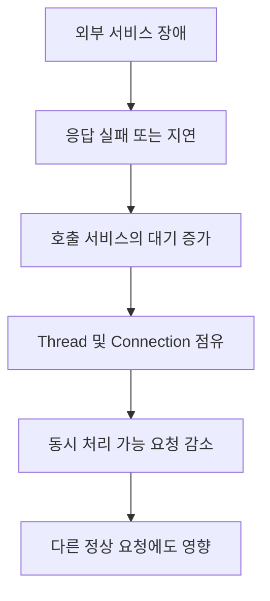
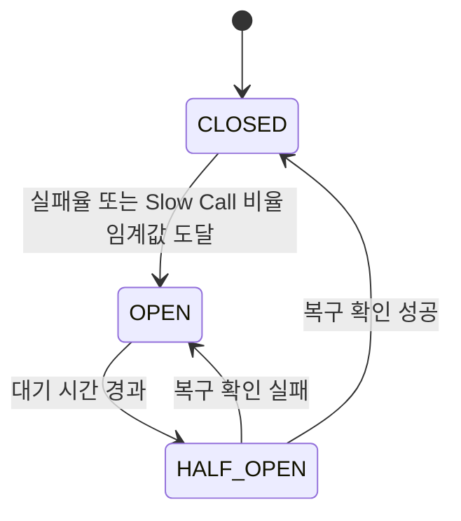
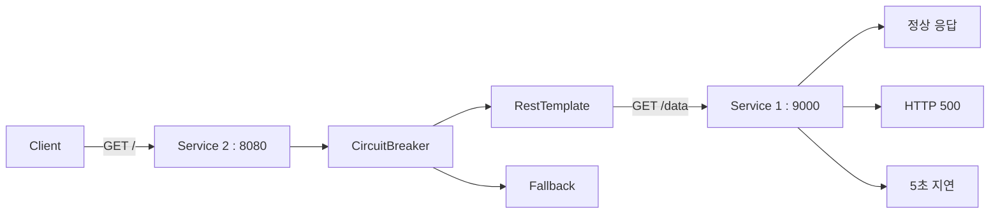
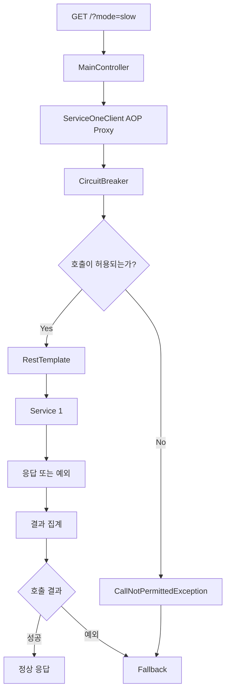
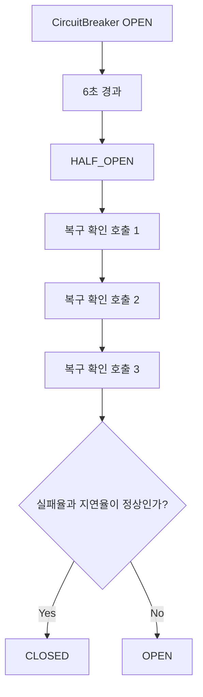
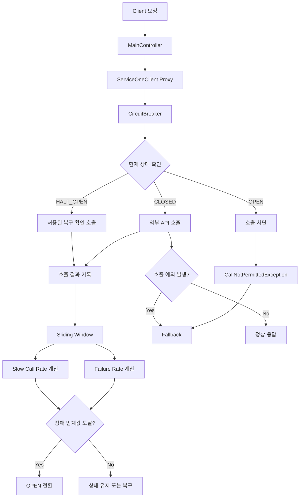

# Resilience4J - 6. 서킷 브레이커 구현 실습
[https://youtu.be/U28Q3kDwcg4?si=EM-28TGiUuB5OjM7](https://youtu.be/U28Q3kDwcg4?si=EM-28TGiUuB5OjM7)

# Resilience4J - 6. 서킷 브레이커 구현 실습
* toc
{:toc}

---

### Resilience4j CircuitBreaker 구현: Spring Boot 설정부터 Fallback과 장애 복구까지

마이크로서비스 아키텍처(MSA)에서는 하나의 서비스가 다른 서비스의 API를 호출하여 비즈니스 로직을 처리하는 경우가 많다.

예를 들어 주문 서비스에서 상품 정보를 조회하거나 결제 서비스에 승인 요청을 전달하는 상황을 생각해보자.

```text
Client
   ↓
주문 서비스
   ↓
상품 서비스
   ↓
Database
```

정상적인 상황에서는 상품 서비스가 빠르게 응답하므로 문제가 없다.

하지만 상품 서비스가 중단되거나 응답 시간이 갑자기 증가한다면 주문 서비스까지 영향을 받을 수 있다.

특히 `RestTemplate`처럼 동기 방식으로 외부 API를 호출하는 경우에는 응답을 기다리는 동안 요청 처리 Thread가 점유된다.

이러한 지연이 반복되면 서비스 전체의 처리량이 감소할 수 있다.



이러한 문제를 줄이기 위해 Resilience4j의 **CircuitBreaker**를 사용할 수 있다.

CircuitBreaker는 외부 호출의 실패율과 느린 호출 비율을 관찰한다.

그리고 미리 설정한 장애 기준에 도달하면 해당 외부 서비스에 대한 추가 호출을 일시적으로 차단한다.

호출을 차단하는 동안에는 Fallback을 통해 대체 응답을 반환할 수도 있다.

이번에는 Spring Boot 환경에서 `@CircuitBreaker`를 적용하고, 실패와 지연 장애를 직접 재현하여 CircuitBreaker의 상태가 어떻게 변하는지 살펴본다.

---

### 개념

#### CircuitBreaker란?

CircuitBreaker는 외부 서비스의 장애가 반복될 때 추가 호출을 차단하여 장애가 확대되는 것을 줄이는 패턴이다.

예를 들어 Service 2가 Service 1을 호출한다고 가정하자.

```text
Service 2
    ↓
Service 1
```

Service 1이 정상적으로 응답한다면 Service 2는 계속 요청을 전달한다.

하지만 Service 1에서 오류가 반복된다면 어떻게 될까?

```text
1번째 요청 → 실패
2번째 요청 → 실패
3번째 요청 → 실패
4번째 요청 → 실패
5번째 요청 → 실패
```

CircuitBreaker가 없다면 Service 2는 Service 1이 장애 상태라는 사실을 알고 있어도 새로운 요청이 들어올 때마다 다시 호출한다.

반면 CircuitBreaker를 적용하면 일정한 실패율에 도달했을 때 외부 호출을 차단할 수 있다.

```text
Service 1 호출
    ↓
실패율 증가
    ↓
장애 임계값 도달
    ↓
CircuitBreaker OPEN
    ↓
Service 1 호출 차단
    ↓
Fallback 또는 즉시 실패
```

이를 통해 장애가 발생한 Service 1에 불필요한 요청을 계속 전달하는 상황을 줄일 수 있다.

CircuitBreaker의 목적은 장애가 발생한 서비스를 직접 복구하는 것이 아니다.

**장애가 발생한 서비스에 대한 호출을 제어하여 호출한 서비스까지 함께 영향을 받는 상황을 방지하는 것**이 핵심이다.

#### CircuitBreaker의 상태

CircuitBreaker는 세 가지 기본 상태를 가진다.

| 상태        | 의미                | 동작        |
| --------- | ----------------- | --------- |
| CLOSED    | 정상적으로 회로가 연결된 상태  | 외부 호출 허용  |
| OPEN      | 장애로 인해 회로가 차단된 상태 | 외부 호출 차단  |
| HALF_OPEN | 복구 여부를 확인하는 상태    | 제한된 호출 허용 |

상태 전환은 다음과 같다.



정상 상태인 CLOSED에서는 호출을 허용하면서 결과를 수집한다.

실패율 또는 느린 호출 비율이 설정값 이상으로 증가하면 OPEN 상태로 전환된다.

OPEN에서는 외부 호출을 차단한다.

일정 시간이 지난 뒤에는 HALF_OPEN으로 전환하여 제한적인 호출을 허용한다.

이 호출 결과를 바탕으로 CLOSED로 복구할지, 다시 OPEN으로 돌아갈지 판단한다.

---

### 왜 사용하는가?

#### 외부 서비스 장애는 호출한 서비스에도 영향을 준다

다음과 같은 두 서비스를 생각해보자.

```text
Service 2 : 8080
    ↓
RestTemplate
    ↓
Service 1 : 9000
```

Service 2는 Service 1의 `/data` API를 호출한다.

Service 1이 정상적인 상황에서는 다음과 같이 동작한다.

```text
GET /data

→ 100ms 후 응답

→ HTTP 200
```

그런데 Service 1에서 장애가 발생하면 다음 상황이 나타날 수 있다.

**첫 번째는 실패 상황이다.**

```text
Service 2
    ↓
Service 1 호출
    ↓
Connection Refused
    ↓
예외 발생
```

Service 1이 종료되어 연결할 수 없는 상황이다.

**두 번째는 지연 상황이다.**

```text
Service 2
    ↓
Service 1 호출
    ↓
5초 동안 대기
    ↓
HTTP 200
```

요청 자체는 성공했지만 응답 시간이 지나치게 길다.

사용자에게 빠른 응답을 제공해야 하는 서비스에서는 이러한 상황도 장애로 판단할 수 있다.

CircuitBreaker는 두 상황을 모두 감지할 수 있다.

| 장애 유형     | 판단 기준                 |
| --------- | --------------------- |
| Failure   | 실패한 호출의 비율            |
| Slow Call | 지정된 시간보다 오래 걸린 호출의 비율 |

여기서 중요한 점은 **Failure Rate와 Slow Call Rate가 서로 다른 장애 판단 기준**이라는 것이다.

요청이 HTTP 200으로 성공하더라도 응답 시간이 오래 걸리면 Slow Call로 기록될 수 있다.

반대로 연결 실패나 Timeout 예외가 발생하면 Failure로 기록될 수 있다.

하나의 요청이 실패하면서 동시에 느린 호출에 해당할 수도 있다.

---

### 주요 특징

#### 1. Annotation으로 CircuitBreaker를 적용할 수 있다

Spring Boot에서는 Resilience4j가 제공하는 `@CircuitBreaker`를 사용하여 메서드 단위로 CircuitBreaker를 적용할 수 있다.

기본적인 구조는 다음과 같다.

```java
@CircuitBreaker(
        name = "serviceOne",
        fallbackMethod = "fallback"
)
public String getData() {

    return restTemplate.getForObject(
            "/data",
            String.class
    );
}
```

여기서 두 속성을 사용한다.

| 속성               | 역할                         |
| ---------------- | -------------------------- |
| `name`           | 적용할 CircuitBreaker 인스턴스 이름 |
| `fallbackMethod` | 예외 발생 시 실행할 대체 메서드 이름      |

`name`은 단순히 메서드에 붙이는 설명이 아니다.

**설정 파일에 정의된 CircuitBreaker 인스턴스와 연결하는 식별자**다.

예를 들어 다음과 같이 작성하면:

```java
@CircuitBreaker(name = "serviceOne")
```

설정 파일에서 `serviceOne`이라는 이름의 인스턴스를 참조한다.

```yaml
resilience4j:
  circuitbreaker:
    instances:
      serviceOne:
        baseConfig: default
```

이 연결 관계를 이해하면 여러 외부 서비스에 서로 다른 장애 대응 정책을 적용할 수 있다.

#### 2. 설정 그룹을 여러 인스턴스에서 재사용할 수 있다

Resilience4j는 공통 CircuitBreaker 설정을 하나의 그룹으로 정의하고 여러 인스턴스에서 재사용할 수 있다.

예를 들어 다음과 같은 외부 서비스가 있다고 생각해보자.

```text
회원 서비스
상품 서비스
결제 서비스
알림 서비스
```

각 서비스마다 CircuitBreaker를 따로 적용할 수 있다.

그런데 공통 설정까지 모두 반복해서 작성하면 설정 파일이 길어질 수 있다.

이때 `configs`를 이용해 공통 설정을 정의한다.

```yaml
resilience4j:
  circuitbreaker:
    configs:
      default:
        slidingWindowSize: 10
        minimumNumberOfCalls: 5
        failureRateThreshold: 50

    instances:
      userService:
        baseConfig: default

      productService:
        baseConfig: default

      paymentService:
        baseConfig: default
```

이 구조에서 `default`는 공통 설정 그룹이다.

각 CircuitBreaker 인스턴스는 `baseConfig`로 해당 설정을 참조한다.

```text
configs.default
      │
      ├── userService
      ├── productService
      └── paymentService
```

특정 서비스만 다른 정책이 필요하다면 개별 인스턴스에서 설정을 재정의할 수도 있다.

```yaml
resilience4j:
  circuitbreaker:
    configs:
      default:
        slidingWindowSize: 10
        minimumNumberOfCalls: 5
        failureRateThreshold: 50

    instances:
      productService:
        baseConfig: default

      paymentService:
        baseConfig: default
        failureRateThreshold: 30
```

이 경우 `paymentService`는 공통 설정을 상속받지만 실패율 임계값은 30%를 사용한다.

Resilience4j는 이러한 공통 설정과 개별 인스턴스 구성을 공식적으로 지원한다.

---

### 예제

이번에는 실제로 동작하는 CircuitBreaker를 구현해보자.

#### 프로젝트 구성

두 개의 Spring Boot 애플리케이션을 사용한다.

| 구분     | Service 1    | Service 2                  |
| ------ | ------------ | -------------------------- |
| 역할     | 호출 대상 API 서버 | 외부 API 호출 및 장애 대응          |
| Port   | 9000         | 8080                       |
| 주요 API | `GET /data`  | `GET /`                    |
| 주요 기술  | Spring Web   | RestTemplate, Resilience4j |
| 장애 처리  | 실패·지연 상황 발생  | CircuitBreaker, Fallback   |

전체 구조는 다음과 같다.



이번에는 실제 운영 API에 장애를 만들어내는 대신 Service 1에서 호출 결과를 제어할 수 있도록 구성한다.

Service 1의 `/data` API는 다음 세 가지 모드를 지원한다.

| Mode   | 동작                  |
| ------ | ------------------- |
| `ok`   | 즉시 정상 응답            |
| `fail` | HTTP 500 반환         |
| `slow` | 5초 지연 후 HTTP 200 반환 |

이렇게 만들면 서버를 매번 수정하지 않아도 실패와 지연을 구분해서 확인할 수 있다.

---

#### 1. Gradle 의존성 설정

이번 구현은 앞에서 사용한 Spring Boot 3.2.0과 Java 17을 기준으로 한다.

Resilience4j의 Annotation 기능을 사용하기 위해 다음 의존성을 추가한다.

```gradle
dependencies {
    implementation 'org.springframework.boot:spring-boot-starter-web'
    implementation 'org.springframework.boot:spring-boot-starter-aop'
    implementation 'org.springframework.boot:spring-boot-starter-actuator'

    implementation 'io.github.resilience4j:resilience4j-spring-boot3:2.2.0'

    testImplementation 'org.springframework.boot:spring-boot-starter-test'
}
```

각 의존성의 역할은 다음과 같다.

| 의존성                            | 역할                             |
| ------------------------------ | ------------------------------ |
| `spring-boot-starter-web`      | Spring MVC 및 HTTP API          |
| `spring-boot-starter-aop`      | Annotation 기반 메서드 가로채기         |
| `spring-boot-starter-actuator` | 상태 및 메트릭 확인                    |
| `resilience4j-spring-boot3`    | Resilience4j의 Spring Boot 3 연동 |
| `spring-boot-starter-test`     | 테스트 환경 구성                      |

Resilience4j의 Spring Boot 연동은 AOP 기반으로 `@CircuitBreaker`를 처리한다.

따라서 Annotation 기반 기능을 사용하려면 AOP 의존성이 필요하다.

참고로 기존 프로젝트에 Spring Cloud CircuitBreaker Starter가 이미 추가되어 있다면 이를 무조건 제거하거나 Resilience4j 의존성을 중복 추가할 필요는 없다.

다음 명령으로 실제 의존성을 먼저 확인할 수 있다.

```bash
./gradlew dependencyInsight \
  --dependency resilience4j-spring-boot3 \
  --configuration runtimeClasspath
```

해당 모듈이 이미 포함되어 있다면 버전 충돌이 발생하지 않도록 의존성 구성을 유지하는 것이 좋다.

이번 코드는 `@CircuitBreaker`를 사용하는 Resilience4j 직접 연동 방식으로 작성한다.

---

#### 2. Service 1 구성

먼저 장애를 발생시킬 API 서버를 작성한다.

Service 1은 9000 포트에서 실행한다.

`application.yml`은 다음과 같다.

```yaml
spring:
  application:
    name: service-one

server:
  port: 9000
```

이제 `DataController`를 구현한다.

```java
package com.example.serviceone.controller;

import java.time.Instant;

import org.springframework.http.HttpStatus;
import org.springframework.web.bind.annotation.GetMapping;
import org.springframework.web.bind.annotation.RequestParam;
import org.springframework.web.bind.annotation.RestController;
import org.springframework.web.server.ResponseStatusException;

@RestController
public class DataController {

    @GetMapping("/data")
    public String getData(
            @RequestParam(defaultValue = "ok") String mode
    ) {

        if ("fail".equals(mode)) {

            throw new ResponseStatusException(
                    HttpStatus.INTERNAL_SERVER_ERROR,
                    "강제로 발생시킨 서버 오류"
            );
        }

        if ("slow".equals(mode)) {

            try {
                Thread.sleep(5_000);
            } catch (InterruptedException e) {

                Thread.currentThread().interrupt();

                throw new ResponseStatusException(
                        HttpStatus.SERVICE_UNAVAILABLE,
                        "요청 처리 중단",
                        e
                );
            }
        }

        if (!"ok".equals(mode) && !"slow".equals(mode)) {

            throw new ResponseStatusException(
                    HttpStatus.BAD_REQUEST,
                    "지원하지 않는 mode"
            );
        }

        return "Service One Response: " + Instant.now();
    }
}
```

이 Controller는 세 가지 상황을 재현한다.

**정상 요청**

```http
GET /data?mode=ok
```

즉시 정상적인 데이터를 반환한다.

**실패 요청**

```http
GET /data?mode=fail
```

HTTP 500 오류를 반환한다.

**지연 요청**

```http
GET /data?mode=slow
```

5초 동안 대기한 뒤 정상 응답을 반환한다.

여기서 `Thread.sleep(5_000)`은 장애 상황을 재현하기 위한 코드다.

실제 서비스에서 이러한 방식으로 Thread를 의도적으로 대기시키는 것은 처리량에 영향을 줄 수 있으므로 일반적인 비즈니스 로직에 사용해서는 안 된다.

---

#### 3. Service 2의 RestTemplate 설정

Service 2는 Service 1을 호출하는 역할을 담당한다.

앞에서 사용한 `RestTemplateBuilder`를 이용해 HTTP Client를 구성한다.

```java
package com.example.servicetwo.config;

import java.time.Duration;

import org.springframework.beans.factory.annotation.Value;
import org.springframework.boot.web.client.RestTemplateBuilder;
import org.springframework.context.annotation.Bean;
import org.springframework.context.annotation.Configuration;
import org.springframework.web.client.RestTemplate;

@Configuration
public class RestClientConfig {

    @Bean
    public RestTemplate serviceOneRestTemplate(
            RestTemplateBuilder builder,
            @Value("${clients.service-one.base-url}") String baseUrl
    ) {

        return builder
                .rootUri(baseUrl)
                .setConnectTimeout(Duration.ofSeconds(1))
                .setReadTimeout(Duration.ofSeconds(8))
                .build();
    }
}
```

이번에는 Read Timeout을 8초로 설정했다.

이유는 Service 1의 `slow` 모드가 5초 후 HTTP 200을 반환하기 때문이다.

```text
Service 1 응답 지연 = 5초

RestTemplate Read Timeout = 8초
```

따라서 Service 2는 일반적인 환경에서 5초 후 정상 응답을 받을 수 있다.

반대로 Read Timeout을 2초로 설정하면 5초 지연된 정상 응답을 받기 전에 Timeout이 발생할 수 있다.

이 경우는 Slow Call을 통한 장애 감지보다는 Timeout 예외로 인한 실패를 확인하는 상황이 된다.

**Failure Rate와 Slow Call Rate를 구분하려면 HTTP Client의 Timeout 설정도 함께 고려해야 한다.**

---

#### 4. @CircuitBreaker 적용하기

이제 Service 1을 호출하는 클래스에 CircuitBreaker를 적용한다.

Spring AOP를 사용하므로 외부 HTTP 호출을 담당하는 클래스를 별도 Spring Bean으로 구성한다.

```java
package com.example.servicetwo.client;

import io.github.resilience4j.circuitbreaker.CallNotPermittedException;
import io.github.resilience4j.circuitbreaker.annotation.CircuitBreaker;

import org.slf4j.Logger;
import org.slf4j.LoggerFactory;
import org.springframework.beans.factory.annotation.Qualifier;
import org.springframework.stereotype.Component;
import org.springframework.web.client.RestTemplate;

@Component
public class ServiceOneClient {

    private static final Logger log =
            LoggerFactory.getLogger(ServiceOneClient.class);

    private final RestTemplate restTemplate;

    public ServiceOneClient(
            @Qualifier("serviceOneRestTemplate")
            RestTemplate restTemplate
    ) {
        this.restTemplate = restTemplate;
    }

    @CircuitBreaker(
            name = "serviceOne",
            fallbackMethod = "fallback"
    )
    public String getData(String mode) {

        return restTemplate.getForObject(
                "/data?mode={mode}",
                String.class,
                mode
        );
    }

    private String fallback(
            String mode,
            CallNotPermittedException exception
    ) {

        log.warn(
                "Service One CircuitBreaker OPEN. mode={}",
                mode
        );

        return "CIRCUIT_OPEN";
    }

    private String fallback(
            String mode,
            Exception exception
    ) {

        log.warn(
                "Service One 호출 실패. mode={}",
                mode,
                exception
        );

        return "FALLBACK: "
                + exception.getClass().getSimpleName();
    }
}
```

코드에서 가장 중요한 부분은 다음이다.

```java
@CircuitBreaker(
        name = "serviceOne",
        fallbackMethod = "fallback"
)
```

`serviceOne`은 CircuitBreaker 인스턴스의 이름이다.

그리고 `fallback`은 장애가 발생했을 때 사용할 메서드의 이름이다.

이번에는 Fallback을 두 개 작성했다.

```java
private String fallback(
        String mode,
        CallNotPermittedException exception
)
```

```java
private String fallback(
        String mode,
        Exception exception
)
```

첫 번째는 CircuitBreaker가 OPEN 상태라 호출이 차단되었을 때 실행된다.

두 번째는 일반적인 외부 API 호출 예외를 처리한다.

이렇게 구성하면 정상적인 외부 호출 실패와 CircuitBreaker의 호출 차단을 구분하기 쉽다.

다만 예외 클래스 이름을 HTTP 응답에 포함하는 것은 동작 확인을 위한 구성이다. 실제 서비스에서는 내부 예외 정보를 그대로 노출하지 않도록 별도의 오류 응답 정책을 적용해야 한다.

---

#### Fallback 메서드의 매개변수 규칙

Fallback을 사용할 때는 메서드 시그니처를 정확하게 맞춰야 한다.

기존 메서드를 보자.

```java
public String getData(String mode)
```

매개변수는 `String mode` 하나다.

Fallback은 기존 매개변수에 발생한 예외를 처리할 수 있는 매개변수를 추가한다.

```java
private String fallback(
        String mode,
        Exception exception
)
```

즉 다음 구조다.

```text
원본 메서드

getData(String mode)
```

```text
Fallback 메서드

fallback(String mode, Exception exception)
```

반환 타입 역시 원본 메서드와 호환되어야 한다.

매개변수가 여러 개인 경우에도 기존 매개변수를 동일한 순서로 유지하고 예외 인자를 추가해야 한다.

Resilience4j는 동일한 이름의 Fallback이 여러 개라면 전달된 예외에 가장 구체적으로 대응하는 메서드를 선택할 수 있다.

---

#### 5. MainController 구성

이제 외부에서 Service 2에 요청할 수 있도록 Controller를 작성한다.

```java
package com.example.servicetwo.controller;

import com.example.servicetwo.client.ServiceOneClient;

import org.springframework.web.bind.annotation.GetMapping;
import org.springframework.web.bind.annotation.RequestParam;
import org.springframework.web.bind.annotation.RestController;

@RestController
public class MainController {

    private final ServiceOneClient serviceOneClient;

    public MainController(ServiceOneClient serviceOneClient) {
        this.serviceOneClient = serviceOneClient;
    }

    @GetMapping("/")
    public String main(
            @RequestParam(defaultValue = "ok") String mode
    ) {

        return serviceOneClient.getData(mode);
    }
}
```

Controller에서는 별도의 CircuitBreaker 코드를 작성하지 않는다.

`ServiceOneClient`를 호출하는 것만으로 충분하다.

전체 구조는 다음과 같다.



여기서 주목할 점은 Spring AOP Proxy다.

Spring AOP가 `@CircuitBreaker`가 선언된 메서드 호출을 가로채고 CircuitBreaker를 적용한다.

따라서 같은 클래스 내부에서 `this.getData()`처럼 자기 자신의 메서드를 직접 호출하면 프록시를 거치지 않아 CircuitBreaker가 적용되지 않을 수 있다.

이 때문에 외부 API 호출을 별도의 Spring Bean으로 분리하는 것이 유용하다.

---

### CircuitBreaker 설정하기

이제 가장 중요한 설정 부분이다.

CircuitBreaker에 Annotation만 추가하면 기본 설정으로 동작할 수 있다.

하지만 실제 서비스에서는 외부 API의 특성에 맞게 실패율, 지연율, Sliding Window, 복구 대기 시간 등을 지정해야 한다.

이번에는 `application.yml`에 전체 설정을 작성해보자.

#### application.yml 전체 코드

```yaml
spring:
  application:
    name: service-two

server:
  port: 8080

clients:
  service-one:
    base-url: http://localhost:9000

resilience4j:
  circuitbreaker:
    configs:
      default:
        # Sliding Window
        slidingWindowType: COUNT_BASED
        slidingWindowSize: 5
        minimumNumberOfCalls: 5

        # Failure Rate
        failureRateThreshold: 20

        # Slow Call Rate
        slowCallRateThreshold: 20
        slowCallDurationThreshold: 3s

        # OPEN 상태
        waitDurationInOpenState: 6s
        automaticTransitionFromOpenToHalfOpenEnabled: true

        # HALF_OPEN 상태
        permittedNumberOfCallsInHalfOpenState: 3
        maxWaitDurationInHalfOpenState: 0s

        # 상태 및 이벤트 확인
        registerHealthIndicator: true
        eventConsumerBufferSize: 20

    instances:
      serviceOne:
        baseConfig: default

management:
  endpoints:
    web:
      exposure:
        include: health,info,metrics,circuitbreakers,circuitbreakerevents

  endpoint:
    health:
      show-details: always

  health:
    circuitbreakers:
      enabled: true
```

이 설정은 두 부분으로 나뉜다.

첫 번째는 CircuitBreaker의 장애 대응 정책이다.

```yaml
resilience4j:
  circuitbreaker:
    configs:
      default:
```

두 번째는 설정을 실제 인스턴스에 연결하는 부분이다.

```yaml
instances:
  serviceOne:
    baseConfig: default
```

따라서 `@CircuitBreaker(name = "serviceOne")`이 선언된 메서드는 `default` 설정을 적용받는다.

```text
@CircuitBreaker(name = "serviceOne")
                │
                ▼
instances.serviceOne
                │
                ▼
baseConfig: default
                │
                ▼
configs.default
                │
                ▼
실패율·지연율·복구 정책 적용
```

참고로 위 Actuator 설정은 로컬에서 CircuitBreaker의 상태를 확인하기 위한 구성이다.

운영 환경에서는 `health.show-details: always`와 관리 엔드포인트의 외부 노출을 그대로 사용하지 않는 것이 좋다. 인증, 접근 제어, 별도 관리 포트 등을 고려해야 한다.

---

### CircuitBreaker 주요 설정 자세히 이해하기

#### 1. slidingWindowType

```yaml
slidingWindowType: COUNT_BASED
```

Sliding Window는 CircuitBreaker가 최근 호출 결과를 집계하기 위한 방식이다.

Resilience4j는 두 가지 종류를 제공한다.

| 타입          | 의미                 |
| ----------- | ------------------ |
| COUNT_BASED | 최근 N개 호출 결과 집계     |
| TIME_BASED  | 최근 N초 동안의 호출 결과 집계 |

이번에는 COUNT_BASED를 사용한다.

#### 2. slidingWindowSize

```yaml
slidingWindowSize: 5
```

최근 5개 호출의 결과를 집계한다는 의미다.

예를 들어 다음과 같은 결과가 있다고 생각해보자.

```text
성공 성공 실패 성공 실패
```

총 5개 중 2개가 실패했다.

따라서 실패율은 40%다.

새로운 결과가 추가되면 가장 오래된 결과가 집계 대상에서 제외된다.

이렇게 최근 호출 결과를 기준으로 장애율을 계산한다.

#### 3. minimumNumberOfCalls

```yaml
minimumNumberOfCalls: 5
```

CircuitBreaker가 장애율을 계산하기 위해 필요한 최소 호출 수다.

예를 들어 첫 번째 요청이 실패했다고 생각해보자.

```text
1번째 호출 → 실패
```

현재까지의 실패율은 100%다.

하지만 최소 호출 수가 5이므로 이 결과만으로 CircuitBreaker를 OPEN 상태로 전환하지 않는다.

다섯 번째 호출까지 완료된 이후 장애율을 평가할 수 있다.

**`slidingWindowSize`는 관찰 범위이고, `minimumNumberOfCalls`는 장애 판단을 시작하기 위한 최소 호출 수다.**

두 설정은 역할이 다르다.

---

#### 4. failureRateThreshold

```yaml
failureRateThreshold: 20
```

실패율이 20% 이상이면 CircuitBreaker를 OPEN 상태로 전환할 수 있다는 의미다.

계산식은 다음과 같다.

**Failure Rate = 실패한 호출 수 ÷ 집계된 전체 호출 수 × 100**

현재 설정을 보자.

```text
slidingWindowSize = 5

minimumNumberOfCalls = 5

failureRateThreshold = 20%
```

5개의 호출 중 하나만 실패해도 실패율은 20%다.

```text
전체 호출 = 5

실패 = 1

Failure Rate = 20%
```

따라서 최소 호출 수를 충족한 상태에서 CircuitBreaker는 OPEN 상태로 전환될 수 있다.

이번에는 상태 전환을 빠르게 확인하기 위해 실패율을 낮게 설정했다.

운영 환경에서는 실패 한 번으로 CircuitBreaker가 열리는 것이 적절하지 않을 수 있다.

트래픽 규모와 외부 서비스의 정상적인 오류율을 고려해야 한다.

---

#### 5. slowCallDurationThreshold

```yaml
slowCallDurationThreshold: 3s
```

하나의 호출을 느린 호출로 판단할 시간 기준이다.

여기서는 응답 시간이 3초를 초과하면 Slow Call로 기록한다.

예를 들어 다음과 같은 호출 결과가 있다고 하자.

| 호출 | 응답 시간 | 결과        |
| -- | ----: | --------- |
| 1  | 100ms | 정상        |
| 2  | 200ms | 정상        |
| 3  |    5초 | Slow Call |
| 4  | 120ms | 정상        |
| 5  | 150ms | 정상        |

모든 호출이 HTTP 200을 반환할 수 있다.

하지만 세 번째 호출은 응답 시간이 3초를 초과했기 때문에 Slow Call로 기록된다.

중요한 점은 `slowCallDurationThreshold`가 Timeout 설정이 아니라는 것이다.

```text
Slow Call 기준 = 3초

실제 응답 시간 = 5초
```

이 경우 현재 요청은 5초 후 정상적으로 완료될 수 있다.

다만 CircuitBreaker가 해당 호출을 느린 호출로 기록한다.

따라서 **3초가 지났다고 해서 해당 요청을 자동으로 중단하지는 않는다.**

---

#### 6. slowCallRateThreshold

```yaml
slowCallRateThreshold: 20
```

Sliding Window 안에서 Slow Call의 비율이 20% 이상이면 CircuitBreaker를 OPEN 상태로 변경할 수 있다는 의미다.

계산식은 다음과 같다.

**Slow Call Rate = 느린 호출 수 ÷ 집계된 전체 호출 수 × 100**

예를 들어 5개 호출 중 하나가 5초 걸렸다고 생각해보자.

```text
정상 정상 정상 정상 지연
```

느린 호출은 하나다.

```text
Slow Call Rate

= 1 / 5 × 100

= 20%
```

설정된 임계값에 도달했으므로 OPEN으로 변경될 수 있다.

여기서 기억할 점은 **Failure Rate와 Slow Call Rate 중 하나만 임계값 이상이어도 CircuitBreaker가 OPEN 상태로 전환될 수 있다**는 것이다.

두 비율을 더해서 하나의 장애율로 판단하는 것이 아니다.

---

#### 7. waitDurationInOpenState

```yaml
waitDurationInOpenState: 6s
```

CircuitBreaker가 OPEN 상태가 된 뒤 HALF_OPEN으로 전환할 수 있기까지 기다리는 시간이다.

```text
CLOSED
   ↓
장애 임계값 도달
   ↓
OPEN
   ↓
6초 대기
   ↓
HALF_OPEN
```

이 설정은 외부 서비스가 복구할 시간을 확보하기 위한 것이다.

하지만 6초가 지났다고 외부 서비스가 실제로 복구되었다는 의미는 아니다.

복구 여부는 HALF_OPEN 상태에서 허용된 호출 결과를 확인해야 한다.

---

#### 8. automaticTransitionFromOpenToHalfOpenEnabled

```yaml
automaticTransitionFromOpenToHalfOpenEnabled: true
```

이 설정은 OPEN 상태에서 HALF_OPEN으로 전환하는 방식을 결정한다.

**true**

설정된 대기 시간이 지나면 별도의 호출 없이 HALF_OPEN으로 상태를 전환할 수 있다.

**false**

대기 시간이 지났더라도 새로운 호출이 들어왔을 때 HALF_OPEN 전환이 이루어진다.

차이는 다음과 같다.

| 설정    | 동작                       |
| ----- | ------------------------ |
| true  | 대기 시간 경과 후 상태 전환을 자동 처리  |
| false | 대기 시간 경과 후 다음 호출 시 상태 전환 |

여기서 주의해야 할 점이 있다.

**자동 전환을 활성화했다고 해서 Resilience4j가 외부 서비스에 주기적으로 요청을 보내는 것은 아니다.**

OPEN에서 HALF_OPEN으로 상태를 변경하는 것과 실제 복구 확인 호출을 보내는 것은 다른 작업이다.

HALF_OPEN 이후에는 새로운 실제 요청의 결과를 통해 복구 여부를 판단한다.

---

#### 9. permittedNumberOfCallsInHalfOpenState

```yaml
permittedNumberOfCallsInHalfOpenState: 3
```

HALF_OPEN 상태에서 허용할 호출 수를 지정한다.

현재는 세 개의 호출을 허용한다.

```text
HALF_OPEN

    ↓

첫 번째 호출 허용

두 번째 호출 허용

세 번째 호출 허용
```

호출 결과가 모두 정상적이고 느린 호출 비율도 임계값보다 낮다면 CLOSED 상태로 복구될 수 있다.

반대로 실패율이나 느린 호출 비율이 임계값 이상이라면 다시 OPEN 상태로 전환된다.

예를 들어 다음과 같은 결과를 생각해보자.

```text
HALF_OPEN

호출 1 → 성공
호출 2 → 성공
호출 3 → 성공

→ CLOSED
```

반대로:

```text
HALF_OPEN

호출 1 → 성공
호출 2 → 실패
호출 3 → 성공

→ OPEN 가능
```

현재 설정에서 실패율은 약 33.33%다.

임계값이 20%이므로 다시 OPEN 상태가 될 수 있다.

단, HALF_OPEN에서는 허용된 복구 확인 호출과 해당 상태의 평가 정책에 따라 상태 전환이 이루어진다.

---

#### 10. maxWaitDurationInHalfOpenState

```yaml
maxWaitDurationInHalfOpenState: 0s
```

HALF_OPEN 상태에 머물 수 있는 최대 시간을 설정한다.

`0s`는 복구 확인 호출이 완료될 때까지 시간 제한 없이 기다린다는 의미다.

예를 들어 세 개의 호출을 허용했지만 실제로는 한 개의 요청만 들어왔다고 생각해보자.

```text
HALF_OPEN

허용 호출 = 3

완료된 호출 = 1
```

이 경우 남은 호출이 충분히 발생하지 않으면 HALF_OPEN 상태가 유지될 수 있다.

최대 대기 시간을 별도로 설정하면 해당 시간 안에 복구 확인이 완료되지 않았을 때 다시 OPEN 상태로 전환하도록 구성할 수 있다.

이 설정을 **일정 시간이 지나면 자동으로 CLOSED 상태가 된다는 의미로 이해해서는 안 된다.**

CircuitBreaker의 기본 상태 전환과 HALF_OPEN 대기 시간의 관계는 Resilience4j 공식 설정에서도 구분하고 있다.

---

### Fallback은 언제 실행될까?

CircuitBreaker를 구현할 때 가장 많이 혼동하는 부분이 Fallback의 실행 시점이다.

Fallback은 CircuitBreaker가 OPEN 상태일 때만 실행되는 것이 아니다.

보호 대상 메서드에서 예외가 발생한 경우에도 실행될 수 있다.

#### 상황 1. CircuitBreaker가 CLOSED인 상태에서 호출 실패

```text
CircuitBreaker CLOSED
        ↓
Service 1 호출
        ↓
Connection Refused
        ↓
예외 발생
        ↓
Fallback 실행
```

이 경우 CircuitBreaker는 아직 CLOSED 상태일 수 있다.

하지만 외부 API 호출에서 예외가 발생했으므로 Fallback은 실행될 수 있다.

#### 상황 2. CircuitBreaker가 OPEN인 상태

```text
CircuitBreaker OPEN
        ↓
Service 1 호출 시도
        ↓
실제 HTTP 요청 차단
        ↓
CallNotPermittedException
        ↓
Fallback 실행
```

이 경우에는 실제로 Service 1에 HTTP 요청을 보내지 않는다.

CircuitBreaker가 호출을 허용하지 않아 예외가 발생한 것이다.

#### 상황 3. 응답이 느리지만 정상 완료된 경우

```text
CircuitBreaker CLOSED
        ↓
Service 1 호출
        ↓
5초 대기
        ↓
HTTP 200
        ↓
Slow Call 기록
        ↓
정상 응답 반환
```

이 상황에서는 요청이 성공했으므로 반드시 Fallback이 실행되는 것은 아니다.

해당 요청의 느린 실행 시간이 CircuitBreaker의 통계에 기록될 뿐이다.

그리고 그 결과로 장애 비율이 임계값에 도달하면 **이후 호출부터** 차단될 수 있다.

이 차이를 표로 정리하면 다음과 같다.

| 상황                | 외부 API 실제 호출 | 결과                        | Fallback |
| ----------------- | ------------ | ------------------------- | -------- |
| CLOSED + 정상 응답    | O            | 정상 데이터                    | 실행하지 않음  |
| CLOSED + 호출 예외    | O            | 예외                        | 실행 가능    |
| CLOSED + 느린 정상 응답 | O            | Slow Call 기록 및 정상 데이터     | 실행하지 않음  |
| OPEN              | X            | CallNotPermittedException | 실행 가능    |
| HALF_OPEN + 호출 예외 | O            | 예외                        | 실행 가능    |

이처럼 Fallback은 CircuitBreaker의 상태와 관련이 있지만, 단순히 OPEN 상태에서만 실행되는 기능은 아니다.

---

### 실패 상황 확인하기

이제 실제로 CircuitBreaker가 OPEN 상태로 전환되는지 확인해보자.

먼저 Service 2를 실행한다.

```bash
./gradlew bootRun
```

Service 2는 8080 포트에서 실행된다.

이번에는 Service 1을 실행하지 않는다.

즉 9000 포트에 요청을 처리할 서버가 없는 상태다.

#### 1. 첫 번째 요청

다음 명령을 실행한다.

```bash
curl -i "http://localhost:8080/?mode=fail"
```

Service 2는 다음 주소로 요청을 보내려고 한다.

```text
http://localhost:9000/data?mode=fail
```

하지만 Service 1이 실행되지 않았으므로 연결에 실패한다.

RestTemplate은 일반적으로 `ResourceAccessException`을 발생시킬 수 있다.

CircuitBreaker에는 Fallback이 설정되어 있으므로 다음과 같은 응답을 받을 수 있다.

```text
FALLBACK: ResourceAccessException
```

이 시점에서는 CircuitBreaker가 CLOSED 상태일 수 있다.

최소 호출 수인 5개에 아직 도달하지 않았기 때문이다.

#### 2. 요청 반복

동일한 요청을 다섯 번 실행해보자.

```bash
for i in 1 2 3 4 5
do
    curl -sS "http://localhost:8080/?mode=fail"
    printf '\n'
done
```

예상되는 결과는 다음과 같다.

```text
FALLBACK: ResourceAccessException

FALLBACK: ResourceAccessException

FALLBACK: ResourceAccessException

FALLBACK: ResourceAccessException

FALLBACK: ResourceAccessException
```

각 호출이 실패하면서 Sliding Window에 결과가 기록된다.

```text
1번째 호출 → 실패
2번째 호출 → 실패
3번째 호출 → 실패
4번째 호출 → 실패
5번째 호출 → 실패
```

현재 설정은 다음과 같다.

```text
slidingWindowSize = 5

minimumNumberOfCalls = 5

failureRateThreshold = 20%
```

다섯 번째 호출까지 완료되면 다음과 같이 계산된다.

```text
전체 호출 = 5

실패 호출 = 5

Failure Rate = 100%
```

따라서 CircuitBreaker는 OPEN 상태로 전환된다.

#### 3. OPEN 상태 확인

OPEN 상태에서 다시 요청해보자.

```bash
curl -i "http://localhost:8080/?mode=fail"
```

이제 Service 1에 실제 HTTP 요청을 보내지 않는다.

CircuitBreaker가 먼저 요청을 차단한다.

```text
CircuitBreaker OPEN
        ↓
호출 차단
        ↓
CallNotPermittedException
        ↓
Fallback
```

따라서 이번에는 다음 응답을 확인할 수 있다.

```text
CIRCUIT_OPEN
```

단, 현재 설정에서는 OPEN 상태를 6초 동안 유지한다.

요청 사이에 시간이 오래 경과했다면 이미 HALF_OPEN 상태로 전환되었을 수 있으므로, 상태 확인 시점을 고려해야 한다.

#### 4. 결과가 달라지는 이유

같은 URL을 호출했는데 처음에는 다음 결과가 나왔다.

```text
FALLBACK: ResourceAccessException
```

그런데 이후에는 다음 결과가 나온다.

```text
CIRCUIT_OPEN
```

두 결과의 의미는 다르다.

| 결과                        | 의미                           |
| ------------------------- | ---------------------------- |
| ResourceAccessException   | 실제 외부 HTTP 호출을 시도했으나 실패      |
| CallNotPermittedException | CircuitBreaker가 외부 호출 자체를 차단 |

이 차이를 이해하면 CircuitBreaker가 실제로 동작하고 있는지 확인하기 쉽다.

**처음에는 외부 서비스 호출이 실패하고, 이후에는 CircuitBreaker가 호출을 허용하지 않는 것**이다.

---

### 지연 상황 확인하기

이번에는 Service 1을 정상적으로 실행한다.

Service 1은 9000 포트에서 실행된다.

다음 요청을 보내면 5초 동안 대기한 뒤 HTTP 200을 반환한다.

```bash
curl -i "http://localhost:9000/data?mode=slow"
```

예상되는 응답은 다음과 같다.

```http
HTTP/1.1 200 OK
Content-Type: text/plain;charset=UTF-8

Service One Response: 2026-10-20T01:00:00Z
```

시간 값은 예시이며 실제 실행 시점에 따라 달라진다.

이제 Service 2를 통해 호출해보자.

```bash
curl -i "http://localhost:8080/?mode=slow"
```

Service 2는 Service 1의 응답을 기다린다.

약 5초 후 정상 응답을 받을 수 있다.

```text
Service One Response: ...
```

여기서 중요한 것은 HTTP 요청이 성공했다는 점이다.

하지만 CircuitBreaker의 설정을 보자.

```yaml
slowCallDurationThreshold: 3s
```

현재 요청은 5초가 걸렸으므로 Slow Call에 해당한다.

CircuitBreaker는 이 호출을 성공으로 기록하면서 동시에 느린 호출로 집계할 수 있다.

#### 지연 요청 반복

지연율에 따른 상태 전환을 확인하려면 CircuitBreaker가 초기 CLOSED 상태인 환경에서 시작하는 것이 좋다.

가장 간단한 방법은 Service 2를 재시작해 기존 CircuitBreaker 상태를 초기화하는 것이다.

그다음 다음 명령을 실행한다.

```bash
for i in 1 2 3 4 5
do
    curl -sS "http://localhost:8080/?mode=slow"
    printf '\n'
done
```

각 요청은 약 5초가 걸린다.

현재 설정은 다음과 같다.

```text
minimumNumberOfCalls = 5

slowCallDurationThreshold = 3초

slowCallRateThreshold = 20%
```

다섯 번의 요청이 모두 5초 후 정상 응답했다고 생각해보자.

```text
호출 1 → 성공 + Slow Call

호출 2 → 성공 + Slow Call

호출 3 → 성공 + Slow Call

호출 4 → 성공 + Slow Call

호출 5 → 성공 + Slow Call
```

전체 5개 호출 중 느린 호출이 5개다.

```text
Slow Call Rate = 100%
```

설정된 임계값은 20%다.

따라서 CircuitBreaker는 OPEN 상태로 전환된다.

하지만 중요한 차이가 있다.

**다섯 번째 호출은 정상적으로 Service 1의 응답을 반환할 수 있다.**

호출이 완료된 뒤 Slow Call Rate를 집계하면서 OPEN 상태로 변경되기 때문이다.

이후 새로운 요청이 들어오면 CircuitBreaker가 해당 호출을 차단한다.

```text
1~5번째 호출

→ 5초 대기
→ 정상 응답
→ Slow Call 기록
```

```text
6번째 호출

→ CircuitBreaker OPEN
→ 외부 호출 차단
→ Fallback
```

따라서 CircuitBreaker의 Slow Call 감지는 현재 실행 중인 요청을 자동으로 중단하는 기능이 아니라, **느린 호출이 반복되는 상황을 감지하여 이후 호출을 제한하는 기능**으로 이해해야 한다.

---

### OPEN 상태에서 HALF_OPEN으로 복구하기

CircuitBreaker가 OPEN 상태가 되었다고 해서 영원히 외부 호출을 차단하는 것은 아니다.

현재 설정에서는 다음 값을 사용했다.

```yaml
waitDurationInOpenState: 6s
automaticTransitionFromOpenToHalfOpenEnabled: true
```

따라서 OPEN 상태가 된 뒤 약 6초가 경과하면 HALF_OPEN으로 전환할 수 있다.

이때 중요한 것은 복구 확인에 사용할 호출 수다.

```yaml
permittedNumberOfCallsInHalfOpenState: 3
```

HALF_OPEN에서는 세 개의 호출을 허용한다.

#### 복구 성공 상황

Service 1이 정상적인 상태로 돌아왔다고 가정하자.

```text
GET /data?mode=ok

→ 즉시 HTTP 200
```

이제 CircuitBreaker가 HALF_OPEN 상태인 시점에 다음 요청을 보낸다.

```bash
curl -i "http://localhost:8080/?mode=ok"
```

정상적인 응답을 받을 수 있다.

동일한 요청을 세 번 실행해보자.

```bash
for i in 1 2 3
do
    curl -sS "http://localhost:8080/?mode=ok"
    printf '\n'
done
```

세 호출이 모두 정상적으로 완료되고 장애율이 임계값보다 낮다면 CircuitBreaker는 CLOSED로 복구된다.



#### 복구 실패 상황

이번에는 Service 1이 여전히 실패한다고 생각해보자.

HALF_OPEN 상태에서 호출한 API가 계속 HTTP 500을 반환한다.

```text
HALF_OPEN
    ↓
복구 확인 호출
    ↓
실패
    ↓
장애율 임계값 도달
    ↓
OPEN
```

그러면 CircuitBreaker는 다시 OPEN 상태로 돌아갈 수 있다.

그리고 `waitDurationInOpenState`에 설정된 시간 동안 추가 호출을 차단한다.

이처럼 HALF_OPEN은 장애가 복구되었다고 선언하는 상태가 아니라 **복구 여부를 확인하기 위해 제한된 호출을 허용하는 상태**다.

---

### CircuitBreaker 상태 확인하기

CircuitBreaker를 적용했다면 단순히 Fallback 응답이 나오는지만 확인하는 것은 부족하다.

실제로 어떤 상태인지 확인할 수 있어야 한다.

Resilience4j는 Spring Boot Actuator와 연동해 상태와 메트릭을 확인할 수 있도록 지원한다.

#### 1. CircuitBreaker 목록 확인

다음 명령을 실행한다.

```bash
curl -sS http://localhost:8080/actuator/circuitbreakers
```

인스턴스가 등록되어 있다면 다음과 유사한 응답을 확인할 수 있다.

```json
{
  "circuitBreakers": [
    "serviceOne"
  ]
}
```

이 값은 현재 애플리케이션에 등록된 CircuitBreaker 인스턴스의 이름이다.

#### 2. CircuitBreaker 이벤트 확인

다음 명령을 실행한다.

```bash
curl -sS http://localhost:8080/actuator/circuitbreakerevents
```

이 엔드포인트에서는 CircuitBreaker의 최근 이벤트를 확인할 수 있다.

예를 들어 다음과 같은 이벤트가 존재할 수 있다.

```text
SUCCESS

ERROR

STATE_TRANSITION
```

이벤트를 통해 어떤 호출이 실패했는지, 언제 상태가 변경되었는지 등을 분석할 수 있다.

#### 3. 메트릭 확인

다음 요청으로 사용 가능한 메트릭을 확인할 수 있다.

```bash
curl -sS http://localhost:8080/actuator/metrics
```

대표적인 CircuitBreaker 메트릭은 다음과 같다.

```text
resilience4j.circuitbreaker.calls

resilience4j.circuitbreaker.state

resilience4j.circuitbreaker.failure.rate

resilience4j.circuitbreaker.buffered.calls
```

특정 메트릭을 조회할 수도 있다.

```bash
curl -sS \
  http://localhost:8080/actuator/metrics/resilience4j.circuitbreaker.state
```

이러한 지표는 CircuitBreaker 상태를 모니터링하는 데 사용할 수 있다.

Resilience4j는 Actuator를 통해 CircuitBreaker 목록과 이벤트, Micrometer 기반 메트릭을 제공한다.

---

### Health Indicator를 사용할 때 주의할 점

앞에서 다음 설정을 적용했다.

```yaml
registerHealthIndicator: true
```

그리고 Actuator의 CircuitBreaker Health Indicator도 활성화했다.

```yaml
management:
  health:
    circuitbreakers:
      enabled: true
```

이렇게 하면 CircuitBreaker 상태를 Health 정보에 반영할 수 있다.

일반적인 상태 매핑은 다음과 같다.

| CircuitBreaker 상태 | Health 상태 |
| ----------------- | --------- |
| CLOSED            | UP        |
| OPEN              | DOWN      |
| HALF_OPEN         | UNKNOWN   |

하지만 여기에는 중요한 운영상 문제가 있다.

CircuitBreaker가 OPEN이 되었다고 해서 반드시 애플리케이션 전체가 비정상이라는 의미는 아니다.

예를 들어 추천 서비스에 연결된 CircuitBreaker가 OPEN이라도 주문과 결제는 정상적으로 처리할 수 있다.

그런데 OPEN 상태를 전체 애플리케이션의 Health DOWN으로 연결하면 Kubernetes나 Load Balancer가 해당 애플리케이션을 비정상 인스턴스로 판단할 수 있다.

특히 외부 서비스 장애가 내부 서비스의 재시작이나 트래픽 제외로 이어진다면 CircuitBreaker를 도입한 목적과 반대되는 결과가 발생할 수 있다.

따라서 운영 환경에서는 다음을 구분하는 것이 좋다.

**Liveness**

애플리케이션 프로세스가 정상적으로 동작하는지 확인한다.

**Readiness**

현재 애플리케이션이 요청을 처리할 준비가 되었는지 확인한다.

**CircuitBreaker 상태**

특정 외부 의존성에 대한 호출을 허용하고 있는지 확인한다.

이 세 가지는 서로 다른 개념이다.

CircuitBreaker 상태는 별도의 메트릭과 이벤트를 통해 모니터링하고, Health Indicator를 전체 서비스의 준비 상태에 반영할지는 서비스 특성에 맞게 결정해야 한다.

---

### 예외 처리 설정하기

CircuitBreaker를 실제 서비스에서 사용할 때 중요한 부분 중 하나는 어떤 예외를 실패로 기록할지 결정하는 것이다.

기본적으로 CircuitBreaker는 보호 대상 메서드에서 발생한 예외를 실패로 기록할 수 있다.

하지만 모든 예외가 외부 서비스의 장애를 의미하는 것은 아니다.

예를 들어 상품 조회 API가 다음 응답을 반환했다고 생각해보자.

```http
HTTP/1.1 404 Not Found
```

이 응답은 요청한 상품이 존재하지 않는 정상적인 비즈니스 결과일 수 있다.

반면:

```http
HTTP/1.1 500 Internal Server Error
```

는 외부 서비스 장애일 가능성이 높다.

따라서 비즈니스 오류와 시스템 장애를 구분할 필요가 있다.

#### ignoreExceptions

특정 예외를 CircuitBreaker 통계에서 제외하려면 `ignoreExceptions`를 사용할 수 있다.

예를 들어 RestTemplate에서 발생한 4xx 계열 예외를 별도로 처리한다고 생각해보자.

```yaml
resilience4j:
  circuitbreaker:
    configs:
      default:
        ignoreExceptions:
          - org.springframework.web.client.HttpClientErrorException
```

이 설정을 사용하면 해당 예외와 하위 예외가 CircuitBreaker의 성공·실패 통계에서 제외된다.

다만 여기서 주의해야 한다.

**`ignoreExceptions`는 예외를 무시하고 정상 응답으로 바꿔주는 설정이 아니다.**

CircuitBreaker의 실패율 집계에서 제외한다는 의미다.

따라서 메서드에서 발생한 예외 자체는 여전히 호출자에게 전달될 수 있다.

Fallback이 있다면 해당 예외가 Fallback에서 처리될 수도 있다.

즉 다음 두 개념은 별개다.

```text
CircuitBreaker 실패율에 기록하지 않음
```

```text
예외를 처리하지 않음
```

실무에서는 모든 4xx를 일괄 제외하기보다 해당 서비스의 비즈니스 규칙에 맞춰 대상 예외를 결정하는 편이 좋다.

#### recordExceptions

반대로 특정 예외만 실패로 기록하고 싶다면 `recordExceptions`를 사용할 수 있다.

예를 들어 외부 서비스 호출 시 발생하는 오류 중 일부만 장애로 분류할 수 있다.

다만 `recordExceptions`를 설정하면 목록에 포함되지 않은 다른 예외는 기본적으로 실패가 아니라 성공으로 집계될 수 있다.

따라서 무심코 예외 목록을 제한하면 실제 장애가 CircuitBreaker 통계에서 누락될 수 있다.

또한 RestTemplate은 연결 오류나 Timeout을 일반적으로 `ResourceAccessException`으로 감싸서 전달할 수 있다.

따라서 하위 원인 예외만 등록해두면 예상대로 분류되지 않을 수 있다.

**실제로 보호 대상 메서드 밖으로 전달되는 예외 타입을 확인한 뒤 기록 정책을 설정해야 한다.**

---

### 구조

#### CircuitBreaker의 전체 실행 흐름

지금까지 구현한 구조를 정리하면 다음과 같다.



이 흐름을 이해할 때는 두 단계를 구분해야 한다.

첫 번째는 **현재 요청에 대한 처리**다.

```text
호출 허용 여부 판단
        ↓
외부 API 호출
        ↓
결과 또는 예외 반환
```

두 번째는 **이후 요청에 대한 정책 변경**이다.

```text
호출 결과 기록
        ↓
실패율 및 지연율 계산
        ↓
CircuitBreaker 상태 전환
        ↓
이후 호출 허용 여부 변경
```

즉 CircuitBreaker는 현재 요청에 대한 실행 결과를 이용해 이후 요청의 처리 방식을 변경한다.

이 때문에 느린 호출이 발생했다고 해서 해당 요청이 반드시 Fallback으로 전환되는 것은 아니다.

---

### 실무에서의 활용

CircuitBreaker를 실제 서비스에 적용할 때는 Annotation을 추가하는 것보다 장애 판단 기준과 대체 처리 정책을 잘 설계하는 것이 중요하다.

특히 다음 사항들을 고려해야 한다.

#### 1. 메서드 이름보다 외부 의존성 기준으로 CircuitBreaker를 구분한다

단순한 프로젝트에서는 다음과 같이 이름을 지정해도 동작한다.

```java
@CircuitBreaker(name = "mainControllerMethod1")
```

하지만 실제 서비스에서는 해당 CircuitBreaker가 무엇을 보호하는지 이름만 보고 이해할 수 있어야 한다.

예를 들어 다음과 같이 작성하는 것이 좋다.

```text
paymentGateway

inventoryService

notificationProvider

redisCache
```

이렇게 하면 로그와 메트릭에서 어떤 외부 의존성에 장애가 발생했는지 확인하기 쉽다.

단, 하나의 외부 서비스라도 조회와 상태 변경처럼 장애 특성이 크게 다른 작업은 별도 CircuitBreaker로 분리하는 것이 적합할 수 있다.

#### 2. 너무 낮은 실패율 임계값은 정상적인 요청까지 차단할 수 있다

이번 설정은 다음과 같다.

```yaml
slidingWindowSize: 5
minimumNumberOfCalls: 5
failureRateThreshold: 20
```

다섯 번 중 한 번만 실패해도 OPEN 상태가 될 수 있다.

이는 동작을 확인하기에는 적합하지만 운영 환경에서는 지나치게 민감할 수 있다.

서비스별 오류 발생 빈도와 트래픽 규모를 확인한 뒤 적절한 값을 결정해야 한다.

#### 3. Slow Call 기준은 실제 응답 시간 분포를 기반으로 결정한다

다음 설정을 생각해보자.

```yaml
slowCallDurationThreshold: 3s
```

평소 100ms 안에 응답하는 API라면 3초는 상당히 긴 시간이다.

하지만 원래부터 5초 이상 걸리는 외부 배치성 API라면 3초 기준이 적절하지 않을 수 있다.

따라서 평균 응답 시간뿐 아니라 P95와 P99 Latency를 확인한 뒤 임계값을 결정하는 것이 좋다.

#### 4. Timeout과 CircuitBreaker는 함께 설계해야 한다

CircuitBreaker는 느린 호출의 결과를 기록하지만 실행 중인 HTTP 요청을 직접 중단하지는 않는다.

따라서 HTTP Client의 Timeout 설정이 필요하다.

```text
HTTP Client Timeout
→ 현재 요청의 대기 시간 제한
```

```text
CircuitBreaker
→ 반복된 장애를 근거로 이후 호출 차단
```

두 기능은 역할이 다르다.

#### 5. Fallback이 원래 비즈니스 의미를 훼손하지 않아야 한다

상품 추천 API가 실패했다면 인기 상품을 반환할 수 있다.

하지만 결제 승인 API가 실패했을 때 Fallback에서 무조건 성공을 반환하면 문제가 생긴다.

실제로 결제가 승인되었는지 알 수 없는 상태이기 때문이다.

이러한 경우에는 성공이 아니라 결과 확인이 필요한 상태로 처리하거나, 이후 거래 상태를 조회해 정합성을 확보해야 한다.

#### 6. Fallback도 장애를 발생시킬 수 있다

Redis에서 데이터를 조회하다가 실패하면 DB에서 직접 조회하도록 구성할 수 있다.

하지만 Redis에 집중되던 트래픽이 모두 DB로 전달되면 DB가 과부하될 수 있다.

따라서 Fallback에도 처리량 제한이나 별도의 Bulkhead를 적용하는 방안을 고려해야 한다.

#### 7. HALF_OPEN 복구 확인 호출 수를 신중하게 설정한다

HALF_OPEN에서 허용할 호출 수가 너무 적다면 일시적인 정상 응답 하나만 보고 복구되었다고 판단할 수 있다.

반대로 지나치게 많다면 복구가 완료되기까지 오래 걸릴 수 있다.

따라서 외부 서비스의 정상적인 요청량과 장애 특성을 고려해야 한다.

#### 8. 서비스가 여러 대라면 CircuitBreaker 상태도 각각 다를 수 있다

Resilience4j의 일반적인 CircuitBreaker는 애플리케이션 프로세스 내부에서 상태를 관리한다.

예를 들어 Service 2가 세 대로 구성되어 있다면 다음과 같은 상황이 발생할 수 있다.

```text
Service 2-A → OPEN

Service 2-B → CLOSED

Service 2-C → HALF_OPEN
```

각 서버의 호출 결과가 다르기 때문에 CircuitBreaker 상태 역시 달라질 수 있다.

따라서 분산 환경에서는 전체 서버의 장애율과 CircuitBreaker 상태를 함께 모니터링하는 것이 좋다.

#### 9. Spring AOP의 호출 경계를 확인한다

`@CircuitBreaker`가 적용된 메서드를 같은 클래스 내부에서 직접 호출하면 Spring AOP Proxy를 거치지 않을 수 있다.

이 경우 Annotation이 존재해도 실제 CircuitBreaker가 적용되지 않는 상황이 발생할 수 있다.

따라서 보호할 외부 호출을 별도 Spring Bean으로 분리하거나, 필요한 경우 Decorator API를 사용하는 방법을 고려할 수 있다.

#### 10. CircuitBreaker가 OPEN일 때와 외부 API 호출이 실패할 때를 구분한다

두 상황은 운영 관점에서 의미가 다르다.

외부 API 호출 실패는 실제 외부 서비스나 네트워크에서 문제가 발생했다는 신호다.

반면 `CallNotPermittedException`은 CircuitBreaker가 현재 외부 호출을 차단하고 있다는 의미다.

따라서 두 예외를 구분해 로그와 메트릭을 수집하는 것이 좋다.

#### 11. Retry를 함께 적용할 때는 실행 순서를 확인한다

Resilience4j는 CircuitBreaker와 Retry를 함께 사용할 수 있다.

하지만 두 기능의 적용 순서에 따라 실제 호출 횟수와 실패율 집계가 달라진다.

예를 들어 Retry가 CircuitBreaker 바깥에 있다면 한 번의 비즈니스 요청에서 여러 번의 CircuitBreaker 호출이 발생할 수 있다.

반대로 CircuitBreaker가 Retry 전체를 감싸면 여러 번의 재시도를 하나의 CircuitBreaker 호출 결과로 집계할 수 있다.

따라서 Retry와 CircuitBreaker를 함께 적용할 때는 호출 순서와 재시도 횟수를 확인해야 한다.

#### 12. CircuitBreaker의 OPEN 상태가 무조건 서비스 장애를 의미하지는 않는다

특정 외부 추천 API의 CircuitBreaker가 OPEN이더라도 주문과 결제는 정상적으로 처리할 수 있다.

따라서 OPEN 상태를 애플리케이션 전체의 장애 상태와 동일하게 취급하지 않는 것이 좋다.

서비스의 핵심 기능에 어떤 영향을 주는지에 따라 경고와 장애 등급을 구분할 필요가 있다.

#### 13. Fallback이 실행된 횟수도 모니터링해야 한다

Fallback에서 정상적인 HTTP 200 응답을 반환하면 사용자 입장에서는 문제가 없는 것처럼 보일 수 있다.

하지만 내부적으로는 외부 서비스 장애가 계속 발생하고 있을 수 있다.

따라서 HTTP 성공률뿐 아니라 Fallback 실행 횟수도 별도로 확인하는 것이 좋다.

#### 14. 실제 장애 재현을 통해 설정을 검증해야 한다

정상적인 상황에서 API가 성공하는지만 확인하면 CircuitBreaker가 제대로 동작하는지 알기 어렵다.

다음 상황을 재현해보는 것이 좋다.

| 장애 상황              | 확인할 내용           |
| ------------------ | ---------------- |
| 외부 서버 종료           | 실패율 기록 및 OPEN 전환 |
| HTTP 500 반복        | 오류율 증가           |
| HTTP 200 + 긴 응답 시간 | Slow Call 기록     |
| OPEN 상태            | 실제 외부 호출 차단      |
| HALF_OPEN 상태       | 제한된 복구 확인 호출     |
| 복구 성공              | CLOSED 전환        |
| 복구 실패              | OPEN 재전환         |
| Fallback 오류        | 대체 처리 실패 시 최종 응답 |

이렇게 여러 상황을 확인해야 CircuitBreaker 설정이 실제 의도대로 동작하는지 검증할 수 있다.

---

### 정리

Resilience4j의 CircuitBreaker는 외부 서비스 호출의 실패율과 느린 호출 비율을 감지하고, 일정 기준 이상의 장애가 발생하면 추가 호출을 일시적으로 차단하는 기능이다.

Spring Boot에서는 `@CircuitBreaker` Annotation을 이용해 메서드 단위로 적용할 수 있다.

```java
@CircuitBreaker(
        name = "serviceOne",
        fallbackMethod = "fallback"
)
public String getData(String mode) {

    return restTemplate.getForObject(
            "/data?mode={mode}",
            String.class,
            mode
    );
}
```

그리고 `application.yml`에서 해당 인스턴스의 장애 대응 정책을 설정한다.

```yaml
resilience4j:
  circuitbreaker:
    configs:
      default:
        slidingWindowType: COUNT_BASED
        slidingWindowSize: 5
        minimumNumberOfCalls: 5

        failureRateThreshold: 20

        slowCallRateThreshold: 20
        slowCallDurationThreshold: 3s

        waitDurationInOpenState: 6s
        automaticTransitionFromOpenToHalfOpenEnabled: true

        permittedNumberOfCallsInHalfOpenState: 3

    instances:
      serviceOne:
        baseConfig: default
```

여기서 핵심 설정을 정리하면 다음과 같다.

| 설정                                             | 의미                               |
| ---------------------------------------------- | -------------------------------- |
| `slidingWindowType`                            | 최근 호출 결과를 집계하는 방식                |
| `slidingWindowSize`                            | 호출 결과를 관찰할 범위                    |
| `minimumNumberOfCalls`                         | 장애율 판단에 필요한 최소 호출 수              |
| `failureRateThreshold`                         | OPEN 전환을 위한 실패율 임계값              |
| `slowCallRateThreshold`                        | OPEN 전환을 위한 느린 호출 비율             |
| `slowCallDurationThreshold`                    | 느린 호출로 분류할 시간                    |
| `waitDurationInOpenState`                      | OPEN 상태를 유지할 시간                  |
| `automaticTransitionFromOpenToHalfOpenEnabled` | OPEN에서 HALF_OPEN으로 자동 전환 여부      |
| `permittedNumberOfCallsInHalfOpenState`        | HALF_OPEN에서 허용할 호출 수             |
| `maxWaitDurationInHalfOpenState`               | HALF_OPEN 상태의 최대 대기 시간           |
| `registerHealthIndicator`                      | CircuitBreaker 상태를 Health 정보에 연결 |

CircuitBreaker의 전체 동작 흐름은 다음과 같다.

```text
CLOSED
    ↓
외부 API 호출 허용
    ↓
실패율·지연율 기록
    ↓
Sliding Window 집계
    ↓
장애 임계값 도달
    ↓
OPEN
    ↓
외부 호출 차단
    ↓
Fallback 실행 가능
    ↓
설정된 대기 시간 경과
    ↓
HALF_OPEN
    ↓
제한된 복구 확인 호출
    ↓
복구 성공 또는 실패 판단
    ├── 성공 → CLOSED
    └── 실패 → OPEN
```

여기서 반드시 기억해야 할 점은 세 가지다.

첫째, CircuitBreaker가 CLOSED 상태여도 외부 호출에서 예외가 발생하면 Fallback이 실행될 수 있다.

둘째, HTTP 200 응답이 느리게 도착했다면 Slow Call로 기록될 수 있지만, 해당 요청의 정상 응답이 자동으로 Fallback으로 바뀌는 것은 아니다.

셋째, OPEN에서 HALF_OPEN으로 전환되었다는 것은 외부 서비스가 복구되었다는 의미가 아니다. 실제 복구 확인 호출을 통해 상태를 다시 판단해야 한다.

또한 CircuitBreaker는 외부 호출을 제어하는 기능이지 현재 실행 중인 HTTP 요청의 대기 시간을 제한하거나 동시 실행 수를 제한하는 기능은 아니다.

따라서 실제 운영에서는 HTTP Client Timeout, Bulkhead, Retry, Fallback 등을 서비스 특성에 맞게 함께 설계하는 것이 중요하다.

결국 Resilience4j를 활용한 장애 대응의 목적은 **외부 서비스의 장애를 완전히 없애는 것이 아니라, 장애가 발생했을 때 호출을 빠르게 제어하고 대체 처리와 복구 확인을 통해 전체 시스템의 영향을 최소화하는 것**이다.

#### 한 줄 요약

Resilience4j의 `@CircuitBreaker`는 외부 호출의 실패율과 Slow Call 비율을 Sliding Window로 집계해 임계값 도달 시 호출을 차단하고, Fallback으로 대체 처리를 수행하며, OPEN·HALF_OPEN·CLOSED 상태 전환을 통해 장애 확산 방지와 복구 확인을 지원한다.
