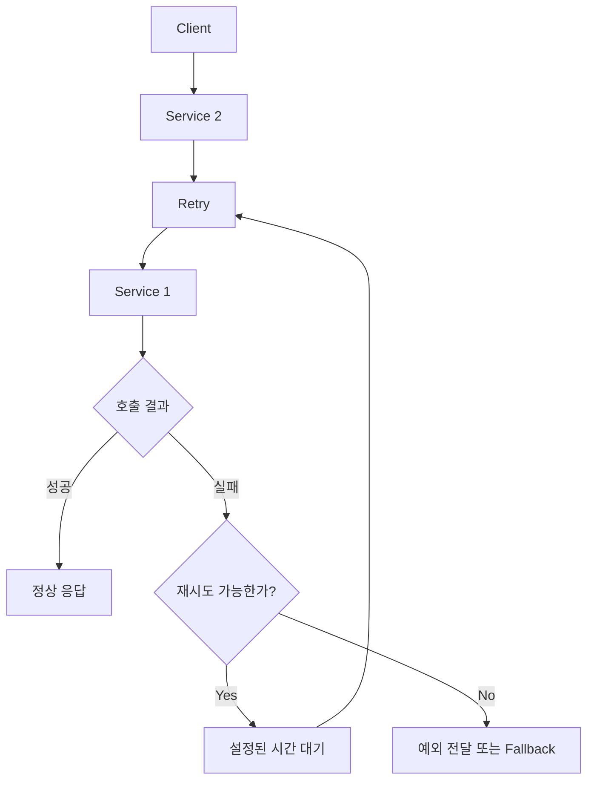
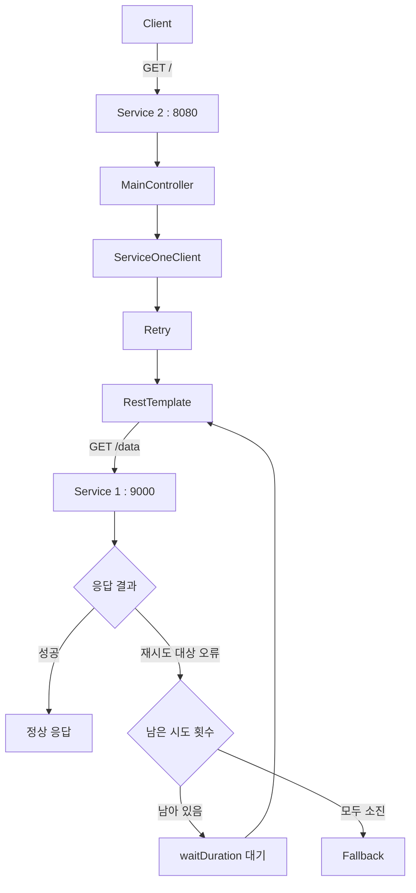
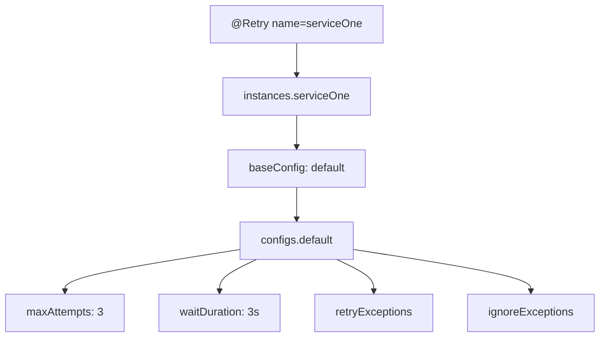
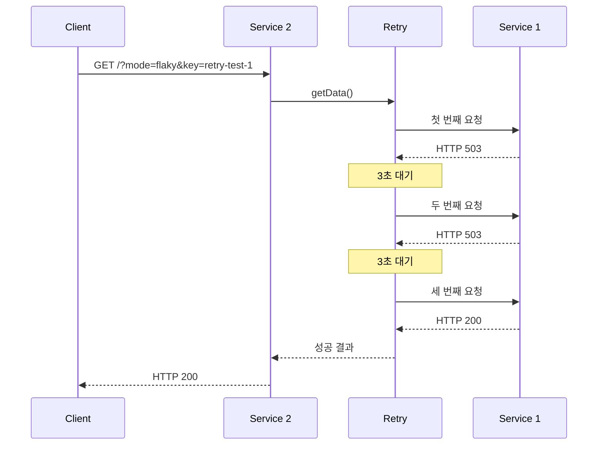
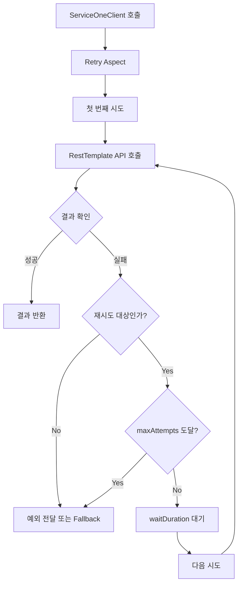
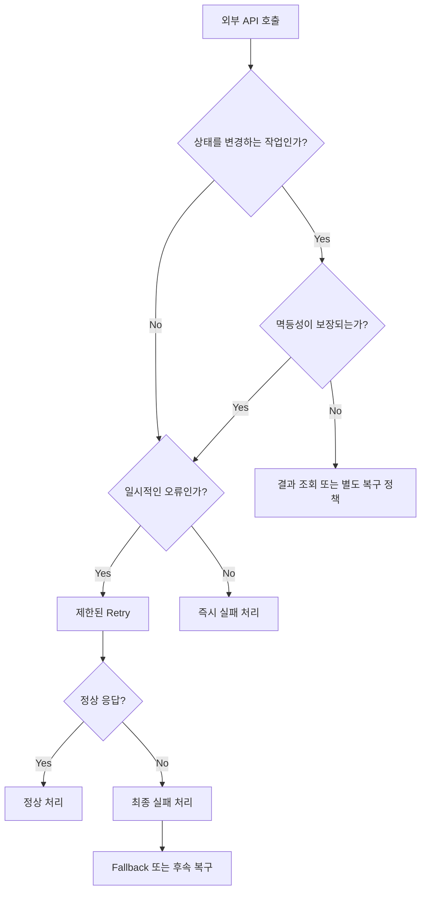

# Resilience4J - 7. retry 재시도 구현 실습
[https://youtu.be/klfx8Xq-cq4?si=SCgYISgx3ZQs0saK](https://youtu.be/klfx8Xq-cq4?si=SCgYISgx3ZQs0saK)

# Resilience4J - 7. retry 재시도 구현 실습
* toc
{:toc}

---

## Resilience4j Retry 완벽 정리: 재시도 설정부터 Fallback, CircuitBreaker 실행 순서까지

마이크로서비스 아키텍처(MSA)에서는 하나의 서비스가 다른 서비스를 호출하는 과정에서 다양한 장애가 발생할 수 있다.

예를 들어 주문 서비스가 상품 서비스의 API를 호출한다고 가정해보자.

```text
Client
   ↓
주문 서비스
   ↓
상품 서비스
   ↓
Database
```

정상적인 상황에서는 상품 서비스가 요청에 응답하고, 주문 서비스는 해당 데이터를 이용해 비즈니스 로직을 처리한다.

하지만 실제 운영 환경에서는 네트워크 오류나 일시적인 서버 과부하로 인해 요청이 실패할 수 있다.

```text
주문 서비스
    ↓
상품 서비스 호출
    ↓
HTTP 503 Service Unavailable
    ↓
요청 실패
```

여기서 중요한 질문이 있다.

**한 번 실패한 요청을 즉시 최종 실패로 처리하는 것이 항상 최선일까?**

모든 장애가 지속적으로 발생하는 것은 아니다.

일시적인 네트워크 문제나 짧은 서버 과부하라면 잠시 후 동일한 요청을 다시 보냈을 때 정상적으로 처리될 가능성이 있다.

```text
첫 번째 요청 → 실패

잠시 대기

두 번째 요청 → 실패

잠시 대기

세 번째 요청 → 성공
```

이처럼 일시적인 장애를 극복하기 위해 실패한 작업을 정해진 정책에 따라 다시 실행하는 방식을 **Retry(재시도)**&#xB77C;고 한다.

Java 환경에서는 Resilience4j의 Retry 모듈을 이용해 이러한 재시도 정책을 구현할 수 있다.

Resilience4j Retry는 재시도 횟수, 재시도 간격, 재시도할 예외, 제외할 예외, 최종 실패 시 Fallback 등을 설정할 수 있다.

다만 Retry를 잘못 사용하면 장애를 복구하기보다 오히려 장애를 확대할 수도 있다.

특히 결제 승인이나 주문 생성처럼 상태를 변경하는 API에 무조건 재시도를 적용하면 중복 처리가 발생할 수 있다.

따라서 Retry를 사용할 때는 단순히 재시도 방법을 아는 것보다 **어떤 요청을, 어떤 오류에서, 몇 번, 얼마의 간격으로 재시도해야 하는지** 이해하는 것이 중요하다.

---

## Retry란?

Retry는 작업이 실패했을 때 미리 정의한 조건에 따라 동일한 작업을 다시 시도하는 장애 대응 패턴이다.

예를 들어 Service 2가 Service 1의 API를 호출하는 구조를 생각해보자.



Retry는 외부 호출에 실패했다고 무조건 다시 실행하는 것이 아니다.

설정한 재시도 정책에 해당하는 경우에만 작업을 반복한다.

예를 들어 다음과 같은 정책을 구성할 수 있다.

| 항목        | 설정              |
| --------- | --------------- |
| 최대 시도 횟수  | 3회              |
| 재시도 간격    | 3초              |
| 재시도할 오류   | HTTP 5xx, 연결 오류 |
| 재시도 제외 오류 | HTTP 4xx        |
| 최종 실패     | Fallback 실행     |

이러한 정책이 적용되면 외부 API에서 일시적인 장애가 발생했을 때 자동으로 재시도를 수행할 수 있다.

반면 재시도할 가치가 없는 오류라면 즉시 실패하도록 구성할 수 있다.

### Retry가 필요한 이유

Retry가 필요한 대표적인 상황은 일시적인 장애다.

예를 들어 다음과 같은 상황을 생각해보자.

**일시적인 네트워크 오류**

```text
Service 2
    ↓
Service 1 호출
    ↓
네트워크 연결 실패
    ↓
500ms 후 재시도
    ↓
연결 성공
```

**일시적인 서버 과부하**

```text
Service 2
    ↓
Service 1 호출
    ↓
HTTP 503
    ↓
1초 후 재시도
    ↓
HTTP 200
```

**일시적인 외부 API 제한**

```text
외부 API 호출
    ↓
HTTP 429 Too Many Requests
    ↓
호출 제한 정책 확인
    ↓
허용된 시점에 재시도
```

마지막 사례처럼 일부 오류는 서버가 전달하는 `Retry-After` 등의 정보를 고려해야 한다.

따라서 모든 오류에 동일한 재시도 간격을 적용하는 것이 적절하지 않을 수 있다.

Retry는 일시적인 장애에 대응하는 기능이며, 지속적인 장애를 직접 해결하는 기술은 아니다.

---

## CircuitBreaker와 Retry의 차이

Resilience4j에는 Retry와 비슷하게 외부 서비스 장애를 처리하는 CircuitBreaker가 있다.

두 모듈 모두 장애 대응에 사용하지만 동작 방식은 반대에 가깝다.

**CircuitBreaker는 불안정한 서비스에 대한 호출을 차단한다.**

반면 **Retry는 실패한 호출을 다시 실행한다.**

| 구분        | CircuitBreaker           | Retry                     |
| --------- | ------------------------ | ------------------------- |
| 주요 목적     | 지속적인 장애의 전파 방지           | 일시적인 장애 복구                |
| 핵심 동작     | 외부 호출 차단                 | 외부 호출 재실행                 |
| 판단 기준     | 실패율, Slow Call 비율        | 예외, 응답 결과, 시도 횟수          |
| 주요 설정     | Sliding Window, 실패율, 지연율 | maxAttempts, waitDuration |
| 장애가 지속될 때 | 추가 호출을 차단할 수 있음          | 설정된 횟수만큼 호출 증가            |
| 대표적인 활용   | 장애가 지속되는 외부 서비스          | 순간적인 연결 오류                |

예를 들어 Service 1이 계속 실패한다고 가정해보자.

Retry만 사용하면 다음과 같이 동작한다.

```text
Service 1 호출
    ↓
실패
    ↓
재시도
    ↓
실패
    ↓
재시도
    ↓
실패
    ↓
최종 실패
```

CircuitBreaker는 반복된 장애가 임계값에 도달하면 다음과 같이 동작할 수 있다.

```text
Service 1 호출
    ↓
반복적인 실패
    ↓
CircuitBreaker OPEN
    ↓
이후 Service 1 호출 차단
```

Retry와 CircuitBreaker를 함께 사용하면 일시적인 장애는 재시도하고, 장애가 지속될 때는 호출을 차단하는 구조를 만들 수 있다.

하지만 두 기능을 함께 사용하는 경우에는 실행 순서에 주의해야 한다.

이 부분은 뒤에서 자세히 살펴본다.

---

## Retry의 주요 설정

Resilience4j Retry를 구현할 때 가장 먼저 알아야 할 설정은 다음과 같다.

| 설정                             | 역할                   |
| ------------------------------ | -------------------- |
| `maxAttempts`                  | 최초 호출을 포함한 최대 시도 횟수  |
| `waitDuration`                 | 재시도 사이의 대기 시간        |
| `retryExceptions`              | 재시도 대상으로 지정할 예외      |
| `ignoreExceptions`             | 재시도하지 않을 예외          |
| `retryExceptionPredicate`      | 예외에 따른 재시도 조건        |
| `retryOnResultPredicate`       | 반환 결과에 따른 재시도 조건     |
| `enableExponentialBackoff`     | 지수 백오프 적용            |
| `exponentialBackoffMultiplier` | 대기 시간 증가 배율          |
| `enableRandomizedWait`         | 재시도 대기 시간에 무작위 변동 적용 |

이 중 가장 기본적인 설정은 `maxAttempts`와 `waitDuration`이다.

Resilience4j는 이러한 설정을 `RetryConfig`를 통해 관리한다.

---

## maxAttempts: 최대 시도 횟수

먼저 다음 설정을 살펴보자.

```yaml
resilience4j:
  retry:
    instances:
      serviceOne:
        maxAttempts: 3
```

`maxAttempts`는 작업을 최대 몇 번 시도할 것인지 결정한다.

여기서 특히 주의할 점이 있다.

**`maxAttempts: 3`은 최초 호출을 포함하여 총 세 번 시도한다는 의미다.**

처음 호출한 뒤 세 번을 추가로 재시도한다는 의미가 아니다.

```text
maxAttempts = 3

1번째 시도 → 최초 호출

2번째 시도 → 첫 번째 재시도

3번째 시도 → 두 번째 재시도
```

따라서 실제 외부 API 호출 횟수는 최대 세 번이다.

이를 표로 정리하면 다음과 같다.

| maxAttempts | 최초 호출 | 추가 재시도 | 최대 총 호출 |
| ----------: | ----: | -----: | ------: |
|           1 |    1회 |     0회 |      1회 |
|           2 |    1회 |     1회 |      2회 |
|           3 |    1회 |     2회 |      3회 |
|           5 |    1회 |     4회 |      5회 |

이 부분을 잘못 이해하면 외부 API에 예상보다 많은 요청을 보내거나, 반대로 기대한 만큼 재시도가 발생하지 않는 문제가 생길 수 있다.

공식 Retry 설정에서도 `maxAttempts`가 최초 호출을 포함한 전체 시도 횟수임을 명시하고 있다.

### 중간에 성공하면 어떻게 될까?

최대 시도 횟수가 세 번이라고 해서 항상 세 번 호출하는 것은 아니다.

첫 번째 요청이 성공하면 재시도하지 않는다.

```text
1번째 호출 → 성공

작업 종료
```

두 번째 요청에서 성공했다면 세 번째 요청은 실행하지 않는다.

```text
1번째 호출 → 실패

2번째 호출 → 성공

작업 종료
```

모든 요청이 실패했을 때만 설정된 최대 횟수까지 호출한다.

```text
1번째 호출 → 실패

2번째 호출 → 실패

3번째 호출 → 실패

최종 실패
```

따라서 Retry는 **최대 시도 횟수를 설정하는 기능이지, 반드시 해당 횟수만큼 호출하는 기능은 아니다.**

---

## waitDuration: 재시도 간격

다음 설정을 살펴보자.

```yaml
resilience4j:
  retry:
    instances:
      serviceOne:
        maxAttempts: 3
        waitDuration: 3s
```

`waitDuration`은 재시도 사이에 기다릴 시간을 의미한다.

위 설정에서는 최대 세 번 시도하고, 재시도할 때마다 3초씩 대기한다.

동작 흐름은 다음과 같다.

```text
1번째 API 호출
    ↓
실패
    ↓
3초 대기
    ↓
2번째 API 호출
    ↓
실패
    ↓
3초 대기
    ↓
3번째 API 호출
    ↓
실패
    ↓
최종 실패
```

여기서 전체 재시도 대기 시간은 6초다.

최초 호출을 포함한 전체 시도 횟수가 세 번이므로 대기 구간은 두 개이기 때문이다.

단, 실제 전체 응답 시간에는 각 HTTP 요청에 소요된 시간도 포함된다.

예를 들어 요청마다 2초가 걸린다면 다음과 같다.

```text
첫 번째 호출 = 2초

첫 번째 대기 = 3초

두 번째 호출 = 2초

두 번째 대기 = 3초

세 번째 호출 = 2초
```

따라서 총 12초가 걸릴 수 있다.

이를 일반화하면 다음과 같다.

**전체 소요 시간 ≈ 각 호출의 실행 시간 합계 + 재시도 사이의 대기 시간 합계**

고정 간격 재시도에서 모든 시도를 수행한다면:

```text
총 재시도 대기 시간
= (maxAttempts - 1) × waitDuration
```

이 계산은 실제 사용자 응답 시간을 설계할 때 중요하다.

재시도 횟수를 늘리면 성공 가능성이 높아질 수 있지만, 그만큼 요청 처리 시간도 증가할 수 있기 때문이다.

---

## Spring Boot에서 Retry 구현하기

이제 실제 Spring Boot 애플리케이션에 Retry를 적용해보자.

앞에서 구성한 두 개의 마이크로서비스를 그대로 활용한다.

Service 1은 데이터를 반환하는 API 서버다.

Service 2는 Service 1을 호출하는 서버다.

이번에는 Service 2에 Retry를 적용한다.

### 전체 아키텍처



이번 구현에서는 CircuitBreaker를 먼저 적용하지 않는다.

Retry 자체가 어떻게 동작하는지 확인한 뒤 두 모듈을 함께 사용할 때의 차이를 살펴본다.

---

## Gradle 의존성 설정

Spring Boot 3.2.0과 Java 17을 기준으로 구성한다.

`build.gradle`은 다음과 같다.

```gradle
plugins {
    id 'java'
    id 'org.springframework.boot' version '3.2.0'
    id 'io.spring.dependency-management' version '1.1.4'
}

group = 'com.example'
version = '0.0.1-SNAPSHOT'

java {
    toolchain {
        languageVersion = JavaLanguageVersion.of(17)
    }
}

repositories {
    mavenCentral()
}

dependencies {
    implementation 'org.springframework.boot:spring-boot-starter-web'

    implementation 'org.springframework.boot:spring-boot-starter-aop'

    implementation 'org.springframework.boot:spring-boot-starter-actuator'

    implementation 'io.github.resilience4j:resilience4j-spring-boot3:2.2.0'

    testImplementation 'org.springframework.boot:spring-boot-starter-test'
}

tasks.named('test') {
    useJUnitPlatform()
}
```

여기서 Resilience4j의 Spring Boot Starter는 Annotation 기반 Retry와 CircuitBreaker를 사용할 수 있도록 연동 기능을 제공한다.

그리고 `spring-boot-starter-aop`는 Spring AOP 기반으로 메서드 호출을 가로채기 위해 사용한다.

위 버전은 앞에서 구성한 Spring Boot 3.2 환경을 재현하기 위한 예시이며, 신규 프로젝트에서는 사용 중인 Spring Boot와 호환되는 지원 버전을 확인해야 한다.

Resilience4j 공식 문서에서도 Spring Boot Starter와 AOP, Actuator를 이용한 연동을 안내한다.

---

## Service 1: 재시도 확인을 위한 API 서버

Retry를 확인하려면 외부 API가 일시적으로 실패하다가 정상적으로 응답하는 상황이 필요하다.

단순히 서버를 종료하면 모든 요청이 계속 실패하기 때문에 재시도를 통해 복구되는 상황을 확인하기 어렵다.

따라서 다음과 같은 API를 구성한다.

| mode    | 동작                    |
| ------- | --------------------- |
| `ok`    | 항상 정상 응답              |
| `fail`  | 항상 HTTP 503 반환        |
| `flaky` | 처음 두 번 실패하고 세 번째부터 성공 |

`flaky`는 일시적으로 불안정한 서비스를 의미한다.

이번에는 이 모드를 이용해 Retry가 실제로 외부 API를 몇 번 호출하는지 확인해보자.

### application.yml

Service 1은 9000 포트에서 실행한다.

```yaml
spring:
  application:
    name: service-one

server:
  port: 9000
```

### DataController 구현

```java
package com.example.serviceone.controller;

import java.time.Instant;
import java.util.concurrent.ConcurrentHashMap;
import java.util.concurrent.atomic.AtomicInteger;

import org.springframework.http.HttpStatus;
import org.springframework.web.bind.annotation.GetMapping;
import org.springframework.web.bind.annotation.RequestParam;
import org.springframework.web.bind.annotation.RestController;
import org.springframework.web.server.ResponseStatusException;

@RestController
public class DataController {

    private final ConcurrentHashMap<String, AtomicInteger> attempts =
            new ConcurrentHashMap<>();

    @GetMapping("/data")
    public String getData(
            @RequestParam(defaultValue = "ok") String mode,
            @RequestParam(defaultValue = "default") String key
    ) {

        if ("ok".equals(mode)) {

            return "SUCCESS: " + Instant.now();
        }

        if ("fail".equals(mode)) {

            throw new ResponseStatusException(
                    HttpStatus.SERVICE_UNAVAILABLE,
                    "일시적인 서버 장애"
            );
        }

        if ("flaky".equals(mode)) {

            AtomicInteger counter = attempts.computeIfAbsent(
                    key,
                    ignored -> new AtomicInteger()
            );

            int currentAttempt = counter.incrementAndGet();

            if (currentAttempt <= 2) {

                throw new ResponseStatusException(
                        HttpStatus.SERVICE_UNAVAILABLE,
                        "일시적인 장애, attempt=" + currentAttempt
                );
            }

            return "SUCCESS: attempt=" + currentAttempt;
        }

        throw new ResponseStatusException(
                HttpStatus.BAD_REQUEST,
                "지원하지 않는 mode"
        );
    }
}
```

코드를 살펴보자.

먼저 다음 자료구조를 사용한다.

```java
private final ConcurrentHashMap<String, AtomicInteger> attempts =
        new ConcurrentHashMap<>();
```

`ConcurrentHashMap`은 여러 Thread가 동시에 접근하는 상황을 고려한 Map 구현체다.

`AtomicInteger`는 카운터 값을 원자적으로 증가시키기 위해 사용한다.

이 구조는 각각의 요청 키에 대해 호출 횟수를 기록한다.

예를 들어 다음 요청이 들어왔다고 하자.

```http
GET /data?mode=flaky&key=test-1
```

처음 두 번은 HTTP 503을 반환한다.

```text
key = test-1

1번째 호출 → 503

2번째 호출 → 503
```

세 번째 호출부터는 정상 응답을 반환한다.

```text
3번째 호출 → 200 OK
```

따라서 다음과 같은 상황을 재현할 수 있다.

```text
Service 2
    ↓
Service 1 호출
    ↓
503
    ↓
Retry
    ↓
503
    ↓
Retry
    ↓
200 OK
```

이번 구현은 재시도 횟수를 확인하기 위해 메모리에 카운터를 저장한 것이다.

운영 환경에서 동일한 방식으로 요청 상태를 무제한 저장하면 메모리 사용량이 증가할 수 있으므로 실제 서비스에 그대로 적용하는 구조는 아니다.

---

## Service 2: RestTemplate 구성

이제 Service 2에서 Service 1을 호출할 RestTemplate을 구성한다.

Service 2는 8080 포트에서 실행된다.

```yaml
spring:
  application:
    name: service-two

server:
  port: 8080

clients:
  service-one:
    base-url: http://localhost:9000
```

RestTemplate은 다음과 같이 Bean으로 등록한다.

```java
package com.example.servicetwo.config;

import java.time.Duration;

import org.springframework.beans.factory.annotation.Value;
import org.springframework.boot.web.client.RestTemplateBuilder;
import org.springframework.context.annotation.Bean;
import org.springframework.context.annotation.Configuration;
import org.springframework.web.client.RestTemplate;

@Configuration
public class RestClientConfig {

    @Bean
    public RestTemplate serviceOneRestTemplate(
            RestTemplateBuilder builder,
            @Value("${clients.service-one.base-url}") String baseUrl
    ) {

        return builder
                .rootUri(baseUrl)
                .setConnectTimeout(Duration.ofSeconds(1))
                .setReadTimeout(Duration.ofSeconds(2))
                .build();
    }
}
```

이번에는 외부 API가 즉시 성공하거나 실패하도록 구성했으므로 Read Timeout을 2초로 설정했다.

다만 실제 운영에서는 Retry 설정과 HTTP Client Timeout을 함께 고려해야 한다.

예를 들어 `maxAttempts=3`이고 각 호출이 Read Timeout까지 대기한다면 전체 요청 처리 시간이 예상보다 길어질 수 있다.

---

## @Retry 적용하기

이제 외부 API를 호출하는 클래스에 `@Retry`를 적용한다.

CircuitBreaker와 마찬가지로 Retry도 Annotation 방식으로 사용할 수 있다.

기본적인 형태는 다음과 같다.

```java
@Retry(
        name = "serviceOne",
        fallbackMethod = "fallback"
)
```

각 속성의 의미는 다음과 같다.

| 속성               | 의미                 |
| ---------------- | ------------------ |
| `name`           | Retry 인스턴스 식별자     |
| `fallbackMethod` | 최종 실패 시 실행할 대체 메서드 |

여기서 `name`으로 지정한 `serviceOne`은 설정 파일의 다음 부분과 연결된다.

```yaml
resilience4j:
  retry:
    instances:
      serviceOne:
        baseConfig: default
```

즉 Annotation 이름과 설정 인스턴스의 이름이 일치해야 한다.

### ServiceOneClient 전체 코드

```java
package com.example.servicetwo.client;

import io.github.resilience4j.retry.annotation.Retry;

import org.slf4j.Logger;
import org.slf4j.LoggerFactory;
import org.springframework.beans.factory.annotation.Qualifier;
import org.springframework.http.HttpStatus;
import org.springframework.http.ResponseEntity;
import org.springframework.stereotype.Component;
import org.springframework.web.client.RestTemplate;

@Component
public class ServiceOneClient {

    private static final Logger log =
            LoggerFactory.getLogger(ServiceOneClient.class);

    private final RestTemplate restTemplate;

    public ServiceOneClient(
            @Qualifier("serviceOneRestTemplate")
            RestTemplate restTemplate
    ) {
        this.restTemplate = restTemplate;
    }

    @Retry(
            name = "serviceOne",
            fallbackMethod = "fallback"
    )
    public ResponseEntity<String> getData(
            String mode,
            String key
    ) {

        log.info(
                "Service One API 호출. mode={}, key={}",
                mode,
                key
        );

        String response = restTemplate.getForObject(
                "/data?mode={mode}&key={key}",
                String.class,
                mode,
                key
        );

        return ResponseEntity.ok(response);
    }

    private ResponseEntity<String> fallback(
            String mode,
            String key,
            Exception exception
    ) {

        log.error(
                "Service One 최종 호출 실패. mode={}, key={}",
                mode,
                key,
                exception
        );

        return ResponseEntity
                .status(HttpStatus.SERVICE_UNAVAILABLE)
                .body("Service One temporarily unavailable");
    }
}
```

이 코드는 외부 API를 호출하는 메서드에 Retry를 적용한 것이다.

핵심 부분은 다음과 같다.

```java
@Retry(
        name = "serviceOne",
        fallbackMethod = "fallback"
)
```

이 설정에 따라 `getData()`에서 재시도 대상 예외가 발생하면 Retry 정책을 수행한다.

```text
getData()
    ↓
RestTemplate
    ↓
Service 1
    ↓
예외 발생
    ↓
Retry 정책 확인
    ↓
재시도
```

모든 시도가 실패하면 Fallback 메서드가 실행된다.

```text
최대 시도 횟수 소진
    ↓
최종 예외 발생
    ↓
fallback()
    ↓
HTTP 503 반환
```

여기서는 최종 실패 시 `503 Service Unavailable`을 반환하도록 했다.

그 이유는 외부 서비스 호출이 실패했는데도 무조건 HTTP 200을 반환하면 사용자나 모니터링 시스템이 정상 처리로 오해할 수 있기 때문이다.

단순한 조회 API에서는 대체 데이터를 제공하는 Fallback을 사용할 수도 있지만, 대체할 데이터가 없다면 명확하게 실패를 표현하는 것이 적절하다.

---

## MainController 구현

이제 외부에서 Service 2에 요청할 수 있도록 Controller를 작성한다.

```java
package com.example.servicetwo.controller;

import com.example.servicetwo.client.ServiceOneClient;

import org.springframework.http.ResponseEntity;
import org.springframework.web.bind.annotation.GetMapping;
import org.springframework.web.bind.annotation.RequestParam;
import org.springframework.web.bind.annotation.RestController;

@RestController
public class MainController {

    private final ServiceOneClient serviceOneClient;

    public MainController(ServiceOneClient serviceOneClient) {
        this.serviceOneClient = serviceOneClient;
    }

    @GetMapping("/")
    public ResponseEntity<String> main(
            @RequestParam(defaultValue = "ok") String mode,
            @RequestParam(defaultValue = "default") String key
    ) {

        return serviceOneClient.getData(mode, key);
    }
}
```

Controller는 Retry 정책을 직접 구현하지 않는다.

외부 API 호출을 담당하는 `ServiceOneClient`에 이미 Retry가 적용되어 있기 때문이다.

전체적인 책임은 다음과 같이 구분된다.

| 구성요소             | 역할               |
| ---------------- | ---------------- |
| MainController   | 클라이언트 요청 수신      |
| ServiceOneClient | Service 1 API 호출 |
| RestTemplate     | HTTP 통신          |
| Retry            | 재시도 정책 적용        |
| Fallback         | 최종 실패 처리         |

이처럼 외부 API 호출을 별도 클래스로 분리하면 장애 대응 로직을 변경할 때 Controller를 크게 수정할 필요가 없다.

---

## Retry 설정: application.yml

이제 `@Retry(name = "serviceOne")`에 적용할 설정을 작성해보자.

앞에서 사용한 공통 설정 방식과 동일하게 `configs`와 `instances`를 사용한다.

### 전체 설정

```yaml
spring:
  application:
    name: service-two

server:
  port: 8080

clients:
  service-one:
    base-url: http://localhost:9000

resilience4j:
  retry:
    configs:
      default:
        maxAttempts: 3
        waitDuration: 3s

        retryExceptions:
          - org.springframework.web.client.HttpServerErrorException
          - org.springframework.web.client.ResourceAccessException

        ignoreExceptions:
          - org.springframework.web.client.HttpClientErrorException

        eventConsumerBufferSize: 20

    instances:
      serviceOne:
        baseConfig: default

management:
  endpoints:
    web:
      exposure:
        include: health,info,metrics,retries,retryevents
```

이 설정은 크게 두 부분으로 구분된다.

첫 번째는 재시도 정책을 정의하는 공통 설정이다.

```yaml
resilience4j:
  retry:
    configs:
      default:
        maxAttempts: 3
        waitDuration: 3s
```

두 번째는 해당 정책을 실제 Retry 인스턴스에 연결하는 부분이다.

```yaml
instances:
  serviceOne:
    baseConfig: default
```

이렇게 설정하면 다음과 같은 관계가 만들어진다.



여기서 `serviceOne`이라는 이름은 Retry 인스턴스를 식별하는 용도로 사용된다.

이름이 다른 Retry 인스턴스를 추가하면 각 호출에 서로 다른 재시도 정책을 적용할 수 있다.

---

## retryExceptions: 재시도할 예외 지정

다음 설정을 살펴보자.

```yaml
retryExceptions:
  - org.springframework.web.client.HttpServerErrorException
  - org.springframework.web.client.ResourceAccessException
```

이 설정은 지정한 예외가 발생했을 때 재시도를 수행하도록 하는 것이다.

첫 번째 예외는 다음과 같다.

```java
HttpServerErrorException
```

RestTemplate에서 기본 오류 처리기를 사용할 경우 HTTP 5xx 응답이 발생하면 이 예외나 하위 타입으로 전달될 수 있다.

예를 들어 다음 응답이다.

```http
HTTP/1.1 503 Service Unavailable
```

두 번째 예외는 다음과 같다.

```java
ResourceAccessException
```

이 예외는 외부 HTTP 호출 과정에서 발생한 I/O 오류를 나타낼 수 있다.

대표적으로 연결 실패나 Timeout이 있다.

```text
Connection Refused

Connection Timeout

Read Timeout
```

이러한 오류가 발생하면 Retry를 수행할 수 있다.

### IOException을 설정하면 될까?

Java에서 네트워크 오류를 처리할 때 `IOException`을 사용하는 경우가 많다.

하지만 RestTemplate을 사용할 때는 주의해야 한다.

실제 네트워크 오류가 `IOException`으로 발생했더라도 RestTemplate이 이를 `ResourceAccessException`으로 감싸서 전달할 수 있기 때문이다.

예를 들어 다음과 같은 구조다.

```text
SocketTimeoutException
    ↓
ResourceAccessException
    ↓
ServiceOneClient
    ↓
Retry
```

따라서 Retry가 실제로 전달받는 예외가 `ResourceAccessException`이라면 `IOException`만 등록해서는 기대한 방식으로 재시도되지 않을 수 있다.

**재시도할 예외는 하위 네트워크 라이브러리에서 처음 발생한 예외가 아니라 보호 대상 메서드 밖으로 전달되는 예외를 기준으로 설정해야 한다.**

이 부분은 실무에서 Retry가 동작하지 않는 원인 중 하나가 될 수 있다.

---

## ignoreExceptions: 재시도하지 않을 예외 지정

다음 설정을 살펴보자.

```yaml
ignoreExceptions:
  - org.springframework.web.client.HttpClientErrorException
```

`ignoreExceptions`는 특정 예외가 발생했을 때 Retry를 수행하지 않도록 하는 설정이다.

이번에는 HTTP 4xx 계열 오류를 제외했다.

예를 들어 다음과 같은 응답을 생각해보자.

```http
HTTP/1.1 400 Bad Request
```

이 오류는 클라이언트가 잘못된 파라미터를 전달해서 발생할 수 있다.

같은 요청을 세 번 보내더라도 입력값이 변경되지 않는다면 문제가 해결되지 않을 가능성이 높다.

마찬가지로 다음 응답도 생각해볼 수 있다.

```http
HTTP/1.1 404 Not Found
```

요청한 리소스가 존재하지 않는 것이 정상적인 비즈니스 결과라면 재시도를 수행할 필요가 없다.

하지만 모든 4xx를 무조건 재시도하지 않아야 하는 것은 아니다.

예를 들어 429 응답은 일시적인 호출 제한을 의미할 수 있다.

이 경우에는 서버가 제공하는 재시도 가능 시점에 맞춰 다시 호출해야 할 수도 있다.

따라서 운영 환경에서는 HTTP 상태 코드와 서비스의 비즈니스 정책을 함께 고려해야 한다.

### retryExceptions와 ignoreExceptions의 차이

| 구분 | retryExceptions | ignoreExceptions |
| -- | --------------- | ---------------- |
| 목적 | 재시도할 오류 지정      | 재시도하지 않을 오류 지정   |
| 예시 | HTTP 503        | HTTP 400         |
| 예시 | 연결 실패           | 잘못된 입력           |
| 결과 | 정책에 따라 다시 호출    | Retry 없이 예외 전달   |

두 설정을 함께 사용할 경우 제외 대상으로 지정한 예외는 재시도하지 않도록 처리된다.

특히 `retryExceptions`로 대상을 명시하면 그 외의 예외는 재시도 대상에서 제외될 수 있으므로 실제 예외 타입을 확인하는 것이 중요하다.

---

## Fallback 설정하기

Retry가 설정된 횟수만큼 재시도를 수행했는데도 정상적인 결과를 얻지 못할 수 있다.

예를 들어 다음과 같은 상황이다.

```text
1번째 호출 → 503

3초 대기

2번째 호출 → 503

3초 대기

3번째 호출 → 503
```

이미 최대 시도 횟수를 모두 사용했다.

이때는 더 이상 재시도하지 않고 최종 예외를 전달한다.

하지만 서비스에 따라 예외를 그대로 전달하는 대신 다른 처리를 수행할 수도 있다.

이것이 Fallback이다.

### Fallback 메서드 규칙

다음 메서드에 Retry가 적용되어 있다고 하자.

```java
@Retry(
        name = "serviceOne",
        fallbackMethod = "fallback"
)
public ResponseEntity<String> getData(
        String mode,
        String key
) {
    // 외부 API 호출
}
```

원본 메서드는 두 개의 매개변수를 받는다.

```text
String mode

String key
```

Fallback 메서드는 원본 메서드와 대응되는 매개변수를 유지하고, 마지막에 처리할 예외 타입을 추가한다.

```java
private ResponseEntity<String> fallback(
        String mode,
        String key,
        Exception exception
) {

    return ResponseEntity
            .status(HttpStatus.SERVICE_UNAVAILABLE)
            .body("Service One temporarily unavailable");
}
```

두 메서드의 관계는 다음과 같다.

```text
원본 메서드

getData(String mode, String key)
```

```text
Fallback 메서드

fallback(String mode, String key, Exception exception)
```

반환 타입도 원본 메서드와 호환되어야 한다.

Resilience4j의 Spring Boot 연동에서는 이러한 방식으로 Fallback 메서드를 지정할 수 있으며, 여러 예외 타입에 대응하는 메서드를 오버로딩하는 것도 지원한다.

---

## 실제 동작 확인

이제 Service 1과 Service 2를 실행해보자.

### Service 1 실행

Service 1 프로젝트에서 다음 명령을 실행한다.

```bash
./gradlew bootRun
```

Service 1은 9000 포트에서 실행된다.

### Service 2 실행

Service 2 프로젝트에서 다음 명령을 실행한다.

```bash
./gradlew bootRun
```

Service 2는 8080 포트에서 실행된다.

두 서비스가 정상적으로 실행되었다면 다음 시나리오를 확인할 수 있다.

---

## 정상 요청에서는 Retry가 실행되지 않는다

먼저 Service 1이 정상적으로 응답하는 상황이다.

```bash
curl -i "http://localhost:8080/?mode=ok&key=normal-1"
```

Service 2는 Service 1의 API를 호출한다.

```text
Service 2
    ↓
Retry
    ↓
RestTemplate
    ↓
Service 1
    ↓
HTTP 200
```

정상적인 경우 다음과 유사한 응답을 받을 수 있다.

```http
HTTP/1.1 200 OK
Content-Type: text/plain;charset=UTF-8

SUCCESS: 2026-10-22T01:30:00Z
```

시간은 응답 형식을 보여주기 위한 예시다.

요청이 첫 번째 시도에서 성공했기 때문에 추가 재시도는 발생하지 않는다.

```text
1번째 호출 → 성공

Retry 종료
```

이처럼 정상적인 호출에서는 Retry가 불필요한 추가 요청을 발생시키지 않는다.

---

## 일시적인 실패 후 정상 응답 확인

이번에는 `flaky` 모드를 이용한다.

이 모드는 처음 두 번 실패하고 세 번째부터 성공하도록 구성했다.

```bash
curl -i "http://localhost:8080/?mode=flaky&key=retry-test-1"
```

여기서 `key`는 요청별 호출 횟수를 구분하기 위해 사용한다.

이전에 사용하지 않은 새로운 키를 지정해야 처음부터 재시도 동작을 확인할 수 있다.

전체 흐름은 다음과 같다.



첫 번째 호출은 실패한다.

```text
attempt = 1

HTTP 503
```

Retry는 재시도 간격인 3초를 기다린다.

두 번째 호출도 실패한다.

```text
attempt = 2

HTTP 503
```

다시 3초를 기다린다.

세 번째 호출은 성공한다.

```text
attempt = 3

HTTP 200
```

최종적으로 클라이언트는 다음과 유사한 응답을 받는다.

```http
HTTP/1.1 200 OK
Content-Type: text/plain;charset=UTF-8

SUCCESS: attempt=3
```

이 결과를 통해 다음 사실을 확인할 수 있다.

**외부 API가 처음에는 실패했더라도 설정된 횟수 안에서 정상 응답을 반환하면 Retry는 최종 성공 결과를 반환한다.**

단, 사용자 입장에서는 재시도 대기 시간만큼 응답이 늦어질 수 있다.

이번에는 재시도 사이에 각각 3초씩 기다렸으므로 전체 소요 시간은 약 6초 이상이 될 수 있다.

---

## 모든 호출이 실패하면 Fallback이 실행된다

이번에는 Service 1이 계속 실패하는 상황이다.

```bash
curl -i "http://localhost:8080/?mode=fail&key=retry-test-2"
```

Service 1은 항상 HTTP 503을 반환한다.

따라서 Retry는 다음과 같이 동작한다.

```text
1번째 호출
    ↓
503
    ↓
3초 대기
    ↓
2번째 호출
    ↓
503
    ↓
3초 대기
    ↓
3번째 호출
    ↓
503
    ↓
Fallback 실행
```

최종적으로 Service 2는 다음과 같은 응답을 반환한다.

```http
HTTP/1.1 503 Service Unavailable
Content-Type: text/plain;charset=UTF-8

Service One temporarily unavailable
```

여기서 중요한 점은 **Fallback이 실행된다고 반드시 HTTP 200을 반환해야 하는 것은 아니라는 것**이다.

Fallback은 원래 작업이 실패했을 때 수행하는 대체 처리다.

대체 데이터가 존재한다면 정상적인 데이터를 반환할 수도 있고, 복구할 수 없는 오류라면 명확한 실패 응답을 반환할 수도 있다.

특히 결제, 주문, 재고처럼 정합성이 중요한 작업에서는 최종 처리 결과를 알 수 없는 상황에서 성공 응답을 만들어 반환해서는 안 된다.

---

## Retry와 CircuitBreaker를 함께 사용하면 어떻게 될까?

여기서 가장 중요하게 이해해야 할 부분이 있다.

앞에서 CircuitBreaker를 구현할 때도 Fallback을 사용했다.

Retry에서도 Fallback을 사용할 수 있다.

그렇다면 다음과 같이 두 Annotation을 함께 사용하면 어떻게 될까?

```java
@CircuitBreaker(
        name = "serviceOne",
        fallbackMethod = "fallback"
)
@Retry(
        name = "serviceOne",
        fallbackMethod = "fallback"
)
public String getData() {
    // 외부 API 호출
}
```

겉으로 보기에는 Retry를 실행한 다음 최종적으로 CircuitBreaker를 적용할 것처럼 생각할 수 있다.

하지만 실제 동작은 **Spring AOP Aspect의 적용 순서와 각 Fallback이 예외를 처리하는 방식**에 따라 달라진다.

### 기본 Aspect 실행 구조

Resilience4j 공식 문서에 설명된 기본적인 Annotation 실행 구조는 다음과 같다.

```text
Retry
  └── CircuitBreaker
        └── RateLimiter
              └── TimeLimiter
                    └── Bulkhead
                          └── 실제 메서드
```

즉 Retry가 CircuitBreaker를 감싸는 구조다.

```text
Retry(
    CircuitBreaker(
        실제 메서드
    )
)
```

이 경우 Retry는 CircuitBreaker를 포함한 내부 호출을 반복 실행할 수 있다.

하지만 CircuitBreaker 내부에서 Fallback이 예외를 처리하고 정상 반환값으로 바꿔버리면 상황이 달라진다.

### CircuitBreaker의 Fallback이 Retry를 방해하는 경우

다음 상황을 생각해보자.

```text
Retry
    ↓
CircuitBreaker
    ↓
외부 API 호출
    ↓
HTTP 503
    ↓
CircuitBreaker Fallback
    ↓
대체 데이터 반환
```

CircuitBreaker의 Fallback이 예외를 처리하고 문자열을 반환했다고 가정하자.

```java
return "Fallback Response";
```

이 경우 바깥쪽 Retry는 예외가 아니라 정상적으로 반환된 문자열을 전달받는다.

```text
Retry
    ↓
CircuitBreaker 실행
    ↓
Fallback Response 반환
    ↓
Retry 입장에서는 정상 반환
    ↓
재시도하지 않음
```

따라서 **안쪽 CircuitBreaker의 Fallback이 예외를 정상 결과로 바꾸면 바깥쪽 Retry가 더 이상 재시도할 오류를 관찰하지 못할 수 있다.**

단, 반환값을 기준으로 재시도하는 별도의 `retryOnResultPredicate`가 설정되어 있다면 결과가 달라질 수 있다.

이 문제를 해결하기 위해서는 Fallback의 위치와 Aspect 순서를 명확하게 설계해야 한다.

---

## CircuitBreaker와 Retry의 실행 순서 변경

Retry와 CircuitBreaker의 실행 순서는 설정으로 변경할 수 있다.

예를 들어 다음과 같이 설정할 수 있다.

```yaml
resilience4j:
  circuitbreaker:
    circuitBreakerAspectOrder: 1

  retry:
    retryAspectOrder: 2
```

이 구성에서는 CircuitBreaker가 Retry를 감싸도록 만들 수 있다.

```text
CircuitBreaker
    └── Retry
          └── 실제 메서드
```

이를 코드 구조로 표현하면 다음과 같다.

```text
CircuitBreaker(
    Retry(
        실제 메서드
    )
)
```

이렇게 되면 Retry가 먼저 여러 번 재시도를 수행하고, 그 전체 결과를 바깥쪽 CircuitBreaker가 하나의 호출 결과로 관찰하도록 구성할 수 있다.

공식 문서에서도 `retryAspectOrder`와 `circuitBreakerAspectOrder`를 이용해 Aspect 적용 순서를 조정하는 방법을 제공한다.

다만 이 설정을 적용할 때는 한 가지를 더 고려해야 한다.

**안쪽 Retry의 Fallback이 모든 예외를 정상 값으로 변환하면 바깥쪽 CircuitBreaker가 해당 실패를 인식하지 못할 수 있다.**

따라서 단순히 Aspect의 순서를 변경하는 것만으로 모든 문제가 해결되는 것은 아니다.

실제 서비스에서는 최종 실패를 어떤 계층에서 처리할 것인지 결정해야 한다.

---

## Retry가 CircuitBreaker보다 바깥에 있을 때

먼저 다음 구조를 생각해보자.

```text
Retry
    └── CircuitBreaker
          └── 외부 API
```

외부 API가 세 번 연속 실패한다.

CircuitBreaker가 각각의 실패를 기록한다.

```text
Retry 1번째 시도
    ↓
CircuitBreaker
    ↓
실패
    ↓
CircuitBreaker 실패 기록
```

```text
Retry 2번째 시도
    ↓
CircuitBreaker
    ↓
실패
    ↓
CircuitBreaker 실패 기록
```

```text
Retry 3번째 시도
    ↓
CircuitBreaker
    ↓
실패
    ↓
CircuitBreaker 실패 기록
```

이 구조에서는 **하나의 사용자 요청에서 발생한 세 번의 외부 호출이 CircuitBreaker에 각각 기록될 수 있다.**

따라서 실제 사용자 요청은 한 건이지만 CircuitBreaker 입장에서는 실패한 호출이 세 건으로 집계될 수 있다.

이 방식이 무조건 잘못된 것은 아니다.

CircuitBreaker가 각각의 실제 외부 호출 결과를 관찰하도록 설계하려는 경우에는 적합할 수 있다.

하지만 하나의 논리적 요청 전체를 하나의 호출 결과로 판단하고 싶다면 다른 구조를 고려해야 한다.

---

## CircuitBreaker가 Retry보다 바깥에 있을 때

반대로 다음 구조를 생각해보자.

```text
CircuitBreaker
    └── Retry
          └── 외부 API
```

이번에도 외부 API가 세 번 연속 실패한다.

Retry는 내부에서 세 번의 시도를 수행한다.

```text
Retry 1번째 시도 → 실패

Retry 2번째 시도 → 실패

Retry 3번째 시도 → 실패
```

그 후 최종 실패를 바깥쪽 CircuitBreaker에 전달한다.

```text
CircuitBreaker
    ↓
Retry 전체 실행
    ↓
최종 실패
    ↓
CircuitBreaker 실패 기록
```

이 구조에서는 **여러 번의 재시도를 하나의 논리적 호출 결과로 집계하도록 구성할 수 있다.**

두 방식의 차이를 정리하면 다음과 같다.

| 구분                    | Retry → CircuitBreaker      | CircuitBreaker → Retry   |
| --------------------- | --------------------------- | ------------------------ |
| 바깥쪽 보호 계층             | Retry                       | CircuitBreaker           |
| CircuitBreaker의 관찰 단위 | 개별 재시도 호출                   | 전체 재시도 작업                |
| 실패 집계                 | 재시도 횟수만큼 기록 가능              | 최종 결과 중심                 |
| 주의 사항                 | 실패율이 빠르게 증가할 수 있음           | 전체 작업의 실행 시간이 길어질 수 있음   |
| Fallback              | 내부 Fallback이 Retry를 막을 수 있음 | 내부 Fallback이 실패를 감출 수 있음 |

실제 동작은 Aspect 순서뿐 아니라 예외 처리, Fallback 위치, 반환값 조건에 영향을 받는다.

따라서 두 모듈을 함께 사용한다면 실패 횟수와 CircuitBreaker 메트릭을 테스트로 확인하는 것이 좋다.

---

## 재시도 간격을 고정하면 발생할 수 있는 문제

지금까지는 다음 설정을 사용했다.

```yaml
maxAttempts: 3
waitDuration: 3s
```

모든 호출이 실패하면 3초마다 재시도한다.

그런데 서버에 1,000개의 요청이 동시에 들어왔다고 가정해보자.

외부 서비스가 장애 상태라면 대부분의 요청이 비슷한 시점에 실패할 수 있다.

```text
10:00:00

1,000개 요청 실패
```

모든 요청이 3초 후 재시도한다.

```text
10:00:03

1,000개 요청 재시도
```

다시 실패하면 또 3초 후 재시도한다.

```text
10:00:06

1,000개 요청 재시도
```

이렇게 되면 장애가 발생한 서비스에 일정 간격으로 대량의 요청이 몰릴 수 있다.

이를 방지하기 위해 실무에서는 Exponential Backoff와 Jitter를 고려한다.

---

## Exponential Backoff란?

Exponential Backoff는 재시도할 때마다 대기 시간을 점진적으로 증가시키는 방식이다.

예를 들어 처음 대기 시간은 1초이고 증가 배율은 2배라고 생각해보자.

```text
첫 번째 실패
    ↓
1초 대기

두 번째 실패
    ↓
2초 대기

세 번째 실패
    ↓
4초 대기

네 번째 실패
    ↓
8초 대기
```

재시도 횟수가 증가할수록 대기 시간이 길어진다.

이렇게 하면 장애가 발생한 서비스에 너무 짧은 간격으로 반복 요청을 보내는 상황을 줄일 수 있다.

Resilience4j는 지수 백오프 설정을 지원한다.

```yaml
resilience4j:
  retry:
    instances:
      serviceOne:
        maxAttempts: 4
        waitDuration: 1s
        enableExponentialBackoff: true
        exponentialBackoffMultiplier: 2
```

이 설정에서는 재시도 대기 시간이 다음처럼 증가하는 정책을 구성할 수 있다.

```text
첫 번째 재시도 전 → 1초

두 번째 재시도 전 → 2초

세 번째 재시도 전 → 4초
```

단, `maxAttempts: 4`이므로 최초 호출을 포함하여 총 네 번까지 시도한다.

따라서 재시도 사이의 대기 구간은 세 개다.

---

## Jitter란?

Exponential Backoff를 사용하더라도 많은 요청이 정확히 같은 시점에 시작했다면 비슷한 간격으로 재시도할 수 있다.

이 문제를 완화하기 위해 사용하는 것이 Jitter다.

Jitter는 재시도 대기 시간에 무작위 변동을 추가하는 방식이다.

예를 들어 기본 대기 시간이 1초라고 생각해보자.

고정 간격이라면 모든 요청이 1초 후 재시도한다.

```text
Request A → 1,000ms

Request B → 1,000ms

Request C → 1,000ms
```

Jitter를 적용하면 다음처럼 분산될 수 있다.

```text
Request A → 850ms

Request B → 1,120ms

Request C → 960ms
```

이렇게 하면 많은 요청이 동일한 시점에 재시도하는 현상을 줄일 수 있다.

Resilience4j는 무작위 대기 간격과 재시도 간격을 계산하는 함수를 지원한다.

실무에서는 단순한 고정 간격보다 **요청량과 장애 특성을 고려한 Backoff 정책**이 더 적절할 수 있다.

---

## 응답 결과를 기준으로도 Retry할 수 있을까?

지금까지는 예외가 발생했을 때 Retry를 수행했다.

하지만 항상 예외가 발생하는 것은 아니다.

예를 들어 외부 API가 HTTP 200을 반환했지만 응답 본문에 다음과 같은 값이 들어 있다고 생각해보자.

```json
{
  "status": "TEMPORARILY_UNAVAILABLE"
}
```

HTTP 호출 자체는 성공했다.

하지만 비즈니스 결과는 일시적인 실패를 의미한다.

이 경우 반환값을 기준으로 재시도할 수 있도록 설정할 수도 있다.

Resilience4j는 이러한 기능을 위해 `retryOnResultPredicate`를 제공한다.

예를 들어 Java 코드에서는 다음과 같은 방식으로 Retry 설정을 구성할 수 있다.

```java
RetryConfig config = RetryConfig.custom()
        .maxAttempts(3)
        .waitDuration(Duration.ofSeconds(1))
        .retryOnResult(result ->
                "TEMPORARILY_UNAVAILABLE".equals(result)
        )
        .build();
```

이 코드는 반환 결과가 `TEMPORARILY_UNAVAILABLE`인 경우 재시도를 수행하도록 구성한다.

다만 이 예시는 반환 타입이 문자열인 작업을 가정한다.

실제 API 응답이 DTO라면 응답 객체의 상태 필드를 확인하도록 작성해야 한다.

여기서 중요한 것은 **Retry가 반드시 Java 예외만 기준으로 동작하는 것은 아니라는 점**이다.

예외뿐 아니라 결과를 평가하는 Predicate를 통해 재시도 정책을 구성할 수 있다.

---

## Retry 모듈의 내부 동작 구조

지금까지 구현한 내용을 바탕으로 Retry의 실행 과정을 정리해보자.



Retry는 메서드 호출을 가로채고 호출 결과에 따라 다음 작업을 결정한다.

재시도 대상 오류가 아니라면 추가 호출 없이 예외를 전달한다.

재시도 대상 오류라면 남은 시도 횟수를 확인한다.

남은 횟수가 있다면 설정된 시간만큼 기다린 뒤 다시 호출한다.

최대 횟수를 모두 사용했다면 최종 결과를 반환하거나 예외를 전달한다.

Fallback이 설정되어 있다면 최종 예외에 대한 대체 처리를 수행할 수 있다.

---

## Spring AOP를 사용할 때 주의할 점

`@Retry`는 Spring AOP를 기반으로 동작한다.

따라서 Annotation을 선언했다고 모든 메서드 호출에 자동으로 적용되는 것은 아니다.

다음과 같은 코드를 생각해보자.

```java
@Service
public class ExternalService {

    public String process() {

        return callExternalApi();
    }

    @Retry(name = "serviceOne")
    public String callExternalApi() {

        // 외부 API 호출
        return "result";
    }
}
```

여기서 `process()`는 같은 클래스 내부의 `callExternalApi()`를 직접 호출한다.

이 경우 Spring AOP Proxy를 거치지 않아 Retry가 적용되지 않을 수 있다.

```text
ExternalService.process()
    ↓
this.callExternalApi()
    ↓
Spring AOP Proxy를 거치지 않음
    ↓
Retry 미적용 가능
```

반면 별도의 Spring Bean으로 분리하면 다음과 같은 구조가 된다.

```text
ApplicationService
    ↓
ExternalClient Spring Proxy
    ↓
Retry Aspect
    ↓
실제 외부 API 호출
```

따라서 외부 API를 호출하는 메서드는 별도 Client나 Service Bean으로 분리하는 것이 좋다.

또한 Spring AOP 기반 Annotation은 일반적으로 Spring이 관리하는 Bean의 메서드 호출에 적용된다는 점을 기억해야 한다.

---

## Retry 동작 테스트하기

실제 서비스에서는 재시도 횟수를 눈으로 확인하는 것보다 자동화 테스트로 검증하는 것이 좋다.

특히 다음 사항을 확인해야 한다.

| 상황         | 기대 결과         |
| ---------- | ------------- |
| 첫 번째 호출 성공 | 1회 호출         |
| 두 번째 호출 성공 | 2회 호출         |
| 세 번째 호출 성공 | 3회 호출         |
| 모든 호출 실패   | 최대 3회 호출 후 실패 |
| 재시도 제외 예외  | 1회 호출 후 실패    |
| Fallback   | 최종 실패 후 실행    |

Retry의 핵심 동작은 실제 HTTP 서버를 실행하지 않고도 테스트할 수 있다.

### Retry 단위 테스트

다음 코드는 Resilience4j의 Java API를 이용해 재시도 횟수를 확인한다.

```java
import io.github.resilience4j.retry.Retry;
import io.github.resilience4j.retry.RetryConfig;

import org.junit.jupiter.api.Test;

import java.time.Duration;
import java.util.concurrent.atomic.AtomicInteger;
import java.util.function.Supplier;

import static org.junit.jupiter.api.Assertions.assertEquals;

class RetryTest {

    @Test
    void 세_번째_호출에서_성공하면_재시도를_종료한다() {

        AtomicInteger attempts = new AtomicInteger();

        RetryConfig config = RetryConfig.custom()
                .maxAttempts(3)
                .waitDuration(Duration.ofMillis(10))
                .retryExceptions(IllegalStateException.class)
                .build();

        Retry retry = Retry.of("testRetry", config);

        Supplier<String> supplier = Retry.decorateSupplier(
                retry,
                () -> {

                    int currentAttempt =
                            attempts.incrementAndGet();

                    if (currentAttempt < 3) {

                        throw new IllegalStateException(
                                "일시적인 오류"
                        );
                    }

                    return "SUCCESS";
                }
        );

        String result = supplier.get();

        assertEquals("SUCCESS", result);

        assertEquals(3, attempts.get());
    }
}
```

코드를 보면 다음과 같이 Retry를 생성한다.

```java
Retry retry = Retry.of("testRetry", config);
```

이후 `Retry.decorateSupplier()`를 이용해 실제 작업을 Retry로 감싼다.

첫 번째와 두 번째 시도에서는 예외가 발생한다.

```text
attempt = 1 → 예외

attempt = 2 → 예외
```

세 번째 시도에서는 정상적인 값을 반환한다.

```text
attempt = 3 → SUCCESS
```

따라서 전체 시도 횟수는 3회가 된다.

이 테스트를 통해 `maxAttempts`가 최초 호출을 포함한다는 사실을 직접 검증할 수 있다.

---

## Retry 상태와 이벤트 모니터링

운영 환경에서는 Retry가 정상적으로 동작하는지 확인할 수 있어야 한다.

Resilience4j는 Spring Boot Actuator와 연동해 Retry 관련 메트릭과 이벤트를 제공한다.

### Retry 인스턴스 확인

다음 명령을 실행한다.

```bash
curl -sS http://localhost:8080/actuator/retries
```

Retry 인스턴스가 등록되어 있다면 다음과 유사한 응답을 확인할 수 있다.

```json
{
  "retries": [
    "serviceOne"
  ]
}
```

### Retry 이벤트 확인

다음 명령을 실행한다.

```bash
curl -sS http://localhost:8080/actuator/retryevents
```

재시도가 발생했다면 Retry 이벤트를 확인할 수 있다.

대표적인 이벤트 유형은 다음과 같다.

| 이벤트     | 의미             |
| ------- | -------------- |
| RETRY   | 재시도 발생         |
| SUCCESS | 재시도 과정에서 정상 완료 |
| ERROR   | 재시도 후 최종 오류    |

이벤트를 이용하면 어떤 Retry 인스턴스에서 재시도가 발생했는지 추적할 수 있다.

### Retry 메트릭 확인

다음 요청으로 메트릭 목록을 조회할 수 있다.

```bash
curl -sS http://localhost:8080/actuator/metrics
```

다음과 같은 Retry 메트릭을 확인할 수 있다.

```text
resilience4j.retry.calls
```

특정 메트릭도 조회할 수 있다.

```bash
curl -sS \
  http://localhost:8080/actuator/metrics/resilience4j.retry.calls
```

이러한 지표를 이용해 재시도가 얼마나 자주 발생하는지 모니터링할 수 있다.

Resilience4j 공식 Spring Boot 연동에서도 Retry의 Actuator 엔드포인트와 메트릭을 지원한다.

단, 운영 환경에서는 관리 엔드포인트를 외부에 무조건 공개하지 않고 접근 제어를 적용해야 한다.

---

## 실무에서 Retry를 사용할 때 고려할 점

Retry는 구현 자체는 간단하지만 시스템의 안정성과 데이터 정합성에 직접적인 영향을 줄 수 있다.

실제 서비스에서는 다음 사항을 함께 검토하는 것이 좋다.

### 1. 모든 API에 Retry를 적용하지 않는다

Retry는 일시적인 오류를 복구할 가능성이 있을 때 유용하다.

예를 들어 상품 정보를 조회하는 API가 순간적인 네트워크 오류로 실패했다면 재시도를 통해 정상 응답을 받을 수 있다.

반면 잘못된 파라미터로 요청한 API는 재시도해도 동일한 오류가 발생할 가능성이 높다.

따라서 모든 API에 일괄적으로 Retry를 적용하기보다 오류 특성에 따라 선택적으로 적용해야 한다.

### 2. maxAttempts는 전체 호출 횟수라는 점을 기억한다

다음 설정은:

```yaml
maxAttempts: 3
```

세 번 더 재시도한다는 의미가 아니다.

최초 호출을 포함해 최대 세 번 시도한다.

이 차이를 잘못 이해하면 실제 외부 API 호출량을 계산할 때 오류가 발생할 수 있다.

### 3. 재시도 횟수보다 전체 소요 시간을 먼저 고려한다

Retry는 실패 복구 가능성을 높일 수 있지만 사용자 응답 시간을 증가시킬 수 있다.

예를 들어 각 HTTP 호출의 Timeout이 5초이고 세 번까지 시도하며 재시도 간격이 3초라면 최악의 경우 대기 시간이 상당히 길어질 수 있다.

```text
5초 호출

3초 대기

5초 호출

3초 대기

5초 호출
```

이 경우 총 21초가 걸릴 수 있다.

따라서 사용자 요청의 전체 처리 시간 예산 안에서 Retry와 Timeout을 함께 설계해야 한다.

### 4. Retry로 인해 요청량이 증가할 수 있다

사용자 요청 1,000건에 `maxAttempts=3`을 적용했다고 생각해보자.

모든 요청이 마지막까지 실패한다면 외부 API 호출은 최대 3,000번 발생할 수 있다.

```text
사용자 요청 1,000건
        ↓
각 요청 최대 3번 시도
        ↓
외부 API 최대 3,000회 호출
```

외부 서비스가 이미 과부하 상태라면 이러한 추가 호출이 장애를 악화시킬 수 있다.

따라서 지속적인 장애에는 CircuitBreaker를 함께 고려해야 한다.

### 5. 결제 승인에는 무조건적인 Retry를 적용하지 않는다

결제 승인 요청 중 Timeout이 발생했다고 생각해보자.

```text
결제 서비스
    ↓
PG 결제 승인 요청
    ↓
PG에서 승인 완료
    ↓
응답 전 네트워크 오류
    ↓
결제 서비스 Timeout
```

호출한 서비스에서는 결제가 성공했는지 알 수 없다.

그런데 같은 요청을 다시 실행하면 중복 결제가 발생할 가능성이 있다.

따라서 이러한 작업에서는 멱등성 키, 거래 상태 조회, 대사 처리 등의 보호 장치를 함께 고려해야 한다.

**실패했다고 판단할 수 없는 상태에서 무조건 재시도하는 것은 위험하다.**

### 6. Retry 대상 예외를 명확하게 정의한다

RestTemplate은 HTTP 상태 코드와 네트워크 오류에 따라 서로 다른 예외를 발생시킬 수 있다.

| 상황           | 대표 예외                    |
| ------------ | ------------------------ |
| HTTP 400     | HttpClientErrorException |
| HTTP 404     | HttpClientErrorException |
| HTTP 500     | HttpServerErrorException |
| HTTP 503     | HttpServerErrorException |
| 연결 실패        | ResourceAccessException  |
| Read Timeout | ResourceAccessException  |

이러한 예외를 모두 같은 방식으로 재시도하는 것은 적절하지 않을 수 있다.

따라서 실제 호출에서 발생하는 예외 타입을 확인하고 재시도 정책을 구성하는 것이 좋다.

### 7. 재시도 간격에 Backoff와 Jitter를 고려한다

고정된 간격으로 재시도하면 많은 요청이 같은 시점에 다시 몰릴 수 있다.

이러한 상황을 줄이기 위해 Exponential Backoff와 Jitter를 적용할 수 있다.

특히 다수의 애플리케이션 인스턴스가 동일한 외부 API를 호출하는 환경에서는 재시도 시점이 겹치지 않도록 설계하는 것이 중요하다.

### 8. Fallback이 성공 응답을 만들어내지 않도록 한다

외부 API 호출이 실패했는데도 Fallback에서 항상 HTTP 200을 반환한다면 모니터링 시스템에서 장애를 놓칠 수 있다.

예를 들어 결제 상태를 확인할 수 없는데 Fallback에서 다음 값을 반환한다고 생각해보자.

```json
{
  "paymentStatus": "SUCCESS"
}
```

실제 결제 상태를 확인하지 않았다면 잘못된 결과다.

따라서 Fallback에서는 대체 가능한 데이터인지, 실패를 명확하게 알려야 하는 상황인지 구분해야 한다.

### 9. Retry와 CircuitBreaker의 적용 순서를 확인한다

Retry가 CircuitBreaker 바깥에 있으면 각각의 재시도가 CircuitBreaker의 호출 결과로 기록될 수 있다.

반대로 CircuitBreaker가 Retry 바깥에 있으면 재시도 전체의 최종 결과를 기록하도록 구성할 수 있다.

따라서 CircuitBreaker의 Failure Rate가 예상보다 빠르게 증가한다면 Retry와의 적용 순서를 확인해야 한다.

### 10. CircuitBreaker Fallback이 Retry를 가로막지 않도록 한다

CircuitBreaker 내부에서 발생한 오류를 Fallback이 정상적인 반환값으로 바꿔버리면 바깥쪽 Retry가 재시도하지 않을 수 있다.

따라서 여러 장애 대응 모듈을 함께 사용하는 경우에는 Fallback을 어느 계층에 둘지 결정해야 한다.

무조건 모든 Annotation에 같은 Fallback을 설정하는 방식은 피하는 것이 좋다.

### 11. 멱등성이 보장된 API인지 확인한다

단순 조회 API는 재시도했을 때 상대적으로 안전한 경우가 많다.

하지만 주문 생성, 쿠폰 발급, 포인트 차감, 결제 승인처럼 데이터를 변경하는 작업은 다르다.

예를 들어 쿠폰 발급 API를 재시도하면 동일한 사용자에게 쿠폰이 중복 발급될 수 있다.

따라서 상태 변경 API에서는 멱등성 보장 여부를 먼저 확인해야 한다.

### 12. 서버가 재시도하지 말라고 응답하는 상황을 고려한다

외부 API가 호출 제한을 적용하거나 점검 중일 수 있다.

이러한 경우에는 단순히 1초 후 다시 요청하는 것이 적절하지 않을 수 있다.

서버에서 `Retry-After`와 같은 정보를 제공한다면 해당 정책을 우선 고려하는 것이 좋다.

### 13. 재시도 결과뿐 아니라 시도 횟수를 모니터링한다

최종 응답이 HTTP 200이라고 해서 모든 요청이 정상적으로 처리되었다는 의미는 아니다.

한 번에 성공한 요청과 세 번의 재시도 끝에 성공한 요청은 운영 관점에서 다르다.

```text
요청 A

1번째 시도 → 성공
```

```text
요청 B

1번째 시도 → 실패
2번째 시도 → 실패
3번째 시도 → 성공
```

두 요청 모두 최종적으로는 성공했지만 요청 B는 외부 의존성의 불안정성을 나타낸다.

따라서 Retry 횟수와 Retry 후 성공률을 별도로 확인하는 것이 좋다.

### 14. Retry가 많아지는 상황을 장애 신호로 활용한다

외부 API의 최종 성공률이 유지되더라도 Retry 횟수가 계속 증가한다면 해당 서비스의 상태가 악화되고 있을 가능성이 있다.

예를 들어 기존에는 대부분의 요청이 한 번에 성공했는데 최근에는 세 번의 시도 끝에 성공하는 경우가 많아졌다고 생각해보자.

이러한 변화는 외부 서비스가 불안정해지고 있다는 초기 신호가 될 수 있다.

따라서 Retry 횟수 증가를 별도의 모니터링 지표로 관리하는 것이 좋다.

---

## Retry와 CircuitBreaker를 함께 사용하는 권장 설계 방향

실제 운영에서는 Retry와 CircuitBreaker를 함께 사용하는 경우가 많다.

하지만 모든 외부 호출에 동일한 방식으로 적용하는 것이 적절하지는 않다.

예를 들어 다음과 같은 외부 의존성이 있다고 생각해보자.

| 외부 의존성     | Retry       | CircuitBreaker | 주요 고려 사항    |
| ---------- | ----------- | -------------- | ----------- |
| 상품 조회 API  | 제한적으로 사용    | 사용 가능          | 지연과 오류율     |
| 알림 발송 API  | 중복 발송 방지 필요 | 사용 가능          | 멱등성과 비동기 처리 |
| 결제 승인 API  | 매우 신중하게 적용  | 사용 가능          | 거래 정합성      |
| 배송 조회 API  | 사용 가능       | 사용 가능          | 일시적인 오류     |
| 사용자 인증 API | 제한적으로 사용    | 사용 가능          | 응답 시간과 보안   |

상품 조회처럼 상태를 변경하지 않는 API는 제한적인 Retry를 적용하기 비교적 쉽다.

반면 결제 승인이나 주문 생성처럼 상태를 변경하는 API는 재시도하기 전에 멱등성과 거래 상태 확인 방식이 필요하다.

따라서 Retry를 구현할 때는 다음 순서로 판단하는 것이 좋다.



Retry를 안전하게 사용하기 위해서는 단순히 재시도 횟수만 설정할 것이 아니라 호출의 비즈니스 의미를 함께 고려해야 한다.

---

## 정리

Resilience4j Retry는 실패한 작업을 정해진 정책에 따라 다시 시도하는 기능이다.

Spring Boot에서는 `@Retry` Annotation을 이용해 메서드 단위로 적용할 수 있다.

```java
@Retry(
        name = "serviceOne",
        fallbackMethod = "fallback"
)
public ResponseEntity<String> getData(
        String mode,
        String key
) {

    String response = restTemplate.getForObject(
            "/data?mode={mode}&key={key}",
            String.class,
            mode,
            key
    );

    return ResponseEntity.ok(response);
}
```

그리고 `application.yml`에서 재시도 정책을 구성한다.

```yaml
resilience4j:
  retry:
    configs:
      default:
        maxAttempts: 3
        waitDuration: 3s

        retryExceptions:
          - org.springframework.web.client.HttpServerErrorException
          - org.springframework.web.client.ResourceAccessException

        ignoreExceptions:
          - org.springframework.web.client.HttpClientErrorException

    instances:
      serviceOne:
        baseConfig: default
```

여기서 핵심적인 설정은 다음과 같다.

| 설정               | 의미            |
| ---------------- | ------------- |
| maxAttempts      | 최대 시도 횟수      |
| waitDuration     | 재시도 간 대기 시간   |
| retryExceptions  | 재시도할 예외       |
| ignoreExceptions | 재시도하지 않을 예외   |
| fallbackMethod   | 최종 실패 시 대체 처리 |

특히 `maxAttempts: 3`은 최초 호출을 포함하여 총 세 번까지 시도한다는 의미다.

```text
1번째 호출 → 실패

3초 대기

2번째 호출 → 실패

3초 대기

3번째 호출 → 성공 또는 실패
```

마지막 시도에서도 실패하면 Fallback을 실행할 수 있다.

또한 Retry와 CircuitBreaker는 목적이 다르다.

```text
Retry
→ 일시적인 실패를 복구하기 위해 다시 호출
```

```text
CircuitBreaker
→ 장애가 지속되는 의존성의 추가 호출 차단
```

두 모듈을 함께 사용할 수 있지만 Aspect 적용 순서와 Fallback 위치에 따라 실제 동작이 달라진다.

특히 안쪽 Fallback이 예외를 정상 결과로 변환하면 바깥쪽 장애 대응 모듈이 실패를 관찰하지 못할 수 있으므로 주의해야 한다.

마지막으로 Retry를 적용할 때 가장 중요한 것은 **모든 실패를 재시도하는 것이 아니라 재시도해도 안전하고 성공 가능성이 있는 작업을 구분하는 것**이다.

일시적인 네트워크 오류나 외부 서비스의 순간적인 장애에는 Retry가 도움이 될 수 있다.

반면 입력값 오류, 영구적인 비즈니스 오류, 결과가 불명확한 결제 승인과 같은 상황에서는 무조건적인 Retry가 오히려 문제를 확대할 수 있다.

따라서 실제 운영에서는 Timeout, 재시도 횟수, Backoff, Jitter, 멱등성, CircuitBreaker, Fallback을 함께 고려해야 한다.

#### 한 줄 요약

Resilience4j의 `@Retry`는 실패한 외부 호출을 `maxAttempts`와 `waitDuration`에 따라 재시도하고, `retryExceptions`와 `ignoreExceptions`로 재시도 대상을 구분하며, 모든 시도가 실패하면 Fallback을 실행할 수 있는 장애 대응 기능이다. 특히 CircuitBreaker와 함께 사용할 때는 Aspect 실행 순서와 Fallback의 예외 처리 방식, 상태 변경 API의 멱등성을 반드시 고려해야 한다.
