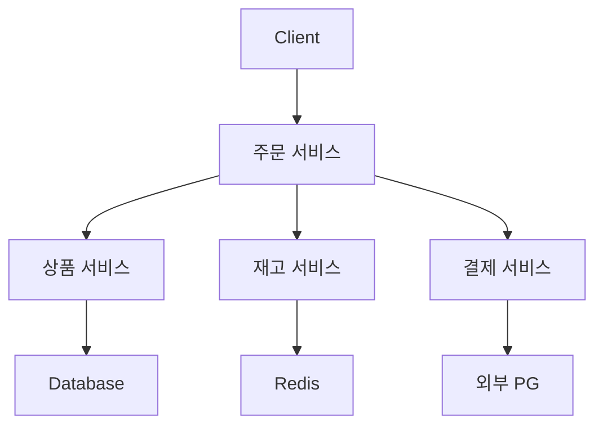
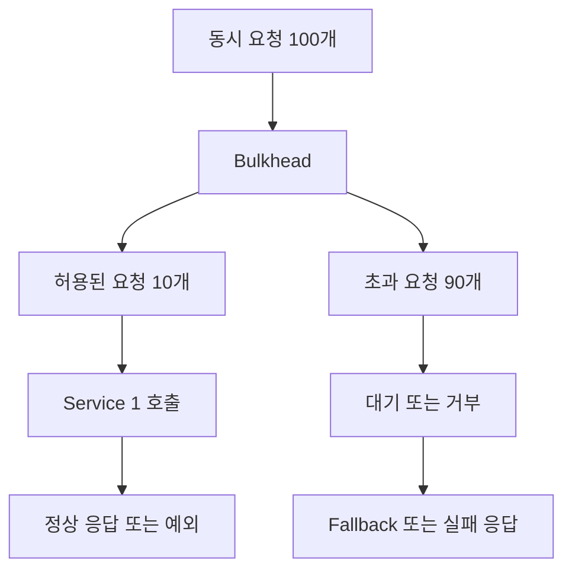
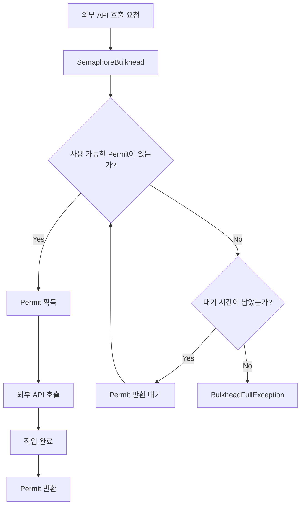
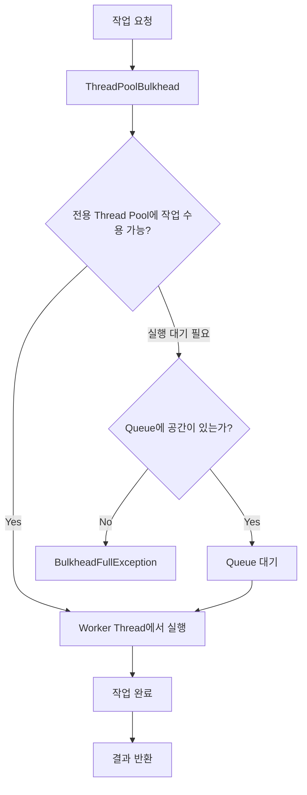
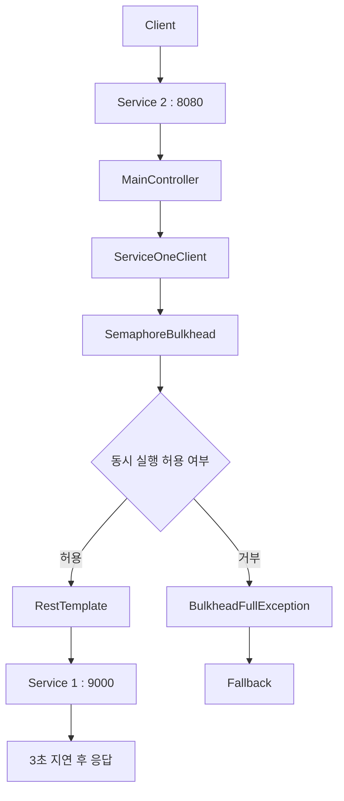
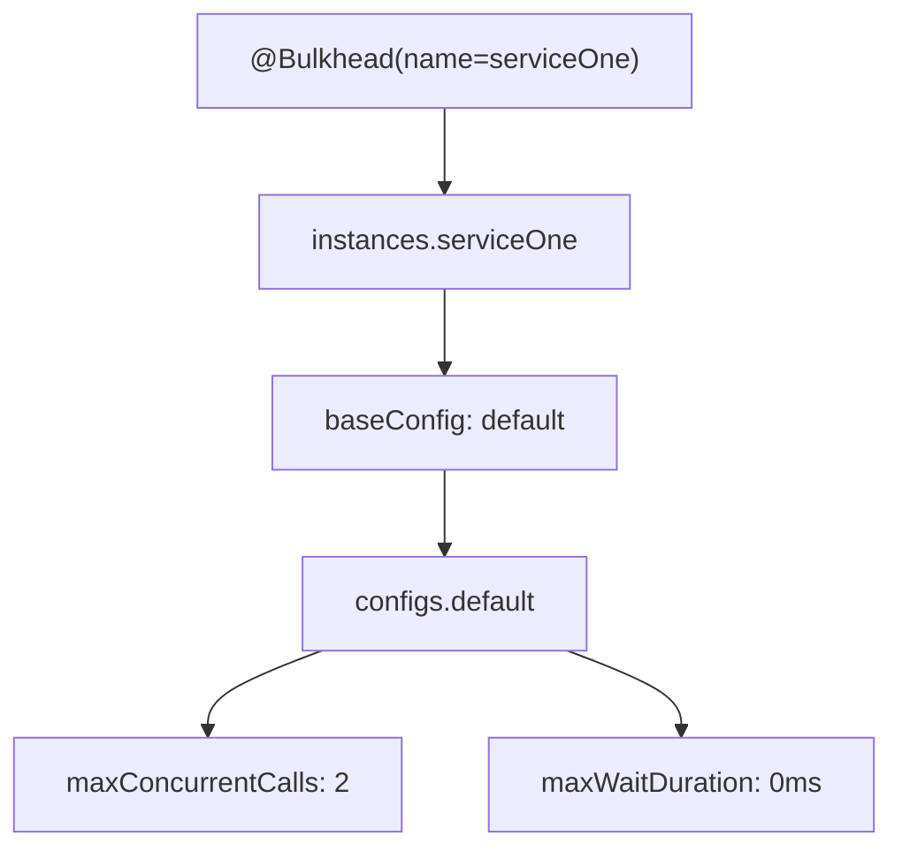
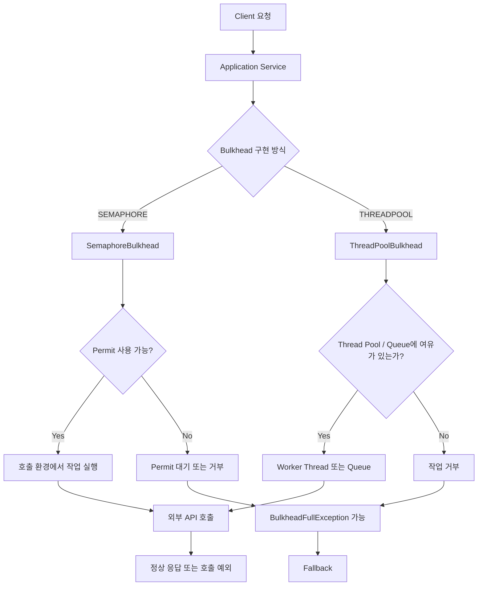

# Resilience4J - 8. bulk head 구현 실습
[https://youtu.be/11VlEZcvZ-g?si=siMa-XxIJNSUDzQ0](https://youtu.be/11VlEZcvZ-g?si=siMa-XxIJNSUDzQ0)

# Resilience4J - 8. bulk head 구현 실습
* toc
{:toc}

---

## Resilience4j Bulkhead 완벽 정리: Semaphore와 ThreadPool 기반 동시 요청 제한 구현

마이크로서비스 아키텍처(MSA)에서는 하나의 서비스가 여러 외부 서비스에 의존하는 구조가 일반적이다.

예를 들어 주문 서비스는 주문 요청을 처리하기 위해 상품 서비스, 재고 서비스, 결제 서비스 등을 호출할 수 있다.



정상적인 상황에서는 각 서비스가 빠르게 응답하므로 특별한 문제가 발생하지 않는다.

하지만 재고 서비스에 장애가 발생해 응답 시간이 길어진다면 어떻게 될까?

주문 서비스는 재고 서비스의 응답을 기다리는 동안 요청 처리 Thread를 계속 점유할 수 있다.

이러한 상황에서 새로운 주문 요청이 계속 들어온다면 재고 서비스를 기다리는 Thread가 점점 증가할 수 있다.

```text
재고 서비스 응답 지연
        ↓
주문 서비스의 대기 Thread 증가
        ↓
사용 가능한 Thread 감소
        ↓
신규 요청 처리 지연
        ↓
상품 조회 및 결제 처리에도 영향
        ↓
전체 서비스 처리량 감소
```

문제는 재고 서비스에서 발생한 장애가 주문 서비스의 다른 기능까지 영향을 줄 수 있다는 것이다.

이런 상황에서 필요한 것은 장애가 발생한 작업이 사용할 수 있는 리소스를 제한하는 방법이다.

예를 들어 재고 서비스 호출을 동시에 최대 10개까지만 허용한다면 어떨까?

```text
재고 서비스 호출

최대 동시 실행 수 = 10
```

이미 10개의 작업이 실행 중이라면 추가 작업을 기다리게 하거나 거부할 수 있다.

이렇게 하면 재고 서비스의 응답이 느려지더라도 해당 호출이 무제한으로 증가하는 상황을 줄일 수 있다.

Resilience4j에서 이러한 역할을 담당하는 것이 **Bulkhead**다.

Bulkhead는 외부 호출 또는 특정 작업의 동시 실행을 제한하여 일부 기능의 장애가 전체 애플리케이션에 미치는 영향을 줄이는 내결함성 패턴이다.

---

## Bulkhead란?

Bulkhead는 특정 작업에 대한 동시 실행 수를 제한하는 장애 격리 패턴이다.

이름은 선박 내부에 설치된 격벽에서 유래했다.

선박 내부를 하나의 거대한 공간으로 구성하면 특정 구역에 물이 들어왔을 때 전체 선박으로 침수가 확산될 수 있다.

반면 여러 격벽으로 공간을 나누면 하나의 구역에 물이 들어오더라도 다른 구역으로 확산되는 것을 줄일 수 있다.

소프트웨어에서도 같은 개념을 적용한다.

```text
하나의 애플리케이션

├── 상품 조회
├── 재고 조회
├── 결제 처리
└── 알림 전송
```

이 중 알림 전송 기능에서 장애가 발생했다고 생각해보자.

알림 전송이 계속 지연되면서 모든 요청 처리 Thread를 점유한다면 상품 조회나 결제 처리에도 영향을 줄 수 있다.

따라서 알림 전송 작업이 동시에 실행할 수 있는 수를 제한한다.

```text
알림 전송

동시 실행 최대 5개
```

이렇게 하면 알림 전송 작업이 점유할 수 있는 동시 실행량에 상한을 둘 수 있다.

다만 Bulkhead 자체가 애플리케이션의 전체 Thread 수나 CPU 사용량을 직접 제어하는 것은 아니다.

**Bulkhead가 보호하는 작업에 대해 허용할 동시 실행 수 또는 전용 실행 리소스를 제한한다**는 의미다.

이 차이는 실제로 적용할 때 매우 중요하다.

---

## 왜 Bulkhead가 필요할까?

### 외부 서비스의 지연이 리소스 고갈로 이어지는 과정

다음과 같은 시스템이 있다고 가정하자.

```text
Service 2
    ↓
RestTemplate
    ↓
Service 1
```

Service 2는 Service 1의 API를 동기 방식으로 호출한다.

정상적인 상황에서는 Service 1의 응답 시간이 100ms다.

그런데 어느 순간 Service 1의 응답 시간이 10초로 증가했다고 생각해보자.

```text
정상 상황

Service 1 응답 시간
→ 100ms
```

```text
장애 상황

Service 1 응답 시간
→ 10,000ms
```

Service 2에서 RestTemplate을 이용한다면 외부 요청이 완료될 때까지 호출 Thread가 대기할 수 있다.

동시에 많은 요청이 들어오면 다음과 같은 상황이 발생한다.

```text
Thread 1   → Service 1 응답 대기
Thread 2   → Service 1 응답 대기
Thread 3   → Service 1 응답 대기
...
Thread 100 → Service 1 응답 대기
```

응답 시간이 증가할수록 처리 중인 요청이 누적될 수 있다.

예를 들어 초당 20건의 요청이 들어오고 각 요청이 평균 10초 동안 처리된다면 정상 상태의 단순한 정상 흐름을 가정했을 때 약 200개의 요청이 동시에 실행 중인 상태가 될 수 있다.

이 관계는 다음과 같이 표현할 수 있다.

**평균 동시 처리 중인 요청 수 ≈ 초당 요청 수 × 평균 처리 시간**

이러한 관계는 Little's Law를 이용해 설명할 수 있다.

```text
초당 요청 수 = 20 RPS

평균 처리 시간 = 10초

평균 동시 처리 중인 요청 수 ≈ 200개
```

실제 시스템에서는 대기열, Timeout, 요청 거부, 부하 변화 등의 영향이 있지만, 응답 시간이 길어질수록 동시 실행 중인 작업이 늘어날 수 있다는 점을 이해하는 데 유용하다.

이 상황이 지속되면 Thread Pool이나 Connection Pool이 고갈될 가능성이 높아진다.

### Bulkhead 적용 후

이제 Service 1 호출에 Bulkhead를 적용해보자.

```text
Bulkhead 설정

maxConcurrentCalls = 10
```

Service 1을 호출하는 작업을 동시에 최대 10개까지만 허용한다.



이렇게 하면 보호 대상 작업의 동시 실행 수를 10개로 제한할 수 있다.

다만 실제로 몇 개를 기다리게 할지, 얼마나 기다릴지는 Bulkhead 구현 방식과 설정에 따라 달라진다.

또한 초과 요청을 차단하더라도 HTTP 요청이 애플리케이션에 들어오는 것 자체를 막는 것은 아니다.

따라서 Bulkhead는 전체 서버의 요청량을 제한하는 기능이 아니라, **특정 작업이 과도한 리소스를 점유하지 않도록 보호하는 기능**으로 이해해야 한다.

---

## Bulkhead가 제공하는 두 가지 구현 방식

Resilience4j는 두 가지 Bulkhead 구현 방식을 제공한다.

1. **SemaphoreBulkhead**
2. **ThreadPoolBulkhead**

두 구현 방식은 모두 동시 작업량을 제한하지만 동작 구조가 다르다.

| 구분             | SemaphoreBulkhead           | ThreadPoolBulkhead        |
| -------------- | --------------------------- | ------------------------- |
| 동작 방식          | Semaphore Permit을 이용한 실행 제한 | 전용 Thread Pool과 Queue 이용  |
| 주요 목적          | 동시 실행 수 제한                  | 작업 실행 리소스 격리              |
| 별도 Thread Pool | 생성하지 않음                     | 사용                        |
| 초과 요청 처리       | Permit 대기 또는 거부             | Queue 대기 또는 거부            |
| 대표 설정          | `maxConcurrentCalls`        | `maxThreadPoolSize`       |
| 대기 관련 설정       | `maxWaitDuration`           | `queueCapacity`           |
| 일반적인 사용        | 동기 호출 및 다양한 비동기 처리          | 전용 실행 풀을 통한 작업 격리         |
| 주요 주의점         | 호출 측 Thread를 별도로 격리하지 않음    | Thread Pool 및 Queue 관리 필요 |

Resilience4j는 Semaphore를 사용하는 `SemaphoreBulkhead`와 제한된 Queue 및 Thread Pool을 사용하는 `FixedThreadPoolBulkhead`를 제공한다.

두 방식은 목적이 비슷하지만 내부적으로 리소스를 제어하는 방법이 다르다.

따라서 각각의 동작 원리를 이해한 후 적절한 방식을 선택해야 한다.

---

## SemaphoreBulkhead란?

SemaphoreBulkhead는 Java의 Semaphore 개념을 이용해 동시에 실행할 수 있는 작업의 수를 제한하는 방식이다.

Semaphore는 공유 자원에 접근할 수 있는 허가증(Permit)을 관리하는 동기화 도구다.

예를 들어 Permit이 세 개 있다고 생각해보자.

```text
Semaphore Permits = 3
```

동시에 세 개의 작업이 실행될 수 있다.

```text
작업 A → Permit 획득
작업 B → Permit 획득
작업 C → Permit 획득
```

현재 사용 가능한 Permit은 0개다.

```text
Available Permits = 0
```

이때 작업 D가 들어오면 즉시 실행할 수 없다.

설정에 따라 Permit이 반환되기를 기다리거나 실행이 거부된다.

### Semaphore 동작 과정



여기서 중요한 것은 Permit이 작업 시작 시 획득되고, 보호 대상 작업이 완료되면 반환된다는 것이다.

예를 들어 다음과 같은 상황을 생각해보자.

```text
Permit = 2
```

첫 번째 요청이 실행된다.

```text
Request A
→ Permit 획득

Available Permits = 1
```

두 번째 요청이 실행된다.

```text
Request B
→ Permit 획득

Available Permits = 0
```

세 번째 요청이 들어온다.

```text
Request C
→ Permit 없음
```

이때 `maxWaitDuration` 설정에 따라 요청 C는 대기하거나 거부된다.

첫 번째 요청이 완료되면 Permit이 반환된다.

```text
Request A 완료

Available Permits = 1
```

이제 새로운 작업이 Permit을 획득할 수 있다.

### SemaphoreBulkhead의 중요한 특징

SemaphoreBulkhead는 별도의 Thread를 생성해 작업을 실행하는 방식이 아니다.

기존 호출 환경에서 실행되는 작업에 대한 동시 실행 허가를 제어한다.

예를 들어 Spring MVC에서 RestTemplate을 호출한다면 일반적으로 Servlet Thread가 외부 HTTP 요청을 실행한다.

SemaphoreBulkhead를 적용하더라도 별도의 Thread Pool로 작업을 옮기는 것은 아니다.

```text
Servlet Thread
    ↓
Semaphore Permit 획득
    ↓
RestTemplate 호출
    ↓
외부 응답 대기
    ↓
Permit 반환
```

따라서 SemaphoreBulkhead는 동시 실행 수를 제한할 수 있지만, 외부 호출이 느려졌을 때 이미 허용된 Thread의 대기 시간을 줄여주지는 않는다.

이 부분은 Timeout과 함께 설계해야 한다.

---

## SemaphoreBulkhead 주요 설정

SemaphoreBulkhead에서는 대표적으로 두 가지 설정을 사용한다.

```yaml
resilience4j:
  bulkhead:
    instances:
      serviceOne:
        maxConcurrentCalls: 10
        maxWaitDuration: 1s
```

각 옵션을 살펴보자.

### maxConcurrentCalls

```yaml
maxConcurrentCalls: 10
```

`maxConcurrentCalls`는 Bulkhead가 동시에 허용할 작업 수를 지정한다.

예를 들어 10으로 설정했다면 보호 대상 작업은 동시에 최대 10개까지 실행할 수 있다.

```text
동시 실행 허용 수 = 10
```

이미 10개가 실행 중이라면 추가 요청은 바로 실행할 수 없다.

여기서 중요한 점은 **애플리케이션 전체의 동시 HTTP 요청 수가 10개로 제한되는 것은 아니라는 것**이다.

`@Bulkhead`가 적용된 메서드 또는 동일한 Bulkhead 인스턴스를 사용하는 작업에 대한 제한이다.

예를 들어 다음 두 메서드가 있다고 생각해보자.

```java
@Bulkhead(name = "serviceOne")
public String getProduct() {
    // ...
}
```

```java
@Bulkhead(name = "serviceOne")
public String getInventory() {
    // ...
}
```

두 메서드가 동일한 Bulkhead 인스턴스인 `serviceOne`을 사용한다면 같은 동시 실행 한도를 공유할 수 있다.

따라서 Bulkhead 이름은 단순한 별명이 아니라 **리소스 격리 범위를 결정하는 식별자**로도 볼 수 있다.

### maxWaitDuration

```yaml
maxWaitDuration: 1s
```

`maxWaitDuration`은 Permit을 획득하지 못했을 때 기다릴 수 있는 최대 시간이다.

예를 들어 다음 설정이 있다고 생각해보자.

```text
maxConcurrentCalls = 2

maxWaitDuration = 1초
```

현재 두 작업이 실행 중이다.

```text
Request A → 실행 중

Request B → 실행 중
```

세 번째 요청이 들어온다.

```text
Request C
    ↓
Permit 없음
    ↓
최대 1초 대기
```

1초 안에 Permit이 반환되면 요청 C가 실행될 수 있다.

반대로 1초가 지나도 Permit을 획득하지 못하면 거부된다.

이때 다음 예외가 발생할 수 있다.

```java
BulkheadFullException
```

반대로 다음과 같이 설정한다면:

```yaml
maxWaitDuration: 0ms
```

사용 가능한 Permit이 없을 때 즉시 거부한다.

### maxWaitDuration이 길수록 좋을까?

그렇지는 않다.

Permit이 반환될 때까지 기다리는 동안 호출 측 Thread가 점유될 수 있기 때문이다.

예를 들어 100개의 요청이 동시에 들어왔는데 Permit은 10개만 존재한다고 생각해보자.

나머지 90개의 요청이 모두 오랫동안 대기한다면 Bulkhead를 적용했더라도 대기 Thread가 누적될 수 있다.

따라서 대기 시간을 무조건 길게 설정하기보다 빠르게 실패시키는 정책이 더 적절할 수 있다.

특히 외부 서비스의 지연을 격리하려는 목적이라면 다음과 같은 구성이 유용할 수 있다.

```yaml
maxConcurrentCalls: 10
maxWaitDuration: 0ms
```

이렇게 하면 동시 실행이 가능한 요청만 허용하고, 초과 요청은 즉시 거부할 수 있다.

---

## ThreadPoolBulkhead란?

ThreadPoolBulkhead는 별도의 Thread Pool과 대기 Queue를 이용해 작업을 실행하는 방식이다.

SemaphoreBulkhead가 실행 허가증을 이용해 동시 실행 수를 제한한다면, ThreadPoolBulkhead는 특정 작업을 실행할 전용 Thread Pool을 관리한다.

예를 들어 알림 전송 작업이 있다고 생각해보자.

```text
주문 서비스
    ↓
알림 서비스 호출
```

알림 서비스가 느려지더라도 해당 작업을 위한 전용 실행 풀을 구성할 수 있다.

```text
알림 전송 전용 Thread Pool

Thread 1
Thread 2
Thread 3
```

그리고 일정 개수의 작업을 대기 Queue에 저장한다.

```text
대기 Queue

Task 4
Task 5
Task 6
```

Thread Pool과 Queue가 모두 포화되면 새로운 작업은 거부된다.

### ThreadPoolBulkhead 동작 구조



이 구조는 개념적인 동작을 나타낸 것이다.

실제 작업을 Worker Thread에 바로 할당할지, Queue에 먼저 저장할지, 추가 Thread를 생성할지는 Thread Pool의 현재 크기와 실행 정책에 따라 달라진다.

ThreadPoolBulkhead의 장점은 보호 대상 작업에 전용 실행 리소스를 할당할 수 있다는 점이다.

예를 들어 상품 조회와 알림 전송에 서로 다른 Thread Pool을 사용한다면 알림 전송 작업이 해당 전용 Pool을 모두 점유하더라도 상품 조회가 사용하는 별도 Pool에는 직접적인 영향을 줄 가능성이 줄어든다.

다만 CPU, 메모리, 네트워크, Database Connection 같은 자원은 여전히 공유할 수 있으므로 Thread Pool 분리만으로 모든 장애가 격리되는 것은 아니다.

---

## ThreadPoolBulkhead 주요 설정

ThreadPoolBulkhead는 다음과 같이 설정할 수 있다.

```yaml
resilience4j:
  thread-pool-bulkhead:
    instances:
      serviceOne:
        maxThreadPoolSize: 10
        coreThreadPoolSize: 5
        queueCapacity: 20
```

대표적인 설정은 세 가지다.

### coreThreadPoolSize

```yaml
coreThreadPoolSize: 5
```

`coreThreadPoolSize`는 Thread Pool에서 유지할 기본 Thread 수를 설정한다.

예를 들어 다음과 같이 구성한다.

```text
Core Thread Pool Size = 5
```

일반적으로 Thread Pool은 이 값을 기준으로 기본 실행 Thread를 관리한다.

다만 애플리케이션 시작 시 정확히 5개의 Thread가 모두 미리 생성된다는 의미는 아니다.

실제 생성 시점은 Executor 구현과 설정에 따라 달라질 수 있다.

### maxThreadPoolSize

```yaml
maxThreadPoolSize: 10
```

`maxThreadPoolSize`는 Thread Pool에서 사용할 수 있는 최대 Thread 수를 설정한다.

```text
Core Thread Pool Size = 5

Max Thread Pool Size = 10
```

이 경우 필요한 상황에 따라 기본 크기를 초과하여 최대 10개까지 Worker Thread를 사용할 수 있도록 구성한다.

다만 최대 Thread 수가 10이라고 해서 CPU 코어가 10개로 제한되는 것은 아니다.

Thread Pool의 실행 Thread 수를 제한하는 설정이다.

### queueCapacity

```yaml
queueCapacity: 20
```

`queueCapacity`는 Worker Thread에서 바로 실행할 수 없는 작업을 대기시키는 Queue의 최대 용량이다.

예를 들어 다음과 같은 설정이 있다고 생각해보자.

```text
maxThreadPoolSize = 10

queueCapacity = 20
```

Thread Pool과 Queue가 모두 포화되면 추가 작업을 거부한다.

여기서 주의해야 할 점은 Queue가 크다고 항상 좋은 것은 아니라는 것이다.

작업 하나가 10초씩 걸리는데 Queue가 1,000개라면 작업들이 오랫동안 대기할 수 있다.

따라서 Queue를 무작정 크게 설정하면 장애를 해결하는 것이 아니라 장애 발생 시점을 늦추는 결과가 될 수 있다.

---

## SemaphoreBulkhead와 ThreadPoolBulkhead는 왜 구분할까?

두 방식은 같은 Bulkhead 패턴을 구현하지만 해결하려는 문제가 조금 다르다.

SemaphoreBulkhead의 핵심은 **동시 실행 허용량 제한**이다.

ThreadPoolBulkhead의 핵심은 **전용 Thread Pool을 통한 작업 실행량과 대기열 제한**이다.

이를 비교하면 다음과 같다.

### SemaphoreBulkhead

```text
Caller Thread
    ↓
Semaphore Permit 확인
    ↓
Permit 획득
    ↓
Caller 실행 환경에서 작업 수행
    ↓
작업 완료
    ↓
Permit 반환
```

### ThreadPoolBulkhead

```text
Caller
    ↓
ThreadPoolBulkhead
    ↓
전용 Thread Pool에 작업 제출
    ↓
Worker Thread에서 작업 실행
    ↓
CompletionStage / CompletableFuture
    ↓
작업 결과 전달
```

여기서 한 가지 오해하기 쉬운 부분이 있다.

**SemaphoreBulkhead가 비동기 작업에 사용할 수 없는 것은 아니다.**

SemaphoreBulkhead는 다양한 실행 모델에서 동시 작업 수를 제한할 수 있다.

비동기 작업이라고 해서 반드시 ThreadPoolBulkhead를 사용해야 하는 것은 아니다.

또한 SemaphoreBulkhead는 Permit이 부족하다고 새로운 Thread를 생성하는 기능을 수행하지 않는다.

새로운 Thread를 생성하는지는 실제 작업을 실행하는 Executor나 비동기 처리 구조에 따라 달라진다.

Resilience4j에서 ThreadPoolBulkhead를 별도로 제공하는 이유는 Semaphore 방식과 달리 전용 실행 풀과 대기 Queue를 통해 작업을 격리할 수 있기 때문이다.

따라서 동기·비동기 여부만으로 구분하기보다 **실행 환경을 그대로 사용할 것인지, 별도 실행 풀로 격리할 것인지**를 기준으로 판단하는 것이 좋다.

---

## Spring Boot에서 Bulkhead 구현하기

이제 실제로 Bulkhead를 적용해보자.

이번에는 앞에서 구성한 두 개의 Spring Boot 애플리케이션을 활용한다.

```text
Service 2
Port: 8080

    ↓

RestTemplate

    ↓

Service 1
Port: 9000
```

Service 1은 외부 API를 제공하는 서버다.

Service 2는 해당 API를 호출하는 서버다.

Service 1에서 의도적으로 응답을 지연시키고, Service 2에서는 Bulkhead를 적용해 동시 호출을 제한한다.

### 구현 목표

이번에 만들 구조는 다음과 같다.



현재는 SemaphoreBulkhead를 중심으로 구현한다.

ThreadPoolBulkhead는 뒤에서 별도로 살펴본다.

---

## Gradle 의존성 설정

Spring Boot 3.2.0과 Java 17 환경을 기준으로 작성한다.

`build.gradle`은 다음과 같다.

```gradle
plugins {
    id 'java'
    id 'org.springframework.boot' version '3.2.0'
    id 'io.spring.dependency-management' version '1.1.4'
}

group = 'com.example'
version = '0.0.1-SNAPSHOT'

java {
    toolchain {
        languageVersion = JavaLanguageVersion.of(17)
    }
}

repositories {
    mavenCentral()
}

dependencies {

    // Spring MVC
    implementation 'org.springframework.boot:spring-boot-starter-web'

    // Spring AOP
    implementation 'org.springframework.boot:spring-boot-starter-aop'

    // Spring Boot Actuator
    implementation 'org.springframework.boot:spring-boot-starter-actuator'

    // Resilience4j Spring Boot 3
    implementation 'io.github.resilience4j:resilience4j-spring-boot3:2.2.0'

    // Test
    testImplementation 'org.springframework.boot:spring-boot-starter-test'
}

tasks.named('test') {
    useJUnitPlatform()
}
```

Resilience4j의 Spring Boot Starter는 `@Bulkhead`, `@Retry`, `@CircuitBreaker` 등을 사용할 수 있는 AOP 연동 기능을 제공한다.

Annotation 기반 기능을 사용하려면 Spring AOP가 필요하다.

Resilience4j 공식 Spring Boot 연동 방식에서도 Starter와 AOP, Actuator 의존성을 함께 사용한다.

여기서 `resilience4j-all`을 반드시 추가할 필요는 없다.

이미 사용하는 Starter가 필요한 Resilience4j 모듈을 포함하는지 확인하고, 불필요한 중복 의존성은 피하는 것이 좋다.

---

## Service 1: 응답 지연 API 구현

먼저 외부 호출 대상이 되는 Service 1을 구성한다.

Service 1은 9000 포트에서 실행된다.

`application.yml`은 다음과 같다.

```yaml
spring:
  application:
    name: service-one

server:
  port: 9000
```

이제 외부 API를 제공하는 `DataController`를 작성한다.

```java
package com.example.serviceone.controller;

import java.time.Instant;

import org.springframework.http.HttpStatus;
import org.springframework.web.bind.annotation.GetMapping;
import org.springframework.web.bind.annotation.RestController;
import org.springframework.web.server.ResponseStatusException;

@RestController
public class DataController {

    @GetMapping("/data")
    public String getData() {

        try {

            Thread.sleep(3_000);

        } catch (InterruptedException exception) {

            Thread.currentThread().interrupt();

            throw new ResponseStatusException(
                    HttpStatus.SERVICE_UNAVAILABLE,
                    "요청 처리가 중단되었습니다.",
                    exception
            );
        }

        return "Service One Response: " + Instant.now();
    }
}
```

이 코드는 `/data` 요청을 받으면 3초 동안 대기한 후 응답을 반환한다.

```text
GET /data
    ↓
Thread.sleep(3000)
    ↓
3초 대기
    ↓
HTTP 200
```

이렇게 구성하면 Service 2에서 여러 요청을 동시에 보냈을 때 동시 실행 중인 HTTP 호출이 일정 시간 유지된다.

따라서 Bulkhead의 동시 실행 제한이 실제로 적용되는지 확인하기 쉽다.

`Thread.sleep()`은 지연을 재현하기 위한 코드다.

실제 비즈니스 로직에서 요청 처리 Thread를 의도적으로 대기시키는 방식은 처리량에 영향을 줄 수 있으므로 주의해야 한다.

---

## Service 2: RestTemplate 설정

Service 2에서는 RestTemplate을 이용해 Service 1을 호출한다.

먼저 외부 HTTP Client를 Spring Bean으로 등록한다.

```java
package com.example.servicetwo.config;

import java.time.Duration;

import org.springframework.beans.factory.annotation.Value;
import org.springframework.boot.web.client.RestTemplateBuilder;
import org.springframework.context.annotation.Bean;
import org.springframework.context.annotation.Configuration;
import org.springframework.web.client.RestTemplate;

@Configuration
public class RestClientConfig {

    @Bean
    public RestTemplate serviceOneRestTemplate(
            RestTemplateBuilder builder,
            @Value("${clients.service-one.base-url}") String baseUrl
    ) {

        return builder
                .rootUri(baseUrl)
                .setConnectTimeout(Duration.ofSeconds(1))
                .setReadTimeout(Duration.ofSeconds(8))
                .build();
    }
}
```

여기서는 Read Timeout을 8초로 설정했다.

Service 1은 3초 뒤에 응답하므로 정상적인 환경에서는 Timeout이 발생하기 전에 데이터를 받을 수 있다.

```text
Service 1 응답 시간
→ 3초

RestTemplate Read Timeout
→ 8초
```

이렇게 해야 Bulkhead가 동시 호출을 제한하는 기능과 HTTP Client의 Timeout 기능을 구분해서 확인할 수 있다.

---

## @Bulkhead Annotation 적용하기

이제 핵심인 Bulkhead를 적용한다.

Resilience4j는 다음 Annotation을 제공한다.

```java
@Bulkhead
```

이 Annotation에서는 다음 속성을 사용할 수 있다.

| 속성               | 역할                            |
| ---------------- | ----------------------------- |
| `name`           | Bulkhead 인스턴스 이름              |
| `type`           | Semaphore 또는 ThreadPool 방식 선택 |
| `fallbackMethod` | 예외 발생 시 대체 처리 메서드             |

기본적인 형태는 다음과 같다.

```java
@Bulkhead(
        name = "serviceOne",
        type = Bulkhead.Type.SEMAPHORE,
        fallbackMethod = "fallback"
)
```

`type`에는 두 가지 값을 지정할 수 있다.

```java
Bulkhead.Type.SEMAPHORE
```

```java
Bulkhead.Type.THREADPOOL
```

별도로 타입을 지정하지 않으면 기본값인 SEMAPHORE가 적용된다.

이번에는 SemaphoreBulkhead를 사용한다.

---

## ServiceOneClient 전체 구현

```java
package com.example.servicetwo.client;

import io.github.resilience4j.bulkhead.BulkheadFullException;
import io.github.resilience4j.bulkhead.annotation.Bulkhead;

import org.slf4j.Logger;
import org.slf4j.LoggerFactory;
import org.springframework.beans.factory.annotation.Qualifier;
import org.springframework.http.HttpStatus;
import org.springframework.http.ResponseEntity;
import org.springframework.stereotype.Component;
import org.springframework.web.client.RestTemplate;

@Component
public class ServiceOneClient {

    private static final Logger log =
            LoggerFactory.getLogger(ServiceOneClient.class);

    private final RestTemplate restTemplate;

    public ServiceOneClient(
            @Qualifier("serviceOneRestTemplate")
            RestTemplate restTemplate
    ) {
        this.restTemplate = restTemplate;
    }

    @Bulkhead(
            name = "serviceOne",
            type = Bulkhead.Type.SEMAPHORE,
            fallbackMethod = "fallback"
    )
    public ResponseEntity<String> getData() {

        log.info("Service One API 호출 시작");

        String response = restTemplate.getForObject(
                "/data",
                String.class
        );

        log.info("Service One API 호출 완료");

        return ResponseEntity.ok(response);
    }

    private ResponseEntity<String> fallback(
            BulkheadFullException exception
    ) {

        log.warn(
                "Bulkhead 허용량 초과: {}",
                exception.getMessage()
        );

        return ResponseEntity
                .status(HttpStatus.SERVICE_UNAVAILABLE)
                .body("Service One is busy. Please try again later.");
    }

    private ResponseEntity<String> fallback(
            Exception exception
    ) {

        log.error(
                "Service One 호출 실패",
                exception
        );

        return ResponseEntity
                .status(HttpStatus.BAD_GATEWAY)
                .body("Service One request failed.");
    }
}
```

코드를 살펴보자.

핵심은 다음 부분이다.

```java
@Bulkhead(
        name = "serviceOne",
        type = Bulkhead.Type.SEMAPHORE,
        fallbackMethod = "fallback"
)
```

이 Annotation은 `getData()` 메서드에 SemaphoreBulkhead를 적용한다.

`serviceOne`이라는 이름은 설정 파일의 Bulkhead 인스턴스와 연결된다.

```text
@Bulkhead(name = "serviceOne")
            ↓
application.yml
            ↓
resilience4j.bulkhead.instances.serviceOne
```

이제 `getData()`가 호출되면 Bulkhead가 실행 허용 여부를 먼저 판단한다.

Permit이 존재하면 실제 메서드를 실행한다.

Permit이 없다면 설정된 대기 정책에 따라 기다리거나 요청을 거부한다.

---

## Fallback은 어떻게 동작할까?

이번 예제에서는 Fallback 메서드를 두 개 작성했다.

첫 번째는 다음과 같다.

```java
private ResponseEntity<String> fallback(
        BulkheadFullException exception
)
```

이 메서드는 Bulkhead 허용량을 초과했을 때 실행된다.

두 번째는 다음과 같다.

```java
private ResponseEntity<String> fallback(
        Exception exception
)
```

이 메서드는 일반적인 호출 예외를 처리한다.

예를 들어 Service 1이 종료되어 RestTemplate에서 연결 오류가 발생하면 일반 예외용 Fallback이 실행될 수 있다.

반면 Permit이 부족해서 Bulkhead가 호출을 거부한다면 `BulkheadFullException`을 처리하는 Fallback이 실행된다.

| 상황              | 발생 가능한 예외                | 처리             |
| --------------- | ------------------------ | -------------- |
| Bulkhead 허용량 초과 | BulkheadFullException    | 호출 거부 Fallback |
| 외부 서버 연결 실패     | ResourceAccessException  | 일반 오류 Fallback |
| 외부 API 500 오류   | HttpServerErrorException | 일반 오류 Fallback |
| 정상 응답           | 없음                       | 정상 데이터 반환      |

Resilience4j는 Fallback 메서드가 여러 개 존재하면 전달된 예외에 가장 구체적으로 대응하는 메서드를 선택할 수 있다.

여기서 중요한 점은 **Fallback이 BulkheadFullException에만 실행되는 것은 아니라는 것**이다.

일반적인 외부 호출 오류까지 처리하려는 경우에는 예외 유형에 따라 적절한 Fallback을 작성해야 한다.

다만 실제 운영에서는 모든 예외를 동일하게 처리하는 것이 적절한지 검토해야 한다.

---

## MainController 구현

이제 외부에서 Service 2에 요청할 수 있도록 Controller를 작성한다.

```java
package com.example.servicetwo.controller;

import com.example.servicetwo.client.ServiceOneClient;

import org.springframework.http.ResponseEntity;
import org.springframework.web.bind.annotation.GetMapping;
import org.springframework.web.bind.annotation.RestController;

@RestController
public class MainController {

    private final ServiceOneClient serviceOneClient;

    public MainController(ServiceOneClient serviceOneClient) {
        this.serviceOneClient = serviceOneClient;
    }

    @GetMapping("/semaphore")
    public ResponseEntity<String> semaphore() {

        return serviceOneClient.getData();
    }
}
```

이제 다음 API가 생성된다.

```http
GET /semaphore
```

클라이언트가 해당 URL로 요청하면 `ServiceOneClient.getData()`가 실행된다.

이때 Bulkhead가 동시 실행 수를 제한한다.

---

## application.yml에서 SemaphoreBulkhead 설정하기

이제 `@Bulkhead(name = "serviceOne")`에 적용할 정책을 설정한다.

이번에는 동작을 명확하게 확인하기 위해 최대 동시 실행 수를 2개로 제한한다.

```yaml
spring:
  application:
    name: service-two

server:
  port: 8080

clients:
  service-one:
    base-url: http://localhost:9000

resilience4j:
  bulkhead:
    configs:
      default:
        maxConcurrentCalls: 2
        maxWaitDuration: 0ms
        eventConsumerBufferSize: 20

    instances:
      serviceOne:
        baseConfig: default

management:
  endpoints:
    web:
      exposure:
        include: health,info,metrics,bulkheads,bulkheadevents
```

현재 설정은 다음과 같다.

```text
maxConcurrentCalls = 2

maxWaitDuration = 0ms
```

즉 동시에 두 개의 작업만 실행할 수 있다.

세 번째 요청이 들어왔을 때 Permit이 없다면 기다리지 않고 즉시 거부한다.

### configs와 instances의 관계

앞에서 CircuitBreaker와 Retry를 구성했던 방식과 동일하다.

`configs`는 재사용 가능한 설정 그룹을 정의한다.

```yaml
configs:
  default:
    maxConcurrentCalls: 2
    maxWaitDuration: 0ms
```

`instances`는 해당 설정을 사용할 Bulkhead 인스턴스를 정의한다.

```yaml
instances:
  serviceOne:
    baseConfig: default
```

이를 구조로 표현하면 다음과 같다.



이렇게 설정하면 여러 Bulkhead에서 공통 설정을 재사용할 수 있다.

예를 들어 알림 서비스와 결제 서비스에 서로 다른 동시 실행 제한을 적용할 수도 있다.

```yaml
resilience4j:
  bulkhead:
    configs:
      default:
        maxConcurrentCalls: 10
        maxWaitDuration: 0ms

    instances:
      notificationService:
        baseConfig: default
        maxConcurrentCalls: 5

      paymentService:
        baseConfig: default
        maxConcurrentCalls: 20
```

이 설정에서는 알림 서비스와 결제 서비스가 각자의 Bulkhead 인스턴스를 사용한다.

따라서 알림 서비스에서 동시 실행 제한에 도달하더라도 결제 서비스의 Bulkhead Permit을 직접 소비하지 않는다.

---

## 실제로 동시 요청을 보내 확인하기

이제 Service 1과 Service 2를 실행한다.

### 1. Service 1 실행

Service 1 프로젝트에서 다음 명령을 실행한다.

```bash
./gradlew bootRun
```

Service 1이 9000 포트에서 실행된다.

다음 명령으로 확인한다.

```bash
curl -i http://localhost:9000/data
```

약 3초 뒤 다음과 같은 응답을 받을 수 있다.

```http
HTTP/1.1 200 OK
Content-Type: text/plain;charset=UTF-8

Service One Response: 2026-10-22T01:30:00Z
```

시간은 응답 형식을 보여주기 위한 예시다.

### 2. Service 2 실행

Service 2 프로젝트에서 다음 명령을 실행한다.

```bash
./gradlew bootRun
```

Service 2는 8080 포트에서 실행된다.

다음 요청을 보내보자.

```bash
curl -i http://localhost:8080/semaphore
```

동시에 다른 요청이 없다면 Bulkhead의 Permit을 획득할 수 있다.

따라서 Service 1을 호출하고 정상 응답을 반환한다.

```text
Bulkhead Permit 획득
        ↓
Service 1 호출
        ↓
3초 대기
        ↓
HTTP 200
        ↓
Permit 반환
```

### 3. 동시에 여러 요청 전송

이번에는 동시 요청을 발생시켜보자.

터미널에서 다음 명령을 실행한다.

```bash
seq 8 | xargs -P 8 -I {} sh -c \
'curl -sS -o /dev/null \
-w "request={} status=%{http_code} elapsed=%{time_total}s\n" \
http://localhost:8080/semaphore'
```

각 명령의 의미는 다음과 같다.

| 명령             | 의미               |
| -------------- | ---------------- |
| `seq 8`        | 1부터 8까지 숫자 생성    |
| `xargs -P 8`   | 최대 8개의 명령을 병렬 실행 |
| `curl`         | HTTP 요청 전송       |
| `-o /dev/null` | 응답 본문 출력 생략      |
| `-w`           | 상태 코드와 응답 시간 출력  |

현재 Bulkhead는 동시에 두 개의 호출만 허용한다.

따라서 요청들이 충분히 겹친다면 다음과 같은 결과를 예상할 수 있다.

```text
request=3 status=503 elapsed=0.012s
request=4 status=503 elapsed=0.015s
request=5 status=503 elapsed=0.018s
request=6 status=503 elapsed=0.019s
request=7 status=503 elapsed=0.021s
request=8 status=503 elapsed=0.023s

request=1 status=200 elapsed=3.012s
request=2 status=200 elapsed=3.018s
```

위 출력은 예시이며 실제 순서와 결과는 요청이 실행되는 시점에 따라 달라질 수 있다.

핵심은 다음과 같다.

**동시에 실행할 수 있는 작업은 최대 2개이며, Permit이 없는 요청은 즉시 거부된다.**

또한 거부된 요청은 Service 1을 실제로 호출하지 않는다.

따라서 외부 서비스가 추가 요청을 처리해야 하는 부담을 줄일 수 있다.

---

## maxWaitDuration을 1초로 설정하면?

이번에는 다음 설정을 변경해보자.

```yaml
maxConcurrentCalls: 2
maxWaitDuration: 1s
```

이제 Permit이 없는 요청은 즉시 거부되지 않고 최대 1초 동안 기다릴 수 있다.

Service 1은 약 3초 뒤 응답한다.

따라서 첫 번째와 두 번째 요청이 실행 중이라면 세 번째 요청은 다음과 같이 동작할 수 있다.

```text
0초

Request A 실행 시작
Request B 실행 시작

Request C Permit 대기
```

```text
1초

Request C는 Permit 획득 실패
```

```text
BulkheadFullException 발생
```

반대로 Service 1의 응답 시간이 매우 짧아서 1초 이내에 Permit이 반환된다면 대기 중인 요청이 정상적으로 실행될 수도 있다.

따라서 `maxWaitDuration`은 초과 요청을 무조건 거부하는 것이 아니라, **Permit을 획득할 기회를 얼마나 기다릴 것인지** 결정하는 설정이다.

다만 대기 시간이 길어질수록 호출 측 Thread의 대기 시간도 증가할 수 있다는 점을 고려해야 한다.

---

## ThreadPoolBulkhead 구현하기

이제 두 번째 방식인 ThreadPoolBulkhead를 살펴보자.

ThreadPoolBulkhead는 `@Bulkhead`의 `type`을 `THREADPOOL`로 지정한다.

```java
@Bulkhead(
        name = "serviceOneThreadPool",
        type = Bulkhead.Type.THREADPOOL
)
```

하지만 Semaphore 방식과 동일하게 일반적인 String 반환 메서드에 적용하면 문제가 발생할 수 있다.

### 반환 타입이 중요한 이유

Semaphore 방식은 다음과 같이 작성할 수 있다.

```java
@Bulkhead(
        name = "serviceOne",
        type = Bulkhead.Type.SEMAPHORE
)
public String getData() {
    return restTemplate.getForObject(
            "/data",
            String.class
    );
}
```

반면 ThreadPool 방식의 Annotation 연동에서는 일반적으로 `CompletableFuture`와 같은 비동기 반환 타입을 사용해야 한다.

예를 들어 다음과 같다.

```java
@Bulkhead(
        name = "serviceOneThreadPool",
        type = Bulkhead.Type.THREADPOOL
)
public CompletableFuture<String> getDataAsync() {

    String response = restTemplate.getForObject(
            "/data",
            String.class
    );

    return CompletableFuture.completedFuture(response);
}
```

여기서 주목할 점은 다음 코드다.

```java
CompletableFuture.completedFuture(response)
```

이 메서드는 이미 계산한 결과를 완료된 CompletableFuture로 감싸서 반환한다.

그 자체가 새로운 Thread를 생성하는 것은 아니다.

현재 구성에서는 **ThreadPoolBulkhead가 보호 대상 메서드의 실행을 전용 실행 풀에 제출하는 역할**을 담당한다.

따라서 메서드 내부에서 RestTemplate을 호출하더라도 해당 작업을 Bulkhead의 Worker Thread에서 실행하도록 구성할 수 있다.

Spring Boot 연동에서 ThreadPoolBulkhead를 사용할 때 비동기 반환 타입이 필요하다는 점은 공식 예제에서도 확인할 수 있다.

### @Async를 반드시 사용해야 할까?

ThreadPoolBulkhead를 사용하기 위해 무조건 `@Async`를 추가해야 하는 것은 아니다.

ThreadPoolBulkhead 자체가 전용 Thread Pool을 통해 작업을 실행할 수 있기 때문이다.

오히려 이미 ThreadPoolBulkhead를 적용한 메서드 내부에서 다시 `CompletableFuture.supplyAsync()`를 사용하면 또 다른 Executor에서 작업을 실행하게 될 수 있다.

```text
ThreadPoolBulkhead Worker
        ↓
CompletableFuture.supplyAsync()
        ↓
다른 Executor Worker
```

이렇게 되면 실제 외부 호출이 어느 Thread Pool에서 실행되는지 복잡해지고, 의도한 리소스 격리가 이루어지는지 확인하기 어려워진다.

따라서 별도의 비동기 실행이 필요한 이유가 없다면 ThreadPoolBulkhead가 제공하는 실행 구조를 먼저 활용하는 편이 단순하다.

---

## ThreadPoolBulkhead 설정하기

이번에는 ThreadPoolBulkhead를 다음과 같이 설정해보자.

```yaml
resilience4j:
  thread-pool-bulkhead:
    configs:
      default:
        maxThreadPoolSize: 2
        coreThreadPoolSize: 2
        queueCapacity: 2

    instances:
      serviceOneThreadPool:
        baseConfig: default
```

설정은 다음과 같다.

| 설정                 |  값 |
| ------------------ | -: |
| maxThreadPoolSize  |  2 |
| coreThreadPoolSize |  2 |
| queueCapacity      |  2 |

Worker Thread는 최대 2개다.

대기 Queue는 최대 2개의 작업을 저장할 수 있다.

두 Worker Thread가 모두 작업 중이고 Queue도 가득 차면 추가 작업은 거부된다.

```text
ThreadPoolBulkhead

Worker 1 → 실행 중
Worker 2 → 실행 중

Queue 1  → 대기 중
Queue 2  → 대기 중

추가 요청 → 거부
```

이 구성에서는 단순한 안정 상태를 가정하면 동시에 최대 두 작업을 실행하고, 추가 두 작업을 Queue에서 대기시킬 수 있다.

따라서 요청이 동시에 많이 들어오면 일부 요청은 즉시 실행되지 않고 Queue에서 기다리다가 순서대로 처리된다.

다만 실제 응답 순서와 거부 시점은 Thread Pool의 상태 및 스케줄링에 따라 달라질 수 있다.

---

## ThreadPoolBulkhead 전체 구현 예제

앞에서 작성한 `ServiceOneClient`에 ThreadPoolBulkhead를 사용하는 메서드를 추가해보자.

```java
package com.example.servicetwo.client;

import java.util.concurrent.CompletableFuture;

import io.github.resilience4j.bulkhead.BulkheadFullException;
import io.github.resilience4j.bulkhead.annotation.Bulkhead;

import org.slf4j.Logger;
import org.slf4j.LoggerFactory;
import org.springframework.beans.factory.annotation.Qualifier;
import org.springframework.http.HttpStatus;
import org.springframework.http.ResponseEntity;
import org.springframework.stereotype.Component;
import org.springframework.web.client.RestTemplate;

@Component
public class ThreadPoolServiceOneClient {

    private static final Logger log =
            LoggerFactory.getLogger(ThreadPoolServiceOneClient.class);

    private final RestTemplate restTemplate;

    public ThreadPoolServiceOneClient(
            @Qualifier("serviceOneRestTemplate")
            RestTemplate restTemplate
    ) {
        this.restTemplate = restTemplate;
    }

    @Bulkhead(
            name = "serviceOneThreadPool",
            type = Bulkhead.Type.THREADPOOL,
            fallbackMethod = "fallback"
    )
    public CompletableFuture<ResponseEntity<String>> getDataAsync() {

        log.info(
                "ThreadPoolBulkhead 작업 실행. thread={}",
                Thread.currentThread().getName()
        );

        String response = restTemplate.getForObject(
                "/data",
                String.class
        );

        return CompletableFuture.completedFuture(
                ResponseEntity.ok(response)
        );
    }

    private CompletableFuture<ResponseEntity<String>> fallback(
            BulkheadFullException exception
    ) {

        log.warn(
                "ThreadPoolBulkhead 허용량 초과",
                exception
        );

        return CompletableFuture.completedFuture(
                ResponseEntity
                        .status(HttpStatus.SERVICE_UNAVAILABLE)
                        .body("ThreadPoolBulkhead is full.")
        );
    }

    private CompletableFuture<ResponseEntity<String>> fallback(
            Exception exception
    ) {

        log.error(
                "ThreadPoolBulkhead 작업 실패",
                exception
        );

        return CompletableFuture.completedFuture(
                ResponseEntity
                        .status(HttpStatus.BAD_GATEWAY)
                        .body("Service One request failed.")
        );
    }
}
```

이 예제의 핵심은 다음과 같다.

```java
@Bulkhead(
        name = "serviceOneThreadPool",
        type = Bulkhead.Type.THREADPOOL,
        fallbackMethod = "fallback"
)
```

그리고 반환 타입은 다음과 같다.

```java
CompletableFuture<ResponseEntity<String>>
```

이렇게 구성하면 ThreadPoolBulkhead의 실행 결과를 비동기 형태로 전달할 수 있다.

Fallback 역시 원본 메서드와 호환되는 반환 타입을 사용해야 한다.

---

## ThreadPoolBulkhead Controller 구성

Spring MVC는 `CompletableFuture`를 비동기 응답 처리에 사용할 수 있다.

따라서 Controller를 다음과 같이 구성할 수 있다.

```java
package com.example.servicetwo.controller;

import java.util.concurrent.CompletableFuture;

import com.example.servicetwo.client.ThreadPoolServiceOneClient;

import org.springframework.http.ResponseEntity;
import org.springframework.web.bind.annotation.GetMapping;
import org.springframework.web.bind.annotation.RestController;

@RestController
public class ThreadPoolController {

    private final ThreadPoolServiceOneClient serviceOneClient;

    public ThreadPoolController(
            ThreadPoolServiceOneClient serviceOneClient
    ) {
        this.serviceOneClient = serviceOneClient;
    }

    @GetMapping("/thread-pool")
    public CompletableFuture<ResponseEntity<String>> getData() {

        return serviceOneClient.getDataAsync();
    }
}
```

이제 다음 URL로 요청할 수 있다.

```http
GET /thread-pool
```

Controller는 비동기 작업의 결과를 반환한다.

일반적으로 Spring MVC는 비동기 응답 처리를 통해 요청 처리 Servlet Thread를 반환할 수 있다.

외부 API를 기다리는 실제 작업은 ThreadPoolBulkhead가 사용하는 Worker Thread에서 실행된다.

따라서 동기 방식의 SemaphoreBulkhead와는 Thread 점유 구조가 달라진다.

단, 비동기 처리를 사용한다고 해서 외부 API 호출 자체가 Non-blocking I/O로 바뀌는 것은 아니다.

이번 예제에서는 RestTemplate을 사용하므로 Worker Thread 내부에서는 여전히 동기 HTTP 호출이 실행된다.

---

## ThreadPoolBulkhead 동시 요청 확인

이제 다음 명령으로 여러 요청을 동시에 보내보자.

```bash
seq 8 | xargs -P 8 -I {} sh -c \
'curl -sS -o /dev/null \
-w "request={} status=%{http_code} elapsed=%{time_total}s\n" \
http://localhost:8080/thread-pool'
```

설정은 다음과 같다.

```text
Worker Thread = 2개

Queue Capacity = 2개
```

요청이 충분히 동시에 들어오고 각 작업이 3초 동안 실행된다고 가정하자.

처음 두 개의 작업은 Worker Thread에서 실행될 수 있다.

```text
Request A → Worker 1

Request B → Worker 2
```

다음 두 개의 작업은 Queue에서 기다릴 수 있다.

```text
Request C → Queue 대기

Request D → Queue 대기
```

그 이후 추가 요청이 들어오면 Thread Pool과 Queue가 모두 포화된 상태에서 거부될 수 있다.

```text
Request E → 거부

Request F → 거부
```

대략적으로 다음과 같은 응답 시간 차이가 발생할 수 있다.

| 요청 | 처리 방식           | 예상 소요 시간 |
| -- | --------------- | -------: |
| A  | Worker에서 즉시 실행  |     약 3초 |
| B  | Worker에서 즉시 실행  |     약 3초 |
| C  | Queue 대기 후 실행   |     약 6초 |
| D  | Queue 대기 후 실행   |     약 6초 |
| E  | Bulkhead 포화로 거부 |    짧은 시간 |
| F  | Bulkhead 포화로 거부 |    짧은 시간 |

실제 요청 순서와 결과는 실행 환경에 따라 달라질 수 있다.

중요한 점은 Semaphore 방식과 달리 ThreadPool 방식에서는 작업을 Queue에 저장해 순차적으로 처리할 수 있다는 것이다.

---

## BulkheadFullException이란?

`BulkheadFullException`은 Bulkhead가 현재 작업을 더 이상 허용할 수 없을 때 발생하는 예외다.

SemaphoreBulkhead에서는 Permit을 획득하지 못했을 때 발생할 수 있다.

```text
Permit 부족
    ↓
maxWaitDuration 초과
    ↓
BulkheadFullException
```

ThreadPoolBulkhead에서는 전용 Thread Pool과 Queue가 포화되어 작업 제출이 거부될 때 발생할 수 있다.

```text
Thread Pool 포화
    ↓
Queue 포화
    ↓
작업 제출 거부
    ↓
BulkheadFullException
```

두 방식 모두 같은 예외를 사용할 수 있지만 예외가 발생하는 내부 조건은 다르다.

따라서 BulkheadFullException이 발생했다면 단순히 예외 메시지만 확인하기보다 어떤 Bulkhead 인스턴스에서 발생했는지 함께 기록하는 것이 좋다.

```java
log.warn(
        "Bulkhead rejected. name={}, reason={}",
        "serviceOne",
        exception.getMessage()
);
```

운영 환경에서는 해당 정보를 로그뿐 아니라 메트릭에도 반영하는 것이 좋다.

---

## Bulkhead와 CircuitBreaker의 차이

Bulkhead와 CircuitBreaker는 모두 장애 전파를 줄이는 기능이다.

하지만 동작 기준이 다르다.

CircuitBreaker는 실패율이나 Slow Call 비율을 기준으로 외부 호출을 차단한다.

Bulkhead는 현재 동시에 실행할 수 있는 작업 수를 기준으로 호출을 제한한다.

| 구분       | CircuitBreaker               | Bulkhead                 |
| -------- | ---------------------------- | ------------------------ |
| 주요 목적    | 반복적인 장애 전파 방지                | 동시 실행량 제한                |
| 판단 기준    | Failure Rate, Slow Call Rate | 현재 실행 중인 작업 수            |
| 주요 설정    | `failureRateThreshold`       | `maxConcurrentCalls`     |
| 주요 상태    | CLOSED, OPEN, HALF_OPEN      | Permit 또는 실행 Pool의 가용 상태 |
| 호출 차단 이유 | 장애율 임계값 도달                   | 동시 실행 허용량 초과             |
| 대표 예외    | CallNotPermittedException    | BulkheadFullException    |

예를 들어 외부 API가 정상적으로 응답하지만 순간적으로 요청이 너무 많이 들어오는 상황을 생각해보자.

CircuitBreaker는 실패율이 낮으므로 CLOSED 상태를 유지할 수 있다.

하지만 Bulkhead는 동시 실행 제한에 도달하면 새로운 작업을 거부할 수 있다.

반대로 외부 API 호출 수가 적더라도 계속 실패한다면 CircuitBreaker는 OPEN 상태로 전환될 수 있다.

따라서 두 기능은 서로 대체 관계가 아니라 함께 사용할 수 있는 기능이다.

---

## Bulkhead와 RateLimiter의 차이

Bulkhead를 사용할 때 가장 헷갈리기 쉬운 기능이 RateLimiter다.

두 기능 모두 요청을 제한하지만 기준이 다르다.

### Bulkhead

```text
동시에 실행 가능한 작업 수
```

예를 들어:

```yaml
maxConcurrentCalls: 10
```

은 동시에 실행할 수 있는 작업을 최대 10개로 제한한다.

### RateLimiter

```text
일정 시간 동안 허용할 호출 수
```

예를 들어:

```yaml
limitForPeriod: 100
limitRefreshPeriod: 1s
```

은 일정한 1초 주기 동안 최대 100회의 호출을 허용하도록 구성하는 설정이다.

두 기능의 차이는 다음과 같다.

| 구분      | Bulkhead   | RateLimiter   |
| ------- | ---------- | ------------- |
| 제한 기준   | 동시 실행 수    | 일정 기간의 호출 수   |
| 예시      | 동시에 10개 실행 | 1초 동안 100번 호출 |
| 주요 목적   | 실행 리소스 격리  | 호출 속도 제어      |
| 대표적인 상황 | 느린 외부 API  | 외부 API 호출량 제한 |

예를 들어 하나의 요청이 30초 동안 실행된다면 RateLimiter만으로는 동시 실행 중인 작업이 누적되는 문제를 충분히 해결하지 못할 수 있다.

반대로 각 요청이 10ms 안에 끝나더라도 외부 API가 초당 100회만 허용한다면 Bulkhead만으로는 호출량 제한을 지키기 어려울 수 있다.

따라서 **Bulkhead는 동시 실행량, RateLimiter는 시간에 따른 호출량**을 제어한다고 이해하면 된다.

---

## Bulkhead와 Retry를 함께 사용할 때

Bulkhead와 Retry를 함께 사용한다면 주의해야 할 부분이 있다.

Bulkhead가 허용량을 초과하면 `BulkheadFullException`이 발생할 수 있다.

그런데 Retry가 이 예외를 재시도 대상으로 처리한다면 어떻게 될까?

```text
Bulkhead 허용량 초과
        ↓
BulkheadFullException
        ↓
Retry
        ↓
다시 Bulkhead 진입 시도
```

외부 서비스가 과부하 상태이거나 Bulkhead의 허용량이 계속 부족한데 요청을 반복하면 불필요한 재시도가 발생할 수 있다.

예를 들어:

```text
1번째 시도 → BulkheadFullException

300ms 대기

2번째 시도 → BulkheadFullException

300ms 대기

3번째 시도 → BulkheadFullException
```

이 경우 재시도를 해도 문제를 해결하지 못하고 요청 처리 시간만 증가할 수 있다.

따라서 BulkheadFullException을 재시도할지 신중하게 결정해야 한다.

특히 무작정 모든 RuntimeException을 Retry 대상으로 지정하는 설정은 피하는 것이 좋다.

### Annotation 실행 순서

Resilience4j의 Spring Boot 연동은 여러 장애 대응 Annotation을 함께 사용할 수 있다.

기본적인 Aspect 구조는 다음과 같이 표현할 수 있다.

```text
Retry
  └── CircuitBreaker
        └── RateLimiter
              └── TimeLimiter
                    └── Bulkhead
                          └── 실제 메서드
```

이 구조에서는 Bulkhead가 내부에서 발생시킨 예외를 바깥쪽 Retry가 관찰할 수 있다.

다만 Bulkhead의 Fallback이 예외를 정상 반환값으로 바꾸면 Retry가 해당 예외를 관찰하지 못할 수도 있다.

따라서 여러 기능을 함께 사용할 때는 **Aspect 적용 순서와 Fallback이 예외를 처리하는 위치**를 함께 확인해야 한다.

---

## Bulkhead 동작을 단위 테스트로 검증하기

Bulkhead는 동시 실행 수를 제한하는 기능이므로 단순히 API를 한 번 호출하는 것만으로는 충분히 검증하기 어렵다.

동시에 여러 요청을 발생시켜 실제 허용량이 적용되는지 확인해야 한다.

이번에는 Spring Boot를 실행하지 않고 Resilience4j Java API로 SemaphoreBulkhead를 검증하는 테스트를 작성해보자.

### SemaphoreBulkhead 테스트 코드

```java
import io.github.resilience4j.bulkhead.Bulkhead;
import io.github.resilience4j.bulkhead.BulkheadConfig;
import io.github.resilience4j.bulkhead.BulkheadFullException;

import org.junit.jupiter.api.Test;

import java.time.Duration;
import java.util.concurrent.CountDownLatch;
import java.util.concurrent.ExecutorService;
import java.util.concurrent.Executors;
import java.util.concurrent.Future;
import java.util.concurrent.TimeUnit;

import static org.junit.jupiter.api.Assertions.*;

class BulkheadTest {

    @Test
    void 동시_실행_허용량을_초과하면_요청을_거부한다() throws Exception {

        BulkheadConfig config = BulkheadConfig.custom()
                .maxConcurrentCalls(2)
                .maxWaitDuration(Duration.ZERO)
                .build();

        Bulkhead bulkhead = Bulkhead.of("testBulkhead", config);

        ExecutorService executor = Executors.newFixedThreadPool(2);

        CountDownLatch started = new CountDownLatch(2);
        CountDownLatch release = new CountDownLatch(1);

        Runnable protectedTask = () ->
                bulkhead.executeRunnable(() -> {

                    started.countDown();

                    try {
                        release.await();
                    } catch (InterruptedException exception) {
                        Thread.currentThread().interrupt();
                    }
                });

        try {

            Future<?> first = executor.submit(protectedTask);
            Future<?> second = executor.submit(protectedTask);

            assertTrue(started.await(2, TimeUnit.SECONDS));

            assertEquals(
                    0,
                    bulkhead.getMetrics()
                            .getAvailableConcurrentCalls()
            );

            assertThrows(
                    BulkheadFullException.class,
                    () -> bulkhead.executeRunnable(() -> {})
            );

            release.countDown();

            first.get(2, TimeUnit.SECONDS);
            second.get(2, TimeUnit.SECONDS);

            assertEquals(
                    2,
                    bulkhead.getMetrics()
                            .getAvailableConcurrentCalls()
            );

        } finally {

            release.countDown();
            executor.shutdownNow();
        }
    }
}
```

이 테스트에서는 다음 설정을 사용한다.

```text
maxConcurrentCalls = 2

maxWaitDuration = 0
```

두 개의 작업을 먼저 실행한다.

```text
Task A → Permit 획득

Task B → Permit 획득
```

두 작업은 `CountDownLatch`를 이용해 완료되지 않고 대기하도록 만든다.

따라서 Bulkhead의 사용 가능한 Permit은 0개가 된다.

```text
Available Permits = 0
```

이 상태에서 세 번째 작업을 실행한다.

```java
bulkhead.executeRunnable(() -> {});
```

사용 가능한 Permit이 없고 대기 시간도 0이므로 `BulkheadFullException`이 발생해야 한다.

이후 기존 작업을 완료시키면 Permit이 반환된다.

```text
Task A 완료 → Permit 반환

Task B 완료 → Permit 반환
```

최종적으로 사용 가능한 Permit은 다시 2개가 된다.

이 테스트를 통해 Bulkhead의 핵심 동작인 **Permit 획득, 실행 제한, 초과 요청 거부, Permit 반환**을 검증할 수 있다.

---

## Bulkhead 모니터링하기

Bulkhead를 실제 서비스에 적용했다면 현재 사용 가능한 Permit 수와 요청 거부 상황을 모니터링하는 것이 중요하다.

Resilience4j는 Micrometer를 통해 Bulkhead 관련 메트릭을 제공한다.

### SemaphoreBulkhead 주요 메트릭

대표적인 메트릭은 다음과 같다.

| 메트릭                                                  | 의미                 |
| ---------------------------------------------------- | ------------------ |
| `resilience4j.bulkhead.available.concurrent.calls`   | 현재 사용 가능한 Permit 수 |
| `resilience4j.bulkhead.max.allowed.concurrent.calls` | 최대 허용 동시 실행 수      |

예를 들어 다음 설정이 있다고 생각해보자.

```yaml
maxConcurrentCalls: 10
```

아무런 작업이 실행되지 않는 상태라면:

```text
Max Allowed Concurrent Calls = 10

Available Concurrent Calls = 10
```

다섯 개의 작업이 실행 중이라면:

```text
Max Allowed Concurrent Calls = 10

Available Concurrent Calls = 5
```

모든 Permit이 사용 중이라면:

```text
Max Allowed Concurrent Calls = 10

Available Concurrent Calls = 0
```

이 상태에서 추가 요청이 들어오면 대기하거나 거부될 수 있다.

### ThreadPoolBulkhead 주요 메트릭

ThreadPoolBulkhead에서는 다음 항목을 확인할 수 있다.

| 메트릭                                           | 의미                   |
| --------------------------------------------- | -------------------- |
| `resilience4j.bulkhead.thread.pool.size`      | 현재 Thread Pool 크기    |
| `resilience4j.bulkhead.core.thread.pool.size` | Core Thread Pool 크기  |
| `resilience4j.bulkhead.max.thread.pool.size`  | 최대 Thread Pool 크기    |
| `resilience4j.bulkhead.queue.depth`           | 현재 Queue에 대기 중인 작업 수 |
| `resilience4j.bulkhead.queue.capacity`        | Queue 최대 용량          |

이러한 지표를 이용하면 작업이 Worker Thread에서 처리되고 있는지, Queue가 얼마나 쌓였는지 확인할 수 있다.

Resilience4j는 SemaphoreBulkhead와 ThreadPoolBulkhead에 대해 서로 다른 메트릭을 제공한다.

### Actuator로 확인하기

앞에서 다음 의존성을 추가했다.

```gradle
implementation 'org.springframework.boot:spring-boot-starter-actuator'
```

그리고 관리 엔드포인트를 활성화했다.

```yaml
management:
  endpoints:
    web:
      exposure:
        include: health,info,metrics,bulkheads,bulkheadevents
```

이제 다음 명령으로 메트릭 목록을 확인할 수 있다.

```bash
curl -sS http://localhost:8080/actuator/metrics
```

Bulkhead의 사용 가능한 Permit 수를 확인하려면 다음 명령을 사용할 수 있다.

```bash
curl -sS \
  http://localhost:8080/actuator/metrics/resilience4j.bulkhead.available.concurrent.calls
```

`serviceOne` 인스턴스만 확인하려면 다음과 같이 태그 조건을 사용할 수 있다.

```bash
curl -sS \
  "http://localhost:8080/actuator/metrics/resilience4j.bulkhead.available.concurrent.calls?tag=name:serviceOne"
```

해당 메트릭이 등록되어 있다면 현재 사용 가능한 Permit 수를 확인할 수 있다.

또한 Bulkhead 목록과 이벤트를 확인할 수 있다.

```bash
curl -sS http://localhost:8080/actuator/bulkheads
```

```bash
curl -sS http://localhost:8080/actuator/bulkheadevents
```

실제 출력은 등록된 Bulkhead 인스턴스와 발생한 이벤트에 따라 달라진다.

운영 환경에서는 관리 엔드포인트를 외부에 무조건 노출하지 않고 인증 및 접근 제어를 적용하는 것이 좋다.

---

## 실무에서 Bulkhead를 사용할 때 고려할 점

### 1. Bulkhead는 서버 전체의 동시 요청 수를 제한하는 것이 아니다

Bulkhead는 보호 대상 작업의 동시 실행 수를 제한한다.

따라서 `maxConcurrentCalls=10`이라고 설정했다고 해서 애플리케이션 전체가 최대 10개의 HTTP 요청만 받는 것은 아니다.

보호할 메서드와 Bulkhead 인스턴스의 범위를 명확하게 설계해야 한다.

### 2. CPU 사용률을 직접 측정하지 않는다

Bulkhead는 CPU 사용률이 80% 이상인지 직접 확인하여 요청을 거부하는 기능이 아니다.

설정한 동시 실행 수와 가용 Permit 또는 Thread Pool 상태를 기준으로 요청을 제어한다.

CPU나 메모리 사용량까지 고려한 동적인 부하 제어가 필요하다면 별도의 모니터링 및 자동 확장 정책 등을 함께 고려해야 한다.

### 3. 외부 의존성별로 Bulkhead를 분리한다

하나의 Bulkhead에 모든 외부 API를 연결하면 특정 서비스의 지연으로 다른 서비스까지 영향을 받을 수 있다.

예를 들어 다음과 같이 분리할 수 있다.

```text
inventoryServiceBulkhead

paymentProviderBulkhead

notificationServiceBulkhead
```

이렇게 하면 각 의존성이 사용할 수 있는 동시 실행량을 독립적으로 관리할 수 있다.

### 4. maxConcurrentCalls는 실제 처리량을 기준으로 결정한다

동시 실행 수를 지나치게 작게 설정하면 정상적인 트래픽에서도 많은 요청이 거부될 수 있다.

반대로 너무 크게 설정하면 리소스 격리 효과가 약해질 수 있다.

따라서 외부 API의 정상 응답 시간, 초당 호출량, Connection Pool 크기 등을 고려해야 한다.

### 5. maxWaitDuration을 길게 설정하는 것이 항상 좋지는 않다

Permit이 부족할 때 오래 기다리도록 설정하면 초과 요청을 거부하는 빈도는 줄어들 수 있다.

하지만 기다리는 동안 호출 측 리소스가 점유될 수 있다.

장애 상황에서 빠르게 실패시키는 것이 더 적절한 서비스라면 짧은 대기 시간이나 `0ms`를 고려할 수 있다.

### 6. ThreadPoolBulkhead의 Queue가 너무 크지 않도록 한다

Queue가 크면 일시적으로 많은 작업을 저장할 수 있다.

하지만 외부 서비스의 응답이 계속 느리다면 작업들이 Queue에서 장시간 대기할 수 있다.

따라서 Queue Capacity를 증가시키는 것만으로 장애가 해결되는 것은 아니다.

### 7. ThreadPoolBulkhead는 반환 타입을 확인한다

Spring Boot의 Annotation 기반 ThreadPoolBulkhead를 사용할 때는 `CompletableFuture`와 같은 적절한 비동기 반환 타입을 사용해야 한다.

일반적인 동기 반환 타입에 `THREADPOOL`을 적용하면 실행 시 오류가 발생할 수 있다.

또한 별도 `@Async`를 무조건 추가할 필요는 없다.

### 8. 비동기 작업이라고 무조건 ThreadPoolBulkhead를 선택하지 않는다

SemaphoreBulkhead도 비동기 작업에서 활용할 수 있다.

이미 적절한 비동기 실행 모델이 존재한다면 별도의 Thread Pool을 생성하지 않고 Semaphore를 통해 동시 실행 수를 제한하는 것이 적합할 수 있다.

따라서 실행 환경과 필요한 격리 수준을 기준으로 선택해야 한다.

### 9. Timeout 설정을 함께 고려한다

Bulkhead는 동시 실행량을 제한하지만 이미 실행 중인 작업을 정해진 시간에 자동으로 중단시키는 기능은 아니다.

외부 HTTP 호출이 너무 오래 걸린다면 해당 작업이 Bulkhead Permit을 장시간 점유할 수 있다.

따라서 HTTP Client Timeout이나 TimeLimiter 등과 함께 설계하는 것이 중요하다.

### 10. BulkheadFullException을 무조건 재시도하지 않는다

Bulkhead가 포화되어 요청을 거부하는 것은 현재 처리할 여유가 부족하다는 신호일 수 있다.

이때 모든 요청을 즉시 재시도하면 과부하를 악화시킬 수 있다.

재시도를 적용하더라도 제한된 횟수와 적절한 대기 시간을 사용해야 한다.

### 11. Fallback이 새로운 장애를 만들지 않도록 한다

예를 들어 Redis 호출에 Bulkhead를 적용했는데 허용량 초과 시 모든 요청을 Database로 보내도록 구성했다고 생각해보자.

이 경우 Redis로 향하던 요청이 DB로 집중될 수 있다.

따라서 Fallback에도 별도의 용량 제한이나 호출 제한을 적용하는 방안을 고려해야 한다.

### 12. ThreadLocal 기반 컨텍스트 전파를 확인한다

ThreadPoolBulkhead는 작업을 별도의 Worker Thread에서 실행할 수 있다.

따라서 다음과 같은 ThreadLocal 기반 정보가 자동으로 전달된다고 가정해서는 안 된다.

```text
SecurityContext

MDC

Trace Context

Request Context
```

예를 들어 HTTP 요청을 처리하는 Thread에는 사용자 인증 정보가 존재하지만 ThreadPoolBulkhead의 Worker Thread에서는 해당 정보가 보이지 않을 수 있다.

따라서 필요한 컨텍스트를 명시적으로 전달하거나 적절한 Context Propagator를 구성해야 한다.

특히 사용자 권한을 확인하거나 분산 추적 정보를 전달하는 시스템에서는 반드시 검증해야 한다.

### 13. 인스턴스별 Bulkhead 제한을 고려한다

Resilience4j의 일반적인 Bulkhead는 애플리케이션 프로세스 내부에서 상태를 관리한다.

예를 들어 다음과 같이 설정했다고 생각해보자.

```yaml
maxConcurrentCalls: 10
```

그리고 애플리케이션을 세 대 실행한다.

```text
Service A → 최대 10개

Service B → 최대 10개

Service C → 최대 10개
```

이 경우 전체적으로 최대 30개의 보호 대상 작업이 동시에 실행될 수 있다.

따라서 외부 API가 전체 시스템 기준으로 최대 10개의 동시 호출만 허용한다면 개별 인스턴스의 Bulkhead 설정만으로는 충분하지 않을 수 있다.

이러한 상황에서는 전역적인 호출 제한 구조를 별도로 고려해야 한다.

### 14. 실제 리소스 격리 효과를 확인한다

Bulkhead를 적용했다고 해서 모든 리소스가 완전히 분리되는 것은 아니다.

예를 들어 ThreadPoolBulkhead는 전용 Worker Thread를 사용할 수 있지만 다음 자원은 공유될 수 있다.

```text
CPU

Heap Memory

Database Connection Pool

Network

Redis Connection Pool
```

따라서 외부 호출의 동시 실행 수를 제한했더라도 Database Connection Pool이 부족하거나 CPU 사용률이 높아지는 문제가 발생할 수 있다.

실제 시스템에서는 Thread Pool뿐 아니라 관련 리소스의 사용량을 함께 확인해야 한다.

### 15. Fallback의 HTTP 상태 코드를 신중하게 결정한다

Bulkhead가 포화되어 작업을 처리할 수 없다면 클라이언트에 적절한 오류를 전달해야 한다.

예를 들어 다음과 같은 상태 코드를 고려할 수 있다.

```http
HTTP/1.1 503 Service Unavailable
```

이는 일시적으로 요청을 처리할 수 없음을 나타낼 수 있다.

다만 모든 Bulkhead 거부를 같은 상태 코드로 처리해야 하는 것은 아니다.

업무 특성과 API 계약에 따라 대체 데이터, 비동기 접수 또는 명확한 실패 응답 중 적절한 방식을 선택해야 한다.

### 16. Bulkhead 포화 상황을 지속적으로 모니터링한다

Bulkhead가 자주 포화된다면 설정한 제한이 너무 낮거나 외부 서비스의 응답 시간이 증가했을 가능성이 있다.

따라서 다음 항목을 함께 확인하는 것이 좋다.

```text
Available Permits

Rejected Calls

Active Thread Count

Queue Depth

External API Latency

Timeout Count

Fallback Count
```

특히 사용 가능한 Permit이 계속 0에 가깝다면 외부 호출이 장시간 실행되고 있거나 요청량이 처리 능력을 초과하고 있을 가능성이 있다.

Bulkhead를 적용한 뒤에도 실제 요청량과 응답 시간을 확인하며 설정을 조정하는 것이 중요하다.

---

## 전체 구조

지금까지 살펴본 내용을 하나의 구조로 정리해보자.



SemaphoreBulkhead는 Permit을 이용해 동시 실행 수를 제한한다.

ThreadPoolBulkhead는 전용 Worker Thread와 Queue를 이용해 작업을 실행하고, 수용할 수 없는 작업을 거부한다.

두 방식 모두 과도한 동시 실행을 제한하는 기능을 제공하지만 내부 실행 방식이 다르다.

---

## 정리

Resilience4j의 Bulkhead는 특정 작업에 대한 동시 실행량을 제한하여 장애가 다른 기능으로 확산되는 상황을 줄이는 내결함성 패턴이다.

Bulkhead는 크게 두 가지 구현 방식을 제공한다.

첫 번째는 SemaphoreBulkhead다.

```text
SemaphoreBulkhead

    ↓

Permit 확인

    ↓

동시 실행 수 제한

    ↓

초과 요청 대기 또는 거부
```

두 번째는 ThreadPoolBulkhead다.

```text
ThreadPoolBulkhead

    ↓

전용 Thread Pool

    ↓

Worker Thread 실행

    ↓

Queue 대기

    ↓

초과 요청 거부
```

두 방식의 설정도 다르다.

**SemaphoreBulkhead**

```yaml
resilience4j:
  bulkhead:
    instances:
      serviceOne:
        maxConcurrentCalls: 10
        maxWaitDuration: 1s
```

**ThreadPoolBulkhead**

```yaml
resilience4j:
  thread-pool-bulkhead:
    instances:
      serviceOne:
        maxThreadPoolSize: 10
        coreThreadPoolSize: 5
        queueCapacity: 20
```

Spring Boot에서는 `@Bulkhead` Annotation을 통해 적용할 수 있다.

```java
@Bulkhead(
        name = "serviceOne",
        type = Bulkhead.Type.SEMAPHORE,
        fallbackMethod = "fallback"
)
```

ThreadPool 방식은 다음과 같이 지정한다.

```java
@Bulkhead(
        name = "serviceOne",
        type = Bulkhead.Type.THREADPOOL,
        fallbackMethod = "fallback"
)
```

여기서 반드시 기억해야 할 핵심은 다음과 같다.

| 항목                    | 핵심 내용                            |
| --------------------- | -------------------------------- |
| SemaphoreBulkhead     | Permit을 이용해 동시 실행 수 제한           |
| ThreadPoolBulkhead    | 전용 Thread Pool과 Queue로 작업 격리     |
| maxConcurrentCalls    | 최대 동시 실행 작업 수                    |
| maxWaitDuration       | Permit 획득을 기다릴 최대 시간             |
| maxThreadPoolSize     | 전용 Thread Pool의 최대 크기            |
| coreThreadPoolSize    | 기본 Thread Pool 크기                |
| queueCapacity         | 실행 대기 Queue의 최대 용량               |
| BulkheadFullException | Bulkhead가 작업을 더 이상 허용할 수 없을 때 발생 |
| Fallback              | 호출 거부 또는 작업 실패 시 대체 처리           |

특히 Bulkhead는 CircuitBreaker와 목적이 다르다.

CircuitBreaker는 외부 서비스의 실패율과 응답 지연 비율을 근거로 추가 호출을 차단한다.

반면 Bulkhead는 현재 실행 중인 작업 수를 기준으로 동시 실행량을 제한한다.

따라서 외부 서비스가 정상적으로 응답하더라도 순간적으로 호출량이 증가한다면 Bulkhead가 도움이 될 수 있다.

반대로 외부 서비스가 지속적으로 실패한다면 CircuitBreaker가 도움이 될 수 있다.

실제 운영 환경에서는 Bulkhead만으로 모든 장애를 해결할 수 없으므로 Timeout, CircuitBreaker, Retry, Fallback 등의 기능과 함께 설계해야 한다.

무엇보다 중요한 것은 **외부 서비스의 장애가 발생했을 때 해당 의존성을 호출하는 작업이 전체 애플리케이션의 리소스를 무제한으로 점유하지 않도록 제한하는 것**이다.

#### 한 줄 요약

Resilience4j Bulkhead는 특정 작업의 동시 실행량을 제한하는 장애 격리 패턴으로, `SemaphoreBulkhead`는 Permit을 이용해 동시 호출 수를 제어하고 `ThreadPoolBulkhead`는 전용 Thread Pool과 Queue를 이용해 작업 실행을 격리한다. 두 방식 모두 허용량을 초과하면 `BulkheadFullException`을 발생시킬 수 있으며, Fallback과 Timeout 등을 함께 구성해 외부 서비스 장애가 전체 시스템으로 확산되는 것을 줄일 수 있다.
