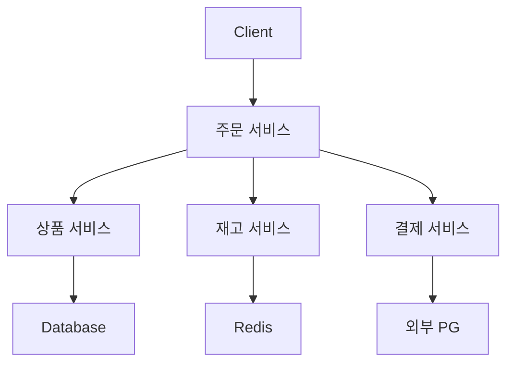
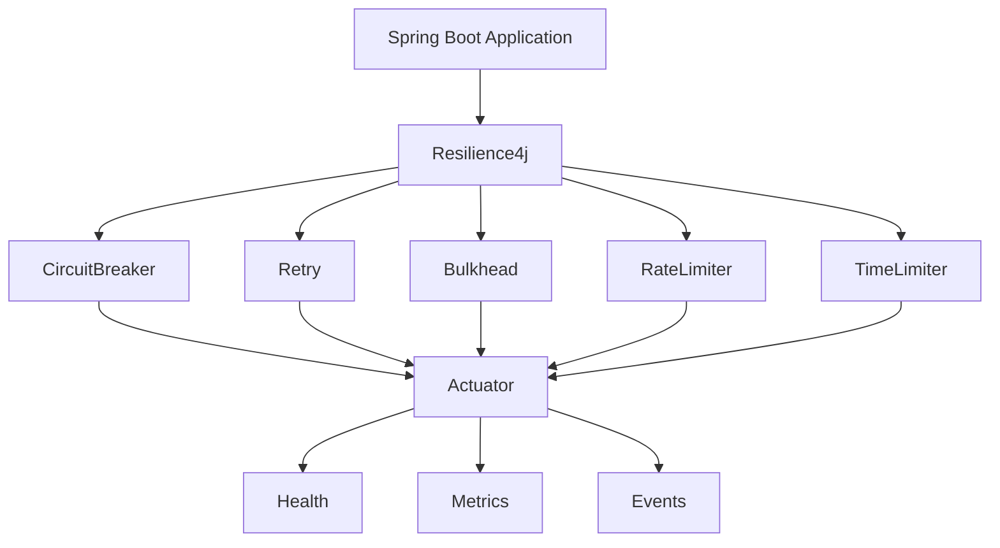
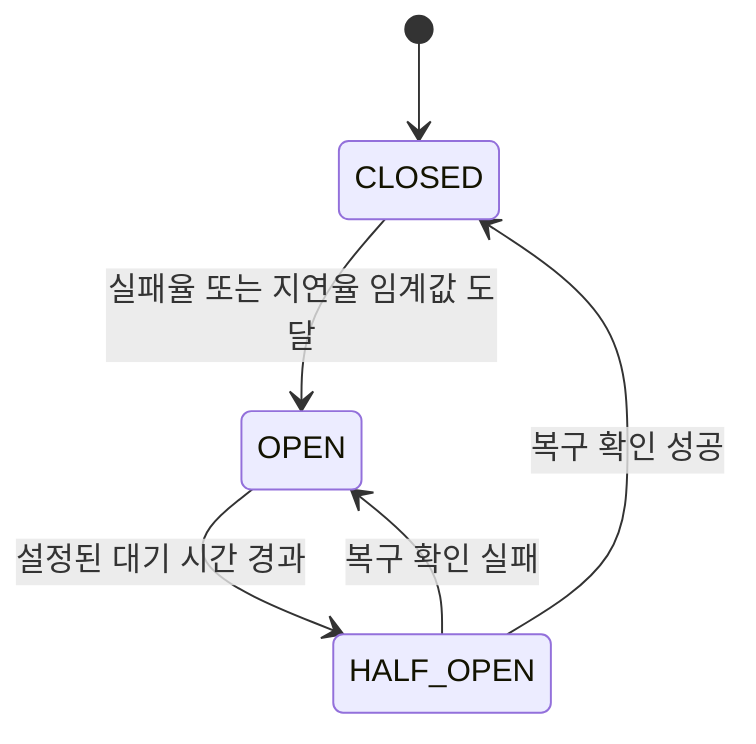
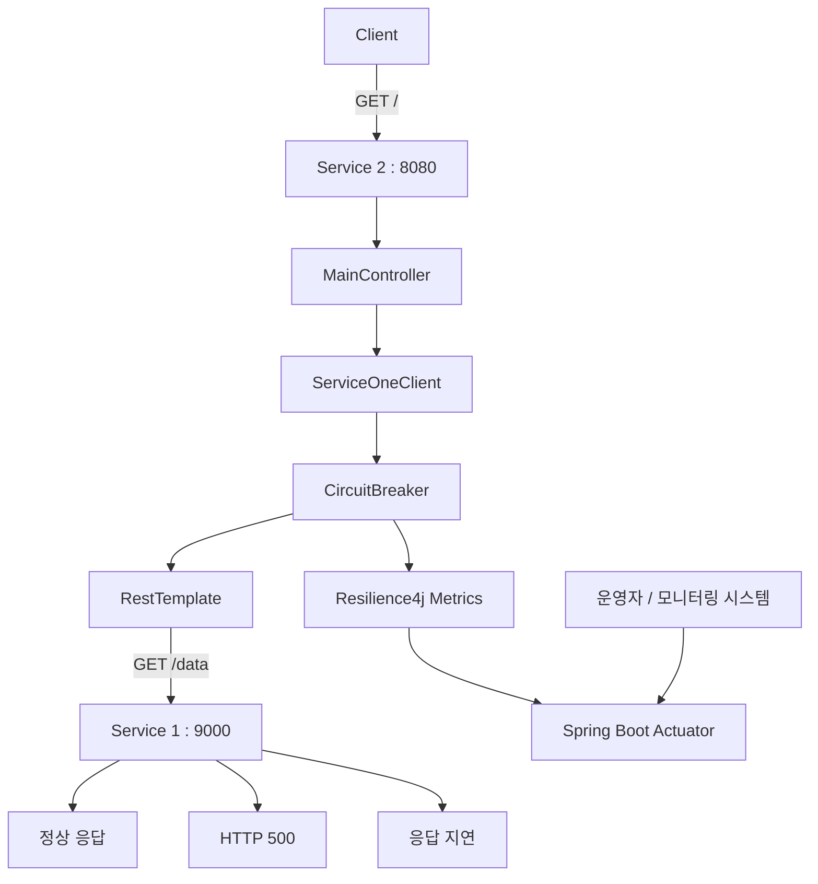
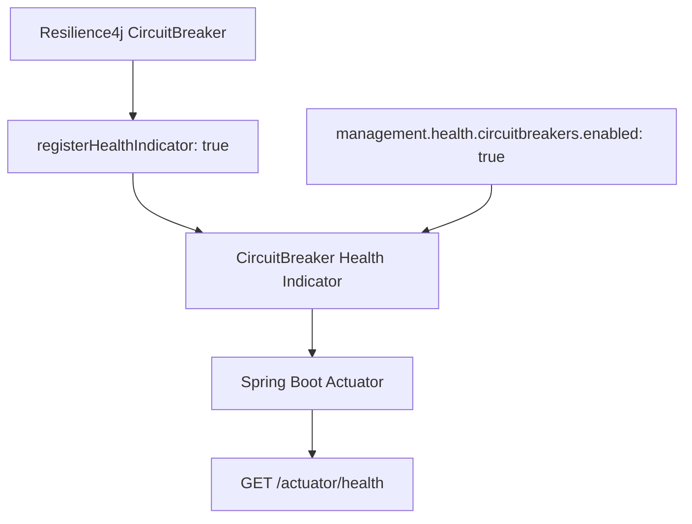
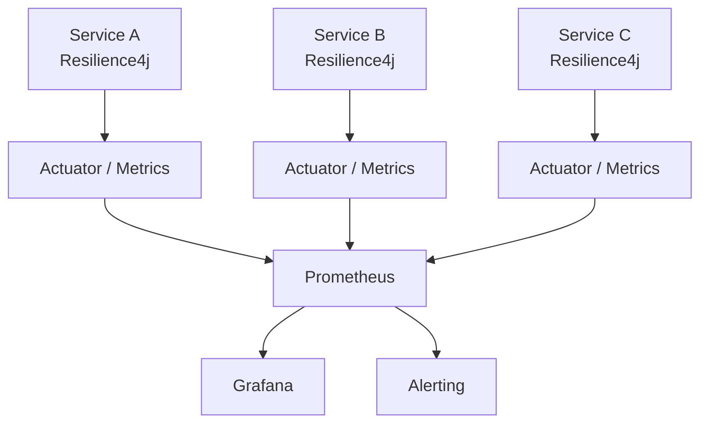
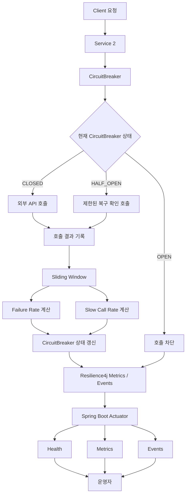

# Resilience4J - 9. actuator 서킷 상태 체크
[https://youtu.be/mQb6exPfnHk?si=QyH3i0iC3LWMdvU9](https://youtu.be/mQb6exPfnHk?si=QyH3i0iC3LWMdvU9)

# Resilience4J - 9. actuator 서킷 상태 체크
* toc
{:toc}

---

### Resilience4j Actuator 완벽 정리: CircuitBreaker 상태 확인과 Health Check 및 모니터링

마이크로서비스 아키텍처(MSA)에서는 여러 서비스가 서로 통신하면서 하나의 비즈니스 요청을 처리한다.

예를 들어 주문 서비스는 상품 서비스에서 상품 정보를 조회하고, 재고 서비스에서 재고를 확인한 후 결제 서비스를 호출할 수 있다.



이러한 구조에서는 특정 서비스의 장애가 다른 서비스로 전파될 수 있다.

이를 방지하기 위해 Resilience4j의 CircuitBreaker를 적용할 수 있다.

CircuitBreaker는 외부 호출의 실패율과 응답 지연 비율을 관찰하고, 미리 설정한 임계값을 초과하면 해당 외부 서비스에 대한 호출을 일시적으로 차단한다.

```text
외부 서비스 호출
       ↓
실패 또는 응답 지연 발생
       ↓
CircuitBreaker가 호출 결과 기록
       ↓
Sliding Window 기반 장애율 계산
       ↓
장애 임계값 도달
       ↓
CircuitBreaker OPEN
       ↓
추가 호출 차단
```

그런데 CircuitBreaker를 실제 서비스에 적용하면 새로운 문제가 생긴다.

**현재 CircuitBreaker가 어떤 상태인지 어떻게 알 수 있을까?**

예를 들어 특정 API가 Fallback 응답을 반환하고 있다고 생각해보자.

Fallback이 실행되는 원인은 다양하다.

* 외부 서비스에서 HTTP 500 오류가 발생했을 수 있다.
* 외부 서비스와의 연결이 실패했을 수 있다.
* HTTP 요청이 Timeout으로 종료되었을 수 있다.
* CircuitBreaker가 OPEN 상태여서 실제 외부 호출을 차단했을 수 있다.

Fallback 응답만으로는 현재 어떤 장애가 발생했는지 정확하게 판단하기 어렵다.

따라서 실제 운영 환경에서는 다음과 같은 정보를 확인할 수 있어야 한다.

| 확인할 정보               | 의미                         |
| -------------------- | -------------------------- |
| CircuitBreaker State | CLOSED, OPEN, HALF_OPEN 상태 |
| Failure Rate         | 실패한 호출의 비율                 |
| Slow Call Rate       | 느린 호출의 비율                  |
| Buffered Calls       | Sliding Window에 집계된 호출 수   |
| Failed Calls         | 실패로 기록된 호출 수               |
| Not Permitted Calls  | CircuitBreaker가 차단한 호출 수   |
| State Transition     | CircuitBreaker 상태 변경 이력    |

Spring Boot에서는 이러한 정보를 확인하기 위해 **Spring Boot Actuator**를 사용할 수 있다.

Actuator를 Resilience4j와 연동하면 CircuitBreaker의 현재 상태뿐 아니라 장애율, 이벤트, 메트릭 등을 HTTP 엔드포인트로 확인할 수 있다.

---

### 개념

#### Spring Boot Actuator란?

Spring Boot Actuator는 실행 중인 Spring Boot 애플리케이션의 상태를 확인하고 운영 관점에서 필요한 정보를 제공하는 모듈이다.

일반적인 Spring Boot 애플리케이션은 Controller를 통해 비즈니스 API를 제공한다.

예를 들어 다음과 같은 API가 있다.

```http
GET /products
```

```http
POST /orders
```

```http
GET /users
```

이러한 API는 클라이언트의 비즈니스 요청을 처리한다.

반면 Actuator는 애플리케이션의 내부 상태와 운영 정보를 확인하기 위한 별도의 엔드포인트를 제공한다.

대표적인 엔드포인트는 다음과 같다.

| Endpoint               | 역할                    |
| ---------------------- | --------------------- |
| `/actuator/health`     | 애플리케이션 상태 확인          |
| `/actuator/info`       | 애플리케이션 정보             |
| `/actuator/metrics`    | JVM 및 애플리케이션 메트릭      |
| `/actuator/beans`      | Spring Bean 정보        |
| `/actuator/env`        | 환경 설정 정보              |
| `/actuator/loggers`    | Logger 설정 조회 및 관리     |
| `/actuator/prometheus` | Prometheus 형식의 메트릭 제공 |

각 엔드포인트는 관련 의존성과 설정에 따라 제공 여부가 달라질 수 있다.

또한 모든 엔드포인트가 기본적으로 HTTP에 노출되는 것은 아니다.

Spring Boot 3.2에서는 기본적으로 `health` 엔드포인트만 HTTP에 노출하며, 다른 엔드포인트는 필요한 항목을 명시적으로 설정해야 한다.

#### Actuator와 Resilience4j의 관계

Spring Boot Actuator는 Resilience4j 전용 라이브러리가 아니다.

Spring Boot 애플리케이션 자체의 운영 정보를 확인하기 위한 도구다.

Resilience4j는 Actuator와 연동하여 CircuitBreaker를 비롯한 여러 장애 대응 모듈의 상태와 메트릭을 제공할 수 있다.



예를 들어 CircuitBreaker가 OPEN 상태로 전환되었다면 Actuator를 통해 해당 상태를 확인할 수 있다.

또한 실패율이나 최근 호출 결과를 메트릭으로 조회할 수 있다.

Resilience4j의 Spring Boot 연동은 CircuitBreaker, Retry, Bulkhead, RateLimiter, TimeLimiter에 대한 Actuator 메트릭과 이벤트 조회 기능을 지원한다.

---

### 왜 사용하는가?

#### CircuitBreaker를 적용하는 것만으로는 충분하지 않다

CircuitBreaker를 적용하면 외부 서비스의 장애가 반복되는 상황에서 추가 호출을 차단할 수 있다.

하지만 운영자는 실제로 다음과 같은 질문에 답할 수 있어야 한다.

**현재 CircuitBreaker가 OPEN 상태인가?**

**왜 OPEN 상태가 되었는가?**

**실패율이 증가했는가, 아니면 응답 지연이 증가했는가?**

**언제 HALF_OPEN 상태로 변경되었는가?**

**외부 서비스가 복구되었는가?**

예를 들어 결제 서비스에 연결된 CircuitBreaker가 OPEN 상태라고 생각해보자.

```text
주문 서비스
    ↓
CircuitBreaker OPEN
    ↓
결제 서비스 호출 차단
    ↓
Fallback
```

이 상황에서 운영자가 CircuitBreaker 상태를 확인할 수 없다면 단순한 네트워크 오류인지, 실제 결제 서비스 장애인지, 이미 CircuitBreaker가 호출을 차단하고 있는지 구분하기 어려울 수 있다.

반면 Actuator를 연동하면 다음과 같은 정보를 확인할 수 있다.

```text
CircuitBreaker Name: paymentService

State: OPEN

Failure Rate: 75%

Failed Calls: 6

Buffered Calls: 8
```

위 값은 설명을 위한 예시다.

이 정보를 보면 최근 호출 중 상당수가 실패했고 CircuitBreaker가 OPEN 상태로 전환되었다는 사실을 확인할 수 있다.

즉 Actuator는 CircuitBreaker의 내부 상태를 외부에서 관찰할 수 있도록 만들어준다.

#### 장애 원인과 복구 과정을 추적할 수 있다

CircuitBreaker가 상태를 변경하는 과정을 생각해보자.



이러한 상태 전환은 정상적인 장애 대응 과정이다.

하지만 운영 환경에서는 상태가 바뀌었다는 사실뿐 아니라 언제, 어떤 이유로 바뀌었는지 확인하는 것이 중요하다.

Actuator와 Resilience4j의 이벤트 기능을 함께 사용하면 상태 전환 및 호출 실패 이력을 확인할 수 있다.

---

### 주요 특징

#### Actuator를 통한 Resilience4j 모니터링 방식

Resilience4j의 상태를 확인하는 방법은 크게 세 가지로 구분할 수 있다.

| 방식      | 대표 URL                           | 확인할 수 있는 정보                |
| ------- | -------------------------------- | -------------------------- |
| Health  | `/actuator/health`               | 애플리케이션 및 CircuitBreaker 상태 |
| Metrics | `/actuator/metrics`              | 실패율, 호출 수, 상태별 메트릭         |
| Events  | `/actuator/circuitbreakerevents` | 최근 호출 및 상태 전환 이벤트          |

여기에 CircuitBreaker 인스턴스 목록을 조회하는 엔드포인트도 있다.

```http
GET /actuator/circuitbreakers
```

이 네 가지 엔드포인트를 함께 활용하면 CircuitBreaker의 현재 상태와 최근 동작을 파악할 수 있다.

단, `health`, `metrics`, `circuitbreakers`, `circuitbreakerevents`는 각각 역할이 다르다.

특히 **Health Indicator를 활성화하는 것과 CircuitBreaker 목록이나 메트릭을 조회할 수 있도록 설정하는 것은 별개의 작업**이다.

---

### 예제

#### 전체 프로젝트 구조

이번에는 앞에서 구성한 두 개의 Spring Boot 애플리케이션을 활용한다.

Service 1은 외부 API를 제공한다.

Service 2는 Service 1을 호출하면서 CircuitBreaker를 적용한다.

| 구분             | Service 1   | Service 2                  |
| -------------- | ----------- | -------------------------- |
| 역할             | 데이터 제공      | 외부 API 호출 및 장애 대응          |
| Port           | 9000        | 8080                       |
| API            | `GET /data` | `GET /`                    |
| 주요 기술          | Spring Web  | RestTemplate, Resilience4j |
| Actuator       | 필수 아님       | 적용                         |
| CircuitBreaker | 적용하지 않음     | 적용                         |

전체 구조는 다음과 같다.



Service 2에서 CircuitBreaker를 적용한 메서드의 호출 결과를 기록한다.

Actuator는 Resilience4j와 연동해 관련 상태를 제공한다.

따라서 운영자는 Service 2의 Actuator 엔드포인트를 통해 CircuitBreaker 상태를 확인할 수 있다.

---

#### 1. Actuator 의존성 추가

Spring Boot에서 Actuator를 사용하려면 다음 의존성을 추가한다.

```gradle
implementation 'org.springframework.boot:spring-boot-starter-actuator'
```

이 의존성을 추가하면 Spring Boot가 제공하는 여러 운영 관련 기능을 사용할 수 있다.

현재 프로젝트에서는 Resilience4j도 사용하므로 관련 의존성이 함께 필요하다.

Spring Boot 3.2.0과 Java 17을 기준으로 `build.gradle`을 구성하면 다음과 같다.

```gradle
plugins {
    id 'java'
    id 'org.springframework.boot' version '3.2.0'
    id 'io.spring.dependency-management' version '1.1.4'
}

group = 'com.example'
version = '0.0.1-SNAPSHOT'

java {
    toolchain {
        languageVersion = JavaLanguageVersion.of(17)
    }
}

repositories {
    mavenCentral()
}

dependencies {

    // Spring MVC
    implementation 'org.springframework.boot:spring-boot-starter-web'

    // Spring AOP
    implementation 'org.springframework.boot:spring-boot-starter-aop'

    // Spring Boot Actuator
    implementation 'org.springframework.boot:spring-boot-starter-actuator'

    // Resilience4j
    implementation 'io.github.resilience4j:resilience4j-spring-boot3:2.2.0'

    // Test
    testImplementation 'org.springframework.boot:spring-boot-starter-test'
}

tasks.named('test') {
    useJUnitPlatform()
}
```

여기서 각 의존성의 역할은 다음과 같다.

| 의존성                            | 역할                              |
| ------------------------------ | ------------------------------- |
| `spring-boot-starter-web`      | HTTP API 제공                     |
| `spring-boot-starter-aop`      | Annotation 기반 CircuitBreaker 적용 |
| `spring-boot-starter-actuator` | Health, Metrics 등 운영 기능         |
| `resilience4j-spring-boot3`    | Resilience4j와 Spring Boot 3 연동  |
| `spring-boot-starter-test`     | 테스트 환경 구성                       |

Resilience4j의 공식 Spring Boot Starter는 Actuator 및 AOP와 함께 사용하는 구성을 지원한다.

위 버전은 기존 Spring Boot 3.2 환경을 재현하기 위한 예시다. 신규 운영 프로젝트에서는 현재 지원되는 Spring Boot 및 Resilience4j 버전의 호환성을 확인해야 한다.

#### 2. Gradle 의존성 반영

`build.gradle`을 수정했다면 Gradle 의존성을 다시 불러온다.

IntelliJ IDEA에서는 Gradle 새로고침 기능을 사용하면 된다.

터미널에서는 다음 명령으로 의존성 구성을 확인할 수 있다.

```bash
./gradlew dependencies --configuration runtimeClasspath
```

이 명령은 애플리케이션 실행 시 사용되는 의존성 구성을 출력한다.

Actuator 관련 의존성만 확인하려면 다음 명령을 사용할 수 있다.

```bash
./gradlew dependencyInsight \
  --dependency spring-boot-starter-actuator \
  --configuration runtimeClasspath
```

정상적으로 추가되었다면 `spring-boot-starter-actuator`와 관련 전이 의존성 정보를 확인할 수 있다.

---

### Actuator 엔드포인트 활성화

Actuator 의존성을 추가했다고 해서 모든 운영 엔드포인트가 자동으로 외부에 노출되는 것은 아니다.

Spring Boot에서는 보안을 위해 HTTP로 노출할 엔드포인트를 명시적으로 선택할 수 있도록 제공한다.

설정은 `application.yml`에서 수행한다.

```yaml
management:
  endpoints:
    web:
      exposure:
        include: health,info,metrics,circuitbreakers,circuitbreakerevents
```

각 설정의 의미는 다음과 같다.

| Endpoint             | 역할                     |
| -------------------- | ---------------------- |
| health               | 애플리케이션 상태 확인           |
| info                 | 애플리케이션 정보              |
| metrics              | 메트릭 조회                 |
| circuitbreakers      | CircuitBreaker 인스턴스 목록 |
| circuitbreakerevents | CircuitBreaker 이벤트 조회  |

이 설정을 적용하면 해당 엔드포인트를 HTTP로 조회할 수 있다.

예를 들어 다음과 같다.

```http
GET /actuator/health
```

```http
GET /actuator/metrics
```

```http
GET /actuator/circuitbreakers
```

```http
GET /actuator/circuitbreakerevents
```

여기서 중요한 점이 있다.

**`management.endpoints.web.exposure.include`는 엔드포인트의 HTTP 노출 여부를 제어하는 설정이다.**

CircuitBreaker를 새롭게 생성하거나 CircuitBreaker의 장애 판단 정책을 변경하는 설정이 아니다.

또한 HTTP 노출을 허용하는 것은 접근 권한을 설정하는 것과 다르므로 실제 운영 환경에서는 별도의 접근 제어가 필요하다.

---

### Health Indicator 설정하기

이번에는 CircuitBreaker 상태를 `/actuator/health`에서 확인할 수 있도록 설정한다.

이를 위해서는 두 가지 설정을 구분해야 한다.

첫 번째는 Spring Boot Actuator의 CircuitBreaker Health Indicator 활성화다.

```yaml
management:
  health:
    circuitbreakers:
      enabled: true
```

두 번째는 Resilience4j CircuitBreaker 인스턴스를 Health Indicator에 등록하는 설정이다.

```yaml
resilience4j:
  circuitbreaker:
    configs:
      default:
        registerHealthIndicator: true
```

두 설정은 같은 기능이 아니다.

#### management.health.circuitbreakers.enabled

```yaml
management:
  health:
    circuitbreakers:
      enabled: true
```

이 설정은 Resilience4j CircuitBreaker의 상태 정보를 Spring Boot Health 시스템에 연동할 수 있도록 활성화한다.

#### registerHealthIndicator

```yaml
registerHealthIndicator: true
```

이 설정은 해당 CircuitBreaker의 상태를 Health Indicator에 등록하도록 지정한다.

즉 다음과 같은 관계다.



따라서 CircuitBreaker의 상세 상태를 Health에 포함하려면 두 설정을 함께 고려해야 한다.

Resilience4j에서도 CircuitBreaker Health Indicator는 기본적으로 비활성화되어 있으며, 활성화 여부를 설정할 수 있도록 제공한다.

---

### Health 상세 정보 활성화

기본적인 Health 응답은 매우 간단하다.

다음과 같이 애플리케이션의 전체 상태만 나타날 수 있다.

```json
{
  "status": "UP"
}
```

이 정보만으로는 CircuitBreaker의 실패율이나 현재 상태를 확인하기 어렵다.

따라서 개발 환경에서는 다음 설정을 사용할 수 있다.

```yaml
management:
  endpoint:
    health:
      show-details: always
```

이 설정은 Health 엔드포인트가 상세 상태 정보를 반환하도록 한다.

각 옵션을 정리하면 다음과 같다.

| 설정값               | 의미                    |
| ----------------- | --------------------- |
| `never`           | 상세 정보 표시하지 않음         |
| `when-authorized` | 권한이 있는 사용자에게 상세 정보 제공 |
| `always`          | 요청자에게 상세 정보 제공        |

Spring Boot의 Health 설정은 이처럼 상세 정보 노출 정책을 지원한다.

다만 `always`는 접근 권한과 무관하게 상세 정보를 제공할 수 있으므로 외부에 공개된 운영 서비스에서는 주의해야 한다.

이번에는 로컬 환경에서 CircuitBreaker 상태를 확인하기 위해 사용한다.

---

### application.yml 전체 설정

지금까지 살펴본 설정을 모두 합쳐보자.

이번에는 CircuitBreaker가 쉽게 OPEN 상태로 전환되는 것을 확인하기 위해 비교적 작은 Sliding Window를 사용한다.

```yaml
spring:
  application:
    name: service-two

server:
  port: 8080

clients:
  service-one:
    base-url: http://localhost:9000

resilience4j:
  circuitbreaker:
    configs:
      default:
        # Health Indicator
        registerHealthIndicator: true

        # Sliding Window
        slidingWindowType: COUNT_BASED
        slidingWindowSize: 4
        minimumNumberOfCalls: 4

        # Failure Rate
        failureRateThreshold: 50

        # Slow Call
        slowCallDurationThreshold: 1s
        slowCallRateThreshold: 50

        # OPEN 상태
        waitDurationInOpenState: 30s

        # HALF_OPEN 상태
        permittedNumberOfCallsInHalfOpenState: 2
        automaticTransitionFromOpenToHalfOpenEnabled: true

        # Event Buffer
        eventConsumerBufferSize: 20

    instances:
      serviceOne:
        baseConfig: default

management:
  endpoints:
    web:
      exposure:
        include: health,info,metrics,circuitbreakers,circuitbreakerevents

  endpoint:
    health:
      show-details: always

  health:
    circuitbreakers:
      enabled: true
```

각 설정을 정리하면 다음과 같다.

| 설정                                           | 값           | 의미                          |
| -------------------------------------------- | ----------- | --------------------------- |
| slidingWindowType                            | COUNT_BASED | 최근 호출 수 기준 집계               |
| slidingWindowSize                            | 4           | 최근 4개 호출 결과                 |
| minimumNumberOfCalls                         | 4           | 최소 4개 호출 후 장애율 판단           |
| failureRateThreshold                         | 50          | 실패율 50% 이상이면 OPEN           |
| slowCallDurationThreshold                    | 1s          | 1초를 초과한 호출은 Slow Call       |
| slowCallRateThreshold                        | 50          | 느린 호출 비율 50% 이상이면 OPEN      |
| waitDurationInOpenState                      | 30s         | OPEN 상태의 복구 대기 시간           |
| permittedNumberOfCallsInHalfOpenState        | 2           | HALF_OPEN에서 2개 호출 허용        |
| automaticTransitionFromOpenToHalfOpenEnabled | true        | 대기 시간 경과 후 HALF_OPEN 자동 전환  |
| eventConsumerBufferSize                      | 20          | 최근 이벤트 저장 버퍼 크기             |
| registerHealthIndicator                      | true        | CircuitBreaker Health 정보 등록 |

이 설정은 CircuitBreaker의 상태 전환과 Actuator 연동을 확인하기 위한 개발용 구성이다.

실제 운영 환경에서는 트래픽 규모, 정상적인 오류율, 응답 시간 분포 등을 기준으로 적절한 임계값을 결정해야 한다.

---

### CircuitBreaker 적용 코드

이제 Service 2의 외부 API 호출 메서드에 CircuitBreaker를 적용한다.

먼저 Service 1을 호출하는 `RestTemplate`이 Bean으로 등록되어 있다고 가정하자.

```java
package com.example.servicetwo.config;

import java.time.Duration;

import org.springframework.beans.factory.annotation.Value;
import org.springframework.boot.web.client.RestTemplateBuilder;
import org.springframework.context.annotation.Bean;
import org.springframework.context.annotation.Configuration;
import org.springframework.web.client.RestTemplate;

@Configuration
public class RestClientConfig {

    @Bean
    public RestTemplate serviceOneRestTemplate(
            RestTemplateBuilder builder,
            @Value("${clients.service-one.base-url}") String baseUrl
    ) {

        return builder
                .rootUri(baseUrl)
                .setConnectTimeout(Duration.ofSeconds(1))
                .setReadTimeout(Duration.ofSeconds(3))
                .build();
    }
}
```

이번에는 Read Timeout을 3초로 설정했다.

이후 Service 1에서 발생시키는 지연은 1.5초이므로 정상적인 환경에서는 Read Timeout이 발생하기 전에 응답을 받을 수 있다.

이제 `ServiceOneClient`를 작성한다.

```java
package com.example.servicetwo.client;

import io.github.resilience4j.circuitbreaker.CallNotPermittedException;
import io.github.resilience4j.circuitbreaker.annotation.CircuitBreaker;

import org.slf4j.Logger;
import org.slf4j.LoggerFactory;
import org.springframework.beans.factory.annotation.Qualifier;
import org.springframework.http.HttpStatus;
import org.springframework.http.ResponseEntity;
import org.springframework.stereotype.Component;
import org.springframework.web.client.RestTemplate;

@Component
public class ServiceOneClient {

    private static final Logger log =
            LoggerFactory.getLogger(ServiceOneClient.class);

    private final RestTemplate restTemplate;

    public ServiceOneClient(
            @Qualifier("serviceOneRestTemplate")
            RestTemplate restTemplate
    ) {
        this.restTemplate = restTemplate;
    }

    @CircuitBreaker(
            name = "serviceOne",
            fallbackMethod = "fallback"
    )
    public ResponseEntity<String> getData(String mode) {

        String response = restTemplate.getForObject(
                "/data?mode={mode}",
                String.class,
                mode
        );

        return ResponseEntity.ok(response);
    }

    private ResponseEntity<String> fallback(
            String mode,
            CallNotPermittedException exception
    ) {

        log.warn(
                "CircuitBreaker OPEN. mode={}",
                mode
        );

        return ResponseEntity
                .status(HttpStatus.SERVICE_UNAVAILABLE)
                .body("CIRCUIT_OPEN");
    }

    private ResponseEntity<String> fallback(
            String mode,
            Exception exception
    ) {

        log.error(
                "Service One 호출 실패. mode={}",
                mode,
                exception
        );

        return ResponseEntity
                .status(HttpStatus.BAD_GATEWAY)
                .body("DOWNSTREAM_FAILURE");
    }
}
```

코드에서 핵심은 다음 Annotation이다.

```java
@CircuitBreaker(
        name = "serviceOne",
        fallbackMethod = "fallback"
)
```

`serviceOne`은 `application.yml`에 정의한 CircuitBreaker 인스턴스 이름이다.

```yaml
instances:
  serviceOne:
    baseConfig: default
```

따라서 `getData()` 호출 결과가 `serviceOne` CircuitBreaker에 기록된다.

다음으로 Controller를 작성한다.

```java
package com.example.servicetwo.controller;

import com.example.servicetwo.client.ServiceOneClient;

import org.springframework.http.ResponseEntity;
import org.springframework.web.bind.annotation.GetMapping;
import org.springframework.web.bind.annotation.RequestParam;
import org.springframework.web.bind.annotation.RestController;

@RestController
public class MainController {

    private final ServiceOneClient serviceOneClient;

    public MainController(ServiceOneClient serviceOneClient) {
        this.serviceOneClient = serviceOneClient;
    }

    @GetMapping("/")
    public ResponseEntity<String> main(
            @RequestParam(defaultValue = "ok") String mode
    ) {

        return serviceOneClient.getData(mode);
    }
}
```

이제 다음 API를 호출하면 CircuitBreaker가 적용된 메서드가 실행된다.

```http
GET /
```

```http
GET /?mode=fail
```

```http
GET /?mode=slow
```

---

### 장애 발생을 위한 Service 1 구성

CircuitBreaker의 상태를 확인하려면 정상 요청과 실패 요청을 구분해서 발생시킬 수 있어야 한다.

Service 1의 `DataController`를 다음과 같이 구성하자.

```java
package com.example.serviceone.controller;

import java.time.Instant;

import org.springframework.http.HttpStatus;
import org.springframework.web.bind.annotation.GetMapping;
import org.springframework.web.bind.annotation.RequestParam;
import org.springframework.web.bind.annotation.RestController;
import org.springframework.web.server.ResponseStatusException;

@RestController
public class DataController {

    @GetMapping("/data")
    public String getData(
            @RequestParam(defaultValue = "ok") String mode
    ) {

        if ("fail".equals(mode)) {

            throw new ResponseStatusException(
                    HttpStatus.INTERNAL_SERVER_ERROR,
                    "강제로 발생시킨 서버 오류"
            );
        }

        if ("slow".equals(mode)) {

            try {
                Thread.sleep(1_500);
            } catch (InterruptedException exception) {

                Thread.currentThread().interrupt();

                throw new ResponseStatusException(
                        HttpStatus.SERVICE_UNAVAILABLE,
                        "요청 처리 중단",
                        exception
                );
            }
        }

        if (!"ok".equals(mode) && !"slow".equals(mode)) {

            throw new ResponseStatusException(
                    HttpStatus.BAD_REQUEST,
                    "지원하지 않는 mode"
            );
        }

        return "Service One Response: " + Instant.now();
    }
}
```

각 모드의 역할은 다음과 같다.

| Mode | Service 1 동작    | CircuitBreaker에 기록되는 결과 |
| ---- | --------------- | ----------------------- |
| ok   | 즉시 HTTP 200     | Success                 |
| fail | HTTP 500        | Failure                 |
| slow | 1.5초 후 HTTP 200 | Slow Call               |

여기서 `slow` 모드는 HTTP 200을 반환한다.

하지만 CircuitBreaker의 Slow Call 기준은 1초이므로 느린 호출로 기록될 수 있다.

이를 통해 실패율과 느린 호출 비율을 각각 확인할 수 있다.

---

### Actuator를 통해 CircuitBreaker 상태 확인하기

이제 Service 1과 Service 2를 실행한다.

Service 1은 9000 포트에서 실행한다.

Service 2는 8080 포트에서 실행한다.

#### 1. Spring Boot 애플리케이션 실행

각 프로젝트 디렉터리에서 다음 명령을 실행한다.

```bash
./gradlew bootRun
```

Service 1과 Service 2는 각각 별도의 프로젝트에서 실행해야 한다.

두 애플리케이션이 정상적으로 실행되었다면 Service 2의 Actuator 엔드포인트에 접근할 수 있다.

#### 2. Health 상태 조회

다음 명령을 실행한다.

```bash
curl -i http://localhost:8080/actuator/health
```

정상적인 경우 다음과 같은 상태를 확인할 수 있다.

```json
{
  "status": "UP"
}
```

현재 설정에서는 상세 Health 정보를 노출하도록 구성했으므로 실제 응답에는 추가적인 구성요소와 CircuitBreaker 상태가 포함될 수 있다.

가장 중요한 정보는 CircuitBreaker의 현재 상태다.

애플리케이션 시작 직후 CircuitBreaker가 CLOSED 상태라면 관련 상태 정보를 통해 다음 값을 확인할 수 있다.

```text
state = CLOSED
```

이때 CircuitBreaker는 정상적으로 외부 호출을 허용하는 상태다.

---

### CircuitBreaker 전용 Health 정보 조회하기

전체 Health 응답에는 다른 구성요소의 상태도 포함될 수 있다.

CircuitBreaker 정보만 확인하려면 다음 경로를 사용할 수 있다.

```bash
curl -sS \
  http://localhost:8080/actuator/health/circuitBreakers
```

위 경로는 CircuitBreaker Health 구성요소를 조회하는 경로다.

실제 응답 구조는 Spring Boot와 Resilience4j 버전에 따라 일부 차이가 있을 수 있다.

예를 들어 다음과 같은 항목이 포함될 수 있다.

```json
{
  "status": "UP",
  "details": {
    "serviceOne": {
      "status": "UP",
      "details": {
        "failureRate": "-1.0%",
        "failureRateThreshold": "50.0%",
        "slowCallRate": "-1.0%",
        "slowCallRateThreshold": "50.0%",
        "bufferedCalls": 0,
        "failedCalls": 0,
        "notPermittedCalls": 0,
        "state": "CLOSED"
      }
    }
  }
}
```

위 JSON은 주요 필드의 의미를 보여주기 위한 예시다.

핵심은 다음 항목이다.

```json
{
  "state": "CLOSED"
}
```

이는 CircuitBreaker가 외부 호출을 정상적으로 허용하고 있음을 의미한다.

그런데 처음 실행한 직후 다음 값이 나타날 수 있다.

```json
{
  "failureRate": "-1.0%",
  "slowCallRate": "-1.0%"
}
```

이 값은 무엇을 의미할까?

---

### failureRate가 -1인 이유

CircuitBreaker를 처음 실행한 직후에는 아직 호출 결과가 충분히 수집되지 않았을 수 있다.

예를 들어 다음과 같이 설정했다고 가정하자.

```yaml
minimumNumberOfCalls: 4
```

이 설정은 최소 4개 이상의 호출 결과가 집계되어야 실패율과 느린 호출 비율을 평가할 수 있다는 의미다.

그런데 현재까지 한 번도 호출하지 않았다면 어떻게 될까?

```text
Buffered Calls = 0

Minimum Number Of Calls = 4
```

아직 장애율을 계산하기 위한 최소 호출 수에 도달하지 않았다.

이때 Resilience4j는 실패율과 느린 호출 비율을 계산할 수 없음을 나타내기 위해 `-1` 값을 반환할 수 있다.

```text
Failure Rate = -1

Slow Call Rate = -1
```

**이 값은 실제 실패율이 -1%라는 의미가 아니다.**

장애율을 평가할 만큼 호출 결과가 충분히 쌓이지 않았다는 의미다.

Resilience4j의 CircuitBreaker Metrics API 역시 최소 호출 수를 충족하지 않은 경우 실패율과 느린 호출 비율에 `-1`을 반환하도록 정의하고 있다.

따라서 운영 환경에서 이 값을 실제 장애율로 해석하지 않도록 주의해야 한다.

---

### CircuitBreaker를 OPEN 상태로 변경하기

이제 Service 2를 통해 의도적으로 실패 요청을 발생시켜보자.

현재 CircuitBreaker 설정은 다음과 같다.

```yaml
slidingWindowSize: 4
minimumNumberOfCalls: 4
failureRateThreshold: 50
```

최근 4개 호출 중 2개 이상이 실패하면 실패율은 50% 이상이 된다.

따라서 OPEN 상태로 전환될 수 있다.

이번에는 모든 요청이 실패하도록 구성한다.

다음 명령을 실행해보자.

```bash
for i in 1 2 3 4
do
  curl -sS \
    "http://localhost:8080/?mode=fail"

  printf '\n'
done
```

각 요청은 Service 1의 `/data?mode=fail` API를 호출한다.

Service 1에서는 HTTP 500을 반환한다.

Service 2의 `RestTemplate`은 예외를 발생시키고, CircuitBreaker가 해당 호출을 실패로 기록한다.

```text
1번째 호출 → 실패

2번째 호출 → 실패

3번째 호출 → 실패

4번째 호출 → 실패
```

따라서 다음과 같이 계산된다.

```text
전체 호출 = 4

실패 호출 = 4

Failure Rate = 100%
```

설정된 실패율 임계값은 50%다.

따라서 CircuitBreaker는 OPEN 상태로 전환된다.

---

### Actuator에서 OPEN 상태 확인하기

실패 요청을 발생시킨 직후 다음 명령을 실행해보자.

```bash
curl -i \
  http://localhost:8080/actuator/health
```

CircuitBreaker의 상태가 OPEN으로 전환되었다면 Health 정보에서도 해당 상태를 확인할 수 있다.

```text
CircuitBreaker State = OPEN
```

또한 다음과 같은 정보가 나타날 수 있다.

```text
Failure Rate = 100%

Buffered Calls = 4

Failed Calls = 4

State = OPEN
```

여기서 주의할 점이 있다.

현재 설정에는 다음 값이 존재한다.

```yaml
waitDurationInOpenState: 30s
```

따라서 OPEN 상태가 된 이후 설정된 시간이 경과하면 HALF_OPEN 상태로 전환할 수 있다.

상태 확인까지 시간이 오래 걸렸다면 이미 HALF_OPEN으로 변경되었을 수 있다.

#### OPEN 상태에서 요청하면?

CircuitBreaker가 OPEN 상태인 동안 다음 요청을 보내보자.

```bash
curl -i \
  "http://localhost:8080/?mode=ok"
```

Service 1이 정상적으로 실행 중이더라도 CircuitBreaker가 OPEN 상태라면 실제 HTTP 호출을 차단한다.

```text
Client
    ↓
Service 2
    ↓
CircuitBreaker OPEN
    ↓
외부 호출 차단
    ↓
CallNotPermittedException
    ↓
Fallback
```

앞에서 작성한 Fallback은 다음 값을 반환한다.

```text
CIRCUIT_OPEN
```

따라서 해당 요청은 Service 1의 정상 응답을 받지 못한다.

이처럼 **외부 서비스가 정상적으로 복구되었더라도 CircuitBreaker가 OPEN 상태라면 추가 호출은 일시적으로 차단될 수 있다.**

CircuitBreaker는 일정 시간이 지난 뒤 HALF_OPEN 상태에서 제한적으로 호출을 허용하면서 복구 여부를 판단한다.

---

### CircuitBreaker Health 상태와 애플리케이션 Health 상태

여기서 매우 중요한 부분이 있다.

CircuitBreaker의 상태와 Spring Boot Actuator의 Health 상태는 같은 개념이 아니다.

CircuitBreaker의 상태는 다음과 같다.

```text
CLOSED

OPEN

HALF_OPEN
```

반면 Spring Boot Actuator의 대표적인 Health 상태는 다음과 같다.

```text
UP

DOWN

UNKNOWN

OUT_OF_SERVICE
```

Resilience4j의 Health Indicator는 CircuitBreaker 상태를 Health 상태로 변환할 수 있다.

Resilience4j 2.2 계열에서 확인할 수 있는 기본적인 상태 매핑은 다음과 같다.

| CircuitBreaker 상태 | Health 상태 |
| ----------------- | --------- |
| CLOSED            | UP        |
| OPEN              | DOWN      |
| HALF_OPEN         | UNKNOWN   |

Resilience4j의 Spring Boot 연동 문서에서도 이 상태 매핑을 설명한다.

이 설정에는 운영상 중요한 의미가 있다.

CircuitBreaker가 OPEN이 되면 해당 Health Indicator가 DOWN을 반환할 수 있다.

그리고 전체 Health 상태에도 영향을 줄 수 있다.

Spring Boot는 기본적으로 전체 Health가 DOWN이면 HTTP 503을 반환한다.

예를 들어 다음 상황을 생각해보자.

```text
추천 서비스 장애
       ↓
추천 서비스 CircuitBreaker OPEN
       ↓
CircuitBreaker Health DOWN
       ↓
전체 Health DOWN 가능
```

그런데 이 상황에서 애플리케이션 전체를 비정상으로 판단하는 것이 적절할까?

추천 기능이 일시적으로 중단되었더라도 상품 조회와 주문 기능은 정상적으로 제공될 수 있다.

이때 애플리케이션 전체를 DOWN으로 표시하면 오히려 정상적인 기능까지 영향을 받을 수 있다.

이 문제는 뒤에서 운영 환경의 Health Check 전략과 함께 살펴본다.

---

### CircuitBreaker 목록 확인하기

Health 엔드포인트 외에도 Resilience4j는 CircuitBreaker 인스턴스 목록을 확인할 수 있는 엔드포인트를 제공한다.

다음 명령을 실행해보자.

```bash
curl -sS \
  http://localhost:8080/actuator/circuitbreakers
```

현재 `serviceOne`이라는 CircuitBreaker 인스턴스가 등록되어 있다면 다음과 같은 응답을 확인할 수 있다.

```json
{
  "circuitBreakers": [
    "serviceOne"
  ]
}
```

이 엔드포인트에서는 등록된 CircuitBreaker의 이름을 확인할 수 있다.

다만 이 목록만으로 개별 CircuitBreaker의 현재 상태나 실패율까지 모두 확인할 수 있는 것은 아니다.

| Endpoint                         | 역할                            |
| -------------------------------- | ----------------------------- |
| `/actuator/circuitbreakers`      | 등록된 CircuitBreaker 목록         |
| `/actuator/health`               | Health에 등록된 CircuitBreaker 상태 |
| `/actuator/metrics`              | CircuitBreaker 메트릭            |
| `/actuator/circuitbreakerevents` | 최근 이벤트                        |

특히 `circuitbreakers`와 `circuitbreakerevents`는 서로 다른 엔드포인트다.

Resilience4j에서는 CircuitBreaker 인스턴스 목록과 최근 이벤트를 조회하는 기능을 별도로 제공한다.

---

### CircuitBreaker 이벤트 확인하기

CircuitBreaker에서는 다양한 이벤트가 발생한다.

예를 들어 외부 서비스 호출이 성공하거나 실패했을 때 이벤트가 발생할 수 있다.

또한 CircuitBreaker 상태가 CLOSED에서 OPEN으로 변경될 때도 이벤트가 발생한다.

이러한 이벤트를 조회하는 엔드포인트가 다음과 같다.

```http
GET /actuator/circuitbreakerevents
```

실제로 호출해보자.

```bash
curl -sS \
  http://localhost:8080/actuator/circuitbreakerevents
```

정상적으로 연동되었다면 최근 CircuitBreaker 이벤트를 확인할 수 있다.

예를 들어 다음과 같은 이벤트가 기록될 수 있다.

```json
{
  "circuitBreakerEvents": [
    {
      "circuitBreakerName": "serviceOne",
      "type": "ERROR",
      "creationTime": "2026-10-23T10:00:00+09:00",
      "errorMessage": "HTTP 500"
    },
    {
      "circuitBreakerName": "serviceOne",
      "type": "STATE_TRANSITION",
      "creationTime": "2026-10-23T10:00:01+09:00",
      "stateTransition": "CLOSED_TO_OPEN"
    }
  ]
}
```

위 JSON은 이벤트의 주요 필드를 설명하기 위해 단순화한 예시다. 실제 응답의 오류 메시지와 세부 구조는 버전 및 발생 이벤트에 따라 달라진다.

대표적인 이벤트는 다음과 같다.

| 이벤트                     | 의미                    |
| ----------------------- | --------------------- |
| SUCCESS                 | 호출 성공                 |
| ERROR                   | 호출 실패                 |
| IGNORED_ERROR           | 집계에서 제외된 오류           |
| NOT_PERMITTED           | CircuitBreaker가 호출 차단 |
| STATE_TRANSITION        | CircuitBreaker 상태 변경  |
| FAILURE_RATE_EXCEEDED   | 실패율 임계값 초과            |
| SLOW_CALL_RATE_EXCEEDED | 느린 호출 비율 임계값 초과       |

이벤트를 이용하면 단순히 현재 OPEN 상태라는 사실뿐 아니라 해당 상태가 되기까지 어떤 일이 발생했는지 추적할 수 있다.

#### eventConsumerBufferSize

이벤트 기록과 관련된 설정은 다음과 같다.

```yaml
eventConsumerBufferSize: 20
```

이는 Actuator에서 최근 이벤트를 보관하기 위한 버퍼 크기를 설정한다.

예를 들어 이벤트가 100개 발생했더라도 버퍼 크기가 20이라면 모든 이벤트를 계속 보관하지 않는다.

```text
이벤트 발생
    ↓
최근 이벤트 버퍼에 기록
    ↓
버퍼 크기 초과
    ↓
오래된 이벤트 제외
```

따라서 이 기능은 최근 이벤트를 확인하는 용도로 적합하다.

장기간의 장애 이력을 보존하려면 로그 수집 시스템이나 별도의 모니터링 시스템을 함께 사용해야 한다.

---

### Actuator Metrics로 CircuitBreaker 상태 확인하기

Actuator는 메트릭 조회 기능도 제공한다.

다음 엔드포인트를 호출하면 현재 등록된 메트릭 목록을 확인할 수 있다.

```bash
curl -sS \
  http://localhost:8080/actuator/metrics
```

Resilience4j가 정상적으로 연동되었다면 다음과 같은 CircuitBreaker 메트릭을 확인할 수 있다.

```text
resilience4j.circuitbreaker.calls

resilience4j.circuitbreaker.state

resilience4j.circuitbreaker.failure.rate

resilience4j.circuitbreaker.buffered.calls
```

이 메트릭들은 각각 다른 정보를 제공한다.

| 메트릭                                          | 의미                       |
| -------------------------------------------- | ------------------------ |
| `resilience4j.circuitbreaker.calls`          | 성공, 실패, 차단된 호출 등의 집계     |
| `resilience4j.circuitbreaker.state`          | CircuitBreaker 상태 정보     |
| `resilience4j.circuitbreaker.failure.rate`   | 실패율                      |
| `resilience4j.circuitbreaker.slow.call.rate` | 느린 호출 비율                 |
| `resilience4j.circuitbreaker.buffered.calls` | Sliding Window에 집계된 호출 수 |

실제 제공되는 메트릭 이름과 태그는 Resilience4j 버전 및 Micrometer 연동 설정에 따라 달라질 수 있다.

Resilience4j 공식 Spring Boot 연동에서도 CircuitBreaker 메트릭을 `/actuator/metrics`를 통해 조회하는 방법을 제공한다.

---

### 특정 CircuitBreaker의 메트릭 조회하기

여러 외부 서비스에 CircuitBreaker를 적용했다면 다음과 같은 인스턴스가 존재할 수 있다.

```text
paymentService

inventoryService

notificationService
```

이때 전체 메트릭을 조회하는 것보다 특정 인스턴스만 확인하는 것이 유용하다.

예를 들어 `serviceOne`의 실패율을 조회하려면 다음 명령을 사용할 수 있다.

```bash
curl -sS \
  "http://localhost:8080/actuator/metrics/resilience4j.circuitbreaker.failure.rate?tag=name:serviceOne"
```

이 명령은 `serviceOne`이라는 이름을 가진 CircuitBreaker의 실패율 메트릭을 조회한다.

응답 형식은 다음과 유사하다.

```json
{
  "name": "resilience4j.circuitbreaker.failure.rate",
  "measurements": [
    {
      "statistic": "VALUE",
      "value": 100.0
    }
  ]
}
```

위 값은 해당 CircuitBreaker의 실패율이 100%인 상황을 가정한 예시다.

아직 최소 호출 수를 충족하지 못했다면 앞서 설명한 것처럼 `-1`이 나타날 수 있다.

#### name 태그

다음 부분을 살펴보자.

```text
?tag=name:serviceOne
```

이는 Micrometer 메트릭의 태그를 이용해 특정 인스턴스의 데이터만 조회하는 방식이다.

예를 들어 다음과 같은 CircuitBreaker가 있을 수 있다.

```text
name=paymentService

name=inventoryService

name=notificationService
```

이처럼 같은 메트릭 이름이라도 태그를 이용해 개별 CircuitBreaker를 구분할 수 있다.

---

### CircuitBreaker 상태 메트릭 확인하기

CircuitBreaker의 현재 상태는 다음 메트릭으로 확인할 수 있다.

```bash
curl -sS \
  "http://localhost:8080/actuator/metrics/resilience4j.circuitbreaker.state?tag=name:serviceOne"
```

Resilience4j의 상태 메트릭은 상태별 태그와 측정값을 통해 표현될 수 있다.

따라서 단순히 숫자 하나만 보고 CLOSED나 OPEN을 판단하는 것이 아니라 **상태를 나타내는 태그도 함께 확인해야 한다.**

예를 들어 CLOSED 상태에 해당하는 메트릭이 활성화되어 있다면 해당 상태가 현재 CircuitBreaker의 상태임을 알 수 있다.

실무에서는 현재 상태를 사람이 확인할 때 Health나 상태 메트릭을 사용하고, 자동화된 알림에는 상태 메트릭의 변화와 실패율을 함께 활용할 수 있다.

---

### 실패율과 지연율을 함께 확인해야 하는 이유

CircuitBreaker는 실패율과 느린 호출 비율을 각각 계산한다.

첫 번째는 Failure Rate다.

```text
Failure Rate

= 실패한 호출 수 / 전체 집계 호출 수 × 100
```

두 번째는 Slow Call Rate다.

```text
Slow Call Rate

= 느린 호출 수 / 전체 집계 호출 수 × 100
```

예를 들어 다음과 같은 상황을 생각해보자.

| 호출 | HTTP 상태 |   응답 시간 |
| -- | ------- | ------: |
| 1  | 200     |   100ms |
| 2  | 200     |   150ms |
| 3  | 200     | 1,500ms |
| 4  | 200     | 2,000ms |

모든 호출이 성공했다.

따라서 Failure Rate는 0%다.

하지만 Slow Call 기준이 1초라면 두 개의 요청은 느린 호출이다.

```text
전체 호출 = 4

느린 호출 = 2

Slow Call Rate = 50%
```

느린 호출 비율 임계값이 50%라면 CircuitBreaker는 OPEN 상태로 전환될 수 있다.

이 경우 HTTP 오류가 전혀 없어도 CircuitBreaker가 열릴 수 있다.

따라서 운영 환경에서는 단순히 HTTP 500 발생 횟수만 확인하는 것보다 Failure Rate와 Slow Call Rate를 함께 모니터링하는 것이 좋다.

---

### OPEN 상태에서 HALF_OPEN으로 변경되는 과정 확인

현재 설정에는 다음 값이 존재한다.

```yaml
waitDurationInOpenState: 30s

automaticTransitionFromOpenToHalfOpenEnabled: true

permittedNumberOfCallsInHalfOpenState: 2
```

CircuitBreaker가 OPEN 상태로 전환된 후 설정된 대기 시간이 지나면 HALF_OPEN 상태로 변경할 수 있다.

여기서 다음 설정을 살펴보자.

```yaml
automaticTransitionFromOpenToHalfOpenEnabled: true
```

이 설정은 대기 시간이 지난 뒤 별도의 외부 호출 없이 OPEN에서 HALF_OPEN으로 상태 전환할 수 있도록 한다.

하지만 이때 중요한 점이 있다.

**HALF_OPEN으로 변경되었다고 Resilience4j가 외부 서비스에 자동으로 복구 확인 HTTP 요청을 보내는 것은 아니다.**

HALF_OPEN은 제한적인 실제 호출을 허용할 수 있는 상태다.

따라서 외부 서비스가 복구되었는지는 이후 발생하는 호출 결과를 확인해야 한다.

```text
CircuitBreaker OPEN
        ↓
대기 시간 경과
        ↓
HALF_OPEN
        ↓
외부 호출 2개 허용
        ↓
호출 결과 집계
        ↓
복구 여부 판단
```

이때 Service 1을 정상 상태로 실행한 뒤 다음 요청을 보낼 수 있다.

```bash
curl -i \
  "http://localhost:8080/?mode=ok"
```

설정된 복구 확인 호출이 정상적으로 완료되고 실패율 및 지연율 조건을 충족하면 CircuitBreaker는 CLOSED로 복구될 수 있다.

반대로 복구 확인 호출이 계속 실패하면 다시 OPEN으로 돌아갈 수 있다.

이러한 상태 전환 과정은 `/actuator/circuitbreakerevents`에서도 확인할 수 있다.

---

### Prometheus와 Grafana 연동하기

Actuator의 HTTP 엔드포인트는 현재 상태를 직접 확인하는 데 유용하다.

하지만 실제 MSA에서는 수많은 애플리케이션 인스턴스가 실행될 수 있다.

예를 들어 주문 서비스가 여러 대로 구성되어 있다고 생각해보자.

```text
Order Service A

Order Service B

Order Service C
```

Resilience4j CircuitBreaker는 기본적으로 개별 애플리케이션 인스턴스 내부에서 상태를 관리한다.

따라서 각 인스턴스의 CircuitBreaker 상태가 서로 다를 수 있다.

```text
Order Service A → CLOSED

Order Service B → OPEN

Order Service C → HALF_OPEN
```

이 경우 특정 서버의 Actuator만 확인해서는 전체 서비스의 상태를 정확하게 판단하기 어렵다.

따라서 여러 인스턴스에서 발생하는 메트릭을 중앙에서 수집하는 방식이 필요하다.

대표적으로 Prometheus와 Grafana를 사용할 수 있다.



Prometheus는 애플리케이션의 메트릭을 수집한다.

Grafana는 수집된 메트릭을 시각화한다.

이를 통해 다음과 같은 정보를 대시보드로 확인할 수 있다.

```text
CircuitBreaker State

Failure Rate

Slow Call Rate

Failed Calls

Not Permitted Calls

Retry Count

Bulkhead Available Permits
```

#### Prometheus 의존성 추가

Prometheus 형식의 메트릭을 제공하려면 다음 의존성을 추가할 수 있다.

```gradle
runtimeOnly 'io.micrometer:micrometer-registry-prometheus'
```

그다음 Actuator에서 Prometheus 엔드포인트를 노출하도록 설정한다.

```yaml
management:
  endpoints:
    web:
      exposure:
        include: health,info,metrics,circuitbreakers,circuitbreakerevents,prometheus
```

이제 다음 경로로 접근할 수 있다.

```http
GET /actuator/prometheus
```

실제로 확인하려면 다음 명령을 사용할 수 있다.

```bash
curl -sS \
  http://localhost:8080/actuator/prometheus
```

Resilience4j 관련 메트릭만 확인하고 싶다면 다음처럼 필터링할 수도 있다.

```bash
curl -sS \
  http://localhost:8080/actuator/prometheus \
  | grep resilience4j_circuitbreaker
```

실제 메트릭 이름은 Prometheus 형식으로 변환되며, 활성화된 메트릭과 태그에 따라 출력이 달라질 수 있다.

Prometheus Registry 의존성을 통해 Actuator의 Prometheus 엔드포인트를 제공하는 구성은 Resilience4j에서도 안내하고 있다.

---

### 구조

#### CircuitBreaker와 Actuator의 전체 동작 흐름

지금까지 구현한 구조를 정리하면 다음과 같다.



여기서 구분해야 할 부분이 있다.

**CircuitBreaker는 장애를 판단하고 호출을 제어하는 역할**을 담당한다.

반면 **Actuator는 CircuitBreaker의 상태와 메트릭을 외부에서 확인할 수 있도록 제공하는 역할**을 담당한다.

따라서 Actuator를 추가했다고 CircuitBreaker의 실패율 계산 방식이나 상태 전환 알고리즘이 변경되지는 않는다.

Actuator는 장애 대응 로직을 실행하는 주체가 아니라 해당 로직의 상태를 관찰하는 수단이다.

---

### 실무에서의 활용

#### 1. CircuitBreaker OPEN을 애플리케이션 전체 장애로 판단하지 않는다

실무에서 가장 주의해야 할 부분이다.

예를 들어 추천 서비스가 장애를 일으켰다고 생각해보자.

```text
상품 서비스
    ↓
추천 서비스 호출
    ↓
CircuitBreaker OPEN
    ↓
인기 상품 Fallback
```

추천 서비스가 장애 상태이더라도 상품 서비스는 정상적으로 동작할 수 있다.

그런데 CircuitBreaker Health Indicator를 전체 Health에 포함하고 OPEN 상태를 DOWN으로 반환하도록 구성하면 상품 서비스 전체가 비정상으로 표시될 수 있다.

이때 Kubernetes나 Load Balancer가 해당 Health 정보를 서비스 상태 판단에 사용한다면 예상치 못한 문제가 발생할 수 있다.

따라서 CircuitBreaker의 상태를 관찰하는 것과 애플리케이션 전체의 정상 여부를 판단하는 것은 구분해야 한다.

#### 2. Liveness와 Readiness를 구분한다

Kubernetes에서는 대표적으로 Liveness Probe와 Readiness Probe를 사용한다.

| 구분           | Liveness          | Readiness            |
| ------------ | ----------------- | -------------------- |
| 목적           | 애플리케이션이 살아 있는지 확인 | 요청을 처리할 준비가 되었는지 확인  |
| 실패 시 일반적인 처리 | 컨테이너 재시작 가능       | 트래픽 전달 제외            |
| 주요 관심사       | 애플리케이션 자체 상태      | 요청 처리 가능 여부          |
| 외부 API 장애 반영 | 일반적으로 부적절         | 핵심 의존성 여부에 따라 신중히 판단 |

Spring Boot Actuator는 Kubernetes 환경에서 Liveness와 Readiness를 구분하는 Health Probe 기능을 제공한다.

Spring Boot 공식 문서에서도 외부 서비스의 장애를 Liveness에 연결하면 불필요한 재시작과 장애 전파가 발생할 수 있다고 설명한다.

따라서 외부 추천 서비스의 CircuitBreaker가 OPEN이라고 해서 주문 서비스의 Liveness까지 실패시키는 것은 일반적으로 적절하지 않다.

#### 3. Health Check 때문에 장애가 확대되지 않도록 한다

다음 상황을 생각해보자.

```text
외부 추천 서비스 장애
        ↓
주문 서비스 CircuitBreaker OPEN
        ↓
전체 Health DOWN
        ↓
Load Balancer가 주문 서비스 제외
        ↓
정상적인 주문 요청도 처리하지 못함
```

원래 CircuitBreaker를 적용한 목적은 추천 서비스 장애가 주문 서비스 전체에 영향을 주지 않도록 만드는 것이다.

하지만 Health 설정이 잘못되어 있다면 CircuitBreaker가 오히려 정상적인 서비스까지 중단시키는 원인이 될 수 있다.

따라서 운영 환경에서는 CircuitBreaker 상태를 별도로 모니터링하는 방식을 고려하는 것이 좋다.

예를 들어 CircuitBreaker를 Health에 포함할 필요가 없다면 다음 설정을 사용할 수 있다.

```yaml
management:
  health:
    circuitbreakers:
      enabled: false
```

이 경우에도 적절한 Resilience4j 메트릭 연동이 구성되어 있다면 CircuitBreaker 상태와 실패율 등을 별도의 메트릭으로 관찰할 수 있다.

#### 4. Health와 Metrics를 구분해 사용한다

Health는 애플리케이션의 현재 정상 상태를 판단하는 데 주로 사용한다.

반면 Metrics는 시간에 따른 상태 변화를 분석하는 데 적합하다.

예를 들어 다음과 같은 데이터를 생각해보자.

```text
10:00 → Failure Rate 5%

10:05 → Failure Rate 15%

10:10 → Failure Rate 35%

10:15 → Failure Rate 70%
```

이러한 변화는 Metrics를 지속적으로 수집해야 확인할 수 있다.

현재 OPEN인지 CLOSED인지만 확인하는 것보다 장애가 발생하기 전 실패율이 어떻게 변화했는지 확인하면 원인 분석에 도움이 된다.

#### 5. Fallback 실행 여부도 함께 모니터링한다

CircuitBreaker가 OPEN이더라도 Fallback이 정상적인 응답을 반환하면 클라이언트에서는 HTTP 200을 받을 수 있다.

따라서 전체 HTTP 성공률만으로는 외부 서비스 장애를 놓칠 수 있다.

예를 들어 다음과 같은 상황이다.

```text
CircuitBreaker OPEN
        ↓
Fallback 실행
        ↓
대체 데이터 반환
        ↓
HTTP 200
```

사용자에게는 대체 데이터를 제공했으므로 서비스가 완전히 중단되지는 않았다.

하지만 내부적으로는 외부 서비스의 정상적인 기능을 사용하지 못하는 상태다.

따라서 Fallback 실행 횟수를 별도 로그나 메트릭으로 수집하는 것이 좋다.

#### 6. Not Permitted Calls를 확인한다

CircuitBreaker가 OPEN 상태에서 실제 외부 호출을 차단하면 Not Permitted Call이 발생한다.

이 값이 계속 증가한다면 많은 요청이 외부 서비스를 호출하지 못하고 있다는 의미일 수 있다.

```text
CircuitBreaker OPEN
        ↓
호출 차단
        ↓
Not Permitted Calls 증가
```

단순히 CircuitBreaker가 OPEN이라는 사실보다 얼마나 많은 요청이 차단되었는지 확인하는 것이 운영상 중요하다.

#### 7. CircuitBreaker 상태 전환 이벤트를 기록한다

CircuitBreaker 상태가 변경되는 시점은 장애 분석에 중요한 정보다.

예를 들어 다음과 같은 이벤트를 기록할 수 있다.

```text
10:00:00 CLOSED

10:01:20 CLOSED → OPEN

10:01:50 OPEN → HALF_OPEN

10:01:55 HALF_OPEN → CLOSED
```

이러한 기록이 있으면 외부 서비스가 언제 불안정해졌고 언제 복구되었는지 추적하기 쉽다.

다만 Actuator의 이벤트 버퍼는 장기 저장소가 아니다.

따라서 장기간 이력을 보존하려면 별도의 로그 수집이나 모니터링 시스템과 연동해야 한다.

#### 8. 여러 인스턴스의 CircuitBreaker 상태를 함께 확인한다

Resilience4j의 일반적인 CircuitBreaker는 애플리케이션 인스턴스별로 상태를 관리한다.

따라서 동일한 서비스라도 서버마다 CircuitBreaker 상태가 다를 수 있다.

```text
Service A → CLOSED

Service B → OPEN

Service C → HALF_OPEN
```

이러한 환경에서는 특정 인스턴스의 Actuator만 확인하기보다 전체 인스턴스의 상태를 함께 수집해야 한다.

Prometheus와 Grafana 등을 이용하면 서비스별·인스턴스별 상태를 비교할 수 있다.

#### 9. Actuator 엔드포인트를 무조건 외부에 공개하지 않는다

Actuator는 애플리케이션의 내부 상태를 제공한다.

일부 엔드포인트에서는 Bean 정보, 환경 설정, 메트릭 등 운영상 민감할 수 있는 정보가 노출될 수 있다.

따라서 다음과 같은 설정은 로컬에서 기능을 확인하는 경우에만 신중하게 사용하는 것이 좋다.

```yaml
management:
  endpoint:
    health:
      show-details: always
```

실제 운영에서는 인증된 사용자에게만 상세 정보를 제공하도록 하거나 관리용 내부 네트워크에서만 접근할 수 있도록 구성해야 한다.

예를 들어 다음 설정을 고려할 수 있다.

```yaml
management:
  endpoint:
    health:
      show-details: when-authorized
```

다만 실제 접근 제어를 위해서는 Spring Security나 네트워크 정책 등을 함께 설정해야 한다.

#### 10. Actuator를 별도 포트로 분리할 수 있다

Spring Boot에서는 관리 엔드포인트를 애플리케이션과 다른 포트로 제공할 수 있다.

예를 들어 다음과 같이 설정할 수 있다.

```yaml
server:
  port: 8080

management:
  server:
    port: 9090
```

이 경우 비즈니스 API는 8080 포트에서 제공된다.

```text
http://localhost:8080/
```

반면 관리 엔드포인트는 9090 포트에서 제공된다.

```text
http://localhost:9090/actuator/health
```

이렇게 구성하면 관리 API에 대한 별도의 네트워크 접근 정책을 적용하기 편하다.

다만 관리 포트를 분리하면 실제 애플리케이션과 다른 네트워크·웹 실행 환경에서 Health Check가 수행될 수 있다는 점을 고려해야 한다.

특히 Kubernetes의 Liveness와 Readiness는 애플리케이션의 실제 서비스 포트에서 확인하는 것이 더 적절할 수 있다.

#### 11. CircuitBreaker를 적용한 이유와 실제 상태를 연결해 분석한다

CircuitBreaker가 OPEN 상태라고 해서 반드시 외부 서비스가 완전히 종료되었다는 의미는 아니다.

예를 들어 다음과 같은 원인으로 OPEN 상태가 될 수 있다.

```text
HTTP 500 증가

Connection Timeout 증가

Read Timeout 증가

Slow Call Rate 증가
```

따라서 OPEN이라는 결과만 확인하는 것보다 실패율과 지연율을 함께 확인해야 한다.

특히 HTTP 200 응답이 계속 반환되더라도 Slow Call Rate 때문에 OPEN 상태가 될 수 있다는 점을 기억해야 한다.

#### 12. 상태 모니터링만으로 장애 대응이 완료되는 것은 아니다

Actuator는 현재 상태를 확인하는 기능을 제공한다.

하지만 장애를 직접 해결하지는 않는다.

따라서 모니터링 결과에 따라 실제 대응 정책이 필요하다.

예를 들어 다음과 같은 흐름을 구성할 수 있다.

```text
CircuitBreaker OPEN 감지
        ↓
관련 외부 서비스 확인
        ↓
실패율 및 지연율 분석
        ↓
서버 부하 및 네트워크 상태 확인
        ↓
복구 여부 확인
        ↓
상태 정상화 후 모니터링
```

이렇게 장애 감지부터 원인 분석, 복구 확인까지 연결하는 것이 중요하다.

#### 13. CircuitBreaker 상태를 알림 조건으로 활용할 수 있다

Prometheus나 별도 모니터링 시스템을 이용하면 CircuitBreaker의 상태를 알림 조건으로 활용할 수 있다.

예를 들어 결제 서비스의 CircuitBreaker가 일정 시간 이상 OPEN 상태로 유지된다면 운영자에게 경고할 수 있다.

다만 모든 CircuitBreaker를 같은 중요도로 취급할 필요는 없다.

추천 서비스와 결제 서비스는 비즈니스 영향도가 다르다.

따라서 서비스별 중요도에 맞춰 알림 수준과 대응 정책을 구분하는 것이 좋다.

#### 14. 메트릭만 수집하지 말고 실제 장애 재현으로 검증한다

Actuator 연동이 완료되었다면 다음 상황을 직접 확인하는 것이 좋다.

| 상황              | 확인할 항목                 |
| --------------- | ---------------------- |
| 애플리케이션 최초 실행    | CircuitBreaker CLOSED  |
| 정상 요청 반복        | Success 기록             |
| HTTP 500 반복     | Failure Rate 증가        |
| 느린 응답 반복        | Slow Call Rate 증가      |
| 임계값 초과          | OPEN 전환                |
| OPEN 상태에서 추가 요청 | Not Permitted Calls 증가 |
| 대기 시간 경과        | HALF_OPEN 전환           |
| 복구 확인 성공        | CLOSED 복구              |
| 복구 확인 실패        | OPEN 재전환               |

단순히 `/actuator/health`에서 UP이 나타난다는 사실만으로는 CircuitBreaker가 정상적으로 적용되었다고 판단하기 어렵다.

실제 실패와 지연을 발생시켜 상태 전환 및 메트릭이 예상대로 기록되는지 확인해야 한다.

---

### Actuator 사용 시 발생할 수 있는 문제

#### /actuator/health는 응답하지만 CircuitBreaker 정보가 없다면?

다음 설정을 확인해야 한다.

```yaml
management:
  health:
    circuitbreakers:
      enabled: true
```

```yaml
resilience4j:
  circuitbreaker:
    instances:
      serviceOne:
        registerHealthIndicator: true
```

또한 Health 상세 정보가 보이지 않는다면 다음 설정을 확인한다.

```yaml
management:
  endpoint:
    health:
      show-details: always
```

이 설정은 로컬 확인용이다.

운영 환경에서는 상세 정보 노출 정책을 별도로 관리해야 한다.

#### /actuator/circuitbreakers가 404라면?

다음 설정을 확인한다.

```yaml
management:
  endpoints:
    web:
      exposure:
        include: health,circuitbreakers
```

또한 Resilience4j Spring Boot Starter가 정상적으로 추가되었는지 확인해야 한다.

#### CircuitBreaker가 OPEN으로 변경되지 않는다면?

다음 항목을 확인한다.

| 확인 항목                       | 원인                 |
| --------------------------- | ------------------ |
| `minimumNumberOfCalls`      | 최소 호출 수를 충족하지 않음   |
| `failureRateThreshold`      | 실패율이 임계값에 도달하지 않음  |
| `slowCallRateThreshold`     | 느린 호출 비율이 낮음       |
| `slowCallDurationThreshold` | 느린 호출 판단 기준이 너무 큼  |
| `@CircuitBreaker`           | 보호 대상 메서드에 적용되지 않음 |
| Spring AOP                  | 프록시를 거치지 않는 내부 호출  |
| 예외 기록 정책                    | 실제 오류가 실패로 집계되지 않음 |

특히 Spring AOP를 사용하는 경우 같은 클래스 내부에서 자기 자신의 메서드를 직접 호출하면 `@CircuitBreaker`가 적용되지 않을 수 있다.

따라서 보호 대상 메서드를 별도 Spring Bean으로 분리하는 것이 좋다.

---

### 정리

Spring Boot Actuator는 실행 중인 애플리케이션의 상태와 메트릭을 확인할 수 있도록 지원하는 운영 도구다.

Resilience4j와 연동하면 CircuitBreaker의 현재 상태뿐 아니라 실패율, 느린 호출 비율, 상태 전환 이벤트 등을 확인할 수 있다.

먼저 Actuator 의존성을 추가한다.

```gradle
implementation 'org.springframework.boot:spring-boot-starter-actuator'
```

그리고 필요한 엔드포인트를 노출한다.

```yaml
management:
  endpoints:
    web:
      exposure:
        include: health,info,metrics,circuitbreakers,circuitbreakerevents
```

CircuitBreaker 상태를 Health 정보에 포함하려면 다음 설정을 사용한다.

```yaml
management:
  health:
    circuitbreakers:
      enabled: true

resilience4j:
  circuitbreaker:
    instances:
      serviceOne:
        registerHealthIndicator: true
```

로컬 개발 환경에서 Health 상세 정보를 확인하려면 다음 설정을 사용할 수 있다.

```yaml
management:
  endpoint:
    health:
      show-details: always
```

이제 다음과 같은 엔드포인트를 이용해 CircuitBreaker 상태를 확인할 수 있다.

| Endpoint                                                     | 주요 기능                       |
| ------------------------------------------------------------ | --------------------------- |
| `/actuator/health`                                           | 전체 Health 확인                |
| `/actuator/health/circuitBreakers`                           | CircuitBreaker Health 정보 확인 |
| `/actuator/circuitbreakers`                                  | CircuitBreaker 인스턴스 목록      |
| `/actuator/circuitbreakerevents`                             | 최근 이벤트 조회                   |
| `/actuator/metrics`                                          | 전체 메트릭 목록                   |
| `/actuator/metrics/resilience4j.circuitbreaker.failure.rate` | CircuitBreaker 실패율 조회       |

CircuitBreaker는 다음과 같은 상태 전환 과정을 가진다.

```text
CLOSED
    ↓
외부 API 호출 허용
    ↓
실패율 및 지연율 집계
    ↓
임계값 도달
    ↓
OPEN
    ↓
추가 호출 차단
    ↓
대기 시간 경과
    ↓
HALF_OPEN
    ↓
제한적인 복구 확인 호출
    ↓
복구 성공 또는 실패
    ├── 성공 → CLOSED
    └── 실패 → OPEN
```

이러한 상태를 Actuator를 통해 관찰할 수 있다.

특히 실제 운영 환경에서는 단순히 CircuitBreaker가 OPEN인지 확인하는 것보다 **왜 OPEN이 되었는지, 얼마나 많은 호출이 차단되었는지, 언제 복구되었는지** 확인하는 것이 중요하다.

또한 CircuitBreaker가 OPEN이라고 해서 애플리케이션 전체가 반드시 중단되어야 하는 것은 아니다.

특정 외부 서비스가 장애를 일으켰더라도 Fallback을 통해 핵심 기능을 유지할 수 있기 때문이다.

따라서 Health Indicator와 Kubernetes의 Liveness·Readiness를 무조건 연결하기보다 서비스의 중요도와 장애 영향 범위를 기준으로 설계해야 한다.

결국 Actuator의 핵심 가치는 CircuitBreaker를 단순히 적용하는 수준에서 벗어나, **장애 대응 기능의 실제 동작 상태를 관찰하고 운영자가 이를 근거로 판단할 수 있도록 만드는 것**이다.

#### 한 줄 요약

Spring Boot Actuator는 Resilience4j CircuitBreaker의 CLOSED·OPEN·HALF_OPEN 상태와 Failure Rate, Slow Call Rate, 호출 차단 횟수 및 상태 전환 이벤트를 확인할 수 있도록 지원한다. 실무에서는 Health와 Metrics를 구분하고, CircuitBreaker의 OPEN 상태가 애플리케이션 전체의 장애로 잘못 판단되지 않도록 모니터링과 Health Check 정책을 설계하는 것이 중요하다.
