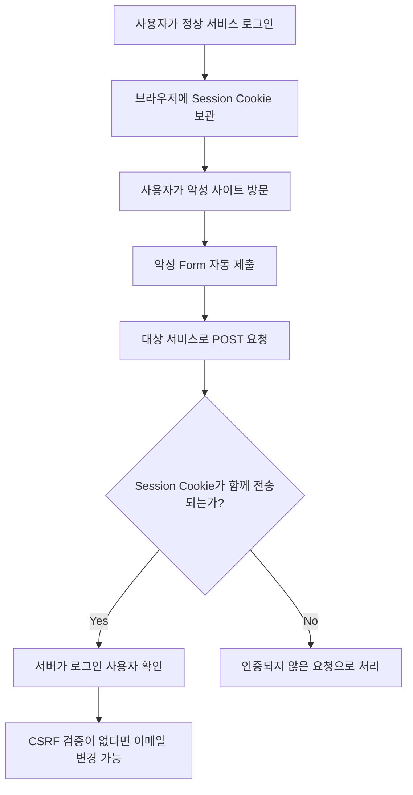
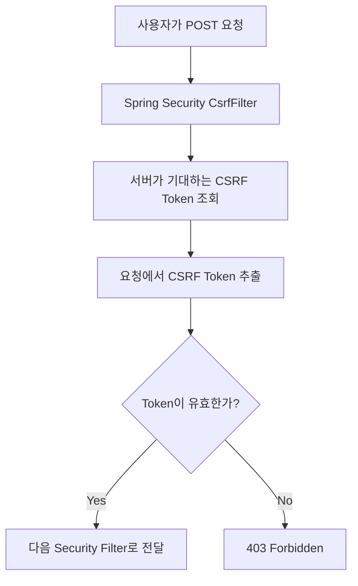
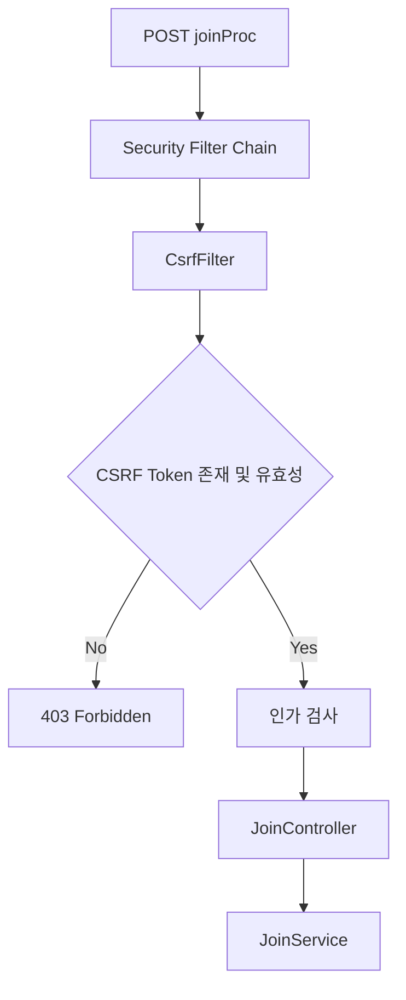
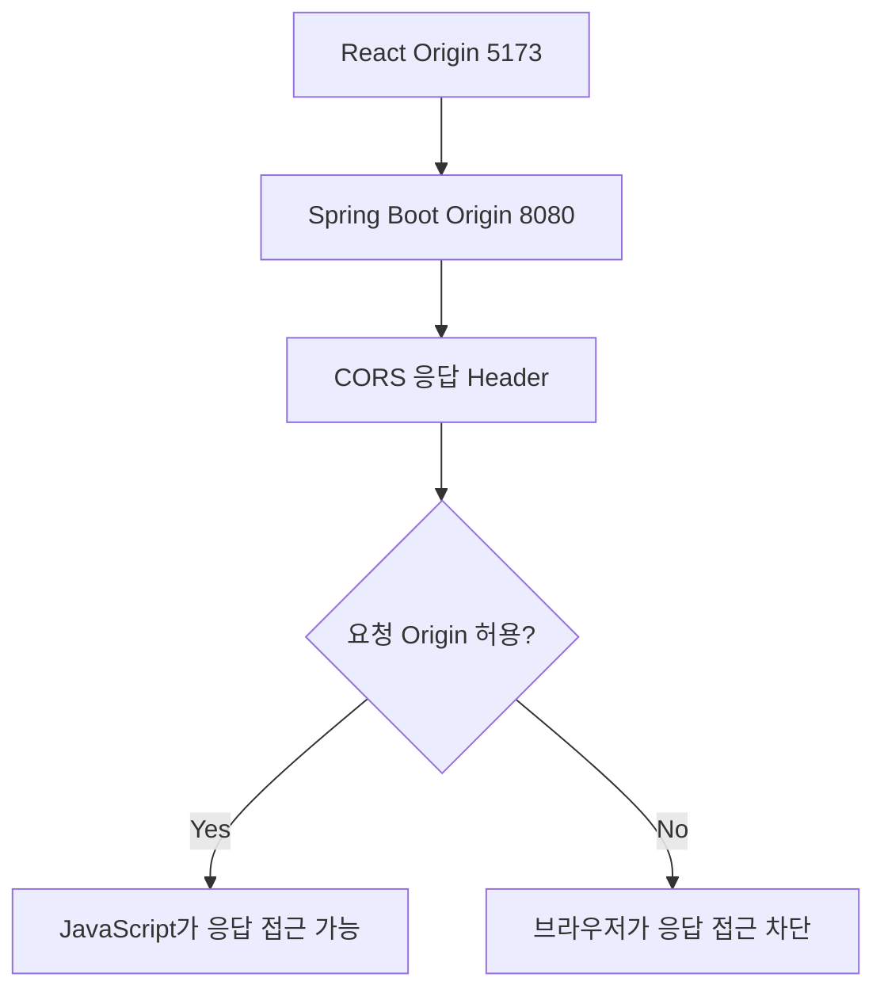
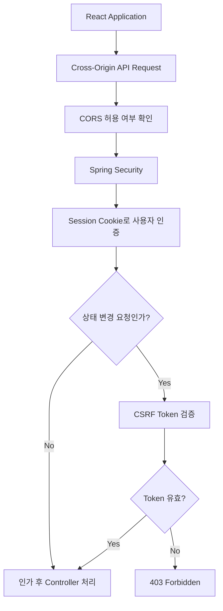

# 스프링 시큐리티 6 - 11. csrf enable 설정 방법
[https://youtu.be/l8xjecnAzMw?si=7xm60YH2Bp-nCf_j](https://youtu.be/l8xjecnAzMw?si=7xm60YH2Bp-nCf_j)

# 스프링 시큐리티 6 - 11. csrf enable 설정 방법
* toc
{:toc}

---

## Spring Security CSRF와 CORS 완벽 이해: 공격 원리부터 Spring Boot 설정까지

Spring Security를 적용하다 보면 CSRF와 CORS라는 용어를 자주 만나게 된다.

두 개념은 이름도 비슷하고, 모두 브라우저에서 발생하는 보안 문제와 관련되어 있어 혼동하기 쉽다.

실제로 Spring Security 프로젝트를 개발하다 보면 다음과 같은 상황을 경험하게 된다.

로그인 Form을 만들어 POST 요청을 보냈는데 갑자기 `403 Forbidden`이 발생한다.

```text
POST /loginProc

403 Forbidden
```

Spring Security 설정에서 CSRF를 비활성화하면 로그인이 정상적으로 동작한다.

```java
.csrf(csrf -> csrf.disable())
```

반면 React와 Spring Boot를 연동할 때는 브라우저에서 다음과 같은 오류가 발생한다.

```text
Access to fetch has been blocked by CORS policy
```

두 상황 모두 브라우저에서 서버로 요청하는 과정에서 발생하지만 원인은 완전히 다르다.

**CSRF는 사용자의 인증 정보를 악용하여 원하지 않는 요청을 실행시키는 공격이다.**

**CORS는 서로 다른 출처의 웹 애플리케이션이 서버 응답에 접근할 수 있는지를 브라우저가 판단하는 정책이다.**

이 차이를 먼저 이해하면 두 개념을 구분하기가 훨씬 쉬워진다.

---

## CSRF와 CORS의 핵심 차이

먼저 두 개념을 비교해보자.

| 구분              | CSRF                        | CORS                              |
| --------------- | --------------------------- | --------------------------------- |
| 정식 명칭           | Cross-Site Request Forgery  | Cross-Origin Resource Sharing     |
| 의미              | 사이트 간 요청 위조                 | 교차 출처 리소스 공유                      |
| 핵심 문제           | 사용자가 의도하지 않은 요청 실행          | 다른 출처의 JavaScript가 응답에 접근할 수 있는가  |
| 주된 관심 대상        | 인증된 사용자의 상태 변경 요청           | 브라우저의 Cross-Origin 요청             |
| 관련 기술           | Session, Cookie, CSRF Token | Origin, SOP, HTTP Header          |
| Spring Security | `csrf()`                    | `cors()`                          |
| 대표적인 상황         | 다른 사이트가 사용자의 권한으로 회원 정보를 변경 | React에서 다른 포트의 Spring Boot API 호출 |

여기서 기억해야 할 문장이 있다.

> CSRF는 사용자의 권한으로 요청을 실행하는 문제이고, CORS는 다른 출처의 JavaScript가 응답을 읽을 수 있는지의 문제다.

예를 들어 사용자가 A 사이트에 로그인한 상태에서 B 사이트를 방문했다고 생각해보자.

B 사이트가 사용자의 브라우저를 이용해 A 사이트에 원하지 않는 요청을 보내는 것이 CSRF 공격의 대표적인 형태다.

반면 B 사이트의 JavaScript가 A 사이트의 API를 호출하고 응답 데이터를 읽으려고 할 때 브라우저가 적용하는 정책이 CORS다.

두 개념은 연결되어 있지만 같은 보안 기능은 아니다.

---

## CSRF란 무엇인가?

CSRF는 Cross-Site Request Forgery의 약자다.

직역하면 사이트 간 요청 위조라는 의미다.

사용자가 특정 서비스에 로그인되어 있다는 사실을 악용해 사용자가 의도하지 않은 요청을 서버로 보내도록 만드는 공격이다.

여기에서 가장 중요한 것은 **공격자가 사용자의 비밀번호를 몰라도 공격이 가능할 수 있다**는 점이다.

세션 기반 인증 구조를 생각해보자.

사용자가 로그인하면 서버는 세션을 생성하고 브라우저는 세션 식별자가 포함된 Cookie를 보관한다.

```text
로그인 요청
    ↓
Spring Security 인증 성공
    ↓
HTTP Session 생성
    ↓
Session ID 발급
    ↓
브라우저가 JSESSIONID Cookie 보관
```

이후 브라우저는 해당 Cookie가 전송되는 조건을 만족하는 요청에 자동으로 Cookie를 포함할 수 있다.

```http
GET /mypage HTTP/1.1
Host: service.example.com
Cookie: JSESSIONID=abc123
```

서버는 전달받은 Session ID를 통해 로그인 사용자를 확인한다.

```text
JSESSIONID
    ↓
HTTP Session 조회
    ↓
SecurityContext
    ↓
Authentication
    ↓
현재 로그인 사용자
```

이 구조 자체는 정상적인 세션 인증 방식이다.

문제는 Cookie가 브라우저에 의해 자동으로 전송될 수 있다는 점을 공격자가 악용할 수 있다는 것이다.

Cookie의 `SameSite` 정책 등 전송 조건을 만족한다면, 사용자가 의도하지 않은 사이트에서 시작한 요청에도 로그인 Cookie가 포함될 수 있다.

---

## CSRF 공격 예시 1: 회원 이메일 강제 변경

실제 공격이 어떻게 이루어지는지 살펴보자.

다음과 같은 서비스가 있다고 가정한다.

```text
https://service.example.com
```

사용자는 이 서비스에 로그인한 상태다.

서버에는 회원 이메일 변경 API가 존재한다.

```http
POST /account/email
```

정상적인 사용자는 마이페이지에서 이메일을 수정한다.

```text
기존 이메일
user@example.com

변경할 이메일
new@example.com
```

브라우저는 다음과 같은 요청을 보낸다.

```http
POST /account/email HTTP/1.1
Host: service.example.com
Cookie: JSESSIONID=abc123
Content-Type: application/x-www-form-urlencoded

email=new@example.com
```

서버는 Session을 확인하고 현재 로그인 사용자의 이메일을 변경한다.

문제는 이 요청이 정말 사용자가 의도한 요청인지 확인하지 않는 경우다.

### 공격자가 악성 사이트를 만든다면

공격자는 별도의 사이트를 운영하고 있다고 가정하자.

```text
https://evil.example.net
```

해당 사이트에는 다음과 같은 Form을 넣을 수 있다.

```html
<!DOCTYPE html>
<html lang="ko">
<body>

<form
    id="attackForm"
    action="https://service.example.com/account/email"
    method="post"
>
    <input
        type="hidden"
        name="email"
        value="attacker@example.net"
    >
</form>

<script>
    document.getElementById("attackForm").submit();
</script>

</body>
</html>
```

이 코드를 실행하면 사용자가 직접 이메일 변경 버튼을 누르지 않아도 브라우저가 대상 서버로 POST 요청을 시도한다.

```text
POST /account/email

email=attacker@example.net
```

세션 Cookie가 함께 전송되는 조건이라면 서버에는 정상 로그인 사용자의 요청처럼 보일 수 있다.

공격자는 사용자의 아이디와 비밀번호를 몰라도 된다.

브라우저가 가지고 있는 인증 상태를 이용하는 것이다.

### 공격 흐름



여기서 공격자가 원하는 것은 응답 데이터를 읽는 것이 아니다.

**서버가 이메일 변경이라는 작업을 실행하도록 만드는 것 자체가 목적이다.**

이 점이 CSRF를 이해하는 핵심이다.

다만 오늘날 브라우저에서는 `SameSite=Lax`나 `SameSite=Strict` 같은 Cookie 정책이 일부 Cross-Site 요청을 차단할 수 있다. 따라서 위 공격이 언제나 성공하는 것은 아니며, Cookie 설정과 브라우저 환경에 따라 결과가 달라진다.

---

## CSRF 공격 예시 2: GET 요청으로 데이터를 삭제하는 경우

이번에는 조금 다른 상황을 생각해보자.

게시글 삭제 API를 다음처럼 구현했다고 가정한다.

```http
GET /posts/100/delete
```

게시글을 삭제하는 작업인데 GET 요청을 사용하고 있다.

공격자는 다른 웹사이트에 다음 코드를 작성할 수 있다.

```html

```

브라우저는 이미지 주소에 접근하려고 GET 요청을 보낸다.

```text
GET /posts/100/delete
```

만약 대상 서버가 이 GET 요청으로 실제 게시글을 삭제한다면 사용자가 버튼을 누르지 않았는데도 삭제가 수행될 가능성이 있다.

이 때문에 HTTP 메서드의 의미를 지키는 것이 중요하다.

| HTTP Method | 일반적인 용도     | 데이터 변경     |
| ----------- | ----------- | ---------- |
| GET         | 조회          | 변경하지 않아야 함 |
| HEAD        | 응답 메타데이터 조회 | 변경하지 않아야 함 |
| OPTIONS     | 통신 옵션 확인    | 변경하지 않아야 함 |
| POST        | 생성 및 처리     | 변경 가능      |
| PUT         | 리소스 갱신      | 변경 가능      |
| PATCH       | 리소스 일부 수정   | 변경 가능      |
| DELETE      | 리소스 삭제      | 변경 가능      |

Spring Security의 기본 CSRF 보호는 일반적으로 GET, HEAD, OPTIONS, TRACE를 보호 대상에서 제외하고 POST, PUT, PATCH, DELETE 같은 상태 변경 요청을 검사한다.

따라서 **GET 요청으로 중요한 데이터를 변경하는 API를 만들면 CSRF 보호 정책의 전제를 깨뜨릴 수 있다.**

---

## CSRF 공격이 가능한 근본적인 이유

CSRF가 성립하는 이유를 조금 더 깊이 살펴보자.

세션 기반 인증에서는 브라우저가 Cookie를 관리한다.

```text
사용자
    ↓
정상 로그인
    ↓
JSESSIONID 보관
```

이후 서버에 요청이 들어오면 서버는 Cookie를 확인한다.

```text
HTTP Request

Cookie: JSESSIONID=abc123
```

서버는 이 Session ID를 이용해 사용자가 누구인지 알 수 있다.

하지만 여기에는 한 가지 정보가 빠져 있다.

```text
이 요청이 로그인 사용자가 실제로 의도한 요청인가?
```

Cookie만으로는 이를 판단하기 어렵다.

즉 다음 둘은 구분해야 한다.

```text
인증된 사용자로부터 발생한 요청
```

```text
인증된 사용자가 의도한 요청
```

두 문장은 같은 의미가 아니다.

CSRF 공격은 바로 이 차이를 이용한다.

---

## CSRF Token이 필요한 이유

이 문제를 해결하기 위해 사용하는 대표적인 방법이 CSRF Token이다.

CSRF Token은 서버가 생성한 예측하기 어려운 값을 정상적인 웹페이지에 제공하고, 상태 변경 요청 시 해당 값을 다시 제출하도록 하는 방식이다.

전체 구조는 다음과 같다.

```text
서버

CSRF Token 생성
    ↓
정상 로그인 Form에 포함
    ↓
브라우저에 전달
    ↓
사용자가 Form 제출
    ↓
CSRF Token 함께 전송
    ↓
서버가 검증
```

예를 들어 서버에 다음 Token이 있다고 가정하자.

```text
CSRF Token = random-token-123
```

정상적인 Form에서는 이를 함께 전달한다.

```http
POST /account/email HTTP/1.1
Content-Type: application/x-www-form-urlencoded

email=new@example.com&_csrf=random-token-123
```

서버는 요청에 포함된 Token을 검증한다.

```text
서버가 기대하는 CSRF Token
random-token-123
```

```text
요청에 포함된 CSRF Token
random-token-123
```

서로 일치한다면 요청을 계속 처리할 수 있다.

반면 공격자가 만든 사이트에서는 정상 서비스에서 발급한 Token을 알기 어렵다.

브라우저의 Same-Origin Policy 때문에 공격 사이트의 JavaScript가 정상 서비스의 응답이나 DOM을 마음대로 읽을 수 없기 때문이다.

따라서 공격자가 요청을 보내더라도 유효한 CSRF Token을 함께 제출하지 못하도록 만드는 것이다.

OWASP에서도 세션 기반 애플리케이션의 대표적인 CSRF 방어 방법으로 Synchronizer Token Pattern을 설명한다.

---

## CSRF Token 검증 흐름



여기서 중요한 점은 요청에 Token이 존재하는지만 검사하는 것이 아니라는 것이다.

다음처럼 아무 값이나 보낸다고 통과하지 않는다.

```http
X-CSRF-TOKEN: hello
```

서버가 기대하는 값과 요청에 포함된 값이 유효하게 대응해야 한다.

---

## Spring Security의 CSRF 기본 동작

Spring Security의 Servlet 기반 보안 설정에서는 CSRF 보호가 기본적으로 활성화되어 있다.

다음처럼 직접 명시할 수도 있다.

```java
http
    .csrf(Customizer.withDefaults());
```

하지만 특별히 비활성화하지 않았다면 기본 CSRF 보호가 적용되므로 반드시 위 설정을 작성해야 하는 것은 아니다.

반대로 다음과 같이 작성하면 보호가 비활성화된다.

```java
http
    .csrf(csrf -> csrf.disable());
```

Spring Security는 기본적으로 POST 같은 Unsafe HTTP Method에 CSRF 보호를 적용한다.

---

## CsrfFilter는 무엇을 할까?

Spring Security 내부에는 CSRF 요청 검증을 담당하는 `CsrfFilter`가 존재한다.

이 Filter는 요청이 들어왔을 때 해당 요청에 CSRF 검증이 필요한지 판단한다.

예를 들어:

```http
GET /login
```

요청은 일반적으로 CSRF Token 검증 대상이 아니다.

반면:

```http
POST /loginProc
```

요청은 검증 대상이다.

```text
GET /login
    ↓
CSRF Token 검증 없이 진행
```

```text
POST /loginProc
    ↓
CSRF Token 검증
    ↓
정상일 때 인증 처리
```

`CsrfFilter`가 검증에 실패하면 다음 인증 처리 단계로 요청을 넘기지 않는다.

따라서 `UsernamePasswordAuthenticationFilter`가 아이디와 비밀번호를 확인하기도 전에 요청이 거부될 수 있다.

Spring Security의 공식 처리 구조에서도 `CsrfFilter`가 Token을 조회하고 제출된 값을 비교한 뒤, 누락되거나 유효하지 않으면 접근 거부 처리를 수행한다.

---

## CSRF를 활성화했더니 로그인이 안 되는 이유

이전까지 로그인 Form은 다음과 같았다.

```html
<form action="/loginProc" method="post">

    <input
        type="text"
        name="username"
    >

    <input
        type="password"
        name="password"
    >

    <button type="submit">
        로그인
    </button>

</form>
```

이 Form에는 username과 password만 존재한다.

```text
username
password
```

하지만 CSRF 보호가 활성화되면 서버는 다음 값도 요구한다.

```text
_csrf
```

따라서 로그인 요청은 다음처럼 처리된다.

```text
POST /loginProc
    ↓
CsrfFilter
    ↓
CSRF Token 없음
    ↓
403 Forbidden
```

로그인 비밀번호가 틀린 것도 아니고, `UserDetailsService`의 조회가 실패한 것도 아니다.

로그인 인증을 수행하기 전에 보안 Filter에서 요청이 거부된 것이다.

---

## Mustache 로그인 Form에 CSRF Token 추가하기

현재 프로젝트는 Mustache를 사용한다.

Mustache에서 CSRF Token을 전송하려면 Hidden Input을 사용할 수 있다.

```html
<form action="/loginProc" method="post">

    <input
        type="hidden"
        name="_csrf"
        value="{{csrfToken}}"
    >

    <input
        type="text"
        name="username"
    >

    <input
        type="password"
        name="password"
    >

    <button type="submit">
        로그인
    </button>

</form>
```

핵심은 다음 코드다.

```html
<input
    type="hidden"
    name="_csrf"
    value="{{csrfToken}}"
>
```

하지만 여기서 한 가지 문제가 있다.

Mustache가 `{{csrfToken}}`이라는 값을 자동으로 만들어주는 것은 아니다.

Spring Security가 제공하는 CSRF Token을 Mustache가 사용할 수 있도록 연결해야 한다.

---

## Spring Security가 CSRF Token을 제공하는 방식

Spring Security는 기본적으로 `CsrfToken`을 HTTP Request Attribute로 노출한다.

대표적인 Attribute 이름은 다음과 같다.

```text
_csrf
```

이 Attribute는 다음 정보를 제공한다.

| 속성              | 의미                |
| --------------- | ----------------- |
| `parameterName` | Form Parameter 이름 |
| `headerName`    | HTTP Header 이름    |
| `token`         | 제출할 CSRF Token    |

예를 들어:

```text
parameterName = _csrf

headerName = X-CSRF-TOKEN

token = ...
```

과 같은 정보를 활용할 수 있다.

Spring Security는 기본적으로 `HttpSessionCsrfTokenRepository`를 사용하며, `CsrfToken`을 Request Attribute로 노출한다. Spring Security 6 이후에는 지연 로딩과 BREACH 방어를 위한 Token 처리도 기본 구조에 포함된다.

---

## 방법 1. Mustache에서 Request Attribute 노출하기

Spring Boot에서는 다음 설정을 사용할 수 있다.

```properties
spring.mustache.servlet.expose-request-attributes=true
```

이 설정은 Servlet Request Attribute를 Mustache Model에 노출하도록 한다.

Spring Boot의 공식 설정에서도 해당 속성을 제공하며 기본값은 `false`다.

이를 설정하면 Mustache에서 다음과 같이 접근할 수 있다.

```html
<input
    type="hidden"
    name="{{_csrf.parameterName}}"
    value="{{_csrf.token}}"
>
```

실제로 렌더링된 HTML은 다음과 유사한 형태가 된다.

```html
<input
    type="hidden"
    name="_csrf"
    value="generated-csrf-token"
>
```

이제 로그인 버튼을 누르면 CSRF Token도 함께 제출된다.

```text
username
password
_csrf
```

다만 이 설정은 CSRF Token만 노출하는 것이 아니라 Request Attribute 전반을 Model에 노출한다.

따라서 필요한 데이터만 명시적으로 전달하고 싶다면 Controller에서 처리하는 방법도 있다.

---

## 방법 2. Controller에서 CSRF Token을 Model에 전달하기

LoginController에서 직접 CSRF Token을 가져올 수도 있다.

```java
package com.example.security.controller;

import jakarta.servlet.http.HttpServletRequest;
import org.springframework.security.web.csrf.CsrfToken;
import org.springframework.stereotype.Controller;
import org.springframework.ui.Model;
import org.springframework.web.bind.annotation.GetMapping;

@Controller
public class LoginController {

    @GetMapping("/login")
    public String login(
            HttpServletRequest request,
            Model model
    ) {

        CsrfToken csrfToken =
                (CsrfToken) request.getAttribute("_csrf");

        model.addAttribute(
                "csrfParameterName",
                csrfToken.getParameterName()
        );

        model.addAttribute(
                "csrfToken",
                csrfToken.getToken()
        );

        return "login";
    }
}
```

이제 Mustache에서 다음처럼 사용한다.

```html
<form action="/loginProc" method="post">

    <input
        type="hidden"
        name="{{csrfParameterName}}"
        value="{{csrfToken}}"
    >

    <input
        type="text"
        name="username"
        placeholder="아이디"
    >

    <input
        type="password"
        name="password"
        placeholder="비밀번호"
    >

    <button type="submit">
        로그인
    </button>

</form>
```

Controller에서 Model로 전달한 값이 Mustache에서 사용된다.

```text
Spring Security
    ↓
CsrfToken
    ↓
LoginController
    ↓
Model
    ↓
login.mustache
```

이 방식은 View에 필요한 값을 명시적으로 전달한다는 장점이 있다.

---

## 회원가입 Form에도 CSRF Token이 필요하다

여기서 놓치기 쉬운 부분이 있다.

로그인 Form에만 CSRF Token을 넣으면 회원가입 기능이 다시 동작하지 않을 수 있다.

이전에 회원가입은 다음 요청을 사용했다.

```http
POST /joinProc
```

이 역시 POST 요청이므로 기본 CSRF 검증 대상이다.

따라서 회원가입 Form에도 Token을 추가해야 한다.

```html
<form action="/joinProc" method="post">

    <input
        type="hidden"
        name="{{csrfParameterName}}"
        value="{{csrfToken}}"
    >

    <input
        type="text"
        name="username"
        placeholder="아이디"
    >

    <input
        type="password"
        name="password"
        placeholder="비밀번호"
    >

    <button type="submit">
        회원가입
    </button>

</form>
```

그리고 `/join` 화면을 렌더링하는 Controller에서도 로그인 화면과 동일한 방식으로 CSRF Token을 Model에 전달하면 된다.

정리하면:

```text
POST /loginProc
→ CSRF Token 필요

POST /joinProc
→ CSRF Token 필요

POST /logout
→ CSRF Token 필요
```

이다.

---

## CSRF Token은 매 요청마다 새로 생성되는가?

여기서 조금 더 깊게 알아두면 좋은 부분이 있다.

Spring Security의 기본적인 세션 기반 CSRF 보호에서는 기대하는 Token을 Session에 저장한다.

그런데 Spring Security 6 이후에는 BREACH 공격에 대한 방어를 위해 브라우저에 노출되는 Token 값에 요청별 무작위성을 추가하는 처리가 기본적으로 적용된다.

따라서 화면에 렌더링된 Token 문자열이 요청마다 달라 보인다고 해서 반드시 서버의 Session에 저장된 원본 Token이 매번 교체된다는 뜻은 아니다.

개념적으로 다음 둘을 구분해야 한다.

```text
서버에 저장된 기대 Token

        ↓

요청에 노출할 Token 표현

        ↓

브라우저

        ↓

서버가 Token을 해석하고 검증
```

이때 사용되는 대표적인 처리기가 `XorCsrfTokenRequestAttributeHandler`다.

이는 단순한 회원가입 구현에서는 직접 설정할 일이 많지 않지만, React 같은 SPA에서 Cookie 기반 CSRF Token을 사용하거나 Spring Security 버전을 올릴 때 중요한 차이가 될 수 있다.

---

## Ajax 요청에서는 CSRF Token을 어떻게 전달할까?

HTML Form을 이용하면 Hidden Input에 Token을 넣을 수 있다.

하지만 JavaScript의 `fetch()`나 Axios를 사용한다면 다른 방법이 필요하다.

일반적으로 HTTP Header에 CSRF Token을 포함한다.

예를 들어 다음 API가 있다고 하자.

```http
POST /api/posts
```

요청 본문은 JSON이다.

```json
{
  "title": "게시글 제목",
  "content": "게시글 내용"
}
```

CSRF 보호가 활성화되어 있다면 HTTP Header에도 Token을 넣는다.

```http
POST /api/posts HTTP/1.1
Content-Type: application/json
X-CSRF-TOKEN: generated-csrf-token
Cookie: JSESSIONID=abc123
```

Spring Security에서 일반적인 세션 기반 Token Repository를 사용할 때 `X-CSRF-TOKEN` Header를 이용할 수 있다.

---

## fetch에서 CSRF Token 전달하기

서버에서 렌더링하는 HTML의 `<head>`에 다음 값을 넣었다고 가정하자.

```html
<meta
    name="_csrf"
    content="{{csrfToken}}"
>

<meta
    name="_csrf_header"
    content="{{csrfHeaderName}}"
>
```

Controller에서는 다음 값도 전달한다.

```java
model.addAttribute(
        "csrfHeaderName",
        csrfToken.getHeaderName()
);
```

JavaScript에서는 다음과 같이 요청할 수 있다.

```javascript
const csrfToken = document.querySelector(
    'meta[name="_csrf"]'
).content;

const csrfHeaderName = document.querySelector(
    'meta[name="_csrf_header"]'
).content;

async function createPost() {
    const response = await fetch("/api/posts", {
        method: "POST",

        credentials: "same-origin",

        headers: {
            "Content-Type": "application/json",
            [csrfHeaderName]: csrfToken
        },

        body: JSON.stringify({
            title: "게시글 제목",
            content: "게시글 내용"
        })
    });

    if (!response.ok) {
        throw new Error("게시글 저장 실패");
    }
}
```

이 방식은 **동일 Origin에서 제공되는 서버 렌더링 화면**을 전제로 한다.

JavaScript는 서버가 HTML에 넣어준 CSRF Token을 읽고 HTTP Header에 포함한다.

```text
서버 렌더링 HTML
    ↓
CSRF Token 포함
    ↓
JavaScript
    ↓
X-CSRF-TOKEN Header
    ↓
POST 요청
    ↓
CsrfFilter 검증
```

중요한 것은 Token을 Header에 넣었다는 사실 자체가 아니라 **서버가 발급한 유효한 Token을 정확히 전달했는가**다.

---

## CookieCsrfTokenRepository는 언제 사용할까?

Spring Security는 기본적으로 세션에 CSRF Token을 저장하는 `HttpSessionCsrfTokenRepository`를 사용한다.

그 외에도 다음 구현체를 제공한다.

```java
CookieCsrfTokenRepository
```

이 방식은 CSRF Token을 Cookie에 저장한다.

대표적인 이름은 다음과 같다.

```text
Cookie
XSRF-TOKEN
```

그리고 요청에서는 다음 Header를 사용할 수 있다.

```http
X-XSRF-TOKEN: ...
```

일부 JavaScript 프레임워크에서는 Cookie에서 Token을 읽어 Header에 자동으로 추가하는 기능을 제공한다.

다만 Spring Security 6 이후에는 SPA의 CSRF Token 처리에서 지연 로딩과 BREACH 보호, 로그인·로그아웃 이후 Token 갱신을 함께 고려해야 한다.

따라서 **`CookieCsrfTokenRepository.withHttpOnlyFalse()`만 설정하면 모든 SPA에서 바로 동작한다고 생각해서는 안 된다.** Spring Security 공식 문서도 SPA를 위한 별도 Request Handler 구성을 안내하고 있다.

---

## CSRF를 활성화하면 로그아웃은 왜 POST로 처리할까?

Spring Security에서 CSRF 보호가 활성화되어 있다면 기본 로그아웃 처리는 POST 요청으로 수행된다.

이유는 로그아웃 역시 사용자 상태를 변경하는 작업이기 때문이다.

만약 다음 요청만으로 로그아웃이 진행된다면:

```http
GET /logout
```

공격자는 악성 사이트에 다음 코드를 넣을 수 있다.

```html

```

사용자가 악성 사이트를 방문했을 때 의도하지 않은 로그아웃이 발생할 가능성이 있다.

따라서 로그아웃도 상태 변경 요청으로 처리하는 것이 좋다.

```http
POST /logout
```

그리고 CSRF Token을 포함한다.

---

## 안전한 로그아웃 Form 만들기

Mustache에서는 다음과 같이 작성할 수 있다.

```html
<form action="/logout" method="post">

    <input
        type="hidden"
        name="{{csrfParameterName}}"
        value="{{csrfToken}}"
    >

    <button type="submit">
        로그아웃
    </button>

</form>
```

이렇게 하면 다음 흐름으로 로그아웃이 처리된다.

```text
로그아웃 버튼 클릭
    ↓
POST /logout
    ↓
CsrfFilter
    ↓
Token 검증
    ↓
LogoutFilter
    ↓
로그아웃 처리
```

일반적인 경우에는 GET 로그아웃을 직접 구현하기보다 Spring Security가 제공하는 POST 로그아웃을 사용하는 것이 적절하다.

참고로 기본 로그아웃 화면 생성 기능이 활성화된 환경에서는 `GET /logout`이 확인 화면을 보여줄 수도 있지만, 실제 로그아웃 처리는 POST 요청으로 수행하는 구조다.

---

## CSRF를 활성화한 SecurityConfig

지금까지의 Spring Security 설정을 다시 구성해보자.

```java
package com.example.security.config;

import org.springframework.context.annotation.Bean;
import org.springframework.context.annotation.Configuration;
import org.springframework.security.config.annotation.web.builders.HttpSecurity;
import org.springframework.security.config.Customizer;
import org.springframework.security.web.SecurityFilterChain;

@Configuration
public class SecurityConfig {

    @Bean
    public SecurityFilterChain securityFilterChain(
            HttpSecurity http
    ) throws Exception {

        http
            .authorizeHttpRequests(auth -> auth
                .requestMatchers(
                    "/",
                    "/login",
                    "/join",
                    "/joinProc"
                ).permitAll()

                .requestMatchers("/admin/**")
                .hasRole("ADMIN")

                .anyRequest()
                .authenticated()
            )

            .formLogin(form -> form
                .loginPage("/login")
                .loginProcessingUrl("/loginProc")
                .permitAll()
            )

            .logout(logout -> logout
                .logoutUrl("/logout")
                .logoutSuccessUrl("/login?logout")
                .permitAll()
            )

            .csrf(Customizer.withDefaults());

        return http.build();
    }
}
```

이제 CSRF 보호는 활성화된 상태다.

```java
.csrf(Customizer.withDefaults())
```

위 코드는 기본 설정을 명시적으로 표현한 것이다.

특별한 사용자 정의 설정이 없다면 생략해도 기본 CSRF 보호가 적용된다.

---

## permitAll이면 CSRF 검증도 통과하는 것일까?

이 부분은 특히 헷갈리기 쉽다.

다음 설정을 보자.

```java
.requestMatchers(
    "/login",
    "/join",
    "/joinProc"
).permitAll()
```

`permitAll()`은 인증하지 않은 사용자도 해당 URL에 접근할 수 있도록 허용한다는 의미다.

그런데:

```http
POST /joinProc
```

요청에 CSRF Token이 없다면 어떻게 될까?

결과는 여전히 `403 Forbidden`이 될 수 있다.

왜냐하면 `permitAll()`과 CSRF 검증은 서로 다른 역할을 하기 때문이다.

```text
permitAll
→ 사용자 인증 없이 접근 가능한가?
```

```text
CSRF
→ 상태 변경 요청에 유효한 Token이 있는가?
```

따라서 다음 두 조건을 동시에 만족해야 한다.

```text
회원가입 URL 접근 허용
        +
유효한 CSRF Token
```

이렇게 이해하면 된다.

---

## CSRF Token이 없을 때 발생하는 403 분석

다음 요청을 생각해보자.

```http
POST /joinProc HTTP/1.1
Content-Type: application/x-www-form-urlencoded

username=user01&password=password1234
```

CSRF Token이 없다.

Spring Security는 다음 흐름으로 처리한다.



중요한 것은 Controller의 메서드가 아예 호출되지 않을 수 있다는 점이다.

따라서 CSRF 관련 오류를 찾을 때는 Controller에 Breakpoint를 거는 것뿐만 아니라 Spring Security Filter 단계도 함께 확인해야 한다.

---

## CSRF 테스트 방법

브라우저 개발자 도구에서 Network 탭을 열고 요청을 확인하면 된다.

먼저 로그인 화면에 접근한다.

```text
GET /login
```

HTML에 Hidden Input이 있는지 확인한다.

```html
<input
    type="hidden"
    name="_csrf"
    value="..."
>
```

로그인 버튼을 누른 뒤 POST 요청의 Form Data를 확인한다.

정상이라면 다음 값이 포함된다.

```text
username
password
_csrf
```

여기에서 `_csrf` 값을 제거한 뒤 요청하면 CSRF 검증 오류가 발생하는지 확인할 수 있다.

일반적인 기본 설정에서는 유효하지 않은 CSRF Token에 대해 403 응답을 반환한다.

---

## Spring Security 테스트 코드에서 CSRF 검증하기

Spring Security Test를 사용하면 CSRF 검증을 자동화할 수 있다.

예를 들어 다음 의존성을 사용할 수 있다.

```gradle
testImplementation 'org.springframework.security:spring-security-test'
```

CSRF Token을 포함한 요청은 다음과 같이 작성한다.

```java
mockMvc.perform(
        post("/joinProc")
            .with(csrf())
            .param("username", "user01")
            .param("password", "password1234")
    )
    .andExpect(status().is3xxRedirection());
```

반대로 Token을 포함하지 않은 요청을 검증할 수 있다.

```java
mockMvc.perform(
        post("/joinProc")
            .param("username", "user01")
            .param("password", "password1234")
    )
    .andExpect(status().isForbidden());
```

첫 번째 테스트는 회원가입 관련 의존성과 테스트 데이터가 정상적으로 준비되어 있다는 전제에서 실행한다.

두 번째 테스트는 CSRF 보호가 활성화된 Security Filter Chain에서 Token이 없는 POST 요청이 차단되는지 확인하는 용도다.

---

## JWT를 사용하면 CSRF를 비활성화해도 될까?

이 부분도 정확하게 구분해야 한다.

흔히 다음과 같이 설명하는 경우가 있다.

```text
JWT 사용
→ Stateless
→ CSRF 필요 없음
```

하지만 이것은 항상 맞는 설명이 아니다.

중요한 것은 JWT 사용 여부 자체가 아니다.

**브라우저가 인증 정보를 자동으로 전송하는 구조인지**가 핵심이다.

예를 들어 두 가지 인증 구조를 비교해보자.

### JWT를 Authorization Header에 담는 방식

클라이언트가 Token을 직접 관리하고 다음처럼 요청한다고 가정하자.

```http
GET /api/users/me HTTP/1.1
Authorization: Bearer eyJhbGciOi...
```

JavaScript가 Token을 읽어 Authorization Header에 넣는 구조라면 다른 사이트가 임의의 Form을 제출하는 것만으로 해당 Bearer Token을 자동 첨부하기는 어렵다.

따라서 전통적인 Cookie 기반 CSRF 공격 위험은 상대적으로 낮다.

다만 이 구조에서는 XSS로 Token을 탈취당하는 등 다른 보안 문제를 고려해야 한다.

### JWT를 Cookie에 저장하는 방식

반면 JWT를 다음과 같이 Cookie에 저장한다고 가정하자.

```http
Cookie: access_token=eyJhbGciOi...
```

브라우저가 해당 Cookie를 자동 전송하는 구조라면 상황이 달라진다.

다른 사이트에서 발생한 요청에도 Cookie가 함께 전송되는 조건이 존재할 수 있다.

따라서 JWT를 사용하더라도 CSRF 공격 가능성을 검토해야 한다.

| 인증 방식                                         | CSRF 고려                        |
| --------------------------------------------- | ------------------------------ |
| HTTP Session + Cookie                         | 일반적으로 필요                       |
| JWT + Cookie 자동 전송                            | 필요할 수 있음                       |
| JWT + JavaScript가 Authorization Header에 직접 추가 | 전통적인 CSRF 위험은 상대적으로 낮음         |
| 모바일 앱의 명시적 Bearer Token 전송                    | 브라우저 Cookie 기반 CSRF와 위험 모델이 다름 |

결론적으로 **JWT라는 기술 자체가 CSRF를 막아주는 것은 아니다.**

---

# CORS 이해하기

## CORS란 무엇인가?

이번에는 CORS를 살펴보자.

CORS는 Cross-Origin Resource Sharing의 약자다.

서로 다른 Origin 사이에서 브라우저의 JavaScript가 리소스 응답에 접근할 수 있도록 서버가 허용 범위를 알려주는 메커니즘이다.

예를 들어 React와 Spring Boot를 분리해서 개발한다고 가정하자.

```text
React
http://localhost:5173
```

```text
Spring Boot
http://localhost:8080
```

React에서 다음 요청을 보낸다.

```javascript
fetch("http://localhost:8080/api/users");
```

브라우저는 이를 서로 다른 Origin 사이의 요청으로 판단한다.

왜냐하면 Port가 다르기 때문이다.

따라서 서버가 해당 Origin을 허용하지 않으면 브라우저에서 CORS 오류가 발생할 수 있다.

---

## Origin이란 무엇인가?

CORS를 이해하려면 먼저 Origin의 의미를 알아야 한다.

Origin은 다음 세 가지 조합으로 결정된다.

```text
Protocol
+
Hostname
+
Port
```

예를 들어 다음 주소가 있다고 하자.

```text
https://example.com:443
```

구성은 다음과 같다.

```text
Protocol
→ https

Hostname
→ example.com

Port
→ 443
```

세 요소가 같아야 Same-Origin이다.

다음 표를 보자.

| A                       | B                           | Same-Origin |
| ----------------------- | --------------------------- | ----------- |
| `https://example.com`   | `https://example.com/users` | O           |
| `https://example.com`   | `http://example.com`        | X           |
| `https://example.com`   | `https://api.example.com`   | X           |
| `http://localhost:8080` | `http://localhost:5173`     | X           |
| `https://example.com`   | `https://example.com:443`   | O           |

마지막 예시에서 HTTPS의 기본 Port는 443이므로 같은 Origin으로 취급된다.

---

## Same-Origin Policy란?

브라우저에는 Same-Origin Policy, 줄여서 SOP라는 보안 정책이 있다.

기본적으로 한 Origin의 JavaScript가 다른 Origin의 응답 데이터를 자유롭게 읽지 못하도록 제한한다.

예를 들어 공격자가 운영하는 사이트가 있다고 가정하자.

```text
https://evil.example.net
```

공격자는 JavaScript에서 다음 요청을 실행하고 싶어 한다.

```javascript
fetch("https://bank.example.com/api/accounts/me");
```

만약 브라우저가 아무런 제한 없이 응답을 읽도록 허용한다면 어떤 문제가 생길까?

사용자가 은행에 로그인한 상태라면 공격 사이트의 JavaScript가 계좌 정보 같은 민감한 응답을 읽으려고 시도할 수 있다.

그래서 브라우저는 다른 Origin의 응답에 대한 JavaScript 접근을 기본적으로 제한한다.

```text
evil.example.net
    ↓
bank.example.com
    ↓
응답 데이터 접근 제한
```

이 정책을 완화하여 특정 Origin에만 응답 접근을 허용하는 메커니즘이 CORS다.

CORS는 서버와 브라우저가 HTTP Header를 통해 허용 여부를 결정하는 구조다.

---

## CORS 공격이라는 표현은 정확할까?

CSRF는 공격 기법의 이름이다.

하지만 CORS는 공격 이름이 아니다.

CORS는 브라우저에서 적용하는 보안 관련 통신 메커니즘이다.

따라서:

```text
CSRF 공격
```

이라는 표현은 자연스럽지만:

```text
CORS 공격
```

이라는 표현은 정확하지 않다.

실제로 문제가 되는 것은 **잘못된 CORS 설정 때문에 신뢰할 수 없는 Origin에서 민감한 응답에 접근할 수 있게 되는 상황**이다.

예를 들어 인증 Cookie를 사용하는 API 서버가 모든 Origin에 Credentials 접근을 허용하도록 잘못 설정하면 보안 문제가 발생할 수 있다.

이 때문에 CORS는 필요한 Origin만 명시적으로 허용하는 것이 중요하다.

---

## CORS는 브라우저가 적용하는 정책이다

여기서 중요한 점이 있다.

CORS는 서버가 무조건 요청을 받지 못하게 하는 기능이 아니다.

브라우저가 Cross-Origin 요청의 응답을 JavaScript에 노출할지 판단하는 메커니즘이다.

따라서 다음처럼 요청을 보내는 도구에서는 상황이 다르다.

```text
curl
Postman
Backend HTTP Client
```

이들은 브라우저의 Same-Origin Policy를 그대로 적용받지 않는다.

예를 들어 Postman에서는 API 호출이 성공하는데 브라우저에서는 CORS 오류가 발생할 수 있다.

이것은 이상한 일이 아니다.

서버 API 자체는 정상적으로 동작하지만 브라우저의 보안 정책에 의해 응답 접근이 제한되는 것일 수 있기 때문이다.

---

## CORS 요청 흐름

React와 Spring Boot가 다음처럼 분리되어 있다고 가정하자.

```text
Frontend
http://localhost:5173
```

```text
Backend
http://localhost:8080
```

React에서 다음 API를 호출한다.

```javascript
fetch("http://localhost:8080/api/users");
```

브라우저는 Request에 Origin 정보를 포함할 수 있다.

```http
GET /api/users HTTP/1.1
Host: localhost:8080
Origin: http://localhost:5173
```

서버가 해당 Origin을 허용한다면 다음과 같은 Header로 응답할 수 있다.

```http
HTTP/1.1 200 OK
Access-Control-Allow-Origin: http://localhost:5173
Content-Type: application/json
```

브라우저는 이 Header를 보고 JavaScript가 응답에 접근해도 되는지 판단한다.



---

## Preflight Request란?

CORS에서 자주 등장하는 개념이 Preflight Request다.

Preflight는 실제 요청을 보내기 전에 브라우저가 서버에 먼저 허용 여부를 확인하는 요청이다.

예를 들어 React에서 다음 요청을 보낸다고 하자.

```javascript
fetch("http://localhost:8080/api/posts", {
    method: "DELETE"
});
```

브라우저는 실제 DELETE 요청 전에 OPTIONS 요청을 보낼 수 있다.

```http
OPTIONS /api/posts HTTP/1.1
Host: localhost:8080
Origin: http://localhost:5173
Access-Control-Request-Method: DELETE
```

서버가 다음처럼 응답한다.

```http
HTTP/1.1 204 No Content
Access-Control-Allow-Origin: http://localhost:5173
Access-Control-Allow-Methods: GET, POST, DELETE, OPTIONS
```

브라우저는 허용 여부를 확인한 뒤 실제 DELETE 요청을 진행한다.

```text
OPTIONS
    ↓
허용 여부 확인
    ↓
DELETE
```

단, 모든 Cross-Origin 요청에 Preflight가 발생하는 것은 아니다.

브라우저가 정해진 조건을 만족하는 단순 요청에는 Preflight를 생략할 수 있다.

---

## 어떤 요청에서 Preflight가 발생할까?

대표적으로 다음과 같은 요청에서 발생할 수 있다.

```text
PUT
PATCH
DELETE
```

또는:

```http
Content-Type: application/json
```

같은 특정 Content-Type을 사용하거나, CORS 안전 목록에 없는 사용자 정의 Header를 전송하는 경우에도 Preflight가 발생할 수 있다.

예를 들어:

```javascript
fetch("http://localhost:8080/api/posts", {
    method: "POST",
    headers: {
        "Content-Type": "application/json"
    },
    body: JSON.stringify({
        title: "hello"
    })
});
```

이 요청은 Preflight 대상이 될 수 있다.

반면 다음과 같은 일반적인 HTML Form은 별도의 Preflight 없이 전송될 수 있다.

```html
<form
    action="https://service.example.com/account/email"
    method="post"
>
</form>
```

이 차이는 CSRF를 이해할 때도 중요하다.

---

## CORS가 있는데 왜 CSRF 공격을 막지 못할까?

가장 중요한 질문이다.

CORS는 다른 Origin에서 보낸 요청의 응답을 JavaScript가 읽는 것을 제한한다.

하지만 공격자가 원하는 것이 응답 읽기가 아니라 **서버에서 특정 작업을 실행하는 것**이라면 이야기가 달라진다.

앞에서 봤던 CSRF 공격을 다시 생각해보자.

공격 사이트에는 다음 Form이 있다.

```html
<form
    action="https://service.example.com/account/email"
    method="post"
>
    <input
        type="hidden"
        name="email"
        value="attacker@example.net"
    >
</form>
```

이런 일반적인 Form 제출은 Cross-Origin이라고 해서 무조건 차단되는 것이 아니다.

따라서 CORS 설정이 없더라도 브라우저가 Form 요청 자체를 전송할 수 있다.

서버에서 CSRF 검증을 하지 않고 인증 Cookie만 확인한다면 요청이 처리될 가능성이 있다.

공격자는 응답 본문을 읽지 못해도 목적을 달성할 수 있다.

```text
CSRF 공격자

응답 데이터를 읽고 싶다?
→ 꼭 그렇지는 않음

사용자의 권한으로 작업을 실행하고 싶다?
→ Yes
```

이것이 핵심이다.

MDN에서도 단순한 Cross-Origin 요청이 Preflight 없이 전송될 수 있는 이유 중 하나로 기존 HTML Form 제출 동작을 설명하며, 이런 요청에 대해서는 서버가 별도로 CSRF를 방어해야 한다고 안내한다.

---

## CORS와 CSRF를 같은 예제로 비교하기

다음 API가 있다고 하자.

```http
POST /account/email
```

공격자는 다른 사이트에서 요청을 보내려고 한다.

### CORS 관점

브라우저는 다음을 판단한다.

```text
다른 Origin의 JavaScript가
서버 응답을 읽을 수 있는가?
```

허용되지 않았다면 JavaScript의 응답 접근을 차단한다.

### CSRF 관점

서버는 다음을 확인해야 한다.

```text
이 상태 변경 요청에
유효한 CSRF Token이 존재하는가?
```

유효한 Token이 없다면 요청을 거부한다.

즉 두 정책은 검사하는 내용이 완전히 다르다.

| 질문                       | 담당               |
| ------------------------ | ---------------- |
| 다른 Origin이 응답을 읽을 수 있는가? | CORS             |
| 사용자가 의도한 상태 변경 요청인가?     | CSRF Token 등의 방어 |
| 요청한 사용자가 로그인되어 있는가?      | Authentication   |
| 해당 작업을 수행할 권한이 있는가?      | Authorization    |

이 네 가지는 서로 다른 문제다.

---

## Spring Security에서 CORS 설정하기

이제 Spring Boot에서 CORS를 설정해보자.

다음 환경을 가정한다.

```text
React

http://localhost:5173
```

```text
Spring Boot

http://localhost:8080
```

Spring Security를 사용하는 프로젝트에서는 `CorsConfigurationSource`를 등록하고 SecurityFilterChain에서 CORS를 활성화하는 방식으로 구성할 수 있다.

Spring Security 공식 문서에서도 CORS 처리가 Security보다 먼저 이루어져야 한다고 설명한다. Preflight 요청에는 일반적으로 인증 Session Cookie가 없으므로, CORS 처리 전에 인증을 요구하면 요청이 거부될 수 있기 때문이다.

---

## CorsConfigurationSource 작성하기

예를 들어 API에 다음과 같이 CORS 설정을 추가할 수 있다.

```java
package com.example.security.config;

import java.util.List;

import org.springframework.context.annotation.Bean;
import org.springframework.context.annotation.Configuration;
import org.springframework.web.cors.CorsConfiguration;
import org.springframework.web.cors.UrlBasedCorsConfigurationSource;

@Configuration
public class CorsConfig {

    @Bean
    public UrlBasedCorsConfigurationSource corsConfigurationSource() {

        CorsConfiguration configuration =
                new CorsConfiguration();

        configuration.setAllowedOrigins(
                List.of("http://localhost:5173")
        );

        configuration.setAllowedMethods(
                List.of(
                        "GET",
                        "POST",
                        "PUT",
                        "PATCH",
                        "DELETE",
                        "OPTIONS"
                )
        );

        configuration.setAllowedHeaders(
                List.of(
                        "Content-Type",
                        "Authorization",
                        "X-CSRF-TOKEN"
                )
        );

        configuration.setAllowCredentials(true);

        UrlBasedCorsConfigurationSource source =
                new UrlBasedCorsConfigurationSource();

        source.registerCorsConfiguration(
                "/api/**",
                configuration
        );

        return source;
    }
}
```

그리고 SecurityConfig에서 CORS를 활성화한다.

```java
http
    .cors(Customizer.withDefaults());
```

이 설정은 `/api/**` 경로에 대해 지정한 Origin과 Method, Header를 허용한다.

다만 `setAllowCredentials(true)`는 Cookie 기반 인증 등이 실제로 필요한 경우에만 적용해야 한다.

---

## 각 CORS 설정의 의미

### setAllowedOrigins

```java
configuration.setAllowedOrigins(
        List.of("http://localhost:5173")
);
```

응답 접근을 허용할 Origin을 지정한다.

예를 들어:

```text
허용

http://localhost:5173
```

```text
허용하지 않음

http://localhost:3000
```

처럼 구분할 수 있다.

### setAllowedMethods

```java
configuration.setAllowedMethods(
        List.of("GET", "POST", "PUT", "DELETE")
);
```

Cross-Origin 접근에 허용할 HTTP Method를 지정한다.

### setAllowedHeaders

```java
configuration.setAllowedHeaders(
        List.of("Content-Type", "Authorization", "X-CSRF-TOKEN")
);
```

Preflight 검사 과정에서 허용할 요청 Header를 지정한다.

### setAllowCredentials

```java
configuration.setAllowCredentials(true);
```

Cross-Origin 요청에서 브라우저가 Credential을 포함하고, 해당 응답을 JavaScript에 노출하도록 허용하는 정책과 관련된다.

Cookie 기반 세션 인증을 사용하는 API라면 이 설정이 필요할 수 있다.

다만 이 설정만으로 Cookie가 언제나 전송되는 것은 아니다.

브라우저의 Cookie 정책, `SameSite`, `Secure`, JavaScript의 `credentials` 설정 등도 영향을 준다.

---

## CORS에서 와일드카드를 주의해야 하는 이유

다음과 같은 설정을 생각해보자.

```java
configuration.setAllowedOrigins(
        List.of("*")
);
```

이는 모든 Origin을 허용하겠다는 의미다.

공개 API처럼 Credential이 필요하지 않은 경우에는 사용할 수 있지만 인증된 사용자의 민감한 정보를 반환하는 API에서는 신중해야 한다.

특히 다음 설정과는 함께 사용할 수 없다.

```java
configuration.setAllowCredentials(true);
```

Credential을 사용하는 CORS 응답에서는 `Access-Control-Allow-Origin: *`를 사용할 수 없다.

브라우저는 이러한 조합을 거부한다.

따라서 인증이 필요한 서비스에서는 실제 허용할 Origin을 명시하는 것이 좋다.

```java
configuration.setAllowedOrigins(
        List.of(
                "https://app.example.com",
                "https://admin.example.com"
        )
);
```

물론 관리자 Origin을 허용한다고 해서 일반 사용자가 관리자 API에 접근해도 된다는 뜻은 아니다.

CORS와 서버의 인증·인가는 여전히 별개다.

---

## React에서 Cookie 기반 인증 요청 보내기

React에서 Spring Boot API를 호출할 때 세션 Cookie를 사용한다고 가정하자.

Frontend는 다음 Origin이다.

```text
http://localhost:5173
```

Backend는 다음 Origin이다.

```text
http://localhost:8080
```

JavaScript에서 Credential을 포함하려면 다음처럼 작성할 수 있다.

```javascript
fetch("http://localhost:8080/api/users/me", {
    method: "GET",
    credentials: "include"
});
```

`credentials: "include"`는 Cross-Origin 요청에도 Credential을 포함하도록 요청하는 설정이다.

다만 실제 Cookie 전송 여부는 `SameSite` 같은 브라우저 Cookie 정책에도 영향을 받는다.

서버도 Credential을 허용해야 한다.

```http
Access-Control-Allow-Origin: http://localhost:5173
Access-Control-Allow-Credentials: true
```

이때도 상태 변경 요청에는 별도의 CSRF 보호가 필요할 수 있다.

```text
CORS 허용
    ↓
Credential을 사용하는 요청 가능
    ↓
POST /api/posts
    ↓
CSRF Token 검증
    ↓
비즈니스 로직 실행
```

---

## CSRF와 CORS를 함께 적용해야 하는 경우

React와 Spring Boot를 분리하고 Session Cookie로 로그인 상태를 관리한다고 가정하자.

전체 구조는 다음과 같다.



실제 Filter Chain에서는 CORS, CSRF, Authentication, Authorization 처리가 각각의 Filter와 구성요소를 통해 이루어진다.

위 흐름은 각 보안 검사의 역할을 이해하기 위한 개념적인 구조다.

중요한 점은 CORS가 허용되었다고 해서 CSRF 검증이 생략되는 것은 아니라는 것이다.

---

## CORS 설정했는데 Preflight가 401 또는 403으로 실패한다면?

이 문제는 Spring Security를 사용하는 프로젝트에서 자주 발생한다.

브라우저가 실제 POST 요청 전에 OPTIONS 요청을 보낸다.

```http
OPTIONS /api/posts HTTP/1.1
Origin: http://localhost:5173
Access-Control-Request-Method: POST
Access-Control-Request-Headers: content-type
```

그런데 Security Filter에서 이 요청에 로그인이 필요하다고 판단하면 요청이 거부될 수 있다.

Preflight에는 일반적으로 Session Cookie가 포함되지 않는다.

따라서 다음 구성이 중요하다.

```java
http
    .cors(Customizer.withDefaults());
```

그리고 실제 허용 Origin과 Method, Header를 정확하게 구성해야 한다.

단순히 모든 OPTIONS 요청을 `permitAll()`로 열어두는 것만으로는 올바른 CORS 응답 Header가 만들어지는 것은 아니다.

Spring Security 공식 문서에서도 CORS가 Security보다 먼저 처리되어야 한다는 점을 강조하고 있다.

---

## CORS와 SameSite는 같은 개념이 아니다

CSRF와 CORS를 이해했다면 마지막으로 `SameSite`도 구분해둘 필요가 있다.

`SameSite`는 Cookie가 Cross-Site 상황에서 언제 전송될 수 있는지를 제어하는 속성이다.

대표적인 값은 다음과 같다.

| 설정       | 의미                                      |
| -------- | --------------------------------------- |
| `Strict` | Cross-Site 상황에서 Cookie 전송을 강하게 제한       |
| `Lax`    | 일부 최상위 탐색 등에서 Cookie 전송 허용              |
| `None`   | Cross-Site Cookie 전송 허용 가능, `Secure` 필요 |

예를 들어:

```http
Set-Cookie: JSESSIONID=abc123; HttpOnly; Secure; SameSite=Lax
```

처럼 설정할 수 있다.

`SameSite`는 CSRF 위험을 줄이는 데 도움이 된다.

하지만 SameSite만으로 모든 CSRF 공격을 해결한다고 단정해서는 안 된다.

서브도메인 구성, 브라우저 호환성, 애플리케이션의 GET 요청 처리 방식 등 다양한 요소를 함께 고려해야 한다. OWASP에서도 SameSite를 방어 계층 중 하나로 활용하되 서비스 환경에 따라 CSRF Token 등과 결합할 것을 권장한다.

---

## Same-Origin과 Same-Site도 다르다

이 부분도 기억해두면 좋다.

다음 두 주소를 생각해보자.

```text
https://app.example.com
```

```text
https://api.example.com
```

Hostname이 다르기 때문에 Same-Origin은 아니다.

따라서 브라우저의 CORS 정책이 적용될 수 있다.

하지만 일반적인 Site 판정에서는 두 주소가 같은 상위 사이트에 속하는 Same-Site 관계일 수 있다.

즉:

```text
Same-Origin
→ Protocol + Hostname + Port
```

```text
Same-Site
→ 브라우저의 사이트 판정 기준
```

으로 서로 다르다.

이 차이 때문에 CORS 문제와 Cookie의 SameSite 문제가 별도로 발생할 수 있다.

---

## CSRF와 XSS도 구분해야 한다

CSRF와 함께 자주 등장하는 공격이 XSS다.

XSS는 Cross-Site Scripting의 약자다.

공격자가 악성 JavaScript를 정상 서비스의 페이지에서 실행할 수 있도록 만드는 공격이다.

두 공격을 비교하면 다음과 같다.

| 구분       | CSRF                            | XSS                       |
| -------- | ------------------------------- | ------------------------- |
| 공격 핵심    | 사용자의 인증 상태를 악용해 요청 위조           | 악성 Script 실행              |
| 주된 공격 위치 | 다른 사이트에서 요청 유도                  | 정상 서비스 Origin에서 Script 실행 |
| 대표 방어    | CSRF Token, SameSite, Origin 검사 | 출력 인코딩, 입력 처리, CSP        |
| 주요 피해    | 의도하지 않은 상태 변경                   | 데이터 탈취, 사용자 대신 작업 수행 등    |

여기서 중요한 사실이 있다.

CSRF Token을 사용한다고 해서 XSS까지 막을 수 있는 것은 아니다.

공격자가 정상 서비스 Origin에서 JavaScript를 실행할 수 있다면 DOM에 존재하는 CSRF Token을 읽거나 정상적인 요청을 만들어 실행할 가능성이 있기 때문이다.

따라서 CSRF와 XSS는 각각 별도로 방어해야 한다.

---

## 실제 프로젝트에서는 어떤 정책을 적용해야 할까?

인증 구조에 따라 CSRF와 CORS 적용 방식도 달라진다.

### Spring MVC + Mustache + Session Login

현재까지 구현한 프로젝트가 여기에 해당한다.

```text
Spring MVC

Mustache

Form Login

HTTP Session
```

이 구조에서는 다음 정책이 자연스럽다.

```text
CSRF
→ 활성화

HTML Form
→ Hidden CSRF Token

로그아웃
→ POST

CORS
→ 별도 Origin에서 접근할 필요가 없다면 추가 설정 불필요
```

### React + Spring Boot + Session Cookie

```text
React

Spring Boot API

Session Cookie
```

이 구조에서는 다음을 고려해야 한다.

```text
CORS
→ 허용 Origin 명시

Credentials
→ 필요한 경우에만 허용

CSRF
→ 상태 변경 요청 보호

SameSite
→ Cookie 전송 정책 확인
```

### React + Spring Boot + Bearer JWT

```text
React

Authorization Bearer Token

Spring Boot API
```

이 구조에서는 다음이 중요하다.

```text
CORS
→ 별도 Origin이면 설정 필요

CSRF
→ 브라우저의 자동 인증 정보 전송 여부에 따라 판단

XSS
→ Token 접근과 탈취 위험 검토
```

이처럼 모든 프로젝트에 동일한 보안 설정을 그대로 복사하는 것은 적절하지 않다.

---

## 개발하면서 자주 만나는 오류 정리

| 상황                     | 의심할 부분                                   |
| ---------------------- | ---------------------------------------- |
| 로그인 POST가 403          | CSRF Token 누락 또는 불일치                     |
| 회원가입 POST가 403         | 회원가입 Form의 CSRF Token 확인                 |
| 로그아웃 GET이 작동하지 않음      | POST 로그아웃 정책 확인                          |
| React API 호출에서 CORS 오류 | Origin, 응답 Header, Preflight 확인          |
| Preflight가 인증 오류로 거부됨  | CORS 처리 순서 확인                            |
| Cookie가 서버에 전달되지 않음    | credentials, SameSite, Secure, Domain 확인 |
| CSRF Token을 넣었는데도 403  | Token 만료, 세션 변경, Token 처리 방식 확인          |
| JWT인데도 CSRF 위험이 존재     | JWT가 Cookie로 자동 전송되는지 확인                 |

---

## 정리

CSRF와 CORS는 둘 다 브라우저 보안과 관련이 있지만 해결하려는 문제가 완전히 다르다.

CSRF는 공격자가 사용자의 인증 상태를 악용해 의도하지 않은 요청을 실행하도록 만드는 공격이다.

```text
정상 서비스 로그인
    ↓
브라우저에 인증 Cookie 보관
    ↓
악성 사이트 방문
    ↓
사용자 의도와 다른 요청 발생
    ↓
인증 Cookie가 전송되는 조건이면
서버가 정상 사용자 요청으로 오인할 가능성
```

이 공격을 방어하기 위해 서버가 발급한 CSRF Token을 상태 변경 요청에 포함시키고 검증한다.

```text
정상 Form
    ↓
CSRF Token 포함
    ↓
POST 요청
    ↓
CsrfFilter
    ↓
Token 검증
    ↓
정상 요청 처리
```

Spring Security에서는 CSRF 보호가 기본적으로 활성화되어 있다.

```java
.csrf(Customizer.withDefaults())
```

Mustache를 사용하는 경우에는 Hidden Input을 통해 CSRF Token을 전송할 수 있다.

```html
<input
    type="hidden"
    name="{{csrfParameterName}}"
    value="{{csrfToken}}"
>
```

로그인과 회원가입뿐 아니라 로그아웃 Form에도 CSRF Token 처리가 필요하다.

반면 CORS는 서로 다른 Origin에서 JavaScript가 서버 응답에 접근할 수 있는지를 브라우저가 판단하는 정책이다.

```text
React

localhost:5173

    ↓

Spring Boot

localhost:8080

    ↓

CORS 정책 확인

    ↓

응답 접근 허용 또는 차단
```

Spring Security에서는 다음 설정으로 CORS 처리를 연결할 수 있다.

```java
.cors(Customizer.withDefaults())
```

그리고 `CorsConfigurationSource`를 통해 허용할 Origin과 HTTP Method, Header 등을 지정할 수 있다.

두 개념을 최종적으로 비교하면 다음과 같다.

| 질문                                        | 답                                     |
| ----------------------------------------- | ------------------------------------- |
| CSRF는 무엇을 막는가?                            | 사용자의 인증 정보를 악용한 요청 위조                 |
| CORS는 무엇을 제어하는가?                          | 다른 Origin의 JavaScript가 응답에 접근할 수 있는지  |
| CORS를 설정하면 CSRF도 막히는가?                    | 아니다                                   |
| CSRF를 설정하면 CORS 오류도 해결되는가?                | 아니다                                   |
| JWT를 사용하면 CSRF가 무조건 필요 없는가?               | 아니다. Token 전달 방식에 따라 다르다              |
| Session Login에서는 CSRF가 필요한가?              | 일반적으로 필요하다                            |
| React와 Spring Boot의 Port가 다르면 CORS가 필요한가? | 브라우저에서 Cross-Origin API 접근이 필요하다면 그렇다 |

결국 기억해야 할 것은 간단하다.

**CSRF는 요청 자체가 사용자의 의도에 따라 이루어졌는지를 보호하는 문제이고, CORS는 브라우저가 다른 출처의 응답에 접근할 수 있는지를 제어하는 문제다.**

### 한 줄 요약

CSRF는 브라우저가 자동으로 전송하는 인증 정보를 악용해 사용자가 원하지 않는 작업을 실행시키는 공격을 막기 위한 것이며, CORS는 서로 다른 Origin 사이에서 JavaScript의 응답 접근을 허용할지 결정하는 브라우저 보안 메커니즘이다.
