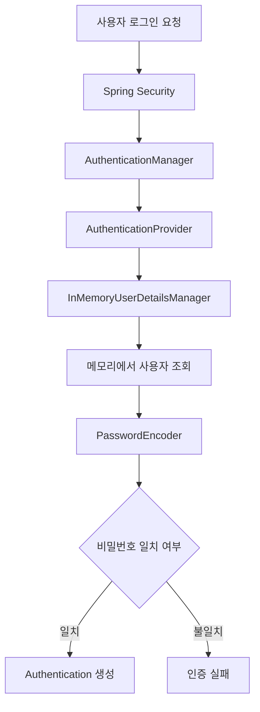
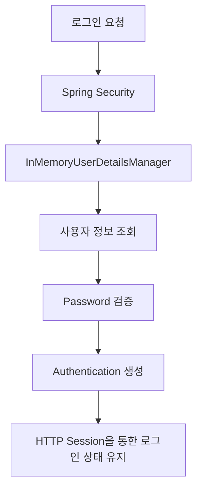
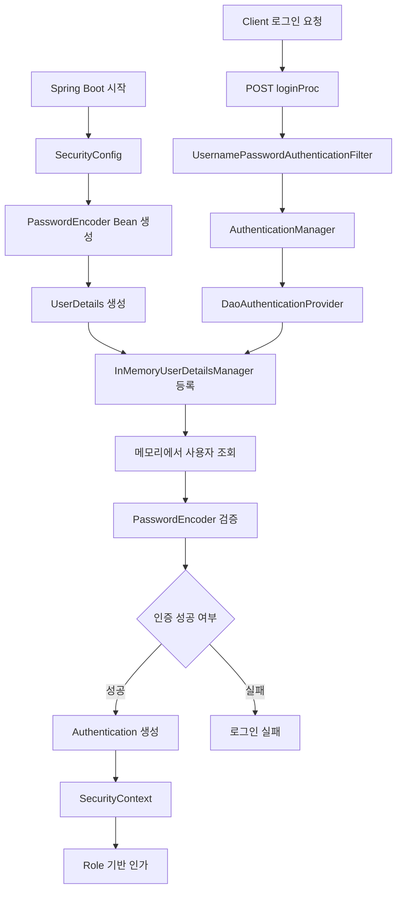

# 스프링 시큐리티 6 - 12. InMemory 방식 유저 정보 저장
[https://youtu.be/GbTOoJ0Y5eA?si=pNOmvP7mLqib7Amo](https://youtu.be/GbTOoJ0Y5eA?si=pNOmvP7mLqib7Amo)

# 스프링 시큐리티 6 - 12. InMemory 방식 유저 정보 저장
* toc
{:toc}

---

## Spring Security In-Memory 인증 구현과 DB 기반 인증 비교

Spring Security에서 사용자 인증을 구현할 때 반드시 데이터베이스가 필요한 것은 아니다.

일반적인 서비스에서는 MySQL이나 PostgreSQL 같은 데이터베이스에 회원 정보를 저장하고, 로그인 요청이 들어오면 저장된 회원 정보를 조회하여 인증을 수행한다.

하지만 모든 애플리케이션이 회원가입 기능이나 데이터베이스를 필요로 하는 것은 아니다.

예를 들어 개발 중인 API를 테스트하기 위해 간단한 로그인 환경이 필요하거나, 소수의 관리 계정만 사용하는 내부 도구를 만든다고 생각해보자.

이런 상황에서는 사용자 인증을 구현하기 위해 별도의 회원 테이블이나 Repository를 만드는 것이 오히려 불필요할 수 있다.

Spring Security는 이러한 상황에서 사용할 수 있도록 **In-Memory 기반 사용자 인증 기능**을 제공한다.

대표적인 구현체가 `InMemoryUserDetailsManager`다.

```text
Spring Security

        ↓

UserDetailsService

        ↓

InMemoryUserDetailsManager

        ↓

메모리에 저장된 사용자 정보
```

사용자 정보를 데이터베이스가 아닌 애플리케이션 메모리에 보관하기 때문에 별도의 DB 연결 없이도 아이디와 비밀번호를 이용한 인증이 가능하다.

다만 메모리에 저장된 정보는 영속적으로 보관되지 않으므로 일반적인 회원 관리 시스템과는 목적이 다르다.

이번에는 In-Memory 인증의 구조와 구현 방법을 알아보고, 앞에서 구현한 JPA 기반 인증 방식과 어떤 차이가 있는지 살펴본다.

---

## In-Memory 인증이란?

In-Memory는 이름 그대로 데이터를 메모리에 저장한다는 의미다.

Spring Security의 In-Memory 인증은 사용자 정보를 애플리케이션의 메모리에 보관하고, 로그인 요청이 발생하면 해당 정보를 조회하여 인증하는 방식이다.

예를 들어 다음 두 계정을 미리 등록한다고 생각해보자.

| username | password    | role       |
| -------- | ----------- | ---------- |
| user1    | user12345!  | ROLE_USER  |
| admin1   | admin12345! | ROLE_ADMIN |

이 계정들은 회원가입 API를 통해 생성된 것이 아니다.

애플리케이션이 시작될 때 Java Configuration을 이용해 등록한 사용자들이다.

```text
Application 시작

        ↓

SecurityConfig 실행

        ↓

UserDetails 생성

        ↓

InMemoryUserDetailsManager 등록

        ↓

메모리에 사용자 정보 보관
```

이후 사용자가 로그인하면 Spring Security가 메모리에 저장된 사용자 정보를 가져와 인증한다.



전체 인증 구조는 데이터베이스 기반 인증과 거의 동일하다.

차이가 있다면 **사용자 정보를 가져오는 위치**다.

---

## In-Memory 방식은 두 가지로 구분해서 이해해야 한다

Java와 Spring 환경에서 In-Memory라는 표현은 여러 곳에서 사용된다.

특히 다음 두 가지는 구분할 필요가 있다.

**첫 번째는 메모리 기반 데이터베이스를 사용하는 방식이다.**

대표적으로 H2 같은 데이터베이스를 메모리 모드로 실행할 수 있다.

```text
Spring Boot
    ↓
Spring Data JPA
    ↓
Hibernate
    ↓
H2 In-Memory Database
```

이 경우 데이터는 메모리에 저장되지만 실제로 데이터베이스 엔진이 존재한다.

따라서 테이블을 생성하고 SQL을 실행하며 JPA Repository를 사용하는 것이 가능하다.

```sql
CREATE TABLE users (
    id BIGINT PRIMARY KEY,
    username VARCHAR(100),
    password VARCHAR(255)
);
```

일반적인 관계형 데이터베이스와 비슷한 구조를 가지지만 저장 위치가 메모리인 것이다.

**두 번째는 Spring Security의 `InMemoryUserDetailsManager`를 사용하는 방식이다.**

```text
Spring Boot
    ↓
Spring Security
    ↓
InMemoryUserDetailsManager
    ↓
메모리에 보관된 UserDetails
```

이 방식은 별도의 데이터베이스 엔진이 필요하지 않다.

JPA Entity도 필요하지 않고 Repository를 만들 필요도 없다.

두 방식을 비교하면 다음과 같다.

| 구분        | H2 In-Memory Database | InMemoryUserDetailsManager |
| --------- | --------------------- | -------------------------- |
| 데이터 저장    | 메모리 기반 DB             | Java 애플리케이션 메모리            |
| DB 엔진     | 필요                    | 불필요                        |
| SQL       | 사용 가능                 | 사용하지 않음                    |
| JPA       | 사용 가능                 | 필요 없음                      |
| 사용자 저장 구조 | Table                 | UserDetails                |
| 주요 목적     | DB 연동 개발 및 테스트        | 간단한 인증                     |
| 재시작 후 데이터 | 일반적인 메모리 모드에서는 소멸     | 메모리 상태 소멸 후 설정된 사용자 재등록    |

회원가입과 Repository의 동작까지 테스트해야 한다면 H2 같은 메모리 데이터베이스가 유용할 수 있다.

반면 단순히 로그인할 수 있는 계정 몇 개가 필요하다면 `InMemoryUserDetailsManager`가 더 간단하다.

---

## 왜 In-Memory 인증을 사용할까?

데이터베이스 기반 인증을 구현하려면 여러 구성요소가 필요하다.

앞에서 구현했던 구조를 생각해보자.

```text
Login Form
    ↓
Spring Security
    ↓
CustomUserDetailsService
    ↓
UserRepository
    ↓
Spring Data JPA
    ↓
MySQL
```

이를 위해 다음 요소들을 구현했다.

* UserEntity
* UserRepository
* CustomUserDetailsService
* CustomUserDetails
* PasswordEncoder
* MySQL 연결 설정

실제 회원 정보를 저장하는 서비스에서는 필요한 구조지만, 인증 기능 자체만 확인하려는 상황에서는 작업이 많아질 수 있다.

In-Memory 인증을 사용하면 사용자 조회 계층을 단순화할 수 있다.

```text
Login Form
    ↓
Spring Security
    ↓
InMemoryUserDetailsManager
    ↓
메모리에 저장된 사용자
```

회원가입이나 데이터베이스 관련 코드 없이 인증 환경을 구성할 수 있다는 것이 가장 큰 장점이다.

대표적으로 다음과 같은 상황에 적합하다.

| 사용 환경                 | 활용 목적            |
| --------------------- | ---------------- |
| 간단한 내부 도구             | 소수 계정으로 접근 제한    |
| 개인 프로젝트               | 빠른 로그인 환경 구성     |
| Spring Security 기능 확인 | 인증·인가 동작 검증      |
| 자동화 테스트               | 테스트 사용자 제공       |
| 프로토타입                 | DB 설계 전 인증 흐름 구성 |

다만 실제 운영 환경에서 사용하려면 계정 정보 관리, 비밀번호 보호, 배포 및 변경 절차 등을 별도로 고려해야 한다.

---

## InMemoryUserDetailsManager의 구조

앞에서 DB 기반 로그인을 구현할 때 `UserDetailsService` 인터페이스를 사용했다.

```java
public class CustomUserDetailsService
        implements UserDetailsService {
}
```

그리고 다음 메서드를 구현했다.

```java
@Override
public UserDetails loadUserByUsername(
        String username
) throws UsernameNotFoundException {
}
```

이 메서드의 역할은 로그인하려는 username에 해당하는 사용자 정보를 반환하는 것이다.

`InMemoryUserDetailsManager`도 같은 `UserDetailsService` 인터페이스를 구현한다.

```text
             UserDetailsService
                     │
          ┌──────────┴──────────┐
          │                     │
CustomUserDetailsService   InMemoryUserDetailsManager
          │                     │
          ▼                     ▼
       MySQL                 Memory
```

Spring Security 입장에서는 사용자 정보를 어디에서 가져오는지가 크게 중요하지 않다.

중요한 것은 `UserDetailsService`가 인증에 필요한 `UserDetails`를 반환할 수 있는지다.

Spring Security 공식 문서에서도 `InMemoryUserDetailsManager`를 메모리에 저장된 사용자 정보를 기반으로 username/password 인증을 지원하는 `UserDetailsService` 구현체로 설명한다.

---

## InMemoryUserDetailsManager 등록하기

Spring Security에서는 `InMemoryUserDetailsManager`를 Bean으로 등록하여 사용할 수 있다.

가장 기본적인 형태는 다음과 같다.

```java
@Bean
public UserDetailsService userDetailsService() {

    UserDetails user = User
            .withUsername("user1")
            .password("{noop}password1234")
            .roles("USER")
            .build();

    return new InMemoryUserDetailsManager(user);
}
```

이 코드는 하나의 사용자를 메모리에 등록한다.

```text
username = user1

password = password1234

role = ROLE_USER
```

여기에서 사용된 `{noop}`은 비밀번호를 Hash하지 않고 원문 그대로 비교하는 PasswordEncoder 식별자다.

따라서 이 코드는 In-Memory 인증의 구조를 이해하는 데에는 도움이 되지만 실제 서비스에서는 사용하지 않는 것이 좋다.

앞에서 BCrypt를 적용했던 것처럼 In-Memory 사용자에게도 PasswordEncoder를 사용하는 것이 바람직하다.

---

## BCryptPasswordEncoder와 함께 사용하기

이전에는 다음 Bean을 등록했다.

```java
@Bean
public PasswordEncoder passwordEncoder() {
    return new BCryptPasswordEncoder();
}
```

In-Memory 인증에서도 동일한 PasswordEncoder를 사용할 수 있다.

```java
@Bean
public UserDetailsService userDetailsService(
        PasswordEncoder passwordEncoder
) {

    UserDetails user = User
            .withUsername("user1")
            .password(
                    passwordEncoder.encode("user12345!")
            )
            .roles("USER")
            .build();

    return new InMemoryUserDetailsManager(user);
}
```

이렇게 하면 사용자 비밀번호는 BCrypt Hash 형태로 메모리에 저장된다.

```text
원본 비밀번호

user12345!

        ↓

BCryptPasswordEncoder.encode()

        ↓

BCrypt Hash

        ↓

InMemoryUserDetailsManager
```

로그인할 때는 사용자가 원본 비밀번호를 입력한다.

```text
username = user1
password = user12345!
```

Spring Security는 저장된 BCrypt Hash와 입력된 비밀번호를 검증한다.

```text
사용자 입력 Password
        ↓
PasswordEncoder.matches()
        ↑
메모리에 저장된 BCrypt Hash
        ↓
인증 성공 또는 실패
```

여기서도 비밀번호를 직접 문자열로 비교하지 않는다.

데이터 저장 위치만 다를 뿐 비밀번호 검증 방식은 동일하다.

---

## 여러 사용자 등록하기

In-Memory 인증에서는 사용자 한 명만 등록해야 하는 것은 아니다.

`InMemoryUserDetailsManager`의 생성자에 여러 `UserDetails` 객체를 전달할 수 있다.

예를 들어 일반 사용자와 관리자 계정을 각각 등록해보자.

```java
@Bean
public UserDetailsService userDetailsService(
        PasswordEncoder passwordEncoder
) {

    UserDetails user1 = User
            .withUsername("user1")
            .password(
                    passwordEncoder.encode("user12345!")
            )
            .roles("USER")
            .build();

    UserDetails admin1 = User
            .withUsername("admin1")
            .password(
                    passwordEncoder.encode("admin12345!")
            )
            .roles("ADMIN")
            .build();

    return new InMemoryUserDetailsManager(
            user1,
            admin1
    );
}
```

애플리케이션이 시작되면 두 사용자 정보가 메모리에 등록된다.

| 사용자    | 비밀번호        | Authority  |
| ------ | ----------- | ---------- |
| user1  | BCrypt Hash | ROLE_USER  |
| admin1 | BCrypt Hash | ROLE_ADMIN |

실행 중에는 다음과 같은 구조로 생각할 수 있다.

```text
InMemoryUserDetailsManager

├── user1
│   ├── password: BCrypt Hash
│   └── authorities: ROLE_USER
│
└── admin1
    ├── password: BCrypt Hash
    └── authorities: ROLE_ADMIN
```

이제 별도의 회원가입을 진행하지 않아도 두 계정으로 로그인할 수 있다.

---

## roles()와 authorities()의 차이

사용자를 등록할 때 다음 메서드를 사용했다.

```java
.roles("USER")
```

Spring Security에서 `roles()`는 일반적으로 `ROLE_` 접두사를 붙여 Authority를 생성한다.

따라서 다음 코드는:

```java
.roles("USER")
```

개념적으로 다음 Authority를 생성한다.

```text
ROLE_USER
```

관리자 역시 동일하다.

```java
.roles("ADMIN")
```

결과:

```text
ROLE_ADMIN
```

반면 `authorities()`는 전달한 문자열을 그대로 Authority로 사용한다.

```java
.authorities("USER_READ")
```

이 경우에는 다음 값이 그대로 등록된다.

```text
USER_READ
```

두 메서드의 차이를 비교하면 다음과 같다.

| 메서드                         | 전달값        | 실제 Authority |
| --------------------------- | ---------- | ------------ |
| `roles("USER")`             | USER       | ROLE_USER    |
| `roles("ADMIN")`            | ADMIN      | ROLE_ADMIN   |
| `authorities("USER_READ")`  | USER_READ  | USER_READ    |
| `authorities("ROLE_ADMIN")` | ROLE_ADMIN | ROLE_ADMIN   |

특히 `roles("ROLE_ADMIN")`처럼 이미 접두사가 포함된 값을 전달해서는 안 된다.

`roles()`에는 접두사를 제외한 Role 이름을 전달해야 한다.

---

## 하나의 사용자에게 여러 Role 부여하기

관리자 계정이 일반 사용자 기능도 사용해야 한다면 여러 Role을 부여할 수 있다.

```java
UserDetails admin = User
        .withUsername("admin1")
        .password(
                passwordEncoder.encode("admin12345!")
        )
        .roles("USER", "ADMIN")
        .build();
```

이렇게 하면 다음 두 Authority가 등록된다.

```text
ROLE_USER
ROLE_ADMIN
```

따라서 다음 설정을 모두 통과할 수 있다.

```java
.hasRole("USER")
```

```java
.hasRole("ADMIN")
```

단순히 관리자니까 모든 기능을 자동으로 사용할 수 있는 것은 아니다.

Spring Security에서 명시적으로 부여한 Authority와 실제 인가 설정을 기준으로 접근 여부가 결정된다.

---

## SecurityConfig 전체 구성

이제 지금까지의 내용을 하나의 SecurityConfig로 구성해보자.

이번 예제에서는 다음 환경을 가정한다.

```text
Spring Boot

Spring Security

Mustache

InMemoryUserDetailsManager

BCryptPasswordEncoder
```

MySQL과 Spring Data JPA는 사용하지 않는다.

필요한 핵심 의존성은 다음과 같다.

```gradle
dependencies {
    implementation 'org.springframework.boot:spring-boot-starter-web'
    implementation 'org.springframework.boot:spring-boot-starter-security'
    implementation 'org.springframework.boot:spring-boot-starter-mustache'
}
```

Spring Security 설정은 다음과 같이 구성할 수 있다.

```java
package com.example.security.config;

import org.springframework.context.annotation.Bean;
import org.springframework.context.annotation.Configuration;
import org.springframework.security.config.annotation.web.builders.HttpSecurity;
import org.springframework.security.core.userdetails.User;
import org.springframework.security.core.userdetails.UserDetails;
import org.springframework.security.core.userdetails.UserDetailsService;
import org.springframework.security.crypto.bcrypt.BCryptPasswordEncoder;
import org.springframework.security.crypto.password.PasswordEncoder;
import org.springframework.security.provisioning.InMemoryUserDetailsManager;
import org.springframework.security.web.SecurityFilterChain;

@Configuration
public class SecurityConfig {

    @Bean
    public SecurityFilterChain securityFilterChain(
            HttpSecurity http
    ) throws Exception {

        http
                .authorizeHttpRequests(auth -> auth
                        .requestMatchers(
                                "/",
                                "/login"
                        )
                        .permitAll()

                        .requestMatchers(
                                "/admin",
                                "/admin/**"
                        )
                        .hasRole("ADMIN")

                        .anyRequest()
                        .authenticated()
                )

                .formLogin(form -> form
                        .loginPage("/login")
                        .loginProcessingUrl("/loginProc")
                        .permitAll()
                );

        return http.build();
    }

    @Bean
    public PasswordEncoder passwordEncoder() {
        return new BCryptPasswordEncoder();
    }

    @Bean
    public UserDetailsService userDetailsService(
            PasswordEncoder passwordEncoder
    ) {

        UserDetails user1 = User
                .withUsername("user1")
                .password(
                        passwordEncoder.encode("user12345!")
                )
                .roles("USER")
                .build();

        UserDetails admin1 = User
                .withUsername("admin1")
                .password(
                        passwordEncoder.encode("admin12345!")
                )
                .roles("USER", "ADMIN")
                .build();

        return new InMemoryUserDetailsManager(
                user1,
                admin1
        );
    }
}
```

위 코드에서 계정과 비밀번호를 직접 작성한 것은 동작 확인을 위한 예제다.

실제 운영 환경에서는 이처럼 고정 비밀번호를 소스 코드에 포함해서는 안 된다.

애플리케이션을 배포할 때 소스 코드나 빌드 결과물을 통해 비밀번호가 노출될 위험이 있기 때문이다.

비밀번호를 BCrypt로 변환해 메모리에 저장하더라도 원본 비밀번호가 소스 코드에 존재한다면 안전하다고 볼 수 없다.

---

## SecurityConfig에서 각각의 Bean은 어떤 역할을 할까?

이번 설정에는 세 가지 Bean이 있다.

```text
SecurityConfig

├── SecurityFilterChain
│
├── PasswordEncoder
│
└── UserDetailsService
```

역할을 구분하면 다음과 같다.

### SecurityFilterChain

HTTP 요청의 인증과 인가 정책을 담당한다.

```java
.requestMatchers(
        "/admin",
        "/admin/**"
)
.hasRole("ADMIN")
```

관리자 권한을 가진 사용자만 관리자 URL에 접근할 수 있도록 설정한다.

### PasswordEncoder

사용자 비밀번호를 Hash하고 인증 과정에서 검증하는 데 사용한다.

```java
@Bean
public PasswordEncoder passwordEncoder() {
    return new BCryptPasswordEncoder();
}
```

### UserDetailsService

사용자 정보를 어디에서 가져올지 결정한다.

```java
@Bean
public UserDetailsService userDetailsService(
        PasswordEncoder passwordEncoder
) {
    // 사용자 생성

    return new InMemoryUserDetailsManager(
            user1,
            admin1
    );
}
```

현재는 MySQL이 아니라 메모리에 저장된 사용자를 반환한다.

---

## 커스텀 로그인 화면과 연결하기

이전과 동일하게 커스텀 로그인 화면을 사용한다.

```java
.formLogin(form -> form
        .loginPage("/login")
        .loginProcessingUrl("/loginProc")
        .permitAll()
)
```

따라서 다음 경로가 필요하다.

```text
GET /login
→ 로그인 화면 반환
```

그리고 로그인 Form에서는 다음 경로로 요청한다.

```text
POST /loginProc
→ Spring Security 인증 처리
```

CSRF 보호가 활성화된 상태에서는 로그인 Form에도 CSRF Token을 포함해야 한다.

예를 들어 `LoginController`를 다음과 같이 작성할 수 있다.

```java
package com.example.security.controller;

import jakarta.servlet.http.HttpServletRequest;
import org.springframework.security.web.csrf.CsrfToken;
import org.springframework.stereotype.Controller;
import org.springframework.ui.Model;
import org.springframework.web.bind.annotation.GetMapping;

@Controller
public class LoginController {

    @GetMapping("/login")
    public String login(
            HttpServletRequest request,
            Model model
    ) {

        CsrfToken csrfToken =
                (CsrfToken) request.getAttribute("_csrf");

        model.addAttribute(
                "csrfParameterName",
                csrfToken.getParameterName()
        );

        model.addAttribute(
                "csrfToken",
                csrfToken.getToken()
        );

        return "login";
    }
}
```

Mustache 로그인 Form은 다음과 같다.

```html
<!DOCTYPE html>
<html lang="ko">
<head>
    <meta charset="UTF-8">
    <title>Login</title>
</head>
<body>

<h1>로그인</h1>

<form action="/loginProc" method="post">

    <input
            type="hidden"
            name="{{csrfParameterName}}"
            value="{{csrfToken}}"
    >

    <div>
        <label for="username">아이디</label>

        <input
                id="username"
                name="username"
                type="text"
                required
        >
    </div>

    <div>
        <label for="password">비밀번호</label>

        <input
                id="password"
                name="password"
                type="password"
                required
        >
    </div>

    <button type="submit">
        로그인
    </button>

</form>

</body>
</html>
```

이제 사용자가 로그인하면:

```text
POST /loginProc

username
password
_csrf
```

가 Spring Security에 전달된다.

여기서 `POST /loginProc`을 처리하는 별도의 Controller는 필요하지 않다.

Spring Security의 인증 Filter가 처리하기 때문이다.

---

## 로그인 성공을 확인할 Controller 만들기

인증이 성공했는지 확인하기 위해 간단한 Controller를 구성할 수 있다.

```java
package com.example.security.controller;

import org.springframework.security.core.Authentication;
import org.springframework.stereotype.Controller;
import org.springframework.web.bind.annotation.GetMapping;
import org.springframework.web.bind.annotation.ResponseBody;

@Controller
public class MainController {

    @GetMapping("/")
    @ResponseBody
    public String main(
            Authentication authentication
    ) {

        if (authentication == null) {
            return "로그인이 필요합니다.";
        }

        return authentication.getName()
                + "님 환영합니다.";
    }

    @GetMapping("/admin")
    @ResponseBody
    public String admin() {

        return "관리자 페이지입니다.";
    }
}
```

이제 일반 사용자로 로그인해보자.

```text
username = user1

password = user12345!
```

로그인이 성공하면 다음과 같은 응답을 확인할 수 있다.

```text
user1님 환영합니다.
```

관리자 계정으로 로그인하면:

```text
username = admin1

password = admin12345!
```

다음 응답을 확인할 수 있다.

```text
admin1님 환영합니다.
```

참고로 실제 인증이 없는 공개 요청에서는 `Authentication` 인자가 `null`일 수 있으므로 이를 고려해 처리했다.

---

## Role에 따른 접근 제어 확인하기

앞에서 SecurityConfig에 다음 설정을 추가했다.

```java
.requestMatchers(
        "/admin",
        "/admin/**"
)
.hasRole("ADMIN")
```

이제 일반 사용자와 관리자의 접근 결과가 달라진다.

### 로그인하지 않은 사용자

```text
GET /admin
```

요청이 들어오면 Spring Security는 로그인이 필요하다고 판단한다.

Form Login을 설정했으므로 로그인 화면으로 이동시킨다.

```text
GET /admin

    ↓

Spring Security

    ↓

인증되지 않은 사용자

    ↓

/login Redirect
```

### 일반 사용자

`user1`은 다음 권한을 가진다.

```text
ROLE_USER
```

로그인 자체는 성공할 수 있지만 관리자 권한은 없다.

```text
GET /admin

    ↓

Authentication 확인

    ↓

ROLE_USER

    ↓

ADMIN 권한 없음

    ↓

403 Forbidden
```

### 관리자

`admin1`은 다음 권한을 가진다.

```text
ROLE_USER
ROLE_ADMIN
```

따라서 관리자 경로에 접근할 수 있다.

```text
GET /admin

    ↓

Authentication 확인

    ↓

ROLE_ADMIN 존재

    ↓

Controller 실행
```

결과:

```text
관리자 페이지입니다.
```

이처럼 In-Memory 방식에서도 Database 기반 인증과 동일하게 Role에 따른 인가를 적용할 수 있다.

---

## 로그인 검증은 실제로 어떻게 이루어질까?

In-Memory 사용자로 로그인할 때 Spring Security 내부에서는 어떤 작업이 이루어질까?

앞에서 DB 기반 인증을 구현할 때 다음 구조를 사용했다.

```text
UsernamePasswordAuthenticationFilter

        ↓

AuthenticationManager

        ↓

DaoAuthenticationProvider

        ↓

CustomUserDetailsService

        ↓

UserRepository

        ↓

MySQL
```

In-Memory 인증에서는 사용자 조회 부분이 다음처럼 달라진다.

```text
UsernamePasswordAuthenticationFilter

        ↓

AuthenticationManager

        ↓

DaoAuthenticationProvider

        ↓

InMemoryUserDetailsManager

        ↓

메모리의 UserDetails
```

이후 과정은 동일하다.

메모리에서 조회한 UserDetails에는 다음 정보가 있다.

```text
username
password
authorities
account status
```

`DaoAuthenticationProvider`는 이 정보를 이용해 PasswordEncoder로 비밀번호를 검증한다.

```text
사용자가 입력한 Password

        ↓

PasswordEncoder.matches()

        ↑

In-Memory에 저장된 BCrypt Hash

        ↓

인증 성공
```

인증이 성공하면 `Authentication`이 생성된다.

이를 `SecurityContext`에서 관리하며 세션 기반 로그인이라면 다음 요청에서도 인증 상태를 유지할 수 있다.

---

## UserDetailsService를 직접 구현하지 않아도 되는 이유

이전에는 다음 클래스를 직접 구현했다.

```java
@Service
@RequiredArgsConstructor
public class CustomUserDetailsService
        implements UserDetailsService {

    private final UserRepository userRepository;

    @Override
    public UserDetails loadUserByUsername(
            String username
    ) throws UsernameNotFoundException {

        UserEntity user =
                userRepository
                        .findByUsername(username)
                        .orElseThrow(
                                () -> new UsernameNotFoundException(
                                        "사용자를 찾을 수 없습니다."
                                )
                        );

        return new CustomUserDetails(user);
    }
}
```

직접 구현했던 이유는 MySQL에서 회원 정보를 가져와야 했기 때문이다.

하지만 In-Memory 인증에서는 이미 Spring Security가 `UserDetailsService` 구현체를 제공한다.

```java
InMemoryUserDetailsManager
```

따라서 사용자 조회 메서드를 직접 작성할 필요가 없다.

```text
DB 기반 인증

직접 UserDetailsService 구현
    ↓
Repository 호출
    ↓
Entity 변환
    ↓
UserDetails 반환
```

반면:

```text
In-Memory 인증

InMemoryUserDetailsManager 사용
    ↓
메모리에서 사용자 조회
    ↓
UserDetails 반환
```

이라는 차이가 있다.

---

## 기존 CustomUserDetailsService가 있다면 주의할 점

앞에서 DB 기반 로그인까지 구현했다면 이미 다음 Bean이 등록되어 있을 수 있다.

```java
@Service
public class CustomUserDetailsService
        implements UserDetailsService {
}
```

그 상태에서 다음 Bean을 추가한다고 생각해보자.

```java
@Bean
public UserDetailsService userDetailsService(
        PasswordEncoder passwordEncoder
) {
    return new InMemoryUserDetailsManager(...);
}
```

그러면 애플리케이션에는 `UserDetailsService`를 구현하는 Bean이 여러 개 존재하게 된다.

```text
UserDetailsService

├── CustomUserDetailsService
│   └── MySQL
│
└── InMemoryUserDetailsManager
    └── Memory
```

이때 Spring Security가 어떤 사용자 조회 서비스를 인증에 사용해야 하는지 명확하지 않을 수 있다.

단순히 Bean 두 개를 등록했다고 해서 Spring Security가 자동으로 두 저장소를 통합해 사용자 인증을 수행하는 것은 아니다.

따라서 In-Memory 인증을 별도로 확인하고 싶다면 기존 `CustomUserDetailsService`가 함께 등록되지 않도록 구성하는 것이 가장 간단하다.

실제 프로젝트에서 두 인증 방식을 함께 사용해야 한다면 `AuthenticationProvider`를 명시적으로 구성하는 등 인증 구조를 분명하게 설계해야 한다.

---

## Spring Boot의 기본 계정과 무엇이 다를까?

Spring Boot에 Spring Security 의존성을 추가하면 기본 사용자 계정을 사용할 수 있는 경우가 있다.

대표적으로 다음 계정이다.

```text
username = user
```

비밀번호는 애플리케이션 실행 시 생성되어 로그에 출력될 수 있다.

```text
Using generated security password: ...
```

이 기본 사용자는 Spring Boot의 Security Auto Configuration을 통해 제공된다.

반면 우리가 등록한 In-Memory 사용자는 직접 정의한 계정이다.

```text
user1
admin1
```

직접 `UserDetailsService` Bean을 등록하면 Spring Boot의 기본 사용자 자동 구성은 물러난다.

따라서 기본 계정과 사용자 정의 In-Memory 계정은 서로 다른 구성을 통해 제공된다.

이 차이를 알아두면 Spring Security를 처음 적용했을 때 생성되는 임시 계정이 어떤 구조로 동작하는지도 이해할 수 있다.

---

## InMemoryUserDetailsManager는 사용자를 추가하거나 삭제할 수 없을까?

In-Memory 방식에서는 애플리케이션 시작 시 등록한 사용자만 사용할 수 있다고 생각하기 쉽다.

앞에서 작성한 예제도 다음과 같이 초기 사용자만 등록했다.

```java
return new InMemoryUserDetailsManager(
        user1,
        admin1
);
```

하지만 `InMemoryUserDetailsManager`는 사용자 추가와 삭제 기능을 제공한다.

정확히는 `UserDetailsService`를 확장한 `UserDetailsManager` 인터페이스를 구현하기 때문이다.

대표적인 메서드는 다음과 같다.

| 메서드                    | 역할           |
| ---------------------- | ------------ |
| `createUser()`         | 새로운 사용자 추가   |
| `updateUser()`         | 기존 사용자 정보 수정 |
| `deleteUser()`         | 사용자 삭제       |
| `userExists()`         | 사용자 존재 여부 확인 |
| `loadUserByUsername()` | 사용자 조회       |
| `changePassword()`     | 사용자 비밀번호 변경  |

따라서 코드로 사용자를 추가하거나 삭제하는 것은 가능하다.

예를 들어 다음과 같이 새로운 사용자를 만들 수 있다.

```java
UserDetails newUser = User
        .withUsername("user2")
        .password(
                passwordEncoder.encode("user23456!")
        )
        .roles("USER")
        .build();

inMemoryUserDetailsManager.createUser(newUser);
```

삭제 역시 가능하다.

```java
inMemoryUserDetailsManager.deleteUser("user2");
```

다만 이것은 데이터베이스에 영구 저장하는 작업이 아니다.

애플리케이션 메모리의 사용자 정보를 변경하는 것이다.

---

## 사용자 추가가 가능한데 왜 회원가입에 적합하지 않을까?

기술적으로 사용자를 동적으로 추가할 수 있다면 회원가입 기능도 구현할 수 있지 않을까?

가능은 하다.

하지만 중요한 제약이 있다.

**메모리에 저장된 사용자는 애플리케이션이 종료되면 유지되지 않는다.**

예를 들어 다음과 같은 상황을 생각해보자.

```text
Application 실행

    ↓

user1 등록

    ↓

createUser("user2")

    ↓

메모리에 user1, user2 존재
```

그런데 서버를 종료한다.

```text
Application 종료

    ↓

메모리 데이터 소멸
```

다시 실행하면 코드에 초기 등록하도록 작성한 사용자만 다시 생성된다.

```text
Application 재시작

    ↓

SecurityConfig 실행

    ↓

user1 재등록

    ↓

user2는 존재하지 않음
```

즉 실행 중에 추가한 사용자는 별도의 영속화 처리가 없다면 재시작 이후 사라진다.

회원가입으로 생성된 계정을 장기간 유지해야 하는 일반적인 서비스에서는 적합하지 않다.

---

## 서버가 여러 대라면 어떻게 될까?

In-Memory 인증의 또 다른 제약은 다중 서버 환경이다.

예를 들어 다음과 같은 구조를 생각해보자.

```text
Load Balancer

├── Server A
├── Server B
└── Server C
```

각 서버가 `InMemoryUserDetailsManager`를 사용한다면 사용자 정보는 각 JVM의 메모리에 따로 존재한다.

```text
Server A

user1
admin1
```

```text
Server B

user1
admin1
```

처음부터 동일한 사용자 정보를 등록했다면 같은 계정으로 로그인할 수 있다.

하지만 Server A에서 실행 중에 새로운 사용자를 추가하면 어떻게 될까?

```text
Server A

user1
admin1
user2
```

Server B에는 해당 정보가 없다.

```text
Server B

user1
admin1
```

각 서버 메모리는 자동으로 동기화되지 않기 때문이다.

따라서 사용자 정보 변경이 필요한 분산 시스템에서는 별도의 공유 저장소가 필요하다.

---

## In-Memory 인증과 Session은 별개의 개념이다

이 부분도 구분해야 한다.

`InMemoryUserDetailsManager`는 사용자 계정 정보를 메모리에 저장한다.

반면 HTTP Session은 로그인한 사용자의 인증 상태를 요청 사이에서 유지하기 위한 수단이다.

두 개념은 역할이 다르다.

```text
InMemoryUserDetailsManager

→ 사용자가 누구인지 조회
```

```text
HTTP Session

→ 로그인 상태 유지
```

따라서 In-Memory 인증을 사용한다고 해서 Session 기반 인증을 사용할 수 없는 것은 아니다.

반대로 MySQL에 사용자 정보를 저장한다고 해서 반드시 Session을 사용해야 하는 것도 아니다.

실제 구조는 다음처럼 분리해서 이해해야 한다.



즉 **사용자 저장 방식과 로그인 상태 유지 방식은 서로 다른 설계 선택**이다.

---

## In-Memory 인증과 Database 인증 비교

지금까지 구현했던 두 가지 인증 방식을 비교해보자.

| 항목                 | In-Memory 인증               | Database 인증    |
| ------------------ | -------------------------- | -------------- |
| 사용자 저장 위치          | Application Memory         | MySQL 등        |
| 사용자 조회             | InMemoryUserDetailsManager | UserRepository |
| UserDetailsService | Spring Security 구현체 제공     | 직접 구현 가능       |
| JPA                | 불필요                        | 사용 가능          |
| 회원가입               | 기술적으로 가능하지만 비영속적           | 영속 저장 가능       |
| 사용자 변경             | 실행 중 변경 가능                 | DB에 저장         |
| 재시작 후              | 실행 중 변경분 소멸                | 데이터 유지         |
| 여러 서버 간 공유         | 기본적으로 불가능                  | 공유 DB 사용 가능    |
| 적합한 규모             | 단순·고정 계정                   | 실제 회원 서비스      |

핵심 차이는 다음과 같다.

```text
In-Memory

UserDetails
    ↓
Application Memory
```

```text
Database

UserEntity
    ↓
UserRepository
    ↓
MySQL
```

Spring Security 인증 과정에서는 둘 다 `UserDetailsService`를 통해 연결할 수 있다.

---

## 실무에서 활용할 때 고려할 점

In-Memory 인증은 간단해서 유용하지만 실제 프로젝트에서 사용할 때는 몇 가지 조건을 확인해야 한다.

### 1. 고정된 소수의 계정에 적합하다

사용자 수가 적고 계정 변경이 자주 발생하지 않는 환경이라면 충분히 활용할 수 있다.

예를 들어 내부에서만 사용하는 간단한 관리 도구가 해당될 수 있다.

다만 관리자 계정을 사용하는 시스템이라면 접근 통제와 비밀번호 관리 정책은 별도로 강화해야 한다.

### 2. 비밀번호를 소스 코드에 직접 작성하지 않는다

다음과 같은 코드는 예제를 이해하기에는 간단하다.

```java
.password(
        passwordEncoder.encode("admin12345!")
)
```

하지만 실제 프로젝트에서는 원본 비밀번호가 코드에 남는다.

운영 환경에서는 환경 변수나 Secret 관리 시스템을 이용해 비밀번호를 외부화하거나, 사전에 안전하게 생성한 Password Hash를 별도 설정으로 관리하는 방법을 고려해야 한다.

### 3. BCrypt를 사용하더라도 원본 비밀번호 관리가 중요하다

BCrypt로 변환한 결과를 메모리에 저장한다고 해서 소스 코드에 존재하는 비밀번호까지 보호되는 것은 아니다.

```text
Source Code
→ 원본 비밀번호 존재

Runtime Memory
→ BCrypt Hash 존재
```

이 구조라면 코드 접근 권한을 가진 사람이 원본 비밀번호를 알 수 있다.

### 4. 사용자 추가 기능은 영속화를 보장하지 않는다

`createUser()`를 사용할 수 있지만 메모리 데이터가 영구 저장되는 것은 아니다.

애플리케이션 재시작과 배포 과정에서 데이터가 초기화될 수 있다.

### 5. 여러 서버 간 사용자 정보가 자동 동기화되지 않는다

서버별로 `InMemoryUserDetailsManager`가 생성되므로 실행 중 변경한 사용자 정보는 다른 서버에 자동 반영되지 않는다.

### 6. 테스트 사용자 구성에 유용하다

Spring Security의 인증·인가 동작을 확인하기 위한 테스트 환경에서는 사용자 정보를 간단히 제공할 수 있다.

특히 DB와 무관한 Security 설정을 검증할 때 불필요한 의존성을 줄일 수 있다.

### 7. 테스트 목적이라면 Security Test 기능도 고려한다

통합 테스트에서 HTTP 인증 전체를 확인해야 하는 것이 아니라면 매번 실제 로그인 Form을 통해 인증할 필요는 없다.

Spring Security Test의 `@WithMockUser`나 `user()` 같은 기능을 이용하면 테스트 목적에 맞게 인증된 사용자를 구성할 수 있다.

따라서 테스트에서 In-Memory 인증이 언제나 유일한 정답은 아니다.

### 8. 사용자 권한은 서버에서 지정한다

`roles("ADMIN")`을 통해 관리자 권한을 등록할 수 있지만, 일반 사용자가 외부 요청을 통해 임의로 관리자 권한을 선택할 수 있게 해서는 안 된다.

### 9. 기존 DB 기반 UserDetailsService와 충돌하지 않도록 한다

`CustomUserDetailsService`와 `InMemoryUserDetailsManager`를 동시에 등록하면 인증 구성에 혼란이 발생할 수 있다.

둘을 함께 사용해야 하는 요구사항이 없다면 실행 환경별로 구성을 분리하는 편이 좋다.

### 10. JPA 의존성이 남아 있다면 DB 자동 구성도 확인한다

앞에서 MySQL 기반 인증을 구현한 프로젝트에는 다음 의존성이 있을 수 있다.

```gradle
implementation 'org.springframework.boot:spring-boot-starter-data-jpa'
runtimeOnly 'com.mysql:mysql-connector-j'
```

In-Memory 인증을 사용한다고 해서 이러한 의존성과 DataSource 자동 구성이 자동으로 제거되는 것은 아니다.

따라서 기존 JPA 의존성을 그대로 유지하면서 Database 설정을 삭제하면 애플리케이션 실행 시 DataSource 구성 오류가 발생할 수 있다.

별도 테스트 프로젝트로 구성하거나, 실제 실행 환경에서 불필요한 DB 자동 구성이 수행되지 않도록 정리해야 한다.

### 11. 사용자 수가 적다는 이유만으로 항상 In-Memory를 선택하지 않는다

계정이 두 개뿐이더라도 비밀번호 변경 이력, 계정 잠금, 감사 로그, 운영 중 계정 관리가 중요한 시스템이라면 데이터베이스 기반 인증이 더 적합할 수 있다.

선택 기준은 단순히 사용자 수가 아니다.

**사용자 정보를 얼마나 안정적으로 관리해야 하는지**가 더 중요한 기준이다.

---

## 프로젝트 구조

In-Memory 인증만 구현한다면 프로젝트 구조를 상당히 단순하게 만들 수 있다.

```text
src/main
├── java
│   └── com.example.security
│       ├── config
│       │   └── SecurityConfig.java
│       │
│       └── controller
│           ├── LoginController.java
│           └── MainController.java
│
└── resources
    ├── application.properties
    │
    └── templates
        └── login.mustache
```

Database 기반 인증에서는 다음 클래스들이 필요했다.

```text
UserEntity
UserRepository
CustomUserDetails
CustomUserDetailsService
```

하지만 현재 구성에서는 `InMemoryUserDetailsManager`가 사용자 조회 기능을 제공한다.

따라서 별도의 Entity나 Repository 없이도 인증이 가능하다.

---

## 전체 인증 흐름

지금까지의 내용을 하나로 연결해보자.



이 구조를 보면 In-Memory 인증에서도 Spring Security의 핵심 인증 구조는 변하지 않는다는 것을 알 수 있다.

사용자 저장소만 MySQL에서 메모리로 변경된 것이다.

---

## 정리

Spring Security에서는 사용자 인증을 구현하기 위해 반드시 데이터베이스를 사용할 필요는 없다.

사용자 수가 적거나 간단한 로그인 환경이 필요한 경우 `InMemoryUserDetailsManager`를 이용해 사용자 정보를 애플리케이션 메모리에 저장할 수 있다.

핵심 구현은 다음과 같다.

```java
@Bean
public UserDetailsService userDetailsService(
        PasswordEncoder passwordEncoder
) {

    UserDetails user = User
            .withUsername("user1")
            .password(
                    passwordEncoder.encode("user12345!")
            )
            .roles("USER")
            .build();

    return new InMemoryUserDetailsManager(user);
}
```

여러 사용자를 등록할 수도 있다.

```java
return new InMemoryUserDetailsManager(
        user1,
        admin1
);
```

사용자 인증은 다음 흐름으로 처리된다.

```text
Login Form

    ↓

Spring Security

    ↓

AuthenticationManager

    ↓

DaoAuthenticationProvider

    ↓

InMemoryUserDetailsManager

    ↓

UserDetails 조회

    ↓

PasswordEncoder 검증

    ↓

Authentication 생성
```

앞에서 구현한 DB 기반 인증과 비교하면 다음과 같다.

```text
DB 기반 인증

UserDetailsService
    ↓
UserRepository
    ↓
MySQL
```

```text
In-Memory 인증

UserDetailsService
    ↓
InMemoryUserDetailsManager
    ↓
Memory
```

또한 `InMemoryUserDetailsManager`는 단순히 초기 사용자만 조회하는 기능에 그치지 않고 `createUser()`, `updateUser()`, `deleteUser()` 같은 사용자 관리 기능도 제공한다.

다만 이러한 변경은 메모리에서 이루어지므로 별도의 영속화 기능이 없다면 애플리케이션 재시작 이후 유지되지 않는다.

따라서 실제 회원가입과 사용자 관리가 필요한 서비스에서는 Database 기반 인증을 사용하고, 간단한 인증 환경이나 고정된 사용자 계정이 필요한 상황에서는 In-Memory 인증을 고려할 수 있다.

중요한 것은 Spring Security의 인증 방식이 저장소에 종속되지 않도록 `UserDetailsService`라는 인터페이스를 통해 추상화되어 있다는 점이다.

### 한 줄 요약

Spring Security의 `InMemoryUserDetailsManager`는 데이터베이스 없이 사용자 정보를 메모리에 저장하고 `UserDetailsService`를 통해 로그인 인증을 처리하는 구현체로, 간단한 인증 환경에 적합하지만 사용자 정보의 영속성과 서버 간 데이터 공유가 필요한 서비스에서는 별도의 저장소가 필요하다.
