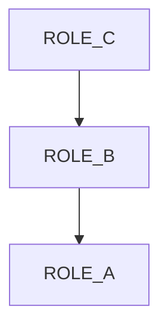
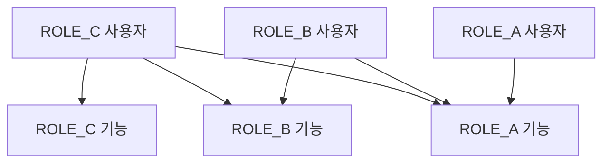
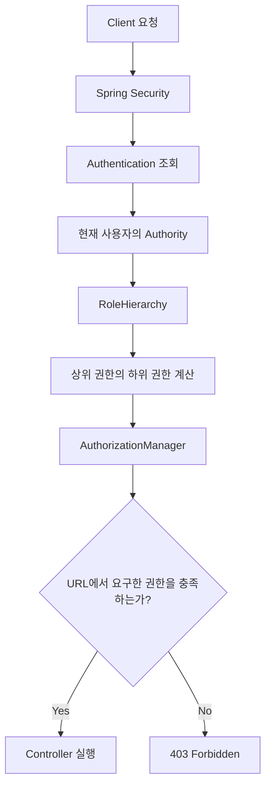

# 스프링 시큐리티 6 - 14. Role Hierarchy (계층 권한)
[https://youtu.be/RnuSJBttJUo?si=_ber9BEaME3NusDz](https://youtu.be/RnuSJBttJUo?si=_ber9BEaME3NusDz)

# 스프링 시큐리티 6 - 14. Role Hierarchy (계층 권한)
* toc
{:toc}

---

## Spring Security Role Hierarchy 계층형 권한 설정과 인가 처리 원리

Spring Security에서 인가(Authorization)를 구현할 때 가장 먼저 사용하는 방식은 `hasRole()`이나 `hasAnyRole()`을 이용해 특정 권한을 가진 사용자만 URL에 접근하도록 제한하는 것이다.

예를 들어 일반 사용자와 관리자 권한이 존재한다고 생각해보자.

```java
.requestMatchers("/admin/**")
.hasRole("ADMIN")

.requestMatchers("/user/**")
.hasAnyRole("USER", "ADMIN")
```

관리자 페이지에는 `ADMIN` 권한을 가진 사용자만 접근할 수 있고, 일반 사용자 페이지에는 `USER` 또는 `ADMIN` 권한을 가진 사용자가 접근할 수 있도록 설정했다.

이 정도의 규모에서는 특별한 문제가 없다.

그런데 서비스가 커지면서 다음과 같이 권한이 늘어난다면 어떨까?

```text
ROLE_USER
ROLE_MANAGER
ROLE_ADMIN
ROLE_SUPER_ADMIN
```

일반적으로 상위 관리자는 하위 권한으로 접근할 수 있는 기능도 사용할 수 있어야 한다.

예를 들어 관리자는 일반 사용자 페이지에 접근할 수 있어야 하고, 최고 관리자는 관리자와 일반 사용자가 사용할 수 있는 기능을 모두 사용할 수 있어야 한다.

이러한 정책을 `hasAnyRole()`로만 처리한다면 권한이 추가될 때마다 여러 URL의 인가 설정을 수정해야 할 수 있다.

이를 해결하기 위해 Spring Security는 **Role Hierarchy(계층형 권한)** 기능을 제공한다.

Role Hierarchy를 사용하면 권한 사이에 상하 관계를 정의하고, 상위 권한이 하위 권한을 포함하도록 구성할 수 있다.

```text
ROLE_ADMIN
    ↓
ROLE_MANAGER
    ↓
ROLE_USER
```

예를 들어 위와 같이 설정하면 `ROLE_ADMIN`을 가진 사용자는 인가 검사에서 `ROLE_MANAGER`, `ROLE_USER` 권한도 가진 것처럼 평가될 수 있다.

이 구조를 활용하면 URL마다 허용할 권한을 나열하지 않고 해당 기능에 필요한 최소 권한만 명시할 수 있다.

---

## Role과 Authority의 차이

Role Hierarchy를 이해하기 전에 Spring Security에서 사용하는 Role과 Authority의 관계를 알아둘 필요가 있다.

앞에서 `UserDetails`를 구현하면서 다음 메서드를 작성했다.

```java
@Override
public Collection<? extends GrantedAuthority> getAuthorities() {

    return List.of(
            new SimpleGrantedAuthority(
                    userEntity.getRole()
            )
    );
}
```

이 메서드는 현재 사용자가 가지고 있는 권한 정보를 Spring Security에 제공한다.

예를 들어 데이터베이스에 다음 값이 저장되어 있다고 하자.

```text
username = admin

role = ROLE_ADMIN
```

`getAuthorities()`에서는 다음과 같은 객체를 반환한다.

```java
new SimpleGrantedAuthority("ROLE_ADMIN")
```

Spring Security는 `Authentication`에 포함된 `GrantedAuthority`를 확인해 사용자의 접근 권한을 판단한다.

그렇다면 Role과 Authority는 어떤 차이가 있을까?

| 구분     | Role                 | Authority             |
| ------ | -------------------- | --------------------- |
| 의미     | 사용자에게 부여한 역할         | 사용자가 가진 권한            |
| 예시     | ADMIN, MANAGER, USER | ROLE_ADMIN, POST_READ |
| 주요 메서드 | `hasRole()`          | `hasAuthority()`      |
| 접두사    | 기본적으로 `ROLE_` 사용     | 전달한 문자열 그대로 사용        |
| 활용     | 사용자 역할 기반 접근 제어      | 세부 기능 권한 관리           |

Spring Security에서 Role은 기본적으로 `ROLE_` 접두사가 붙은 Authority로 표현된다.

따라서 다음 설정은:

```java
.hasRole("ADMIN")
```

기본 설정에서 다음 Authority를 확인하는 것과 대응된다.

```java
.hasAuthority("ROLE_ADMIN")
```

반대로 다음 코드는 주의해야 한다.

```java
.hasRole("ROLE_ADMIN")
```

`hasRole()`은 기본적으로 `ROLE_` 접두사를 처리하므로 일반적으로 접두사를 제외한 이름을 전달해야 한다.

Role Hierarchy에서도 이 관계를 이해하는 것이 중요하다.

---

## 기존 권한 설정 방식의 문제

이번에는 세 가지 권한을 가진 서비스를 생각해보자.

```text
ROLE_A
ROLE_B
ROLE_C
```

권한의 높이는 다음과 같다.

```text
ROLE_C
   ↓
ROLE_B
   ↓
ROLE_A
```

`ROLE_C`가 가장 높은 권한이며 `ROLE_A`가 가장 낮은 권한이다.

서비스에는 다음 세 가지 URL이 존재한다.

| URL        | 필요한 최소 권한 |
| ---------- | --------- |
| `/`        | ROLE_A    |
| `/manager` | ROLE_B    |
| `/admin`   | ROLE_C    |

그리고 상위 권한은 하위 권한의 기능을 사용할 수 있어야 한다.

따라서 접근 정책은 다음과 같다.

| 보유 권한  | `/` | `/manager` | `/admin` |
| ------ | :-: | :--------: | :------: |
| ROLE_A |  O  |      X     |     X    |
| ROLE_B |  O  |      O     |     X    |
| ROLE_C |  O  |      O     |     O    |

### hasAnyRole로 구현한다면

Role Hierarchy를 사용하지 않고 위 정책을 구현하려면 다음과 같이 작성할 수 있다.

```java
@Bean
public SecurityFilterChain securityFilterChain(
        HttpSecurity http
) throws Exception {

    http
            .authorizeHttpRequests(auth -> auth
                    .requestMatchers("/")
                    .hasAnyRole("A", "B", "C")

                    .requestMatchers("/manager")
                    .hasAnyRole("B", "C")

                    .requestMatchers("/admin")
                    .hasRole("C")

                    .anyRequest()
                    .authenticated()
            )

            .httpBasic(Customizer.withDefaults());

    return http.build();
}
```

동작에는 문제가 없다.

하지만 권한이 늘어날수록 유지보수가 번거로워진다.

예를 들어 `ROLE_D`라는 최상위 권한이 추가된다고 생각해보자.

```text
ROLE_D
   ↓
ROLE_C
   ↓
ROLE_B
   ↓
ROLE_A
```

이제 `ROLE_D`도 모든 페이지에 접근할 수 있어야 한다.

그러면 기존 설정을 다음과 같이 수정해야 한다.

```java
.requestMatchers("/")
.hasAnyRole("A", "B", "C", "D")

.requestMatchers("/manager")
.hasAnyRole("B", "C", "D")

.requestMatchers("/admin")
.hasAnyRole("C", "D")
```

권한이 네 개밖에 없는데도 수정할 부분이 많아졌다.

서비스에 수십 개의 API와 여러 권한이 존재한다면 이러한 방식은 점점 관리하기 어려워진다.

더 큰 문제는 특정 URL에서 새 권한을 빠뜨릴 가능성이 있다는 것이다.

따라서 단순히 권한을 나열하는 방식보다 **권한 사이의 관계를 정의하는 방식**이 필요하다.

---

## Role Hierarchy란?

Role Hierarchy는 Spring Security에서 권한 사이의 계층 관계를 정의하는 기능이다.

예를 들어 다음과 같은 관계를 설정할 수 있다.

```text
ROLE_C > ROLE_B
ROLE_B > ROLE_A
```

여기서 `>`는 단순한 숫자 비교 연산자가 아니다.

**왼쪽 권한이 오른쪽 권한을 포함한다는 의미**다.

따라서:

```text
ROLE_C > ROLE_B
```

는 `ROLE_C`를 가진 사용자가 `ROLE_B` 권한이 필요한 기능에도 접근할 수 있다는 의미다.

그리고:

```text
ROLE_B > ROLE_A
```

는 `ROLE_B`를 가진 사용자가 `ROLE_A` 권한이 필요한 기능에도 접근할 수 있다는 뜻이다.

두 관계를 연결하면 다음과 같다.



이때 `ROLE_C`는 `ROLE_B`를 포함하고, `ROLE_B`는 `ROLE_A`를 포함한다.

따라서 `ROLE_C`는 `ROLE_A`도 포함하게 된다.

이러한 관계를 **전이적 관계(Transitive Relationship)**&#xB77C;고 한다.

결과적으로:

| 실제 보유 권한 | 인가 검사에서 인정되는 권한        |
| -------- | ---------------------- |
| ROLE_A   | ROLE_A                 |
| ROLE_B   | ROLE_B, ROLE_A         |
| ROLE_C   | ROLE_C, ROLE_B, ROLE_A |

와 같은 구조가 된다.

Spring Security의 `RoleHierarchyImpl`은 이러한 계층 관계를 계산해 인가 검사에 활용할 수 있도록 제공한다.

---

## Role Hierarchy를 적용하면 무엇이 달라질까?

앞에서 작성한 인가 설정을 다시 보자.

```java
.requestMatchers("/")
.hasAnyRole("A", "B", "C")

.requestMatchers("/manager")
.hasAnyRole("B", "C")

.requestMatchers("/admin")
.hasRole("C")
```

Role Hierarchy를 적용하면 다음처럼 단순화할 수 있다.

```java
.requestMatchers("/")
.hasRole("A")

.requestMatchers("/manager")
.hasRole("B")

.requestMatchers("/admin")
.hasRole("C")
```

각 URL에 필요한 최소 권한만 표현하면 된다.

`/`에 접근하려면 `ROLE_A` 권한이 필요하지만, 상위 권한인 `ROLE_B`와 `ROLE_C`도 접근할 수 있다.

`/manager`에는 `ROLE_B`가 필요하지만 `ROLE_C`도 접근할 수 있다.

`/admin`은 가장 높은 `ROLE_C` 권한을 가진 사용자만 접근할 수 있다.

인가 설정 자체는 다음과 같이 읽으면 된다.

```text
/
→ 최소 ROLE_A 필요

/manager
→ 최소 ROLE_B 필요

/admin
→ ROLE_C 필요
```

새로운 권한이 추가되더라도 기존 URL의 접근 정책을 일일이 수정할 필요가 줄어든다.

---

## RoleHierarchyImpl 등록하기

Spring Security에서는 `RoleHierarchy` 인터페이스와 `RoleHierarchyImpl` 구현체를 제공한다.

```text
RoleHierarchy
      ↑
      │
RoleHierarchyImpl
```

`RoleHierarchy`는 권한 계층을 처리하기 위한 추상화이며, `RoleHierarchyImpl`은 실제 계층 관계를 관리하는 구현체다.

Spring Bean으로 등록하면 Spring Security의 인가 구성에서 활용할 수 있다.

```java
@Bean
public RoleHierarchy roleHierarchy() {

    return RoleHierarchyImpl.fromHierarchy("""
            ROLE_C > ROLE_B
            ROLE_B > ROLE_A
            """);
}
```

필요한 import는 다음과 같다.

```java
import org.springframework.context.annotation.Bean;
import org.springframework.security.access.hierarchicalroles.RoleHierarchy;
import org.springframework.security.access.hierarchicalroles.RoleHierarchyImpl;
```

핵심 부분은 다음이다.

```java
RoleHierarchyImpl.fromHierarchy("""
        ROLE_C > ROLE_B
        ROLE_B > ROLE_A
        """);
```

이 코드는 다음 관계를 생성한다.

```text
ROLE_C
→ ROLE_B
→ ROLE_A
```

Java Text Block을 사용했기 때문에 여러 권한을 줄바꿈으로 구분해 작성할 수 있다.

Spring Security의 `RoleHierarchyImpl.fromHierarchy()`는 이러한 문자열 형태의 계층 정의를 지원한다.

---

## 권한을 정의할 때 순서가 중요한 이유

다음 설정을 생각해보자.

```text
ROLE_C > ROLE_B
ROLE_B > ROLE_A
```

이 설정에서는 `ROLE_C`가 가장 높은 권한이다.

그런데 다음처럼 반대로 작성하면 어떻게 될까?

```text
ROLE_A > ROLE_B
ROLE_B > ROLE_C
```

권한 관계가 완전히 반대로 바뀐다.

```text
ROLE_A
   ↓
ROLE_B
   ↓
ROLE_C
```

이제 `ROLE_A`가 가장 높은 권한이 된다.

따라서 계층을 정의할 때 `>`의 방향을 정확하게 이해해야 한다.

```text
상위 권한 > 하위 권한
```

이렇게 기억하면 된다.

또한 권한 계층에 순환 관계가 생기지 않도록 주의해야 한다.

예를 들어:

```text
ROLE_A > ROLE_B
ROLE_B > ROLE_A
```

처럼 서로가 서로를 포함하는 구조는 정상적인 권한 계층으로 보기 어렵다.

Spring Security의 `RoleHierarchyImpl`도 계층 관계를 계산할 때 이러한 순환 구조를 검사한다.

---

## Spring Security 설정에 Role Hierarchy 적용하기

이제 실제 SecurityConfig에 적용해보자.

기존 인가 설정과 RoleHierarchy Bean을 함께 등록하면 된다.

```java
package com.example.security.config;

import org.springframework.context.annotation.Bean;
import org.springframework.context.annotation.Configuration;
import org.springframework.security.access.hierarchicalroles.RoleHierarchy;
import org.springframework.security.access.hierarchicalroles.RoleHierarchyImpl;
import org.springframework.security.config.Customizer;
import org.springframework.security.config.annotation.web.builders.HttpSecurity;
import org.springframework.security.web.SecurityFilterChain;

@Configuration
public class SecurityConfig {

    @Bean
    public SecurityFilterChain securityFilterChain(
            HttpSecurity http
    ) throws Exception {

        http
                .authorizeHttpRequests(auth -> auth
                        .requestMatchers("/")
                        .hasRole("A")

                        .requestMatchers(
                                "/manager",
                                "/manager/**"
                        )
                        .hasRole("B")

                        .requestMatchers(
                                "/admin",
                                "/admin/**"
                        )
                        .hasRole("C")

                        .anyRequest()
                        .authenticated()
                )

                .httpBasic(Customizer.withDefaults());

        return http.build();
    }

    @Bean
    public RoleHierarchy roleHierarchy() {

        return RoleHierarchyImpl.fromHierarchy("""
                ROLE_C > ROLE_B
                ROLE_B > ROLE_A
                """);
    }
}
```

여기에서는 앞에서 구현한 HTTP Basic 인증 방식을 사용했다.

다만 Role Hierarchy는 HTTP Basic에만 적용되는 기능이 아니다.

Form Login을 사용하든 HTTP Basic을 사용하든, 인증이 완료된 사용자의 Authority를 기반으로 인가를 수행할 때 활용할 수 있다.

Spring Security 6.5와 7.x의 공식 구성에서는 `RoleHierarchy` Bean을 이용한 계층 권한 설정을 `authorizeHttpRequests` 기반 URL 인가에 적용할 수 있다.

---

## In-Memory 사용자와 연결하기

앞에서 `InMemoryUserDetailsManager`를 이용해 사용자를 등록하는 방법을 살펴봤다.

이번에도 데이터베이스 없이 권한 계층을 확인할 수 있도록 세 명의 사용자를 등록해보자.

먼저 BCryptPasswordEncoder를 Bean으로 등록한다.

```java
@Bean
public PasswordEncoder passwordEncoder() {

    return new BCryptPasswordEncoder();
}
```

그리고 사용자 계정을 등록한다.

```java
@Bean
public UserDetailsService userDetailsService(
        PasswordEncoder passwordEncoder
) {

    UserDetails userA = User
            .withUsername("userA")
            .password(
                    passwordEncoder.encode("userA-pass123!")
            )
            .roles("A")
            .build();

    UserDetails userB = User
            .withUsername("userB")
            .password(
                    passwordEncoder.encode("userB-pass123!")
            )
            .roles("B")
            .build();

    UserDetails userC = User
            .withUsername("userC")
            .password(
                    passwordEncoder.encode("userC-pass123!")
            )
            .roles("C")
            .build();

    return new InMemoryUserDetailsManager(
            userA,
            userB,
            userC
    );
}
```

위 계정과 비밀번호는 로컬에서 동작을 확인하기 위한 예시이며, 실제 운영 환경에서는 비밀번호를 소스 코드에 직접 작성하지 않아야 한다.

각 사용자의 권한은 다음과 같다.

| 사용자   | 실제 부여된 Role |
| ----- | ----------- |
| userA | ROLE_A      |
| userB | ROLE_B      |
| userC | ROLE_C      |

여기서 한 가지 주의할 점이 있다.

다음 코드에서는:

```java
.roles("C")
```

`ROLE_` 접두사를 직접 작성하지 않는다.

Spring Security의 `roles()` 메서드가 기본적으로 `ROLE_` 접두사를 붙이기 때문이다.

따라서 실제 Authority는 다음과 같다.

```text
ROLE_C
```

Role Hierarchy는 이 Authority를 기준으로 계층 관계를 계산한다.

---

## Controller 만들기

접근 테스트를 위해 세 가지 URL을 구성한다.

```java
package com.example.security.controller;

import org.springframework.web.bind.annotation.GetMapping;
import org.springframework.web.bind.annotation.RestController;

@RestController
public class MainController {

    @GetMapping("/")
    public String main() {

        return "Main Page";
    }

    @GetMapping("/manager")
    public String manager() {

        return "Manager Page";
    }

    @GetMapping("/admin")
    public String admin() {

        return "Admin Page";
    }
}
```

각 URL의 접근 조건은 다음과 같다.

```java
.requestMatchers("/")
.hasRole("A")
```

```java
.requestMatchers("/manager")
.hasRole("B")
```

```java
.requestMatchers("/admin")
.hasRole("C")
```

Role Hierarchy 설정은 다음과 같다.

```text
ROLE_C > ROLE_B
ROLE_B > ROLE_A
```

이제 세 명의 사용자로 각각 접근했을 때 어떤 결과가 발생하는지 확인할 수 있다.

---

## ROLE_A 사용자의 접근 결과

먼저 `ROLE_A`를 가진 사용자다.

```text
username = userA

authority = ROLE_A
```

이 사용자가 `/`에 접근한다.

```http
GET /
```

해당 URL은 `ROLE_A`가 필요하다.

사용자도 `ROLE_A`를 가지고 있으므로 접근이 허용된다.

```text
ROLE_A

    ↓

GET /

    ↓

hasRole("A")

    ↓

접근 허용
```

반면 `/manager`에 접근하면 어떻게 될까?

```http
GET /manager
```

이 URL은 `ROLE_B`가 필요하다.

`ROLE_A`는 `ROLE_B`의 하위 권한이므로 접근할 수 없다.

```text
ROLE_A

    ↓

GET /manager

    ↓

ROLE_B 필요

    ↓

403 Forbidden
```

`/admin` 역시 접근할 수 없다.

---

## ROLE_B 사용자의 접근 결과

이번에는 `ROLE_B`를 가진 사용자다.

```text
username = userB

authority = ROLE_B
```

Role Hierarchy 설정은 다음과 같다.

```text
ROLE_B > ROLE_A
```

따라서 `ROLE_B` 사용자는 인가 검사에서 `ROLE_A`에 해당하는 기능도 사용할 수 있다.

```text
ROLE_B

├── ROLE_B
└── ROLE_A
```

`/manager` 접근:

```http
GET /manager
```

결과:

```text
200 OK
```

`/` 접근:

```http
GET /
```

결과:

```text
200 OK
```

하지만 `/admin`은 가장 높은 `ROLE_C`가 필요하다.

```http
GET /admin
```

결과:

```text
403 Forbidden
```

상위 권한이 하위 권한을 포함하는 것이지, 하위 권한이 상위 권한을 얻는 것은 아니다.

---

## ROLE_C 사용자의 접근 결과

마지막으로 가장 높은 권한을 가진 사용자다.

```text
username = userC

authority = ROLE_C
```

현재 계층 구조는 다음과 같다.

```text
ROLE_C
   ↓
ROLE_B
   ↓
ROLE_A
```

따라서 `ROLE_C`를 가진 사용자는 다음 권한을 모두 충족하는 것으로 평가된다.

```text
ROLE_C
ROLE_B
ROLE_A
```

그래서 세 URL 모두 접근할 수 있다.

```text
GET /
→ 200 OK

GET /manager
→ 200 OK

GET /admin
→ 200 OK
```

이러한 결과가 가능한 이유는 `ROLE_C`가 하위 권한을 포함하도록 설정했기 때문이다.

---

## 전체 접근 결과

최종적으로 다음과 같이 정리할 수 있다.

| 사용자   | 실제 Role | `/` | `/manager` | `/admin` |
| ----- | ------- | :-: | :--------: | :------: |
| userA | ROLE_A  |  허용 |     거부     |    거부    |
| userB | ROLE_B  |  허용 |     허용     |    거부    |
| userC | ROLE_C  |  허용 |     허용     |    허용    |

이를 다이어그램으로 표현하면 다음과 같다.



권한 계층을 한 번 정의하면 여러 URL에서 권한 목록을 반복해서 나열할 필요가 줄어든다.

---

## Role Hierarchy는 내부적으로 어떻게 동작할까?

여기서 중요한 부분을 조금 더 살펴보자.

사용자가 로그인하면 Spring Security는 `Authentication` 객체를 생성한다.

앞에서 구현한 `CustomUserDetails`나 `InMemoryUserDetailsManager`가 제공하는 Authority가 이 객체에 포함된다.

예를 들어 `ROLE_C` 사용자가 로그인했다고 하자.

```text
Authentication

principal = userC

authorities = [ROLE_C]
```

이때 데이터베이스나 사용자 저장소에 저장된 권한은 여전히 하나다.

```text
ROLE_C
```

그런데 URL 접근 시 Spring Security의 인가 구성은 Role Hierarchy를 이용해 하위 권한까지 고려할 수 있다.

```text
Authentication

ROLE_C

    ↓

RoleHierarchy

    ↓

ROLE_C
ROLE_B
ROLE_A

    ↓

AuthorizationManager

    ↓

접근 허용 여부 판단
```

Spring Security는 `RoleHierarchy`를 통해 도달 가능한 Authority를 계산할 수 있다.

이러한 작업은 다음 메서드와 연결된다.

```java
getReachableGrantedAuthorities()
```

이 메서드는 현재 사용자가 가진 Authority와 계층 관계를 기반으로 도달 가능한 Authority 목록을 반환한다.

---

## getReachableGrantedAuthorities() 살펴보기

직접 확인해보면 Role Hierarchy를 이해하기가 더 쉽다.

다음과 같은 코드가 있다고 하자.

```java
RoleHierarchy roleHierarchy =
        RoleHierarchyImpl.fromHierarchy("""
                ROLE_C > ROLE_B
                ROLE_B > ROLE_A
                """);
```

현재 사용자는 `ROLE_C`만 가지고 있다.

```java
Collection<GrantedAuthority> authorities =
        List.of(
                new SimpleGrantedAuthority("ROLE_C")
        );
```

이제 다음 메서드를 호출한다.

```java
Collection<? extends GrantedAuthority> reachableAuthorities =
        roleHierarchy.getReachableGrantedAuthorities(
                authorities
        );
```

반환된 Authority를 출력해보자.

```java
reachableAuthorities.forEach(
        authority ->
                System.out.println(
                        authority.getAuthority()
                )
);
```

결과에는 다음 권한들이 포함된다.

```text
ROLE_C
ROLE_B
ROLE_A
```

출력 순서는 보장된 것으로 가정하지 않아도 된다.

중요한 것은 `ROLE_C`라는 하나의 권한으로 `ROLE_B`, `ROLE_A`까지 도달할 수 있다는 사실이다.

이러한 방식으로 Spring Security는 인가 검사에 필요한 유효 권한을 계산한다.

---

## DB에 저장된 Role도 자동으로 추가될까?

이 부분은 오해하기 쉽다.

Role Hierarchy를 설정했다고 해서 DB에 저장된 Role이 자동으로 변경되는 것은 아니다.

예를 들어 다음과 같은 회원 정보가 있다고 하자.

```text
users

id = 1
username = admin
role = ROLE_C
```

Role Hierarchy를 등록한다.

```text
ROLE_C > ROLE_B
ROLE_B > ROLE_A
```

그렇다고 Database의 Role 컬럼이 다음처럼 변경되는 것은 아니다.

```text
ROLE_C, ROLE_B, ROLE_A
```

DB에는 여전히 다음 값이 저장되어 있다.

```text
ROLE_C
```

인가 검사에서 계층을 적용하는 것이다.

이 차이를 구분해야 한다.

```text
DB에 실제 저장된 권한
→ ROLE_C
```

```text
Role Hierarchy가 적용된 인가 검사
→ ROLE_C, ROLE_B, ROLE_A를 충족
```

따라서 권한 계층을 변경하더라도 모든 회원의 Role 데이터를 직접 수정할 필요가 줄어든다.

---

## Authentication.getAuthorities()에서도 하위 Role이 보일까?

앞에서 현재 로그인한 사용자의 권한을 확인할 때 다음 코드를 사용했다.

```java
Authentication authentication =
        SecurityContextHolder
                .getContext()
                .getAuthentication();

authentication.getAuthorities();
```

여기서 주의해야 한다.

**Role Hierarchy를 등록했다고 해서 `Authentication.getAuthorities()`에 들어 있는 실제 Authority 목록이 반드시 하위 권한까지 확장되는 것은 아니다.**

예를 들어 사용자가 `ROLE_C`만 부여받았다면:

```text
Authentication.getAuthorities()

→ ROLE_C
```

처럼 반환될 수 있다.

하지만 Role Hierarchy를 사용하는 인가 검사에서는 다음처럼 평가된다.

```text
ROLE_C
ROLE_B
ROLE_A
```

따라서 직접 다음처럼 검사하면:

```java
boolean hasRoleA =
        authentication.getAuthorities()
                .stream()
                .anyMatch(
                        authority ->
                                "ROLE_A".equals(
                                        authority.getAuthority()
                                )
                );
```

계층 관계를 고려하지 못할 수 있다.

권한 계층을 반영해야 한다면 `RoleHierarchy`를 통해 도달 가능한 Authority를 조회하거나, Spring Security가 제공하는 계층 인가 기능을 사용하는 것이 좋다.

---

## Role Hierarchy와 hasRole()의 관계

Role Hierarchy를 적용한 상태에서는 다음처럼 작성할 수 있다.

```java
.requestMatchers("/")
.hasRole("A")
```

여기서 `hasRole("A")`는 해당 요청에 `ROLE_A` 권한이 필요한지 확인하는 인가 조건이다.

권한 계층이 없다면 `ROLE_C`만 가진 사용자는 이를 통과하지 못한다.

하지만 다음 관계가 적용되면:

```text
ROLE_C > ROLE_B
ROLE_B > ROLE_A
```

`ROLE_C` 사용자는 `ROLE_A` 조건을 충족할 수 있다.

핵심은 다음과 같다.

```text
hasRole("A")
→ 필요한 권한 정의
```

```text
RoleHierarchy
→ 상위 권한이 포함하는 하위 권한 정의
```

두 기능이 결합되어 접근 여부가 결정된다.

---

## 최근 Spring Security에서 제공하는 Builder 방식

앞에서는 다음 방식으로 권한 계층을 정의했다.

```java
RoleHierarchyImpl.fromHierarchy("""
        ROLE_C > ROLE_B
        ROLE_B > ROLE_A
        """);
```

이 방식은 직관적이고 간단하다.

Spring Security 6.3 이후에는 Builder 방식도 사용할 수 있다.

```java
@Bean
public RoleHierarchy roleHierarchy() {

    return RoleHierarchyImpl.withDefaultRolePrefix()
            .role("C").implies("B")
            .role("B").implies("A")
            .build();
}
```

여기서는 `ROLE_` 접두사를 직접 작성하지 않는다.

```java
.role("C").implies("B")
```

는 기본적으로 다음 관계를 의미한다.

```text
ROLE_C > ROLE_B
```

마찬가지로:

```java
.role("B").implies("A")
```

는 다음을 의미한다.

```text
ROLE_B > ROLE_A
```

두 방식은 동일한 계층 관계를 표현한다.

Spring Security 6.3부터 `withDefaultRolePrefix()` Builder가 제공되며 현재 공식 문서에서도 이 방식을 사용한다.

따라서 기존 프로젝트의 Spring Security 버전을 확인한 뒤 적절한 방식을 선택하면 된다.

---

## 실제 서비스에서는 A, B, C보다 명확한 이름이 좋다

앞에서는 구조를 이해하기 위해 `ROLE_A`, `ROLE_B`, `ROLE_C`를 사용했다.

하지만 실제 서비스에서는 권한 이름만 봐도 역할이 드러나는 것이 좋다.

예를 들어 다음과 같은 권한 체계를 생각할 수 있다.

```text
ROLE_SUPER_ADMIN
        ↓
ROLE_ADMIN
        ↓
ROLE_MANAGER
        ↓
ROLE_USER
```

이를 Java 코드로 작성하면 다음과 같다.

```java
@Bean
public RoleHierarchy roleHierarchy() {

    return RoleHierarchyImpl.fromHierarchy("""
            ROLE_SUPER_ADMIN > ROLE_ADMIN
            ROLE_ADMIN > ROLE_MANAGER
            ROLE_MANAGER > ROLE_USER
            """);
}
```

이제 인가 설정에서는 해당 기능에 필요한 최소 권한만 명시한다.

```java
.authorizeHttpRequests(auth -> auth
        .requestMatchers("/user/**")
        .hasRole("USER")

        .requestMatchers("/manager/**")
        .hasRole("MANAGER")

        .requestMatchers("/admin/**")
        .hasRole("ADMIN")

        .requestMatchers("/super-admin/**")
        .hasRole("SUPER_ADMIN")

        .anyRequest()
        .authenticated()
)
```

그 결과 최고 관리자는 모든 하위 관리 기능에 접근할 수 있다.

```text
ROLE_SUPER_ADMIN

├── ROLE_SUPER_ADMIN
├── ROLE_ADMIN
├── ROLE_MANAGER
└── ROLE_USER
```

반면 일반 사용자는 상위 권한을 얻지 않는다.

```text
ROLE_USER

└── ROLE_USER
```

이 방식의 장점은 권한 구조와 URL의 접근 정책을 구분해서 관리할 수 있다는 것이다.

---

## @PreAuthorize에서도 Role Hierarchy를 사용할 수 있을까?

지금까지는 URL 단위 인가만 살펴봤다.

```java
.requestMatchers("/admin/**")
.hasRole("ADMIN")
```

하지만 실제 서비스에서는 Service 메서드 단위로 인가를 처리해야 하는 경우도 많다.

예를 들어 특정 관리자 기능에 다음과 같은 Annotation을 사용할 수 있다.

```java
@PreAuthorize("hasRole('MANAGER')")
public void processApproval() {

    // 승인 처리
}
```

이 메서드는 `MANAGER` 권한이 필요하다.

그런데 `ADMIN`이나 `SUPER_ADMIN`도 이 기능을 실행할 수 있어야 한다고 생각해보자.

이때 Method Security에도 Role Hierarchy를 적용할 수 있다.

먼저 Method Security를 활성화한다.

```java
@EnableMethodSecurity
@Configuration
public class MethodSecurityConfig {
}
```

그리고 `MethodSecurityExpressionHandler`에 Role Hierarchy를 연결한다.

```java
@Bean
static MethodSecurityExpressionHandler methodSecurityExpressionHandler(
        RoleHierarchy roleHierarchy
) {

    DefaultMethodSecurityExpressionHandler handler =
            new DefaultMethodSecurityExpressionHandler();

    handler.setRoleHierarchy(roleHierarchy);

    return handler;
}
```

필요한 import는 다음과 같다.

```java
import org.springframework.context.annotation.Bean;
import org.springframework.security.access.hierarchicalroles.RoleHierarchy;
import org.springframework.security.access.expression.method.DefaultMethodSecurityExpressionHandler;
import org.springframework.security.access.expression.method.MethodSecurityExpressionHandler;
```

이제 다음 계층이 존재한다면:

```text
ROLE_ADMIN > ROLE_MANAGER
```

`ROLE_ADMIN` 사용자가 아래 메서드의 `hasRole("MANAGER")` 조건을 충족하도록 구성할 수 있다.

```java
@PreAuthorize("hasRole('MANAGER')")
public void processApproval() {

    // 승인 처리
}
```

Spring Security 공식 문서에서도 URL 기반 인가와 Method Security에서 Role Hierarchy를 활용할 수 있으며, `@PreAuthorize` 등의 표현식 기반 메서드 보안에는 `MethodSecurityExpressionHandler`를 연결하는 예제를 제공한다.

---

## URL 인가와 Method Security를 함께 사용할 때

실무에서는 URL 접근 제어와 메서드 접근 제어를 함께 사용할 수 있다.

예를 들어 다음과 같은 API가 있다고 하자.

```http
POST /manager/approvals/100
```

SecurityConfig에서는 다음처럼 설정한다.

```java
.requestMatchers("/manager/**")
.hasRole("MANAGER")
```

그리고 실제 승인 Service에도 정책을 적용할 수 있다.

```java
@Service
public class ApprovalService {

    @PreAuthorize("hasRole('MANAGER')")
    public void approve(Long approvalId) {

        // 승인 처리
    }
}
```

두 계층의 역할은 다음과 같다.

| 구분              | 역할                        |
| --------------- | ------------------------- |
| URL 인가          | 특정 HTTP 경로에 접근 가능한지 검사    |
| Method Security | 특정 Java 메서드를 실행할 수 있는지 검사 |
| Role Hierarchy  | 상위 권한이 포함하는 하위 권한 정의      |

URL에서 인증과 인가를 수행하더라도 Service가 다른 경로에서 호출될 가능성이 있다면 메서드 단위의 접근 제어도 도움이 될 수 있다.

다만 동일한 정책을 여러 곳에 중복해서 작성하면 관리 비용이 증가할 수 있으므로 각 계층이 담당할 책임을 명확하게 정하는 것이 좋다.

---

## Role Hierarchy만으로 모든 인가를 해결할 수 있을까?

Role Hierarchy는 편리하지만 모든 권한 문제를 해결하지는 않는다.

예를 들어 다음과 같은 게시글 수정 API를 생각해보자.

```http
PUT /posts/100
```

현재 사용자는 `ROLE_USER`다.

게시글 수정 권한을 다음처럼 정의했다고 하자.

```text
자신이 작성한 게시글만 수정할 수 있다.
```

이 경우에는 사용자의 Role만 확인해서는 안 된다.

현재 로그인 사용자와 게시글 작성자를 비교해야 한다.

```text
현재 로그인 사용자 ID
        ↓
게시글 작성자 ID
        ↓
일치 여부 확인
```

Role Hierarchy는 권한 사이의 상하 관계를 정의한다.

반면 특정 데이터의 소유자인지 여부는 별도의 도메인 인가 로직이 필요하다.

예를 들어:

```java
@Transactional
public void updatePost(
        Long postId,
        Long currentUserId,
        String content
) {

    Post post = postRepository.findById(postId)
            .orElseThrow();

    if (!post.getUserId().equals(currentUserId)) {
        throw new AccessDeniedException(
                "게시글 수정 권한이 없습니다."
        );
    }

    post.updateContent(content);
}
```

와 같은 검사가 필요할 수 있다.

이때 `currentUserId`는 클라이언트가 임의로 전달한 값을 그대로 신뢰하지 않고 서버에서 인증된 사용자 정보로부터 가져와야 한다.

---

## 상위 권한이 항상 모든 하위 권한을 포함해야 할까?

이 부분도 실제 권한 체계를 설계할 때 중요하다.

Role Hierarchy를 사용하면 다음과 같은 구조를 쉽게 만들 수 있다.

```text
ROLE_ADMIN
    ↓
ROLE_MANAGER
    ↓
ROLE_USER
```

하지만 모든 서비스의 권한이 이러한 일직선 계층으로 표현되는 것은 아니다.

예를 들어 회사 내부 시스템에는 다음 역할이 있을 수 있다.

```text
ROLE_FINANCE_MANAGER
ROLE_HR_MANAGER
ROLE_CONTENT_MANAGER
```

재무 관리자는 재무 데이터를 다룰 수 있지만 인사 정보에 접근할 권한은 없을 수 있다.

반대로 인사 관리자는 인사 정보를 다룰 수 있지만 정산 승인 권한은 없을 수 있다.

이러한 권한들을 단순히 높고 낮은 관계로 정의하면 문제가 생길 수 있다.

```text
재무 관리자
    ↓
인사 관리자
```

이처럼 잘못된 계층을 만들면 의도하지 않은 권한까지 상속될 수 있다.

따라서 실제 서비스에서는 다음을 구분하는 것이 좋다.

**Role**

사용자의 역할을 표현한다.

```text
ADMIN
MANAGER
USER
```

**Permission**

사용자가 수행할 수 있는 구체적인 작업을 표현한다.

```text
POST_READ
POST_DELETE
PAYMENT_APPROVE
USER_MANAGE
```

Role Hierarchy는 상위 Role이 하위 Role의 권한을 포함하도록 할 때 유용하다.

하지만 역할별로 서로 다른 업무 권한을 조합해야 한다면 Permission 기반 설계도 함께 고려하는 것이 좋다.

---

## 실무에서 Role Hierarchy를 활용할 때 주의할 점

Role Hierarchy는 설정 자체는 간단하지만 권한은 서비스 보안과 직접 연결되기 때문에 신중하게 설계해야 한다.

### 1. 계층 관계는 실제 업무 권한을 기준으로 정의한다

관리자라는 이유만으로 모든 데이터에 접근할 수 있어야 하는 것은 아니다.

조직 내 역할과 업무 책임을 먼저 정리한 뒤 계층을 정의하는 것이 좋다.

### 2. Role 이름은 일관되게 관리한다

다음과 같이 혼합해서 사용하면 문제가 생기기 쉽다.

```text
ADMIN
ROLE_ADMIN
admin
```

Spring Security의 기본 `ROLE_` 접두사 정책과 실제 저장 형식을 일관되게 유지하는 것이 중요하다.

### 3. DB에 저장된 Role이 자동 변경되는 것은 아니다

Role Hierarchy는 인가 검사에 사용되는 유효 권한을 계산하는 기능이다.

데이터베이스에 저장된 Role 목록을 변경하는 기능으로 이해해서는 안 된다.

### 4. 직접 Authority를 비교할 때는 계층이 적용되지 않을 수 있다

다음처럼 직접 문자열을 비교하면:

```java
authentication.getAuthorities()
```

에 포함된 원래 Authority만 확인하게 될 수 있다.

Role Hierarchy가 필요한 검사에는 이를 지원하는 인가 기능을 사용하는 것이 좋다.

### 5. 계층 방향을 반대로 작성하지 않는다

```text
ROLE_ADMIN > ROLE_USER
```

와:

```text
ROLE_USER > ROLE_ADMIN
```

은 완전히 다른 정책이다.

권한 관계가 반대로 설정되면 일반 사용자에게 관리자 권한을 포함시키는 심각한 문제가 발생할 수 있다.

### 6. 순환 계층을 만들지 않는다

다음과 같은 설정은 피해야 한다.

```text
ROLE_A > ROLE_B
ROLE_B > ROLE_A
```

권한의 상하 관계가 명확해야 한다.

### 7. 여러 부서의 독립 권한을 하나의 계층에 강제로 넣지 않는다

재무와 인사처럼 업무 영역이 다른 권한은 단순한 높낮이 관계로 표현하기 어려울 수 있다.

이 경우 Role과 Permission을 분리하는 것이 적절할 수 있다.

### 8. URL 인가와 Method Security가 동일한 정책을 사용하는지 확인한다

URL에서는 Role Hierarchy가 적용되는데 Method Security에서는 적용되지 않는다면 접근 결과가 달라질 수 있다.

사용하는 Spring Security 버전과 Method Security 설정을 확인해야 한다.

### 9. 권한 계층 변경은 보안 정책 변경으로 관리한다

Role Hierarchy 설정을 변경하면 기존 사용자들이 접근할 수 있는 기능의 범위도 달라질 수 있다.

단순한 코드 정리로 생각하기보다 보안 정책 변경으로 취급하는 것이 좋다.

### 10. 접근 허용뿐 아니라 접근 거부도 테스트한다

상위 권한이 하위 기능에 접근할 수 있는지만 확인하면 부족하다.

반대로 하위 권한이 상위 기능에 접근하지 못하는지도 반드시 확인해야 한다.

---

## 권한 계층 테스트 코드

Role Hierarchy를 적용했다면 테스트 코드로 실제 접근 정책을 검증하는 것이 좋다.

Spring Security Test를 사용하면 간단하게 테스트할 수 있다.

Gradle에는 다음 의존성을 추가할 수 있다.

```gradle
testImplementation 'org.springframework.security:spring-security-test'
```

MockMvc를 이용하면 각 Role에 따른 접근 여부를 검증할 수 있다.

```java
@SpringBootTest
@AutoConfigureMockMvc
class RoleHierarchyTest {

    @Autowired
    private MockMvc mockMvc;

    @Test
    void roleA는_메인_페이지에만_접근할_수_있다()
            throws Exception {

        mockMvc.perform(
                get("/")
                        .with(user("userA").roles("A"))
        )
        .andExpect(status().isOk());

        mockMvc.perform(
                get("/manager")
                        .with(user("userA").roles("A"))
        )
        .andExpect(status().isForbidden());

        mockMvc.perform(
                get("/admin")
                        .with(user("userA").roles("A"))
        )
        .andExpect(status().isForbidden());
    }

    @Test
    void roleB는_메인과_매니저에_접근할_수_있다()
            throws Exception {

        mockMvc.perform(
                get("/")
                        .with(user("userB").roles("B"))
        )
        .andExpect(status().isOk());

        mockMvc.perform(
                get("/manager")
                        .with(user("userB").roles("B"))
        )
        .andExpect(status().isOk());

        mockMvc.perform(
                get("/admin")
                        .with(user("userB").roles("B"))
        )
        .andExpect(status().isForbidden());
    }

    @Test
    void roleC는_모든_페이지에_접근할_수_있다()
            throws Exception {

        mockMvc.perform(
                get("/")
                        .with(user("userC").roles("C"))
        )
        .andExpect(status().isOk());

        mockMvc.perform(
                get("/manager")
                        .with(user("userC").roles("C"))
        )
        .andExpect(status().isOk());

        mockMvc.perform(
                get("/admin")
                        .with(user("userC").roles("C"))
        )
        .andExpect(status().isOk());
    }
}
```

이 테스트에서는 각각의 사용자가 자신보다 낮은 권한의 기능에 접근할 수 있는지, 반대로 높은 권한의 기능에는 접근하지 못하는지를 확인한다.

특히 테스트 결과는 다음 표와 일치해야 한다.

| Role |  메인 | 매니저 | 관리자 |
| ---- | :-: | :-: | :-: |
| A    | 200 | 403 | 403 |
| B    | 200 | 200 | 403 |
| C    | 200 | 200 | 200 |

권한 계층을 변경할 때도 같은 테스트를 실행하면 기존 인가 정책이 의도하지 않게 변경되었는지 확인할 수 있다.

---

## Role Hierarchy의 전체 동작 구조

지금까지 설명한 구조를 한 번에 정리해보자.



예를 들어 `ROLE_C` 사용자가 `/manager`에 접근했다고 하자.

현재 사용자에게 실제로 부여된 Authority는 다음과 같다.

```text
ROLE_C
```

Role Hierarchy는 다음과 같다.

```text
ROLE_C > ROLE_B
ROLE_B > ROLE_A
```

`/manager`에서 요구하는 권한은 다음과 같다.

```text
ROLE_B
```

인가 과정에서는 `ROLE_C`가 `ROLE_B`를 포함하므로 접근이 허용된다.

```text
Authentication
    ↓
ROLE_C
    ↓
RoleHierarchy
    ↓
ROLE_C, ROLE_B, ROLE_A
    ↓
hasRole("B")
    ↓
접근 허용
```

반대로 `ROLE_A` 사용자가 `/admin`에 접근하면 다음과 같다.

```text
Authentication
    ↓
ROLE_A
    ↓
RoleHierarchy
    ↓
ROLE_A
    ↓
hasRole("C")
    ↓
접근 거부
```

이 구조가 Role Hierarchy의 핵심 동작 원리다.

---

## 정리

Spring Security의 Role Hierarchy는 여러 권한 사이의 상하 관계를 정의하여 인가 설정을 단순하게 만드는 기능이다.

기존에는 다음과 같이 접근 가능한 권한을 모두 나열해야 했다.

```java
.requestMatchers("/")
.hasAnyRole("A", "B", "C")

.requestMatchers("/manager")
.hasAnyRole("B", "C")

.requestMatchers("/admin")
.hasRole("C")
```

하지만 Role Hierarchy를 이용하면 다음 관계를 정의할 수 있다.

```text
ROLE_C > ROLE_B
ROLE_B > ROLE_A
```

Spring Bean으로 등록한다.

```java
@Bean
public RoleHierarchy roleHierarchy() {

    return RoleHierarchyImpl.fromHierarchy("""
            ROLE_C > ROLE_B
            ROLE_B > ROLE_A
            """);
}
```

그 후 인가 설정에서는 URL에 필요한 최소 권한만 명시할 수 있다.

```java
.requestMatchers("/")
.hasRole("A")

.requestMatchers("/manager")
.hasRole("B")

.requestMatchers("/admin")
.hasRole("C")
```

Role Hierarchy가 적용되면 상위 권한을 가진 사용자는 하위 권한으로 보호된 기능에도 접근할 수 있다.

```text
ROLE_A
→ ROLE_A 기능

ROLE_B
→ ROLE_B, ROLE_A 기능

ROLE_C
→ ROLE_C, ROLE_B, ROLE_A 기능
```

다만 Role Hierarchy가 데이터베이스의 실제 Role 값을 변경하는 것은 아니다.

```text
실제 보유 권한
→ ROLE_C
```

```text
계층이 적용된 인가 검사
→ ROLE_C, ROLE_B, ROLE_A
```

로 구분해야 한다.

또한 실제 서비스에서는 단순히 관리자와 일반 사용자만 존재하지 않는다.

재무, 인사, 운영, 정산, 콘텐츠 관리 등 서로 다른 업무 영역의 권한이 존재할 수 있다.

이러한 권한을 모두 하나의 상하 관계로 연결하면 오히려 불필요한 접근 권한이 생길 수 있다.

따라서 Role Hierarchy는 **실제로 상속 관계가 성립하는 권한에 적용하고, 독립적인 업무 권한이나 데이터 소유권은 별도의 Permission 또는 도메인 인가 정책으로 관리하는 것**이 좋다.

### 한 줄 요약

Spring Security의 `RoleHierarchy`는 `ROLE_ADMIN > ROLE_MANAGER > ROLE_USER`처럼 권한의 포함 관계를 정의해 상위 권한이 하위 권한의 기능에도 접근할 수 있도록 만드는 기능이며, 이를 활용하면 `hasAnyRole()`로 권한을 반복해서 나열하지 않고 각 URL에 필요한 최소 권한만 설정할 수 있다.
