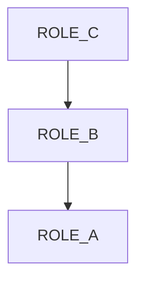
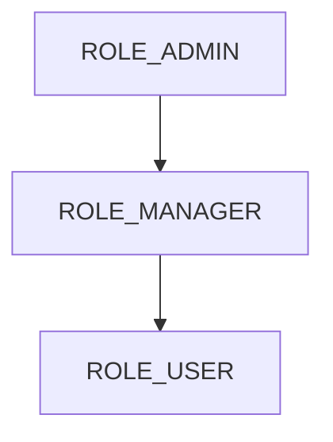
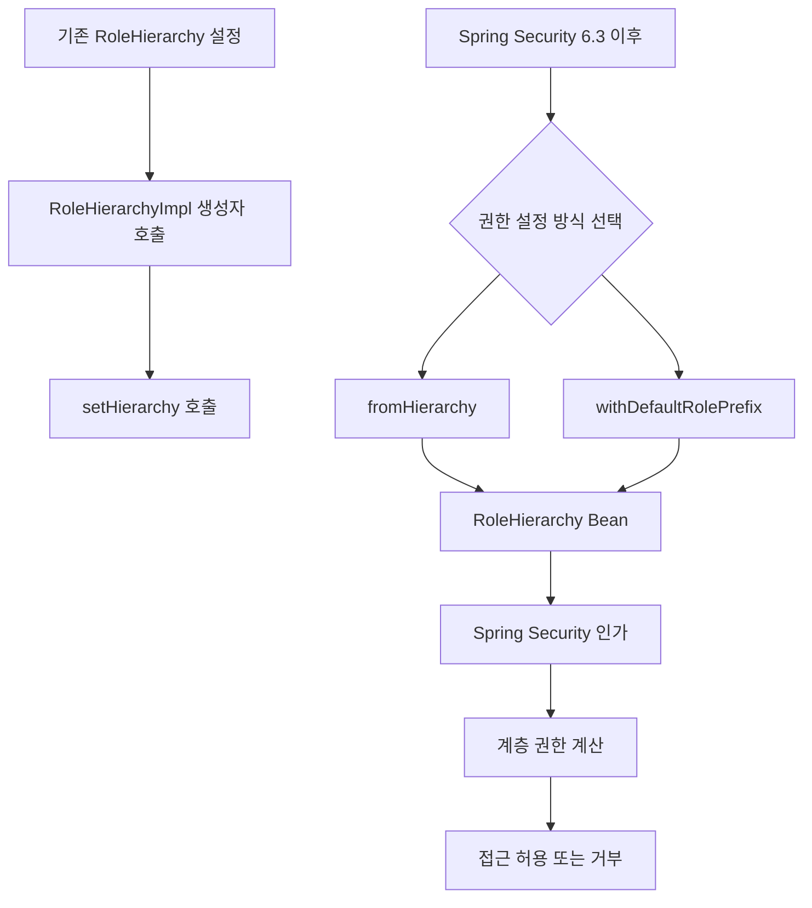

# 스프링 시큐리티 6 - Role Hierarchy 6.3.x Deprecated 해결
[https://youtu.be/3nmmMKZHhUs?si=Sv3_B5KrV_o2zzr3](https://youtu.be/3nmmMKZHhUs?si=Sv3_B5KrV_o2zzr3)

# 스프링 시큐리티 6 - Role Hierarchy 6.3.x Deprecated 해결
* toc
{:toc}

---

## Spring Security 6.3 RoleHierarchyImpl Deprecated 해결과 새로운 권한 계층 설정

Spring Security에서 Role Hierarchy를 이용하면 상위 권한이 하위 권한을 포함하도록 계층 구조를 정의할 수 있다.

예를 들어 다음과 같은 권한 구조가 있다고 가정해보자.

```text
ROLE_C
   ↓
ROLE_B
   ↓
ROLE_A
```

`ROLE_C`가 가장 높은 권한이며, `ROLE_A`가 가장 낮은 권한이다.

이러한 구조를 설정하면 `ROLE_C`를 가진 사용자는 `ROLE_B`, `ROLE_A` 권한이 필요한 기능에도 접근할 수 있다.

기존에는 `RoleHierarchyImpl` 객체를 직접 생성하고 `setHierarchy()` 메서드로 권한 계층을 설정했다.

```java
@Bean
public RoleHierarchy roleHierarchy() {

    RoleHierarchyImpl roleHierarchy =
            new RoleHierarchyImpl();

    roleHierarchy.setHierarchy(
            "ROLE_C > ROLE_B\n" +
            "ROLE_B > ROLE_A"
    );

    return roleHierarchy;
}
```

하지만 Spring Security 6.3 계열부터 이 방식에 Deprecated 경고가 발생한다.

기존 코드가 당장 실행되지 않는 것은 아니지만, Spring Security에서는 새로운 API를 사용하도록 권장하고 있다.

변경된 코드는 다음과 같다.

```java
@Bean
public RoleHierarchy roleHierarchy() {

    return RoleHierarchyImpl.fromHierarchy("""
            ROLE_C > ROLE_B
            ROLE_B > ROLE_A
            """);
}
```

기존에는 객체를 생성한 다음 별도로 계층 정보를 주입했다면, 이제는 정적 팩토리 메서드인 `fromHierarchy()`를 통해 권한 계층이 설정된 객체를 한 번에 생성할 수 있다.

또한 Spring Security 6.3부터는 `ROLE_` 접두사를 자동으로 처리하는 Builder API도 제공한다.

```java
@Bean
public RoleHierarchy roleHierarchy() {

    return RoleHierarchyImpl.withDefaultRolePrefix()
            .role("C").implies("B")
            .role("B").implies("A")
            .build();
}
```

두 방식은 같은 권한 계층을 표현한다.

이번에는 변경된 API를 중심으로 각각의 차이를 살펴보자.

---

## RoleHierarchyImpl이란?

`RoleHierarchyImpl`은 Spring Security에서 계층형 권한을 구현하는 클래스다.

Spring Security는 기본적으로 `Authentication`에 저장된 `GrantedAuthority`를 확인하여 사용자의 접근 권한을 판단한다.

예를 들어 다음과 같은 사용자가 있다고 가정하자.

```text
username = admin

authorities = [ROLE_C]
```

그리고 다음 URL에 `ROLE_A` 권한이 필요하다고 설정했다.

```java
.requestMatchers("/")
.hasRole("A")
```

일반적인 권한 비교에서는 사용자가 `ROLE_A`를 직접 가지고 있지 않으므로 접근할 수 없다.

하지만 다음과 같은 Role Hierarchy가 있다면 상황이 달라진다.

```text
ROLE_C > ROLE_B
ROLE_B > ROLE_A
```

이 관계는 `ROLE_C`가 `ROLE_B`를 포함하고, `ROLE_B`가 `ROLE_A`를 포함한다는 의미다.

따라서 `ROLE_C` 사용자에게 도달 가능한 권한은 다음과 같다.

```text
ROLE_C
ROLE_B
ROLE_A
```

이를 다이어그램으로 표현하면 다음과 같다.



Spring Security는 이러한 권한 포함 관계를 인가 판단에 활용할 수 있다.

`RoleHierarchyImpl`은 권한 계층을 정의하고, 현재 사용자가 가진 권한에서 도달 가능한 하위 권한을 계산하는 기능을 제공한다.

---

## 기존 RoleHierarchyImpl 구현 방식

Spring Security의 이전 버전에서는 다음과 같이 권한 계층을 구성했다.

```java
@Configuration
public class SecurityConfig {

    @Bean
    public RoleHierarchy roleHierarchy() {

        RoleHierarchyImpl roleHierarchy =
                new RoleHierarchyImpl();

        roleHierarchy.setHierarchy(
                "ROLE_C > ROLE_B\n" +
                "ROLE_B > ROLE_A"
        );

        return roleHierarchy;
    }
}
```

이 코드는 세 단계로 동작한다.

먼저 `RoleHierarchyImpl` 객체를 생성한다.

```java
RoleHierarchyImpl roleHierarchy =
        new RoleHierarchyImpl();
```

이후 권한 계층을 설정한다.

```java
roleHierarchy.setHierarchy(
        "ROLE_C > ROLE_B\n" +
        "ROLE_B > ROLE_A"
);
```

마지막으로 생성한 객체를 반환한다.

```java
return roleHierarchy;
```

전체 흐름은 다음과 같다.

```text
new RoleHierarchyImpl()
        ↓
객체 생성
        ↓
setHierarchy()
        ↓
권한 계층 설정
        ↓
Bean 등록
```

문제는 Spring Security 6.3 계열부터 객체 생성자와 계층 설정 메서드가 Deprecated 처리되었다는 것이다.

---

## Deprecated는 무엇을 의미할까?

Java에서 Deprecated는 해당 API의 사용을 더 이상 권장하지 않는다는 의미다.

일반적으로 `@Deprecated`가 선언된 클래스나 메서드를 사용하면 IDE에서 취소선이나 경고가 표시된다.

예를 들어 다음 코드에 경고가 표시될 수 있다.

```java
RoleHierarchyImpl roleHierarchy =
        new RoleHierarchyImpl();
```

그리고 다음 메서드에도 경고가 발생할 수 있다.

```java
roleHierarchy.setHierarchy(...);
```

다만 Deprecated라고 해서 메서드가 즉시 제거되었다는 뜻은 아니다.

세 가지 상태를 구분할 필요가 있다.

| 상태         | 의미                 |
| ---------- | ------------------ |
| 정상 API     | 사용 가능한 API         |
| Deprecated | 사용은 가능하지만 다른 방식 권장 |
| Removed    | 해당 버전에서 API 제거     |

따라서 Spring Security 6.3 환경에서 기존 코드가 Deprecated 경고를 출력하더라도 컴파일과 실행이 가능할 수 있다.

하지만 향후 버전에서는 해당 API가 제거될 수 있으므로 권장되는 대체 API로 변경하는 것이 좋다.

실제로 Spring Security 6.x API에서는 `RoleHierarchyImpl()` 생성자와 `setHierarchy()`에 Deprecated 표시가 있으며, 대체 방법으로 `fromHierarchy(String)`을 안내한다.

---

## Spring Security 6.3에서 변경된 부분

변경된 내용을 비교해보자.

| 항목       | 기존 방식                     | 변경된 방식                       |
| -------- | ------------------------- | ---------------------------- |
| 객체 생성    | `new RoleHierarchyImpl()` | 정적 팩토리 메서드 사용                |
| 계층 설정    | `setHierarchy()`          | `fromHierarchy()`            |
| Builder  | 기존 방식에서는 사용하지 않음          | `withDefaultRolePrefix()` 제공 |
| Role 접두사 | 문자열에 직접 작성                | Builder에서 자동 처리 가능           |
| 권장 여부    | Deprecated                | 권장 API                       |

가장 중요한 변화는 다음 두 가지다.

**첫 번째는 생성 방식이다.**

기존:

```java
new RoleHierarchyImpl();
```

변경:

```java
RoleHierarchyImpl.fromHierarchy(...);
```

**두 번째는 계층 설정 방식이다.**

기존:

```java
roleHierarchy.setHierarchy(...);
```

변경:

```java
RoleHierarchyImpl.fromHierarchy(...);
```

즉, 권한 계층을 설정하기 위해 객체를 먼저 만들고 Setter를 호출하는 단계가 사라졌다.

이는 권한 계층 정보를 받아 객체를 완성하는 방식으로 API가 정리된 것으로 이해할 수 있다.

---

## fromHierarchy()를 이용한 새로운 설정

가장 간단하게 기존 코드를 변경하는 방법은 `fromHierarchy()`를 사용하는 것이다.

```java
@Bean
public RoleHierarchy roleHierarchy() {

    return RoleHierarchyImpl.fromHierarchy("""
            ROLE_C > ROLE_B
            ROLE_B > ROLE_A
            """);
}
```

이 코드는 다음 권한 계층을 정의한다.

```text
ROLE_C > ROLE_B
ROLE_B > ROLE_A
```

여기서 `>`는 상위 권한이 하위 권한을 포함한다는 의미다.

따라서 다음처럼 해석할 수 있다.

```text
ROLE_C
→ ROLE_B 권한 포함

ROLE_B
→ ROLE_A 권한 포함
```

결과적으로 `ROLE_C`는 두 하위 권한을 모두 포함한다.

```text
ROLE_C
├── ROLE_B
└── ROLE_A
```

`fromHierarchy()`는 문자열로 작성한 계층 정보를 해석해 `RoleHierarchyImpl` 객체를 생성한다.

사용법은 간단하다.

```java
RoleHierarchyImpl.fromHierarchy(
        "ROLE_ADMIN > ROLE_USER"
);
```

권한 계층이 많다면 여러 줄을 작성하면 된다.

```java
RoleHierarchyImpl.fromHierarchy("""
        ROLE_SUPER_ADMIN > ROLE_ADMIN
        ROLE_ADMIN > ROLE_MANAGER
        ROLE_MANAGER > ROLE_USER
        """);
```

Spring Security 공식 API에서도 `fromHierarchy(String)`을 계층 정의 문자열로 객체를 생성하는 정적 메서드로 제공한다.

---

## 여러 권한을 문자열로 연결하는 방법

Java Text Block을 사용하지 않는 프로젝트라면 다음과 같이 작성할 수도 있다.

```java
@Bean
public RoleHierarchy roleHierarchy() {

    String hierarchy =
            "ROLE_SUPER_ADMIN > ROLE_ADMIN\n" +
            "ROLE_ADMIN > ROLE_MANAGER\n" +
            "ROLE_MANAGER > ROLE_USER";

    return RoleHierarchyImpl.fromHierarchy(hierarchy);
}
```

여기서 `\n`은 줄바꿈을 의미한다.

```text
ROLE_SUPER_ADMIN > ROLE_ADMIN
ROLE_ADMIN > ROLE_MANAGER
ROLE_MANAGER > ROLE_USER
```

Spring Security는 각 줄을 계층 관계로 해석한다.

Java 17 이상을 사용하는 Spring Boot 3 프로젝트라면 Text Block을 사용해 다음과 같이 작성하는 편이 가독성이 좋다.

```java
@Bean
public RoleHierarchy roleHierarchy() {

    return RoleHierarchyImpl.fromHierarchy("""
            ROLE_SUPER_ADMIN > ROLE_ADMIN
            ROLE_ADMIN > ROLE_MANAGER
            ROLE_MANAGER > ROLE_USER
            """);
}
```

권한 계층이 늘어날수록 문자열 연결 방식보다 Text Block을 사용하는 편이 수정하기 편하다.

---

## withDefaultRolePrefix()를 이용한 Builder 방식

Spring Security 6.3부터는 또 다른 설정 방법을 제공한다.

바로 `withDefaultRolePrefix()`를 사용하는 Builder 방식이다.

```java
@Bean
public RoleHierarchy roleHierarchy() {

    return RoleHierarchyImpl.withDefaultRolePrefix()
            .role("C").implies("B")
            .role("B").implies("A")
            .build();
}
```

이 방식의 특징은 `ROLE_` 접두사를 직접 작성할 필요가 없다는 것이다.

다음 코드를 살펴보자.

```java
.role("C").implies("B")
```

이 코드는 다음 관계를 의미한다.

```text
ROLE_C > ROLE_B
```

마찬가지로:

```java
.role("B").implies("A")
```

는 다음과 같다.

```text
ROLE_B > ROLE_A
```

`withDefaultRolePrefix()`를 사용하면 기본 접두사인 `ROLE_`가 자동으로 적용된다.

Spring Security 6.3부터 `RoleHierarchyImpl.Builder`와 `withDefaultRolePrefix()`가 제공되며, Builder는 권한 계층을 구성한 뒤 `build()`로 최종 객체를 생성한다.

---

## Builder API는 어떻게 동작할까?

Builder 방식은 다음 메서드를 중심으로 구성된다.

```java
withDefaultRolePrefix()
```

```java
role()
```

```java
implies()
```

```java
build()
```

각 역할은 다음과 같다.

| 메서드                       | 역할                              |
| ------------------------- | ------------------------------- |
| `withDefaultRolePrefix()` | 기본 `ROLE_` 접두사를 사용하는 Builder 생성 |
| `role()`                  | 상위 권한 지정                        |
| `implies()`               | 해당 권한이 포함하는 하위 권한 지정            |
| `build()`                 | RoleHierarchyImpl 객체 생성         |

예를 들어 다음 코드를 보자.

```java
RoleHierarchyImpl.withDefaultRolePrefix()
        .role("ADMIN").implies("MANAGER")
        .role("MANAGER").implies("USER")
        .build();
```

이를 그림으로 나타내면 다음과 같다.



`ROLE_ADMIN`을 가진 사용자는 `ROLE_MANAGER`와 `ROLE_USER` 권한도 충족한다.

반대로 `ROLE_USER` 사용자는 `ROLE_MANAGER`나 `ROLE_ADMIN` 권한을 얻지 않는다.

---

## fromHierarchy()와 Builder 중 어떤 방식을 사용해야 할까?

두 방식은 동일한 권한 계층을 구성할 수 있다.

### fromHierarchy()

```java
@Bean
public RoleHierarchy roleHierarchy() {

    return RoleHierarchyImpl.fromHierarchy("""
            ROLE_ADMIN > ROLE_MANAGER
            ROLE_MANAGER > ROLE_USER
            """);
}
```

### withDefaultRolePrefix()

```java
@Bean
public RoleHierarchy roleHierarchy() {

    return RoleHierarchyImpl.withDefaultRolePrefix()
            .role("ADMIN").implies("MANAGER")
            .role("MANAGER").implies("USER")
            .build();
}
```

비교하면 다음과 같다.

| 구분                  | fromHierarchy()  | withDefaultRolePrefix() |
| ------------------- | ---------------- | ----------------------- |
| 설정 형태               | 문자열 기반           | Builder                 |
| ROLE_ 접두사           | 직접 작성            | 자동 추가                   |
| 가독성                 | 여러 계층을 한눈에 보기 편함 | 메서드 호출로 관계 표현           |
| 기존 코드 변경            | 최소한의 수정으로 가능     | 설정 형태 변경 필요             |
| 권한 이름 오타            | 문자열 관리 필요        | 문자열 관리 필요               |
| Spring Security 6.3 | 사용 가능            | 사용 가능                   |

기존의 `setHierarchy()` 코드를 빠르게 변경하려면 `fromHierarchy()`가 가장 간단하다.

반면 새 프로젝트에서 Role 접두사를 직접 반복해서 작성하고 싶지 않다면 Builder 방식도 좋은 선택이다.

두 방식 사이에 무조건적인 우열이 있는 것은 아니다.

중요한 것은 팀에서 하나의 방식을 선택해 일관되게 관리하는 것이다.

---

## 실무 권한 구조로 작성해보기

실제 서비스에서는 단순히 A, B, C보다는 역할을 명확하게 표현하는 것이 좋다.

예를 들어 다음과 같은 관리자 권한 체계를 생각해보자.

```text
SUPER_ADMIN
    ↓
ADMIN
    ↓
MANAGER
    ↓
USER
```

최고 관리자는 모든 기능에 접근할 수 있다.

일반 관리자는 관리자와 매니저, 일반 사용자 기능에 접근할 수 있다.

매니저는 일반 사용자 기능을 사용할 수 있다.

일반 사용자는 자신의 권한에 해당하는 기능만 이용할 수 있다.

이를 `fromHierarchy()`로 구현하면 다음과 같다.

```java
@Bean
public RoleHierarchy roleHierarchy() {

    return RoleHierarchyImpl.fromHierarchy("""
            ROLE_SUPER_ADMIN > ROLE_ADMIN
            ROLE_ADMIN > ROLE_MANAGER
            ROLE_MANAGER > ROLE_USER
            """);
}
```

Builder 방식으로 작성하면 다음과 같다.

```java
@Bean
public RoleHierarchy roleHierarchy() {

    return RoleHierarchyImpl.withDefaultRolePrefix()
            .role("SUPER_ADMIN").implies("ADMIN")
            .role("ADMIN").implies("MANAGER")
            .role("MANAGER").implies("USER")
            .build();
}
```

어느 방식이든 최종적인 권한 관계는 동일하다.

---

## SecurityFilterChain에 적용하기

Role Hierarchy를 설정했다면 실제 인가 정책에서 활용해야 한다.

예를 들어 다음과 같은 API가 있다고 생각해보자.

| URL               | 필요한 권한      |
| ----------------- | ----------- |
| `/user/**`        | USER        |
| `/manager/**`     | MANAGER     |
| `/admin/**`       | ADMIN       |
| `/super-admin/**` | SUPER_ADMIN |

Role Hierarchy가 없다면 상위 권한을 가진 사용자까지 고려하여 여러 Role을 지정해야 할 수 있다.

```java
.requestMatchers("/user/**")
.hasAnyRole("USER", "MANAGER", "ADMIN", "SUPER_ADMIN")
```

하지만 계층 관계를 적용하면 최소 권한만 선언할 수 있다.

```java
.requestMatchers("/user/**")
.hasRole("USER")
```

나머지도 동일하다.

```java
.requestMatchers("/manager/**")
.hasRole("MANAGER")
```

```java
.requestMatchers("/admin/**")
.hasRole("ADMIN")
```

```java
.requestMatchers("/super-admin/**")
.hasRole("SUPER_ADMIN")
```

Spring Security의 `authorizeHttpRequests`에서는 RoleHierarchy Bean을 이용해 이러한 계층형 인가를 구성할 수 있다.

---

## SecurityConfig 전체 예제

앞에서 구현한 설정을 하나로 정리해보자.

```java
package com.example.security.config;

import org.springframework.context.annotation.Bean;
import org.springframework.context.annotation.Configuration;
import org.springframework.security.access.hierarchicalroles.RoleHierarchy;
import org.springframework.security.access.hierarchicalroles.RoleHierarchyImpl;
import org.springframework.security.config.Customizer;
import org.springframework.security.config.annotation.web.builders.HttpSecurity;
import org.springframework.security.web.SecurityFilterChain;

@Configuration
public class SecurityConfig {

    @Bean
    public SecurityFilterChain securityFilterChain(
            HttpSecurity http
    ) throws Exception {

        http
                .authorizeHttpRequests(auth -> auth
                        .requestMatchers(
                                "/user",
                                "/user/**"
                        )
                        .hasRole("USER")

                        .requestMatchers(
                                "/manager",
                                "/manager/**"
                        )
                        .hasRole("MANAGER")

                        .requestMatchers(
                                "/admin",
                                "/admin/**"
                        )
                        .hasRole("ADMIN")

                        .requestMatchers(
                                "/super-admin",
                                "/super-admin/**"
                        )
                        .hasRole("SUPER_ADMIN")

                        .anyRequest()
                        .authenticated()
                )

                .httpBasic(Customizer.withDefaults());

        return http.build();
    }

    @Bean
    public RoleHierarchy roleHierarchy() {

        return RoleHierarchyImpl.withDefaultRolePrefix()
                .role("SUPER_ADMIN").implies("ADMIN")
                .role("ADMIN").implies("MANAGER")
                .role("MANAGER").implies("USER")
                .build();
    }
}
```

여기에서는 HTTP Basic 인증을 사용했지만 Role Hierarchy는 Form Login에서도 동일한 방식으로 사용할 수 있다.

Role Hierarchy는 인증 방식이 아니라 **인증이 완료된 사용자에게 어떤 권한을 인정할 것인지 결정하는 인가 기능**이기 때문이다.

---

## RoleHierarchy Bean만 등록하면 모든 권한 검사에 적용될까?

여기서 조금 주의해야 할 부분이 있다.

`RoleHierarchy`를 Bean으로 등록했다고 해서 애플리케이션의 모든 권한 검사가 자동으로 계층 관계를 적용하는 것은 아니다.

예를 들어 다음 코드를 직접 작성했다고 생각해보자.

```java
authentication.getAuthorities()
        .stream()
        .anyMatch(
                authority ->
                        authority.getAuthority()
                                .equals("ROLE_USER")
        );
```

이 코드는 `Authentication`에 실제로 들어 있는 Authority를 직접 비교한다.

따라서 사용자가 `ROLE_ADMIN`만 가지고 있다면 `ROLE_USER`가 자동으로 존재하는 것처럼 반환되지는 않는다.

```text
Authentication

authorities = [ROLE_ADMIN]
```

Role Hierarchy가 설정되어 있더라도 원래 Authentication에 저장된 Authority 값 자체가 변경되는 것은 아니다.

인가 판단 과정에서 하위 권한을 계산하는 것이다.

따라서 계층 구조를 적용하려면 이를 지원하는 Spring Security 인가 기능을 사용해야 한다.

직접 유효 권한을 계산하고 싶다면 다음 메서드를 사용할 수 있다.

```java
roleHierarchy.getReachableGrantedAuthorities(
        authentication.getAuthorities()
);
```

---

## getReachableGrantedAuthorities()로 직접 확인하기

Role Hierarchy의 실제 동작은 테스트 코드로 확인하는 것이 가장 명확하다.

다음 관계를 정의한다.

```text
ROLE_C > ROLE_B
ROLE_B > ROLE_A
```

그리고 `ROLE_C`만 가진 사용자의 유효 권한을 확인한다.

```java
import org.junit.jupiter.api.Test;
import org.springframework.security.access.hierarchicalroles.RoleHierarchy;
import org.springframework.security.access.hierarchicalroles.RoleHierarchyImpl;
import org.springframework.security.core.GrantedAuthority;
import org.springframework.security.core.authority.SimpleGrantedAuthority;

import java.util.Collection;
import java.util.List;
import java.util.Set;
import java.util.stream.Collectors;

import static org.junit.jupiter.api.Assertions.assertEquals;

class RoleHierarchyTest {

    @Test
    void 상위_권한은_하위_권한을_포함한다() {

        RoleHierarchy roleHierarchy =
                RoleHierarchyImpl.fromHierarchy("""
                        ROLE_C > ROLE_B
                        ROLE_B > ROLE_A
                        """);

        List<GrantedAuthority> authorities =
                List.of(
                        new SimpleGrantedAuthority("ROLE_C")
                );

        Collection<? extends GrantedAuthority> reachable =
                roleHierarchy.getReachableGrantedAuthorities(
                        authorities
                );

        Set<String> roles = reachable.stream()
                .map(GrantedAuthority::getAuthority)
                .collect(Collectors.toSet());

        assertEquals(
                Set.of(
                        "ROLE_A",
                        "ROLE_B",
                        "ROLE_C"
                ),
                roles
        );
    }
}
```

테스트에서는 다음을 확인한다.

```text
실제 보유 권한

ROLE_C
```

Role Hierarchy가 적용된 결과:

```text
ROLE_C
ROLE_B
ROLE_A
```

세 권한이 모두 포함된다.

`Set`으로 비교한 이유는 권한 목록의 반환 순서에 의존하지 않기 위해서다.

이렇게 단위 테스트를 만들어두면 Role Hierarchy를 수정하더라도 기존 권한 관계가 유지되는지 쉽게 검증할 수 있다.

---

## Method Security에도 계층 권한을 적용하려면?

지금까지는 URL 기반 인가를 살펴봤다.

```java
.requestMatchers("/manager/**")
.hasRole("MANAGER")
```

하지만 실제 서비스에서는 `@PreAuthorize`를 이용해 메서드 단위로 권한을 검사하기도 한다.

```java
@PreAuthorize("hasRole('MANAGER')")
public void approve() {
    // 승인 처리
}
```

이 경우에도 `ADMIN`이 `MANAGER`를 포함하도록 만들고 싶다면 Method Security에서 Role Hierarchy를 사용하도록 구성해야 한다.

Spring Security 6.x에서는 다음과 같이 `MethodSecurityExpressionHandler`에 Role Hierarchy를 연결할 수 있다.

```java
@Configuration
@EnableMethodSecurity
public class MethodSecurityConfig {

    @Bean
    static MethodSecurityExpressionHandler methodSecurityExpressionHandler(
            RoleHierarchy roleHierarchy
    ) {

        DefaultMethodSecurityExpressionHandler handler =
                new DefaultMethodSecurityExpressionHandler();

        handler.setRoleHierarchy(roleHierarchy);

        return handler;
    }
}
```

필요한 import는 다음과 같다.

```java
import org.springframework.context.annotation.Bean;
import org.springframework.context.annotation.Configuration;
import org.springframework.security.access.hierarchicalroles.RoleHierarchy;
import org.springframework.security.access.expression.method.DefaultMethodSecurityExpressionHandler;
import org.springframework.security.access.expression.method.MethodSecurityExpressionHandler;
import org.springframework.security.config.annotation.method.configuration.EnableMethodSecurity;
```

이렇게 하면 다음 메서드에:

```java
@PreAuthorize("hasRole('MANAGER')")
public void approve() {
}
```

`ROLE_MANAGER`뿐 아니라 이를 포함하는 상위 Role도 접근할 수 있도록 구성할 수 있다.

공식적인 Spring Security 6.x Method Security 구성에서도 `DefaultMethodSecurityExpressionHandler`에 `RoleHierarchy`를 연결하는 방식을 사용한다.

다만 Spring Security 버전에 따라 권한 처리 내부 구조가 변경될 수 있으므로 URL 인가와 Method Security를 함께 사용한다면 각각 실제로 계층이 적용되는지 테스트하는 것이 좋다.

---

## Spring Security 버전 확인하기

Deprecated 경고가 나타났다면 현재 프로젝트에서 사용하는 Spring Security 버전을 확인하는 것이 좋다.

Spring Boot 프로젝트에서는 일반적으로 Spring Boot가 Spring Security 의존성 버전을 관리한다.

따라서 `build.gradle`에 다음과 같이 작성되어 있더라도:

```gradle
implementation 'org.springframework.boot:spring-boot-starter-security'
```

실제로 사용되는 Spring Security 버전은 Gradle의 Dependency Resolution 결과를 확인해야 한다.

다음 명령으로 확인할 수 있다.

```bash
./gradlew dependencyInsight \
    --dependency spring-security-core \
    --configuration runtimeClasspath
```

이 명령은 `spring-security-core`가 어떤 버전으로 선택되었는지, 어떤 의존성 경로를 통해 포함되었는지 확인할 때 사용할 수 있다.

예를 들어 Spring Security 6.3 계열을 사용한다면 결과에서 다음과 같은 버전 정보를 확인할 수 있다.

```text
org.springframework.security:spring-security-core:6.3.x
```

실제 출력되는 정확한 버전은 프로젝트의 Spring Boot 버전과 의존성 설정에 따라 달라진다.

여기서 주의할 점은 Spring Boot 버전과 Spring Security 버전이 동일하지 않다는 것이다.

```text
Spring Boot
3.3.x
```

```text
Spring Security
6.3.x
```

처럼 각각 다른 버전 체계를 사용한다.

Spring Boot가 관리하는 의존성 버전을 임의로 변경하면 호환성 문제가 발생할 수도 있으므로 단순히 Deprecated 경고를 없애기 위해 전체 Spring Security 버전을 변경하기보다는 먼저 대체 API로 전환하는 방법을 확인하는 것이 좋다.

---

## 실무에서 RoleHierarchyImpl을 사용할 때 확인할 점

### 1. Deprecated는 즉시 실행 오류를 의미하지 않는다

기존 메서드가 Deprecated되었다고 해서 바로 사용할 수 없게 되는 것은 아니다.

현재 버전에서 정상적으로 실행되더라도 향후 호환성을 위해 권장 API로 변경하는 것이 좋다.

### 2. 기존 setHierarchy()는 fromHierarchy()로 교체한다

기존 코드:

```java
RoleHierarchyImpl roleHierarchy =
        new RoleHierarchyImpl();

roleHierarchy.setHierarchy(
        "ROLE_ADMIN > ROLE_USER"
);
```

변경 코드:

```java
RoleHierarchyImpl.fromHierarchy(
        "ROLE_ADMIN > ROLE_USER"
);
```

### 3. ROLE_ 접두사 처리를 확인한다

`fromHierarchy()`에서는 일반적으로 전체 Authority 이름을 작성한다.

```text
ROLE_ADMIN > ROLE_USER
```

반면 `withDefaultRolePrefix()`에서는 접두사를 생략한다.

```java
.role("ADMIN").implies("USER")
```

두 방식을 혼동하면 예상과 다른 권한 계층을 만들 수 있다.

### 4. Role 방향을 반대로 작성하지 않는다

다음 설정은:

```text
ROLE_ADMIN > ROLE_USER
```

관리자가 일반 사용자 권한을 포함한다는 의미다.

반대로 작성하면:

```text
ROLE_USER > ROLE_ADMIN
```

일반 사용자에게 관리자 권한을 포함시키는 위험한 설정이 된다.

### 5. Authentication의 원본 Authority는 자동 변경되지 않는다

Role Hierarchy는 권한 포함 관계를 계산하는 기능이다.

사용자의 DB Role이나 `Authentication.getAuthorities()` 결과 자체를 변경하는 기능이 아니다.

### 6. URL 인가와 Method Security를 구분한다

URL에서 Role Hierarchy가 적용되더라도 `@PreAuthorize`에서 동일하게 적용되는지 별도로 확인해야 한다.

특히 Spring Security 6.x에서는 MethodSecurityExpressionHandler 설정이 필요할 수 있다.

### 7. 권한 계층은 한곳에서 관리한다

여러 Configuration 클래스에 서로 다른 Role Hierarchy를 정의하면 권한 정책을 이해하기 어려워질 수 있다.

가능하면 중앙에서 계층 관계를 관리하고 인가 설정에서 재사용하는 것이 좋다.

### 8. 상위 권한뿐 아니라 하위 권한의 접근 거부도 테스트한다

`ROLE_ADMIN`이 `ROLE_USER` 기능에 접근하는지만 확인해서는 부족하다.

반대로 `ROLE_USER`가 관리자 기능에 접근하지 못하는지도 테스트해야 한다.

### 9. 순환 계층을 만들지 않는다

다음과 같은 구조는 피해야 한다.

```text
ROLE_A > ROLE_B
ROLE_B > ROLE_A
```

권한 계층은 상위 권한과 하위 권한 사이의 포함 관계를 명확하게 표현해야 한다.

### 10. 모든 업무 권한을 하나의 계층으로 연결하지 않는다

예를 들어 재무 관리자와 인사 관리자는 서로 다른 업무 권한을 가질 수 있다.

```text
ROLE_FINANCE_MANAGER

ROLE_HR_MANAGER
```

이러한 권한이 반드시 상하 관계에 있어야 하는 것은 아니다.

계층형 Role이 적합하지 않다면 별도의 Authority나 Permission 기반 인가 정책을 사용하는 것이 좋다.

---

## 전체 구조

변경 전과 변경 후의 관계를 정리하면 다음과 같다.



가장 중요한 변화는 다음과 같다.

```text
기존

new RoleHierarchyImpl()
        ↓
setHierarchy()
        ↓
RoleHierarchy 반환
```

```text
변경

RoleHierarchyImpl.fromHierarchy()
        ↓
RoleHierarchy 반환
```

또는:

```text
변경

withDefaultRolePrefix()
        ↓
role()
        ↓
implies()
        ↓
build()
        ↓
RoleHierarchy 반환
```

이다.

---

## 정리

Spring Security 6.3 계열부터 기존 `RoleHierarchyImpl`의 기본 생성자와 `setHierarchy()` 사용 방식에 Deprecated 경고가 발생한다.

기존 구현은 다음과 같았다.

```java
@Bean
public RoleHierarchy roleHierarchy() {

    RoleHierarchyImpl roleHierarchy =
            new RoleHierarchyImpl();

    roleHierarchy.setHierarchy(
            "ROLE_C > ROLE_B\n" +
            "ROLE_B > ROLE_A"
    );

    return roleHierarchy;
}
```

변경된 방식에서는 정적 팩토리 메서드를 사용한다.

```java
@Bean
public RoleHierarchy roleHierarchy() {

    return RoleHierarchyImpl.fromHierarchy("""
            ROLE_C > ROLE_B
            ROLE_B > ROLE_A
            """);
}
```

또는 Builder 방식으로 작성할 수 있다.

```java
@Bean
public RoleHierarchy roleHierarchy() {

    return RoleHierarchyImpl.withDefaultRolePrefix()
            .role("C").implies("B")
            .role("B").implies("A")
            .build();
}
```

두 방식의 차이는 다음과 같다.

| 방식                        | 특징                              |
| ------------------------- | ------------------------------- |
| `fromHierarchy()`         | 계층 문자열을 직접 전달                   |
| `withDefaultRolePrefix()` | `ROLE_` 접두사를 자동 적용하는 Builder 사용 |

기존 코드에서 변경량을 최소화하려면 `fromHierarchy()`가 적합하다.

반면 새롭게 권한 계층을 작성한다면 Builder 방식도 사용할 수 있다.

중요한 것은 API의 작성 방식이 달라졌다고 해서 Role Hierarchy의 동작 원리가 변경된 것은 아니라는 점이다.

여전히 상위 권한은 하위 권한을 포함하고, 인가 검사에서 해당 관계를 활용한다.

```text
ROLE_C
   ↓
ROLE_B
   ↓
ROLE_A
```

따라서 `ROLE_C` 사용자는 `ROLE_B`, `ROLE_A` 권한이 필요한 기능에 접근할 수 있지만 반대 방향으로 권한이 부여되는 것은 아니다.

또한 Role Hierarchy는 DB의 실제 Role 값을 수정하는 것이 아니라, 권한 검사 시 도달 가능한 하위 권한을 계산한다.

Spring Security 버전을 업그레이드하면서 Deprecated 경고가 발생했다면 전체 인증 구조를 다시 구현할 필요 없이 **RoleHierarchyImpl 생성 방식을 권장 API로 변경하고, 기존 인가 정책이 동일하게 동작하는지 테스트하면 된다.**

### 한 줄 요약

Spring Security 6.3부터 `RoleHierarchyImpl()` 생성자와 `setHierarchy()`가 Deprecated 처리되었으므로, 권한 계층을 정의할 때는 `RoleHierarchyImpl.fromHierarchy()` 또는 `withDefaultRolePrefix().role().implies().build()`를 사용하는 것이 좋다.
