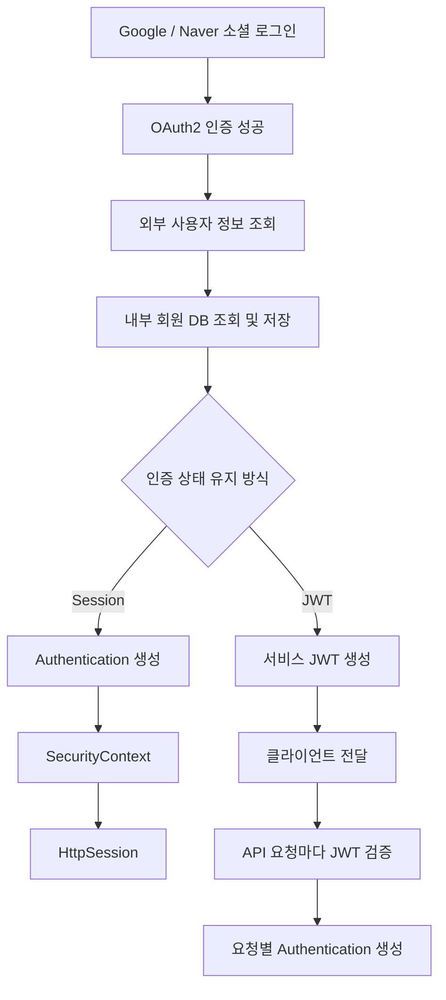
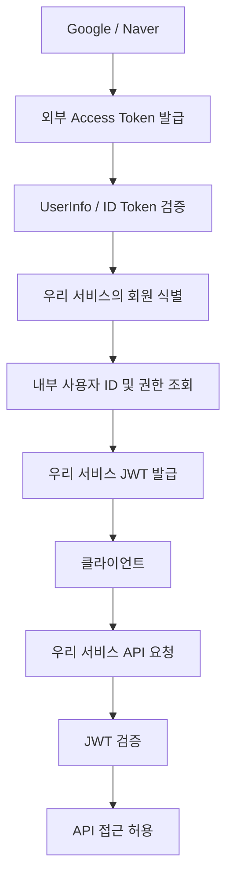
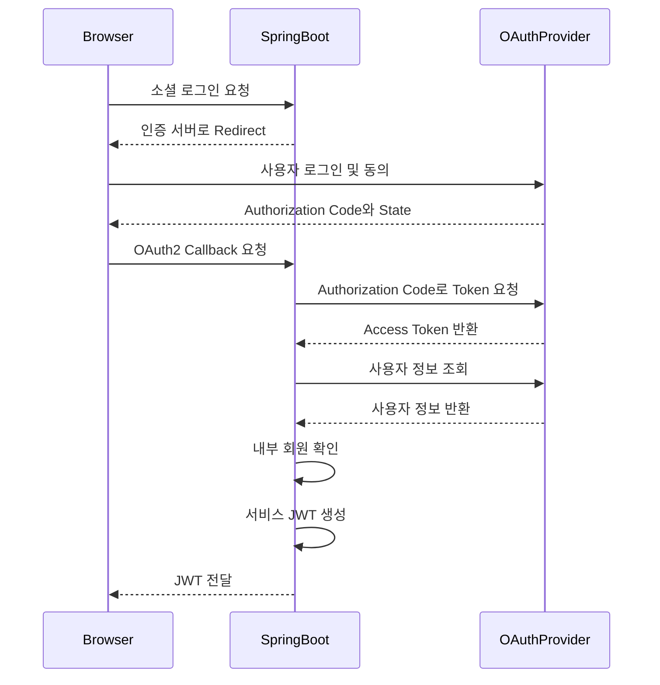
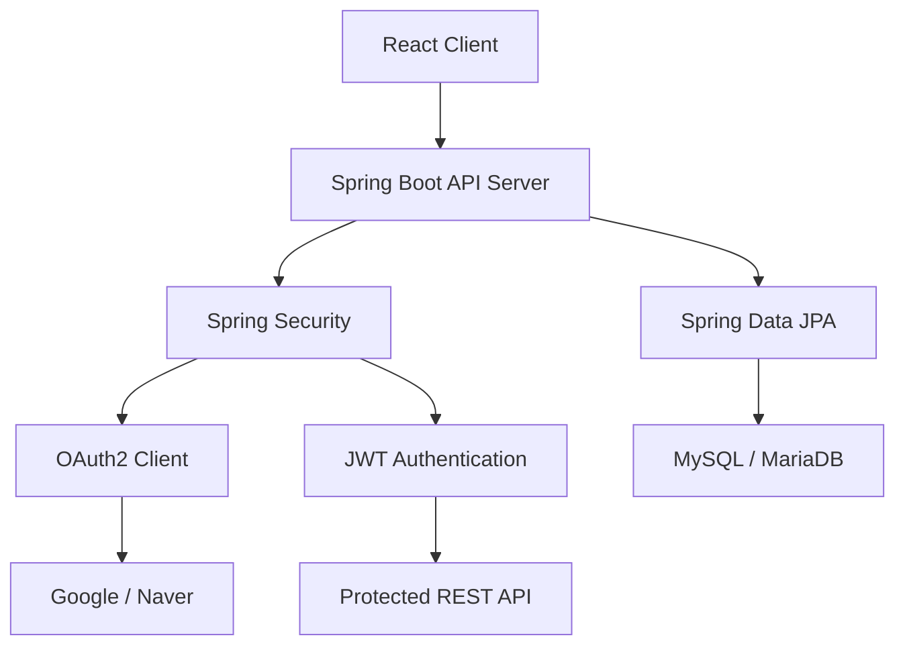
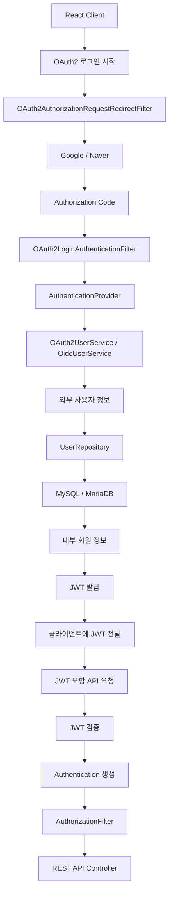
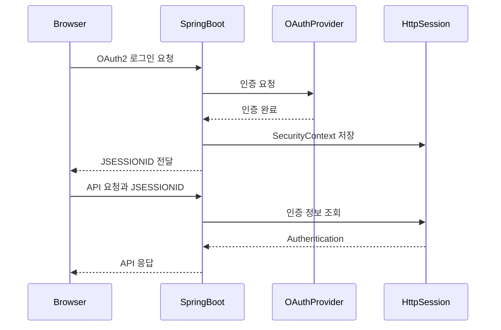
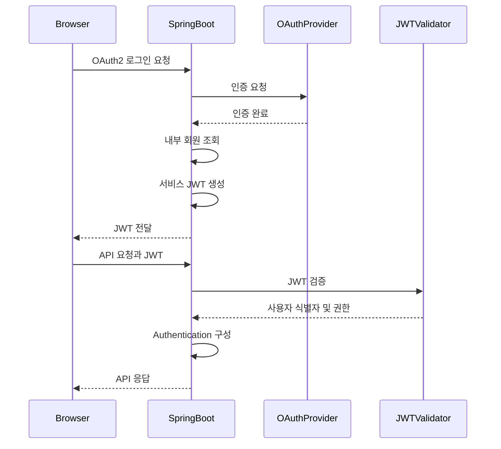
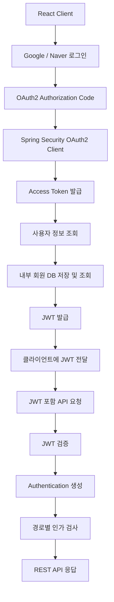

# 스프링 OAuth2 클라이언트 JWT - 1. 소셜 로그인 실습 목표
[https://youtu.be/xsmKOo-sJ3c?si=pwgPvKxfPkp3-yFK](https://youtu.be/xsmKOo-sJ3c?si=pwgPvKxfPkp3-yFK)

# 스프링 OAuth2 클라이언트 JWT - 1. 소셜 로그인 실습 목표
{:toc}

---

### Spring Security 6 OAuth2 Client와 JWT 기반 소셜 로그인: 인증 구조, 세션 방식과의 차이 및 구현 목표

Spring Security OAuth2 Client를 이용하면 Google, Naver 등 외부 인증 제공자를 통해 사용자 인증을 구현할 수 있다.

OAuth2 로그인을 구현할 때 가장 먼저 이해해야 할 부분은 외부 인증 제공자의 인증 결과와 우리 서비스의 로그인 상태가 서로 다른 개념이라는 점이다.

예를 들어 사용자가 Google 계정으로 로그인했다고 생각해보자.

Google은 사용자의 신원을 확인하고 OAuth2 Authorization Code를 발급한다.

우리 서버는 해당 Authorization Code를 이용해 Access Token을 발급받고 사용자 정보를 조회한다.

이후 조회한 사용자 정보를 내부 데이터베이스의 회원 정보와 연결한다.

여기까지는 세션 기반 소셜 로그인과 JWT 기반 소셜 로그인에서 공통으로 수행하는 과정이다.

두 방식의 차이는 **외부 사용자 인증이 완료된 이후 우리 서비스의 로그인 상태를 어떻게 유지할 것인지**에서 발생한다.

세션 방식에서는 일반적으로 Spring Security의 `Authentication`을 `SecurityContext`에 저장하고, 해당 정보를 `HttpSession`을 통해 유지한다.

반면 JWT 방식에서는 인증된 사용자 정보를 바탕으로 JWT를 발급하고, 이후 API 요청마다 JWT를 검증하여 인증된 사용자 정보를 구성할 수 있다.

전체 구조를 비교하면 다음과 같다.



이번에는 JWT 기반 인증 구조를 중심으로 다음 내용을 살펴본다.

- OAuth2 소셜 로그인과 JWT의 관계
- JWT 기반 인증을 사용하는 이유
- 세션 방식과 JWT 방식의 차이
- 외부 인증 제공자의 Access Token과 내부 JWT의 차이
- Authorization Code 방식의 전체 인증 과정
- JWT를 발급하고 검증하는 구조
- 사용자 정보를 데이터베이스에 저장해야 하는 이유
- JWT 기반 API 서버의 인증 및 인가 흐름
- 필요한 기술 스택과 주요 구성요소
- 실제 서비스에서 고려해야 할 보안 및 아키텍처 설계

이번 구조의 핵심 목표는 **외부 인증 제공자가 사용자를 인증하고, 우리 서버가 자체 JWT를 발급하여 이후 API 접근 권한을 관리하는 것**이다.

---

### 개념

#### OAuth2와 JWT는 서로 다른 기술이다

OAuth2와 JWT는 함께 사용되는 경우가 많지만 동일한 기술은 아니다.

OAuth2는 클라이언트가 사용자로부터 위임받은 권한을 이용해 외부 서비스의 보호된 리소스에 접근할 수 있도록 하는 인가 프레임워크다.

반면 JWT는 사용자 정보나 권한과 같은 Claim을 JSON 형식으로 표현하고, 이를 서명하거나 암호화할 수 있도록 정의된 토큰 형식이다.

즉 OAuth2는 권한 위임을 위한 프로토콜 체계이고, JWT는 토큰의 형식이다.

둘을 비교하면 다음과 같다.

| 구분 | OAuth2 | JWT |
|---|---|---|
| 개념 | 권한 위임을 위한 프레임워크 | Claim 기반 토큰 형식 |
| 주요 목적 | 외부 리소스 접근 권한 위임 | 정보를 토큰으로 표현 |
| 사용자 인증 | OIDC 등과 결합하여 지원 | 토큰 자체가 로그인 프로토콜은 아님 |
| 주요 구성요소 | Client, Authorization Server, Resource Server | Header, Payload, Signature |
| 사용 예시 | Google·Naver 소셜 로그인 | 우리 서비스의 Access Token |
| Spring Security | OAuth2 Client | Resource Server 또는 커스텀 JWT 처리 |

OAuth2에서 발급하는 Access Token이 반드시 JWT 형식이어야 하는 것은 아니다.

인증 제공자는 자체적인 불투명 토큰을 발급할 수도 있고 JWT 형식의 Access Token을 발급할 수도 있다.

반대로 우리 서비스에서 JWT를 사용한다고 해서 반드시 OAuth2 로그인을 구현해야 하는 것도 아니다.

일반 아이디·비밀번호 로그인에서도 자체 JWT를 발급할 수 있다.

따라서 다음 두 개념을 구분해야 한다.

```text
OAuth2
    ↓
사용자 인증 및 외부 권한 위임
```

```text
JWT
    ↓
우리 서비스의 인증 상태 및 권한 정보 전달
```

이번에는 OAuth2로 인증된 사용자에게 우리 서비스의 JWT를 발급하는 구조를 구성한다.

#### 왜 OAuth2 인증 이후 JWT가 추가로 필요할까?

Google이나 Naver 로그인이 성공하면 외부 인증 제공자의 Access Token을 받을 수 있다.

그렇다면 해당 Access Token을 그대로 우리 서비스의 인증 토큰으로 사용하면 되지 않을까?

여기에는 중요한 문제가 있다.

Google Access Token은 Google이 제공하는 보호된 리소스에 접근하기 위한 토큰이다.

Naver Access Token 역시 Naver에서 허용한 리소스에 접근하기 위해 발급된다.

하지만 우리 서비스의 주문, 결제, 회원 관리 API는 Google이나 Naver의 리소스가 아니다.

예를 들어 다음과 같은 API가 있다고 생각해보자.

```http
GET /api/orders
Host: api.example.com
```

이 API에 접근하려면 우리 서비스가 사용자의 신원과 접근 권한을 확인해야 한다.

Google이 발급한 Access Token을 우리 API의 인증 수단으로 무조건 인정한다면 토큰의 발급자와 사용 대상, 권한 체계를 혼동하게 된다.

따라서 일반적인 소셜 로그인 구조에서는 외부 인증 결과를 내부 회원 정보와 연결한 뒤, 우리 서비스에서 사용할 별도의 인증 수단을 발급할 수 있다.

이번에는 그 인증 수단으로 JWT를 사용한다.



여기서 중요한 원칙은 다음과 같다.

**외부 인증 제공자의 Access Token과 우리 서비스가 발급한 JWT는 발급 주체, 목적, 검증 기준이 다르다.**

---

### 왜 사용하는가?

#### 세션 방식에서 JWT 방식으로 전환하는 이유

기존 세션 방식에서는 인증에 성공한 사용자 정보를 서버가 관리한다.

예를 들어 다음과 같은 구조다.

```text
Browser
    ↓
JSESSIONID
    ↓
Spring Boot
    ↓
HttpSession
    ↓
SecurityContext
    ↓
Authentication
```

클라이언트는 세션 식별자를 전달한다.

서버는 해당 식별자에 연결된 인증 정보를 조회한다.

JWT 방식에서는 다음과 같은 구조를 사용할 수 있다.

```text
Browser
    ↓
JWT 전달
    ↓
Spring Boot
    ↓
JWT 서명 및 Claim 검증
    ↓
Authentication 생성
    ↓
API 실행
```

서버는 JWT를 검증하여 현재 요청의 인증 정보를 구성한다.

적절하게 설계하면 매 요청마다 중앙 세션 저장소에서 인증 정보를 조회하지 않아도 된다.

다만 JWT를 사용한다고 해서 데이터베이스 조회가 전혀 필요하지 않은 것은 아니다.

계정 정지 상태, 실시간 권한 변경, 토큰 폐기 여부 등을 확인해야 하는 경우에는 추가적인 저장소 조회가 필요할 수 있다.

#### 세션 방식과 JWT 방식 비교

| 구분 | Session | JWT |
|---|---|---|
| 로그인 상태 유지 | 서버 세션 | 클라이언트가 전달하는 토큰 |
| 인증 정보의 주요 위치 | 서버 저장소 | 서명된 토큰의 Claim |
| 요청 시 전달 | Session ID | JWT |
| 서버 처리 | 세션 조회 | 토큰 검증 |
| 서버 재시작 | 세션 저장 방식에 영향 | 검증 키와 토큰 유효성에 영향 |
| 다중 서버 | 세션 공유 또는 요청 고정 필요 | 검증 키 공유로 독립 검증 가능 |
| 권한 변경 | 세션 갱신 필요 | 기존 토큰의 Claim 갱신 문제 |
| 즉시 로그아웃 | 서버 세션 무효화 | 별도 폐기 정책 필요 |
| 인증 데이터 크기 | 세션 ID만 전달 가능 | JWT 크기만큼 요청에 포함 |
| 주요 위험 | 세션 탈취, 세션 고정 등 | 토큰 탈취, 재사용, 폐기 어려움 등 |

여기서 JWT가 세션보다 항상 더 우수한 것은 아니다.

세션 방식은 서버가 로그인 상태를 직접 제어할 수 있다는 장점이 있다.

반면 JWT 방식은 적절한 서명 검증 체계를 구성하면 여러 API 서버에서 인증 상태를 독립적으로 검증할 수 있다는 장점이 있다.

따라서 선택 기준은 서비스의 아키텍처와 인증 정책이어야 한다.

---

### 주요 특징

#### 1. Authorization Code 방식을 사용한다

Google과 Naver 소셜 로그인에는 OAuth2 Authorization Code 방식을 사용한다.

Authorization Code 방식에서는 외부 인증 제공자가 사용자 인증을 완료한 뒤 우리 서버에 Authorization Code를 전달한다.

우리 서버는 해당 코드를 이용해 Access Token을 요청한다.

기본적인 흐름은 다음과 같다.



Google을 사용하는 경우에는 OIDC 설정에 따라 ID Token도 함께 처리할 수 있다.

이때 Spring Security는 ID Token 검증 및 사용자 정보 처리 기능을 제공한다.

반면 Naver의 일반 OAuth2 로그인에서는 UserInfo Endpoint를 이용해 사용자 정보를 조회하는 구성이 사용된다.

중요한 점은 **Authorization Code를 Access Token으로 교환하는 과정과 우리 서비스 JWT를 발급하는 과정이 서로 다른 단계라는 사실**이다.

#### 2. API 서버 구조로 구성한다

이번 구조는 API 서버를 중심으로 설계한다.

API 서버는 화면을 직접 렌더링하기보다 클라이언트의 HTTP 요청을 처리하고 필요한 데이터를 응답하는 역할을 담당한다.

예를 들어 React 기반 프런트엔드와 Spring Boot 백엔드를 분리할 수 있다.



이 구조에서는 소셜 로그인 과정과 일반 API 요청을 구분해야 한다.

소셜 로그인 과정에서는 외부 인증 제공자와의 리다이렉트가 발생한다.

반면 로그인 이후 일반 API 요청에서는 JWT를 전달하여 사용자 인증을 수행한다.

예를 들어 로그인 완료 후 다음과 같은 요청을 보낼 수 있다.

```http
GET /api/me HTTP/1.1
Host: api.example.com
Authorization: Bearer SERVICE_JWT
```

서버는 전달받은 JWT를 검증한다.

검증에 성공하면 인증된 사용자로 요청을 처리한다.

JWT가 없거나 유효하지 않다면 인증이 필요한 API에 대해 `401 Unauthorized`를 반환할 수 있다.

인증은 되었지만 필요한 권한이 없는 경우에는 `403 Forbidden`을 반환할 수 있다.

#### 3. 내부 사용자 정보를 DB에 저장한다

외부 소셜 로그인에 성공했다고 해서 사용자 정보를 데이터베이스에 저장하지 않아도 되는 것은 아니다.

실제 서비스에서는 사용자별로 관리해야 할 데이터가 존재한다.

예를 들어 다음과 같다.

```text
회원 ID

사용자 이름

이메일

서비스 권한

계정 상태

가입일

최근 로그인 일시

서비스 이용 정보
```

Google이나 Naver가 이러한 내부 데이터를 모두 관리해 주는 것은 아니다.

따라서 외부 인증을 통해 얻은 사용자 식별자를 내부 회원 정보와 연결해야 한다.

```text
Google / Naver
    ↓
Provider User ID
    ↓
내부 회원 조회
    ↓
UserEntity
    ↓
서비스 사용자 ID
    ↓
JWT Subject
```

이때 사용자 식별자로 이메일만 사용하는 것은 신중해야 한다.

이메일은 변경될 수 있고, 인증 제공자의 동의 정책에 따라 제공되지 않을 수도 있기 때문이다.

따라서 일반적으로 다음 조합을 이용해 소셜 계정을 구분한다.

```text
provider + providerUserId
```

예를 들어 다음과 같다.

```text
google:google-user-123
```

```text
naver:naver-user-456
```

그리고 내부 서비스에는 별도의 회원 ID를 부여할 수 있다.

```text
userId = 10001
```

최종적으로 우리 서비스 JWT에는 내부 회원 ID를 사용자 식별자로 사용하는 방법을 고려할 수 있다.

이렇게 하면 외부 인증 제공자의 식별자 정책과 내부 서비스의 회원 식별 체계를 분리할 수 있다.

#### 4. JWT는 단일 토큰 구조로 시작한다

JWT 기반 인증 시스템에서는 Access Token과 Refresh Token을 함께 사용하는 경우가 많다.

하지만 기본 구조를 이해하기 위해 하나의 JWT만 발급하는 방식으로 시작할 수 있다.

```text
OAuth2 로그인 성공
    ↓
JWT 발급
    ↓
클라이언트 저장
    ↓
API 요청에 JWT 포함
    ↓
JWT 검증
    ↓
인가 처리
```

이 구조에는 별도의 Refresh Token이 필요하지 않다.

구현이 상대적으로 간단하고 JWT 기반 인증의 기본적인 흐름을 이해하기에 적합하다.

하지만 단일 JWT 방식은 토큰이 만료되면 다시 인증을 수행해야 하는 문제가 있다.

예를 들어 JWT 유효기간이 15분이라면 다음과 같은 상황이 발생할 수 있다.

```text
JWT 발급
    ↓
15분 동안 API 요청
    ↓
JWT 만료
    ↓
인증 실패
    ↓
재로그인 또는 재인증 필요
```

따라서 단일 JWT 방식에서는 유효기간 정책이 중요하다.

토큰 유효기간을 너무 길게 설정하면 탈취된 토큰이 오랫동안 사용될 위험이 커진다.

반면 너무 짧게 설정하면 사용자에게 재인증을 자주 요구할 수 있다.

이러한 문제는 이후 Refresh Token과 재발급 정책을 추가하여 개선할 수 있다.

---

### JWT의 구조

JWT는 일반적으로 다음 세 부분으로 구성된다.

```text
Header.Payload.Signature
```

각 부분은 마침표로 구분된다.

예를 들어 다음과 같은 형태다.

```text
xxxxx.yyyyy.zzzzz
```

각 부분의 역할을 살펴보자.

#### Header

Header에는 토큰의 유형과 서명 알고리즘 등의 정보가 포함된다.

예를 들어 다음과 같다.

```json
{
  "alg": "HS256",
  "typ": "JWT"
}
```

여기서 `alg`는 서명 알고리즘을 의미한다.

`HS256`은 HMAC-SHA256 알고리즘을 사용한다는 의미다.

#### Payload

Payload에는 JWT의 Claim이 저장된다.

예를 들어 다음과 같다.

```json
{
  "iss": "https://api.example.com",
  "sub": "user:10001",
  "aud": "example-api",
  "role": "ROLE_USER",
  "iat": 1700000000,
  "exp": 1700000900
}
```

이 JSON은 Claim 구조를 설명하기 위한 예시다.

각 필드의 의미는 다음과 같다.

| Claim | 의미 |
|---|---|
| `iss` | 토큰 발급자 |
| `sub` | 토큰의 대상 사용자 |
| `aud` | 토큰을 사용할 대상 서비스 |
| `iat` | 토큰 발급 시각 |
| `exp` | 토큰 만료 시각 |
| `role` | 서비스에서 정의한 사용자 권한 |

여기서 `role`은 서비스가 자체적으로 정의한 Claim이다.

반면 `iss`, `sub`, `aud`, `iat`, `exp` 등은 JWT 표준에 정의된 등록 Claim이다.

중요한 점은 **일반적으로 서명된 JWT의 Payload가 암호화되어 있지 않다는 사실**이다.

JWT를 Base64URL 디코딩하면 Payload에 저장된 정보를 확인할 수 있다.

따라서 주민등록번호, 비밀번호, 외부 Access Token 등의 민감한 정보를 불필요하게 저장해서는 안 된다.

#### Signature

Signature는 JWT가 허가된 발급 주체에 의해 생성되었으며 서명 대상 데이터가 변경되지 않았는지 검증하는 데 사용된다.

HMAC 기반 JWT에서는 서버가 관리하는 비밀키를 사용한다.

반면 RSA나 ECDSA 기반 JWT에서는 개인키로 서명하고 공개키로 검증할 수 있다.

중요한 것은 서버가 단순히 JWT를 디코딩하는 것이 아니라 **서명과 Claim의 유효성을 검증해야 한다는 사실**이다.

---

### JWT 인증은 어떻게 이루어질까?

JWT 기반 인증에서는 일반적으로 서버가 클라이언트의 토큰을 검증한다.

이 과정을 단계별로 살펴보자.

#### 1. JWT 발급

사용자가 Google이나 Naver 로그인에 성공하면 내부 회원 정보를 확인한다.

```text
외부 인증 성공
    ↓
사용자 정보 획득
    ↓
UserRepository 조회
    ↓
UserEntity 확인
    ↓
JWT 생성
```

JWT를 발급할 때는 내부 회원 식별자와 필요한 권한 정보를 사용할 수 있다.

예를 들어 다음과 같다.

```text
subject = user:10001

role = ROLE_USER

expiration = 발급 시각 + 유효기간
```

이후 서버는 JWT에 서명한다.

#### 2. 클라이언트에 JWT 전달

JWT를 전달하는 방법에는 여러 가지가 있다.

대표적으로 HTTP 응답 본문, Cookie 등을 사용할 수 있다.

브라우저 기반 서비스에서는 HttpOnly Cookie를 이용하는 방법을 고려할 수 있다.

예를 들어 다음과 같다.

```http
HTTP/1.1 302 Found
Location: https://app.example.com/
Set-Cookie: SERVICE_ACCESS_TOKEN=JWT_VALUE; Path=/; Max-Age=900; HttpOnly; Secure; SameSite=Lax
```

이 응답은 서버가 JWT를 쿠키에 설정하고 프런트엔드 화면으로 이동시키는 구조를 보여준다.

여기서 각 Cookie 속성의 역할은 다음과 같다.

| 속성 | 역할 |
|---|---|
| `HttpOnly` | JavaScript에서 쿠키 값에 직접 접근하는 것을 제한 |
| `Secure` | HTTPS 연결에서 쿠키 전송 |
| `SameSite` | 교차 사이트 요청에서 쿠키 전송 동작 제어 |
| `Max-Age` | 쿠키 유효기간 |
| `Path` | 쿠키를 전송할 경로 |

단, Cookie에 JWT를 저장한다면 브라우저가 요청 시 쿠키를 자동으로 첨부할 수 있다.

따라서 CSRF 공격에 대한 보호도 함께 고려해야 한다.

또한 프런트엔드와 백엔드가 서로 다른 사이트에 존재하는 환경이라면 SameSite, Domain, CORS 및 Credentials 설정을 함께 검토해야 한다.

#### 3. 클라이언트가 JWT를 포함하여 API 요청

JWT를 전달받은 클라이언트는 이후 API 요청에 해당 토큰을 포함한다.

Authorization 헤더를 사용하는 경우 다음과 같다.

```http
GET /api/me HTTP/1.1
Host: api.example.com
Authorization: Bearer JWT_VALUE
```

Cookie 기반 방식이라면 다음과 같이 전달될 수 있다.

```http
GET /api/me HTTP/1.1
Host: api.example.com
Cookie: SERVICE_ACCESS_TOKEN=JWT_VALUE
```

두 방식은 토큰을 전달하는 위치가 다르다.

따라서 서버의 JWT 검증 구성도 그에 맞게 구현해야 한다.

#### 4. 서버에서 JWT 검증

서버는 전달받은 JWT를 확인한다.

일반적인 검증 항목은 다음과 같다.

```text
JWT 존재 여부
    ↓
JWT 형식 확인
    ↓
서명 검증
    ↓
만료 시간 확인
    ↓
발급자 확인
    ↓
대상 서비스 확인
    ↓
필요한 사용자 및 권한 정보 추출
```

이 과정에서 서명이 유효하지 않거나 토큰이 만료되었다면 인증에 실패해야 한다.

또한 우리 API를 대상으로 발급되지 않은 토큰을 인증에 사용해서는 안 된다.

JWT 검증 과정은 단순히 Payload를 읽는 작업과 다르다.

반드시 신뢰할 수 있는 키와 허용된 알고리즘을 이용해 서명을 검증해야 한다.

#### 5. Authentication 생성

JWT 검증에 성공하면 Spring Security가 사용할 Authentication을 생성할 수 있다.

예를 들어 다음과 같은 구조다.

```text
JWT
    ↓
검증 완료
    ↓
사용자 ID 추출
    ↓
권한 정보 확인
    ↓
Authentication 생성
    ↓
SecurityContextHolder
    ↓
AuthorizationFilter
    ↓
Controller
```

여기서 중요한 점은 SecurityContextHolder에 Authentication을 설정한다고 해서 반드시 HttpSession이 생성되는 것은 아니라는 사실이다.

Stateless API에서는 현재 HTTP 요청을 처리하는 동안 인증 정보를 사용할 수 있도록 SecurityContext를 구성하고, 다음 요청에서는 JWT를 다시 검증한다.

따라서 **SecurityContext를 사용한다는 사실과 HttpSession을 이용해 로그인 상태를 유지한다는 사실은 구분해야 한다.**

---

### 구조

#### OAuth2 로그인과 JWT 인증의 전체 아키텍처

지금까지 설명한 내용을 하나의 구조로 정리하면 다음과 같다.



이 구조에서 중요한 구간은 두 부분이다.

첫 번째는 OAuth2를 이용한 사용자 인증이다.

```text
외부 OAuth2 인증
    ↓
내부 회원 식별
    ↓
JWT 발급
```

두 번째는 JWT를 이용한 API 접근이다.

```text
JWT 포함 API 요청
    ↓
JWT 검증
    ↓
Authentication 구성
    ↓
인가 검사
    ↓
API 실행
```

즉 로그인할 때는 OAuth2가 사용되고, 로그인 이후의 API 접근에서는 우리 서비스가 발급한 JWT가 사용된다.

---

### 세션 방식과 JWT 방식의 내부 흐름 비교

기존 세션 방식에서는 외부 인증에 성공하면 SecurityContext를 세션에 저장할 수 있다.



반면 JWT 방식의 일반적인 API 인증 흐름은 다음과 같다.



두 흐름에서 눈여겨볼 부분은 인증 상태의 유지 방식이다.

세션 방식은 서버에 저장된 인증 정보를 재사용한다.

JWT 방식은 요청마다 전달받은 토큰을 검증하여 인증 정보를 다시 구성할 수 있다.

다만 OAuth2 Authorization Code 로그인 자체는 다단계 리다이렉트 흐름이므로, 최초 인증 요청과 Callback을 연결하기 위한 임시 상태 저장이 필요하다.

Spring Security는 기본적으로 이 과정에서 HttpSession을 사용할 수 있다.

따라서 **JWT 기반 API 인증이 Stateless라는 사실이 OAuth2 로그인 과정에서도 세션을 전혀 사용하지 않는다는 의미는 아니다.**

---

### 예제

#### 1. API 서버에서 소셜 로그인 시작하기

사용자가 Google 로그인을 선택하면 다음 경로로 접근한다.

```http
GET /oauth2/authorization/google HTTP/1.1
Host: localhost:8080
```

Spring Security는 Google의 ClientRegistration을 조회한다.

이후 Authorization Request를 생성한다.

주요 정보는 다음과 같다.

```text
client_id

redirect_uri

response_type

scope

state
```

생성된 인증 요청은 Google Authorization Endpoint로 전달된다.

Google에서 인증을 완료하면 다음 Callback 경로로 돌아온다.

```text
/login/oauth2/code/google
```

이 과정은 세션 기반 OAuth2 로그인에서 사용한 Spring Security 구성요소를 재사용할 수 있다.

#### 2. OAuth2 로그인 성공 이후 JWT 발급 위치

Spring Security는 로그인 성공 후 추가 작업을 수행할 수 있도록 `AuthenticationSuccessHandler`를 제공한다.

일반적인 OAuth2 로그인에서는 인증 성공 이후 특정 URL로 이동할 수 있다.

하지만 JWT 방식에서는 인증 성공 이후 우리 서비스의 JWT를 발급하는 작업이 필요하다.

따라서 다음과 같은 구조를 사용할 수 있다.

```text
OAuth2LoginAuthenticationFilter
    ↓
AuthenticationManager
    ↓
AuthenticationProvider
    ↓
OAuth2UserService
    ↓
Authentication
    ↓
AuthenticationSuccessHandler
    ↓
JWT 발급
    ↓
클라이언트 전달
```

이때 중요한 점은 **Spring Security의 `oauth2Login()`을 활성화했다고 해서 우리 서비스의 JWT가 자동으로 생성되는 것은 아니라는 사실**이다.

JWT를 발급하려면 별도의 발급 로직이 필요하다.

예를 들어 다음과 같은 구성요소를 설계할 수 있다.

| 구성요소 | 역할 |
|---|---|
| `CustomOAuth2UserService` | 외부 사용자 정보 조회 및 처리 |
| `CustomOidcUserService` | OIDC 사용자 정보 처리 |
| `UserRepository` | 내부 회원 조회 |
| `JwtTokenProvider` | JWT 생성 및 검증 |
| `OAuth2LoginSuccessHandler` | 로그인 성공 후 JWT 발급 |
| `JwtAuthenticationFilter` | API 요청의 JWT 검증 |
| `SecurityFilterChain` | 인증 및 인가 정책 |

이는 JWT 기반 소셜 로그인을 구현하기 위한 설계 예시다.

실제 프로젝트에서는 Spring Security Resource Server를 이용해 JWT를 검증하거나 별도의 커스텀 필터를 구성하는 방식 중 하나를 선택할 수 있다.

#### 3. 내부 회원 정보와 JWT Claim 연결

다음과 같은 내부 회원 정보가 있다고 생각해보자.

```text
UserEntity

id = 10001

username = google:google-user-123

role = ROLE_USER

status = ACTIVE
```

이 회원에 대해 다음과 같은 JWT Claim을 구성할 수 있다.

```json
{
  "iss": "https://api.example.com",
  "sub": "10001",
  "aud": "example-api",
  "role": "ROLE_USER",
  "iat": 1700000000,
  "exp": 1700000900
}
```

여기서 중요한 점은 JWT에 외부 제공자의 Access Token을 그대로 저장할 필요가 없다는 사실이다.

JWT에는 우리 서비스에서 인증과 인가를 수행하는 데 필요한 최소한의 정보를 포함하는 것이 좋다.

또한 `role`은 JWT 발급 시점에 조회한 권한 정보다.

따라서 JWT 발급 이후 내부 DB에서 사용자의 권한이 변경되더라도 기존 JWT에 포함된 role이 자동으로 변경되지는 않는다.

이 문제는 별도의 권한 동기화 정책으로 해결해야 한다.

---

### 필요한 기술 스택

JWT 기반 소셜 로그인을 구현하기 위한 주요 기술은 다음과 같다.

| 기술 | 역할 |
|---|---|
| Java 17 이상 | 백엔드 애플리케이션 개발 |
| Spring Boot 3.x | 애플리케이션 실행 및 설정 |
| Spring Security 6.x | 인증 및 인가 |
| Spring Security OAuth2 Client | Google·Naver 로그인 |
| Spring Data JPA | 회원 정보 영속화 |
| MySQL 또는 MariaDB | 회원 데이터 저장 |
| JWT 라이브러리 | JWT 생성 및 검증 |
| Gradle | 의존성 및 빌드 관리 |
| Lombok | 반복 코드 감소 |
| React 등 프런트엔드 | 사용자 로그인 요청 및 API 호출 |

JWT 구현에는 JJWT 0.12.x 계열과 같은 라이브러리를 사용할 수 있다.

또 다른 방법으로는 Spring Security OAuth2 Resource Server의 JWT 검증 기능을 활용할 수 있다.

두 접근 방식의 차이는 다음과 같다.

| 방식 | 주요 특징 |
|---|---|
| JJWT + 커스텀 필터 | JWT 생성 및 검증 과정을 직접 제어 |
| Spring Security Resource Server | 표준 JWT 검증 및 Authentication 구성을 재사용 |

두 방식을 반드시 함께 사용해야 하는 것은 아니다.

서비스의 요구사항과 구현 목적에 따라 선택할 수 있다.

다만 JWT를 직접 검증하는 경우에는 서명 검증, 만료 시간, 발급자, 대상 서비스, 예외 처리 등을 빠뜨리지 않아야 한다.

---

### 실무에서의 활용

#### 1. 외부 인증 토큰과 내부 JWT를 명확하게 구분한다

소셜 로그인 시스템에서는 여러 종류의 토큰이 등장한다.

대표적으로 다음과 같다.

| 토큰 | 발급자 | 목적 |
|---|---|---|
| OAuth2 Authorization Code | Google·Naver | Access Token 발급을 위한 일회성 코드 |
| OAuth2 Access Token | Google·Naver | 외부 보호된 리소스 접근 |
| OIDC ID Token | OIDC Provider | 사용자 인증 정보 전달 |
| 서비스 JWT | 우리 서버 | 내부 API 인증 및 인가 |

특히 Google의 ID Token과 우리 서비스 JWT를 혼동하지 않아야 한다.

둘 다 JWT 형식일 수 있지만 발급자와 대상 서비스가 다르다.

따라서 Google에서 받은 ID Token을 우리 서비스의 Access Token으로 그대로 사용하는 설계는 신중하게 검토해야 한다.

#### 2. JWT 발급 책임을 서버에 둔다

JWT 서명키는 신뢰할 수 있는 서버 환경에서 관리해야 한다.

브라우저에서 JWT를 직접 서명하도록 구성하면 비밀키를 안전하게 관리하기 어렵다.

따라서 일반적인 소셜 로그인 기반 서비스에서는 서버가 인증 결과를 확인한 후 JWT를 발급하는 구조가 적절하다.

```text
OAuth2 인증 완료
    ↓
백엔드에서 회원 확인
    ↓
백엔드에서 JWT 발급
    ↓
클라이언트 전달
```

클라이언트는 전달받은 JWT를 이후 API 요청에 사용한다.

#### 3. JWT Payload에 민감한 정보를 저장하지 않는다

JWT는 일반적으로 Payload를 디코딩할 수 있다.

따라서 다음과 같은 정보는 저장하지 않는 것이 좋다.

```text
비밀번호

주민등록번호

외부 Access Token

Refresh Token

민감한 개인정보
```

인증에 필요한 내부 사용자 식별자와 최소한의 Claim을 사용하는 것이 적절하다.

#### 4. JWT의 유효기간을 명확하게 관리한다

JWT는 만료 시간이 중요한 인증 수단이다.

특히 단일 JWT 방식에서는 별도의 Refresh Token을 사용하지 않으므로 만료 후 재인증이 필요할 수 있다.

따라서 서비스의 보안 수준과 사용자 경험을 고려하여 유효기간을 결정해야 한다.

예를 들어 금융 서비스와 일반 콘텐츠 서비스는 요구되는 인증 보안 수준이 다를 수 있다.

#### 5. JWT 탈취에 대비한다

JWT는 일반적으로 Bearer Token으로 사용된다.

Bearer Token은 해당 토큰을 소유한 주체가 토큰을 이용할 수 있다는 특성을 가진다.

따라서 토큰이 탈취되면 공격자가 유효기간 동안 해당 토큰으로 API에 접근할 수 있다.

이러한 위험을 줄이기 위해 HTTPS, 안전한 토큰 저장 방식, 짧은 유효기간 등을 고려해야 한다.

#### 6. JWT 저장 위치에 따라 보안 정책을 다르게 적용한다

JWT를 Authorization 헤더로 전달하는 방식과 Cookie에 저장하는 방식은 보안 특성이 다르다.

Authorization 헤더 방식에서는 클라이언트가 직접 토큰을 설정한다.

반면 Cookie 방식에서는 브라우저가 쿠키를 자동으로 전송할 수 있다.

따라서 Cookie 기반 인증에서는 CSRF 보호가 중요하다.

또한 HttpOnly Cookie를 사용하더라도 XSS 공격에 따른 사용자 권한 남용 위험이 완전히 사라지는 것은 아니다.

토큰 저장 방식은 프런트엔드 구조와 서비스의 보안 요구사항을 고려하여 결정해야 한다.

#### 7. JWT를 사용한다고 해서 CORS 문제가 자동으로 해결되지는 않는다

React와 Spring Boot가 서로 다른 Origin에서 실행될 수 있다.

예를 들어 다음과 같다.

```text
React

http://localhost:3000
```

```text
Spring Boot

http://localhost:8080
```

두 서버는 서로 다른 Origin이다.

따라서 브라우저에서 API를 호출할 때 CORS 정책을 고려해야 한다.

특히 Cookie를 포함한 교차 출처 요청에서는 Credentials 설정과 허용 Origin이 중요하다.

CORS는 브라우저의 교차 출처 요청을 제어하는 정책이고, JWT는 인증 정보를 전달하는 토큰이다.

서로 다른 목적을 가지므로 별도로 구성해야 한다.

#### 8. JWT 기반 인증에서는 SecurityContext를 요청 단위로 관리한다

Stateless API에서는 JWT를 검증할 때마다 Authentication을 구성할 수 있다.

이후 Spring Security는 해당 Authentication을 현재 요청에서 사용한다.

```text
JWT 검증
    ↓
Authentication 생성
    ↓
SecurityContextHolder
    ↓
AuthorizationFilter
    ↓
Controller
```

여기서 SecurityContextHolder는 현재 실행 흐름에서 인증 정보를 사용할 수 있도록 지원한다.

이것을 서버 세션에 Authentication을 영속적으로 저장하는 동작과 혼동하면 안 된다.

#### 9. OAuth2 로그인 시작 단계의 임시 상태 저장을 고려한다

JWT 방식으로 API 인증을 구성하더라도 OAuth2 Authorization Code 인증에는 `state` 검증이 필요하다.

Spring Security는 기본적으로 인증 요청을 저장하기 위해 `HttpSessionOAuth2AuthorizationRequestRepository`를 사용한다.

```text
OAuth2 로그인 시작
    ↓
Authorization Request 생성
    ↓
State 저장
    ↓
외부 인증 서버
    ↓
Callback
    ↓
저장된 State 확인
```

따라서 `SessionCreationPolicy.STATELESS`를 설정했다고 해서 OAuth2 로그인 과정의 모든 상태 저장이 자동으로 제거되는 것은 아니다.

실무에서는 로그인 과정과 JWT 기반 API 인증 과정의 상태 관리 방식을 구분해서 설계해야 한다.

필요한 경우 로그인용 SecurityFilterChain과 API용 SecurityFilterChain을 분리하는 방법도 고려할 수 있다.

#### 10. 사용자의 권한이 변경되었을 때를 고려한다

JWT에는 발급 당시의 권한 정보가 포함될 수 있다.

예를 들어 다음과 같다.

```json
{
  "sub": "10001",
  "role": "ROLE_ADMIN"
}
```

그런데 관리자가 DB에서 해당 사용자의 권한을 변경했다고 생각해보자.

```text
ROLE_ADMIN
    ↓
ROLE_USER
```

기존 JWT에는 여전히 ROLE_ADMIN이 포함되어 있을 수 있다.

따라서 JWT가 만료되기 전까지 이전 권한으로 API에 접근할 수 있는 문제가 발생할 수 있다.

이러한 문제를 해결하려면 다음과 같은 방법을 고려할 수 있다.

| 방식 | 특징 |
|---|---|
| 짧은 JWT 유효기간 | 오래된 권한의 유지 시간 감소 |
| 중요 API에서 DB 재조회 | 최신 권한 확인 |
| Token Version | 계정 상태 변경 시 기존 토큰 무효화 판단 |
| 토큰 폐기 목록 | 특정 JWT 사용 제한 |
| 중앙 인증 정책 | 권한 변경의 일관성 관리 |

어떤 방식이 적절한지는 권한 변경을 얼마나 빠르게 반영해야 하는지에 따라 달라진다.

#### 11. 로그아웃 정책을 별도로 설계한다

세션 방식에서는 서버의 세션을 무효화하여 로그인 상태를 종료할 수 있다.

반면 JWT 방식에서는 클라이언트가 토큰을 삭제했다고 해서 이미 발급된 JWT가 암호학적으로 무효화되는 것은 아니다.

유효기간이 남아 있고 별도의 폐기 검증이 없다면 기존 JWT를 다시 사용할 수 있다.

따라서 실제 서비스에서는 로그아웃 정책을 명확하게 정의해야 한다.

특히 금융, 결제, 개인정보 관련 서비스에서는 단순한 클라이언트 토큰 삭제만으로 충분한지 검토해야 한다.

#### 12. OAuth2 로그인 실패와 JWT 검증 실패를 구분한다

JWT 기반 소셜 로그인에서는 인증 실패 지점이 크게 두 구간으로 나뉜다.

첫 번째는 OAuth2 로그인 과정이다.

```text
Authorization Code 오류

State 불일치

ClientRegistration 오류

Access Token 교환 실패

UserInfo 조회 실패
```

두 번째는 JWT 인증 과정이다.

```text
JWT 누락

JWT 서명 오류

JWT 만료

Issuer 불일치

Audience 불일치

권한 부족
```

이 두 구간을 구분하면 장애 발생 시 원인을 더 빠르게 파악할 수 있다.

예를 들어 Google 로그인에는 성공했지만 우리 서비스 JWT의 서명이 잘못되었다면 외부 OAuth2 인증보다 내부 JWT 발급 및 검증 설정을 먼저 확인해야 한다.

#### 13. 여러 API 서버에서 JWT 검증 키를 일관되게 관리한다

JWT 기반 인증은 여러 서버에서 동일한 JWT를 검증할 수 있다는 장점이 있다.

하지만 모든 서버가 적절한 검증 키와 알고리즘, Claim 검증 정책을 공유해야 한다.

예를 들어 HMAC 방식에서는 서명에 사용하는 비밀키를 서버 간에 안전하게 관리해야 한다.

RSA 기반 방식에서는 발급 서버가 개인키로 서명하고 API 서버들이 공개키로 검증할 수 있다.

따라서 서버가 많아질수록 키 관리와 교체 전략이 중요하다.

#### 14. JWT를 도입하더라도 사용자 DB는 필요하다

JWT가 내부 사용자 정보를 포함한다고 해서 모든 회원 데이터를 JWT에 저장하는 것은 적절하지 않다.

사용자의 주문, 결제, 구독, 프로필, 계정 상태 등은 여전히 데이터베이스에서 관리해야 한다.

JWT는 이러한 사용자 데이터를 대신하는 저장소가 아니다.

JWT는 인증된 사용자를 식별하고 필요한 권한을 전달하기 위한 수단이다.

따라서 다음 관계를 유지하는 것이 좋다.

```text
JWT
    ↓
내부 사용자 ID
    ↓
UserRepository
    ↓
UserEntity
    ↓
비즈니스 데이터
```

#### 15. 인증 단계와 API 요청 단계를 분리해서 관찰한다

OAuth2 로그인은 외부 인증 서버와 통신하는 과정이므로 네트워크 지연이나 외부 장애의 영향을 받을 수 있다.

반면 JWT 기반 API 요청은 일반적으로 우리 서버에서 토큰을 검증하는 과정이 중심이다.

따라서 두 단계의 성능 지표를 구분하는 것이 좋다.

예를 들어 다음과 같다.

| 구간 | 관찰할 지표 |
|---|---|
| OAuth2 로그인 | 인증 성공률 |
| Token Endpoint | 외부 응답 시간 및 오류율 |
| UserInfo 조회 | 응답 시간 및 실패율 |
| 내부 회원 저장 | DB 처리 시간 |
| JWT 발급 | 토큰 생성 실패율 |
| JWT 검증 | 검증 실패율 및 처리 시간 |
| API 인가 | 401·403 응답 비율 |

이렇게 하면 로그인 실패와 일반 API 인증 실패를 별도로 분석할 수 있다.

---

### 정리

Spring Security OAuth2 Client를 이용하면 Google과 Naver 같은 외부 인증 제공자를 통해 사용자 인증을 구현할 수 있다.

하지만 외부 인증 제공자의 Access Token과 우리 서비스의 로그인 상태는 별개의 개념이다.

따라서 OAuth2 인증 결과를 이용해 내부 회원을 식별하고, 우리 서비스에서 사용할 JWT를 발급하는 구조를 설계할 수 있다.

전체 흐름은 다음과 같다.



이번 구조에서 반드시 기억해야 할 핵심은 다음과 같다.

**첫째, OAuth2와 JWT는 서로 다른 기술이다.**

OAuth2는 외부 권한 위임과 인증 흐름에 사용되고, JWT는 사용자 정보와 Claim을 표현하는 토큰 형식이다.

**둘째, Google이나 Naver에서 발급한 Access Token과 우리 서비스 JWT는 구분해야 한다.**

외부 Access Token은 외부 리소스 접근에 사용된다.

우리 서비스 JWT는 내부 API 인증과 인가에 사용할 수 있다.

**셋째, OAuth2 로그인에는 Authorization Code 방식을 사용한다.**

외부 인증에 성공하면 Authorization Code를 전달받고, 이를 이용해 Access Token을 발급받는다.

**넷째, 외부 사용자 정보는 내부 회원 DB와 연결해야 한다.**

사용자 권한, 계정 상태, 서비스 이용 정보 등을 관리하기 위해서다.

**다섯째, JWT는 서버에서 발급해야 한다.**

서명키와 사용자 권한 정보를 신뢰할 수 있는 환경에서 관리해야 하기 때문이다.

**여섯째, API 요청에서는 JWT를 검증하여 Authentication을 구성할 수 있다.**

이후 Spring Security의 인가 기능을 이용해 API 접근을 제어한다.

**일곱째, Stateless 인증과 OAuth2 로그인 과정의 임시 상태 저장은 구분해야 한다.**

JWT 기반 API에서 서버 세션을 사용하지 않더라도 OAuth2 로그인 과정에는 State와 Authorization Request를 관리하는 저장소가 필요하다.

**여덟째, 단일 JWT 구조에서는 토큰 만료와 재인증 정책이 중요하다.**

Refresh Token을 사용하지 않는다면 JWT 만료 후 재로그인 또는 재인증이 필요할 수 있다.

**아홉째, JWT는 기본적으로 Payload의 기밀성을 보장하지 않는다.**

따라서 민감한 개인정보를 불필요하게 포함해서는 안 된다.

**열째, JWT의 서명과 만료 시간, 발급자 및 대상 서비스를 검증해야 한다.**

토큰을 단순히 디코딩하는 것만으로 인증 처리를 완료해서는 안 된다.

**열한째, JWT 저장 위치에 따라 보안 정책이 달라진다.**

Cookie 기반 인증에서는 CSRF 보호를 고려해야 하고, 토큰의 탈취 및 재사용 위험도 함께 관리해야 한다.

**열두째, JWT를 사용하더라도 내부 사용자 데이터베이스는 필요하다.**

JWT는 회원 데이터를 대체하는 저장소가 아니라 인증 정보를 전달하는 수단이다.

이번 구조의 핵심은 기존 OAuth2 Client 인증 흐름을 활용하면서, 로그인 성공 이후의 인증 상태 유지 방식을 JWT로 변경하는 것이다.

이를 통해 외부 인증 제공자를 통한 소셜 로그인과 자체 JWT 기반 API 인증을 하나의 서비스에서 연결할 수 있다.

또한 이후에는 JWT 생성 및 검증, OAuth2 로그인 성공 처리, JWT 인증 필터, CORS 설정, 사용자 권한 관리 등으로 기능을 확장할 수 있다.

#### 한 줄 요약

Spring Security 6에서 OAuth2 Client와 JWT를 결합하면 Google·Naver의 Authorization Code 방식으로 사용자를 인증한 뒤, 외부 사용자 정보를 내부 데이터베이스의 회원 정보와 연결하고 우리 서비스에서 사용할 JWT를 발급할 수 있다. 이후 클라이언트는 JWT를 포함하여 API를 호출하고, 서버는 JWT의 서명과 Claim을 검증해 Authentication을 구성하여 경로별 인가를 수행한다. 이 과정에서 외부 Access Token과 내부 JWT의 역할을 구분해야 하며, JWT 만료·폐기·권한 변경 정책과 OAuth2 로그인 과정의 임시 상태 관리도 함께 고려해야 한다.
