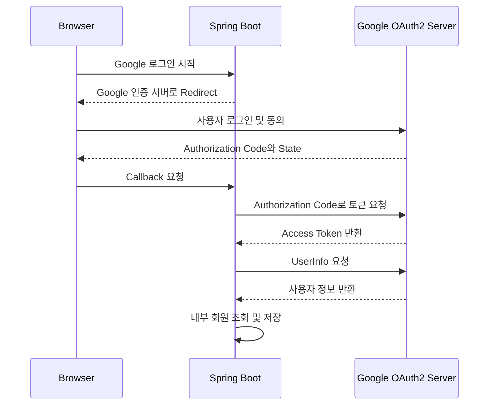
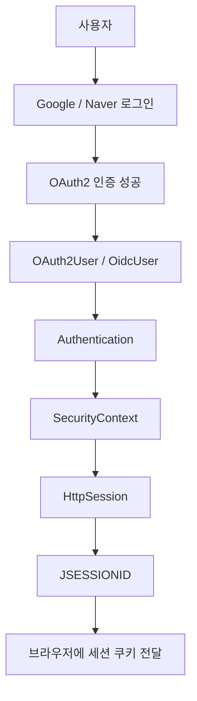
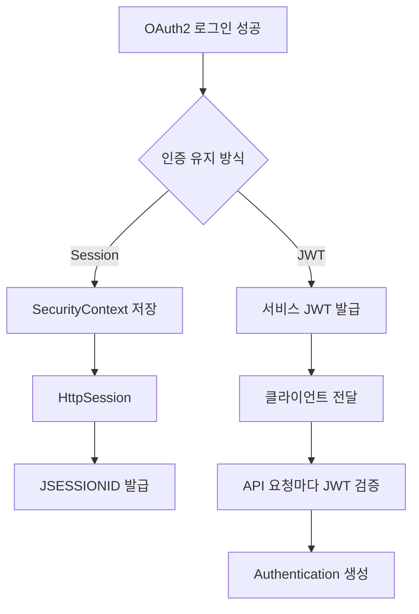
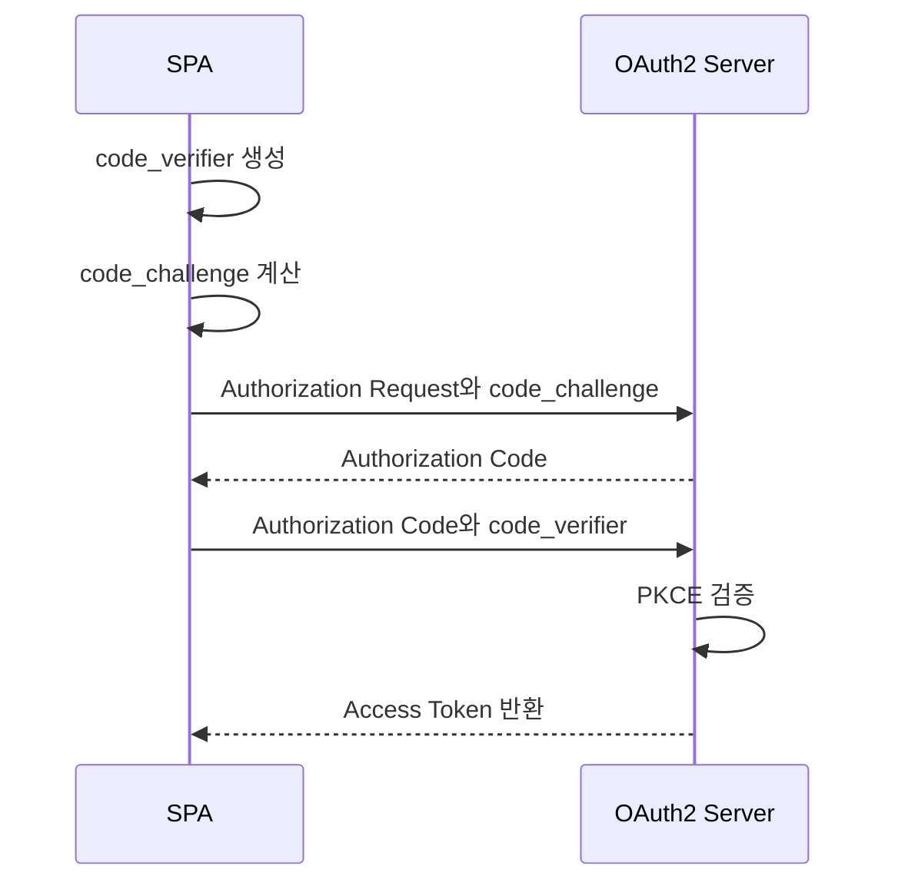
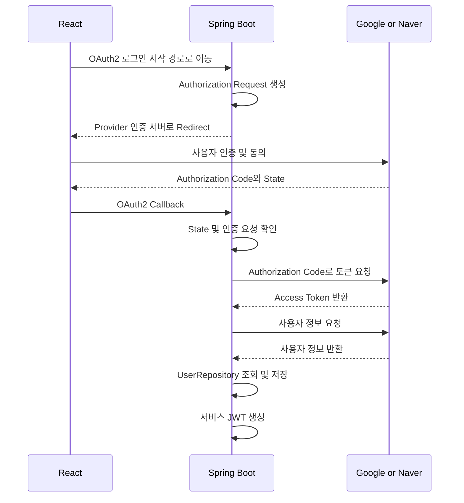
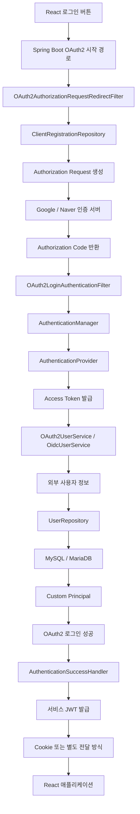
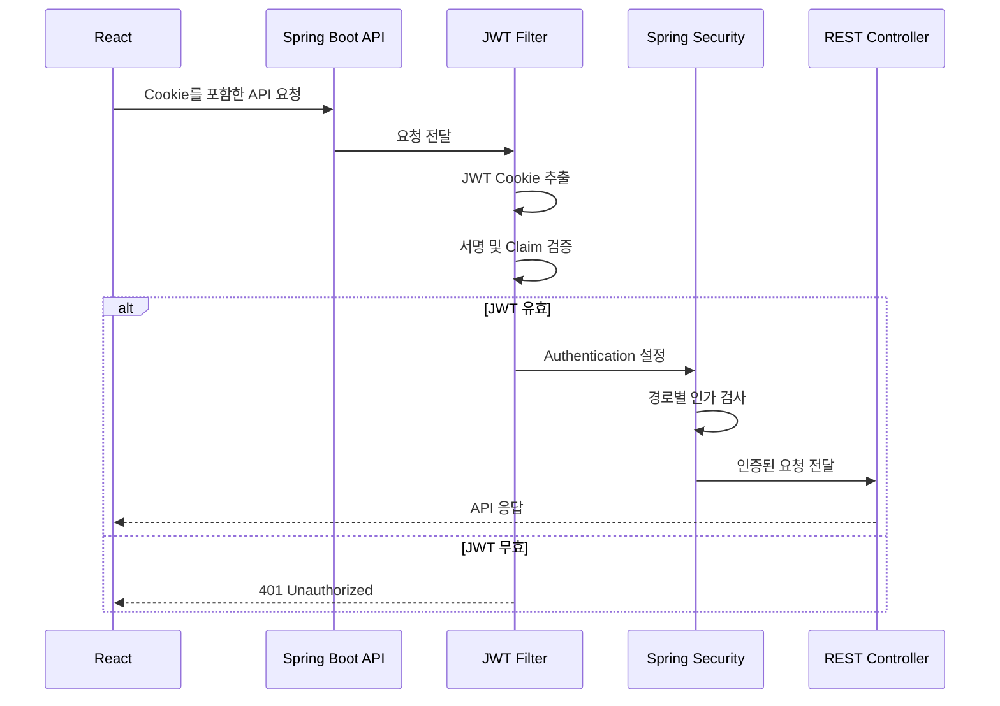
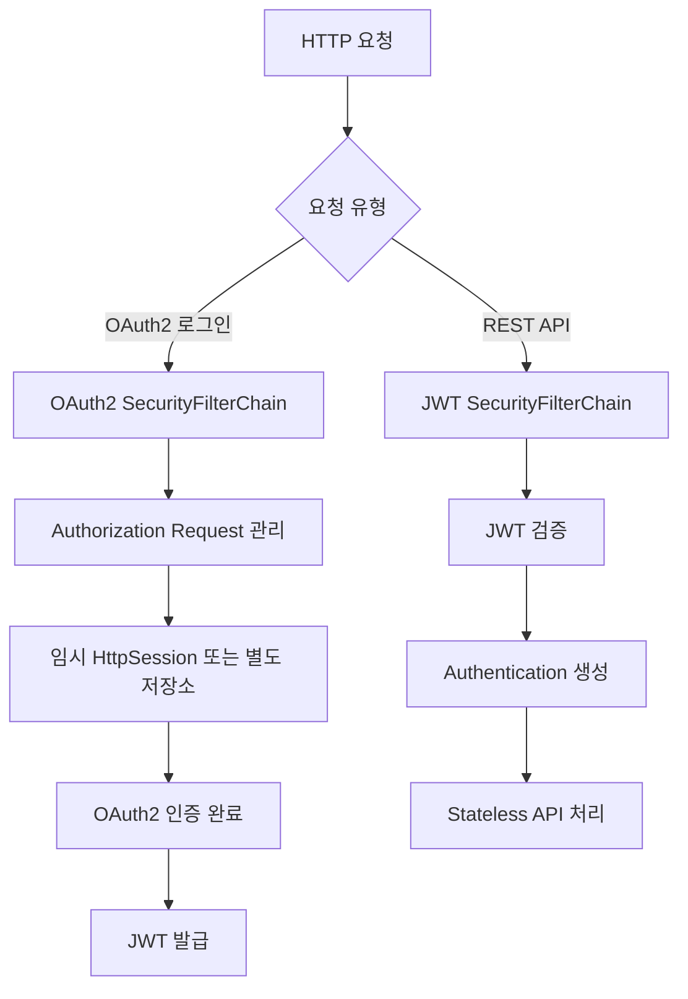
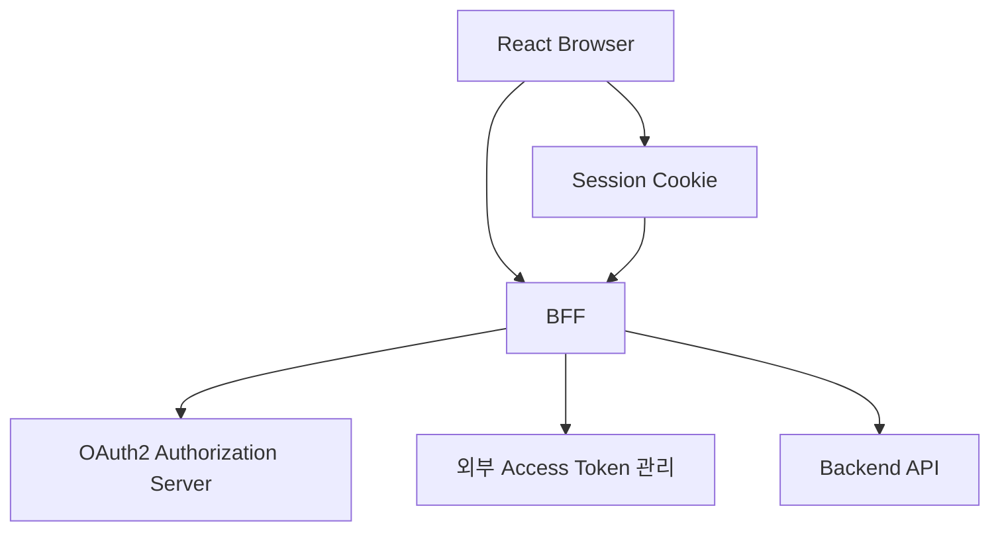
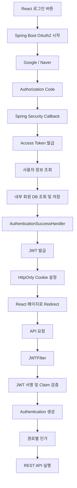

# 스프링 OAuth2 클라이언트 JWT - 2. 동작 원리와 프론트/백 책임 분배
[https://youtu.be/6XZ8oJOex_U?si=hFlQvfaUU4nXk5Eb](https://youtu.be/6XZ8oJOex_U?si=hFlQvfaUU4nXk5Eb)

# 스프링 OAuth2 클라이언트 JWT - 2. 동작 원리와 프론트/백 책임 분배
{:toc}

---

### Spring Security 6 OAuth2 JWT 로그인 동작 원리와 프론트엔드·백엔드 책임 분배

Spring Security OAuth2 Client를 이용하면 Google, Naver와 같은 외부 인증 제공자를 통해 사용자를 인증할 수 있다.

앞서 OAuth2 Authorization Code 방식으로 사용자 인증을 수행하고, 인증된 사용자 정보를 내부 데이터베이스에 저장한 뒤 자체 JWT를 발급하는 구조를 살펴보았다.

여기서 중요한 문제가 하나 있다.

**OAuth2 인증 과정에서 프론트엔드와 백엔드는 각각 어떤 역할을 담당해야 할까?**

일반적인 웹 애플리케이션에서는 프론트엔드가 사용자 화면을 담당하고, 백엔드가 비즈니스 로직과 데이터베이스 처리를 담당한다.

하지만 OAuth2 인증은 단순한 REST API 요청과 다르다.

사용자를 외부 인증 서버로 이동시키고, 인증 완료 후 Authorization Code를 전달받으며, 다시 Access Token으로 교환하는 과정이 필요하기 때문이다.

또한 JWT 기반 인증을 구성한다면 외부 OAuth2 인증에 성공한 이후 우리 서비스에서 사용할 JWT를 발급해야 한다.

이 과정에서 다음과 같은 질문이 발생한다.

- Google 로그인 페이지로 이동시키는 작업은 누가 담당해야 할까?
- Authorization Code는 프론트엔드와 백엔드 중 어디에서 받아야 할까?
- Access Token을 발급받는 작업은 어디에서 수행하는 것이 좋을까?
- 외부 사용자 정보는 어떤 방식으로 백엔드에 전달해야 할까?
- 백엔드에서 생성한 JWT를 React 애플리케이션에 어떻게 전달해야 할까?
- JWT를 Cookie에 저장한다면 프론트엔드는 어떻게 인증 상태를 확인해야 할까?
- JWT 기반 인증인데 OAuth2 로그인 과정에서 HttpSession을 사용해도 괜찮을까?

이러한 문제는 단순히 코드를 어느 위치에 작성할지 결정하는 문제가 아니다.

**사용자 인증의 신뢰 경계와 외부 토큰의 노출 범위를 결정하는 아키텍처 설계 문제다.**

이번에는 OAuth2 Authorization Code의 기본 동작을 다시 살펴보고, 프론트엔드와 백엔드가 책임을 나누는 세 가지 방식을 비교한다.

이후 Spring Security OAuth2 Client와 JWT를 결합하는 구조에서 어떤 방식을 선택할 수 있는지 알아본다.

---

### 개념

#### OAuth2 Authorization Code 방식의 기본 동작

OAuth2 Authorization Code 방식은 사용자가 외부 인증 제공자에서 인증을 완료한 뒤, Authorization Code를 통해 Access Token을 발급받는 방식이다.

예를 들어 우리 서비스에서 Google 로그인을 제공한다고 생각해보자.

사용자는 Google 로그인 버튼을 선택한다.

이후 Google 인증 서버에서 로그인하고, 필요한 정보 제공에 동의한다.

Google은 인증에 성공하면 미리 등록한 Redirect URI로 Authorization Code를 전달한다.

OAuth2 Client는 Authorization Code를 이용해 Google의 Token Endpoint에 Access Token을 요청한다.

Access Token을 획득하면 필요한 경우 UserInfo Endpoint를 호출하여 사용자 정보를 조회한다.

이 과정은 다음과 같이 정리할 수 있다.

```text
1. OAuth2 로그인 요청
       ↓
2. 외부 인증 서버로 이동
       ↓
3. 사용자 로그인 및 동의
       ↓
4. Authorization Code 발급
       ↓
5. Authorization Code로 Access Token 요청
       ↓
6. Access Token 발급
       ↓
7. Access Token으로 사용자 정보 조회
       ↓
8. 외부 사용자 정보 획득
```

전체 흐름을 시퀀스 다이어그램으로 표현하면 다음과 같다.



여기서 주의할 점은 Google이 반드시 별도의 UserInfo API 호출을 요구하는 것은 아니라는 사실이다.

Google에서 OpenID Connect를 사용하는 경우에는 ID Token을 이용해 사용자 인증 정보를 확인할 수 있다.

Spring Security의 `OidcUserService`는 ID Token과 UserInfo Endpoint 설정 등을 이용해 OIDC 사용자 정보를 처리한다.

반면 Naver와 같은 일반 OAuth2 연동에서는 Access Token을 이용해 UserInfo Endpoint에서 사용자 정보를 조회하는 구성이 사용된다.

이번에는 외부 인증 과정의 흐름을 이해하는 데 집중한다.

---

### 세션 방식에서는 어떻게 동작할까?

JWT 기반 인증을 이해하려면 먼저 세션 기반 OAuth2 로그인을 살펴보는 것이 좋다.

세션 방식에서는 외부 인증이 완료된 이후 Spring Security가 `Authentication`을 생성한다.

그리고 Authentication을 `SecurityContext`에 저장한다.

서버는 SecurityContext를 HttpSession을 통해 관리할 수 있다.



로그인 이후의 요청은 다음과 같이 처리된다.

```text
Browser
    ↓
JSESSIONID 전달
    ↓
Spring Security
    ↓
HttpSession 조회
    ↓
SecurityContext 조회
    ↓
Authentication 확인
    ↓
인가 처리
```

예를 들어 사용자가 다음 API에 접근한다고 생각해보자.

```http
GET /api/me HTTP/1.1
Host: api.example.com
Cookie: JSESSIONID=SESSION_ID
```

서버는 세션 식별자를 이용해 저장된 인증 정보를 조회한다.

이때 인증 상태를 결정하는 핵심 데이터는 서버가 관리하는 SecurityContext에 존재한다.

따라서 세션 방식에서는 서버가 인증 상태의 생명주기를 관리하는 역할을 담당한다.

---

### JWT 방식에서는 무엇이 달라질까?

JWT 기반 인증에서는 로그인 성공 이후 별도의 JWT를 발급할 수 있다.

예를 들어 다음과 같은 구조다.

```text
Google / Naver 로그인 성공
    ↓
외부 사용자 정보 조회
    ↓
내부 회원 DB 조회
    ↓
JWT 생성
    ↓
클라이언트에 JWT 전달
    ↓
JWT를 포함한 API 요청
    ↓
JWT 검증
    ↓
Authentication 생성
    ↓
인가 처리
```

핵심적인 차이는 인증 상태를 유지하는 방법이다.

세션 방식에서는 서버에 저장된 Authentication을 재사용한다.

JWT 방식에서는 요청마다 전달받은 JWT를 검증하여 Authentication을 다시 구성할 수 있다.



그러나 JWT 방식에서는 세션 방식에 없던 새로운 문제가 발생한다.

**백엔드에서 생성한 JWT를 프론트엔드에 어떻게 전달할 것인가?**

특히 OAuth2 로그인은 브라우저 리다이렉트를 이용하므로 일반적인 REST API 응답과 동일하게 처리하기 어렵다.

이 문제를 이해하기 위해 먼저 프론트엔드와 백엔드의 책임 분배 방식을 살펴보자.

---

### 왜 사용하는가?

#### 프론트엔드와 백엔드의 책임을 명확하게 분리해야 하는 이유

React와 Spring Boot를 분리하여 개발한다고 생각해보자.

```text
Frontend

http://localhost:3000
```

```text
Backend

http://localhost:8080
```

React는 화면과 사용자 상호작용을 담당한다.

Spring Boot는 비즈니스 로직과 데이터베이스를 관리한다.

그렇다면 OAuth2 인증은 어디에서 수행해야 할까?

다음과 같은 세 가지 구조를 생각할 수 있다.

| 방식 | OAuth2 주요 처리 주체 | 특징 |
|---|---|---|
| 프론트엔드 중심 | SPA 또는 모바일 애플리케이션 | 클라이언트가 OAuth2 Public Client 역할 |
| 프론트엔드·백엔드 분담 | 두 시스템이 역할 분담 | Code 또는 토큰을 안전한 규약에 따라 전달 |
| 백엔드 중심 | Spring Boot | 서버가 OAuth2 Client 역할을 담당 |

세 방식 모두 구현할 수 있다.

다만 각 방식은 서로 다른 보안 요구사항을 가진다.

특히 외부 인증 제공자의 Access Token이나 ID Token을 우리 서비스의 인증 수단으로 사용할 때는 토큰의 발급자, 대상 서비스, 유효기간, 서명 및 사용자 식별자를 적절하게 검증해야 한다.

이러한 검증 없이 외부에서 전달한 사용자 정보를 그대로 신뢰하면 인증 우회 문제가 발생할 수 있다.

---

### 주요 특징

#### 1. 프론트엔드가 OAuth2 인증을 담당하는 방식

첫 번째 방식은 프론트엔드가 OAuth2 인증의 주요 단계를 처리하는 구조다.

예를 들어 React SPA 또는 모바일 애플리케이션이 OAuth2 Client 역할을 수행할 수 있다.

개념적인 흐름은 다음과 같다.

```text
Frontend
    ↓
Google 로그인 요청
    ↓
Authorization Code 발급
    ↓
Authorization Code + PKCE로 토큰 교환
    ↓
외부 사용자 인증 결과 획득
    ↓
Backend에 검증 가능한 인증 정보 전달
    ↓
Backend에서 내부 사용자 확인
    ↓
서비스 JWT 발급
```

여기서 중요한 것은 Authorization Code를 사용하는 클라이언트가 누구인지다.

SPA나 모바일 애플리케이션은 일반적으로 클라이언트 비밀정보를 안전하게 보관할 수 없는 Public Client로 취급한다.

따라서 Client Secret을 프론트엔드 코드에 포함해서는 안 된다.

대신 Authorization Code + PKCE 방식이 사용된다.

#### PKCE란?

PKCE는 Proof Key for Code Exchange의 약자다.

Authorization Code를 요청한 클라이언트와 해당 코드를 Access Token으로 교환하는 클라이언트를 연결하는 데 사용된다.

주요 값은 다음 두 가지다.

```text
code_verifier
```

```text
code_challenge
```

클라이언트는 먼저 예측하기 어려운 `code_verifier`를 생성한다.

이후 해당 값으로부터 `code_challenge`를 계산한다.

Authorization Request에는 `code_challenge`를 포함한다.

그리고 Token Endpoint에서 Authorization Code를 교환할 때 `code_verifier`를 전달한다.



이 구조에서는 Authorization Code가 탈취되더라도 공격자가 올바른 `code_verifier`를 가지고 있지 않다면 토큰 교환에 실패하도록 보호할 수 있다.

따라서 프론트엔드 중심 OAuth2 인증이 무조건 잘못된 방식인 것은 아니다.

다만 프론트엔드가 토큰을 직접 보유하기 때문에 토큰 저장과 XSS 공격 등에 대한 추가적인 보안 설계가 중요하다.

---

### 프론트엔드가 사용자 정보를 백엔드에 전달할 때 주의할 점

프론트엔드에서 OAuth2 인증을 완료했다고 생각해보자.

이후 다음과 같은 사용자 정보를 백엔드로 전달한다.

```http
POST /api/auth/social HTTP/1.1
Host: api.example.com
Content-Type: application/json

{
  "provider": "google",
  "providerUserId": "123456789",
  "email": "user@example.com",
  "name": "홍길동"
}
```

여기서 심각한 문제가 발생할 수 있다.

백엔드가 해당 JSON을 그대로 신뢰한다면 클라이언트가 사용자 식별자를 임의로 변경할 수 있기 때문이다.

예를 들어 공격자가 다음과 같이 요청할 수 있다.

```json
{
  "provider": "google",
  "providerUserId": "admin-user-id",
  "email": "admin@example.com",
  "name": "관리자"
}
```

백엔드가 이 값을 검증하지 않고 JWT를 발급한다면 다른 사용자를 사칭하는 문제가 발생할 수 있다.

따라서 **클라이언트가 전달한 사용자 정보 자체를 인증 증거로 취급해서는 안 된다.**

백엔드는 신뢰할 수 있는 인증 결과를 별도로 검증해야 한다.

예를 들어 Google OIDC ID Token을 전달받았다면 해당 토큰의 서명, 발급자, Audience, 만료 시간 등을 검증해야 한다.

또는 유효한 외부 Access Token을 전달받은 경우 Provider가 지원하는 방식에 따라 서버 측에서 해당 토큰을 검증하고 사용자 정보를 조회할 수 있다.

이때 외부 토큰이 우리 서비스의 인증 흐름에 적합한지 확인하는 과정이 반드시 필요하다.

---

### 2. 프론트엔드와 백엔드가 인증 과정을 분담하는 방식

두 번째 방식은 프론트엔드와 백엔드가 OAuth2 인증 과정을 나누어 처리하는 구조다.

예를 들어 프론트엔드에서 Authorization Code를 발급받고 백엔드에서 토큰 교환을 수행할 수 있다.

```text
Frontend
    ↓
OAuth2 로그인 요청
    ↓
Authorization Code 발급
    ↓
Backend로 Authorization Code 전달
    ↓
Backend
    ↓
Token Endpoint 호출
    ↓
Access Token 발급
    ↓
사용자 정보 조회
    ↓
서비스 JWT 발급
```

이 방식에서는 두 시스템이 인증 관련 정보를 주고받는다.

따라서 다음과 같은 문제를 고려해야 한다.

- Authorization Code를 어떤 클라이언트가 발급받았는가?
- Redirect URI는 어느 시스템을 가리키는가?
- PKCE의 code_verifier는 누가 보관하고 검증 과정에 제공하는가?
- State는 누가 생성하고 관리하는가?
- 백엔드는 전달받은 Code가 정상적인 인증 흐름에서 생성되었다는 사실을 어떻게 확인하는가?
- 인증 코드를 중복 사용하지 않도록 어떻게 처리하는가?

이러한 조건을 고려하지 않고 단순히 프론트엔드에서 Authorization Code를 전달하면 구현이 불안정해질 수 있다.

특히 OAuth2 Client ID와 Redirect URI, PKCE 검증 값의 관계가 맞지 않으면 Token Endpoint에서 인증에 실패할 수 있다.

#### Authorization Code를 프론트엔드에서 백엔드로 전달하면 무조건 위험할까?

그렇지는 않다.

HTTPS와 PKCE, Redirect URI 검증 및 적절한 요청 상태 관리가 구성되어 있다면 브라우저와 백엔드가 Authorization Code 처리 책임을 나누는 구조도 안전하게 설계할 수 있다.

실제로 Backend for Frontend 구조에서도 브라우저가 Authorization Code를 백엔드로 전달하는 과정이 발생한다.

핵심은 단순히 Code가 브라우저를 경유하는지가 아니다.

**어느 시스템이 신뢰할 수 있는 OAuth2 Client인지, 인증 요청의 무결성을 어떻게 보장하는지가 중요하다.**

따라서 이 방식 자체를 잘못된 구현이라고 단정하기보다, 인증 책임이 분산되는 만큼 명확한 계약과 보안 검증이 필요하다고 이해하는 것이 정확하다.

---

### 3. 백엔드가 OAuth2 인증을 담당하는 방식

세 번째 방식은 Spring Boot가 OAuth2 Client 역할을 담당하는 구조다.

프론트엔드는 로그인 버튼을 제공하고, 사용자가 해당 버튼을 클릭하면 백엔드의 OAuth2 로그인 시작 경로로 이동한다.

예를 들어 Google 로그인 버튼은 다음과 같다.

```html
<a href="http://localhost:8080/oauth2/authorization/google">
    Google 로그인
</a>
```

Naver 로그인 버튼은 다음과 같다.

```html
<a href="http://localhost:8080/oauth2/authorization/naver">
    Naver 로그인
</a>
```

사용자가 로그인 버튼을 클릭하면 Spring Security가 인증 절차를 시작한다.

이후 Authorization Code 수신과 Access Token 교환, 사용자 정보 조회는 백엔드에서 처리한다.



여기서 프론트엔드는 OAuth2 인증 서버와의 리다이렉트 과정에 참여한다.

하지만 Authorization Code를 이용한 토큰 교환이나 Client Secret 관리 등 OAuth2 Client의 주요 책임은 백엔드가 담당한다.

즉 백엔드 중심 구조란 브라우저가 인증 과정에 전혀 참여하지 않는다는 의미가 아니다.

**서버가 OAuth2 Client로서 인증 요청과 토큰 교환의 책임을 소유한다는 의미다.**

---

### 세 가지 방식 비교

| 비교 항목 | 프론트엔드 중심 | 프론트엔드·백엔드 분담 | 백엔드 중심 |
|---|---|---|---|
| OAuth2 Client 주체 | SPA 또는 모바일 앱 | 설계에 따라 다름 | Spring Boot |
| Authorization Code 처리 | 프론트엔드 | 분담 | 백엔드 Callback |
| Token Endpoint 호출 | 프론트엔드 | 대체로 백엔드 | 백엔드 |
| Client Secret 보관 | 불가능 | 서버에서 관리 | 서버에서 관리 |
| PKCE | 필수적인 보호 수단 | 설계에 따라 적용 | 적용 권장 |
| 외부 Access Token 노출 | 클라이언트에 존재 가능 | 설계에 따라 다름 | 브라우저에 노출하지 않을 수 있음 |
| 사용자 정보 검증 | 백엔드 검증 필요 | 백엔드 검증 필요 | 백엔드에서 처리 |
| 구현 복잡도 | 토큰 보안 정책 필요 | 책임 경계 조율 필요 | 서버 중심으로 관리 가능 |
| 대표 활용 | SPA, 모바일 Public Client | 하이브리드 구조 | 서버 중심 웹 애플리케이션 |

이 비교에서 중요한 것은 특정 방식이 모든 상황에서 절대적으로 우수하지 않다는 점이다.

프론트엔드가 직접 인증하는 방식은 모바일 애플리케이션이나 Public Client 환경에서 적절할 수 있다.

반면 서버에서 Client Secret과 외부 토큰을 관리해야 하는 서비스라면 백엔드 중심 구조가 유리할 수 있다.

이번에는 Spring Security OAuth2 Client를 활용하는 백엔드 중심 구조를 기준으로 설명한다.

---

### 구조

#### 백엔드 중심 OAuth2 인증과 JWT 발급

이제 백엔드 중심 OAuth2 인증과 JWT 발급 과정을 하나로 연결해보자.

전체 흐름은 다음과 같다.



여기서 중요한 구성요소는 다음과 같다.

| 구성요소 | 역할 |
|---|---|
| `OAuth2AuthorizationRequestRedirectFilter` | OAuth2 로그인 시작 |
| `ClientRegistrationRepository` | Google·Naver Client 정보 조회 |
| `OAuth2LoginAuthenticationFilter` | Authorization Code Callback 처리 |
| `AuthenticationManager` | 인증 처리 위임 |
| `AuthenticationProvider` | 토큰 교환 및 인증 처리 |
| `OAuth2UserService` | 외부 사용자 정보 조회 |
| `OidcUserService` | OIDC 사용자 정보 처리 |
| `UserRepository` | 내부 회원 정보 조회 및 저장 |
| `AuthenticationSuccessHandler` | 로그인 성공 이후 작업 |
| `JWTUtil` | 서비스 JWT 발급 및 검증 |
| `JWTFilter` | API 요청의 JWT 검증 |

이 구조에서 Spring Security가 제공하는 OAuth2 인증 기능은 그대로 활용할 수 있다.

따라서 외부 인증 프로토콜을 직접 구현할 필요가 없다.

우리 서비스에서는 인증 완료 후 JWT를 생성하고, 이후 API 요청에서 해당 JWT를 검증하는 기능을 추가하면 된다.

---

### JWT를 프론트엔드에 어떻게 전달할까?

백엔드 중심 OAuth2 인증에서 가장 중요한 문제 중 하나는 JWT 전달 방식이다.

예를 들어 사용자가 React 애플리케이션에서 Google 로그인 버튼을 클릭했다고 생각해보자.

```javascript
window.location.href =
    "http://localhost:8080/oauth2/authorization/google";
```

이 코드는 브라우저를 Spring Boot의 OAuth2 로그인 시작 경로로 이동시킨다.

이후 브라우저는 Google 인증 서버로 이동한다.

Google 인증이 완료되면 다시 Spring Boot의 Callback 경로로 돌아온다.

Spring Security가 인증에 성공하면 백엔드에서 JWT를 생성할 수 있다.

그렇다면 생성한 JWT를 React 애플리케이션에 어떤 방식으로 전달해야 할까?

일반적으로 다음과 같은 방법을 생각할 수 있다.

#### 1. HTTP 응답 본문으로 전달

REST API에서는 JWT를 JSON 응답으로 전달하는 경우가 많다.

```json
{
  "accessToken": "JWT_VALUE"
}
```

이 방식은 프론트엔드에서 `fetch()`나 `axios`로 API를 호출하는 경우 사용하기 쉽다.

하지만 OAuth2 로그인은 일반적인 AJAX 요청이 아니라 브라우저의 페이지 이동과 리다이렉트를 중심으로 동작한다.

따라서 `window.location.href`로 로그인 요청을 시작했다면 브라우저의 최종 이동 응답을 일반적인 `fetch()` 응답처럼 처리할 수 없다.

즉 다음 흐름이 자동으로 연결되는 것은 아니다.

```text
window.location.href
    ↓
OAuth2 로그인
    ↓
백엔드 JSON 응답
    ↓
React에서 자동으로 JSON 획득
```

일반적인 페이지 이동과 API 응답 처리는 다르기 때문이다.

따라서 별도의 전달 전략이 필요하다.

#### 2. URL Query Parameter로 전달

다음과 같은 방식도 생각할 수 있다.

```text
https://app.example.com/?token=JWT_VALUE
```

그러나 이 방식은 권장하기 어렵다.

URL에 JWT가 포함되면 브라우저 방문 기록이나 접근 로그 등에 노출될 수 있기 때문이다.

또한 잘못된 로그 설정이나 분석 도구로 토큰이 전달될 위험도 있다.

따라서 인증 토큰을 URL Query Parameter에 직접 포함하는 방식은 피하는 것이 좋다.

#### 3. HTTP Cookie로 전달

이번에는 Cookie를 이용하는 방식을 살펴본다.

```text
OAuth2 로그인 성공
    ↓
백엔드 JWT 생성
    ↓
Set-Cookie 응답
    ↓
React 페이지로 Redirect
    ↓
이후 브라우저가 API 요청에 Cookie 자동 첨부
```

이 방식에서는 백엔드가 JWT를 Cookie에 저장하도록 응답한다.

그리고 React 애플리케이션으로 리다이렉트한다.

브라우저는 Cookie의 Domain, Path, Secure, SameSite 등의 조건에 따라 이후 요청에 해당 Cookie를 첨부한다.

따라서 프론트엔드가 JWT 문자열을 직접 읽어야 할 필요가 줄어든다.

---

### 예제

#### 1. React에서 OAuth2 로그인 시작하기

프론트엔드에서는 로그인 버튼을 제공한다.

예를 들어 다음과 같다.

```jsx
function LoginPage() {

    const loginWithGoogle = () => {

        window.location.href =
            "http://localhost:8080/oauth2/authorization/google";
    };

    const loginWithNaver = () => {

        window.location.href =
            "http://localhost:8080/oauth2/authorization/naver";
    };

    return (
        <main>
            <h1>소셜 로그인</h1>

            <button onClick={loginWithGoogle}>
                Google 로그인
            </button>

            <button onClick={loginWithNaver}>
                Naver 로그인
            </button>
        </main>
    );
}

export default LoginPage;
```

여기서 중요한 점은 프론트엔드가 직접 Google이나 Naver의 Authorization URL을 생성하지 않는다는 것이다.

Spring Security의 OAuth2 로그인 시작 경로를 이용한다.

```text
/oauth2/authorization/google
```

```text
/oauth2/authorization/naver
```

따라서 Client ID와 Redirect URI, State 등을 구성하는 작업은 백엔드의 Spring Security가 담당한다.

---

### 2. OAuth2 로그인 성공 이후 JWT 발급

Spring Security는 로그인 성공 이후 추가적인 작업을 수행할 수 있도록 `AuthenticationSuccessHandler`를 제공한다.

이번 구조에서는 로그인 성공 이후 JWT를 발급하는 용도로 사용할 수 있다.

```text
OAuth2 인증 성공
    ↓
Authentication 생성
    ↓
AuthenticationSuccessHandler
    ↓
내부 사용자 정보 확인
    ↓
JWT 생성
    ↓
Cookie 설정
    ↓
React 페이지로 Redirect
```

이때 AuthenticationSuccessHandler는 이미 인증된 Authentication을 전달받는다.

따라서 Google이나 Naver에 다시 인증을 요청할 필요는 없다.

또한 앞서 `CustomOAuth2UserService`와 `CustomOidcUserService`에서 내부 사용자 정보를 조회하고 저장했다면 해당 결과를 활용할 수 있다.

#### JWT 발급 서비스의 책임

JWT를 발급하는 기능은 별도의 서비스로 분리하는 것이 좋다.

예를 들어 다음과 같은 인터페이스를 생각할 수 있다.

```java
package com.example.oauthjwt.jwt;

import java.util.Collection;

import org.springframework.security.core.GrantedAuthority;

public interface JwtIssuer {

    String issue(
            String principalName,
            Collection<? extends GrantedAuthority> authorities
    );
}
```

이 인터페이스는 인증된 사용자의 식별자와 권한을 이용해 JWT를 생성하는 역할을 표현한다.

실제 구현체에서는 JWT 서명키와 만료 시간, 발급자, Audience 등의 정책을 적용해야 한다.

이번에는 JWT 생성 알고리즘 자체보다 로그인 성공 이후 JWT를 전달하는 구조에 집중한다.

---

### 3. CustomSuccessHandler 구현

다음으로 로그인 성공 이후 실행할 Handler를 구현한다.

```java
package com.example.oauthjwt.handler;

import java.io.IOException;
import java.time.Duration;

import com.example.oauthjwt.jwt.JwtIssuer;

import jakarta.servlet.ServletException;
import jakarta.servlet.http.HttpServletRequest;
import jakarta.servlet.http.HttpServletResponse;

import org.springframework.http.HttpHeaders;
import org.springframework.http.ResponseCookie;

import org.springframework.security.core.Authentication;
import org.springframework.security.web.authentication.AuthenticationSuccessHandler;

import org.springframework.stereotype.Component;

@Component
public class CustomSuccessHandler
        implements AuthenticationSuccessHandler {

    private final JwtIssuer jwtIssuer;

    public CustomSuccessHandler(
            JwtIssuer jwtIssuer
    ) {
        this.jwtIssuer = jwtIssuer;
    }

    @Override
    public void onAuthenticationSuccess(
            HttpServletRequest request,
            HttpServletResponse response,
            Authentication authentication
    ) throws IOException, ServletException {

        // 인증된 사용자 식별자
        String principalName =
                authentication.getName();

        // 자체 JWT 발급
        String jwt = jwtIssuer.issue(
                principalName,
                authentication.getAuthorities()
        );

        // HttpOnly Cookie 생성
        ResponseCookie cookie =
                ResponseCookie.from("SERVICE_ACCESS", jwt)
                        .httpOnly(true)
                        .secure(true)
                        .sameSite("Lax")
                        .path("/")
                        .maxAge(Duration.ofMinutes(15))
                        .build();

        // Set-Cookie 응답 헤더 추가
        response.addHeader(
                HttpHeaders.SET_COOKIE,
                cookie.toString()
        );

        // 로그인 이후 프론트엔드로 이동
        response.sendRedirect(
                "https://app.example.com/"
        );
    }
}
```

위 코드는 HTTPS 운영 환경에서 Cookie를 전달하는 핵심 연동 예시다.

`JwtIssuer`의 실제 구현과 JWT 검증 기능은 별도로 구성해야 한다.

또한 `authentication.getName()`은 실제 서비스의 안정적인 회원 식별자를 반환하도록 설계하는 것이 좋다.

기존 CustomOAuth2User와 CustomOidcUser의 `getName()`이 외부 사용자 식별자를 반환한다면, 내부 회원 ID를 사용하는 정책과 비교하여 적절한 식별자를 선택해야 한다.

여기서 중요한 코드를 살펴보자.

---

### ResponseCookie란?

Spring Framework는 HTTP Cookie를 생성하기 위한 `ResponseCookie` 클래스를 제공한다.

이번에는 다음과 같이 사용했다.

```java
ResponseCookie cookie =
        ResponseCookie.from("SERVICE_ACCESS", jwt)
                .httpOnly(true)
                .secure(true)
                .sameSite("Lax")
                .path("/")
                .maxAge(Duration.ofMinutes(15))
                .build();
```

각 옵션의 의미는 다음과 같다.

| 옵션 | 역할 |
|---|---|
| `SERVICE_ACCESS` | Cookie 이름 |
| `jwt` | Cookie에 저장할 JWT |
| `httpOnly(true)` | JavaScript에서 Cookie 값 직접 접근 제한 |
| `secure(true)` | HTTPS 연결에서만 Cookie 전송 |
| `sameSite("Lax")` | 교차 사이트 요청에서 Cookie 전송 범위 제한 |
| `path("/")` | 해당 호스트의 전체 경로에 Cookie 적용 |
| `maxAge()` | Cookie 유효기간 설정 |

이때 Cookie의 유효기간과 JWT의 만료 시간을 함께 관리해야 한다.

예를 들어 JWT는 15분 후 만료되는데 Cookie는 30일 동안 유지된다면, Cookie가 존재하더라도 JWT 검증에는 실패할 수 있다.

따라서 서로 다른 만료 정책을 사용하는 이유가 명확하지 않다면 Cookie와 JWT의 수명을 일관되게 관리하는 것이 좋다.

또한 위 예제의 `secure(true)`는 HTTPS 환경을 전제로 한다.

HTTP 기반 로컬 개발 환경에서는 별도의 개발용 Cookie 설정이 필요할 수 있다.

운영 환경에서 Secure 속성을 제거하는 방식으로 해결해서는 안 된다.

---

### 4. JWT를 Cookie에 저장한 뒤 Redirect하는 이유

다음 코드를 살펴보자.

```java
response.addHeader(
        HttpHeaders.SET_COOKIE,
        cookie.toString()
);
```

이 코드는 HTTP 응답에 Set-Cookie 헤더를 추가한다.

이후 다음 코드를 실행한다.

```java
response.sendRedirect(
        "https://app.example.com/"
);
```

브라우저는 Set-Cookie 응답을 처리한 뒤 지정된 주소로 이동할 수 있다.

개념적인 HTTP 응답은 다음과 같다.

```http
HTTP/1.1 302 Found
Location: https://app.example.com/
Set-Cookie: SERVICE_ACCESS=JWT_VALUE; Path=/; Max-Age=900; HttpOnly; Secure; SameSite=Lax
```

여기서 중요한 점이 있다.

Set-Cookie는 JWT를 브라우저가 저장하도록 하는 응답 헤더다.

Location은 브라우저가 이동할 주소다.

즉 서로 다른 역할을 가진다.

```text
Set-Cookie
    ↓
브라우저에 인증 Cookie 저장
```

```text
Location
    ↓
프론트엔드 페이지로 이동
```

이 방식을 이용하면 JWT를 URL Query Parameter에 직접 포함하지 않고도 로그인 성공 이후 프론트엔드 화면으로 이동할 수 있다.

---

### 5. SecurityConfig에 SuccessHandler 등록

이제 Spring Security의 OAuth2 로그인에 CustomSuccessHandler를 연결한다.

핵심 설정은 다음과 같다.

```java
.oauth2Login(oauth2 -> oauth2

        .successHandler(customSuccessHandler)

)
```

기존 사용자 정보 처리 서비스와 함께 구성하면 다음과 같다.

```java
.oauth2Login(oauth2 -> oauth2

        .userInfoEndpoint(userInfo -> userInfo

                .userService(customOAuth2UserService)

                .oidcUserService(customOidcUserService)
        )

        .successHandler(customSuccessHandler)
)
```

여기서 각 구성요소의 역할은 다음과 같다.

| 구성요소 | 역할 |
|---|---|
| CustomOAuth2UserService | 일반 OAuth2 사용자 정보 처리 |
| CustomOidcUserService | OIDC 사용자 정보 처리 |
| CustomSuccessHandler | 인증 성공 이후 JWT 발급 및 전달 |

중요한 점은 SuccessHandler가 외부 사용자 인증을 다시 수행하는 것이 아니라는 사실이다.

OAuth2LoginAuthenticationFilter가 AuthenticationManager를 통해 인증에 성공하면 이후 성공 처리 단계에서 실행된다.

따라서 외부 인증 로직과 JWT 발급 로직을 분리할 수 있다.

---

### 6. 프론트엔드는 JWT를 어떻게 사용할까?

앞의 예제에서는 JWT를 HttpOnly Cookie에 저장했다.

따라서 React에서 다음과 같이 Cookie 값을 직접 읽을 수 없다.

```javascript
document.cookie
```

HttpOnly 속성이 적용된 Cookie는 JavaScript에서 직접 접근할 수 없기 때문이다.

그렇다면 React는 어떻게 인증된 사용자로 API를 호출할 수 있을까?

브라우저가 Cookie를 자동으로 전송하도록 구성할 수 있다.

예를 들어 다음과 같다.

```javascript
async function getCurrentUser() {

    const response = await fetch(
        "https://api.example.com/api/me",
        {
            method: "GET",
            credentials: "include"
        }
    );

    if (!response.ok) {
        throw new Error("사용자 정보를 조회하지 못했습니다.");
    }

    return response.json();
}
```

여기서 중요한 옵션은 다음과 같다.

```javascript
credentials: "include"
```

이 옵션은 브라우저가 교차 출처 요청에서 Cookie 등 자격 증명을 포함할 수 있도록 지정한다.

다만 실제 Cookie가 전송되는지는 Domain, Path, Secure, SameSite 및 브라우저 정책에 따라 달라진다.

또한 프론트엔드와 백엔드가 서로 다른 Origin이라면 서버의 CORS 설정도 필요하다.

예를 들어 다음과 같은 환경이다.

```text
Frontend

https://app.example.com
```

```text
Backend

https://api.example.com
```

두 주소는 서로 다른 Origin이지만 같은 사이트에 속할 수 있다.

따라서 Cookie 정책과 CORS를 적절하게 구성하면 인증 Cookie를 포함한 API 요청을 사용할 수 있다.

반면 프론트엔드와 백엔드가 완전히 다른 사이트에 존재한다면 SameSite 및 브라우저의 서드파티 Cookie 제한을 추가로 고려해야 한다.

---

### JWT를 Cookie로 전달할 때 반드시 알아야 할 차이

JWT는 일반적으로 Authorization 헤더에 포함하여 전달할 수 있다.

```http
Authorization: Bearer JWT_VALUE
```

하지만 이번에는 Cookie에 JWT를 저장했다.

```http
Cookie: SERVICE_ACCESS=JWT_VALUE
```

두 방식은 JWT를 전달하는 위치가 다르다.

따라서 백엔드의 JWT 검증 방식도 달라져야 한다.

예를 들어 JWTFilter가 Authorization 헤더만 확인한다면 Cookie에 저장된 JWT를 읽을 수 없다.

```text
JWTFilter
    ↓
Authorization Header 조회
    ↓
JWT 없음
```

반면 Cookie 기반 구조라면 다음과 같은 처리가 필요하다.

```text
JWTFilter
    ↓
Cookie 조회
    ↓
SERVICE_ACCESS 확인
    ↓
JWT 추출
    ↓
JWT 검증
    ↓
Authentication 생성
```

Spring Security Resource Server를 사용한다면 기본 Bearer Token Resolver는 일반적으로 Authorization 헤더를 이용한다.

Cookie에 저장된 JWT를 인증에 사용하려면 커스텀 `BearerTokenResolver` 등을 통해 Cookie에서 토큰을 추출하도록 구성할 수 있다.

즉 **JWT의 저장 위치와 Spring Security가 JWT를 추출하는 위치는 반드시 일치해야 한다.**

---

### JWT 기반 API 요청의 전체 흐름

이제 로그인 이후 API 요청을 살펴보자.



여기서 중요한 부분은 JWT 검증 이후의 처리다.

JWT 검증에 성공하면 Spring Security가 사용할 Authentication을 구성한다.

이후 `SecurityContextHolder`에 Authentication을 설정한다.

하지만 이 작업이 반드시 서버 세션에 인증 정보를 저장하는 것은 아니다.

Stateless API에서는 요청이 종료되면 현재 요청에 사용한 인증 정보도 정리된다.

다음 요청에서는 Cookie에 포함된 JWT를 다시 검증한다.

이것이 JWT 기반 인증의 주요 특징이다.

---

### OAuth2 로그인 과정과 JWT 기반 API 인증의 세션 정책

여기서 한 가지 중요한 문제가 발생한다.

JWT 기반 API에서는 일반적으로 다음 설정을 사용할 수 있다.

```java
.sessionManagement(session -> session

        .sessionCreationPolicy(
                SessionCreationPolicy.STATELESS
        )
)
```

이 설정은 Spring Security가 인증 상태를 HttpSession에 저장하지 않는 방식으로 API를 구성할 때 사용한다.

하지만 OAuth2 로그인은 여러 HTTP 요청에 걸쳐 진행된다.

```text
OAuth2 로그인 시작
    ↓
Authorization Request 생성
    ↓
State 저장
    ↓
Google / Naver 인증
    ↓
Callback
    ↓
State 확인
```

따라서 로그인 시작 시 생성한 Authorization Request를 Callback 시점에 다시 확인할 수 있어야 한다.

Spring Security의 기본 OAuth2 로그인 구성에서는 이 정보를 HttpSession에 저장할 수 있다.

그런데 OAuth2 로그인과 JWT API 인증을 하나의 SecurityFilterChain에서 무조건 Stateless로 설정하면 Authorization Request를 정상적으로 복원하지 못하는 문제가 발생할 수 있다.

대표적으로 다음 오류를 확인할 수 있다.

```text
authorization_request_not_found
```

따라서 두 영역을 분리하여 설계하는 것이 좋다.



이러한 구조에서는 OAuth2 로그인 과정에서 필요한 임시 상태를 유지하면서 일반 API 요청은 JWT 기반으로 처리할 수 있다.

다만 SecurityFilterChain을 분리할 때는 요청 경로, 필터 적용 순서, 인증 성공 처리와 CSRF 설정까지 함께 검토해야 한다.

---

### 실무에서의 활용

#### 1. OAuth2 인증 책임을 어느 계층에 둘지 먼저 결정한다

JWT 발급 로직을 구현하기 전에 OAuth2 Client가 프론트엔드인지 백엔드인지 결정해야 한다.

이 결정에 따라 ClientRegistration, Redirect URI, Token Endpoint 호출 위치, Client Secret 관리 방식이 달라진다.

일반적인 Spring Boot 중심 웹 서비스에서는 백엔드가 OAuth2 Client 역할을 담당하도록 구성할 수 있다.

반면 SPA가 직접 OAuth2 Client 역할을 수행해야 한다면 Authorization Code + PKCE와 Public Client 보안 정책을 적용해야 한다.

#### 2. 외부 사용자 정보를 인증 증거로 신뢰하지 않는다

클라이언트가 전달한 사용자 ID와 이메일만으로 JWT를 발급해서는 안 된다.

예를 들어 다음 값은 클라이언트가 임의로 작성할 수 있다.

```json
{
  "email": "admin@example.com",
  "role": "ROLE_ADMIN"
}
```

백엔드는 이러한 값을 그대로 신뢰해서는 안 된다.

외부 인증 제공자가 발급한 검증 가능한 토큰이나 서버 측 사용자 정보 조회 결과를 이용해야 한다.

#### 3. Authorization Code와 Access Token의 노출 범위를 최소화한다

백엔드 중심 구조에서는 외부 Access Token을 백엔드 내부에서 관리할 수 있다.

따라서 브라우저에 외부 Access Token을 불필요하게 전달하지 않을 수 있다.

이렇게 하면 프론트엔드가 외부 토큰의 저장과 갱신, 노출 위험을 직접 관리해야 하는 부담을 줄일 수 있다.

다만 백엔드 내부 저장소의 토큰 보호 정책은 별도로 필요하다.

#### 4. JWT를 URL에 포함하여 전달하지 않는다

다음과 같은 방식은 피하는 것이 좋다.

```text
https://app.example.com/?jwt=TOKEN
```

JWT가 브라우저 기록이나 서버 접근 로그 등에 노출될 수 있기 때문이다.

Cookie를 이용하거나 안전하게 설계된 별도의 토큰 전달 프로토콜을 사용하는 것이 좋다.

#### 5. HttpOnly Cookie의 역할을 정확하게 이해한다

HttpOnly는 JavaScript가 Cookie 값을 직접 읽지 못하도록 제한한다.

하지만 브라우저가 해당 Cookie를 포함하여 요청을 보내는 것은 가능하다.

따라서 HttpOnly Cookie는 토큰 원문 노출 위험을 줄이는 데 도움이 되지만, XSS 공격으로 인한 모든 위험을 제거하는 것은 아니다.

악성 스크립트가 사용자의 브라우저에서 인증된 요청을 수행할 가능성도 고려해야 한다.

#### 6. Cookie 기반 JWT 인증에는 CSRF 보호가 필요하다

JWT를 사용한다고 해서 CSRF 공격이 자동으로 방지되는 것은 아니다.

브라우저가 JWT Cookie를 자동으로 전송하는 경우에는 CSRF 위험이 발생할 수 있다.

따라서 상태를 변경하는 API에는 CSRF Token이나 검증된 Origin 정책 등 적절한 보호 수단을 적용해야 한다.

특히 `SessionCreationPolicy.STATELESS`를 적용했다는 이유만으로 CSRF 보호를 무조건 비활성화해서는 안 된다.

#### 7. CORS와 Cookie 정책은 별도로 이해한다

CORS는 브라우저의 교차 출처 요청을 제어하는 정책이다.

Cookie의 SameSite 속성은 교차 사이트 요청에서 Cookie가 전송되는 범위를 제어한다.

두 개념은 서로 다르다.

예를 들어 CORS가 정상적으로 구성되어 있더라도 Cookie의 SameSite 정책 때문에 Cookie가 전송되지 않을 수 있다.

반대로 Cookie가 전송되더라도 CORS 설정이 잘못되어 있다면 프론트엔드가 응답을 읽지 못할 수 있다.

따라서 두 정책을 함께 검증해야 한다.

#### 8. OAuth2 로그인 세션과 JWT 인증 상태를 구분한다

OAuth2 로그인에서 사용하는 HttpSession은 Authorization Request와 State를 보관하는 용도로 사용될 수 있다.

반면 JWT 기반 API에서는 요청마다 JWT를 검증하여 Authentication을 구성할 수 있다.

따라서 JWT 기반 서비스에서 HttpSession이 일부 사용된다고 해서 전체 API가 반드시 Stateful 인증이라는 의미는 아니다.

중요한 것은 어떤 정보를 어떤 목적으로 저장하는지다.

#### 9. JWT를 Cookie에 저장했다면 검증 필터도 Cookie를 읽어야 한다

JWT를 발급할 때는 Cookie에 저장하고, 검증할 때는 Authorization 헤더만 조회한다면 인증이 정상적으로 동작하지 않는다.

따라서 JWT 발급과 전달, 추출, 검증의 경로를 일관되게 구성해야 한다.

```text
JWT 발급
    ↓
Cookie 저장
    ↓
Cookie 전송
    ↓
Cookie에서 JWT 추출
    ↓
JWT 검증
```

이 구조를 먼저 정의한 뒤 JWTFilter를 구현하는 것이 좋다.

#### 10. JWT Claim에 내부 회원 식별자를 사용한다

외부 OAuth2 인증 이후에는 내부 회원 정보를 조회한다.

이때 내부 회원 ID를 JWT Subject로 사용할 수 있다.

```text
Google User ID
    ↓
UserRepository
    ↓
Internal User ID
    ↓
JWT Subject
```

이렇게 하면 외부 인증 제공자의 사용자 식별자와 내부 서비스의 회원 식별 체계를 분리할 수 있다.

단, 실제 서비스에서 Principal의 이름을 변경한다면 기존 OAuth2AuthorizedClient 저장소의 principalName과의 관계도 함께 확인해야 한다.

#### 11. 인증 성공 이후 JWT 발급과 DB 저장의 순서를 고려한다

외부 인증에 성공했다고 해서 내부 회원 등록이 항상 성공하는 것은 아니다.

예를 들어 다음과 같은 상황이 발생할 수 있다.

```text
OAuth2 인증 성공
    ↓
UserRepository 저장 실패
    ↓
JWT 발급 시도
```

이 경우 내부 회원 정보가 정상적으로 저장되지 않았는데 JWT를 발급해서는 안 된다.

따라서 내부 사용자 조회 및 저장이 성공한 이후 JWT를 발급하는 것이 적절하다.

#### 12. JWT 발급 실패에 대한 별도의 처리가 필요하다

OAuth2 인증에는 성공했지만 JWT 생성 과정에서 오류가 발생할 수 있다.

예를 들어 서명키 설정 오류나 내부 회원 정보 누락 등이 발생할 수 있다.

이 경우 사용자에게 로그인 성공으로 응답해서는 안 된다.

따라서 OAuth2 인증 성공과 최종 서비스 로그인 성공은 구분할 필요가 있다.

#### 13. JWT 기반 인증에서는 로그아웃 정책을 별도로 정의한다

세션 방식에서는 서버가 HttpSession을 무효화할 수 있다.

반면 JWT 기반 인증에서는 Cookie를 삭제하더라도 이미 발급된 JWT 자체가 즉시 무효화되는 것은 아니다.

따라서 서비스 보안 수준에 따라 토큰 폐기 목록이나 Token Version 등의 방법을 고려할 수 있다.

특히 결제 및 개인정보와 관련된 민감한 API에서는 즉시 로그아웃 요구사항을 별도로 검토해야 한다.

#### 14. 웹과 모바일은 인증 책임 분배가 다를 수 있다

브라우저 기반 웹 애플리케이션과 네이티브 모바일 애플리케이션은 실행 환경이 다르다.

브라우저에서는 Cookie를 이용한 인증 상태 관리가 자연스러울 수 있다.

반면 모바일 애플리케이션에서는 운영체제의 보안 저장소와 Authorization Code + PKCE를 이용하는 구조를 고려할 수 있다.

따라서 모든 클라이언트에 동일한 OAuth2 구현 방식을 강제하기보다 실행 환경과 보안 요구사항을 고려해야 한다.

#### 15. BFF 아키텍처도 함께 고려할 수 있다

Backend for Frontend는 브라우저와 백엔드 API 사이에 프론트엔드 전용 서버 계층을 두는 구조다.

OAuth2 인증에서 BFF를 사용하면 외부 OAuth2 토큰을 서버 측에서 관리하고 브라우저에는 세션 Cookie를 전달하는 방식을 구성할 수 있다.



여기서 BFF가 사용하는 세션 Cookie와 이번에 살펴본 JWT Cookie는 서로 다른 설계라는 점에 주의해야 한다.

BFF에서는 브라우저에 외부 Access Token을 노출하지 않는 구조를 만들 수 있다.

따라서 높은 수준의 토큰 보호가 필요한 브라우저 기반 서비스라면 BFF 방식도 비교할 가치가 있다.

---

### 정리

OAuth2 Authorization Code 방식에서는 사용자 인증을 수행한 이후 Authorization Code를 발급받는다.

그리고 Authorization Code를 Access Token으로 교환하여 사용자 정보를 확인한다.

JWT 기반 소셜 로그인을 구현하려면 이러한 외부 인증 과정을 처리하는 주체와 JWT를 발급하고 검증하는 주체를 명확하게 정의해야 한다.

크게 다음 세 가지 구성이 가능하다.

**첫 번째는 프론트엔드 중심 방식이다.**

SPA나 모바일 애플리케이션이 OAuth2 Client 역할을 담당한다.

이 경우 Authorization Code + PKCE를 사용하고 Client Secret을 프론트엔드에 노출하지 않아야 한다.

**두 번째는 프론트엔드와 백엔드가 책임을 나누는 방식이다.**

이 구조에서는 Authorization Code와 PKCE, State, Redirect URI 관리 책임을 명확하게 정의해야 한다.

단순히 프론트엔드에서 Authorization Code를 백엔드로 전달한다는 사실만으로 잘못된 구현이라고 판단할 수는 없다.

**세 번째는 백엔드 중심 방식이다.**

Spring Boot가 OAuth2 Client 역할을 담당한다.

프론트엔드는 Spring Security의 OAuth2 로그인 시작 경로로 브라우저를 이동시킨다.

이후 백엔드에서 Authorization Code 교환과 사용자 정보 조회, 내부 회원 저장을 수행한다.

그리고 최종적으로 우리 서비스에서 사용할 JWT를 발급한다.

이번에 살펴본 구조는 다음과 같다.



여기서 반드시 기억해야 할 핵심은 다음과 같다.

**첫째, OAuth2 인증을 담당하는 주체를 먼저 결정해야 한다.**

**둘째, 프론트엔드 중심 OAuth2 인증에서는 Authorization Code + PKCE를 사용해야 한다.**

**셋째, 클라이언트가 전달한 사용자 정보를 검증 없이 신뢰해서는 안 된다.**

**넷째, 백엔드 중심 구조에서는 Spring Security OAuth2 Client 기능을 활용할 수 있다.**

**다섯째, JWT는 OAuth2 인증에 성공한 이후 내부 회원 정보를 기준으로 발급할 수 있다.**

**여섯째, 브라우저 리다이렉트와 일반적인 AJAX 응답 처리는 서로 다르다.**

**일곱째, JWT를 URL Query Parameter에 직접 포함하는 방식은 피하는 것이 좋다.**

**여덟째, HttpOnly Cookie를 이용해 JWT를 브라우저에 전달할 수 있다.**

**아홉째, Cookie 기반 JWT 인증에서는 CSRF 보호와 Cookie 정책을 고려해야 한다.**

**열째, JWT를 Cookie에 저장했다면 JWT 검증 구성요소도 Cookie에서 토큰을 추출하도록 구성해야 한다.**

**열한째, OAuth2 로그인 과정의 임시 상태 저장과 JWT 기반 API 인증의 Stateless 정책은 구분해야 한다.**

**열두째, 외부 OAuth2 Access Token과 우리 서비스 JWT는 서로 다른 목적을 가진다.**

**열셋째, JWT 인증에 성공하면 요청별 Authentication을 구성하여 Spring Security의 인가 기능을 사용할 수 있다.**

**열넷째, 웹과 모바일의 특성에 따라 인증 책임 분배 방식은 달라질 수 있다.**

**열다섯째, 토큰 노출을 최소화해야 하는 브라우저 기반 서비스에서는 BFF 아키텍처도 함께 고려할 수 있다.**

이러한 구조를 이해하면 Spring Security OAuth2 Client와 JWT를 결합하는 과정에서 단순히 로그인 기능을 구현하는 것을 넘어, 각 시스템의 책임과 보안 경계를 명확하게 설계할 수 있다.

특히 **OAuth2 인증 과정과 JWT 기반 API 인증 과정은 서로 연결되어 있지만 서로 다른 책임을 가진다는 점**이 중요하다.

OAuth2 인증 단계에서는 외부 사용자의 신원을 확인한다.

JWT 발급 단계에서는 내부 서비스 회원을 식별한다.

JWT 검증 단계에서는 이후 API 요청의 인증과 인가를 수행한다.

이러한 역할을 분리하면 인증 방식의 변경이나 프론트엔드 구조의 변경에도 유연하게 대응할 수 있다.

#### 한 줄 요약

Spring Security 6에서 OAuth2 Client와 JWT를 결합하려면 먼저 프론트엔드와 백엔드 중 어느 쪽이 OAuth2 인증을 담당할지 결정해야 한다. 백엔드 중심 구조에서는 프론트엔드가 `/oauth2/authorization/{registrationId}` 경로로 브라우저를 이동시키고, Spring Security가 Authorization Code 수신과 Access Token 교환 및 사용자 정보 조회를 수행한다. 이후 내부 회원 정보를 확인하고 AuthenticationSuccessHandler에서 서비스 JWT를 발급할 수 있다. JWT는 HttpOnly Cookie 등을 통해 전달할 수 있으며, 이후 API 요청에서는 JWT를 검증하여 Authentication을 구성한다. 이때 OAuth2 인증 과정의 임시 상태 관리와 JWT 기반 API의 Stateless 인증 정책을 구분하고, Cookie 보안과 CSRF 보호까지 함께 설계하는 것이 중요하다.
