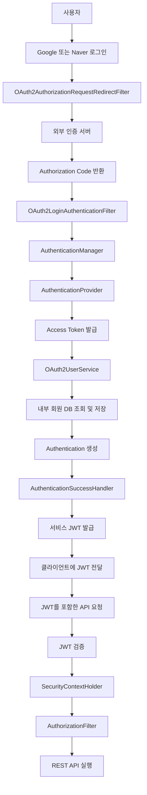
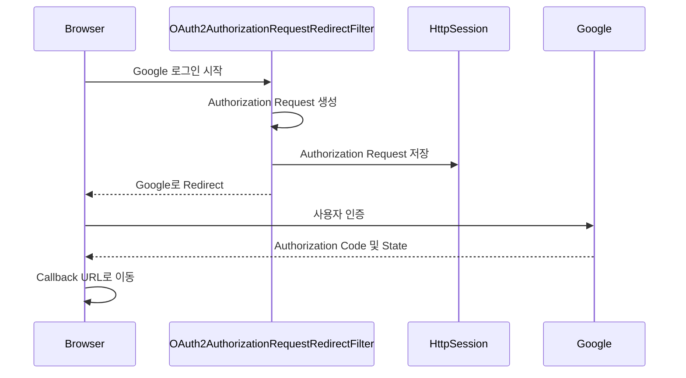
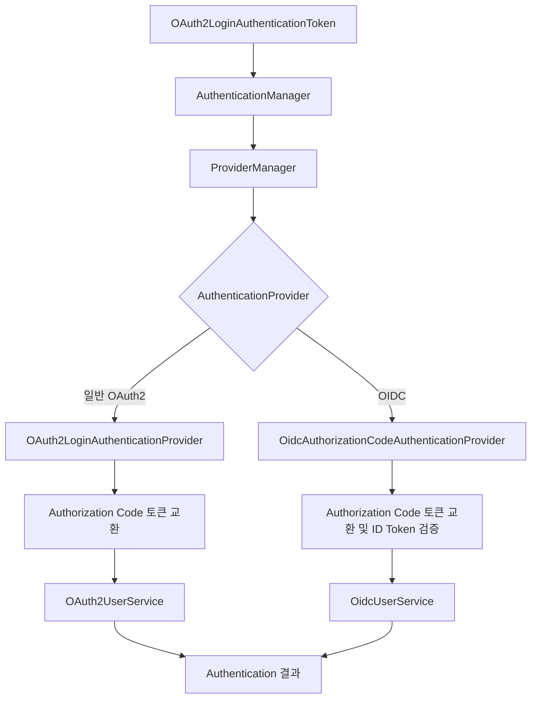
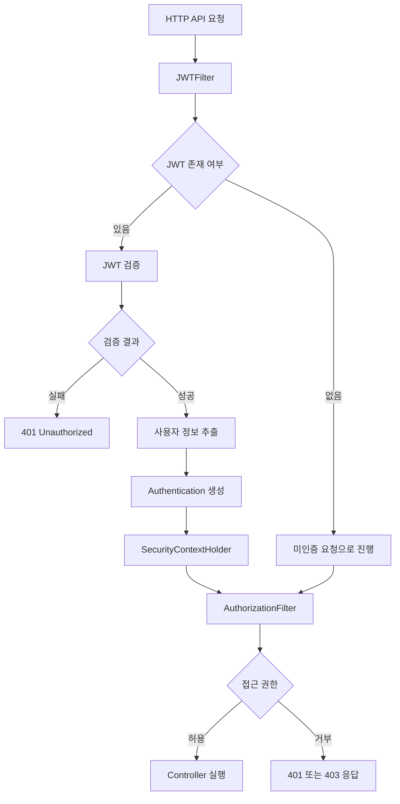
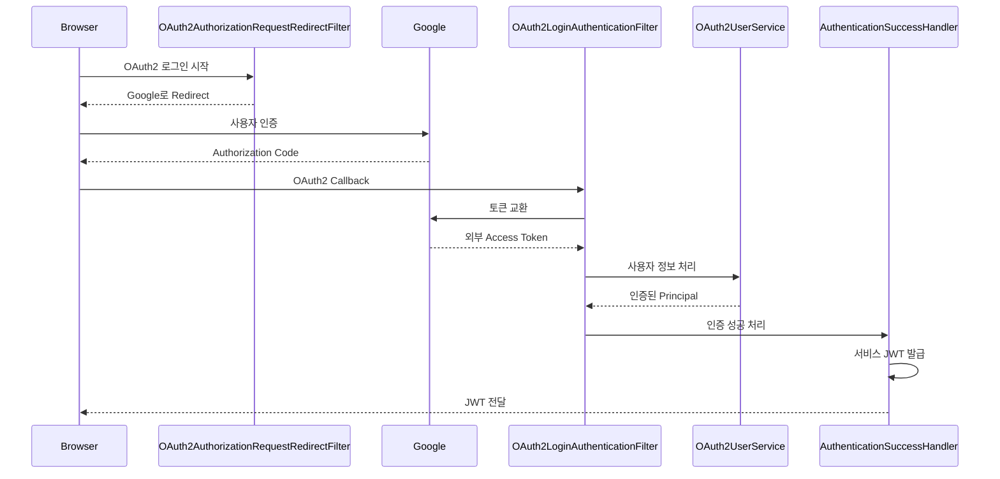
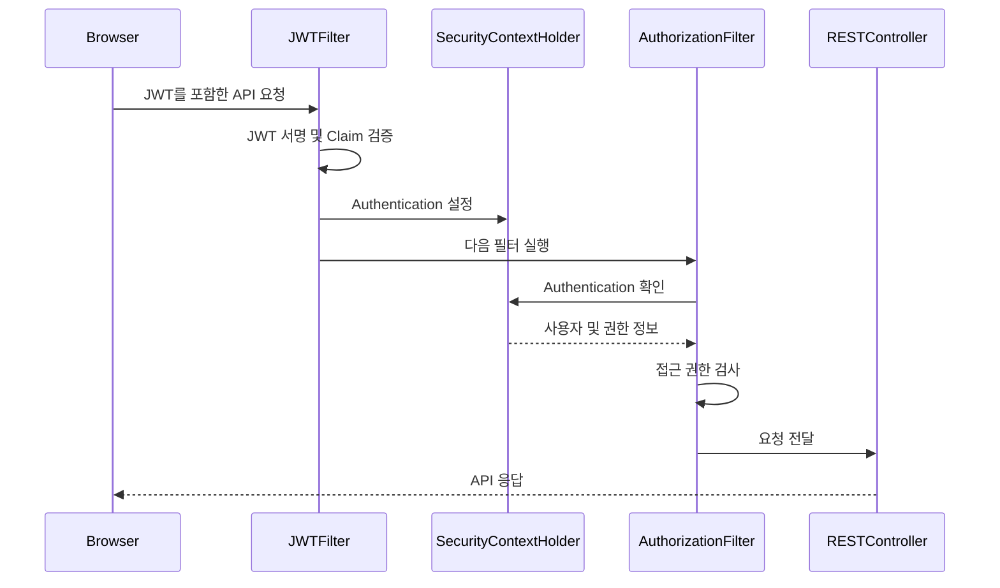
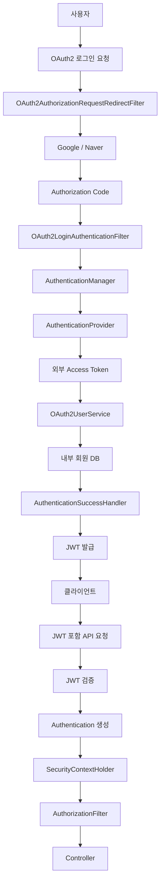

# 스프링 OAuth2 클라이언트 JWT - 3. 프로젝트 생성 및 의존성 추가
[https://youtu.be/BY-HWViE_l4?si=3iqSvZ1wMNHCcsy-](https://youtu.be/BY-HWViE_l4?si=3iqSvZ1wMNHCcsy-)

# 스프링 OAuth2 클라이언트 JWT - 3. 프로젝트 생성 및 의존성 추가
{:toc}

---

### Spring Security 6 OAuth2 Client JWT 인증·인가 구조와 필터 동작 원리

Spring Security OAuth2 Client를 사용하면 Google이나 Naver 같은 외부 인증 제공자를 통해 사용자를 인증할 수 있다.

OAuth2 로그인은 외부 인증 서버에서 사용자의 신원을 확인하는 과정이다.

하지만 실제 서비스를 운영하려면 외부 인증을 완료한 이후에도 사용자가 우리 서비스의 API를 지속적으로 호출할 수 있어야 한다.

이를 위해 대표적으로 두 가지 인증 유지 방식을 사용할 수 있다.

첫 번째는 서버가 인증 상태를 관리하는 세션 방식이다.

두 번째는 서버가 JWT를 발급하고 클라이언트가 이후 요청에 해당 토큰을 포함하는 JWT 방식이다.

이번에는 두 번째 방식을 중심으로 살펴본다.

JWT 기반 OAuth2 로그인에서는 사용자 인증과 API 인증이 서로 다른 시점에 수행된다.

**첫 번째는 Google이나 Naver를 이용해 사용자를 인증하고 JWT를 발급하는 과정이다.**

**두 번째는 발급받은 JWT를 이용해 이후 API 요청의 인증과 인가를 수행하는 과정이다.**

전체 구조는 다음과 같다.



여기서 중요한 것은 OAuth2 로그인과 JWT 인증이 하나의 필터에서 처리되지 않는다는 점이다.

OAuth2 로그인에서는 Spring Security가 제공하는 OAuth2 Client 관련 필터와 AuthenticationProvider가 사용된다.

반면 JWT를 이용한 API 요청에서는 JWT를 검증하고 Authentication을 구성하는 별도의 인증 처리가 필요하다.

이러한 차이를 이해하면 Spring Security의 인증 구조를 더 명확하게 설계할 수 있다.

---

### 개념

#### Spring Security는 HTTP 요청을 어떻게 처리할까?

Spring Boot 애플리케이션에서는 일반적으로 Controller를 작성하여 HTTP 요청을 처리한다.

예를 들어 다음과 같다.

```java
@RestController
@RequestMapping("/api")
public class UserController {

    @GetMapping("/me")
    public String me() {

        return "사용자 정보";
    }
}
```

사용자가 다음 주소로 요청을 보내면 해당 Controller가 실행될 수 있다.

```http
GET /api/me HTTP/1.1
Host: localhost:8080
```

하지만 Spring Security를 사용하는 애플리케이션에서는 Controller에 도달하기 전에 보안 필터를 통과한다.

Spring Security는 Servlet Filter를 이용해 HTTP 요청을 가로채고 인증과 인가를 수행한다.

기본적인 요청 흐름은 다음과 같다.

```text
Client
    ↓
Servlet Container
    ↓
DelegatingFilterProxy
    ↓
FilterChainProxy
    ↓
SecurityFilterChain
    ↓
Spring Security Filters
    ↓
DispatcherServlet
    ↓
Controller
```

여기서 각각의 구성요소가 담당하는 역할을 이해해야 한다.

| 구성요소 | 역할 |
|---|---|
| DelegatingFilterProxy | Servlet Filter와 Spring Bean 연결 |
| FilterChainProxy | Spring Security 필터 체인 관리 |
| SecurityFilterChain | 요청에 적용할 보안 필터 구성 |
| Authentication 관련 필터 | 사용자 인증 처리 |
| AuthorizationFilter | 접근 권한 확인 |
| DispatcherServlet | Spring MVC 요청 처리 |
| Controller | 비즈니스 API 실행 |

핵심은 **사용자의 요청이 Controller에 도달하기 전에 Spring Security의 보안 검사를 거친다는 사실**이다.

따라서 JWT 인증을 구현할 때 모든 Controller에서 직접 JWT를 검사할 필요가 없다.

Spring Security의 인증 처리 단계에서 JWT를 검증하고 Authentication을 구성하면 된다.

---

### 왜 사용하는가?

#### OAuth2 인증과 JWT 인증을 분리해야 하는 이유

OAuth2 로그인에 성공했다고 생각해보자.

이때 사용자는 Google이나 Naver에서 정상적으로 인증되었다.

하지만 이후 모든 API 요청을 처리할 때마다 Google이나 Naver로 이동해 다시 인증을 수행할 수는 없다.

예를 들어 다음과 같은 요청이 발생할 수 있다.

```text
GET /api/me

GET /api/orders

POST /api/orders

GET /api/notifications
```

만약 모든 API 요청에서 외부 OAuth2 인증을 다시 수행한다면 다음 문제가 발생한다.

- 외부 인증 서버에 불필요한 요청이 발생한다.
- API 응답 시간이 증가한다.
- 외부 인증 제공자의 장애에 영향을 크게 받는다.
- 사용자에게 반복적인 로그인 과정을 요구할 수 있다.
- API 서버가 외부 인증 과정에 과도하게 의존한다.

따라서 일반적인 소셜 로그인 서비스에서는 외부 인증이 완료된 이후 자체 인증 수단을 발급할 수 있다.

이번에는 해당 인증 수단으로 JWT를 사용한다.

```text
Google / Naver
    ↓
외부 사용자 인증
    ↓
우리 서비스의 회원 확인
    ↓
JWT 발급
    ↓
이후 API에서 JWT 검증
```

즉 다음과 같이 책임을 분리한다.

| 구분 | OAuth2 로그인 | JWT 인증 |
|---|---|---|
| 목적 | 외부 사용자 인증 | 내부 API 인증 및 인가 |
| 실행 시점 | 로그인 시점 | API 요청 시점 |
| 주요 정보 | Authorization Code, 외부 Access Token | 서비스 JWT |
| 인증 주체 | Google, Naver 및 OAuth2 Client | 우리 서비스 |
| 처리 구성요소 | OAuth2 관련 필터 및 Provider | JWT 인증 필터 또는 Resource Server |
| 결과 | 사용자 인증 완료 | API 접근 권한 판단 |

이러한 구조를 통해 외부 인증과 내부 API 인증의 책임을 분리할 수 있다.

---

### 주요 특징

#### 1. OAuth2AuthorizationRequestRedirectFilter

먼저 OAuth2 로그인 시작 과정을 살펴보자.

사용자가 Google 로그인을 선택한다.

```http
GET /oauth2/authorization/google HTTP/1.1
Host: localhost:8080
```

이 요청은 Spring Security의 다음 필터가 처리한다.

```java
OAuth2AuthorizationRequestRedirectFilter
```

이 필터는 Google 인증 서버로 이동하기 위한 Authorization Request를 생성한다.

대표적인 처리 과정은 다음과 같다.

```text
/oauth2/authorization/google
    ↓
OAuth2AuthorizationRequestRedirectFilter
    ↓
OAuth2AuthorizationRequestResolver
    ↓
ClientRegistrationRepository
    ↓
Google ClientRegistration 조회
    ↓
Authorization Request 생성
    ↓
State 생성
    ↓
Authorization Request 저장
    ↓
Google 인증 서버로 Redirect
```

여기서 중요한 역할을 담당하는 객체는 다음과 같다.

```java
ClientRegistrationRepository
```

이 Repository에는 Google이나 Naver에 등록한 OAuth2 Client 정보가 저장되어 있다.

예를 들어 Google ClientRegistration은 다음 정보를 포함한다.

```text
registrationId = google

clientId = GOOGLE_CLIENT_ID

clientSecret = GOOGLE_CLIENT_SECRET

authorizationUri = Google Authorization Endpoint

tokenUri = Google Token Endpoint

redirectUri = Callback URI
```

Spring Security는 이 정보를 이용해 외부 인증 요청을 생성한다.

따라서 Google과 Naver 각각의 인증 요청 URL을 개발자가 직접 작성할 필요가 없다.

---

#### 2. Authorization Request 저장

OAuth2 로그인은 하나의 HTTP 요청으로 완료되지 않는다.

사용자는 우리 서비스에서 Google이나 Naver로 이동한다.

이후 외부 인증이 완료되면 다시 우리 서비스로 돌아온다.

따라서 최초 인증 요청과 Callback 요청을 연결하는 정보가 필요하다.

이때 사용되는 구성요소가 다음과 같다.

```java
AuthorizationRequestRepository
```

Spring Security는 기본적으로 다음 구현체를 제공한다.

```java
HttpSessionOAuth2AuthorizationRequestRepository
```

이 구현체는 OAuth2AuthorizationRequest를 HttpSession에 저장한다.



여기서 중요한 정보는 State다.

State는 최초 인증 요청과 외부 인증 서버에서 돌아온 응답을 연결하는 역할을 담당한다.

이 값이 올바르게 관리되지 않으면 인증 요청 혼동 및 로그인 CSRF 공격과 관련된 문제가 발생할 수 있다.

따라서 JWT 기반 인증을 사용하더라도 OAuth2 로그인 과정에서는 State와 Authorization Request를 안전하게 관리해야 한다.

---

#### 3. OAuth2LoginAuthenticationFilter

이제 Google에서 사용자가 인증을 완료했다고 생각해보자.

Google은 Callback URI로 Authorization Code와 State를 전달한다.

```http
GET /login/oauth2/code/google?code=AUTH_CODE&state=STATE HTTP/1.1
Host: localhost:8080
```

이 요청을 처리하는 필터는 다음과 같다.

```java
OAuth2LoginAuthenticationFilter
```

이 필터는 다음 작업을 수행한다.

```text
OAuth2 Callback 요청
    ↓
Authorization Code와 State 확인
    ↓
기존 Authorization Request 조회
    ↓
ClientRegistration 조회
    ↓
OAuth2LoginAuthenticationToken 생성
    ↓
AuthenticationManager 호출
```

여기서 중요한 점이 있다.

**OAuth2LoginAuthenticationFilter가 Access Token 발급과 사용자 정보 조회를 직접 모두 수행하는 것은 아니다.**

필터는 인증 요청 객체를 구성한 뒤 AuthenticationManager에 인증을 위임한다.

이후 실제 인증은 적절한 AuthenticationProvider가 담당한다.

일반 OAuth2 로그인에서는 다음 Provider가 사용될 수 있다.

```java
OAuth2LoginAuthenticationProvider
```

반면 Google에서 `openid` Scope를 사용하는 OIDC 인증에서는 다음 Provider가 사용된다.

```java
OidcAuthorizationCodeAuthenticationProvider
```

따라서 Google과 Naver는 같은 Callback 필터를 사용하더라도 이후 인증 처리 경로가 달라질 수 있다.

---

#### 4. AuthenticationManager와 AuthenticationProvider

Spring Security의 인증 구조에서는 AuthenticationManager가 중요한 역할을 담당한다.

대표적인 구현체는 다음과 같다.

```java
ProviderManager
```

ProviderManager는 등록된 AuthenticationProvider 중 전달받은 인증 요청을 처리할 수 있는 Provider를 선택한다.

예를 들어 다음과 같은 구조다.



이 구조에서는 인증 처리 책임이 여러 단계로 분리된다.

AuthenticationManager는 인증을 적절한 Provider에 위임한다.

AuthenticationProvider는 인증 요청을 처리한다.

OAuth2UserService 또는 OidcUserService는 외부 사용자 정보를 처리한다.

이러한 책임 분리는 Spring Security가 다양한 인증 방식을 지원할 수 있는 중요한 이유다.

---

#### 5. OAuth2UserService

외부 인증에 성공했다면 사용자 정보를 가져와야 한다.

예를 들어 Naver의 UserInfo API에서는 다음과 같은 응답을 받을 수 있다.

```json
{
  "resultcode": "00",
  "message": "success",
  "response": {
    "id": "naver-user-123",
    "name": "홍길동",
    "email": "user@example.com"
  }
}
```

반면 Google에서는 다음과 같은 사용자 정보가 제공될 수 있다.

```json
{
  "sub": "google-user-123",
  "name": "홍길동",
  "email": "user@example.com"
}
```

두 제공자는 사용자 정보를 표현하는 JSON 구조가 다르다.

따라서 외부 인증 제공자별 응답을 공통된 형태로 변환할 필요가 있다.

예를 들어 다음과 같은 인터페이스를 사용할 수 있다.

```java
public interface OAuth2Response {

    String getProvider();

    String getProviderId();

    String getEmail();

    String getName();
}
```

이 인터페이스를 통해 외부 사용자 정보 처리 구조를 통일할 수 있다.

이후 내부 회원 정보를 조회하거나 저장한다.

```text
외부 사용자 정보
    ↓
OAuth2Response
    ↓
UserRepository
    ↓
UserEntity
    ↓
CustomOAuth2User
```

여기서 중요한 점은 **외부 사용자의 인증 결과와 우리 서비스의 회원 정보가 서로 다른 데이터라는 사실**이다.

외부 인증 제공자는 사용자의 신원을 확인한다.

하지만 우리 서비스의 회원 권한과 계정 상태는 내부 DB에서 관리하는 것이 적절하다.

---

### OAuth2 로그인 성공 이후 JWT 발급

지금까지는 세션 기반 OAuth2 로그인에서도 사용되는 과정이다.

그렇다면 JWT 방식에서는 어느 부분이 추가될까?

핵심은 로그인 성공 이후 처리다.

Spring Security는 인증에 성공했을 때 추가 작업을 수행할 수 있도록 다음 인터페이스를 제공한다.

```java
AuthenticationSuccessHandler
```

OAuth2 로그인이 성공하면 이 Handler에서 JWT를 발급할 수 있다.

전체 흐름은 다음과 같다.

```text
OAuth2LoginAuthenticationFilter
    ↓
AuthenticationManager
    ↓
AuthenticationProvider
    ↓
OAuth2UserService
    ↓
CustomOAuth2User
    ↓
Authentication
    ↓
AuthenticationSuccessHandler
    ↓
JWT 발급
    ↓
클라이언트 전달
```

여기서 AuthenticationSuccessHandler가 직접 외부 OAuth2 인증을 수행하지 않는다는 점을 이해해야 한다.

이미 인증을 완료한 Authentication을 전달받아 후속 작업을 수행한다.

대표적으로 다음과 같은 작업이 가능하다.

```text
사용자 식별자 추출

권한 정보 조회

JWT 생성

JWT 응답

프론트엔드로 Redirect
```

이때 서비스에서 발급하는 JWT는 Google이나 Naver가 발급한 Access Token과 다르다.

외부 Access Token은 외부 API에 접근하기 위해 사용된다.

반면 우리 서비스의 JWT는 내부 API 접근을 위해 사용한다.

---

### JWT란?

JWT는 JSON Web Token의 약자다.

일반적으로 다음 세 부분으로 구성된다.

```text
Header.Payload.Signature
```

각 부분은 마침표로 구분된다.

```text
xxxxx.yyyyy.zzzzz
```

JWT의 주요 구성요소는 다음과 같다.

| 구성요소 | 역할 |
|---|---|
| Header | 토큰 유형과 서명 알고리즘 |
| Payload | 사용자 정보 및 Claim |
| Signature | 토큰의 서명 검증 |

예를 들어 다음과 같은 Claim을 포함할 수 있다.

```json
{
  "iss": "https://api.example.com",
  "sub": "10001",
  "aud": "example-api",
  "role": "ROLE_USER",
  "iat": 1700000000,
  "exp": 1700003600
}
```

여기서 중요한 Claim은 다음과 같다.

| Claim | 의미 |
|---|---|
| iss | 토큰 발급자 |
| sub | 사용자 식별자 |
| aud | 토큰 사용 대상 |
| role | 사용자 권한 |
| iat | 발급 시각 |
| exp | 만료 시각 |

실제 서비스에서는 내부 회원 ID를 Subject로 사용하는 방식이 유용하다.

예를 들어 Google 사용자의 외부 식별자가 다음과 같다고 생각해보자.

```text
google-user-123
```

내부 회원 ID는 다음과 같다.

```text
10001
```

그러면 JWT에는 다음 값을 사용할 수 있다.

```text
sub = 10001
```

이렇게 하면 JWT를 이용해 내부 회원을 직접 식별할 수 있다.

외부 OAuth2 Provider의 사용자 식별자를 모든 API에서 직접 사용할 필요도 줄어든다.

다만 JWT의 Payload는 일반적으로 암호화되어 있지 않다.

따라서 비밀번호나 외부 Access Token 같은 민감한 정보를 불필요하게 저장해서는 안 된다.

---

### JWTFilter의 역할

OAuth2 로그인 이후에는 우리 서비스가 발급한 JWT를 이용해 API에 접근한다.

이때 JWT를 검증하는 처리가 필요하다.

커스텀 JWT 인증 구조에서는 다음과 같은 필터를 구현할 수 있다.

```java
JWTFilter
```

일반적으로 OncePerRequestFilter를 상속하여 구현한다.

```java
public class JWTFilter extends OncePerRequestFilter {
}
```

JWTFilter의 주요 역할은 다음과 같다.

```text
HTTP 요청 수신
    ↓
JWT 존재 여부 확인
    ↓
JWT 추출
    ↓
JWT 서명 검증
    ↓
JWT 만료 여부 확인
    ↓
사용자 및 권한 정보 확인
    ↓
Authentication 생성
    ↓
SecurityContextHolder 설정
    ↓
다음 필터 실행
```

전체 구조는 다음과 같다.



여기서 JWT가 존재하지 않는 경우 모든 요청을 즉시 거부해야 하는 것은 아니다.

예를 들어 다음과 같은 공개 API가 존재할 수 있다.

```text
GET /api/public/products
```

이 API는 로그인하지 않은 사용자도 접근할 수 있다.

반면 다음 API는 인증된 사용자만 접근하도록 구성할 수 있다.

```text
GET /api/me
```

따라서 JWTFilter의 인증 처리와 AuthorizationFilter의 인가 처리를 구분해야 한다.

JWTFilter는 토큰을 이용해 사용자를 인증한다.

AuthorizationFilter는 현재 Authentication과 요청 경로의 접근 정책을 비교한다.

---

### JWT 검증 이후 Authentication은 어떻게 생성할까?

JWT 검증에 성공하면 Spring Security가 사용할 Authentication을 구성해야 한다.

예를 들어 JWT에서 다음 정보를 확인했다고 생각해보자.

```text
userId = 10001

role = ROLE_USER
```

커스텀 필터 방식에서는 다음과 같이 Authentication을 생성할 수 있다.

```java
List<GrantedAuthority> authorities =
        List.of(
                new SimpleGrantedAuthority("ROLE_USER")
        );

Authentication authentication =
        new UsernamePasswordAuthenticationToken(
                principal,
                null,
                authorities
        );
```

이 코드에서 중요한 부분은 세 가지다.

첫 번째는 Principal이다.

```java
principal
```

Principal은 현재 요청에서 인증된 사용자를 표현한다.

두 번째는 Credentials다.

```java
null
```

JWT 검증이 완료된 이후에는 별도의 비밀번호를 저장할 필요가 없으므로 null을 전달할 수 있다.

세 번째는 Authorities다.

```java
authorities
```

이 값은 현재 사용자의 권한을 나타낸다.

예를 들어 다음과 같다.

```text
ROLE_USER
```

이렇게 생성한 Authentication을 SecurityContext에 저장할 수 있다.

```java
SecurityContext context =
        SecurityContextHolder.createEmptyContext();

context.setAuthentication(authentication);

SecurityContextHolder.setContext(context);
```

이 코드는 현재 요청을 처리하는 실행 흐름에서 인증된 사용자 정보를 사용할 수 있도록 한다.

다만 중요한 조건이 있다.

**이 코드는 JWT의 서명과 Claim 검증이 정상적으로 완료된 이후에만 실행해야 한다.**

JWT Payload를 단순히 디코딩한 결과만으로 Authentication을 생성해서는 안 된다.

---

### JWTFilter와 Spring Security Resource Server의 차이

JWT 기반 인증은 반드시 커스텀 JWTFilter를 작성해야만 구현할 수 있는 것은 아니다.

Spring Security는 JWT 기반 Bearer Token 인증을 위한 Resource Server 기능도 제공한다.

이 방식에서는 다음과 같은 구성요소가 사용된다.

```text
BearerTokenAuthenticationFilter
    ↓
AuthenticationManager
    ↓
JwtAuthenticationProvider
    ↓
JwtDecoder
    ↓
JwtAuthenticationConverter
    ↓
Authentication
```

커스텀 필터 방식과 비교하면 다음과 같다.

| 구분 | 커스텀 JWTFilter | Resource Server |
|---|---|---|
| JWT 추출 | 직접 구현 | BearerTokenResolver |
| JWT 검증 | 직접 구성 | JwtDecoder |
| Authentication 생성 | 직접 구현 | JwtAuthenticationProvider |
| 권한 변환 | 직접 구현 | JwtAuthenticationConverter |
| 필터 등록 | 직접 구성 | Spring Security 설정 |
| 커스터마이징 | 구현 자유도 높음 | 확장 지점 제공 |
| 유지보수 | 직접 관리할 코드 많음 | 표준 구현 재사용 |

기본적인 JWT 인증이라면 Resource Server를 활용하는 방법도 고려할 수 있다.

반면 특별한 인증 규약이 있거나 JWT 처리 과정을 직접 제어해야 한다면 커스텀 필터를 구현할 수도 있다.

어느 방식을 사용하더라도 핵심은 동일하다.

**JWT를 검증한 후 Spring Security의 Authentication으로 변환해야 한다.**

---

### 구조

#### OAuth2 로그인과 JWT 인증은 서로 다른 요청이다

이번 구조에서 가장 중요한 부분이다.

사용자가 최초로 소셜 로그인을 수행할 때와 JWT를 이용해 API를 호출할 때는 서로 다른 HTTP 요청이 발생한다.

먼저 OAuth2 로그인 과정이다.



이 과정에서는 외부 인증 제공자와 통신한다.

그리고 최종적으로 우리 서비스의 JWT가 생성된다.

다음은 JWT 기반 API 요청이다.



두 번째 과정에서는 일반적으로 Google이나 Naver의 인증 서버를 다시 호출하지 않는다.

우리 서버가 발급한 JWT를 검증하여 사용자 인증을 수행하기 때문이다.

단, JWT 검증 정책에서 내부 회원 상태나 토큰 폐기 여부를 별도로 조회하도록 구성했다면 추가적인 DB 또는 캐시 접근은 발생할 수 있다.

---

### OAuth2 로그인에서 HttpSession을 사용해도 될까?

JWT 기반 인증을 구현할 때 자주 혼동하는 개념이 있다.

JWT 인증은 Stateless 방식으로 구성할 수 있다.

그런데 OAuth2 로그인에서는 HttpSession이 사용될 수 있다.

이 둘은 모순되는 것일까?

그렇지 않다.

두 기능은 서로 다른 목적을 가진다.

#### OAuth2 로그인 과정의 HttpSession

OAuth2 Authorization Code 방식에서는 최초 Authorization Request와 Callback 응답을 연결해야 한다.

예를 들어 다음과 같다.

```text
최초 OAuth2 로그인 요청
    ↓
Authorization Request 생성
    ↓
State 생성
    ↓
HttpSession 저장
    ↓
외부 인증 서버 이동
    ↓
Callback
    ↓
기존 Authorization Request 확인
```

여기서 HttpSession은 OAuth2 인증 과정의 임시 상태를 관리하기 위해 사용된다.

#### JWT 인증 과정

반면 JWT 기반 API에서는 요청마다 JWT를 검증할 수 있다.

```text
JWT를 포함한 요청
    ↓
JWT 검증
    ↓
Authentication 생성
    ↓
SecurityContextHolder 저장
    ↓
API 실행
    ↓
요청 종료
```

이 과정에서는 로그인 상태를 유지하기 위한 HttpSession이 필요하지 않을 수 있다.

따라서 다음 두 개념을 구분해야 한다.

| 구분 | OAuth2 로그인 | JWT API 인증 |
|---|---|---|
| 목적 | 외부 인증 완료 | 내부 API 접근 |
| HttpSession | 기본 구현에서 사용 가능 | 사용하지 않도록 구성 가능 |
| 주요 정보 | Authorization Request, State | JWT Claim |
| 상태 유지 기간 | 로그인 처리 중 | 요청 단위 인증 |
| 저장소 | HttpSession 또는 커스텀 Repository | JWT 검증 키 및 필요 시 별도 저장소 |

즉 JWT 기반 API 인증이 Stateless라는 사실이 애플리케이션에서 HttpSession을 전혀 사용할 수 없다는 뜻은 아니다.

중요한 것은 **어떤 요청에서 어떤 상태를 유지하는지 구분하는 것**이다.

---

### SecurityFilterChain 분리

실제 서비스에서는 OAuth2 로그인과 JWT 기반 API 인증을 서로 다른 SecurityFilterChain으로 구성할 수 있다.

예를 들어 다음과 같다.

```text
SecurityFilterChain A
    ↓
/api/**
    ↓
JWT 인증
    ↓
Stateless
```

```text
SecurityFilterChain B
    ↓
/oauth2/**
/login/oauth2/**
    ↓
OAuth2 인증
    ↓
Authorization Request 상태 관리
```

이러한 구조를 사용하면 JWT 인증에 필요한 정책과 OAuth2 로그인에 필요한 정책을 별도로 구성할 수 있다.

예를 들어 API 요청에서는 다음과 같은 설정을 사용할 수 있다.

```java
.sessionManagement(session -> session
        .sessionCreationPolicy(
                SessionCreationPolicy.STATELESS
        )
)
```

반면 OAuth2 로그인에서는 기본적인 Authorization Request 저장 방식을 유지할 수 있다.

다만 모든 요청에 무조건 Stateless 설정을 적용하고 기본 HttpSessionOAuth2AuthorizationRequestRepository를 함께 사용할 경우 인증 과정에서 상태 복원 문제가 발생할 수 있다.

대표적으로 다음과 같은 오류가 발생할 수 있다.

```text
authorization_request_not_found
```

따라서 OAuth2 로그인과 JWT API 인증의 세션 정책을 함께 고려해야 한다.

---

### 예제

#### 1. JWT 인증의 책임을 별도 클래스로 분리하기

JWT를 발급하는 기능과 검증하는 기능은 서로 다른 책임을 가진다.

예를 들어 다음과 같은 인터페이스를 정의할 수 있다.

```java
public interface JwtTokenService {

    String createToken(
            Long userId,
            String role
    );

    JwtPrincipal verifyToken(
            String token
    );
}
```

그리고 JWT 검증 결과를 표현하는 객체를 다음과 같이 정의할 수 있다.

```java
public record JwtPrincipal(
        Long userId,
        String role
) {
}
```

이때 `verifyToken()`은 단순한 디코딩 메서드가 아니다.

실제 구현에서는 다음 항목을 검증해야 한다.

```text
JWT 형식

허용된 서명 알고리즘

서명 유효성

만료 시각

발급자

Audience

필수 Claim
```

이렇게 하면 JWT 발급과 검증 로직을 하나의 서비스로 관리하면서도 인증 필터에서는 필요한 기능만 호출할 수 있다.

---

#### 2. JWTFilter의 기본 구조

JWTFilter는 HTTP 요청에서 JWT를 추출하고 검증하는 역할을 담당한다.

개념적인 구조는 다음과 같다.

```java
public class JWTFilter extends OncePerRequestFilter {

    private final JwtTokenService jwtTokenService;

    public JWTFilter(
            JwtTokenService jwtTokenService
    ) {
        this.jwtTokenService = jwtTokenService;
    }

    @Override
    protected void doFilterInternal(
            HttpServletRequest request,
            HttpServletResponse response,
            FilterChain filterChain
    ) throws ServletException, IOException {

        String token = extractToken(request);

        if (token == null) {
            filterChain.doFilter(request, response);
            return;
        }

        JwtPrincipal jwtPrincipal;

        try {
            jwtPrincipal = jwtTokenService.verifyToken(token);
        } catch (JwtException | IllegalArgumentException ex) {
            response.sendError(
                    HttpServletResponse.SC_UNAUTHORIZED,
                    "Invalid authentication token"
            );
            return;
        }

        List<GrantedAuthority> authorities =
                List.of(
                        new SimpleGrantedAuthority(
                                jwtPrincipal.role()
                        )
                );

        Authentication authentication =
                new UsernamePasswordAuthenticationToken(
                        jwtPrincipal,
                        null,
                        authorities
                );

        SecurityContext context =
                SecurityContextHolder.createEmptyContext();

        context.setAuthentication(authentication);

        SecurityContextHolder.setContext(context);

        filterChain.doFilter(request, response);
    }

    private String extractToken(
            HttpServletRequest request
    ) {

        String authorization =
                request.getHeader("Authorization");

        if (authorization == null
                || !authorization.startsWith("Bearer ")) {

            return null;
        }

        return authorization.substring(7);
    }
}
```

이 코드는 JWT 인증 필터의 주요 구조를 보여준다.

여기서는 Authorization 헤더를 기준으로 JWT를 추출한다.

```http
Authorization: Bearer JWT_VALUE
```

따라서 JWT를 Cookie로 전달하는 구조에서는 `extractToken()`을 변경해야 한다.

또한 위 코드의 실제 실행을 위해서는 `JwtTokenService`의 구현이 필요하다.

필터의 예외 처리와 SecurityContext 정리 방식도 적용할 SecurityFilterChain 및 인증 정책과 일치하도록 구성해야 한다.

---

### JWT 인증 필터에서 중요한 점

#### 인증 필터가 사용자 권한을 임의로 결정해서는 안 된다

다음과 같은 코드를 생각해보자.

```java
new SimpleGrantedAuthority("ROLE_ADMIN")
```

모든 사용자에게 이 권한을 부여하면 심각한 보안 문제가 발생한다.

따라서 권한은 검증된 JWT Claim이나 신뢰할 수 있는 내부 권한 저장소에서 가져와야 한다.

또한 JWT에 저장된 권한은 발급 시점의 정보일 수 있다.

실시간 권한 변경이 중요한 서비스에서는 DB 또는 캐시를 이용한 추가 검증도 고려해야 한다.

#### JWT를 단순 디코딩해서 인증하면 안 된다

다음과 같은 작업만으로는 인증이 완료되지 않는다.

```text
JWT Payload 디코딩
    ↓
userId 확인
```

Payload는 누구나 디코딩할 수 있기 때문이다.

반드시 다음 과정이 필요하다.

```text
JWT 추출
    ↓
서명 검증
    ↓
Claim 검증
    ↓
사용자 식별
    ↓
Authentication 생성
```

특히 알고리즘 검증과 키 관리 정책이 중요하다.

#### 필터 실행 순서가 중요하다

JWT 인증 필터는 AuthorizationFilter가 접근 권한을 판단하기 전에 Authentication을 구성해야 한다.

따라서 SecurityFilterChain에 등록할 때 적절한 실행 순서를 설정해야 한다.

예를 들어 특정 기준 필터 앞에 등록하는 방식을 사용할 수 있다.

```java
http.addFilterBefore(
        jwtFilter,
        UsernamePasswordAuthenticationFilter.class
);
```

다만 실제 필터 체인에서 어떤 순서로 실행되는지는 등록한 보안 기능과 다른 필터들의 위치에 따라 달라진다.

따라서 필터를 등록했다는 사실만으로 모든 인증 문제가 해결되는 것은 아니다.

실제 SecurityFilterChain의 구성을 확인해야 한다.

---

### 실무에서의 활용

#### 1. OAuth2 로그인과 JWT API 인증을 분리한다

OAuth2 로그인에서는 외부 인증 서버와 통신한다.

반면 JWT API 인증에서는 일반적으로 내부 JWT 검증이 수행된다.

두 기능을 분리하면 인증 흐름의 복잡성을 줄일 수 있다.

#### 2. 외부 Access Token과 내부 JWT를 혼동하지 않는다

Google에서 발급한 Access Token을 우리 서비스의 JWT와 동일하게 취급해서는 안 된다.

토큰의 발급자와 대상 서비스, 검증 기준이 다르기 때문이다.

#### 3. JWT 발급 이전에 내부 회원 정보를 확인한다

소셜 로그인에 성공했다면 외부 사용자 정보를 내부 회원 정보와 연결한다.

이후 내부 회원 ID를 기준으로 JWT를 발급할 수 있다.

이렇게 하면 외부 Provider와 내부 서비스의 사용자 식별 체계를 분리할 수 있다.

#### 4. JWT 생성과 검증을 별도의 책임으로 구성한다

JWT 생성은 로그인 성공 시점에 수행된다.

JWT 검증은 이후 API 요청마다 수행된다.

두 책임을 분리하면 테스트와 유지보수가 쉬워진다.

#### 5. 로그인 성공 Handler에서는 외부 인증을 반복하지 않는다

AuthenticationSuccessHandler는 이미 인증된 Authentication을 전달받는다.

따라서 JWT 발급에 필요한 정보를 활용하되 외부 OAuth2 인증을 다시 수행할 필요는 없다.

#### 6. JWT 인증 필터에서는 검증된 정보만 사용한다

JWT에서 읽어온 정보는 서명과 Claim 검증이 완료되어야 신뢰할 수 있다.

검증되지 않은 Claim으로 Authentication을 생성해서는 안 된다.

#### 7. Stateless 인증과 SecurityContext를 구분한다

Stateless 인증에서도 SecurityContextHolder는 사용된다.

다만 해당 인증 정보를 HttpSession에 저장하여 다음 요청에서 재사용하지 않을 수 있다는 점이 다르다.

#### 8. OAuth2 로그인 과정의 State를 안전하게 관리한다

JWT 기반 API를 사용하더라도 최초 OAuth2 인증 요청과 Callback을 연결하는 State는 필요하다.

따라서 AuthorizationRequestRepository의 저장 및 조회 정책을 명확하게 구성해야 한다.

#### 9. 여러 서버에서는 OAuth2 로그인 상태 저장을 고려한다

JWT는 여러 서버에서 검증 키를 공유하면 독립적으로 검증할 수 있다.

하지만 OAuth2 로그인 과정에서 기본 HttpSession을 사용한다면 로그인 시작 서버와 Callback 처리 서버의 세션 일관성이 필요하다.

따라서 Spring Session과 Redis 등을 이용하는 구조를 고려할 수 있다.

#### 10. JWT 만료와 사용자 로그아웃을 구분한다

JWT가 만료되면 검증에 실패해야 한다.

반면 로그아웃은 별도의 정책이 필요할 수 있다.

단순히 클라이언트에서 JWT를 삭제했다고 해서 이미 발급된 JWT 자체가 무효화되는 것은 아니기 때문이다.

#### 11. 인증 실패와 인가 실패를 구분한다

JWT가 없거나 유효하지 않다면 인증 실패로 처리할 수 있다.

반면 JWT는 유효하지만 필요한 권한이 없다면 인가 실패다.

일반적으로 다음과 같이 구분한다.

| 상황 | 응답 |
|---|---|
| JWT 없음, 인증 필요 | 401 |
| JWT 서명 오류 | 401 |
| JWT 만료 | 401 |
| 인증됨, 권한 부족 | 403 |
| 인증 및 권한 충족 | API 정상 처리 |

이렇게 하면 프론트엔드에서도 인증 실패와 권한 부족을 구분하여 처리할 수 있다.

#### 12. JWT 저장 위치와 추출 위치를 일치시킨다

JWT를 Cookie에 저장했다면 검증 구성요소도 Cookie를 확인해야 한다.

반대로 Authorization 헤더 방식을 사용한다면 해당 헤더에서 JWT를 추출해야 한다.

토큰 전달 방식과 검증 방식이 일치하지 않으면 로그인은 성공했지만 API 인증에 실패하는 문제가 발생할 수 있다.

#### 13. Cookie 기반 JWT 인증에는 CSRF 보호를 고려한다

JWT를 HttpOnly Cookie에 저장하는 경우 브라우저가 해당 Cookie를 자동으로 전송할 수 있다.

따라서 JWT를 사용한다고 해서 CSRF 보호가 불필요해지는 것은 아니다.

서비스의 요청 방식과 Cookie 정책에 맞는 보호 수단을 적용해야 한다.

#### 14. 권한은 검증된 Authentication을 기준으로 판단한다

Spring Security의 AuthorizationFilter는 현재 Authentication에 포함된 Authority를 이용해 접근 권한을 판단할 수 있다.

따라서 권한 확인 로직을 각 Controller에 중복해서 작성하는 대신 Spring Security의 인가 기능을 활용하는 것이 좋다.

#### 15. 인증 단계별 로그와 메트릭을 구분한다

OAuth2 로그인과 JWT 인증은 실패 지점이 다르다.

따라서 다음과 같은 지표를 구분하여 관리하면 도움이 된다.

| 구간 | 주요 지표 |
|---|---|
| OAuth2 로그인 시작 | 인증 요청 수 |
| Callback 처리 | 인증 성공률 |
| Token Endpoint | 외부 응답 시간 |
| UserInfo 조회 | 외부 API 실패율 |
| 내부 회원 처리 | DB 처리 시간 |
| JWT 발급 | 발급 성공률 |
| JWT 검증 | 서명 및 만료 오류율 |
| API 인가 | 401·403 응답 비율 |

이렇게 하면 외부 OAuth2 장애와 내부 JWT 인증 장애를 구분할 수 있다.

---

### 정리

Spring Security OAuth2 Client와 JWT를 결합하면 외부 인증 제공자를 이용한 소셜 로그인과 자체 JWT 기반 API 인증을 구성할 수 있다.

이 과정은 크게 두 단계로 구분된다.

첫 번째는 OAuth2 로그인이다.

```text
OAuth2AuthorizationRequestRedirectFilter
    ↓
외부 인증 제공자
    ↓
OAuth2LoginAuthenticationFilter
    ↓
AuthenticationManager
    ↓
AuthenticationProvider
    ↓
OAuth2UserService
    ↓
내부 회원 조회 및 저장
    ↓
AuthenticationSuccessHandler
    ↓
JWT 발급
```

두 번째는 JWT를 이용한 API 인증이다.

```text
HTTP API 요청
    ↓
JWT 추출
    ↓
JWT 서명 및 Claim 검증
    ↓
Authentication 생성
    ↓
SecurityContextHolder
    ↓
AuthorizationFilter
    ↓
Controller
```

두 과정에서 사용되는 기술과 역할은 서로 다르다.

OAuth2는 외부 사용자의 인증 결과를 획득하는 데 사용된다.

JWT는 우리 서비스가 발급한 인증 정보를 이후 API 요청에서 전달하는 데 사용된다.

Spring Security는 이러한 과정을 필터와 AuthenticationProvider, Authentication, SecurityContext 등을 이용해 처리한다.

전체 구조를 정리하면 다음과 같다.



이번 구조에서 반드시 기억해야 할 핵심은 다음과 같다.

**첫째, OAuth2 로그인과 JWT 인증은 서로 다른 시점에 수행된다.**

**둘째, OAuth2AuthorizationRequestRedirectFilter는 외부 인증을 시작한다.**

**셋째, OAuth2LoginAuthenticationFilter는 외부 인증 결과를 처리한다.**

**넷째, AuthenticationManager는 실제 인증을 적절한 AuthenticationProvider에 위임한다.**

**다섯째, OAuth2UserService는 외부 사용자 정보를 처리하고 내부 회원 정보와 연결할 수 있다.**

**여섯째, AuthenticationSuccessHandler에서는 인증 성공 이후 자체 JWT를 발급할 수 있다.**

**일곱째, JWTFilter는 API 요청의 JWT를 검증하여 Authentication을 구성할 수 있다.**

**여덟째, SecurityContextHolder는 현재 요청의 인증 정보를 관리한다.**

**아홉째, AuthorizationFilter는 현재 Authentication과 인가 정책을 이용해 접근 권한을 확인한다.**

**열째, JWT 기반 Stateless 인증에서도 OAuth2 로그인 과정에는 임시 상태 저장이 필요할 수 있다.**

**열한째, JWT를 Cookie에 저장했다면 검증 필터도 해당 Cookie에서 JWT를 추출하도록 구성해야 한다.**

**열두째, JWT를 검증할 때는 단순 디코딩이 아니라 서명 및 Claim 검증이 필요하다.**

**열셋째, 인증에 성공한 사용자와 API에 접근할 권한이 있는 사용자는 서로 다른 개념이다.**

**열넷째, 여러 서버에서 운영한다면 JWT 검증 키뿐 아니라 OAuth2 로그인 상태 저장 정책도 고려해야 한다.**

**열다섯째, 외부 인증과 내부 JWT 인증을 분리하면 인증 장애와 API 인가 문제를 더욱 정확하게 분석할 수 있다.**

이러한 구조를 이해하면 Spring Security의 OAuth2 Client와 JWT를 단순히 연결하는 수준을 넘어, 각각의 인증 구성요소가 어떤 역할을 담당하는지 명확하게 파악할 수 있다.

특히 OAuth2 로그인에서 생성한 인증 결과를 자체 JWT로 전환하고, 이후 요청에서 JWT를 다시 Authentication으로 변환하는 과정이 JWT 기반 소셜 로그인 구조의 핵심이다.

#### 한 줄 요약

Spring Security 6에서 OAuth2 Client와 JWT를 결합하면 `OAuth2AuthorizationRequestRedirectFilter`와 `OAuth2LoginAuthenticationFilter`를 통해 Google·Naver 소셜 로그인을 처리하고, 인증 성공 이후 `AuthenticationSuccessHandler`에서 자체 JWT를 발급할 수 있다. 이후 API 요청에서는 JWT를 검증하여 Authentication을 생성하고, SecurityContextHolder와 AuthorizationFilter를 이용해 인증 및 인가를 수행한다. 이때 OAuth2 로그인 과정의 임시 상태 저장과 JWT 기반 API의 Stateless 인증 정책은 서로 구분하여 설계해야 한다.
