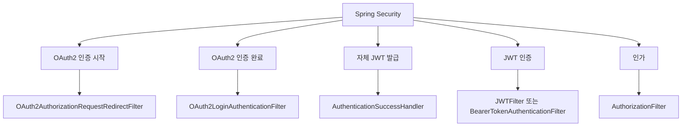
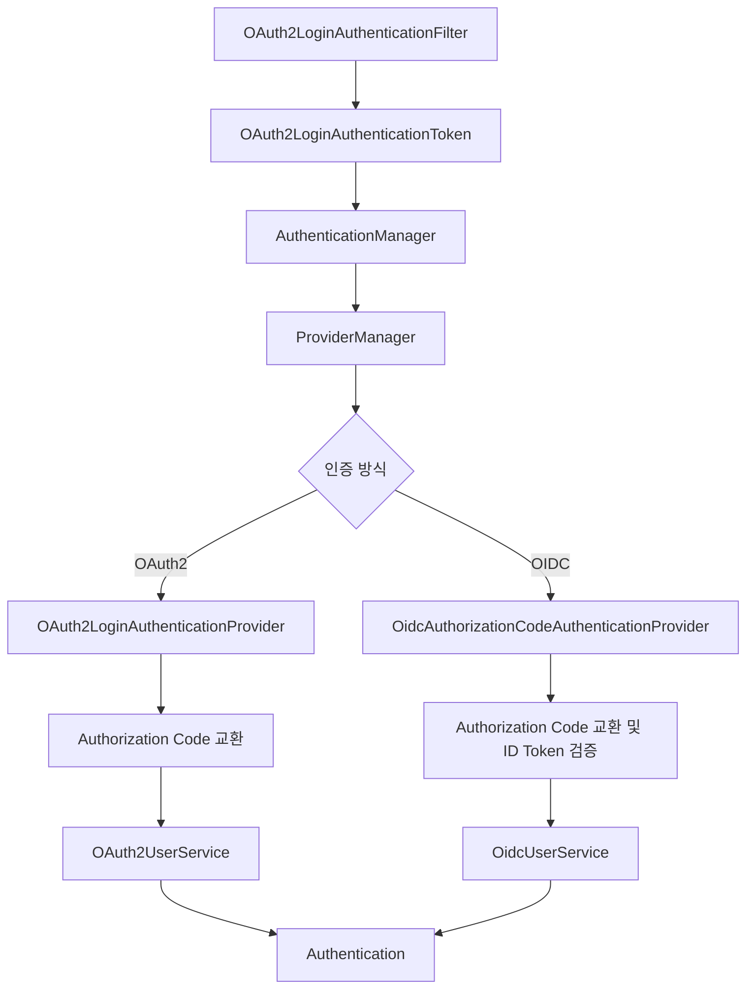
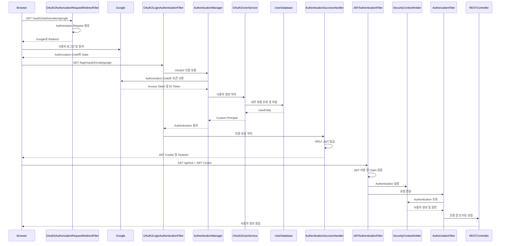
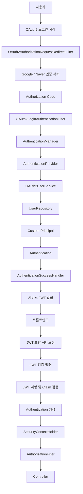

# 스프링 OAuth2 클라이언트 JWT - 4. 동작 원리
[https://youtu.be/JQJVHcI7Rzo?si=E2-VmhEB2SBQkTu_](https://youtu.be/JQJVHcI7Rzo?si=E2-VmhEB2SBQkTu_)

# 스프링 OAuth2 클라이언트 JWT - 4. 동작 원리
{:toc}

---

### Spring Security 6 OAuth2 Client와 JWT의 전체 동작 원리

Spring Security OAuth2 Client를 이용하면 Google, Naver와 같은 외부 인증 제공자를 통해 소셜 로그인을 구현할 수 있다.

이때 OAuth2는 외부 인증 제공자를 이용해 사용자를 인증하는 과정에 사용되며, JWT는 우리 서비스에서 발급한 인증 정보를 이후 API 요청에 전달하는 데 사용할 수 있다.

앞서 OAuth2 Authorization Code 방식과 JWT 기반 인증의 차이, 프론트엔드와 백엔드 사이의 역할 분담을 살펴보았다.

이제 두 인증 방식을 하나의 애플리케이션에서 연결했을 때 실제로 어떤 순서로 동작하는지 이해할 필요가 있다.

특히 Spring Security에서는 모든 인증 요청을 하나의 필터가 처리하지 않는다.

OAuth2 로그인을 시작하는 필터, 외부 인증 결과를 처리하는 필터, JWT를 검증하는 필터가 각각 다른 역할을 담당한다.

예를 들어 다음 세 요청을 생각해보자.

```http
GET /oauth2/authorization/google HTTP/1.1
Host: localhost:8080
```

```http
GET /login/oauth2/code/google?code=AUTH_CODE&state=STATE HTTP/1.1
Host: localhost:8080
```

```http
GET /api/me HTTP/1.1
Host: localhost:8080
Authorization: Bearer SERVICE_JWT
```

세 요청은 모두 인증과 관련되어 있지만 처리 목적이 다르다.

첫 번째 요청은 Google 인증을 시작한다.

두 번째 요청은 Google에서 돌아온 Authorization Code를 처리한다.

세 번째 요청은 우리 서비스에서 발급한 JWT를 이용해 보호된 API에 접근한다.

각 요청을 처리하는 대표적인 구성요소는 다음과 같다.

| 요청 | 주요 처리 구성요소 | 역할 |
|---|---|---|
| `/oauth2/authorization/google` | OAuth2AuthorizationRequestRedirectFilter | Google 인증 시작 |
| `/login/oauth2/code/google` | OAuth2LoginAuthenticationFilter | Google 인증 결과 처리 |
| `/api/me` | JWTFilter 또는 BearerTokenAuthenticationFilter | 자체 JWT 검증 |
| 인증 성공 이후 | AuthenticationSuccessHandler | 자체 JWT 발급 |
| 인증이 필요한 API | AuthorizationFilter | 접근 권한 확인 |

여기서 중요한 것은 각 필터가 실행되는 시점과 책임을 명확하게 구분하는 것이다.

전체 흐름을 이해하면 OAuth2 로그인은 성공했지만 JWT가 발급되지 않는 문제, JWT는 발급되었지만 API에 접근할 수 없는 문제, 인증 이후에도 계속 로그인 화면으로 이동하는 문제 등을 구분해서 분석할 수 있다.

---

### 개념

#### OAuth2 로그인과 JWT 인증은 하나의 인증 흐름으로 연결된다

OAuth2 기반 소셜 로그인과 JWT 인증은 서로 다른 기술이지만 하나의 로그인 시스템으로 연결할 수 있다.

전체 과정은 크게 두 단계로 구분된다.

**첫 번째 단계는 외부 인증 제공자를 이용해 사용자를 인증하고 자체 JWT를 발급하는 과정이다.**

```text
사용자
    ↓
Google / Naver 로그인 요청
    ↓
Spring Security OAuth2 Client
    ↓
외부 인증 서버
    ↓
Authorization Code 발급
    ↓
Access Token 교환
    ↓
외부 사용자 정보 조회
    ↓
내부 회원 DB 조회 및 저장
    ↓
Authentication 생성
    ↓
서비스 JWT 발급
    ↓
클라이언트 전달
```

**두 번째 단계는 발급된 JWT를 이용해 API에 접근하는 과정이다.**

```text
클라이언트
    ↓
JWT를 포함한 HTTP 요청
    ↓
Spring Security
    ↓
JWT 검증
    ↓
Authentication 생성
    ↓
SecurityContext 설정
    ↓
AuthorizationFilter
    ↓
Controller
    ↓
API 응답
```

이 두 단계는 서로 연결되어 있지만 독립적인 요청 흐름을 가진다.

OAuth2 로그인 과정에서 사용하는 외부 Access Token과 우리 서비스가 발급한 JWT도 서로 다르다.

| 구분 | 외부 Access Token | 자체 서비스 JWT |
|---|---|---|
| 발급 주체 | Google, Naver 등 | 우리 서비스 |
| 주요 목적 | 외부 리소스 접근 | 내부 API 인증 |
| 사용 시점 | OAuth2 인증 및 외부 API 호출 | 로그인 이후 API 요청 |
| 검증 주체 | 외부 제공자 또는 해당 리소스 서버 | 우리 서비스 |
| 사용자 식별 | 외부 Provider의 사용자 정보 | 내부 회원 식별자 |
| 저장 위치 | 서버 측 저장소 등 | Cookie, 클라이언트 메모리 등 |

따라서 Google이나 Naver에서 Access Token을 발급받았다는 사실만으로 우리 서비스의 JWT 인증이 완료되었다고 판단해서는 안 된다.

---

### 왜 사용하는가?

#### 인증 단계별 책임을 분리하기 위해서

Spring Security를 사용하지 않고 OAuth2 로그인과 JWT 인증을 모두 직접 구현한다고 생각해보자.

이 경우 다음 기능을 개발자가 직접 처리해야 한다.

1. 외부 인증 서버의 Authorization URL 생성
2. OAuth2 State 생성 및 관리
3. Authorization Code 수신
4. Authorization Code를 Access Token으로 교환
5. 외부 사용자 정보 조회
6. 내부 회원 정보 저장
7. 자체 JWT 발급
8. JWT 검증
9. 사용자 권한 확인
10. 인증 실패 및 인가 실패 처리

이렇게 여러 기능이 하나의 클래스나 Controller에 집중되면 유지보수가 어려워진다.

반면 Spring Security에서는 각 단계의 책임을 분리할 수 있다.



이 구조에서 Spring Security의 기존 OAuth2 Client 기능은 최대한 재사용할 수 있다.

반면 자체 JWT 발급 및 검증 정책은 서비스 요구사항에 맞게 구현해야 한다.

즉 모든 기능을 직접 구현하기보다 기존 프레임워크가 제공하는 기능과 서비스에서 추가해야 할 기능을 구분하는 것이 중요하다.

---

### 주요 특징

#### 1. OAuth2AuthorizationRequestRedirectFilter는 소셜 로그인을 시작한다

사용자가 Google 로그인을 선택했다고 생각해보자.

프론트엔드에서는 다음 주소로 브라우저를 이동시킬 수 있다.

```text
http://localhost:8080/oauth2/authorization/google
```

이 요청을 처리하는 필터는 다음과 같다.

```java
OAuth2AuthorizationRequestRedirectFilter
```

이 필터는 OAuth2 인증을 시작하기 위한 요청을 처리한다.

내부적으로 다음 작업을 수행한다.

```text
GET /oauth2/authorization/google
    ↓
OAuth2AuthorizationRequestRedirectFilter
    ↓
OAuth2AuthorizationRequestResolver
    ↓
ClientRegistrationRepository
    ↓
Google ClientRegistration 조회
    ↓
OAuth2AuthorizationRequest 생성
    ↓
State 생성
    ↓
AuthorizationRequestRepository 저장
    ↓
Google Authorization Endpoint로 Redirect
```

여기서 중요한 부분은 `ClientRegistrationRepository`다.

Spring Security는 요청 경로에서 `registrationId`를 추출한다.

```text
/oauth2/authorization/google
                      ↓
                 google
```

이 값을 이용해 등록된 OAuth2 Client 정보를 조회한다.

```java
ClientRegistration registration =
        clientRegistrationRepository
                .findByRegistrationId("google");
```

이후 Client ID, Redirect URI, Scope, Authorization URI 등을 이용해 인증 요청을 생성한다.

따라서 개발자가 Google 인증 서버로 전달할 모든 쿼리 파라미터를 직접 구성하지 않아도 된다.

#### OAuth2 로그인 시작 경로

Spring Security의 기본 OAuth2 인증 시작 경로는 다음과 같다.

```text
/oauth2/authorization/{registrationId}
```

Google을 사용하는 경우:

```text
/oauth2/authorization/google
```

Naver를 사용하는 경우:

```text
/oauth2/authorization/naver
```

여기서 `{registrationId}`는 `ClientRegistration`에 등록한 식별자다.

이 경로는 Spring Security가 기본 제공하는 규약이며, `authorizationEndpoint().baseUri()` 설정으로 변경할 수 있다.

---

#### 2. OAuth2 로그인 시작 요청은 Controller에서 처리하지 않는다

일반적인 Spring MVC에서는 다음과 같이 요청 경로에 대응하는 Controller를 작성한다.

```java
@GetMapping("/login")
public String login() {

    return "login";
}
```

하지만 다음 경로는 별도의 Controller 없이도 처리할 수 있다.

```text
/oauth2/authorization/google
```

그 이유는 Spring Security의 필터가 해당 요청을 직접 처리하기 때문이다.

Spring Security는 DispatcherServlet에 요청이 도달하기 전에 필터 체인을 실행한다.

```text
Browser
    ↓
Servlet Filter
    ↓
Spring Security FilterChain
    ↓
OAuth2AuthorizationRequestRedirectFilter
    ↓
HTTP Redirect 응답
```

OAuth2AuthorizationRequestRedirectFilter가 요청을 처리하면 외부 인증 서버로 이동하기 위한 응답을 생성한다.

예를 들어 다음과 같다.

```http
HTTP/1.1 302 Found
Location: https://accounts.google.com/o/oauth2/v2/auth?...
```

브라우저는 Location 헤더를 확인하고 Google 인증 서버로 이동한다.

따라서 OAuth2 로그인 시작 요청이 반드시 Spring MVC Controller까지 전달되는 것은 아니다.

이러한 동작은 Spring Security의 필터 기반 인증 구조를 이해하는 중요한 부분이다.

---

#### 3. OAuth2LoginAuthenticationFilter는 Callback 요청을 처리한다

사용자가 Google에서 로그인과 동의를 완료하면 Google은 등록된 Redirect URI로 브라우저를 이동시킨다.

이때 Authorization Code와 State가 전달된다.

예를 들어 다음과 같다.

```http
GET /login/oauth2/code/google?code=AUTH_CODE&state=STATE HTTP/1.1
Host: localhost:8080
```

이 요청을 처리하는 필터는 다음과 같다.

```java
OAuth2LoginAuthenticationFilter
```

기본 Callback 처리 경로는 다음과 같다.

```text
/login/oauth2/code/*
```

Google의 Callback 경로는 다음과 같다.

```text
/login/oauth2/code/google
```

Naver의 Callback 경로는 다음과 같다.

```text
/login/oauth2/code/naver
```

여기서 중요한 점은 로그인 시작 경로와 Callback 경로가 서로 다르다는 것이다.

| 구분 | 로그인 시작 | Callback |
|---|---|---|
| Google | `/oauth2/authorization/google` | `/login/oauth2/code/google` |
| Naver | `/oauth2/authorization/naver` | `/login/oauth2/code/naver` |
| 처리 필터 | OAuth2AuthorizationRequestRedirectFilter | OAuth2LoginAuthenticationFilter |
| 입력 | registrationId | Authorization Code, State |
| 목적 | 외부 인증 시작 | 외부 인증 결과 처리 |

두 경로는 서로 다른 책임을 가진다.

따라서 로그인 버튼 URL과 외부 인증 제공자에 등록하는 Redirect URI를 혼동해서는 안 된다.

---

#### 4. OAuth2LoginAuthenticationFilter는 인증 처리를 AuthenticationManager에 위임한다

OAuth2LoginAuthenticationFilter는 Authorization Code를 전달받으면 기존 Authorization Request를 조회한다.

이후 ClientRegistration을 확인하고 인증 요청 객체를 생성한다.

```text
OAuth2 Callback
    ↓
OAuth2LoginAuthenticationFilter
    ↓
AuthorizationRequestRepository
    ↓
기존 Authorization Request 확인
    ↓
ClientRegistrationRepository
    ↓
OAuth2LoginAuthenticationToken 생성
    ↓
AuthenticationManager
```

여기서 `AuthenticationManager`는 인증 처리를 조정하는 역할을 담당한다.

대표적인 구현체는 다음과 같다.

```java
ProviderManager
```

ProviderManager는 등록된 AuthenticationProvider 중 인증 요청을 처리할 수 있는 Provider를 선택한다.

일반 OAuth2에서는 다음 Provider가 사용될 수 있다.

```java
OAuth2LoginAuthenticationProvider
```

OIDC에서는 다음 Provider가 사용된다.

```java
OidcAuthorizationCodeAuthenticationProvider
```

전체 구조는 다음과 같다.



이렇게 하면 Google OIDC와 Naver OAuth2를 동일한 로그인 시스템에서 처리할 수 있다.

---

#### 5. OAuth2UserService는 외부 사용자 정보를 내부 사용자 정보와 연결한다

Authorization Code를 Access Token으로 교환한 이후에는 사용자 정보를 획득한다.

일반 OAuth2에서는 Access Token을 이용해 외부 UserInfo API를 호출할 수 있다.

OIDC에서는 ID Token과 UserInfo Endpoint 등을 이용해 사용자 정보를 처리한다.

외부 사용자 정보의 구조는 Provider마다 다를 수 있다.

예를 들어 Google은 다음과 같은 형태의 사용자 정보를 제공할 수 있다.

```json
{
  "sub": "google-user-123",
  "email": "user@example.com",
  "name": "홍길동"
}
```

반면 Naver는 사용자 정보가 `response` 내부에 존재한다.

```json
{
  "resultcode": "00",
  "message": "success",
  "response": {
    "id": "naver-user-123",
    "email": "user@example.com",
    "name": "홍길동"
  }
}
```

따라서 외부 응답을 공통 사용자 정보 모델로 변환하는 과정이 필요하다.

이후 내부 회원 DB에서 사용자를 조회한다.

```text
외부 사용자 정보
    ↓
OAuth2Response
    ↓
UserRepository
    ↓
UserEntity 조회
    ↓
신규 회원이면 저장
    ↓
CustomOAuth2User
    ↓
Authentication
```

여기서 중요한 점은 Google이나 Naver가 우리 서비스의 사용자 권한까지 결정하지 않는다는 것이다.

예를 들어 우리 서비스의 `ROLE_ADMIN` 권한은 외부 Provider의 이메일 주소만 보고 부여해서는 안 된다.

외부 인증 제공자는 사용자 인증을 담당한다.

반면 내부 서비스의 회원 상태와 권한은 우리 서비스가 관리해야 한다.

---

#### 6. AuthenticationSuccessHandler에서 자체 JWT를 발급한다

외부 인증 과정이 정상적으로 완료되면 Spring Security의 Authentication이 생성된다.

이후 인증 성공 처리가 실행된다.

이때 다음 인터페이스를 이용할 수 있다.

```java
AuthenticationSuccessHandler
```

JWT 기반 소셜 로그인에서는 인증 성공 이후 자체 JWT를 발급하는 기능을 구현할 수 있다.

```text
OAuth2 인증 성공
    ↓
Authentication 생성
    ↓
AuthenticationSuccessHandler 실행
    ↓
내부 회원 정보 확인
    ↓
JWT 생성
    ↓
JWT를 클라이언트에 전달
```

예를 들어 다음과 같은 사용자 정보가 있다고 생각해보자.

```text
내부 회원 ID = 10001

사용자 권한 = ROLE_USER
```

자체 JWT에는 다음과 같은 Claim을 포함할 수 있다.

```json
{
  "iss": "https://api.example.com",
  "sub": "10001",
  "aud": "example-api",
  "role": "ROLE_USER",
  "iat": 1700000000,
  "exp": 1700000900
}
```

위 값은 Claim 구조를 설명하기 위한 예시다.

실제 발급 과정에서는 현재 시각을 기준으로 발급 시각과 만료 시각을 설정해야 한다.

또한 JWT 서명키와 알고리즘, Issuer, Audience 등의 정책을 적용해야 한다.

여기서 중요한 것은 다음과 같다.

**Spring Security OAuth2 Client가 외부 사용자 인증을 처리한다고 해서 자체 JWT까지 자동으로 생성해 주는 것은 아니다.**

우리 서비스 JWT는 별도의 발급 로직으로 생성해야 한다.

---

#### 7. JWT는 프론트엔드로 전달된다

자체 JWT가 생성되었다면 클라이언트에 전달해야 한다.

예를 들어 HttpOnly Cookie를 사용할 수 있다.

```http
HTTP/1.1 302 Found
Location: https://app.example.com/
Set-Cookie: SERVICE_ACCESS=JWT_VALUE; Path=/; Max-Age=900; HttpOnly; Secure; SameSite=Lax
```

이 응답은 두 가지 작업을 수행한다.

첫 번째는 JWT를 Cookie에 저장하도록 브라우저에 지시하는 것이다.

두 번째는 로그인 이후 프론트엔드 페이지로 이동시키는 것이다.

```text
Set-Cookie
    ↓
브라우저에 JWT 저장
```

```text
Location
    ↓
프론트엔드 페이지로 이동
```

여기서 Cookie를 발급하는 서버의 도메인과 실제 API를 호출하는 도메인을 함께 고려해야 한다.

예를 들어 JWT Cookie를 `api.example.com`에서 발급했다면 해당 Cookie는 기본적으로 발급 호스트에 연결된다.

프론트엔드가 `app.example.com`에서 동작하더라도 API 요청을 `api.example.com`으로 보내면 Cookie 정책에 따라 해당 Cookie가 전송될 수 있다.

다만 실제 전송 여부는 Domain, Path, Secure, SameSite 및 브라우저의 Cookie 정책에 영향을 받는다.

또한 JWT를 Cookie에 저장한다면 이후 JWT 인증 필터에서도 Cookie를 읽도록 구성해야 한다.

---

### JWT 인증은 어느 필터가 담당할까?

OAuth2 로그인에 성공하면 클라이언트는 자체 JWT를 가지고 있다.

이제 사용자가 보호된 API에 접근한다고 생각해보자.

```http
GET /api/me HTTP/1.1
Host: api.example.com
Cookie: SERVICE_ACCESS=JWT_VALUE
```

이 요청에는 Google이나 Naver의 Authorization Code가 포함되지 않는다.

외부 인증 서버의 Access Token을 반드시 포함하는 것도 아니다.

우리 서비스가 발급한 JWT가 전달된다.

따라서 이 요청은 OAuth2LoginAuthenticationFilter가 아니라 JWT 인증을 담당하는 구성요소에서 처리한다.

#### 커스텀 JWTFilter 방식

커스텀 필터를 사용한다면 다음과 같은 구조를 구현할 수 있다.

```text
GET /api/me
    ↓
JWTFilter
    ↓
Cookie 또는 Authorization Header 확인
    ↓
JWT 추출
    ↓
JWT 서명 검증
    ↓
JWT 만료 확인
    ↓
사용자 ID 추출
    ↓
권한 정보 확인
    ↓
Authentication 생성
    ↓
SecurityContextHolder
    ↓
AuthorizationFilter
    ↓
Controller
```

여기서 중요한 점이 있다.

**JWTFilter는 특정 URL에서만 동작하도록 자동으로 정해진 필터가 아니다.**

OAuth2AuthorizationRequestRedirectFilter는 기본적으로 다음 URL 패턴을 처리한다.

```text
/oauth2/authorization/{registrationId}
```

OAuth2LoginAuthenticationFilter는 다음 패턴을 처리한다.

```text
/login/oauth2/code/*
```

반면 직접 구현한 JWTFilter는 개발자가 어느 SecurityFilterChain에 등록하고 어떤 요청에 적용할지 결정한다.

예를 들어 다음과 같이 구성할 수 있다.

```text
/api/**
    ↓
JWTFilter 실행
```

따라서 JWTFilter를 `/api/**` 요청에 적용하려면 SecurityFilterChain에서 해당 경로에 대한 인증 정책을 설정해야 한다.

---

### 구조

#### OAuth2 로그인부터 JWT API 인증까지의 전체 동작

지금까지 살펴본 내용을 하나의 시퀀스 다이어그램으로 정리해보자.



이 구조에서 중요한 구간은 세 부분이다.

첫 번째는 OAuth2 인증 요청 단계다.

```text
OAuth2AuthorizationRequestRedirectFilter
    ↓
Google / Naver
```

두 번째는 OAuth2 인증 완료 및 JWT 발급 단계다.

```text
OAuth2LoginAuthenticationFilter
    ↓
AuthenticationManager
    ↓
OAuth2UserService
    ↓
AuthenticationSuccessHandler
    ↓
JWT 발급
```

세 번째는 JWT 기반 API 요청 단계다.

```text
JWTFilter
    ↓
SecurityContextHolder
    ↓
AuthorizationFilter
    ↓
Controller
```

이 세 흐름을 구분하면 인증 시스템 전체를 이해하기 쉬워진다.

---

### 예제

#### 1. 프론트엔드에서 OAuth2 로그인 시작하기

React 기반 프론트엔드에서는 다음과 같이 로그인 버튼을 구성할 수 있다.

```jsx
function LoginPage() {

    const loginWithGoogle = () => {

        window.location.href =
            "http://localhost:8080/oauth2/authorization/google";
    };

    const loginWithNaver = () => {

        window.location.href =
            "http://localhost:8080/oauth2/authorization/naver";
    };

    return (
        <main>
            <h1>소셜 로그인</h1>

            <button onClick={loginWithGoogle}>
                Google 로그인
            </button>

            <button onClick={loginWithNaver}>
                Naver 로그인
            </button>
        </main>
    );
}

export default LoginPage;
```

이 코드는 Google이나 Naver의 인증 API를 직접 호출하지 않는다.

브라우저를 Spring Security의 OAuth2 로그인 시작 경로로 이동시킨다.

이후 Spring Security가 ClientRegistration을 조회하고 Authorization Request를 생성한다.

#### 2. 인증 성공 이후 JWT 발급하기

OAuth2 인증에 성공한 이후에는 AuthenticationSuccessHandler를 이용해 자체 JWT를 발급할 수 있다.

핵심적인 구조는 다음과 같다.

```java
@Override
public void onAuthenticationSuccess(
        HttpServletRequest request,
        HttpServletResponse response,
        Authentication authentication
) throws IOException {

    String principalName = authentication.getName();

    String jwt = jwtTokenService.createToken(
            principalName,
            authentication.getAuthorities()
    );

    ResponseCookie cookie =
            ResponseCookie.from("SERVICE_ACCESS", jwt)
                    .httpOnly(true)
                    .secure(true)
                    .sameSite("Lax")
                    .path("/")
                    .maxAge(Duration.ofMinutes(15))
                    .build();

    response.addHeader(
            HttpHeaders.SET_COOKIE,
            cookie.toString()
    );

    response.sendRedirect(
            "https://app.example.com/"
    );
}
```

이 예제는 JWT 발급 후 Cookie로 전달하는 핵심 처리만 나타낸다.

`jwtTokenService`는 서비스에서 별도로 구현한 JWT 발급 구성요소이며, 실제 적용 시 안정적인 내부 회원 ID를 사용하도록 설계해야 한다.

또한 HTTPS 환경을 전제로 Cookie의 Secure 속성을 설정했다.

여기서 중요한 점은 OAuth2 인증 성공과 자체 JWT 발급이 다른 책임이라는 사실이다.

OAuth2 인증에 성공했더라도 JWT 생성에 실패하면 최종 서비스 로그인은 완료되지 않은 것으로 처리해야 한다.

#### 3. JWT를 포함한 API 요청

프론트엔드에서 다음과 같이 API 요청을 보낼 수 있다.

```javascript
async function getCurrentUser() {

    const response = await fetch(
        "https://api.example.com/api/me",
        {
            method: "GET",
            credentials: "include"
        }
    );

    if (!response.ok) {
        throw new Error(
            "사용자 정보 조회에 실패했습니다."
        );
    }

    return response.json();
}
```

여기서 `credentials: "include"`는 교차 출처 요청에서 Cookie 등 자격 증명을 포함하도록 지정하는 옵션이다.

다만 실제 Cookie 전송 여부는 Cookie 속성과 브라우저 정책에 따라 달라진다.

또한 서버 측에서도 Credentials를 허용하는 CORS 설정이 필요할 수 있다.

이후 요청은 JWT 인증을 담당하는 필터에서 처리한다.

#### 4. JWT 검증 이후 Authentication 생성하기

JWT 검증에 성공하면 Spring Security의 Authentication을 구성한다.

개념적으로 다음과 같다.

```java
List<GrantedAuthority> authorities =
        List.of(
                new SimpleGrantedAuthority(
                        "ROLE_USER"
                )
        );

Authentication authentication =
        new UsernamePasswordAuthenticationToken(
                principal,
                null,
                authorities
        );

SecurityContext context =
        SecurityContextHolder.createEmptyContext();

context.setAuthentication(authentication);

SecurityContextHolder.setContext(context);
```

여기서 `principal`과 `authorities`는 검증된 JWT 또는 신뢰할 수 있는 내부 저장소에서 얻은 값이어야 한다.

임의의 사용자에게 `ROLE_USER` 또는 `ROLE_ADMIN`을 부여하는 방식으로 구현해서는 안 된다.

또한 위 코드는 JWT 검증 이후 Authentication을 구성하는 부분만 보여주는 예제다.

실제 서비스에서는 JWT 서명 검증, 만료 검사, Issuer 및 Audience 확인 등을 먼저 수행해야 한다.

---

### SecurityFilterChain은 어떻게 구분할까?

OAuth2 로그인과 JWT API 인증을 하나의 SecurityFilterChain에서 처리할 수도 있다.

하지만 서로 다른 세션 정책과 인증 방식을 적용해야 한다면 SecurityFilterChain을 분리하는 방법을 고려할 수 있다.

예를 들어 다음과 같다.

```text
SecurityFilterChain A
    ↓
/api/**
    ↓
JWT 검증
    ↓
Stateless API 인증
```

```text
SecurityFilterChain B
    ↓
/oauth2/authorization/**
/login/oauth2/code/**
/login
    ↓
OAuth2 로그인
    ↓
Authorization Request 및 State 관리
```

이 구조의 장점은 요청 유형에 따라 다른 인증 정책을 적용할 수 있다는 것이다.

#### API SecurityFilterChain

API 요청에서는 자체 JWT를 검증한다.

```text
GET /api/me
    ↓
API SecurityFilterChain
    ↓
JWT 인증
    ↓
인가 처리
    ↓
Controller
```

#### OAuth2 SecurityFilterChain

OAuth2 인증에서는 외부 인증을 시작하거나 Callback을 처리한다.

```text
GET /oauth2/authorization/google
    ↓
OAuth2 SecurityFilterChain
    ↓
Authorization Request 생성
    ↓
외부 인증 서버로 Redirect
```

```text
GET /login/oauth2/code/google
    ↓
OAuth2 SecurityFilterChain
    ↓
Authorization Code 교환
    ↓
인증 성공
    ↓
JWT 발급
```

여기서 중요한 점은 **SecurityFilterChain이 반드시 URL별로 하나씩 생성되는 것은 아니라는 사실**이다.

개발자가 정의한 RequestMatcher를 기준으로 요청에 적용할 SecurityFilterChain이 선택된다.

또한 Spring Security의 FilterChainProxy는 여러 SecurityFilterChain 중 매칭되는 첫 번째 체인을 적용한다.

따라서 여러 체인을 사용한다면 `@Order`와 `securityMatcher()` 설정을 정확하게 관리해야 한다.

---

### Spring Security가 제공하는 JWT 인증 기능

JWT 인증에서는 반드시 커스텀 JWTFilter를 구현해야 하는 것은 아니다.

Spring Security는 OAuth2 Resource Server 기능을 제공한다.

이 기능을 사용하면 다음과 같은 구조로 JWT를 검증할 수 있다.

```text
BearerTokenAuthenticationFilter
    ↓
BearerTokenAuthenticationToken
    ↓
AuthenticationManager
    ↓
JwtAuthenticationProvider
    ↓
JwtDecoder
    ↓
JWT 검증
    ↓
JwtAuthenticationToken
    ↓
SecurityContextHolder
```

여기서 각 구성요소의 역할은 다음과 같다.

| 구성요소 | 역할 |
|---|---|
| BearerTokenAuthenticationFilter | 요청에서 Bearer Token 추출 |
| BearerTokenAuthenticationToken | 인증 전 토큰 표현 |
| AuthenticationManager | 인증 처리 위임 |
| JwtAuthenticationProvider | JWT 인증 수행 |
| JwtDecoder | JWT 서명 및 Claim 검증 |
| JwtAuthenticationConverter | JWT Claim을 권한 정보로 변환 |
| JwtAuthenticationToken | 인증 완료 결과 |

Spring Security Resource Server에서는 기본적으로 Authorization 헤더에서 Bearer Token을 조회한다.

예를 들어 다음과 같다.

```http
Authorization: Bearer JWT_VALUE
```

하지만 이번 구조처럼 JWT를 HttpOnly Cookie에 저장한다면 기본 Bearer Token 추출 방식과 일치하지 않는다.

따라서 Cookie에서 JWT를 추출하는 커스텀 BearerTokenResolver를 구현하거나 별도의 JWT 인증 필터를 구성해야 한다.

즉 다음 두 가지는 구분해야 한다.

```text
커스텀 JWTFilter
    ↓
개발자가 직접 JWT 추출과 인증 처리 구현
```

```text
Spring Security Resource Server
    ↓
표준 JWT 검증 및 인증 구성요소 재사용
```

실무에서는 Spring Security가 제공하는 검증 기능을 활용할 수 있다면 이를 먼저 검토하는 것이 좋다.

---

### 실무에서의 활용

#### 1. 로그인 시작 URL과 Callback URL을 구분한다

OAuth2 로그인 관련 경로는 다음과 같이 구분한다.

| 구분 | URL |
|---|---|
| Google 로그인 시작 | `/oauth2/authorization/google` |
| Naver 로그인 시작 | `/oauth2/authorization/naver` |
| Google Callback | `/login/oauth2/code/google` |
| Naver Callback | `/login/oauth2/code/naver` |

두 URL의 역할을 혼동하면 OAuth2 설정 오류가 발생하기 쉽다.

특히 외부 인증 제공자에 등록하는 Redirect URI는 로그인 시작 URL이 아니라 Callback URL이다.

#### 2. JWT 인증 필터는 적용 경로를 명확하게 지정한다

커스텀 JWTFilter는 어떤 URL을 처리할지 자동으로 결정하지 않는다.

따라서 `/api/**`처럼 JWT 인증이 필요한 경로를 명확하게 정의해야 한다.

반면 로그인 시작 및 Callback 경로는 OAuth2 Client의 인증 필터가 처리하도록 구성해야 한다.

#### 3. OAuth2 로그인과 JWT 발급 실패를 구분한다

Google 인증에 성공했다고 해서 자체 JWT 발급이 반드시 성공하는 것은 아니다.

예를 들어 내부 회원 DB 조회에 실패하거나 JWT 서명키 설정에 문제가 발생할 수 있다.

따라서 외부 인증 성공과 최종 서비스 로그인 성공을 구분해서 기록해야 한다.

#### 4. JWT Cookie를 사용한다면 검증 필터도 Cookie를 읽어야 한다

JWT 발급은 Cookie 방식인데 검증은 Authorization 헤더만 확인하도록 구현하면 API 인증에 실패한다.

따라서 JWT 발급부터 전달, 추출, 검증까지 일관된 구조로 구성해야 한다.

#### 5. OAuth2 로그인 과정에는 임시 상태 저장이 필요할 수 있다

JWT 기반 API 인증은 Stateless 방식으로 구성할 수 있다.

하지만 OAuth2 Authorization Code 인증에서는 최초 요청과 Callback을 연결하는 State가 필요하다.

Spring Security의 기본 AuthorizationRequestRepository는 HttpSession을 사용한다.

따라서 모든 요청에 무조건 Stateless 정책을 적용하면 OAuth2 인증 과정에서 기존 요청을 복원하지 못할 수 있다.

#### 6. 기본 OAuth2 로그인이 세션을 저장하는 동작도 고려한다

OAuth2 로그인 과정에서 HttpSession을 사용하는 목적은 Authorization Request 저장에만 한정되지 않는다.

Spring Security의 기본 OAuth2 로그인 성공 처리에서는 SecurityContext가 세션에 저장될 수도 있다.

따라서 자체 JWT를 발급하는 구조로 전환하면서 세션 기반 로그인 상태를 더 이상 유지하지 않으려면, 인증 성공 후 SecurityContext 저장 정책과 세션 정리 정책도 함께 검토해야 한다.

단순히 SuccessHandler에서 JWT를 발급했다는 이유만으로 서버 세션 인증이 자동으로 비활성화되는 것은 아니다.

#### 7. JWT 검증 시 서명과 Claim을 모두 확인한다

JWT Payload를 디코딩하는 것만으로는 인증이 완료되지 않는다.

서명 검증과 만료 시간, 발급자 및 대상 서비스 검증이 필요하다.

예를 들어 다른 서비스에서 발급한 유효한 JWT를 우리 서비스의 인증 토큰으로 허용하지 않도록 Audience와 Issuer를 확인해야 한다.

#### 8. 외부 Provider의 권한과 내부 서비스 권한을 구분한다

Google이나 Naver에서 제공한 사용자 정보만으로 내부 관리자 권한을 부여해서는 안 된다.

내부 서비스 권한은 UserRepository 등을 통해 관리하는 것이 적절하다.

이렇게 하면 외부 인증과 내부 인가의 책임을 분리할 수 있다.

#### 9. JWT를 Cookie에 저장한다면 CSRF 보호를 고려한다

브라우저는 Cookie를 자동으로 전송할 수 있다.

따라서 JWT를 Cookie에 저장하는 경우에도 CSRF 공격 가능성을 고려해야 한다.

`SessionCreationPolicy.STATELESS`를 적용했다는 이유만으로 CSRF 보호가 불필요해지는 것은 아니다.

상태를 변경하는 API에 대해 CSRF Token이나 Origin 검증 등 적절한 보호 수단을 적용해야 한다.

#### 10. 여러 SecurityFilterChain을 사용할 때 우선순위를 확인한다

Spring Security는 요청에 매칭되는 SecurityFilterChain을 선택한다.

따라서 다음과 같은 체인 구성을 사용한다면:

```text
/api/**
    ↓
JWT SecurityFilterChain
```

```text
/oauth2/**
    ↓
OAuth2 SecurityFilterChain
```

각 요청이 의도한 체인에서 처리되는지 확인해야 한다.

특히 너무 넓은 RequestMatcher를 먼저 적용하면 다른 체인이 실행되지 않을 수 있다.

#### 11. JWT 검증 오류와 API 인가 오류를 구분한다

JWT가 만료되거나 서명이 잘못되었다면 인증 실패다.

반면 JWT는 유효하지만 필요한 권한이 없다면 인가 실패다.

일반적으로 다음과 같이 응답을 구분할 수 있다.

| 상황 | HTTP 상태 |
|---|---|
| JWT 누락, 보호된 API 접근 | 401 |
| JWT 만료 | 401 |
| JWT 서명 오류 | 401 |
| JWT 유효, 권한 부족 | 403 |
| JWT 유효, 권한 충족 | 정상 응답 |

이렇게 하면 프론트엔드에서도 재로그인과 권한 부족 안내를 구분할 수 있다.

#### 12. 인증 흐름별 로그를 분리한다

OAuth2 로그인과 JWT 인증은 실패 원인이 서로 다르다.

예를 들어 다음과 같다.

```text
OAuth2 로그인 오류
    ↓
Authorization Request
    ↓
State
    ↓
Authorization Code
    ↓
Token Endpoint
```

```text
JWT 인증 오류
    ↓
JWT 추출
    ↓
서명 검증
    ↓
만료 시간
    ↓
Claim 검증
    ↓
권한 확인
```

따라서 로그와 모니터링 지표를 구분하는 것이 좋다.

특히 Authorization Code와 Access Token, JWT 원문이 로그에 노출되지 않도록 주의해야 한다.

---

### 정리

Spring Security OAuth2 Client와 JWT를 결합하면 외부 인증 제공자를 이용한 소셜 로그인과 자체 JWT 기반 API 인증을 구성할 수 있다.

이 과정은 다음과 같이 구분된다.

**첫 번째는 OAuth2 로그인 시작이다.**

```text
/oauth2/authorization/google
    ↓
OAuth2AuthorizationRequestRedirectFilter
    ↓
Authorization Request 생성
    ↓
Google 인증 서버
```

**두 번째는 OAuth2 Callback 처리다.**

```text
/login/oauth2/code/google
    ↓
OAuth2LoginAuthenticationFilter
    ↓
AuthenticationManager
    ↓
AuthenticationProvider
    ↓
OAuth2UserService
    ↓
Authentication 생성
```

**세 번째는 자체 JWT 발급이다.**

```text
OAuth2 인증 성공
    ↓
AuthenticationSuccessHandler
    ↓
JWT 생성
    ↓
Cookie 또는 별도 전달 방식
    ↓
클라이언트
```

**네 번째는 JWT 기반 API 인증이다.**

```text
/api/me
    ↓
JWTFilter
    ↓
JWT 검증
    ↓
Authentication 생성
    ↓
SecurityContextHolder
    ↓
AuthorizationFilter
    ↓
Controller
```

여기서 가장 중요한 개념은 OAuth2 로그인 필터와 JWT 인증 필터가 서로 다른 역할을 담당한다는 사실이다.

OAuth2AuthorizationRequestRedirectFilter는 외부 인증을 시작한다.

OAuth2LoginAuthenticationFilter는 외부 인증 결과를 처리한다.

AuthenticationSuccessHandler는 인증 성공 이후 자체 JWT를 발급할 수 있다.

JWTFilter는 이후 API 요청에 포함된 JWT를 검증한다.

마지막으로 AuthorizationFilter는 인증된 사용자가 요청한 API에 접근할 권한이 있는지 판단한다.

전체 구조는 다음과 같다.



이러한 구조를 이해하면 인증 시스템에서 문제가 발생했을 때 원인을 단계별로 구분할 수 있다.

예를 들어 Google 로그인 화면으로 이동하지 못한다면 OAuth2AuthorizationRequestRedirectFilter와 ClientRegistration 설정을 확인한다.

Google 인증 이후 Callback에서 실패한다면 OAuth2LoginAuthenticationFilter와 AuthorizationRequestRepository, Token Endpoint 등을 확인한다.

JWT 발급 단계에서 실패한다면 AuthenticationSuccessHandler와 JWT 발급 로직을 확인한다.

마지막으로 JWT는 존재하지만 API 요청이 실패한다면 JWT 검증 필터와 SecurityContext, 인가 정책을 확인한다.

즉 **OAuth2 인증과 JWT 인증을 하나의 연속된 흐름으로 이해하되, 각 단계의 책임은 명확하게 분리해야 한다.**

이것이 Spring Security OAuth2 Client와 JWT를 결합한 인증 시스템을 설계할 때 가장 중요한 원칙이다.

#### 한 줄 요약

Spring Security 6에서 OAuth2 Client와 JWT를 결합하면 `/oauth2/authorization/{registrationId}` 요청은 OAuth2AuthorizationRequestRedirectFilter가 처리하고, `/login/oauth2/code/{registrationId}` Callback 요청은 OAuth2LoginAuthenticationFilter가 처리한다. 이후 AuthenticationSuccessHandler에서 자체 JWT를 발급하고, 클라이언트는 해당 JWT를 이용해 보호된 API에 접근한다. API 요청에서는 JWTFilter 또는 Spring Security Resource Server가 JWT를 검증하여 Authentication을 생성하고, AuthorizationFilter가 최종 접근 권한을 확인한다. 이때 OAuth2 로그인 과정의 상태 관리와 JWT 기반 API 인증 정책을 구분하는 것이 중요하다.
