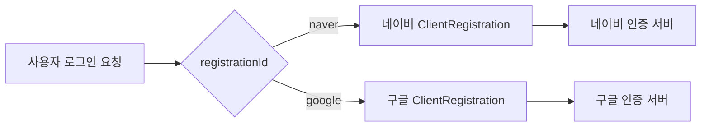
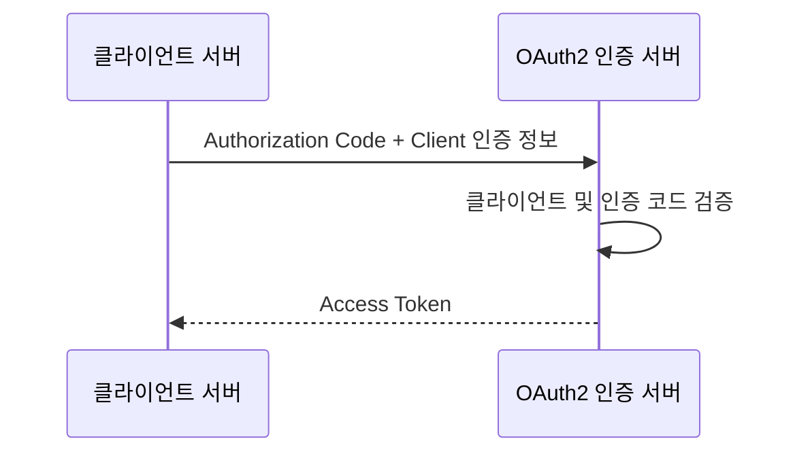
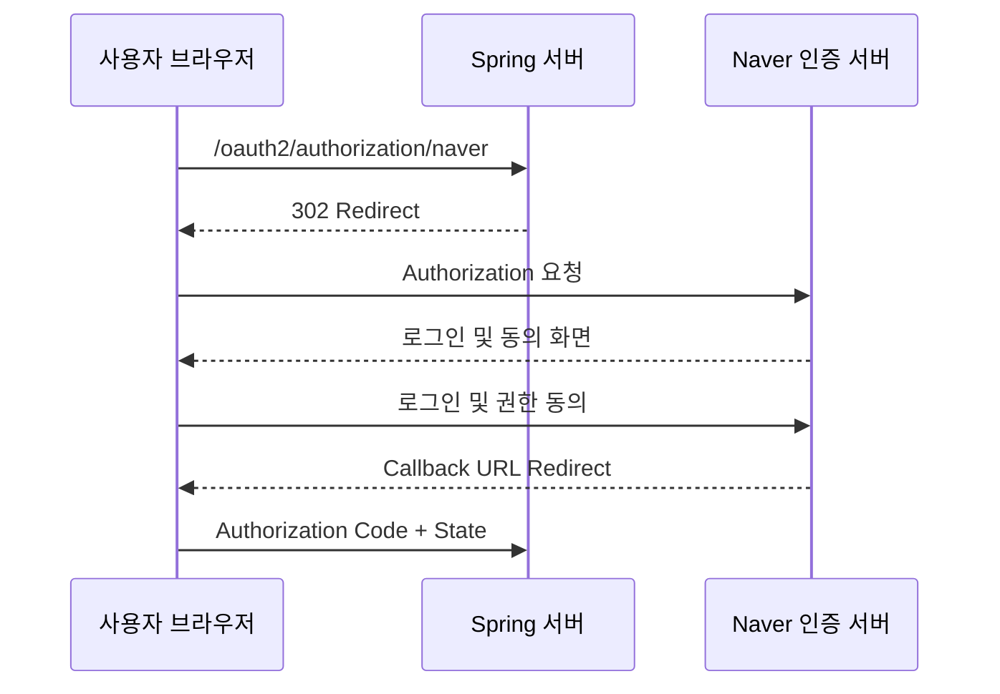
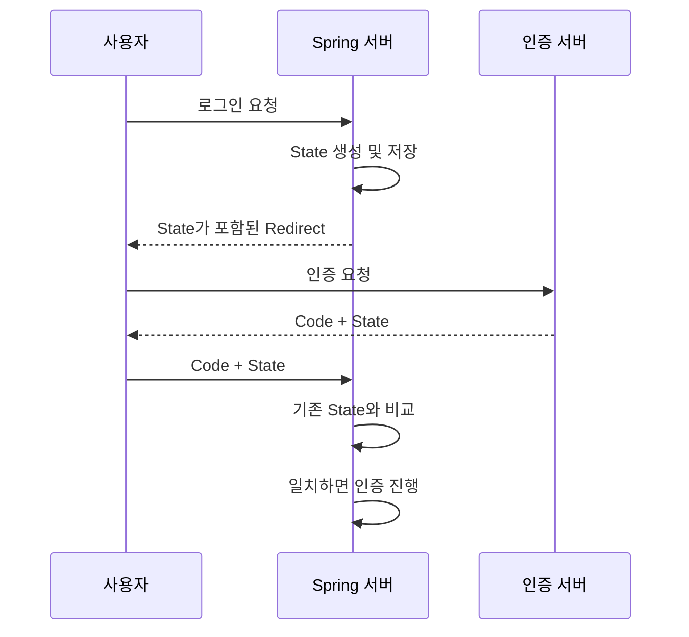
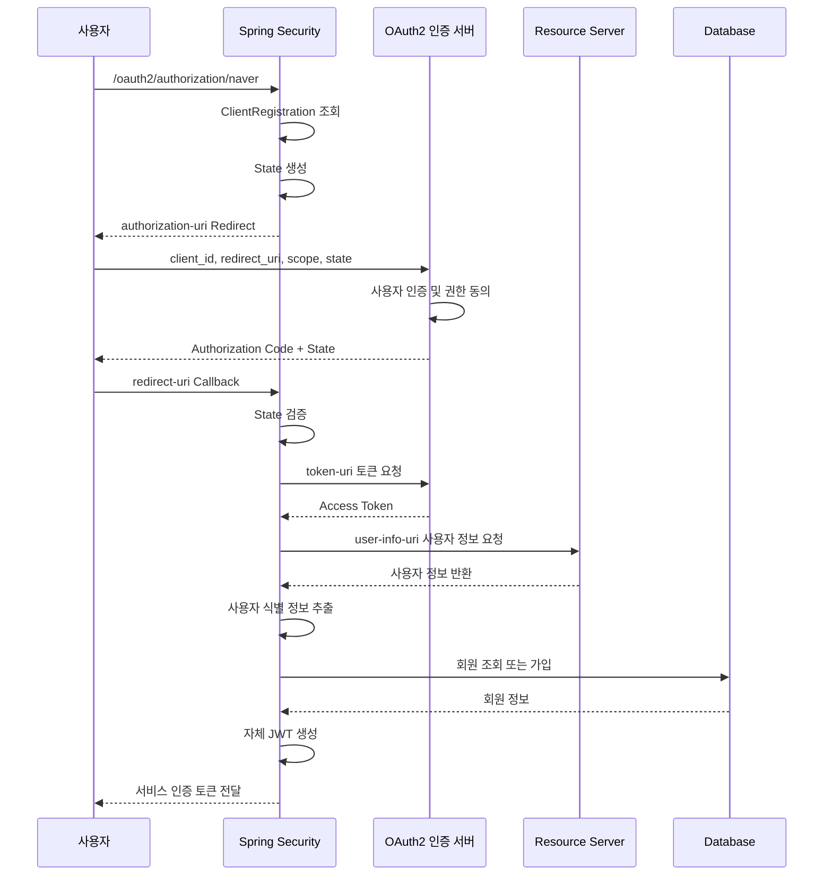
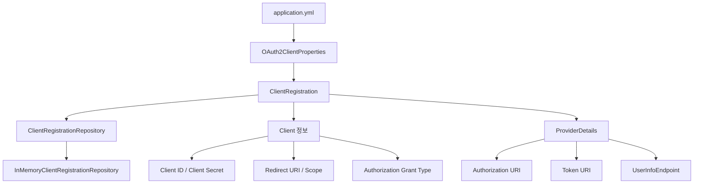
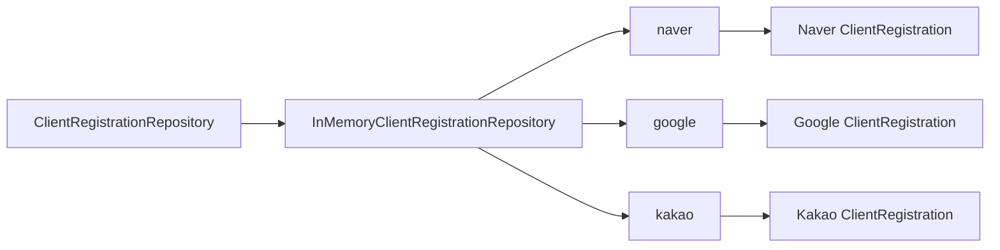
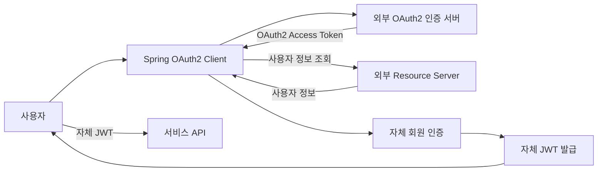

# 스프링 OAuth2 클라이언트 JWT - 5. 변수 역할
[https://youtu.be/sUuc0XW2te4?si=Q3vYeU3bXLCRAddk](https://youtu.be/sUuc0XW2te4?si=Q3vYeU3bXLCRAddk)

# 스프링 OAuth2 클라이언트 JWT - 5. 변수 역할
{:toc}

---

## Spring Security OAuth2 Client - 주요 설정 변수와 역할

### 개념

Spring Security에서 OAuth2 로그인을 구현하려면 외부 인증 서버와 통신하기 위한 여러 설정값이 필요하다.

OAuth2 로그인은 단순히 외부 서비스에서 사용자 정보를 가져오는 기능이 아니다. 인증 코드 발급, 액세스 토큰 발급, 사용자 정보 조회 등의 과정을 거쳐 사용자를 인증하는 구조이다.

이러한 과정을 처리하기 위해 Spring Security에서는 크게 두 가지 설정 영역을 제공한다.

- `registration` : OAuth2 클라이언트 애플리케이션에 대한 정보
- `provider` : OAuth2 인증 서비스를 제공하는 서버에 대한 정보

각 설정값이 어떤 시점에 사용되는지 이해하면 OAuth2 로그인 과정에서 발생하는 인증 오류를 분석하거나 새로운 소셜 로그인 서비스를 추가할 때 도움이 된다.

### OAuth2 Client 설정

#### application.yml

네이버와 구글 로그인을 연동한다고 가정하면 다음과 같이 설정할 수 있다.

```yaml
spring:
  security:
    oauth2:
      client:
        registration:
          naver:
            client-name: naver
            client-id: ${NAVER_CLIENT_ID}
            client-secret: ${NAVER_CLIENT_SECRET}
            redirect-uri: "{baseUrl}/login/oauth2/code/{registrationId}"
            authorization-grant-type: authorization_code
            scope:
              - name
              - email

          google:
            client-name: google
            client-id: ${GOOGLE_CLIENT_ID}
            client-secret: ${GOOGLE_CLIENT_SECRET}
            redirect-uri: "{baseUrl}/login/oauth2/code/{registrationId}"
            authorization-grant-type: authorization_code
            scope:
              - profile
              - email

        provider:
          naver:
            authorization-uri: https://nid.naver.com/oauth2.0/authorize
            token-uri: https://nid.naver.com/oauth2.0/token
            user-info-uri: https://openapi.naver.com/v1/nid/me
            user-name-attribute: response
```

### Registration 설정 변수

`registration`은 OAuth2 인증 서버에 등록된 클라이언트 애플리케이션의 정보를 정의하는 영역이다.

#### 주요 변수 비교

| 변수 | 역할 |
|---|---|
| registrationId | OAuth2 클라이언트 등록 정보의 식별자 |
| client-name | 클라이언트의 표시 이름 |
| client-id | 인증 서버에서 발급한 클라이언트 식별자 |
| client-secret | 클라이언트 인증에 사용하는 비밀값 |
| redirect-uri | 인증 결과를 전달받을 콜백 주소 |
| authorization-grant-type | 액세스 토큰을 발급받는 방식 |
| scope | 클라이언트가 요청하는 접근 권한 |
| client-authentication-method | 토큰 요청 시 클라이언트를 인증하는 방식 |

#### registrationId

`registrationId`는 Spring Security 내부에서 OAuth2 클라이언트 등록 정보를 구분하기 위한 식별자이다.

```yaml
registration:
  naver:
    client-name: naver

  google:
    client-name: google
```

위 설정에서 `naver`와 `google`이 각각 `registrationId`에 해당한다.

Spring Security는 기본적으로 다음과 같은 로그인 요청 주소를 제공한다.

```text
/oauth2/authorization/naver

/oauth2/authorization/google
```

주소의 마지막 부분을 통해 어떤 OAuth2 클라이언트 설정을 사용할 것인지 판단한다.



따라서 여러 소셜 로그인 서비스를 하나의 애플리케이션에서 관리할 수 있다.

#### client-name

OAuth2 클라이언트의 표시 이름을 정의한다.

```yaml
client-name: naver
```

Spring Security가 제공하는 기본 로그인 페이지 등에서 클라이언트의 이름을 표시할 때 사용할 수 있다.

`registrationId`와 달리 인증 서버에서 클라이언트를 식별하기 위한 값은 아니다.

#### client-id

`client-id`는 OAuth2 인증 서버에서 애플리케이션을 식별하기 위한 고유한 값이다.

외부 인증 서비스에 애플리케이션을 등록하면 발급받을 수 있다.

```yaml
client-id: ${NAVER_CLIENT_ID}
```

사용자가 소셜 로그인을 요청하면 OAuth2 인증 서버로 다음과 같은 요청이 전달된다.

```http
GET /oauth2.0/authorize?
    response_type=code
    &client_id=MY_CLIENT_ID
    &redirect_uri=http://localhost:8080/login/oauth2/code/naver
    &state=RANDOM_STATE
```

인증 서버는 `client_id`를 통해 어떤 애플리케이션에서 인증을 요청했는지 확인한다.

`client-id`는 일반적으로 공개될 수 있는 식별자이며, 비밀번호처럼 사용되는 값은 아니다.

#### client-secret

`client-secret`은 클라이언트 애플리케이션을 인증하기 위해 사용하는 비밀값이다.

```yaml
client-secret: ${NAVER_CLIENT_SECRET}
```

Authorization Code 방식에서는 일반적으로 인증 코드를 액세스 토큰으로 교환할 때 클라이언트 인증에 사용된다.



`client-id`와 `client-secret`의 차이는 다음과 같다.

| 구분 | Client ID | Client Secret |
|---|---|---|
| 목적 | 애플리케이션 식별 | 클라이언트 인증 |
| 공개 여부 | 일반적으로 공개 가능 | 비공개 |
| 인증 요청 | 사용 | 일반적으로 사용하지 않음 |
| 토큰 요청 | 사용 가능 | 인증 방식에 따라 사용 |
| 보안 관리 | 일반적인 관리 | 안전한 비밀값 관리 필요 |

실무에서는 `client-secret`을 소스 코드에 직접 작성하거나 Git 저장소에 커밋하지 않아야 한다.

환경 변수, AWS Secrets Manager, Azure Key Vault 등의 비밀값 관리 서비스를 활용하는 것이 좋다.

#### redirect-uri

`redirect-uri`는 사용자가 외부 인증 서버에서 인증을 완료한 이후 인증 결과를 전달받을 주소이다.

```yaml
redirect-uri: "{baseUrl}/login/oauth2/code/{registrationId}"
```

Spring Security는 해당 설정에 포함된 변수를 실제 요청 환경에 맞게 치환한다.

| 변수 | 설명 | 예시 |
|---|---|---|
| `{baseUrl}` | 애플리케이션의 기본 주소 | `http://localhost:8080` |
| `{registrationId}` | OAuth2 클라이언트 식별자 | `naver` |
| `{baseScheme}` | 프로토콜 | `https` |
| `{baseHost}` | 호스트 주소 | `example.com` |
| `{basePort}` | 포트 | `8080` |
| `{basePath}` | 애플리케이션의 기본 경로 | `/api` |

네이버 로그인이라면 다음과 같은 주소가 생성된다.

```text
http://localhost:8080/login/oauth2/code/naver
```

인증이 완료되면 인증 서버는 일반적으로 브라우저를 해당 주소로 리다이렉트한다.

```http
HTTP/1.1 302 Found

Location: http://localhost:8080/login/oauth2/code/naver?code=AUTHORIZATION_CODE&state=RANDOM_STATE
```

Spring Security에서는 기본적으로 `OAuth2LoginAuthenticationFilter`가 해당 콜백 요청을 처리한다.

주의할 점은 외부 인증 서비스에 등록한 Callback URL과 실제 요청에 사용하는 `redirect_uri`가 일치해야 한다는 것이다.

#### authorization-grant-type

OAuth2에서 액세스 토큰을 어떤 방식으로 발급받을 것인지 정의한다.

```yaml
authorization-grant-type: authorization_code
```

OAuth2에는 여러 가지 권한 부여 방식이 존재한다.

| Grant Type | 설명 | 주요 사용 목적 |
|---|---|---|
| Authorization Code | 인증 코드를 토큰으로 교환 | 사용자 로그인 |
| Client Credentials | 클라이언트 인증을 통해 토큰 발급 | 서버 간 통신 |
| Refresh Token | 기존 Refresh Token으로 토큰 재발급 | 인증 유지 |
| Implicit | 인증 과정에서 직접 토큰 반환 | 과거 브라우저 애플리케이션 |
| Password | 사용자 계정 정보로 직접 토큰 요청 | 과거 레거시 시스템 |

일반적인 소셜 로그인에서는 Authorization Code 방식을 사용한다.

Implicit 방식과 Password 방식은 현대적인 OAuth2 보안 설계에서 사용하지 않는 것이 권장된다.

Authorization Code 방식에 PKCE를 적용하면 인증 코드 탈취에 대한 보호도 강화할 수 있다.

#### scope

`scope`는 클라이언트가 사용자로부터 허용받고자 하는 접근 권한의 범위를 의미한다.

```yaml
scope:
  - name
  - email
```

예를 들어 사용자 이름과 이메일 정보에 접근할 수 있는 권한을 요청할 수 있다.

다만 Scope의 명칭과 제공 범위는 OAuth2 서비스마다 다르다.

| 서비스 | Scope 예시 |
|---|---|
| Google | `openid`, `profile`, `email` |
| Naver | `name`, `email` |
| Kakao | `profile_nickname`, `account_email` |

Scope를 요청한다고 해서 반드시 모든 정보를 반환받는 것은 아니다. 사용자 동의 여부와 인증 서비스의 정책에 따라 실제 반환되는 정보가 달라질 수 있다.

실무에서는 서비스에 필요한 최소한의 권한만 요청하는 것이 좋다.

### Provider 설정 변수

`provider`는 OAuth2 인증 서버와 통신하기 위한 엔드포인트 정보를 정의하는 영역이다.

```yaml
provider:
  naver:
    authorization-uri: https://nid.naver.com/oauth2.0/authorize
    token-uri: https://nid.naver.com/oauth2.0/token
    user-info-uri: https://openapi.naver.com/v1/nid/me
    user-name-attribute: response
```

#### 주요 변수 비교

| 변수 | 역할 |
|---|---|
| authorization-uri | 사용자 인증 및 권한 동의를 요청하는 주소 |
| token-uri | 인증 코드를 액세스 토큰으로 교환하는 주소 |
| user-info-uri | 액세스 토큰으로 사용자 정보를 조회하는 주소 |
| user-name-attribute | 사용자 Principal의 이름을 결정하는 응답 속성 |
| issuer-uri | 인증 서버의 발급자 식별 주소 및 설정 탐색에 사용 |
| jwk-set-uri | JWT 서명 검증에 필요한 공개키 집합의 주소 |

#### authorization-uri

사용자 인증과 권한 동의를 요청하는 인증 서버의 주소이다.

```yaml
authorization-uri: https://nid.naver.com/oauth2.0/authorize
```

사용자가 네이버 로그인을 요청하면 Spring Security는 필요한 파라미터를 구성하여 해당 주소로 브라우저를 리다이렉트한다.



이 과정에서는 아직 액세스 토큰이 발급되지 않는다.

#### token-uri

발급받은 Authorization Code를 Access Token으로 교환하는 주소이다.

```yaml
token-uri: https://nid.naver.com/oauth2.0/token
```

토큰 요청에는 일반적으로 다음과 같은 정보가 포함된다.

```text
grant_type=authorization_code
code=AUTHORIZATION_CODE
redirect_uri=CALLBACK_URL
```

여기에 클라이언트 인증 방식에 따라 `client-id`, `client-secret` 등의 인증 정보가 전달된다.

인증 서버에서 검증이 완료되면 다음과 같은 형태의 응답을 받을 수 있다.

```json
{
  "access_token": "ACCESS_TOKEN",
  "refresh_token": "REFRESH_TOKEN",
  "token_type": "Bearer",
  "expires_in": 3600
}
```

Refresh Token 발급 여부와 만료 시간은 인증 서비스의 정책에 따라 달라질 수 있다.

#### user-info-uri

발급받은 Access Token을 이용하여 사용자 정보를 조회하는 주소이다.

```yaml
user-info-uri: https://openapi.naver.com/v1/nid/me
```

다음과 같이 Authorization 헤더에 Access Token을 포함하여 요청한다.

```http
GET /v1/nid/me HTTP/1.1
Host: openapi.naver.com
Authorization: Bearer ACCESS_TOKEN
```

네이버 사용자 정보 응답은 다음과 같은 구조를 가진다.

```json
{
  "resultcode": "00",
  "message": "success",
  "response": {
    "id": "NAVER_USER_ID",
    "name": "홍길동",
    "email": "user@example.com"
  }
}
```

Spring Security의 `OAuth2UserService`를 통해 해당 사용자 정보를 처리할 수 있다.

#### user-name-attribute

OAuth2 사용자 정보 응답에서 `OAuth2User`의 이름을 결정하기 위해 사용하는 최상위 속성이다.

```yaml
user-name-attribute: response
```

네이버의 경우 실제 사용자 정보가 `response` 객체 내부에 존재한다.

```json
{
  "response": {
    "id": "NAVER_USER_ID",
    "name": "홍길동",
    "email": "user@example.com"
  }
}
```

따라서 `response`를 지정하고, 내부에 존재하는 실제 사용자 식별자는 별도로 추출하는 방식으로 구현할 수 있다.

```java
Map<String, Object> response =
        oauth2User.getAttribute("response");

String id = (String) response.get("id");
String name = (String) response.get("name");
String email = (String) response.get("email");
```

여기서 중요한 점은 `user-name-attribute: response`를 지정한다고 해서 Spring Security가 내부의 `id`까지 자동으로 찾아주는 것은 아니라는 것이다.

서비스에서 사용할 고유 사용자 식별자는 별도로 추출하고 관리해야 한다.

### OAuth2 요청 과정에서 사용되는 동적 변수

앞서 살펴본 설정값 외에도 OAuth2 인증 과정에서 동적으로 생성되는 변수들이 존재한다.

| 변수 | 역할 |
|---|---|
| response_type | 인증 서버에 요청하는 응답 유형 |
| state | 인증 요청과 콜백을 연결하고 CSRF 공격을 방어 |
| code | 인증 완료 후 발급되는 일회성 인증 코드 |
| access_token | 보호된 리소스에 접근하기 위한 토큰 |
| refresh_token | 새로운 Access Token 발급에 사용하는 토큰 |
| code_verifier | PKCE 검증에 사용하는 비밀 문자열 |
| code_challenge | code_verifier를 기반으로 생성한 검증값 |
| nonce | OpenID Connect에서 인증 응답의 재사용 공격 등을 방어 |

#### state

`state`는 OAuth2 인증 요청과 인증 결과가 동일한 인증 흐름에 속하는지 검증하기 위해 사용하는 값이다.



Spring Security는 기본적으로 OAuth2 인증 요청 정보를 `HttpSessionOAuth2AuthorizationRequestRepository`를 통해 HTTP Session에 저장한다.

따라서 JWT 기반으로 인증 시스템을 구현하더라도 OAuth2 로그인 과정에서 세션이 사용될 수 있다.

완전한 Stateless 구조를 구현하려면 OAuth2 인증 요청 정보의 저장 및 복원 방식도 별도로 고려해야 한다.

### OAuth2 전체 인증 구조

각 설정값이 어느 시점에 사용되는지 전체 흐름을 통해 확인해 보자.



각 변수는 OAuth2 인증 과정에서 서로 다른 역할을 수행한다.

| 인증 단계 | 사용되는 주요 변수 |
|---|---|
| OAuth2 클라이언트 선택 | registrationId |
| 인증 서버 리다이렉트 | authorization-uri |
| 사용자 인증 요청 | client-id, scope, redirect-uri, state |
| 인증 결과 수신 | code, state |
| 토큰 발급 | token-uri, client 인증 정보, authorization-grant-type |
| 사용자 정보 조회 | user-info-uri, access_token |
| 사용자 식별 | user-name-attribute 및 서비스별 사용자 ID |
| 자체 서비스 인증 | 애플리케이션에서 발급한 JWT |

### Spring Security 내부 구조

Spring Boot는 `application.yml`에 정의된 OAuth2 설정을 바탕으로 `ClientRegistration` 객체를 구성한다.

`ClientRegistration`은 OAuth2 인증을 수행하는 데 필요한 클라이언트 및 인증 서버 정보를 포함한다.



#### ClientRegistration

개념적으로 다음과 같은 정보를 관리하는 객체이다.

```java
public final class ClientRegistration {

    private String registrationId;

    private String clientId;

    private String clientSecret;

    private ClientAuthenticationMethod clientAuthenticationMethod;

    private AuthorizationGrantType authorizationGrantType;

    private String redirectUri;

    private Set<String> scopes;

    private ProviderDetails providerDetails;

    private String clientName;
}
```

위 코드는 이해를 돕기 위해 실제 클래스의 주요 필드만 정리한 것이다.

#### ClientRegistrationRepository

여러 OAuth2 클라이언트 등록 정보를 관리하기 위한 인터페이스이다.

```java
public interface ClientRegistrationRepository {

    ClientRegistration findByRegistrationId(
            String registrationId
    );
}
```

특정 `registrationId`를 기반으로 OAuth2 클라이언트 정보를 조회할 수 있다.

#### InMemoryClientRegistrationRepository

Spring Boot의 일반적인 OAuth2 Client 자동 설정에서는 등록 정보를 메모리에 보관하는 구현체가 사용된다.



새로운 OAuth2 서비스가 추가되더라도 동일한 인터페이스를 통해 클라이언트 정보를 조회할 수 있다.

### OAuth2 Access Token과 자체 JWT의 차이

OAuth2 Client와 JWT를 함께 구현할 때 가장 주의해야 할 부분은 외부 인증 서버에서 발급한 Access Token과 자체 서비스에서 발급한 JWT를 구분하는 것이다.

두 토큰은 발급 목적과 사용 대상이 서로 다르다.

| 구분 | OAuth2 Access Token | 자체 서비스 JWT |
|---|---|---|
| 발급 주체 | 외부 인증 서버 | 자체 서비스 |
| 사용 목적 | 외부 리소스 접근 | 자체 서비스 사용자 인증 |
| 사용 대상 | Google, Naver 등의 API | 자체 서비스 API |
| 만료 정책 | 외부 인증 서비스 정책 | 자체 서비스 정책 |
| 토큰 형식 | JWT 또는 Opaque Token 등 | JWT |
| 서명 및 검증 | 외부 서비스 정책 | 자체 서비스의 키 및 검증 정책 |



외부 OAuth2 Access Token을 이용하여 사용자 정보를 조회하고, 사용자 식별이 완료되면 자체 서비스에서 사용할 인증 토큰을 별도로 발급하는 구조이다.

JWT는 토큰의 표현 형식이고 OAuth2는 권한 부여 프레임워크이므로 두 개념은 동일하지 않다.

### 실무에서의 활용

#### 환경별 설정 분리

개발, 스테이징, 운영 환경에서는 서로 다른 OAuth2 클라이언트 정보를 사용할 수 있다.

```yaml
spring:
  security:
    oauth2:
      client:
        registration:
          naver:
            client-id: ${NAVER_CLIENT_ID}
            client-secret: ${NAVER_CLIENT_SECRET}
            redirect-uri: ${NAVER_REDIRECT_URI}
```

환경 변수로 관리하면 애플리케이션 코드를 변경하지 않고도 환경별 인증 설정을 적용할 수 있다.

#### 소셜 로그인 사용자 식별

외부 OAuth2 사용자의 이메일을 고유 식별자로 사용하는 것은 주의해야 한다.

이메일은 변경될 수 있으며, 서비스별로 이메일 검증 여부나 제공 정책이 다르기 때문이다.

일반적으로 인증 제공자와 해당 제공자의 고유 사용자 ID를 함께 관리하는 것이 안전하다.

```sql
CREATE TABLE social_account (
    id BIGINT PRIMARY KEY,
    member_id BIGINT NOT NULL,
    provider VARCHAR(30) NOT NULL,
    provider_user_id VARCHAR(255) NOT NULL,
    email VARCHAR(255),

    CONSTRAINT uk_social_account
        UNIQUE (provider, provider_user_id)
);
```

| member_id | provider | provider_user_id |
|---|---|---|
| 1 | NAVER | naver-user-123 |
| 1 | GOOGLE | google-user-456 |
| 2 | KAKAO | kakao-user-789 |

이러한 구조를 사용하면 하나의 서비스 계정에 여러 소셜 로그인 계정을 연결하는 기능도 구현할 수 있다.

단, 계정 연결 과정에서는 기존 회원에 대한 재인증 등 별도의 보안 검증이 필요하다.

#### OAuth2 로그인 장애 분석

각 설정 변수의 역할을 이해하고 있으면 인증 과정에서 발생하는 오류의 원인을 단계별로 분석할 수 있다.

| 오류 | 주요 확인 대상 |
|---|---|
| redirect_uri_mismatch | redirect-uri 및 등록된 Callback URL |
| invalid_client | client-id, client-secret, 클라이언트 인증 방식 |
| invalid_grant | Authorization Code 만료, 재사용, Redirect URI 불일치 |
| invalid_scope | scope 설정 |
| access_denied | 사용자 권한 동의 여부 |
| authorization_request_not_found | 세션 및 OAuth2 인증 요청 저장소 |
| invalid_state_parameter | State 검증 및 인증 요청 유지 여부 |
| 사용자 정보 조회 실패 | user-info-uri, Access Token, Scope |
| 사용자 식별 실패 | user-name-attribute 및 응답 파싱 로직 |

특히 로드밸런서를 사용하는 다중 서버 환경에서는 최초 인증 요청을 처리한 서버와 콜백 요청을 처리하는 서버가 달라질 수 있다.

이 경우 OAuth2 인증 요청 정보를 세션에 저장하는 기본 구조라면 세션 공유 방식도 함께 고려해야 한다.

### 정리

Spring Security OAuth2 Client의 설정값은 크게 클라이언트 정보와 인증 서버 정보로 구분된다.

`registration`은 어떤 애플리케이션이 인증을 요청하는지 정의하고, `provider`는 해당 인증 요청을 어디로 전달하고 어떻게 처리할 것인지 정의한다.

Spring Security는 이러한 설정값을 `ClientRegistration` 객체로 관리하며, 인증 요청부터 인증 코드 발급, 토큰 교환, 사용자 정보 조회까지의 과정을 처리한다.

OAuth2 기반의 소셜 로그인에 자체 JWT 인증 방식을 결합하면 외부 서비스의 사용자 인증 과정과 내부 서비스의 인증 및 인가 과정을 분리할 수 있다.

#### 참고 문서

- [Spring Security - OAuth2 Login Core Configuration](https://docs.spring.io/spring-security/reference/servlet/oauth2/login/core.html)
- [Spring Security - OAuth2 Client Core](https://docs.spring.io/spring-security/reference/servlet/oauth2/client/core.html)
- [RFC 6749 - The OAuth 2.0 Authorization Framework](https://datatracker.ietf.org/doc/html/rfc6749)
- [RFC 9700 - Best Current Practice for OAuth 2.0 Security](https://datatracker.ietf.org/doc/html/rfc9700)
- [RFC 7636 - Proof Key for Code Exchange](https://datatracker.ietf.org/doc/html/rfc7636)

#### 한 줄 요약

Spring Security OAuth2 Client에서 `registration`은 인증을 요청하는 클라이언트의 정보를, `provider`는 인증 서버와 통신하기 위한 정보를 정의하며, 이를 기반으로 외부 사용자 인증과 자체 서비스의 JWT 인증을 연결할 수 있다.
