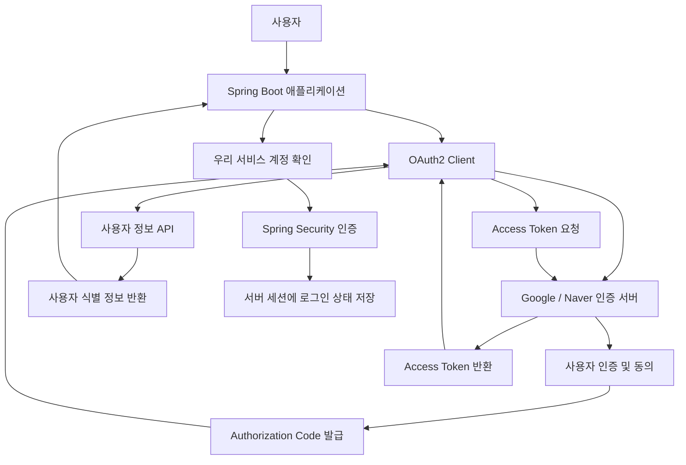
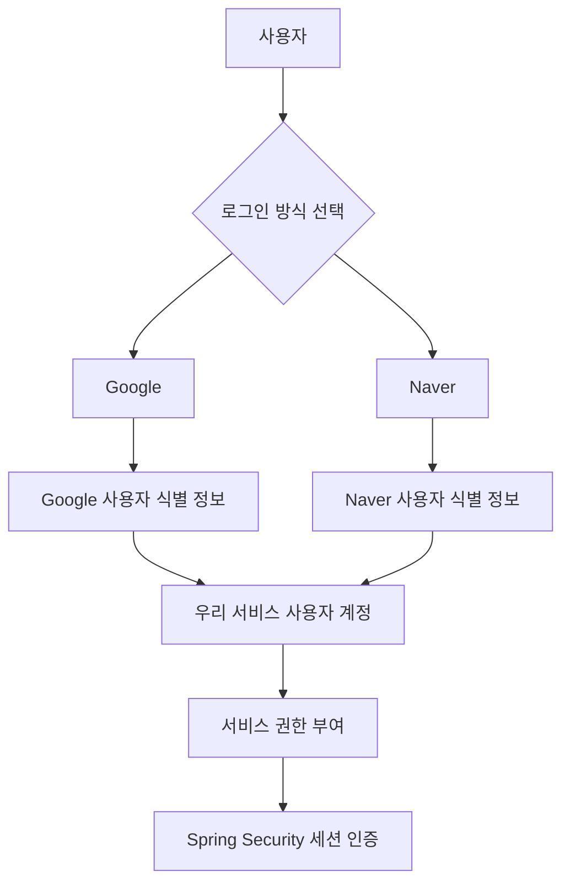
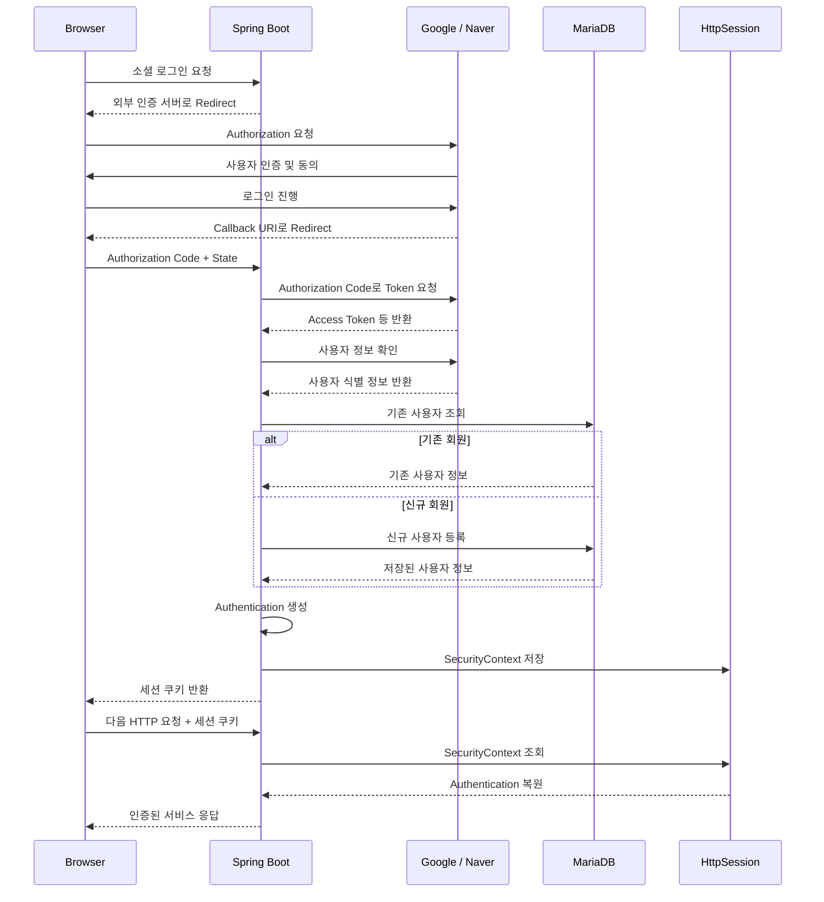
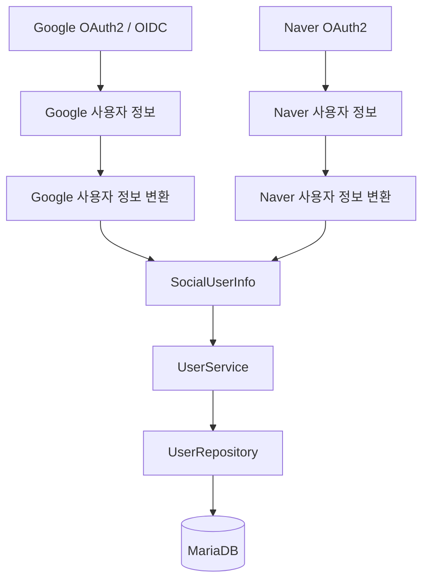
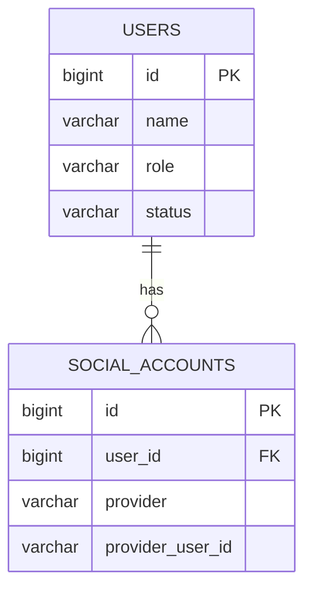
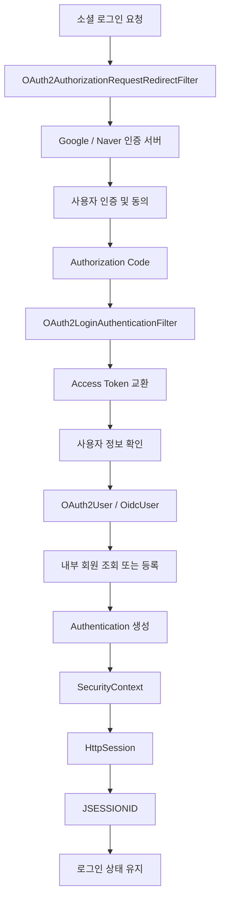

# 스프링 OAuth2 클라이언트 세션 - 1. 실습 목표 및 간단 동작 원리
[https://youtu.be/ulb4eNSqCPs?si=AHmgkLHMW5CGfzK2](https://youtu.be/ulb4eNSqCPs?si=AHmgkLHMW5CGfzK2)

# 스프링 OAuth2 클라이언트 세션 - 1. 실습 목표 및 간단 동작 원리
* toc
{:toc}

---

### Spring Security 6 OAuth2 소셜 로그인 완벽 이해: Authorization Code, Google·Naver 로그인과 세션 인증 구조

Spring Security를 이용해 사용자 인증 시스템을 구현하는 방법은 다양하다.

가장 기본적인 방식은 사용자가 직접 아이디와 비밀번호를 입력하고, 서버가 데이터베이스에 저장된 사용자 정보와 비교하여 인증하는 것이다.

예를 들어 다음과 같은 구조다.

```text
사용자
    ↓
아이디 / 비밀번호 입력
    ↓
Spring Security
    ↓
AuthenticationManager
    ↓
UserDetailsService
    ↓
Database
    ↓
비밀번호 검증
    ↓
로그인 성공
```

이러한 방식에서는 우리 서비스가 직접 사용자 자격 증명을 관리한다.

사용자 비밀번호를 안전하게 해시하여 저장해야 하고, 비밀번호 변경이나 계정 복구 기능도 구현해야 한다.

반면 사용자가 이미 보유한 구글이나 네이버 계정으로 로그인할 수 있도록 구성하는 방법도 있다.

대표적인 기능이 다음과 같다.

- Google 계정으로 로그인
- Naver 계정으로 로그인

이처럼 외부 서비스의 계정을 이용해 우리 서비스에 로그인하는 방식을 일반적으로 **소셜 로그인(Social Login)** 이라고 부른다.

Spring Security에서는 OAuth2 Client 기능을 이용해 이러한 인증 흐름을 구성할 수 있다.

다만 OAuth2와 사용자 인증은 정확히 동일한 개념이 아니다.

OAuth 2.0은 기본적으로 위임된 접근 권한을 처리하기 위한 프레임워크이며, 사용자 신원 확인을 표준화하기 위해서는 OpenID Connect(OIDC)를 함께 사용하기도 한다.

Google 로그인은 대표적인 OIDC 기반 로그인이고, Naver의 일반 OAuth2 로그인에서는 제공자가 반환하는 사용자 식별 정보를 이용해 서비스 계정과 연결할 수 있다.

이번에 살펴볼 구조는 다음과 같다.

```text
사용자
    ↓
Google / Naver 로그인 요청
    ↓
외부 인증 제공자
    ↓
사용자 인증
    ↓
Authorization Code 발급
    ↓
Spring Security OAuth2 Client
    ↓
Access Token 요청
    ↓
사용자 정보 확인
    ↓
우리 서비스 계정 조회 또는 등록
    ↓
Spring Security Authentication 생성
    ↓
서버 세션에 인증 상태 저장
    ↓
로그인 완료
```

이 방식에서는 외부 서비스가 사용자 인증의 일부를 담당하고, 우리 서비스는 인증 결과를 바탕으로 자체적인 사용자 계정과 권한을 관리한다.

최종적으로는 JWT를 클라이언트에 발급하는 대신, Spring Security의 세션 기반 인증을 이용해 로그인 상태를 유지한다.

---

### 개념

#### OAuth2란?

OAuth 2.0은 사용자가 자신의 비밀번호를 제3자 애플리케이션에 직접 전달하지 않고도, 특정 리소스에 대한 접근 권한을 위임할 수 있도록 정의된 프레임워크다.

예를 들어 사용자가 우리 서비스에 구글 계정으로 로그인한다고 생각해보자.

일반적인 아이디·비밀번호 로그인이라면 사용자가 우리 서비스에 자신의 비밀번호를 입력한다.

하지만 Google OAuth2 로그인에서는 우리 서비스가 사용자의 구글 비밀번호를 직접 전달받지 않는다.

대신 사용자를 Google의 인증 화면으로 이동시킨다.

```text
우리 서비스
    ↓
Google 인증 화면으로 이동
    ↓
사용자가 Google 계정으로 인증
    ↓
Google이 인증 및 동의 절차 처리
    ↓
우리 서비스에 인증 결과 전달
```

우리 서비스는 해당 결과를 이용해 필요한 사용자 정보를 확인한다.

이러한 구조에서 OAuth2는 외부 서비스와의 접근 권한 위임을 담당한다.

Spring Security는 OAuth2 Client 기능을 통해 이러한 흐름을 구현할 수 있다.

---

#### OAuth2와 OpenID Connect의 차이

OAuth2를 공부할 때 반드시 구분해야 하는 개념이 있다.

바로 **OAuth 2.0과 OpenID Connect(OIDC)** 다.

OAuth2는 기본적으로 접근 권한을 위임하기 위한 기술이다.

반면 OpenID Connect는 OAuth2를 기반으로 사용자 인증 기능을 표준화한 프로토콜이다.

| 구분 | OAuth 2.0 | OpenID Connect |
|---|---|---|
| 핵심 목적 | 접근 권한 위임 | 사용자 인증 |
| 대표적인 토큰 | Access Token | ID Token, Access Token |
| 사용자 신원 확인 | 별도 규약이나 제공자 API 필요 | 표준화된 ID Token 활용 |
| 대표적인 활용 | 외부 API 접근 권한 획득 | 소셜 로그인, SSO |
| Spring Security 주요 객체 | OAuth2User | OidcUser |

예를 들어 Google 로그인을 이용하면 OIDC 기반 사용자 인증을 수행할 수 있다.

이때 Google이 발급하는 ID Token에는 사용자 식별에 필요한 Claim이 포함된다.

반면 Naver의 일반 OAuth2 로그인에서는 Access Token으로 사용자 정보 API를 호출하고, 응답받은 식별 정보를 이용해 사용자를 구분할 수 있다.

Spring Security에서도 `openid` Scope의 유무에 따라 OIDC 전용 처리와 일반 OAuth2 사용자 정보 처리를 구분한다.

---

### OAuth2에 등장하는 주요 구성요소

OAuth2의 전체 구조를 이해하려면 네 가지 역할을 구분해야 한다.

| 구성요소 | 의미 | 예시 |
|---|---|---|
| Resource Owner | 리소스에 대한 권한을 가진 사용자 | Google 계정 소유자 |
| Client | 사용자를 대신해 접근 권한을 요청하는 애플리케이션 | Spring Boot 서비스 |
| Authorization Server | 사용자 인증 및 토큰 발급 담당 | Google 인증 서버 |
| Resource Server | 보호된 사용자 정보나 API 제공 | Google UserInfo API |

이번 구조에서는 Spring Boot 애플리케이션이 OAuth2 Client 역할을 담당한다.

Google과 Naver는 인증을 처리하고 사용자 정보에 접근할 수 있는 API를 제공한다.

이를 그림으로 표현하면 다음과 같다.



이때 반드시 이해해야 할 사실이 있다.

**Google이나 Naver가 발급한 Access Token과 우리 서비스에서 사용하는 로그인 세션은 서로 다른 인증 수단이다.**

외부 Access Token은 제공자의 사용자 정보 API를 호출할 때 사용한다.

반면 우리 서비스의 세션은 사용자가 우리 애플리케이션에서 로그인한 상태를 유지하기 위해 사용한다.

---

### 왜 사용하는가?

#### 1. 사용자 비밀번호를 직접 관리하지 않아도 된다

일반적인 로그인에서는 우리 서비스가 사용자 비밀번호를 검증해야 한다.

이를 위해 다음과 같은 기능이 필요하다.

```text
회원가입
    ↓
비밀번호 해시 저장
    ↓
로그인 시 비밀번호 검증
    ↓
비밀번호 변경
    ↓
비밀번호 분실 및 계정 복구
```

소셜 로그인을 이용하면 외부 제공자가 사용자의 자격 증명 인증을 담당한다.

우리 서비스는 Google이나 Naver의 비밀번호를 직접 보관하거나 검증할 필요가 없다.

다만 자체 계정의 권한 관리, 탈퇴, 비정상 로그인 대응 등 우리 서비스가 담당해야 하는 보안 책임까지 사라지는 것은 아니다.

---

#### 2. 사용자의 로그인 절차를 단순화할 수 있다

사용자는 새로운 아이디와 비밀번호를 만들지 않고 기존 계정으로 로그인할 수 있다.

예를 들어 다음과 같다.

```text
사용자
    ↓
Google 로그인 선택
    ↓
Google 인증
    ↓
우리 서비스 로그인 완료
```

이미 외부 서비스에 로그인한 상태라면 추가적인 비밀번호 입력 없이 인증 절차를 진행할 수 있는 경우도 있다.

다만 제공자의 보안 정책에 따라 추가 인증이나 사용자 동의가 필요할 수 있다.

---

#### 3. 여러 인증 수단을 하나의 사용자 시스템으로 통합할 수 있다

우리 서비스는 Google과 Naver 로그인을 모두 지원할 수 있다.



외부 인증 제공자가 여러 개이더라도 내부에서는 동일한 사용자 계정 구조와 권한 정책을 사용할 수 있다.

이것이 소셜 로그인을 구현할 때 중요한 설계 목표 중 하나다.

---

### 주요 특징

#### Authorization Code Grant란?

OAuth2에는 여러 가지 인가 방식이 있다.

그중 사용자 중심의 웹 애플리케이션 로그인에서 널리 사용하는 방식이 **Authorization Code Grant**다.

Authorization Code Grant는 외부 인증 서버가 먼저 Authorization Code를 발급하고, OAuth2 Client가 이 코드를 Access Token으로 교환하는 구조다.

다음과 같이 동작한다.

```text
사용자 로그인 요청
    ↓
외부 인증 서버로 이동
    ↓
사용자 인증 및 동의
    ↓
Authorization Code 발급
    ↓
Spring Boot 서버가 Code 수신
    ↓
Code를 Access Token으로 교환
    ↓
사용자 정보 조회
    ↓
우리 서비스 로그인 처리
```

Authorization Code는 API 접근에 직접 사용하는 토큰이 아니다.

이 코드는 Access Token을 발급받기 위해 사용하는 짧은 수명의 일회성 인증 수단이다.

따라서 클라이언트가 Authorization Code를 받았다고 해서 곧바로 외부 API에 접근할 수 있는 것은 아니다.

Spring Security의 OAuth2 Login 기능은 Authorization Code Grant를 기반으로 구현된다.

---

### Authorization Code Grant 전체 동작 원리

실제 로그인 흐름을 단계별로 살펴보자.

#### 1. 사용자가 소셜 로그인을 요청한다

사용자가 우리 서비스에서 Google 로그인 버튼을 선택한다.

브라우저는 다음 경로에 접근한다.

```http
GET /oauth2/authorization/google HTTP/1.1
Host: localhost:8080
```

이 경로는 Spring Security가 OAuth2 인증 요청을 시작하기 위해 제공하는 기본 경로다.

Naver 로그인이라면 다음과 같다.

```http
GET /oauth2/authorization/naver HTTP/1.1
Host: localhost:8080
```

여기서 `google`, `naver`는 각각 등록된 OAuth2 Client의 `registrationId`다.

---

#### 2. Spring Security가 외부 인증 서버로 이동시킨다

Spring Security는 요청한 OAuth2 Client의 설정을 조회한다.

예를 들어 Google 로그인 요청이라면 다음 정보를 사용한다.

```text
Client ID
Client Secret
Authorization URI
Token URI
Redirect URI
Scope
```

이후 브라우저를 Google의 Authorization Endpoint로 이동시킨다.

개념적인 요청 형식은 다음과 같다.

```http
GET /o/oauth2/v2/auth?
    response_type=code&
    client_id=CLIENT_ID&
    redirect_uri=REDIRECT_URI&
    scope=openid%20profile%20email&
    state=RANDOM_STATE
```

실제 요청에서는 파라미터가 URL 인코딩되어 하나의 URL로 전달된다.

여기서 `state`는 로그인 요청과 응답을 연결하고 요청 위조 공격을 방어하는 데 중요한 역할을 한다.

또한 보안 요구사항에 따라 PKCE를 함께 사용할 수 있다.

---

#### 3. 사용자가 외부 인증 서버에서 로그인한다

브라우저가 Google 인증 화면으로 이동한다.

사용자는 Google 계정으로 인증한다.

필요한 경우 요청한 접근 권한에 대한 동의 절차도 진행한다.

이 과정에서 우리 Spring Boot 서버는 사용자의 Google 비밀번호를 전달받지 않는다.

인증은 Google에서 처리한다.

---

#### 4. 외부 인증 서버가 Authorization Code를 반환한다

사용자 인증과 동의가 성공하면 Google은 사전에 등록한 Redirect URI로 브라우저를 이동시킨다.

예를 들어 다음과 같다.

```http
GET /login/oauth2/code/google?
    code=AUTHORIZATION_CODE&
    state=RANDOM_STATE
```

여기서 중요한 점은 **Authorization Code가 브라우저 리다이렉트를 통해 우리 서버의 Callback Endpoint로 전달된다는 사실**이다.

Google이 Spring Security 필터에 직접 내부 메서드를 호출하는 구조가 아니다.

우리 서버는 해당 HTTP 요청을 받아 OAuth2 인증 흐름을 이어서 처리한다.

---

#### 5. Spring Boot 서버가 Access Token을 요청한다

Spring Security는 전달받은 Authorization Code를 이용해 Google의 Token Endpoint에 Access Token을 요청한다.

개념적으로 다음과 같은 요청이다.

```http
POST /token HTTP/1.1
Host: oauth2.googleapis.com
Content-Type: application/x-www-form-urlencoded

grant_type=authorization_code
&code=AUTHORIZATION_CODE
&redirect_uri=REDIRECT_URI
&client_id=CLIENT_ID
&client_secret=CLIENT_SECRET
```

실제 요청 형식은 제공자의 Client 인증 방식과 PKCE 사용 여부 등에 따라 달라질 수 있다.

여기서 Client Secret을 사용하는 서버 측 교환은 일반적으로 Spring Boot 서버와 외부 Token Endpoint 사이에서 수행한다.

따라서 Client Secret을 브라우저 JavaScript에 노출할 필요가 없다.

인증 서버가 요청을 검증하면 Access Token을 반환한다.

Google OIDC 로그인에서는 ID Token도 반환될 수 있다.

---

#### 6. 외부 사용자 정보를 확인한다

Spring Security는 제공자별 인증 정보 처리 방식에 따라 사용자 정보를 확인한다.

일반적인 OAuth2 로그인에서는 Access Token을 이용해 UserInfo API를 호출할 수 있다.

예를 들어 Naver에서는 다음 API를 제공한다.

```http
GET /v1/nid/me HTTP/1.1
Host: openapi.naver.com
Authorization: Bearer <NAVER_ACCESS_TOKEN>
```

Naver는 해당 Access Token을 검증한 뒤 사용자 정보를 반환한다.

반면 Google의 OIDC 로그인은 ID Token을 통해 사용자 신원을 확인할 수 있으며, 필요한 경우 UserInfo Endpoint에서 추가 정보를 가져올 수 있다.

따라서 모든 소셜 로그인에서 사용자 인증을 처리하는 방식이 완전히 동일하다고 이해해서는 안 된다.

---

#### 7. 우리 서비스 사용자 계정과 연결한다

외부 제공자가 반환한 사용자 식별 정보를 이용해 우리 서비스의 회원을 확인한다.

예를 들어 다음과 같은 사용자 정보가 존재한다고 생각해보자.

```text
Provider = google

Provider User ID = 123456789
```

우리 서비스는 다음 조합으로 사용자를 조회할 수 있다.

```text
google:123456789
```

해당 사용자가 이미 등록되어 있다면 기존 회원으로 로그인한다.

반대로 아직 등록되지 않았다면 서비스 정책에 따라 회원을 생성할 수 있다.

```text
외부 사용자 식별 정보
    ↓
우리 서비스 DB 조회
    ↓
기존 회원인가?
    ├── Yes → 기존 사용자 사용
    └── No  → 신규 사용자 등록
```

이때 이메일 주소만으로 동일한 사용자인지 판단하는 것은 주의해야 한다.

외부 제공자의 이메일은 변경될 수 있고, 제공자마다 검증 여부와 제공 정책도 다를 수 있기 때문이다.

---

#### 8. Spring Security가 인증 상태를 구성한다

외부 인증 절차가 완료되고 우리 서비스의 사용자 정보가 확인되었다면 Spring Security는 인증된 사용자를 나타내는 `Authentication` 객체를 구성한다.

예를 들어 다음과 같은 구조다.

```text
Authentication
    │
    ├── Principal
    │     └── OAuth2User 또는 OidcUser
    │
    ├── Authorities
    │     └── ROLE_USER
    │
    └── Authenticated
          └── true
```

이 인증 정보는 `SecurityContext`를 통해 관리된다.

이번 구조에서는 세션 기반 인증을 사용하므로 Spring Security가 인증 결과를 `HttpSession`에 저장하고 이후 요청에서 복원할 수 있다.

---

#### 9. 클라이언트에 세션 쿠키를 전달한다

세션 기반 로그인이 완료되면 클라이언트는 일반적으로 세션 식별 쿠키를 받는다.

대표적인 예가 다음과 같다.

```http
Set-Cookie: JSESSIONID=SESSION_ID; HttpOnly; Path=/
```

실제 쿠키 속성은 서버의 세션 및 보안 설정에 따라 달라진다.

브라우저는 이후 요청에서 쿠키를 전달한다.

```http
Cookie: JSESSIONID=SESSION_ID
```

Spring Security는 해당 세션에 저장된 인증 정보를 복원하여 사용자를 인증된 상태로 처리할 수 있다.

이처럼 외부 OAuth2 로그인으로 인증을 시작하더라도 **우리 서비스에서는 세션 기반 로그인 상태를 유지할 수 있다.**

---

### 구조

#### OAuth2 소셜 로그인 전체 시퀀스

지금까지의 흐름을 하나의 구조로 정리하면 다음과 같다.



이 구조는 크게 세 영역으로 나눌 수 있다.

| 영역 | 역할 |
|---|---|
| 외부 인증 제공자 | 사용자 인증 및 외부 사용자 식별 정보 제공 |
| Spring Security OAuth2 Client | 인증 흐름 처리 및 Authentication 구성 |
| 우리 서비스 | 회원 영속성, 서비스 권한, 세션 관리 |

중요한 것은 **외부 인증 제공자가 우리 서비스의 모든 권한까지 결정하는 것은 아니라는 점**이다.

Google에서 인증에 성공했다고 해서 우리 서비스의 관리자 권한을 자동으로 부여해서는 안 된다.

외부 제공자는 사용자 신원을 확인하는 역할을 담당하고, 우리 서비스의 권한 정책은 내부에서 관리해야 한다.

---

### Spring Security 내부에서 어떤 필터가 동작할까?

OAuth2 로그인 흐름을 이해하려면 Spring Security의 주요 구성요소를 알아야 한다.

대표적으로 다음과 같은 구성요소가 사용된다.

| 구성요소 | 역할 |
|---|---|
| `OAuth2AuthorizationRequestRedirectFilter` | 외부 인증 서버로 Authorization 요청 시작 |
| `OAuth2LoginAuthenticationFilter` | Callback으로 전달된 Authorization Code 처리 |
| `ClientRegistrationRepository` | OAuth2 Client 등록 정보 관리 |
| `OAuth2AuthorizationRequestRepository` | 인증 요청과 응답을 연결할 정보 관리 |
| `OAuth2UserService` | 일반 OAuth2 사용자 정보 조회 및 구성 |
| `OidcUserService` | OIDC 기반 사용자 정보 구성 |
| `Authentication` | 인증된 사용자 정보 표현 |
| `SecurityContextRepository` | SecurityContext 저장 및 복원 |

이 중 중요한 필터는 두 가지다.

---

#### OAuth2AuthorizationRequestRedirectFilter

이 필터는 외부 인증 서버로 이동시키는 역할을 담당한다.

예를 들어 사용자가 다음 요청을 보낸다.

```http
GET /oauth2/authorization/google
```

Spring Security는 등록된 Google OAuth2 Client 정보를 조회한다.

그리고 Google Authorization Endpoint로 브라우저를 이동시킨다.

```text
GET /oauth2/authorization/google
    ↓
OAuth2AuthorizationRequestRedirectFilter
    ↓
ClientRegistration 조회
    ↓
Authorization 요청 생성
    ↓
Google 인증 서버로 Redirect
```

이때 `state`와 같은 인증 요청 관련 정보가 관리된다.

기본적인 세션 기반 OAuth2 로그인에서는 인증 요청과 Callback을 연결하기 위해 HttpSession을 활용할 수 있다.

---

#### OAuth2LoginAuthenticationFilter

이 필터는 외부 인증 서버에서 돌아온 Authorization Code를 처리한다.

기본 Callback URI는 다음 형태다.

```text
/login/oauth2/code/{registrationId}
```

Google은 다음과 같다.

```text
/login/oauth2/code/google
```

Naver는 다음과 같다.

```text
/login/oauth2/code/naver
```

사용자가 Google 인증을 완료하면 브라우저가 해당 경로로 이동한다.

이때 Spring Security는 다음 작업을 수행한다.

```text
Authorization Code 수신
    ↓
State 검증
    ↓
Access Token 교환
    ↓
외부 사용자 인증 정보 확인
    ↓
OAuth2User / OidcUser 구성
    ↓
Authentication 생성
    ↓
로그인 성공 처리
```

Spring Security 공식 구성에서도 Authorization 요청 시작 경로와 Callback 처리 경로를 분리한다.

---

### OAuth2UserService는 어떤 역할을 할까?

외부 제공자의 사용자 정보를 가져온 뒤에는 우리 서비스가 사용할 수 있는 형태로 변환해야 한다.

Spring Security는 이 과정을 지원하기 위해 `OAuth2UserService`를 제공한다.

대표적인 인터페이스는 다음과 같다.

```java
public interface OAuth2UserService<R extends OAuth2UserRequest, U extends OAuth2User> {

    U loadUser(R userRequest) throws OAuth2AuthenticationException;
}
```

일반적인 OAuth2 사용자 정보 처리는 다음 구현체를 사용할 수 있다.

```java
DefaultOAuth2UserService
```

Google OIDC 로그인에서는 다음 구성요소를 사용할 수 있다.

```java
OidcUserService
```

두 구성요소의 역할을 비교하면 다음과 같다.

| 구성요소 | 대상 | 주요 처리 |
|---|---|---|
| DefaultOAuth2UserService | 일반 OAuth2 로그인 | UserInfo API 호출 및 OAuth2User 생성 |
| OidcUserService | OIDC 로그인 | ID Token과 OIDC 사용자 정보 처리 |
| Custom OAuth2UserService | 서비스별 확장 | 사용자 정보 변환 및 내부 계정 연결 |

여기서 중요한 차이가 있다.

**OAuth2UserService가 직접 HttpSession을 생성하고 인증 상태를 저장하는 것은 아니다.**

OAuth2UserService는 사용자 정보를 조회하고 `OAuth2User`를 구성하는 역할을 담당한다.

그 결과를 이용해 Spring Security의 인증 필터가 인증 처리와 세션 저장 흐름을 진행한다.

따라서 외부 사용자 조회와 세션 저장은 서로 다른 책임이다.

---

### Google과 Naver 로그인의 차이

Google과 Naver는 모두 소셜 로그인에 사용할 수 있지만 사용자 정보 구조와 설정 방식에 차이가 있다.

#### Google

Google은 Spring Security가 기본 제공하는 OAuth2 Client Provider 중 하나다.

일반적으로 다음 정보만 지정하면 기본적인 로그인 구성을 시작할 수 있다.

```yaml
spring:
  security:
    oauth2:
      client:
        registration:
          google:
            client-id: ${GOOGLE_CLIENT_ID}
            client-secret: ${GOOGLE_CLIENT_SECRET}
            scope:
              - openid
              - profile
              - email
```

Google은 OIDC를 지원하므로 `openid` Scope를 사용하는 경우 OIDC 관련 구성요소가 동작한다.

대표적인 사용자 식별 정보는 `sub` Claim이다.

```json
{
  "sub": "123456789012345678901",
  "name": "Example User",
  "email": "user@example.com",
  "email_verified": true
}
```

위 값은 구조를 설명하기 위한 예시다.

사용자 식별에는 표시 이름보다 `sub`처럼 안정적인 제공자 식별자를 사용하는 것이 적절하다.

---

#### Naver

Naver의 일반 OAuth2 로그인에서는 제공자가 반환한 Access Token을 이용해 사용자 정보를 조회한다.

대표적인 API는 다음과 같다.

```http
GET https://openapi.naver.com/v1/nid/me
Authorization: Bearer <NAVER_ACCESS_TOKEN>
```

Naver의 사용자 정보 응답은 다음과 유사한 구조다.

```json
{
  "resultcode": "00",
  "message": "success",
  "response": {
    "id": "32742776",
    "nickname": "ExampleUser",
    "name": "Example",
    "email": "user@example.com"
  }
}
```

Google과 달리 실제 사용자 정보가 `response` 객체 안에 들어 있다.

Naver가 반환하는 `response.id`는 사용자를 구분하기 위한 식별 정보이며, 일반적인 네이버 로그인 아이디 문자열과는 다르다.

따라서 Naver 사용자 정보를 우리 서비스의 공통 사용자 구조로 변환하려면 별도의 처리 과정이 필요할 수 있다.

---

### 외부 사용자 정보는 왜 정규화해야 할까?

Google과 Naver가 제공하는 사용자 정보는 서로 다르다.

예를 들어 다음과 같다.

**Google**

```json
{
  "sub": "google-user-123",
  "name": "Example",
  "email": "user@example.com"
}
```

**Naver**

```json
{
  "response": {
    "id": "naver-user-456",
    "name": "Example",
    "email": "user@example.com"
  }
}
```

이 구조를 서비스 전체에서 직접 사용하면 제공자마다 별도의 분기 처리가 필요하다.

```java
if (provider.equals("google")) {
    // Google 사용자 처리
} else if (provider.equals("naver")) {
    // Naver 사용자 처리
}
```

이러한 코드가 여러 계층에 반복되면 유지보수가 어려워진다.

따라서 다음과 같이 공통 사용자 모델로 변환하는 것이 좋다.

```java
public record SocialUserInfo(
        String provider,
        String providerUserId,
        String name,
        String email
) {
}
```

Google 사용자 정보는 다음과 같이 변환할 수 있다.

```java
SocialUserInfo googleUser = new SocialUserInfo(
        "google",
        "google-user-123",
        "Example",
        "user@example.com"
);
```

Naver 사용자 정보도 동일한 구조로 변환한다.

```java
SocialUserInfo naverUser = new SocialUserInfo(
        "naver",
        "naver-user-456",
        "Example",
        "user@example.com"
);
```

이렇게 하면 이후 비즈니스 로직은 Google과 Naver의 응답 형식을 직접 알 필요가 없다.



이러한 추상화는 소셜 로그인 제공자가 늘어날수록 중요해진다.

---

### 예제

#### Spring Boot 프로젝트 구성

이번 구조에서는 다음 기술을 사용한다.

| 항목 | 기술 |
|---|---|
| Java | 17 |
| Spring Boot | 3.2.1 |
| Spring Security | 6.2.1 |
| OAuth2 | Spring Security OAuth2 Client |
| 화면 처리 | Thymeleaf |
| 영속성 | Spring Data JPA |
| 데이터베이스 | MariaDB |
| 빌드 도구 | Gradle |
| 인증 상태 관리 | HttpSession |

여기서는 먼저 기본적인 OAuth2 로그인 흐름을 구성하고, 이후 데이터베이스 연동과 사용자 정보 정규화로 확장할 수 있는 구조를 살펴본다.

---

### Gradle 의존성 설정

Spring Boot에서 OAuth2 Client를 사용하려면 관련 의존성이 필요하다.

`build.gradle`은 다음과 같이 구성할 수 있다.

```gradle
plugins {
    id 'java'
    id 'org.springframework.boot' version '3.2.1'
    id 'io.spring.dependency-management' version '1.1.4'
}

group = 'com.example'
version = '0.0.1-SNAPSHOT'

java {
    sourceCompatibility = '17'
}

repositories {
    mavenCentral()
}

dependencies {

    // Spring MVC
    implementation 'org.springframework.boot:spring-boot-starter-web'

    // Spring Security
    implementation 'org.springframework.boot:spring-boot-starter-security'

    // OAuth2 Client
    implementation 'org.springframework.boot:spring-boot-starter-oauth2-client'

    // SSR 화면 처리
    implementation 'org.springframework.boot:spring-boot-starter-thymeleaf'

    // JPA
    implementation 'org.springframework.boot:spring-boot-starter-data-jpa'

    // MariaDB
    runtimeOnly 'org.mariadb.jdbc:mariadb-java-client'

    // Test
    testImplementation 'org.springframework.boot:spring-boot-starter-test'
    testImplementation 'org.springframework.security:spring-security-test'
}

tasks.named('test') {
    useJUnitPlatform()
}
```

가장 중요한 의존성은 다음과 같다.

```gradle
implementation 'org.springframework.boot:spring-boot-starter-oauth2-client'
```

이 의존성을 추가하면 Spring Security의 OAuth2 Client 기능을 사용할 수 있다.

대표적으로 다음 구성요소가 포함된다.

```text
OAuth2AuthorizationRequestRedirectFilter

OAuth2LoginAuthenticationFilter

OAuth2UserService

OidcUserService

ClientRegistrationRepository
```

Spring Boot에서는 OAuth2 Client 설정을 기반으로 ClientRegistration 관련 구성요소를 자동 구성할 수 있다.

---

### application.yml 설정

Google 로그인을 먼저 구성한다고 가정하자.

다음과 같이 설정할 수 있다.

```yaml
server:
  port: 8080

spring:
  application:
    name: oauth2-session

  datasource:
    driver-class-name: org.mariadb.jdbc.Driver
    url: ${DB_URL:jdbc:mariadb://localhost:3306/oauth2_demo}
    username: ${DB_USERNAME}
    password: ${DB_PASSWORD}

  jpa:
    hibernate:
      ddl-auto: none

    open-in-view: false

  security:
    oauth2:
      client:
        registration:
          google:
            client-id: ${GOOGLE_CLIENT_ID}
            client-secret: ${GOOGLE_CLIENT_SECRET}

            scope:
              - openid
              - profile
              - email
```

각 설정의 의미는 다음과 같다.

| 설정 | 역할 |
|---|---|
| `spring.datasource.url` | MariaDB 연결 주소 |
| `spring.datasource.username` | DB 계정 |
| `spring.datasource.password` | DB 비밀번호 |
| `spring.security.oauth2.client.registration.google` | Google Client 등록 |
| `client-id` | Google에서 발급받은 Client ID |
| `client-secret` | Google에서 발급받은 Client Secret |
| `scope` | 요청할 인증 및 사용자 정보 범위 |

Google OAuth2 Client를 사용하려면 Google 측에도 애플리케이션을 등록해야 한다.

그리고 Redirect URI를 등록해야 한다.

현재 Spring Security의 기본 Callback URI는 다음과 같다.

```text
http://localhost:8080/login/oauth2/code/google
```

Google에 등록한 Redirect URI와 실제 Spring Security의 Callback URI가 일치해야 한다.

그렇지 않으면 Redirect URI 불일치 오류가 발생할 수 있다.

---

### SecurityConfig 작성

이제 OAuth2 Login을 활성화한다.

이번 구조에서는 JWT를 발급하지 않고 세션을 이용한다.

따라서 SecurityConfig는 다음과 같이 작성할 수 있다.

```java
package com.example.oauth2.config;

import org.springframework.context.annotation.Bean;
import org.springframework.context.annotation.Configuration;

import org.springframework.security.config.Customizer;

import org.springframework.security.config.annotation.web.builders.HttpSecurity;
import org.springframework.security.config.annotation.web.configuration.EnableWebSecurity;

import org.springframework.security.config.annotation.web.configurers.AbstractHttpConfigurer;

import org.springframework.security.config.http.SessionCreationPolicy;

import org.springframework.security.web.SecurityFilterChain;

@Configuration
@EnableWebSecurity
public class SecurityConfig {

    @Bean
    public SecurityFilterChain filterChain(
            HttpSecurity http
    ) throws Exception {

        http
                // 공개 경로 및 인증 필요 경로
                .authorizeHttpRequests(auth -> auth

                        .requestMatchers(
                                "/",
                                "/css/**",
                                "/js/**"
                        ).permitAll()

                        .anyRequest().authenticated()
                )

                // HTTP Basic 인증 비활성화
                .httpBasic(AbstractHttpConfigurer::disable)

                // OAuth2 로그인 활성화
                .oauth2Login(Customizer.withDefaults())

                // 세션 기반 인증
                .sessionManagement(session -> session
                        .sessionCreationPolicy(
                                SessionCreationPolicy.IF_REQUIRED
                        )
                )

                // 로그아웃
                .logout(logout -> logout
                        .logoutSuccessUrl("/")
                );

        return http.build();
    }
}
```

여기서 가장 중요한 설정은 다음과 같다.

```java
.oauth2Login(Customizer.withDefaults())
```

이 설정은 OAuth2 로그인 처리를 활성화한다.

또한 다음 설정을 살펴보자.

```java
.sessionManagement(session -> session
        .sessionCreationPolicy(
                SessionCreationPolicy.IF_REQUIRED
        )
)
```

`IF_REQUIRED`는 필요한 경우 세션을 생성할 수 있도록 하는 정책이다.

실제로 이 값은 Spring Security의 기본 세션 생성 정책이기도 하므로 명시하지 않아도 되는 경우가 있다.

이번에는 JWT Stateless 인증과의 차이를 드러내기 위해 직접 작성했다.

#### JWT 방식과의 차이

JWT 기반 Stateless 인증에서는 다음과 같은 설정을 사용했다.

```java
.sessionManagement(session -> session
        .sessionCreationPolicy(
                SessionCreationPolicy.STATELESS
        )
)
```

반면 이번에는 세션 기반 인증을 사용한다.

```java
.sessionManagement(session -> session
        .sessionCreationPolicy(
                SessionCreationPolicy.IF_REQUIRED
        )
)
```

두 설정의 차이는 다음과 같다.

| 설정 | 동작 |
|---|---|
| STATELESS | Spring Security가 세션에 인증 상태를 유지하지 않음 |
| IF_REQUIRED | 필요한 경우 세션을 생성하고 활용 가능 |

OAuth2 Authorization Code 로그인에서는 인증 요청과 Callback을 연결하기 위한 상태 관리도 필요하므로 세션 기반 구성이 자연스럽다.

---

### 기본 로그인 화면 연결하기

Spring Security의 OAuth2 Client 설정이 완료되면 다음 경로로 로그인 흐름을 시작할 수 있다.

```text
/oauth2/authorization/google
```

Naver를 등록했다면 다음 경로를 사용할 수 있다.

```text
/oauth2/authorization/naver
```

이를 HTML에서 다음과 같이 연결할 수 있다.

```html
<a href="/oauth2/authorization/google">
    Google 로그인
</a>
```

Naver는 다음과 같다.

```html
<a href="/oauth2/authorization/naver">
    Naver 로그인
</a>
```

이 링크를 클릭하면 Spring Security가 외부 인증 서버로 이동시키는 처리를 수행한다.

직접 Google Authorization URL을 문자열로 조합하지 않아도 Spring Security의 OAuth2 Client 기능을 이용할 수 있다.

---

### Controller에서 로그인 상태 확인하기

세션 기반 인증이 완료되면 Controller에서 현재 인증된 사용자 정보를 조회할 수 있다.

예를 들어 다음과 같이 구현할 수 있다.

```java
package com.example.oauth2.controller;

import org.springframework.security.authentication.AnonymousAuthenticationToken;

import org.springframework.security.core.Authentication;

import org.springframework.stereotype.Controller;
import org.springframework.ui.Model;

import org.springframework.web.bind.annotation.GetMapping;

@Controller
public class HomeController {

    @GetMapping("/")
    public String home(
            Model model,
            Authentication authentication
    ) {

        boolean loggedIn =
                authentication != null
                && !(authentication instanceof AnonymousAuthenticationToken);

        model.addAttribute(
                "loggedIn",
                loggedIn
        );

        if (loggedIn) {

            model.addAttribute(
                    "username",
                    authentication.getName()
            );
        }

        return "home";
    }
}
```

이 코드에서는 다음 메서드로 현재 인증된 사용자의 식별 이름을 가져온다.

```java
authentication.getName();
```

단, OAuth2 로그인에서 반환되는 이름은 제공자가 부여한 사용자 식별자일 수 있다.

실제 화면에 보여줄 닉네임이나 이름이 필요하다면 사용자 정보 Claim 또는 우리 서비스 DB의 프로필 정보를 별도로 활용해야 한다.

---

### Thymeleaf 화면 작성

SSR(Server-Side Rendering) 방식에서는 서버가 HTML을 생성하여 응답한다.

다음 파일을 생성한다.

```text
src/main/resources/templates/home.html
```

예제 코드는 다음과 같다.

```html
<!DOCTYPE html>
<html lang="ko"
      xmlns:th="http://www.thymeleaf.org">

<head>
    <meta charset="UTF-8">
    <title>OAuth2 로그인</title>
</head>

<body>

<h1>Spring Security OAuth2 로그인</h1>

<div th:if="${!loggedIn}">

    <p>로그인이 필요합니다.</p>

    <a th:href="@{/oauth2/authorization/google}">
        Google 로그인
    </a>

</div>

<div th:if="${loggedIn}">

    <p>
        로그인 사용자:
        <span th:text="${username}"></span>
    </p>

    <form th:action="@{/logout}" method="post">

        <button type="submit">
            로그아웃
        </button>

    </form>

</div>

</body>

</html>
```

이 코드는 로그인 상태에 따라 다른 화면을 반환한다.

로그인하지 않았다면 Google 로그인 링크를 표시한다.

로그인에 성공하면 사용자 식별 이름과 로그아웃 버튼을 표시한다.

여기서 로그아웃은 POST 방식으로 처리한다.

Spring Security의 기본 CSRF 보호를 유지한 상태에서 Thymeleaf의 `th:action`을 사용하면 Spring MVC 통합을 통해 필요한 CSRF 입력값을 반영할 수 있다.

---

### 실행 및 확인

#### 1. MariaDB 준비

먼저 데이터베이스를 생성한다.

```sql
CREATE DATABASE oauth2_demo
CHARACTER SET utf8mb4
COLLATE utf8mb4_unicode_ci;
```

이 명령은 `oauth2_demo` 데이터베이스를 생성한다.

실제 애플리케이션 실행 계정에는 필요한 데이터베이스 접근 권한이 있어야 한다.

#### 2. 환경변수 설정

다음과 같이 연결 정보를 설정할 수 있다.

```bash
export DB_USERNAME="app_user"
export DB_PASSWORD="your-db-password"

export GOOGLE_CLIENT_ID="your-google-client-id"
export GOOGLE_CLIENT_SECRET="your-google-client-secret"
```

위 값은 각각 실제 DB 계정과 Google OAuth2 Client 정보로 변경해야 한다.

Client Secret은 소스 코드에 직접 작성하거나 공개 저장소에 포함하지 않는 것이 좋다.

#### 3. Spring Boot 실행

다음 명령을 실행한다.

```bash
./gradlew bootRun
```

`bootRun`은 Spring Boot 애플리케이션을 실행하는 Gradle 작업이다.

설정이 정상적이라면 애플리케이션이 8080 포트에서 실행된다.

#### 4. Google 로그인 요청

브라우저에서 다음 경로에 접근한다.

```text
http://localhost:8080/oauth2/authorization/google
```

그러면 Google 인증 화면으로 이동한다.

Google 인증을 완료하면 브라우저가 Spring Boot의 Callback URI로 돌아온다.

```text
http://localhost:8080/login/oauth2/code/google
```

Spring Security가 인증에 성공하면 로그인 상태가 세션에 저장될 수 있다.

이후 홈 화면에서 현재 사용자 정보를 조회할 수 있다.

다만 위 예제는 **Google OAuth2 로그인과 세션 생성의 기본 동작을 확인하기 위한 구성**이다.

외부 사용자 정보를 MariaDB에 영속화하거나 자체 회원 권한을 연결하는 로직은 아직 추가하지 않았다.

---

### Naver OAuth2 Client 설정 구조

Naver는 Google과 달리 Spring Security의 기본 Provider 목록에 포함되지 않는다.

따라서 Naver의 Authorization Endpoint와 Token Endpoint 등을 직접 설정해야 한다.

대표적인 설정 형태는 다음과 같다.

```yaml
spring:
  security:
    oauth2:
      client:
        registration:
          naver:
            client-id: ${NAVER_CLIENT_ID}
            client-secret: ${NAVER_CLIENT_SECRET}

            client-authentication-method: client_secret_post

            authorization-grant-type: authorization_code

            redirect-uri: "{baseUrl}/login/oauth2/code/{registrationId}"

            client-name: Naver

        provider:
          naver:
            authorization-uri: https://nid.naver.com/oauth2.0/authorize

            token-uri: https://nid.naver.com/oauth2.0/token

            user-info-uri: https://openapi.naver.com/v1/nid/me

            user-name-attribute: response
```

이 설정에서 각 항목은 다음을 의미한다.

| 설정 | 설명 |
|---|---|
| client-id | Naver 애플리케이션 ID |
| client-secret | Naver 애플리케이션 Secret |
| authorization-grant-type | Authorization Code 방식 |
| redirect-uri | 인증 완료 후 돌아올 주소 |
| authorization-uri | Naver 인증 요청 주소 |
| token-uri | Access Token 발급 주소 |
| user-info-uri | 사용자 정보 조회 주소 |
| user-name-attribute | 사용자 식별 정보를 찾기 위한 응답 속성 |

Naver의 일반 OAuth2 사용자 정보는 `response` 객체 안에 들어 있으므로 실제 사용자 ID를 얻으려면 추가적인 매핑이 필요하다.

또한 Naver Token API는 `state` 등 제공자 고유의 요청 파라미터를 사용한다. 따라서 표준 OAuth2 Client 설정만으로 모든 인증 흐름이 호환된다고 가정해서는 안 되며, 필요에 따라 Token Request 변환 로직을 확장해야 한다.

즉 위 설정은 **Naver 연동에 필요한 주요 Client 정보를 보여주는 기본 형태**다.

실제로 Naver 로그인을 완성하려면 제공자별 사용자 정보 변환과 Token Endpoint 호환성까지 확인해야 한다.

---

### 사용자 정보를 왜 데이터베이스에 저장할까?

소셜 로그인을 구현한다고 해서 반드시 우리 서비스의 데이터베이스에 회원 정보를 저장해야 하는 것은 아니다.

외부 제공자가 반환한 사용자 정보만으로 인증된 요청을 처리하는 구조도 가능하다.

하지만 실제 서비스에서는 자체 사용자 계정을 관리해야 하는 경우가 많다.

예를 들어 다음과 같은 기능이 필요할 수 있다.

```text
주문 내역

게시글 작성

서비스 이용 권한

구독 상태

회원 탈퇴

서비스별 프로필

관리자 권한
```

이러한 기능은 외부 인증 제공자의 계정 정보만으로 관리하기 어렵다.

따라서 외부 계정과 우리 서비스의 내부 회원을 연결하는 것이 일반적이다.

---

### 소셜 로그인 사용자 엔티티 설계

가장 단순한 회원 구조는 다음과 같다.

```text
User
    │
    ├── id
    ├── provider
    ├── providerUserId
    ├── name
    ├── email
    └── role
```

각 필드의 의미는 다음과 같다.

| 필드 | 설명 |
|---|---|
| id | 우리 서비스 내부 사용자 ID |
| provider | Google, Naver 등 로그인 제공자 |
| providerUserId | 외부 제공자가 부여한 사용자 식별자 |
| name | 사용자 표시 이름 |
| email | 이메일 |
| role | 우리 서비스의 사용자 권한 |

예를 들어 다음과 같은 정보가 저장될 수 있다.

```text
id = 1001

provider = google

providerUserId = google-12345

name = Example

email = user@example.com

role = ROLE_USER
```

여기서 가장 중요한 필드는 다음 두 가지다.

```text
provider
providerUserId
```

이 두 값을 조합하면 외부 제공자별 사용자를 구분할 수 있다.

예를 들어 다음 두 계정은 서로 다른 외부 계정이다.

```text
google:12345
```

```text
naver:12345
```

외부 식별자가 동일한 문자열이더라도 제공자가 다르면 다른 계정으로 취급해야 한다.

따라서 다음과 같은 복합 유니크 제약을 적용할 수 있다.

```sql
CREATE TABLE social_user (

    id BIGINT NOT NULL AUTO_INCREMENT,

    provider VARCHAR(30) NOT NULL,

    provider_user_id VARCHAR(255) NOT NULL,

    name VARCHAR(100),

    email VARCHAR(255),

    role VARCHAR(30) NOT NULL,

    PRIMARY KEY (id),

    UNIQUE KEY uk_social_user_provider (
        provider,
        provider_user_id
    )
);
```

이 구조에서는 `provider`와 `provider_user_id`의 조합을 중복 저장할 수 없다.

다만 동일한 사용자가 Google과 Naver 계정을 모두 연결하는 기능까지 지원하려면, 회원 테이블과 외부 인증 계정 테이블을 별도로 분리하는 구조가 더 적절하다.

---

### 외부 인증 계정과 내부 회원을 분리하는 구조

서비스가 확장된다면 다음 구조를 고려할 수 있다.

```text
users
    │
    ├── id
    ├── name
    ├── role
    └── status
```

```text
social_accounts
    │
    ├── id
    ├── user_id
    ├── provider
    └── provider_user_id
```

이를 관계로 표현하면 다음과 같다.



이 구조에서는 한 명의 내부 사용자가 여러 소셜 계정을 연결할 수 있다.

예를 들어 다음과 같다.

```text
우리 서비스 회원 ID = 1001
    │
    ├── Google 계정
    │     └── google:12345
    │
    └── Naver 계정
          └── naver:67890
```

이렇게 하면 로그인 제공자가 달라지더라도 동일한 내부 회원으로 연결할 수 있다.

특히 주문, 결제, 구독, 쿠폰 등 사용자 중심의 도메인을 운영하는 서비스에서는 내부 사용자 식별자를 안정적으로 유지하는 것이 중요하다.

---

### OAuth2 세션 인증과 JWT 인증의 차이

앞서 구현한 JWT 로그인과 이번 OAuth2 세션 로그인을 비교해보자.

JWT 기반 인증은 다음과 같이 동작했다.

```text
아이디 / 비밀번호 검증
    ↓
JWT 발급
    ↓
클라이언트가 JWT 보관
    ↓
Authorization 헤더로 JWT 전달
    ↓
JWTFilter
    ↓
인증 정보 구성
```

이번 OAuth2 세션 기반 로그인은 다음과 같다.

```text
외부 인증 제공자 로그인
    ↓
Authorization Code 발급
    ↓
Access Token 교환
    ↓
사용자 정보 확인
    ↓
우리 서비스 Authentication 생성
    ↓
HttpSession에 인증 상태 저장
    ↓
세션 쿠키로 로그인 상태 유지
```

두 방식을 비교하면 다음과 같다.

| 구분 | OAuth2 + 세션 로그인 | JWT 기반 로그인 |
|---|---|---|
| 최초 인증 | 외부 제공자 또는 자체 인증 | 자체 인증 또는 외부 인증 |
| 클라이언트가 주로 보관하는 값 | 세션 쿠키 | JWT |
| 인증 상태 저장 | 서버 세션 | 토큰 Claim 중심 |
| 이후 요청 인증 | 세션 정보 복원 | JWT 검증 |
| 로그아웃 | 서버 세션 무효화 | 토큰 폐기 정책 필요 |
| 서버 간 확장 | 공유 세션 저장소 등 고려 | 토큰 검증 키 및 정책 공유 |
| SSR 웹 애플리케이션 | 자연스럽게 활용 가능 | 별도 토큰 처리 필요 |
| API 서버 | 사용 가능 | 사용 가능 |

여기서 한 가지 중요한 사실이 있다.

**OAuth2와 JWT는 서로 대체되는 개념이 아니다.**

OAuth2는 외부 인증 및 권한 위임 흐름을 처리하는 데 사용하고, JWT는 정보를 전달하는 토큰 형식이다.

따라서 OAuth2 로그인을 완료한 뒤 우리 서비스의 JWT를 별도로 발급하는 구조도 가능하다.

반대로 이번처럼 OAuth2 로그인을 완료한 뒤 세션 기반 인증을 사용하는 구조도 가능하다.

즉 다음 두 아키텍처 모두 구현할 수 있다.

```text
OAuth2 로그인
    ↓
우리 서비스 세션 생성
```

```text
OAuth2 로그인
    ↓
우리 서비스 JWT 발급
```

두 구조의 차이는 **외부 사용자 인증이 완료된 이후 우리 서비스가 로그인 상태를 어떻게 유지할 것인가**에 있다.

---

### 실무에서의 활용

#### 1. 외부 제공자의 인증과 우리 서비스의 인가를 분리한다

Google이나 Naver에서 로그인에 성공했다는 사실은 해당 외부 계정으로 인증되었다는 의미다.

하지만 이것이 우리 서비스의 모든 기능에 접근할 권한이 있다는 의미는 아니다.

예를 들어 다음과 같은 상황을 생각해보자.

```text
Google 로그인 성공
    ↓
외부 사용자 식별
    ↓
우리 서비스 회원 조회
    ↓
회원 상태 확인
    ↓
ROLE_USER 부여
```

이 사용자가 관리자 API에 접근하려면 별도의 권한이 필요하다.

따라서 외부 제공자의 인증 결과를 신뢰하더라도 우리 서비스의 권한은 내부 정책을 통해 결정해야 한다.

#### 2. 사용자 식별자로 이메일만 사용하지 않는다

Google과 Naver는 모두 이메일을 제공할 수 있다.

하지만 이메일은 변경될 수 있고 제공자의 정책이나 사용자 동의에 따라 제공되지 않을 수 있다.

따라서 이메일을 유일한 사용자 식별자로 사용하는 것은 신중해야 한다.

일반적으로 다음 조합이 더 적절하다.

```text
provider + providerUserId
```

Google에서는 `sub`, Naver에서는 `response.id`와 같은 제공자 식별자를 사용할 수 있다.

#### 3. 소셜 계정과 내부 회원의 관계를 명확하게 정의한다

서비스에서 Google 계정과 Naver 계정을 모두 지원한다면 한 사용자가 서로 다른 두 계정으로 가입할 수 있다.

이때 두 계정을 하나의 내부 회원으로 연결할 것인지 정책을 정해야 한다.

단순히 이메일이 동일하다는 이유만으로 자동 병합하면 계정 탈취나 잘못된 계정 연결 문제가 발생할 수 있다.

따라서 계정 연결에는 기존 로그인 상태 확인이나 추가적인 사용자 인증 등 명시적인 검증 절차가 필요하다.

#### 4. Authorization Code는 반드시 안전하게 처리한다

Authorization Code는 Access Token을 발급받기 위한 중요한 값이다.

따라서 Callback에서 전달받은 코드를 무조건 신뢰해서는 안 된다.

인증 요청에 사용한 `state`를 검증하고, 등록된 Redirect URI와 Client 정보를 확인해야 한다.

또한 가능한 환경에서는 PKCE를 활용해 Authorization Code 탈취나 주입 공격의 위험을 줄이는 것이 좋다.

OAuth 2.0의 최신 보안 권고는 Public Client의 PKCE 사용을 요구하고 Confidential Client에도 PKCE를 권장한다.

#### 5. 외부 Access Token과 내부 인증 상태를 혼동하지 않는다

Google이나 Naver가 발급한 Access Token은 제공자의 API에 접근하기 위한 토큰이다.

반면 우리 서비스의 HttpSession은 내부 사용자의 로그인 상태를 유지하기 위해 사용한다.

따라서 다음 두 값은 목적이 다르다.

```text
Google Access Token
```

```text
우리 서비스 JSESSIONID
```

외부 Access Token을 우리 서비스의 모든 API 인증 수단으로 직접 사용하도록 설계할 필요는 없다.

외부 사용자 인증이 완료되면 자체 Authentication을 구성하고 세션에 저장할 수 있다.

#### 6. OAuth2UserService에 모든 비즈니스 로직을 집중시키지 않는다

OAuth2UserService는 외부 사용자 정보를 가져오고 OAuth2User를 구성하는 역할을 담당한다.

실무에서는 이 과정에서 내부 회원 조회나 등록이 필요할 수 있다.

하지만 주문, 결제, 구독 등 모든 비즈니스 로직까지 OAuth2UserService에 구현하면 책임이 과도하게 커진다.

따라서 다음과 같이 분리하는 것이 좋다.

```text
OAuth2UserService
    ↓
외부 사용자 정보 정규화
    ↓
SocialAccountService
    ↓
내부 회원 조회 또는 등록
    ↓
OAuth2User 반환
```

이렇게 하면 인증 제공자별 처리와 사용자 도메인 로직을 구분할 수 있다.

#### 7. 회원 등록 과정의 동시성을 고려한다

하나의 외부 계정으로 거의 동시에 두 개의 로그인 요청이 발생할 수 있다.

이때 다음과 같은 문제가 발생할 수 있다.

```text
요청 A → 사용자 없음 확인
요청 B → 사용자 없음 확인

요청 A → 사용자 생성
요청 B → 사용자 생성
```

이를 방지하려면 사용자 조회 후 저장하는 코드만으로는 부족할 수 있다.

다음과 같은 복합 유니크 제약을 적용하는 것이 좋다.

```sql
UNIQUE (provider, provider_user_id)
```

그리고 동시 요청에서 중복 키 예외가 발생하면 기존 사용자 조회 등의 방식으로 처리해야 한다.

#### 8. 외부 인증 제공자의 장애를 고려한다

소셜 로그인에서는 Google이나 Naver의 인증 서버에 의존한다.

외부 인증 서버가 응답하지 않거나 네트워크 오류가 발생하면 로그인에 실패할 수 있다.

또한 Access Token을 받은 뒤 UserInfo API 호출에서 오류가 발생할 수도 있다.

따라서 다음과 같은 오류 상황을 구분해야 한다.

```text
사용자 로그인 취소
```

```text
Authorization Code 만료
```

```text
Token Endpoint 호출 실패
```

```text
UserInfo API 오류
```

```text
내부 사용자 저장 실패
```

이러한 상황을 동일한 오류 메시지로 처리하기보다 내부적으로는 원인을 구분하여 기록하고, 사용자에게는 적절한 안내를 제공하는 것이 좋다.

#### 9. 외부 토큰을 불필요하게 저장하지 않는다

Google이나 Naver의 Access Token이 발급되었다고 해서 반드시 데이터베이스에 영구 저장해야 하는 것은 아니다.

우리 서비스가 외부 사용자 정보를 최초 로그인 시에만 조회한다면 외부 토큰을 장기간 보관할 필요가 없을 수도 있다.

반면 사용자 동의를 바탕으로 외부 API를 지속해서 호출해야 한다면 토큰 저장과 갱신 정책이 필요하다.

이 경우 토큰은 암호화와 접근 제어 등 적절한 보호 수단을 적용해야 한다.

#### 10. 세션 기반 인증에서는 CSRF를 고려한다

이번 구조는 브라우저의 세션 쿠키를 이용한다.

브라우저는 같은 사이트 또는 쿠키 정책이 허용하는 요청에 쿠키를 자동으로 포함할 수 있다.

따라서 세션 기반 인증에서는 CSRF 공격을 고려해야 한다.

JWT Stateless 인증에서 사용했던 다음 설정을 그대로 적용할 필요는 없다.

```java
.csrf(AbstractHttpConfigurer::disable)
```

일반적인 브라우저 기반 세션 인증에서는 Spring Security의 CSRF 보호를 유지하는 것이 적절하다.

특히 회원 정보 변경이나 로그아웃처럼 상태를 변경하는 요청은 CSRF 정책을 함께 검토해야 한다.

#### 11. 세션 고정 공격에 대응한다

세션 인증에서는 로그인 전후에 세션 ID를 안전하게 관리해야 한다.

공격자가 미리 확보한 세션 ID를 사용자가 인증한 이후에도 계속 사용하게 만들면 세션 고정 공격으로 이어질 수 있다.

Spring Security는 세션 고정 공격 방어 기능을 제공하며, 일반적인 Servlet 환경에서는 로그인 시 세션 ID를 변경하는 방식을 사용할 수 있다.

따라서 세션 기반 소셜 로그인에서도 세션 고정 공격 방어 설정을 이해하는 것이 중요하다.

#### 12. 세션 저장소의 확장성을 고려한다

애플리케이션 서버가 한 대라면 메모리 기반 HttpSession으로도 기본적인 인증 시스템을 구현할 수 있다.

하지만 서버가 여러 대로 확장되면 문제가 발생할 수 있다.

```text
Load Balancer
    ├── Application A
    ├── Application B
    └── Application C
```

사용자가 Application A에서 로그인한 뒤 Application B로 요청을 보낸다면 세션 정보가 공유되지 않아 로그인 상태를 찾지 못할 수 있다.

이 문제를 해결하기 위해 Redis 기반 Spring Session 등을 고려할 수 있다.

다만 Redis를 도입하면 저장소의 가용성과 장애 대응도 함께 고려해야 한다.

#### 13. 사용자 권한은 외부 제공자와 독립적으로 관리한다

외부 제공자는 사용자가 어떤 계정으로 인증했는지 확인해준다.

하지만 우리 서비스에서는 다음과 같은 별도 권한이 필요할 수 있다.

```text
ROLE_USER

ROLE_ADMIN

ROLE_MANAGER
```

따라서 외부 사용자 정보에 서비스 권한을 직접 의존시키기보다 내부 데이터베이스에서 권한을 관리하는 것이 적절하다.

예를 들어 사용자가 Google 로그인에 성공하더라도 내부 계정이 정지 상태라면 로그인을 허용하지 않을 수 있다.

#### 14. 로그인 성공과 회원가입 완료를 구분한다

소셜 로그인에 성공했다고 해서 우리 서비스의 모든 가입 절차가 완료되었다고 볼 수는 없다.

서비스에 따라 추가 정보 입력이나 약관 동의가 필요할 수 있다.

예를 들어 다음과 같은 구조다.

```text
Google 로그인 성공
    ↓
외부 사용자 식별
    ↓
우리 서비스 회원 없음
    ↓
임시 가입 상태
    ↓
추가 정보 입력
    ↓
약관 동의
    ↓
회원가입 완료
```

따라서 외부 인증 성공과 서비스 가입 완료는 별도의 상태로 관리할 수 있다.

#### 15. Google OIDC와 Naver OAuth2의 사용자 정보 처리를 구분한다

Spring Security는 Google OIDC 로그인과 일반 OAuth2 로그인을 서로 다른 사용자 정보 처리 경로로 다룰 수 있다.

따라서 Naver 전용 OAuth2UserService만 구현했다고 Google OIDC 로그인까지 동일하게 처리되는 것은 아니다.

여러 제공자의 사용자 정보를 우리 서비스의 회원 계정으로 통합하려면 `OAuth2UserService`와 `OidcUserService`의 확장 지점을 각각 고려해야 한다.

#### 16. 로그아웃과 외부 제공자 로그아웃을 구분한다

우리 서비스에서 로그아웃하면 내부 HttpSession을 무효화할 수 있다.

하지만 이것이 Google이나 Naver 계정에서도 로그아웃되었다는 의미는 아니다.

예를 들어 다음과 같다.

```text
우리 서비스 로그아웃
    ↓
JSESSIONID 무효화
    ↓
우리 서비스 인증 상태 종료
```

외부 제공자의 로그인 상태는 별도로 유지될 수 있다.

따라서 사용자가 다시 소셜 로그인을 선택하면 제공자의 기존 인증 상태를 이용해 빠르게 로그인할 수도 있다.

외부 제공자까지 로그아웃하는 기능은 해당 제공자의 프로토콜과 정책을 별도로 확인해야 한다.

#### 17. 인증 성공 이후의 리다이렉트 정책을 관리한다

OAuth2 로그인은 브라우저 리다이렉트를 활용한다.

로그인이 성공한 뒤 사용자를 어디로 이동시킬지 결정해야 한다.

예를 들어 다음과 같은 경로가 있을 수 있다.

```text
/
```

```text
/mypage
```

```text
/orders
```

하지만 사용자가 전달한 임의의 URL로 무조건 리다이렉트하면 Open Redirect 취약점이 발생할 수 있다.

따라서 로그인 성공 후 이동할 경로는 신뢰할 수 있는 내부 경로로 제한하거나 별도의 검증 정책을 적용해야 한다.

#### 18. 외부 로그인과 내부 로그인 방식을 확장 가능하게 구성한다

서비스가 성장하면 다음과 같은 인증 수단이 추가될 수 있다.

```text
Google

Naver

Kakao

Apple

사내 SSO
```

이때 각 제공자의 응답 구조를 서비스 전체에서 직접 처리하면 구현 복잡성이 커진다.

따라서 다음과 같은 공통 구조가 중요하다.

```text
외부 인증 제공자
    ↓
Provider별 사용자 정보 변환
    ↓
공통 SocialUserInfo
    ↓
내부 사용자 조회
    ↓
Authentication 생성
```

이러한 구조를 사용하면 새로운 인증 제공자를 추가하더라도 핵심 사용자 도메인을 크게 변경하지 않고 확장할 수 있다.

---

### 정리

Spring Security OAuth2 Client를 이용하면 Google이나 Naver와 같은 외부 서비스의 인증 기능을 활용하여 소셜 로그인을 구현할 수 있다.

이번 구조는 Authorization Code Grant를 기반으로 동작한다.

사용자가 소셜 로그인을 요청하면 Spring Security는 외부 인증 서버로 브라우저를 이동시킨다.

```text
/oauth2/authorization/google
```

사용자가 인증을 완료하면 외부 인증 서버는 Authorization Code를 포함하여 등록된 Callback URI로 브라우저를 이동시킨다.

```text
/login/oauth2/code/google
```

Spring Security는 Authorization Code를 Access Token으로 교환한다.

이후 외부 제공자에 맞는 방식으로 사용자 정보를 확인한다.

```text
Authorization Code
    ↓
Access Token
    ↓
사용자 정보 확인
    ↓
OAuth2User 또는 OidcUser
```

그다음 우리 서비스의 사용자 계정과 연결한다.

```text
외부 사용자 정보
    ↓
UserService
    ↓
UserRepository
    ↓
MariaDB
```

내부 사용자 정보가 확인되면 Spring Security의 Authentication을 구성한다.

세션 기반 인증에서는 인증 상태를 HttpSession에 저장하고 이후 요청에서 복원할 수 있다.

```text
Authentication
    ↓
SecurityContext
    ↓
HttpSession
    ↓
JSESSIONID
```

전체 과정을 정리하면 다음과 같다.



이번 주제에서 반드시 기억해야 할 핵심은 다음과 같다.

**첫째, OAuth2는 기본적으로 접근 권한 위임을 위한 프레임워크다.**

사용자 인증을 표준화한 OIDC와의 차이를 이해해야 한다.

**둘째, Authorization Code와 Access Token은 서로 다른 역할을 가진다.**

Authorization Code는 Access Token을 발급받기 위한 값이고, Access Token은 외부 제공자의 보호된 리소스에 접근하는 데 사용한다.

**셋째, 외부 제공자가 사용자를 인증하더라도 우리 서비스의 권한은 별도로 관리해야 한다.**

소셜 로그인 성공이 관리자 권한 부여를 의미하지는 않는다.

**넷째, OAuth2UserService와 세션 저장은 서로 다른 책임이다.**

OAuth2UserService는 외부 사용자 정보를 처리하고, Spring Security의 인증 처리 과정에서 Authentication과 세션 저장이 이루어진다.

**다섯째, OAuth2 로그인 이후에는 세션이나 JWT 등 서로 다른 인증 상태 유지 방식을 선택할 수 있다.**

이번 구조에서는 서버 세션을 활용하지만, 별도의 JWT 발급 구조로 확장하는 것도 가능하다.

**여섯째, 실제 서비스에서는 외부 계정과 내부 사용자를 안정적으로 연결하는 데이터 모델이 중요하다.**

`provider + providerUserId`를 기반으로 사용자 식별을 수행하고, 여러 외부 계정을 지원한다면 회원과 소셜 계정의 관계를 분리하여 관리할 수 있다.

이러한 구조를 이해하면 Spring Security OAuth2 Client를 이용한 소셜 로그인을 단순히 외부 로그인 버튼을 연결하는 기능이 아니라, **외부 사용자 인증과 내부 회원 관리 및 세션 기반 인가를 연결하는 인증 아키텍처**로 이해할 수 있다.

#### 한 줄 요약

Spring Security OAuth2 소셜 로그인은 `OAuth2AuthorizationRequestRedirectFilter`를 통해 Google·Naver 등의 인증 서버로 사용자를 이동시키고, 인증이 완료되면 `OAuth2LoginAuthenticationFilter`가 Authorization Code를 Access Token으로 교환하여 사용자 정보를 확인하는 구조다. 이후 외부 사용자 정보를 우리 서비스의 회원 계정과 연결하고, Spring Security의 Authentication을 생성하여 HttpSession에 인증 상태를 저장한다. 이때 외부 인증 제공자는 사용자 신원 확인을 담당하고, 우리 서비스는 자체 회원 정보와 권한을 관리한다.
