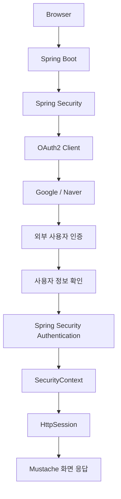
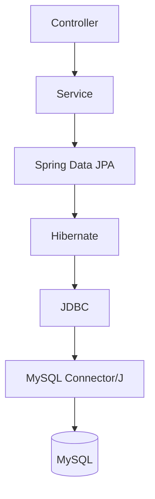
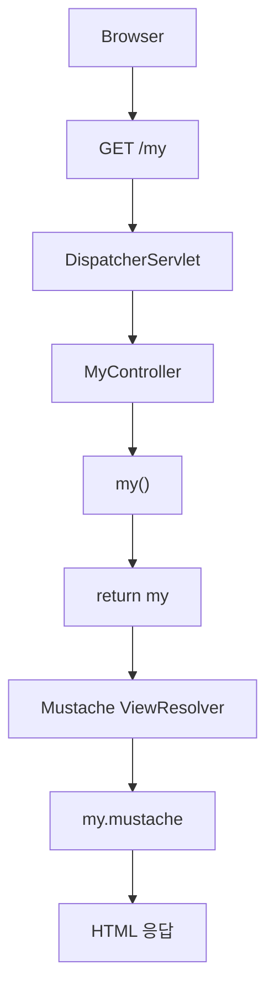
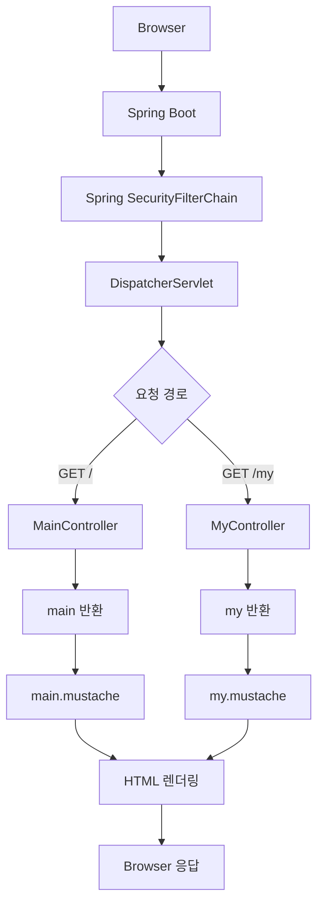
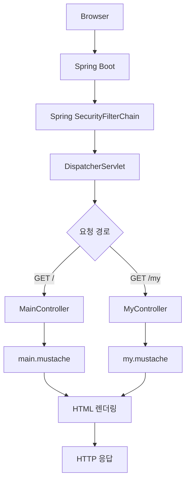

# 스프링 OAuth2 클라이언트 세션 - 2. 프로젝트 생성 및 의존성 추가
[https://youtu.be/5sHRtJ2wgyw?si=Ni32XtX2UMXhfyLR](https://youtu.be/5sHRtJ2wgyw?si=Ni32XtX2UMXhfyLR)

# 스프링 OAuth2 클라이언트 세션 - 2. 프로젝트 생성 및 의존성 추가
* toc
{:toc}

---

### Spring Security 6 OAuth2 Client 프로젝트 생성 및 초기 환경 구성

Spring Security에서 OAuth2 Client를 이용해 소셜 로그인을 구현하려면 먼저 프로젝트의 기본 환경을 구성해야 한다.

이번 프로젝트에서는 Google과 Naver를 외부 인증 제공자로 사용하고, 인증된 사용자 정보를 Spring Security의 세션 기반 인증 시스템과 연결할 예정이다.

전체적인 목표는 다음과 같다.

```text
사용자
    ↓
Google / Naver 로그인
    ↓
외부 인증 제공자
    ↓
OAuth2 Authorization Code
    ↓
Spring Security OAuth2 Client
    ↓
Access Token 발급 및 사용자 정보 확인
    ↓
우리 서비스 사용자 정보 처리
    ↓
Authentication 생성
    ↓
SecurityContext
    ↓
HttpSession
    ↓
로그인 상태 유지
```

하지만 이러한 OAuth2 인증 흐름을 구현하려면 몇 가지 기본적인 구성이 필요하다.

먼저 Spring Boot 프로젝트를 생성해야 한다.

그리고 HTTP 요청을 처리하기 위한 Spring Web, 인증 및 인가를 담당하는 Spring Security, 외부 로그인 연동을 지원하는 OAuth2 Client를 추가한다.

또한 이번 프로젝트는 REST API 응답만 반환하는 서버가 아니라, 서버에서 HTML을 생성해 브라우저에 응답하는 SSR(Server-Side Rendering) 구조를 사용한다.

따라서 Mustache 템플릿 엔진을 이용해 기본 화면을 구성한다.

사용자 정보는 이후 MySQL에 저장할 예정이므로 Spring Data JPA와 MySQL Connector/J도 준비한다.

이번 구현의 목표는 다음과 같다.

1. Spring Boot 프로젝트 생성
2. Gradle을 이용한 의존성 관리
3. Spring Security 및 OAuth2 Client 의존성 추가
4. MySQL 연결 전 JPA 의존성 임시 비활성화
5. 기본 Controller 구현
6. Mustache 템플릿 구현
7. 애플리케이션 실행 및 기본 Security 동작 확인

아직 Google과 Naver의 OAuth2 Client 등록 정보는 설정하지 않는다.

우선 소셜 로그인 기능을 구현할 수 있는 프로젝트 구조와 기본 화면을 준비하는 데 집중한다.

---

### 개념

#### OAuth2 Client 프로젝트의 기본 구조

이번 프로젝트는 Spring Security의 세션 기반 인증 방식을 사용한다.

이전의 JWT 인증 방식에서는 클라이언트가 JWT를 전달하고, 서버가 토큰을 검증하여 요청 단위의 인증 정보를 구성했다.

반면 이번에는 OAuth2를 통해 외부 인증을 완료한 다음 Spring Security의 세션을 이용하여 로그인 상태를 유지할 예정이다.

두 방식을 비교하면 다음과 같다.

| 구분 | JWT 기반 인증 | OAuth2 Client 세션 인증 |
|---|---|---|
| 최초 로그인 | 아이디·비밀번호 또는 외부 인증 | Google·Naver 등 외부 인증 |
| 인증 처리 | JWT 검증 | OAuth2 로그인 후 세션 인증 |
| 로그인 상태 유지 | 클라이언트가 JWT 전달 | 서버 측 HttpSession 활용 |
| 클라이언트 인증 정보 | Authorization 헤더의 JWT | 세션 쿠키 |
| 주요 보안 설정 | Stateless | 필요 시 세션 생성 |
| 화면 처리 | REST API 중심으로 구성 가능 | Mustache 기반 SSR |
| 사용자 정보 저장 | MySQL 등 | MySQL 등 |

여기서 중요한 점은 OAuth2와 세션이 서로 다른 역할을 담당한다는 사실이다.

OAuth2는 외부 인증 제공자와의 인증 및 권한 위임 흐름을 처리한다.

세션은 인증이 완료된 사용자의 로그인 상태를 우리 애플리케이션에서 유지하는 데 사용한다.

즉 다음과 같은 관계다.



이번에는 이러한 전체 구조의 기반이 되는 프로젝트를 생성한다.

---

### 왜 사용하는가?

#### Spring Boot를 사용하는 이유

Spring Boot는 Spring Framework 기반 애플리케이션을 빠르게 구성할 수 있도록 다양한 자동 설정 기능을 제공한다.

예를 들어 Spring Web 의존성을 추가하면 기본적인 Servlet 웹 애플리케이션을 구성할 수 있다.

또한 Spring Security 의존성을 추가하면 기본적인 인증 및 인가 정책이 자동으로 적용된다.

OAuth2 Client 의존성을 추가하면 외부 인증 제공자와 연동하기 위한 구성요소를 사용할 수 있다.

Spring Data JPA를 추가하면 Repository를 이용한 데이터베이스 접근 기능을 활용할 수 있다.

즉 필요한 기술을 각각 처음부터 구성하는 대신 Spring Boot Starter를 통해 기본 환경을 준비할 수 있다.

#### Spring Initializr란?

Spring Initializr는 Spring Boot 프로젝트를 생성할 때 사용할 수 있는 도구다.

프로젝트의 언어, Java 버전, 빌드 도구, Spring Boot 버전, 의존성 등을 선택하면 기본 프로젝트 구조를 생성한다.

생성된 프로젝트에는 다음과 같은 파일이 포함된다.

```text
build.gradle

settings.gradle

gradlew

gradlew.bat

gradle/

src/main/java/

src/main/resources/

src/test/java/
```

이 중 `build.gradle`은 프로젝트의 의존성과 빌드 설정을 관리하는 핵심 파일이다.

---

### 주요 특징

#### 개발 환경

이번 프로젝트에서는 다음 환경을 사용한다.

| 항목 | 설정 |
|---|---|
| Project Name | oauth2-session |
| Language | Java |
| Java Version | 17 |
| Spring Boot | 3.2.1 |
| Spring Security | 6.2.1 |
| Build Tool | Gradle |
| Build Script | Groovy |
| Packaging | Jar |
| Template Engine | Mustache |
| Database | MySQL |
| ORM | Spring Data JPA |
| IDE | IntelliJ IDEA |

Spring Boot 3.2.1은 Java 17 이상을 요구하며 Java 21까지의 호환성을 명시하고 있다. 따라서 Java 17이나 Java 18을 사용할 수 있다.

이번 예제에서는 Java 17을 기준으로 진행한다.

Java 17은 LTS(Long-Term Support) 버전이므로 안정적인 개발 환경을 구성하기에 적합하다.

또한 Spring Boot 3.2.1이 관리하는 Spring Security 버전은 6.2.1이다.

버전 관계는 다음과 같다.

```text
Java 17
    ↓
Spring Boot 3.2.1
    ↓
Spring Framework 6.1.x
    ↓
Spring Security 6.2.1
```

다만 Spring Boot 3.2.1은 2023년 12월에 출시된 버전이다.

현재 신규 운영 프로젝트라면 지원 중인 Spring Boot 버전과 보안 패치를 검토하는 것이 적절하지만, 여기서는 구현의 일관성을 위해 3.2.1을 기준으로 구성한다.

---

### 예제

#### Spring Boot 프로젝트 생성

Spring Initializr를 이용하여 프로젝트를 생성한다.

다음과 같은 기본 설정을 선택한다.

| 설정 항목 | 값 |
|---|---|
| Name | oauth2-session |
| Type | Gradle - Groovy |
| Language | Java |
| Group | com.example |
| Artifact | oauth2-session |
| Package Name | com.example.oauth2session |
| JDK | 17 |
| Java | 17 |
| Packaging | Jar |
| Spring Boot | 3.2.1 |

여기서 몇 가지 설정을 구분해야 한다.

#### Group

Group은 프로젝트를 구분하는 기본적인 네임스페이스다.

예를 들어 다음과 같이 지정할 수 있다.

```text
com.example
```

#### Artifact

Artifact는 빌드 결과물의 이름을 구성할 때 사용한다.

```text
oauth2-session
```

Jar로 패키징하면 다음과 같은 결과물이 생성될 수 있다.

```text
oauth2-session-0.0.1-SNAPSHOT.jar
```

#### Package Name

Java 클래스가 위치할 기본 패키지다.

```text
com.example.oauth2session
```

Spring Boot의 컴포넌트 스캔은 일반적으로 메인 애플리케이션 클래스가 위치한 패키지와 그 하위 패키지를 대상으로 수행한다.

따라서 Controller와 Service 등을 기본 패키지 아래에 배치하는 것이 자연스럽다.

---

### 프로젝트에 필요한 7가지 의존성

이번 프로젝트에서 사용하는 주요 의존성은 다음과 같다.

| 번호 | 의존성 | 주요 역할 |
|---|---|---|
| 1 | Lombok | 반복적인 Java 코드 생성 |
| 2 | Spring Web | HTTP 요청 및 MVC 처리 |
| 3 | Mustache | 서버 사이드 HTML 템플릿 |
| 4 | Spring Security | 인증 및 인가 |
| 5 | OAuth2 Client | 외부 OAuth2 로그인 연동 |
| 6 | Spring Data JPA | ORM 기반 데이터 접근 |
| 7 | MySQL Driver | MySQL JDBC 연결 |

각 의존성이 어떤 기능을 제공하는지 살펴보자.

---

### Lombok

Lombok은 Java에서 반복적으로 작성하는 코드를 줄이는 데 도움을 주는 라이브러리다.

예를 들어 다음 클래스를 생각해보자.

```java
public class User {

    private String username;

    private String email;

    public String getUsername() {
        return username;
    }

    public void setUsername(String username) {
        this.username = username;
    }

    public String getEmail() {
        return email;
    }

    public void setEmail(String email) {
        this.email = email;
    }
}
```

단순한 데이터 객체인데도 Getter와 Setter가 반복적으로 작성된다.

Lombok을 사용하면 다음과 같이 표현할 수 있다.

```java
import lombok.Getter;
import lombok.Setter;

@Getter
@Setter
public class User {

    private String username;

    private String email;
}
```

이렇게 하면 Lombok이 컴파일 과정에서 필요한 메서드를 생성한다.

Gradle에서는 다음과 같이 설정한다.

```gradle
compileOnly 'org.projectlombok:lombok'
annotationProcessor 'org.projectlombok:lombok'
```

`compileOnly`는 컴파일 시점에 필요한 의존성을 지정한다.

`annotationProcessor`는 Lombok Annotation Processor를 실행하기 위해 사용한다.

현재는 기본 Controller만 구현하기 때문에 Lombok이 반드시 필요한 것은 아니다.

이후 사용자 Entity와 DTO를 작성할 때 활용한다.

---

### Spring Web

Spring Web은 Servlet 기반 웹 애플리케이션을 구성하기 위한 Starter다.

```gradle
implementation 'org.springframework.boot:spring-boot-starter-web'
```

이 의존성을 추가하면 다음 기능을 사용할 수 있다.

- Spring MVC
- DispatcherServlet
- Controller
- HTTP 요청 매핑
- JSON 응답 처리
- 내장 Servlet Container

예를 들어 다음 Controller를 작성할 수 있다.

```java
@Controller
public class MainController {

    @GetMapping("/")
    public String main() {

        return "main";
    }
}
```

클라이언트가 `/` 경로에 GET 요청을 보내면 Spring MVC가 해당 Controller 메서드를 실행한다.

이후 반환된 `"main"`을 뷰 이름으로 해석한다.

현재 프로젝트에서는 Mustache 템플릿을 이용해 HTML 응답을 생성한다.

---

### Mustache

Mustache는 HTML 템플릿에 데이터를 적용하여 동적인 화면을 생성할 수 있는 템플릿 엔진이다.

```gradle
implementation 'org.springframework.boot:spring-boot-starter-mustache'
```

이번 프로젝트는 React와 같은 별도 프론트엔드 애플리케이션 없이 Spring Boot 서버에서 HTML을 생성하는 SSR 방식을 사용한다.

예를 들어 Controller에서 다음 데이터를 Model에 저장한다고 생각해보자.

```java
model.addAttribute("username", "user01");
```

Mustache에서는 다음과 같이 사용할 수 있다.

```html
<p>사용자: {{username}}</p>
```

렌더링 결과는 다음과 같다.

```html
<p>사용자: user01</p>
```

이처럼 Controller에서 전달한 데이터를 템플릿에 바인딩하여 HTML을 생성할 수 있다.

Mustache의 주요 특징은 다음과 같다.

| 특징 | 설명 |
|---|---|
| 간결한 문법 | `{{변수명}}` 사용 |
| 서버 사이드 렌더링 | 서버에서 HTML 생성 |
| View Template | Controller의 뷰 이름과 연결 |
| 반복 처리 | Section 문법 지원 |
| 조건부 렌더링 | 데이터 존재 여부 기반 렌더링 |

이번에는 복잡한 데이터 바인딩 없이 기본 HTML 화면 두 개만 작성한다.

---

### Spring Security

Spring Security는 Spring 애플리케이션의 인증과 인가를 담당하는 프레임워크다.

```gradle
implementation 'org.springframework.boot:spring-boot-starter-security'
```

주요 기능은 다음과 같다.

| 기능 | 설명 |
|---|---|
| Authentication | 사용자 인증 |
| Authorization | 접근 권한 검증 |
| SecurityFilterChain | 보안 필터 체인 |
| SecurityContextHolder | 현재 사용자 인증 정보 관리 |
| Session Management | 인증 세션 관리 |
| CSRF Protection | CSRF 공격 방어 |
| Logout | 로그아웃 처리 |

여기서 중요한 특징이 있다.

**Spring Security 의존성만 추가해도 기본적인 인증 설정이 자동으로 적용된다.**

별도의 SecurityConfig를 작성하지 않은 상태에서도 기본적으로 웹 요청에 인증이 요구된다.

따라서 이번에 작성할 메인 화면과 마이 화면 역시 초기 상태에서는 인증을 요구할 수 있다.

Spring Boot의 기본 Security 자동 설정은 개발용 사용자 계정을 생성하고, 로그인 화면과 HTTP Basic 인증을 제공한다.

이 동작은 뒤에서 직접 확인한다.

---

### OAuth2 Client

이번 프로젝트에서 가장 중요한 의존성이다.

```gradle
implementation 'org.springframework.boot:spring-boot-starter-oauth2-client'
```

OAuth2 Client는 Google, Naver 등의 외부 인증 제공자와 연동할 때 사용한다.

대표적으로 다음 기능을 제공한다.

```text
OAuth2 Client
    │
    ├── ClientRegistrationRepository
    │
    ├── OAuth2AuthorizationRequestRedirectFilter
    │
    ├── OAuth2LoginAuthenticationFilter
    │
    ├── OAuth2UserService
    │
    └── OidcUserService
```

각 구성요소의 역할은 다음과 같다.

| 구성요소 | 역할 |
|---|---|
| ClientRegistrationRepository | 외부 OAuth2 Client 등록 정보 관리 |
| OAuth2AuthorizationRequestRedirectFilter | 외부 인증 서버로 리다이렉트 |
| OAuth2LoginAuthenticationFilter | OAuth2 인증 Callback 처리 |
| OAuth2UserService | 일반 OAuth2 사용자 정보 처리 |
| OidcUserService | OIDC 사용자 정보 처리 |

다만 OAuth2 Client 의존성을 추가했다고 해서 Google이나 Naver 로그인이 즉시 동작하는 것은 아니다.

실제 소셜 로그인을 사용하려면 다음 설정이 추가로 필요하다.

```text
Google / Naver 애플리케이션 등록
    ↓
Client ID
    ↓
Client Secret
    ↓
Authorization URI
    ↓
Token URI
    ↓
Redirect URI
    ↓
사용자 정보 처리
```

또한 Spring Security의 `oauth2Login()` 설정과 제공자별 ClientRegistration이 필요하다.

현재는 OAuth2 Client 기능을 사용할 수 있도록 의존성만 준비한다.

---

### Spring Data JPA

Spring Data JPA는 JPA 기반 데이터 접근을 쉽게 구현하도록 지원한다.

```gradle
implementation 'org.springframework.boot:spring-boot-starter-data-jpa'
```

소셜 로그인에 성공한 사용자의 정보를 MySQL에 저장할 때 사용한다.

예를 들어 다음과 같은 사용자 정보를 관리할 수 있다.

```text
UserEntity
    │
    ├── id
    ├── provider
    ├── providerUserId
    ├── name
    ├── email
    └── role
```

Spring Data JPA를 사용하면 Repository 인터페이스를 통해 데이터 접근 기능을 구현할 수 있다.

예를 들어 다음과 같다.

```java
public interface UserRepository
        extends JpaRepository<UserEntity, Long> {

}
```

이후 저장 기능을 호출할 수 있다.

```java
userRepository.save(userEntity);
```

하지만 현재는 데이터베이스를 연결하지 않는다.

따라서 JPA 의존성을 임시로 비활성화한다.

---

### MySQL Driver

MySQL과 연결하려면 JDBC 드라이버가 필요하다.

```gradle
runtimeOnly 'com.mysql:mysql-connector-j'
```

Spring Data JPA가 ORM 기능을 제공한다면, MySQL Connector/J는 JDBC 프로토콜을 통해 MySQL에 접근할 수 있도록 한다.

일반적인 데이터 접근 흐름은 다음과 같다.



각 구성요소의 역할은 다음과 같다.

| 구성요소 | 역할 |
|---|---|
| Spring Data JPA | Repository 기능 제공 |
| Hibernate | JPA 구현체 및 ORM 처리 |
| JDBC | Java 데이터베이스 접근 API |
| MySQL Connector/J | MySQL JDBC 드라이버 |
| MySQL | 실제 데이터 저장소 |

현재는 MySQL 연결이 완료되지 않았으므로 드라이버 의존성도 임시로 비활성화한다.

---

### build.gradle 전체 구성

지금까지의 의존성을 정리하면 다음과 같다.

```gradle
plugins {
    id 'java'
    id 'org.springframework.boot' version '3.2.1'
    id 'io.spring.dependency-management' version '1.1.4'
}

group = 'com.example'
version = '0.0.1-SNAPSHOT'

java {
    toolchain {
        languageVersion = JavaLanguageVersion.of(17)
    }
}

repositories {
    mavenCentral()
}

dependencies {

    // Lombok
    compileOnly 'org.projectlombok:lombok'
    annotationProcessor 'org.projectlombok:lombok'

    // Spring Web
    implementation 'org.springframework.boot:spring-boot-starter-web'

    // Mustache
    implementation 'org.springframework.boot:spring-boot-starter-mustache'

    // Spring Security
    implementation 'org.springframework.boot:spring-boot-starter-security'

    // OAuth2 Client
    implementation 'org.springframework.boot:spring-boot-starter-oauth2-client'

    // Spring Data JPA
    implementation 'org.springframework.boot:spring-boot-starter-data-jpa'

    // MySQL Driver
    runtimeOnly 'com.mysql:mysql-connector-j'
}
```

위 코드는 최종적으로 사용할 주요 의존성을 모두 포함한다.

Spring Boot가 제공하는 의존성 관리 기능을 사용하므로 대부분의 Starter에 버전을 직접 지정할 필요가 없다.

예를 들어 다음과 같이 작성한다.

```gradle
implementation 'org.springframework.boot:spring-boot-starter-security'
```

Spring Boot 3.2.1의 의존성 관리 설정에 따라 호환되는 Spring Security 버전이 선택된다.

이는 여러 Spring 라이브러리의 버전을 직접 관리할 때 발생할 수 있는 충돌을 줄이는 데 도움이 된다.

---

### MySQL 연결 전 의존성을 임시 비활성화하는 이유

프로젝트를 생성한 뒤 바로 애플리케이션을 실행하면 데이터베이스 설정 때문에 문제가 발생할 수 있다.

그 이유를 알아보자.

Spring Boot는 클래스패스에 존재하는 의존성을 기반으로 자동 설정을 수행한다.

예를 들어 다음 의존성이 존재한다고 생각해보자.

```gradle
implementation 'org.springframework.boot:spring-boot-starter-data-jpa'
```

Spring Data JPA Starter에는 데이터베이스 연결에 필요한 JDBC 관련 의존성이 포함된다.

Spring Boot는 이러한 환경을 감지하여 DataSource와 JPA 관련 자동 설정을 시도한다.

하지만 현재 프로젝트에는 다음 설정이 존재하지 않는다.

```properties
spring.datasource.url=
spring.datasource.username=
spring.datasource.password=
```

또한 H2와 같은 내장 데이터베이스도 추가하지 않았다.

따라서 Spring Boot가 연결할 데이터베이스를 결정하지 못할 수 있다.

대표적인 오류는 다음과 같다.

```text
Failed to configure a DataSource:
'url' attribute is not specified and
no embedded datasource could be configured.

Reason:
Failed to determine a suitable driver class
```

여기서 중요한 점은 **MySQL 드라이버만 추가했다고 해서 무조건 데이터베이스 연결 오류가 발생하는 것은 아니라는 사실**이다.

이번 문제의 핵심은 JPA Starter를 통해 데이터베이스 자동 설정이 활성화되었지만, 유효한 DataSource 설정이 존재하지 않는다는 점이다.

---

### JPA와 MySQL 의존성 주석 처리

아직 데이터베이스를 연결하지 않을 예정이므로 다음 의존성을 임시로 주석 처리한다.

```gradle
// Spring Data JPA
// implementation 'org.springframework.boot:spring-boot-starter-data-jpa'

// MySQL Driver
// runtimeOnly 'com.mysql:mysql-connector-j'
```

이제 `build.gradle`은 다음과 같이 구성된다.

```gradle
plugins {
    id 'java'
    id 'org.springframework.boot' version '3.2.1'
    id 'io.spring.dependency-management' version '1.1.4'
}

group = 'com.example'
version = '0.0.1-SNAPSHOT'

java {
    toolchain {
        languageVersion = JavaLanguageVersion.of(17)
    }
}

repositories {
    mavenCentral()
}

dependencies {

    // Lombok
    compileOnly 'org.projectlombok:lombok'
    annotationProcessor 'org.projectlombok:lombok'

    // Spring Web
    implementation 'org.springframework.boot:spring-boot-starter-web'

    // Mustache
    implementation 'org.springframework.boot:spring-boot-starter-mustache'

    // Spring Security
    implementation 'org.springframework.boot:spring-boot-starter-security'

    // OAuth2 Client
    implementation 'org.springframework.boot:spring-boot-starter-oauth2-client'

    // Spring Data JPA - 추후 활성화
    // implementation 'org.springframework.boot:spring-boot-starter-data-jpa'

    // MySQL Driver - 추후 활성화
    // runtimeOnly 'com.mysql:mysql-connector-j'
}
```

이렇게 하면 데이터베이스 연결을 준비하기 전에도 기본 웹 애플리케이션을 실행할 수 있다.

다만 이 방법은 초기 개발 과정에서 사용하기 위한 임시 구성이다.

나중에 MySQL 연결을 구현할 때는 해당 의존성을 다시 활성화해야 한다.

---

### Gradle 의존성 다시 로딩하기

`build.gradle`을 변경했다면 Gradle 설정을 갱신해야 한다.

IntelliJ IDEA에서는 Gradle 프로젝트 새로고침 기능을 이용할 수 있다.

CLI에서는 다음 명령을 사용할 수 있다.

```bash
./gradlew dependencies
```

이 명령은 Gradle이 인식한 프로젝트 의존성 구성을 출력한다.

정상적인 경우 다음과 유사한 의존성 구성을 확인할 수 있다.

```text
spring-boot-starter-web
spring-boot-starter-mustache
spring-boot-starter-security
spring-boot-starter-oauth2-client
```

실제로 컴파일에 사용하는 의존성을 확인하려면 다음 명령을 사용할 수 있다.

```bash
./gradlew dependencies --configuration compileClasspath
```

현재는 JPA와 MySQL 의존성을 비활성화했으므로 해당 의존성이 직접 선언된 형태로 포함되지 않는다.

다만 다른 의존성이 일부 데이터 관련 라이브러리를 전이 의존성으로 포함할 가능성까지 무조건 배제할 수는 없다.

중요한 것은 현재 프로젝트가 MySQL 연결 없이 실행될 수 있는 구성을 갖추는 것이다.

---

### 기본 Controller 구현

이제 HTTP 요청을 처리할 Controller를 생성한다.

이번에는 두 가지 경로를 구현한다.

| Controller | 요청 경로 | 반환 View |
|---|---|---|
| MainController | `/` | main |
| MyController | `/my` | my |

메인 화면은 서비스의 기본 화면으로 사용한다.

마이 화면은 이후 로그인한 사용자만 접근할 수 있는 보호된 화면으로 확장한다.

현재는 두 Controller 모두 단순히 Mustache 템플릿을 반환하도록 구성한다.

---

### 프로젝트 패키지 구조

먼저 기본 패키지 아래에 `controller` 패키지를 생성한다.

```text
src/main/java/com/example/oauth2session
```

프로젝트 구조는 다음과 같다.

```text
oauth2-session
│
├── build.gradle
├── settings.gradle
├── gradlew
├── gradlew.bat
│
└── src
    │
    └── main
        │
        ├── java
        │   └── com
        │       └── example
        │           └── oauth2session
        │               │
        │               ├── Oauth2SessionApplication.java
        │               │
        │               └── controller
        │                   ├── MainController.java
        │                   └── MyController.java
        │
        └── resources
            ├── application.properties
            │
            └── templates
                ├── main.mustache
                └── my.mustache
```

이 구조에서 다음 사항을 기억해야 한다.

`controller` 패키지는 HTTP 요청을 처리하는 Controller 클래스를 관리한다.

`resources/templates` 디렉터리는 Mustache와 같은 템플릿 파일을 보관한다.

`application.properties`는 애플리케이션 설정을 관리한다.

현재 단계에서는 Entity, Repository, Service를 구현하지 않는다.

---

### MainController 구현

먼저 메인 화면을 처리할 Controller를 작성한다.

파일 경로는 다음과 같다.

```text
src/main/java/com/example/oauth2session/controller/MainController.java
```

전체 코드는 다음과 같다.

```java
package com.example.oauth2session.controller;

import org.springframework.stereotype.Controller;
import org.springframework.web.bind.annotation.GetMapping;

@Controller
public class MainController {

    @GetMapping("/")
    public String main() {

        return "main";
    }
}
```

코드를 하나씩 살펴보자.

#### @Controller

```java
@Controller
```

`@Controller`는 해당 클래스를 Spring MVC Controller로 등록하는 Annotation이다.

Spring의 컴포넌트 스캔 대상이 되므로 별도의 객체 생성 없이 Spring Container에서 관리할 수 있다.

Spring MVC는 HTTP 요청을 처리할 Controller를 찾고, 요청 경로에 맞는 메서드를 실행한다.

#### @GetMapping

```java
@GetMapping("/")
```

`@GetMapping`은 HTTP GET 요청을 특정 메서드에 연결한다.

현재는 `/` 경로를 처리한다.

따라서 다음 요청이 들어오면 `main()` 메서드가 실행된다.

```http
GET / HTTP/1.1
Host: localhost:8080
```

#### View 이름 반환

```java
return "main";
```

이 부분은 단순히 `"main"`이라는 문자열을 HTTP 응답 본문으로 반환하는 것이 아니다.

`@Controller`를 사용했으므로 반환한 문자열을 논리적인 View 이름으로 해석한다.

Mustache가 설정되어 있다면 해당 View 이름을 이용해 템플릿을 찾는다.

기본 설정에서는 다음 파일을 탐색한다.

```text
src/main/resources/templates/main.mustache
```

즉 다음과 같은 관계다.

```text
@GetMapping("/")
    ↓
MainController.main()
    ↓
return "main"
    ↓
Mustache ViewResolver
    ↓
main.mustache
    ↓
HTML 렌더링
```

---

### MyController 구현

이제 마이 화면을 처리할 Controller를 작성한다.

파일 경로는 다음과 같다.

```text
src/main/java/com/example/oauth2session/controller/MyController.java
```

전체 코드는 다음과 같다.

```java
package com.example.oauth2session.controller;

import org.springframework.stereotype.Controller;
import org.springframework.web.bind.annotation.GetMapping;

@Controller
public class MyController {

    @GetMapping("/my")
    public String my() {

        return "my";
    }
}
```

현재 Controller는 `/my` 경로를 처리한다.

```http
GET /my HTTP/1.1
Host: localhost:8080
```

해당 요청이 들어오면 `my()` 메서드가 실행된다.

그리고 다음 View 이름을 반환한다.

```java
return "my";
```

Mustache는 다음 템플릿을 찾는다.

```text
src/main/resources/templates/my.mustache
```

처리 과정을 그림으로 표현하면 다음과 같다.



여기서 `DispatcherServlet`은 Spring MVC의 핵심 진입점이다.

요청에 맞는 Controller를 찾아 실행하고, 반환 결과를 이용해 View를 처리한다.

---

### @Controller와 @RestController의 차이

이 부분은 반드시 구분해야 한다.

현재 프로젝트는 Mustache를 이용해 HTML 화면을 반환한다.

따라서 `@Controller`를 사용한다.

```java
@Controller
public class MainController {

    @GetMapping("/")
    public String main() {

        return "main";
    }
}
```

이 경우 `"main"`은 View 이름이다.

반면 다음과 같이 `@RestController`를 사용하면 동작이 달라진다.

```java
@RestController
public class MainController {

    @GetMapping("/")
    public String main() {

        return "main";
    }
}
```

이 경우에는 `"main"` 문자열이 HTTP 응답 본문으로 반환된다.

Mustache 템플릿을 렌더링하지 않는다.

두 Annotation을 비교하면 다음과 같다.

| 구분 | @Controller | @RestController |
|---|---|---|
| 주요 목적 | MVC View 처리 | HTTP 응답 본문 반환 |
| 문자열 반환 | View 이름으로 해석 가능 | 문자열 자체 반환 |
| Mustache 연동 | 가능 | 일반적인 문자열 반환에는 적용되지 않음 |
| REST API | @ResponseBody 등으로 가능 | 기본적으로 지원 |
| 현재 프로젝트 | 사용 | 기본 화면 Controller에서는 사용하지 않음 |

즉 이번에는 `@Controller`를 사용해야 한다.

---

### Mustache View 생성

이제 Controller가 반환하는 View를 구현한다.

Spring Boot에서 Mustache를 사용하면 기본적으로 다음 디렉터리에 템플릿을 작성할 수 있다.

```text
src/main/resources/templates/
```

그리고 템플릿 파일의 확장자는 다음과 같다.

```text
.mustache
```

이번에는 두 파일을 생성한다.

```text
main.mustache
```

```text
my.mustache
```

---

### main.mustache 작성

파일 경로는 다음과 같다.

```text
src/main/resources/templates/main.mustache
```

전체 코드는 다음과 같다.

```html
<!DOCTYPE html>
<html lang="ko">

<head>
    <meta charset="UTF-8">
    <meta name="viewport"
          content="width=device-width, initial-scale=1.0">

    <title>OAuth2 Session - Main</title>
</head>

<body>

    <h1>메인 화면</h1>

    <p>
        Spring Security OAuth2 Client 프로젝트입니다.
    </p>

    <a href="/my">
        마이 화면 이동
    </a>

</body>

</html>
```

현재는 HTML만 사용한다.

Mustache의 동적 데이터 바인딩은 아직 적용하지 않는다.

이후 로그인한 사용자 정보를 Model에 추가하면 사용자 이름 등을 출력할 수 있다.

---

### my.mustache 작성

파일 경로는 다음과 같다.

```text
src/main/resources/templates/my.mustache
```

전체 코드는 다음과 같다.

```html
<!DOCTYPE html>
<html lang="ko">

<head>
    <meta charset="UTF-8">
    <meta name="viewport"
          content="width=device-width, initial-scale=1.0">

    <title>OAuth2 Session - My</title>
</head>

<body>

    <h1>마이 화면</h1>

    <p>
        인증된 사용자의 정보를 표시할 영역입니다.
    </p>

    <a href="/">
        메인 화면 이동
    </a>

</body>

</html>
```

이렇게 하면 기본적인 화면 두 개가 준비된다.

아직 OAuth2 로그인은 구현되지 않았으므로 사용자 이름이나 권한을 표시하지 않는다.

이후 Google 또는 Naver 로그인에 성공하면 Spring Security의 Authentication에서 사용자 정보를 가져와 화면에 전달할 수 있다.

---

### Mustache는 어떻게 View를 찾을까?

Spring Boot의 Mustache 자동 설정은 Controller에서 반환한 논리적인 View 이름을 기반으로 템플릿을 찾는다.

기본 설정을 개념적으로 표현하면 다음과 같다.

```properties
spring.mustache.prefix=classpath:/templates/
spring.mustache.suffix=.mustache
```

예를 들어 다음 코드가 있다고 생각해보자.

```java
return "main";
```

Spring Boot는 다음 경로의 파일을 찾는다.

```text
classpath:/templates/main.mustache
```

다음 코드라면:

```java
return "my";
```

다음 파일을 찾는다.

```text
classpath:/templates/my.mustache
```

따라서 파일 이름과 Controller의 반환 문자열이 일치해야 한다.

| Controller 반환값 | 탐색하는 템플릿 |
|---|---|
| `"main"` | `main.mustache` |
| `"my"` | `my.mustache` |
| `"login"` | `login.mustache` |
| `"user/profile"` | `user/profile.mustache` |

Spring Boot는 Mustache 등 지원하는 템플릿 엔진의 기본 템플릿 경로를 자동으로 구성한다.

현재는 기본 설정을 그대로 사용하므로 `application.properties`에 Mustache 경로를 별도로 작성할 필요가 없다.

---

### 요청 처리 구조

지금까지 작성한 Controller와 Mustache의 관계를 정리해보자.



여기서 한 가지 중요한 요소가 있다.

Spring Security가 추가되었으므로 요청이 DispatcherServlet에 도달하기 전에 보안 필터 체인을 통과한다.

따라서 Controller가 정상적으로 작성되어 있어도 Spring Security의 인증 정책에 따라 요청이 제한될 수 있다.

이제 실제로 실행해보자.

---

### Spring Boot 실행

애플리케이션을 실행하기 전에 메인 클래스를 확인한다.

파일 경로는 다음과 같다.

```text
src/main/java/com/example/oauth2session/Oauth2SessionApplication.java
```

코드는 다음과 같다.

```java
package com.example.oauth2session;

import org.springframework.boot.SpringApplication;
import org.springframework.boot.autoconfigure.SpringBootApplication;

@SpringBootApplication
public class Oauth2SessionApplication {

    public static void main(String[] args) {

        SpringApplication.run(
                Oauth2SessionApplication.class,
                args
        );
    }
}
```

`@SpringBootApplication`은 Spring Boot 애플리케이션의 기본 구성을 활성화한다.

일반적으로 다음 기능을 포함한다.

- Spring Boot 자동 설정
- 컴포넌트 스캔
- Spring Boot 구성 클래스 등록

이제 다음 명령을 실행한다.

```bash
./gradlew bootRun
```

명령의 의미는 다음과 같다.

| 명령 | 의미 |
|---|---|
| `./gradlew` | Gradle Wrapper 실행 |
| `bootRun` | Spring Boot 애플리케이션 실행 |

정상적으로 실행되면 다음과 유사한 로그를 확인할 수 있다.

```text
Tomcat started on port 8080 (http)

Started Oauth2SessionApplication
```

여기서 예상하지 못한 로그가 하나 더 출력될 수 있다.

바로 Spring Security의 기본 사용자 비밀번호다.

---

### Spring Security 기본 사용자 계정

Spring Security 의존성을 추가했지만 별도의 인증 설정을 구성하지 않았다.

이 경우 Spring Boot는 기본 보안 설정을 적용한다.

대표적으로 다음과 같은 로그가 출력될 수 있다.

```text
Using generated security password: <GENERATED_PASSWORD>

This generated password is for development use only.
```

이 메시지는 개발용 기본 사용자 비밀번호가 생성되었다는 의미다.

기본 사용자 이름은 다음과 같다.

```text
user
```

비밀번호는 실행 로그에 출력되는 임의의 값이다.

예를 들어 다음과 같이 사용할 수 있다.

```text
Username: user

Password: 실행 로그에 출력된 비밀번호
```

여기서 중요한 사실은 **이 계정이 Google 또는 Naver 소셜 로그인으로 생성된 계정이 아니라는 점**이다.

아직 OAuth2 로그인 구성을 하지 않았으므로 Spring Boot의 기본 사용자 인증이 사용되는 것이다.

따라서 현재 단계에서는 다음 구조로 동작한다.

```text
사용자
    ↓
Spring Security 기본 로그인
    ↓
기본 In-Memory 사용자
    ↓
인증 성공
    ↓
SecurityContext 생성
    ↓
세션 기반 인증
```

이후 OAuth2 Login 구성을 추가하면 외부 인증 제공자를 이용한 로그인 흐름으로 확장할 수 있다.

---

### 메인 화면 접근 확인

브라우저에서 다음 주소에 접근한다.

```text
http://localhost:8080/
```

현재는 별도의 SecurityConfig를 작성하지 않았다.

따라서 Spring Security의 기본 설정에 의해 인증이 요구된다.

브라우저 요청에서는 일반적으로 로그인 화면으로 이동한다.

```text
GET /
    ↓
Spring Security
    ↓
인증 정보 없음
    ↓
로그인 화면으로 Redirect
```

로그인 화면에서 다음 정보를 입력한다.

```text
Username: user

Password: 자동 생성된 비밀번호
```

인증에 성공하면 요청했던 경로로 이동하여 메인 화면을 확인할 수 있다.

Mustache 템플릿이 정상적으로 처리되었다면 다음 내용이 표시된다.

```text
메인 화면

Spring Security OAuth2 Client 프로젝트입니다.

마이 화면 이동
```

이것으로 다음 기능이 동작한다는 사실을 확인할 수 있다.

- Spring Boot 실행
- Spring MVC 요청 매핑
- Controller 호출
- Mustache 템플릿 탐색
- HTML 렌더링
- Spring Security 기본 인증

---

### 마이 화면 접근 확인

이번에는 다음 경로에 접근한다.

```text
http://localhost:8080/my
```

요청 흐름은 다음과 같다.

```text
GET /my
    ↓
Spring SecurityFilterChain
    ↓
인증 여부 확인
    ↓
MyController
    ↓
return "my"
    ↓
my.mustache
    ↓
HTML 응답
```

이미 기본 로그인에 성공한 상태라면 세션을 통해 인증 상태가 유지될 수 있다.

따라서 마이 화면에 접근할 수 있다.

반대로 인증되지 않은 상태라면 Spring Security의 기본 정책에 의해 로그인 화면으로 이동한다.

현재 단계에서는 메인 화면과 마이 화면 모두 인증이 필요하다.

**메인 화면을 공개하고 마이 화면만 보호하려면 별도의 SecurityConfig를 작성해야 한다.**

이 설정은 이후 OAuth2 로그인과 함께 구성할 수 있지만, 차이를 이해하기 위해 간단한 확장 예제를 살펴보자.

---

### 확장: 메인 화면은 공개하고 마이 화면만 보호하기

현재 프로젝트의 목적은 다음과 같다.

```text
GET /
    ↓
모든 사용자 접근 가능
```

```text
GET /my
    ↓
인증된 사용자만 접근 가능
```

이러한 정책을 구현하려면 SecurityFilterChain을 직접 구성할 수 있다.

다음 클래스는 기본 구조를 확인하기 위한 예제다.

```java
package com.example.oauth2session.config;

import org.springframework.context.annotation.Bean;
import org.springframework.context.annotation.Configuration;

import org.springframework.security.config.Customizer;
import org.springframework.security.config.annotation.web.builders.HttpSecurity;

import org.springframework.security.web.SecurityFilterChain;

@Configuration
public class SecurityConfig {

    @Bean
    public SecurityFilterChain filterChain(
            HttpSecurity http
    ) throws Exception {

        http
                .authorizeHttpRequests(auth -> auth

                        // 메인 화면은 공개
                        .requestMatchers("/")
                        .permitAll()

                        // 나머지는 인증 필요
                        .anyRequest()
                        .authenticated()
                )

                // 기본 Form Login 사용
                .formLogin(Customizer.withDefaults());

        return http.build();
    }
}
```

이 설정을 추가하면 메인 화면은 인증 없이 접근할 수 있다.

반면 마이 화면은 로그인한 사용자만 접근할 수 있다.

| 요청 | 인증되지 않은 사용자 | 인증된 사용자 |
|---|---|---|
| GET `/` | 접근 가능 | 접근 가능 |
| GET `/my` | 로그인 필요 | 접근 가능 |

다만 이 설정은 아직 OAuth2 Login을 구현하지 않은 상태에서 기본 인증 흐름을 확인하기 위한 것이다.

Google과 Naver 로그인 기능을 추가할 때는 다음과 같은 설정을 함께 구성하게 된다.

```java
.oauth2Login(Customizer.withDefaults())
```

따라서 현재 단계에서는 기본 Controller와 Mustache가 정상적으로 동작하는지 먼저 확인하면 된다.

---

### 구조

#### 최종 프로젝트 구조

이번에 작성한 코드를 모두 정리하면 다음과 같다.

```text
oauth2-session
│
├── build.gradle
├── settings.gradle
├── gradlew
├── gradlew.bat
│
└── src
    │
    ├── main
    │   │
    │   ├── java
    │   │   └── com
    │   │       └── example
    │   │           └── oauth2session
    │   │               │
    │   │               ├── Oauth2SessionApplication.java
    │   │               │
    │   │               └── controller
    │   │                   ├── MainController.java
    │   │                   └── MyController.java
    │   │
    │   └── resources
    │       ├── application.properties
    │       │
    │       └── templates
    │           ├── main.mustache
    │           └── my.mustache
    │
    └── test
        └── java
```

앞서 소개한 선택적 SecurityConfig까지 적용했다면 다음 클래스가 추가된다.

```text
config
    └── SecurityConfig.java
```

현재 프로젝트에서는 데이터베이스 연결과 OAuth2 로그인 로직을 아직 구현하지 않았다.

따라서 다음 구성요소도 아직 존재하지 않는다.

```text
UserEntity

UserRepository

OAuth2UserService

CustomOAuth2User

Google / Naver ClientRegistration
```

이 구성요소들은 외부 로그인 인증과 사용자 정보 저장 기능을 구현하면서 추가할 수 있다.

---

### 실무에서의 활용

#### 1. Spring Boot와 Java 버전의 호환성을 먼저 확인한다

Spring Boot 3.2.1은 Java 17 이상을 요구한다.

따라서 Java 8이나 Java 11로 프로젝트를 구성하면 호환성 문제가 발생할 수 있다.

프로젝트 생성 전에 Java 버전을 확인해야 한다.

```bash
java -version
```

예상 출력은 다음과 같다.

```text
openjdk version "17..."
```

또한 Gradle이 사용하는 JVM도 확인할 수 있다.

```bash
./gradlew --version
```

이때 Java 실행 환경과 Gradle JVM 설정이 일치하는지 확인하는 것이 좋다.

#### 2. Gradle Groovy와 Kotlin DSL을 구분한다

Gradle은 대표적으로 Groovy DSL과 Kotlin DSL을 지원한다.

Groovy DSL에서는 다음 파일을 사용한다.

```text
build.gradle
```

Kotlin DSL에서는 다음 파일을 사용한다.

```text
build.gradle.kts
```

이번 프로젝트는 Groovy DSL을 기준으로 작성한다.

따라서 다음과 같은 문법을 사용한다.

```gradle
implementation 'org.springframework.boot:spring-boot-starter-web'
```

Kotlin DSL에서는 다음과 같이 작성한다.

```kotlin
implementation("org.springframework.boot:spring-boot-starter-web")
```

두 방식은 문법이 다르므로 예제 코드를 적용할 때 빌드 스크립트 유형을 확인해야 한다.

#### 3. Spring Boot Starter가 제공하는 자동 설정을 이해한다

Spring Boot Starter는 단순히 라이브러리 하나를 추가하는 기능이 아니다.

관련된 여러 의존성을 함께 제공하고 자동 설정을 활성화할 수 있다.

예를 들어 다음과 같다.

```text
spring-boot-starter-web
    ↓
Spring MVC
    ↓
Embedded Tomcat
```

```text
spring-boot-starter-security
    ↓
SecurityFilterChain 기본 설정
    ↓
기본 사용자 인증
```

```text
spring-boot-starter-data-jpa
    ↓
DataSource 자동 설정
    ↓
JPA 관련 자동 설정
```

따라서 의존성을 추가하면 애플리케이션의 동작 자체가 변경될 수 있다는 사실을 이해해야 한다.

#### 4. 데이터베이스 의존성을 추가하기 전에 연결 설정을 준비한다

JPA Starter를 추가하면 Spring Boot가 DataSource를 구성하려고 할 수 있다.

이때 연결할 데이터베이스가 없다면 애플리케이션 실행에 실패할 수 있다.

이번에는 JPA 의존성을 비활성화했지만 다른 방법도 가능하다.

예를 들어 다음과 같은 방법이 있다.

- MySQL을 먼저 실행하고 DataSource 설정을 추가한다.
- 개발용 H2 데이터베이스를 사용한다.
- DB 연동 전에는 JPA Starter를 제외한다.

현재처럼 Controller와 화면만 확인하는 단계에서는 JPA 의존성을 임시로 제외하는 방법이 단순하다.

#### 5. @Controller와 @RestController를 목적에 맞게 사용한다

SSR 애플리케이션에서는 View 이름을 반환해야 한다.

따라서 다음과 같이 작성한다.

```java
@Controller
public class MainController {

    @GetMapping("/")
    public String main() {

        return "main";
    }
}
```

반면 REST API에서 JSON이나 문자열을 응답하려면 `@RestController`가 적절할 수 있다.

어떤 응답을 생성하려는지에 따라 Controller 유형을 선택해야 한다.

#### 6. Mustache 템플릿 경로를 정확하게 관리한다

Spring Boot는 기본적으로 다음 경로에서 Mustache 템플릿을 찾는다.

```text
src/main/resources/templates/
```

따라서 다음 구조는 정상적인 기본 구성이 될 수 있다.

```text
templates/main.mustache
```

반면 다음과 같이 파일을 생성하면 의도한 View를 찾지 못할 수 있다.

```text
static/main.mustache
```

`static`은 일반적으로 정적 리소스를 제공하는 디렉터리다.

Mustache 템플릿을 렌더링하려면 `templates` 아래에 배치해야 한다.

#### 7. View 이름과 파일 이름을 일치시킨다

Controller가 다음 값을 반환한다고 생각해보자.

```java
return "main";
```

이때 Mustache는 기본적으로 다음 파일을 찾는다.

```text
main.mustache
```

만약 실제 파일 이름이 다음과 같다면:

```text
index.mustache
```

View를 찾지 못할 수 있다.

따라서 Controller 반환값과 템플릿 파일 이름의 관계를 명확하게 관리해야 한다.

#### 8. 기본 Spring Security 인증을 실제 소셜 로그인과 혼동하지 않는다

Spring Security 의존성을 추가하면 기본 사용자 계정이 생성될 수 있다.

이 계정은 개발용 기본 인증을 확인하기 위한 것이다.

Google이나 Naver의 외부 사용자 정보와는 관계가 없다.

따라서 기본 로그인 화면에서 인증에 성공하더라도 OAuth2 소셜 로그인 구현이 완료된 것은 아니다.

#### 9. 공개 화면과 인증이 필요한 화면을 구분한다

일반적인 웹 서비스에서는 모든 화면에 인증을 요구하지 않는다.

예를 들어 다음과 같이 구성할 수 있다.

```text
/
    ↓
공개
```

```text
/my
    ↓
인증 필요
```

```text
/admin
    ↓
관리자 권한 필요
```

이러한 접근 정책은 Controller에서 직접 구현하기보다 Spring Security의 인가 설정을 활용하는 것이 좋다.

#### 10. OAuth2 Client와 OAuth2 Resource Server를 구분한다

Spring Security에는 OAuth2와 관련된 여러 모듈이 존재한다.

대표적으로 다음과 같다.

| 모듈 | 역할 |
|---|---|
| OAuth2 Client | 외부 OAuth2 인증 및 API 접근 |
| OAuth2 Resource Server | 전달받은 Access Token 검증 |
| OAuth2 Authorization Server | 인증 및 토큰 발급 서버 구성 |

이번 프로젝트는 Google과 Naver를 이용해 로그인하기 때문에 OAuth2 Client가 필요하다.

따라서 다음 의존성을 사용한다.

```gradle
implementation 'org.springframework.boot:spring-boot-starter-oauth2-client'
```

OAuth2 Resource Server를 추가한다고 해서 소셜 로그인 기능이 자동으로 구현되는 것은 아니다.

#### 11. 사용자 인증 방식과 화면 처리 방식을 분리해서 생각한다

이번에는 Mustache 기반 SSR 구조를 사용한다.

하지만 OAuth2 소셜 로그인이 Mustache에서만 가능한 것은 아니다.

React와 Spring Boot를 분리하여 구현하는 것도 가능하다.

중요한 것은 다음 두 가지가 서로 다른 설계 문제라는 사실이다.

```text
사용자 인증 방식
    ↓
OAuth2
```

```text
화면 처리 방식
    ↓
SSR 또는 CSR
```

이번 프로젝트에서는 OAuth2 Client와 Mustache를 조합하여 SSR 기반 소셜 로그인 시스템을 구성한다.

#### 12. OAuth2 로그인 이후 사용자 정보를 별도로 관리할 수 있도록 설계한다

Google이나 Naver가 반환하는 사용자 정보만으로 모든 서비스를 운영할 필요는 없다.

실제 서비스에서는 다음과 같은 정보가 필요할 수 있다.

```text
회원 ID

서비스 권한

가입 상태

프로필

주문 내역

구독 상태
```

이러한 정보는 외부 제공자의 계정과 분리하여 우리 서비스의 데이터베이스에서 관리할 수 있다.

따라서 이후 MySQL과 Spring Data JPA를 추가하여 외부 계정과 내부 사용자를 연결하는 구조를 구현할 수 있다.

#### 13. 환경별 설정을 분리한다

개발 환경과 운영 환경에서는 설정이 다르다.

예를 들어 다음과 같은 정보가 환경에 따라 변경될 수 있다.

```text
Database URL

Database Username

Database Password

Google Client ID

Google Client Secret

Naver Client ID

Naver Client Secret

OAuth2 Redirect URI
```

이러한 값은 환경변수나 별도의 설정 관리 시스템을 통해 관리하는 것이 적절하다.

특히 Client Secret이나 데이터베이스 비밀번호를 소스 코드에 직접 작성해서는 안 된다.

#### 14. 서버 세션이 필요한 이유를 이해한다

이번 프로젝트는 세션 기반 인증을 사용한다.

OAuth2 로그인에 성공하면 Spring Security는 인증된 사용자 정보를 SecurityContext로 관리한다.

세션 기반 구성에서는 이 인증 정보를 서버 측 HttpSession에 저장하고 이후 요청에서 복원할 수 있다.

따라서 브라우저는 세션 쿠키를 이용해 로그인 상태를 유지할 수 있다.

다만 현재는 OAuth2 로그인 흐름을 구현하지 않았으므로 이후 해당 과정이 어떻게 연결되는지 확인해야 한다.

#### 15. 초기 프로젝트에서는 구현 범위를 작게 유지한다

OAuth2 로그인은 다음과 같은 여러 단계로 구성된다.

```text
프로젝트 생성
    ↓
기본 화면 구현
    ↓
Spring Security 설정
    ↓
OAuth2 Client 등록
    ↓
외부 인증 요청
    ↓
Callback 처리
    ↓
사용자 정보 조회
    ↓
DB 저장
    ↓
세션 생성
    ↓
권한 검증
```

처음부터 모든 기능을 동시에 구현하면 오류가 발생했을 때 원인을 찾기 어려워질 수 있다.

따라서 현재 단계에서는 프로젝트 실행과 기본 화면 렌더링을 먼저 확인하는 것이 좋다.

---

### 정리

Spring Security OAuth2 Client를 이용한 소셜 로그인 시스템을 구현하려면 먼저 Spring Boot 프로젝트의 기본 환경을 준비해야 한다.

이번 프로젝트에서는 다음 기술을 사용한다.

```text
Java 17

Spring Boot 3.2.1

Spring Security 6.2.1

Gradle Groovy

Spring Web

Mustache

OAuth2 Client

Spring Data JPA

MySQL
```

먼저 Spring Initializr를 통해 프로젝트를 생성한다.

그리고 다음 주요 의존성을 추가한다.

```gradle
dependencies {

    compileOnly 'org.projectlombok:lombok'
    annotationProcessor 'org.projectlombok:lombok'

    implementation 'org.springframework.boot:spring-boot-starter-web'

    implementation 'org.springframework.boot:spring-boot-starter-mustache'

    implementation 'org.springframework.boot:spring-boot-starter-security'

    implementation 'org.springframework.boot:spring-boot-starter-oauth2-client'

    // implementation 'org.springframework.boot:spring-boot-starter-data-jpa'

    // runtimeOnly 'com.mysql:mysql-connector-j'
}
```

현재는 MySQL 연결을 진행하지 않으므로 JPA와 MySQL 관련 의존성을 임시로 비활성화한다.

이후 기본 Controller를 작성한다.

메인 화면은 다음과 같다.

```java
@Controller
public class MainController {

    @GetMapping("/")
    public String main() {

        return "main";
    }
}
```

마이 화면은 다음과 같다.

```java
@Controller
public class MyController {

    @GetMapping("/my")
    public String my() {

        return "my";
    }
}
```

그리고 Mustache 템플릿을 작성한다.

```text
src/main/resources/templates/main.mustache
```

```text
src/main/resources/templates/my.mustache
```

전체 요청 흐름은 다음과 같다.



현재는 Spring Security의 기본 인증 설정이 적용된다.

따라서 별도의 SecurityConfig가 없다면 메인 화면과 마이 화면 모두 인증을 요구할 수 있다.

기본 사용자 계정은 다음과 같다.

```text
Username: user

Password: 실행 로그에서 확인
```

이 계정은 개발용 기본 계정이며 실제 OAuth2 소셜 로그인 계정이 아니다.

최종적으로 이번 단계에서 준비한 기능은 다음과 같다.

| 기능 | 구현 상태 |
|---|---|
| Spring Boot 프로젝트 생성 | 완료 |
| Gradle 의존성 관리 | 완료 |
| Spring Security 추가 | 완료 |
| OAuth2 Client 의존성 추가 | 완료 |
| Mustache 템플릿 엔진 추가 | 완료 |
| MySQL 관련 의존성 준비 | 완료 |
| MySQL 연결 | 미구현 |
| MainController | 완료 |
| MyController | 완료 |
| main.mustache | 완료 |
| my.mustache | 완료 |
| Google OAuth2 로그인 | 미구현 |
| Naver OAuth2 로그인 | 미구현 |
| OAuth2 사용자 정보 영속화 | 미구현 |
| 소셜 로그인 후 세션 인증 | 미구현 |

이렇게 기본 프로젝트를 구성하면 이후 Google과 Naver의 ClientRegistration을 추가하고, 외부 인증을 통해 전달받은 사용자 정보를 우리 서비스의 회원 계정과 연결하는 기능을 구현할 수 있다.

#### 한 줄 요약

Spring Security OAuth2 Client 기반의 세션 로그인 프로젝트는 Spring Boot 3.2.1, Spring Security 6.2.1, Java 17, Gradle을 기반으로 구성하며, Spring Web, Mustache, Spring Security, OAuth2 Client, Spring Data JPA, MySQL Driver 등의 의존성을 사용한다. 초기에는 데이터베이스 연결 오류를 방지하기 위해 JPA와 MySQL 의존성을 임시로 비활성화하고, `@Controller`와 Mustache를 이용해 `/` 및 `/my` 경로의 기본 화면을 구현한다. 이후 OAuth2 Client 설정과 사용자 데이터베이스 연동을 통해 Google·Naver 소셜 로그인과 세션 기반 인증 시스템으로 확장할 수 있다.
